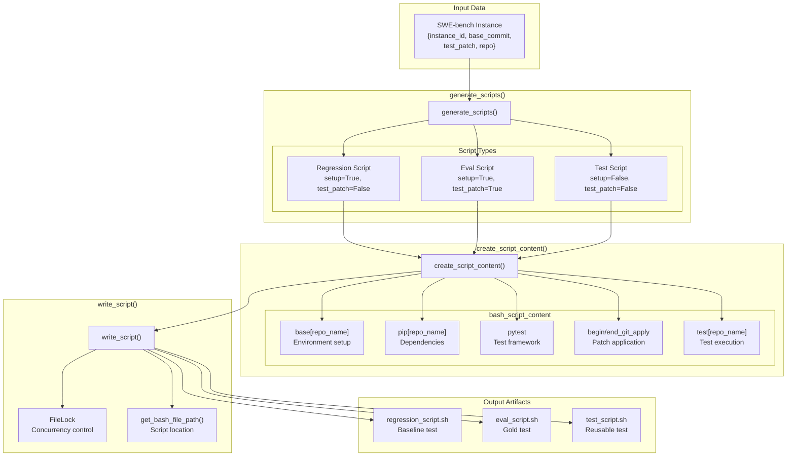
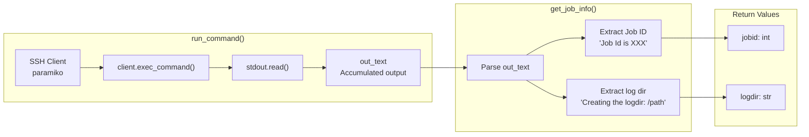
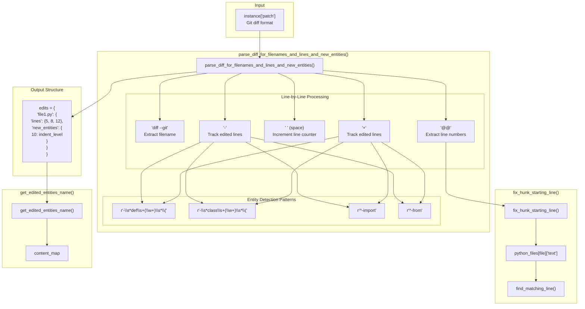
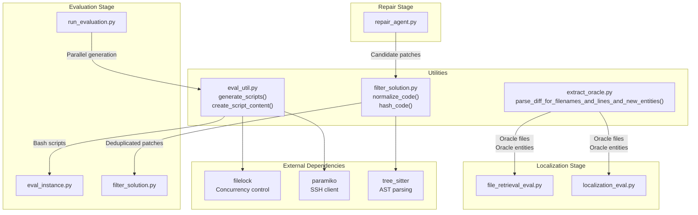

<!-- source: DeepWiki mcp.deepwiki.com · repo NVIDIA/Nemotron-CORTEXA · page 7 Utilities and Supporting Components · fetched 2026-10-26 -->

# Utilities and Supporting Components

<details>
<summary>Relevant source files</summary>

The following files were used as context for generating this wiki page:

- [src/cortexa/evaluate/eval_util.py](src/cortexa/evaluate/eval_util.py)
- [src/cortexa/evaluate/extract_oracle.py](src/cortexa/evaluate/extract_oracle.py)

</details>


## Purpose and Scope

This page documents the utility modules, helper functions, and supporting scripts that provide essential services to the core Nemotron-CORTEXA components. These utilities handle cross-cutting concerns such as script generation, SSH-based remote execution, patch parsing for ground truth extraction, and code normalization for deduplication.

For information about the main evaluation orchestration system that uses these utilities, see [Evaluation Stage](#4). For details on solution filtering that relies on code normalization, see [Solution Filtering and Selection](#4.3).

---

## Overview

The utility layer consists of three primary functional areas:

| Component | Module | Primary Purpose |
|-----------|--------|-----------------|
| Evaluation Utilities | `eval_util.py` | Script generation, SSH command execution, SLURM job management |
| Oracle Extraction | `extract_oracle.py` | Parsing patches to identify ground truth files and entities |
| Code Normalization | `filter_solution.py` | AST-based normalization and hashing for deduplication |

These utilities are consumed by higher-level components in the localization, repair, and evaluation stages, providing reusable functionality that would otherwise be duplicated across multiple modules.

---

## Evaluation Utilities

The `eval_util.py` module provides essential services for the evaluation stage, particularly for script generation and remote job execution.

### Script Generation Architecture



**Sources**: [src/cortexa/evaluate/eval_util.py:74-136]()

### Script Content Generation

The `create_script_content()` function assembles bash scripts by concatenating repository-specific command templates from `bash_script_content` in `repo_foundary.py`. The function supports three modes controlled by parameters:

| Parameter | Purpose | Effect |
|-----------|---------|--------|
| `setup` | Include environment setup | Adds base environment, pip install, pytest install, git checkout |
| `test_patch` | Apply gold test patch | Includes `instance['test_patch']` within git apply block |
| `patch` | Apply candidate solution | Includes provided patch within git apply block |

The function performs special handling for Django test files by converting filesystem paths to dotted module paths (e.g., `tests/models/test_user.py` → `models.test_user`).

**Sources**: [src/cortexa/evaluate/eval_util.py:90-119]()

### SSH Command Execution



The `run_command()` function provides a simple wrapper around SSH command execution, reading stdout until completion. The `get_job_info()` function parses the output to extract SLURM job metadata, specifically looking for two patterns in the text:
- `"Job Id is"` followed by an integer
- `"Creating the logdir:"` followed by a directory path

These utilities enable remote evaluation execution on SLURM clusters, which is essential for distributed evaluation workloads.

**Sources**: [src/cortexa/evaluate/eval_util.py:39-72]()

### File Locking for Concurrent Access

The `write_script()` and `read_script()` functions use `FileLock` from the `filelock` library to ensure thread-safe file operations:

```python
with FileLock(script_path + ".lock"):
    with open(script_path, 'w') as script_file:
        script_file.write(content)
```

This is critical when multiple worker processes in `run_evaluation.py` might attempt to generate scripts for the same instance concurrently. The lock file (`{script_path}.lock`) is automatically created and removed by the `FileLock` context manager.

**Sources**: [src/cortexa/evaluate/eval_util.py:74-88]()

---

## Oracle Extraction

The `extract_oracle.py` module parses git diff patches to identify ground truth files and code entities that were modified in the original bug fix. This information is used to evaluate localization accuracy (see [Localization Evaluation Metrics](#2.3)).

### Patch Parsing Pipeline



**Sources**: [src/cortexa/evaluate/extract_oracle.py:37-102]()

### Entity Detection Logic

The parser identifies new or modified entities by matching regex patterns against diff lines. For each detected entity, it tracks:

1. **Entity name**: Captured from function/class definition patterns
2. **Line number**: The line where the entity definition appears
3. **Indent level**: Calculated as `len(line[1:]) - len(line[1:].lstrip())`

The indent level tracking ensures that when multiple entities are defined at the same line number (which can occur in complex diffs), the parser retains the entity with the **least indentation** (i.e., the outermost scope). This heuristic prioritizes top-level definitions over nested ones.

**Deduplication strategy**: The parser maintains a `names` set to track entity names already seen within a file. When an entity name appears in both a deletion (`-`) and addition (`+`) line, it's considered an **edit** rather than a new entity, and is removed from `new_entities`.

**Sources**: [src/cortexa/evaluate/extract_oracle.py:66-99]()

### Hunk Line Number Correction

Git diff hunk headers (e.g., `@@ -20,5 +25,8 @@`) specify starting line numbers, but these may not match the actual repository state due to:
- Whitespace differences
- Comment modifications not tracked in the patch
- Line ending inconsistencies

The `fix_hunk_starting_line()` function corrects misalignments by:

1. Checking if the current line number matches the expected content
2. Searching **forward** in the file for a matching line
3. Verifying the match by checking the next line as well
4. Falling back to **backward** search if forward search fails
5. Returning the original line number if no match is found

This correction is essential for accurate entity localization, as incorrect line numbers would cause the oracle extraction to identify wrong functions/classes.

**Sources**: [src/cortexa/evaluate/extract_oracle.py:104-128]()

### Oracle File Extraction

The main script at the bottom of `extract_oracle.py` processes the entire SWE-bench dataset to generate two oracle files:

| Output File | Content | Purpose |
|-------------|---------|---------|
| `instance_content_map_oracle_entity.jsonl` | Entity-level ground truth | Evaluate entity localization precision/recall |
| `instance_oracle_file.jsonl` | File-level ground truth | Evaluate file retrieval accuracy |

Each line in these JSONL files contains:
```json
{
  "instance_id": "django__django-12345",
  "content_map": { /* entity mappings */ },
  "oracle_files": ["django/core/models.py", ...]
}
```

These oracle files are consumed by `localization_eval.py` and `file_retrieval_eval.py` to compute precision, recall, and other IR metrics.

**Sources**: [src/cortexa/evaluate/extract_oracle.py:131-151]()

---

## Code Normalization

Code normalization is performed by functions in `filter_solution.py` to enable deduplication of semantically equivalent patches that differ only in formatting or variable naming. While the detailed implementation is documented in [Solution Filtering and Selection](#4.3), the key concept is:

**AST-based normalization**: Python code is parsed into an Abstract Syntax Tree (AST), identifiers are renamed to canonical forms (e.g., `var_1`, `var_2`), and the normalized AST is hashed to generate a unique fingerprint. Patches with identical fingerprints are considered duplicates and only one is retained.

This process is critical for reducing redundant evaluation work when the RepairAgent generates multiple patches with superficial differences.

**Sources**: Referenced in [Solution Filtering and Selection](#4.3)

---

## Integration with Core Components

The following diagram shows how utilities integrate with the main system pipeline:



**Sources**: [src/cortexa/evaluate/eval_util.py](), [src/cortexa/evaluate/extract_oracle.py]()

---

## Usage Patterns

### Generating Evaluation Scripts

To generate all three script types for an instance:

```python
from cortexa.evaluate.eval_util import generate_scripts

generate_scripts(instance, base_dir='/path/to/scripts')
```

This creates:
- `{base_dir}/{instance_id}_setup_regre.sh` - Regression baseline
- `{base_dir}/{instance_id}_setup.sh` - Evaluation with gold tests
- `{base_dir}/{instance_id}_test.sh` - Test execution only

**Sources**: [src/cortexa/evaluate/eval_util.py:121-136]()

### Extracting Oracle Information

To extract ground truth from a dataset:

```python
from cortexa.evaluate.extract_oracle import parse_diff_for_filenames_and_lines_and_new_entities
from cortexa.utils.preprocess_input import get_edited_entities_name

edits = parse_diff_for_filenames_and_lines_and_new_entities(instance_obj)
content_map = get_edited_entities_name(edits, instance_obj)
```

The `content_map` contains file → entity mappings that represent the ground truth for localization evaluation.

**Sources**: [src/cortexa/evaluate/extract_oracle.py:140-148]()

### SSH Command Execution

For remote SLURM job submission:

```python
from cortexa.evaluate.eval_util import run_command, get_job_info
import paramiko

client = paramiko.SSHClient()
client.connect(hostname, username=user)

out_text = run_command(client, 'sbatch submit_script.sh')
jobid, logdir = get_job_info(out_text)
```

**Sources**: [src/cortexa/evaluate/eval_util.py:39-72]()

---

## Key Design Decisions

### Repository-Specific Script Templates

The script generation system uses a dictionary `bash_script_content` in `repo_foundary.py` that maps repository names to command templates. This design allows:

1. **Framework flexibility**: Different test frameworks (pytest, Django test runner, Sympy)
2. **Environment customization**: Repository-specific pip install commands
3. **Path handling**: Django requires dotted module paths instead of file paths

The `repo_list` in `repo_foundary.py` defines supported repositories, and `create_script_content()` validates against this list to catch configuration errors early.

**Sources**: [src/cortexa/evaluate/eval_util.py:91-118]()

### Bidirectional Line Search

The `fix_hunk_starting_line()` function searches both forward and backward from the expected line number because:

1. **Forward search** handles cases where content was added before the patch location
2. **Backward search** handles cases where content was removed before the patch location
3. **Next-line verification** reduces false positives by confirming multi-line context

This bidirectional approach achieves high accuracy even when repository state doesn't perfectly match git diff expectations.

**Sources**: [src/cortexa/evaluate/extract_oracle.py:104-128]()

### Indent-Based Entity Priority

When multiple entities are detected at the same line number, the parser prioritizes the entity with **lowest indent level**. This handles nested definitions correctly:

```python
- def outer():
-     def inner():  # This would be discarded
-         pass
```

Only `outer` would be tracked as a new entity, avoiding noise from inner definitions that are part of the outer function's implementation.

**Sources**: [src/cortexa/evaluate/extract_oracle.py:74-76](), [src/cortexa/evaluate/extract_oracle.py:91-93]()

---

