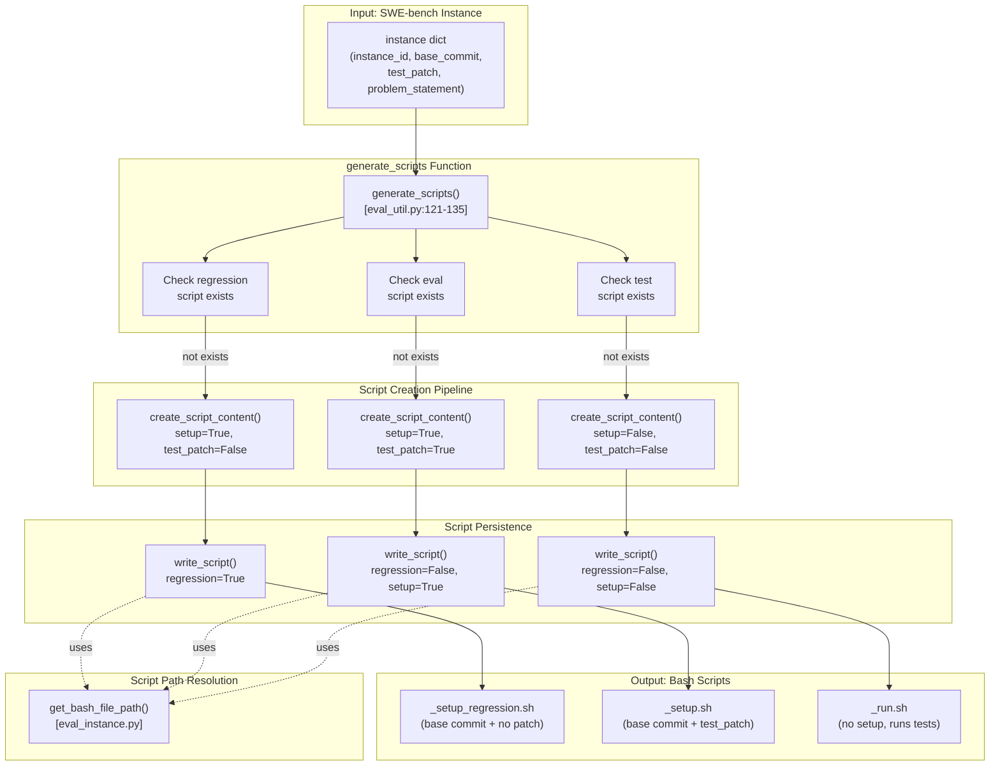
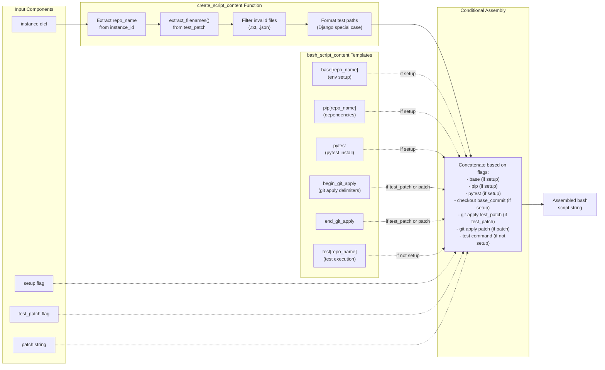
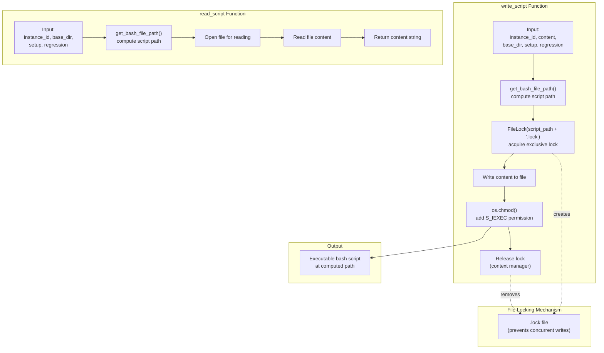
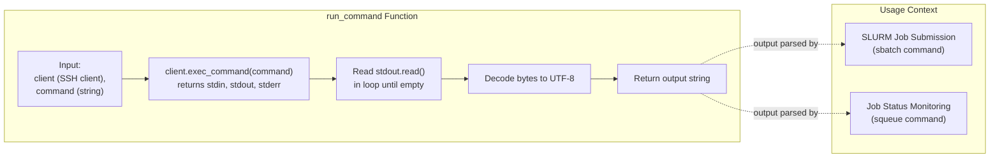
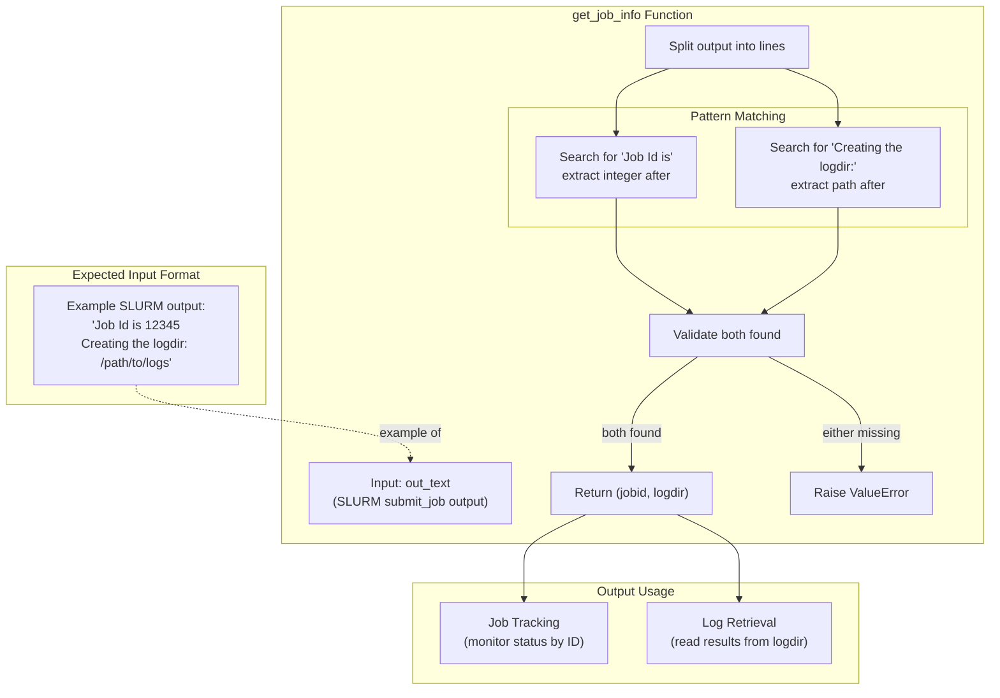
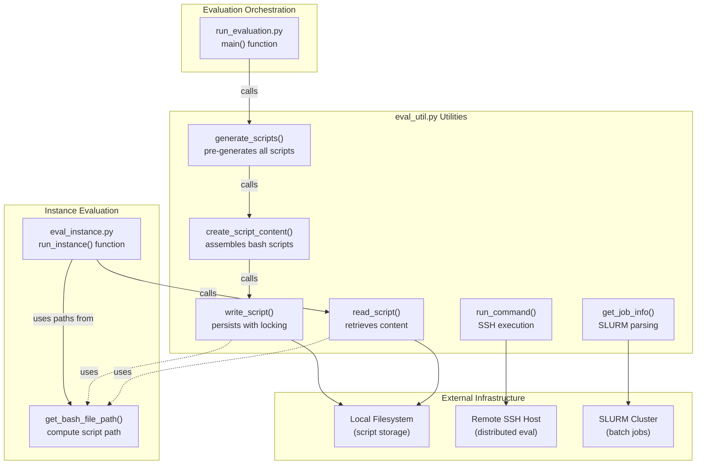

<!-- source: DeepWiki mcp.deepwiki.com · repo NVIDIA/Nemotron-CORTEXA · page 7.1 Evaluation Utilities · fetched 2026-10-26 -->

# Evaluation Utilities

<details>
<summary>Relevant source files</summary>

The following files were used as context for generating this wiki page:

- [src/cortexa/evaluate/eval_util.py](src/cortexa/evaluate/eval_util.py)

</details>


## Purpose and Scope

This document describes the utility functions in `eval_util.py` that support the evaluation orchestration process. These utilities handle three primary responsibilities: (1) generating bash test scripts for different evaluation modes, (2) executing remote commands via SSH for distributed evaluation, and (3) parsing SLURM job submission output for job tracking. For the high-level evaluation orchestration that uses these utilities, see [Evaluation Orchestration](#4.1). For the actual evaluation execution that runs the generated scripts, see [Instance Evaluation and Testing](#4.2).

**Sources**: [src/cortexa/evaluate/eval_util.py:1-142]()

---

## Overview

The `eval_util.py` module provides low-level utilities that abstract away infrastructure concerns from the evaluation orchestration layer. The module operates at the intersection of three execution environments: local filesystem for script persistence, SSH connections for remote execution, and SLURM clusters for job management.

### Core Functions

| Function | Purpose | Key Parameters |
|----------|---------|----------------|
| `generate_scripts` | Orchestrates generation of all three script types | `instance`, `base_dir` |
| `create_script_content` | Assembles bash script from repository-specific templates | `instance`, `setup`, `test_patch`, `patch` |
| `write_script` | Persists script to filesystem with executable permissions | `instance_id`, `content`, `base_dir`, `setup`, `regression` |
| `read_script` | Retrieves script content from filesystem | `instance_id`, `base_dir`, `setup`, `regression` |
| `run_command` | Executes command on remote host via SSH | `client`, `command` |
| `get_job_info` | Extracts job ID and log directory from SLURM output | `out_text` |

**Sources**: [src/cortexa/evaluate/eval_util.py:39-142]()

---

## Script Generation Architecture

The script generation system creates three types of bash scripts for each SWE-bench instance, corresponding to the evaluation modes documented in [Instance Evaluation and Testing](#4.2).



**Diagram: Script Generation Workflow**

The system generates three distinct script types per instance to support different evaluation phases:

1. **Regression Script** (`setup=True, regression=True`): Sets up environment at base commit without any patches, used to verify baseline test behavior
2. **Eval Script** (`setup=True, regression=False`): Sets up environment and applies test_patch, used for gold test evaluation
3. **Test Script** (`setup=False, regression=False`): Lightweight script that only runs tests, used after setup is complete

Scripts are generated once and cached on disk, checked via `os.path.exists()` to avoid redundant generation.

**Sources**: [src/cortexa/evaluate/eval_util.py:121-135]()

---

## Script Content Assembly

The `create_script_content` function assembles bash scripts by combining repository-specific templates from `repo_foundary.py` with instance-specific data.



**Diagram: Script Content Assembly Process**

### Repository-Specific Handling

The function handles Django test files specially by converting filesystem paths to Python module paths:

| Input Path | Output Format |
|------------|---------------|
| `tests/admin_views/test_actions.py` | `admin_views.test_actions` |
| `django/tests/forms/test_formsets.py` | `forms.test_formsets` |

This conversion occurs at [eval_util.py:98-105](), splitting on `/` and `.`, then joining with `.` to create pytest-compatible module paths.

### Git Apply Pattern

Scripts wrap patches in git apply delimiters to ensure proper patch application:

```bash
git apply -v - <<'EOF_114329324912'
diff --git a/file.py b/file.py
...
EOF_114329324912
```

These delimiters are provided by `bash_script_content['begin_git_apply']` and `bash_script_content['end_git_apply']`.

**Sources**: [src/cortexa/evaluate/eval_util.py:90-119](), [src/cortexa/utils/repo_foundary.py]()

---

## Script Persistence with File Locking

The `write_script` and `read_script` functions handle concurrent access to the filesystem using `FileLock` to prevent race conditions during parallel evaluation.



**Diagram: Script Persistence with Concurrency Control**

### File Lock Implementation

The `write_script` function uses `FileLock` from the `filelock` library to ensure atomic writes:

- Lock file: `{script_path}.lock`
- Lock is automatically released when the context manager exits
- Prevents corruption when multiple processes attempt to write the same script

The executable permission is set using `os.stat().st_mode | stat.S_IEXEC`, which preserves existing permissions while adding execute capability.

**Sources**: [src/cortexa/evaluate/eval_util.py:74-88]()

---

## SSH Command Execution

The `run_command` function provides a simple wrapper around Paramiko SSH client execution, capturing stdout for job submission and monitoring.



**Diagram: SSH Command Execution Flow**

The function blocks until the command completes and all output is captured. The output is decoded as UTF-8 text, which is suitable for parsing SLURM job submission responses and status commands.

**Implementation Detail**: The function uses a while loop with `stdout.read()` to consume output incrementally, concatenating decoded chunks into a single string. This approach handles large outputs without loading everything into memory at once.

**Sources**: [src/cortexa/evaluate/eval_util.py:62-71]()

---

## SLURM Job Management

The `get_job_info` function parses the output from SLURM's `submit_job` command to extract job tracking information.



**Diagram: SLURM Job Information Extraction**

### Parsing Logic

The function implements a simple line-by-line search for two specific patterns:

| Pattern | Extraction Method | Example |
|---------|------------------|---------|
| `"Job Id is"` | Extract last token as integer | `"Job Id is 12345"` → `12345` |
| `"Creating the logdir:"` | Extract last token as path | `"Creating the logdir: /logs"` → `"/logs"` |

### Error Handling

The function validates that both job ID and log directory are found:
- Missing job ID: Logs the full output text to `logging.error()` and raises `ValueError("No Job ID found!")`
- Missing log directory: Raises `ValueError("No slurm log dir found!")`

This strict validation ensures that job submission succeeded before proceeding with evaluation.

**Sources**: [src/cortexa/evaluate/eval_util.py:39-59]()

---

## Integration with Evaluation Pipeline

The utilities in `eval_util.py` are used by higher-level components in the evaluation pipeline:



**Diagram: Integration with Evaluation Components**

### Main Entry Point

The module can be executed directly to pre-generate scripts for all instances in SWE-bench_Verified:

```python
if __name__ == "__main__":
    dataset = load_dataset('princeton-nlp/SWE-bench_Verified', split='test')
    base_dir = f'{os.path.dirname(os.path.dirname(get_root_path()))}/eval_scripts'
    os.makedirs(base_dir, exist_ok=True)
    for instance in dataset:
        generate_scripts(instance, base_dir)
```

This pre-generation approach allows scripts to be created once and reused across multiple evaluation runs, reducing startup latency.

**Sources**: [src/cortexa/evaluate/eval_util.py:137-142](), [src/cortexa/evaluate/eval_instance.py](), [src/cortexa/evaluate/run_evaluation.py]()

---

## Dependencies and Imports

The module relies on the following external components:

| Module | Purpose | Key Imports |
|--------|---------|-------------|
| `cortexa.utils.util` | General utilities | `extract_filenames`, `get_root_path` |
| `cortexa.utils.repo_foundary` | Repository-specific templates | `bash_script_content`, `default_base_test_content`, `repo_list` |
| `cortexa.evaluate.eval_instance` | Path computation | `get_bash_file_path` |
| `filelock` | Concurrency control | `FileLock` |
| `datasets` | HuggingFace datasets | `load_dataset` |

The `bash_script_content` dictionary in `repo_foundary.py` provides the repository-specific bash templates that are assembled by `create_script_content`. The `repo_list` defines supported repositories (Django, SymPy, etc.).

**Sources**: [src/cortexa/evaluate/eval_util.py:16-34]()

---

