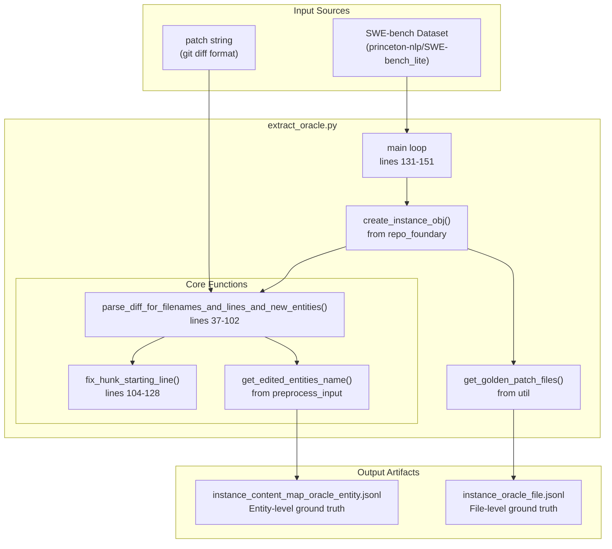
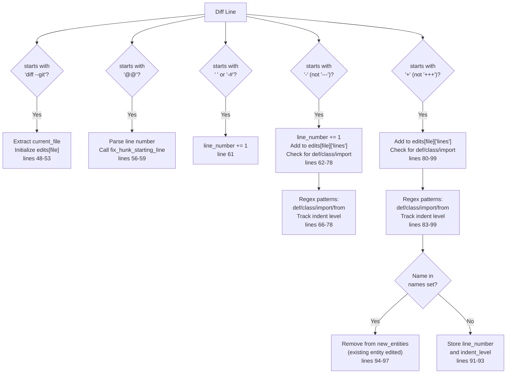
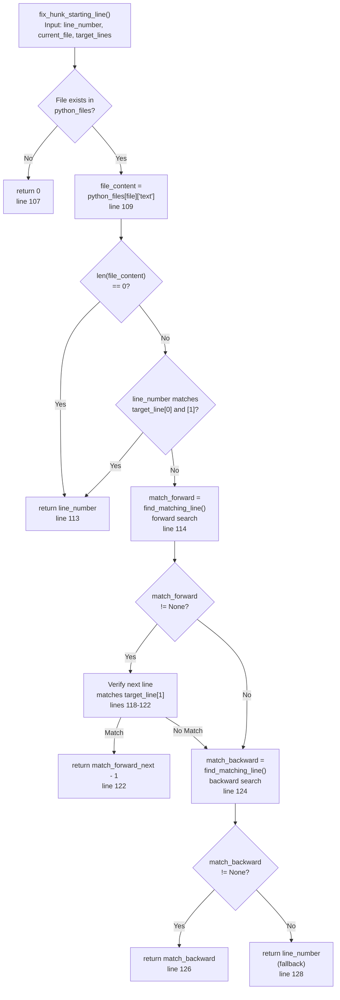
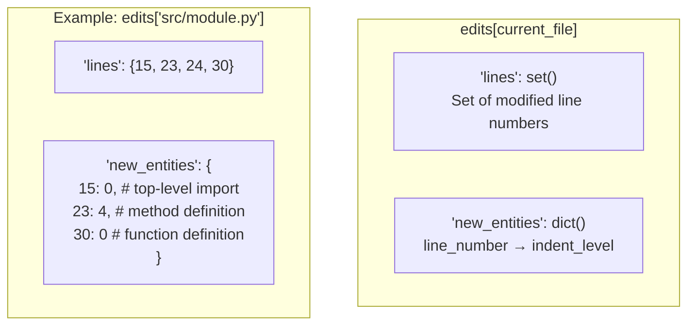
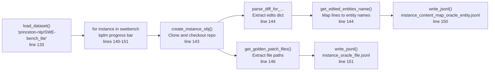
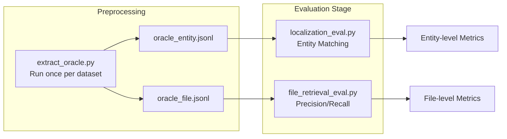

<!-- source: DeepWiki mcp.deepwiki.com · repo NVIDIA/Nemotron-CORTEXA · page 7.2 Oracle Extraction · fetched 2026-10-26 -->

# Oracle Extraction

<details>
<summary>Relevant source files</summary>

The following files were used as context for generating this wiki page:

- [src/cortexa/evaluate/extract_oracle.py](src/cortexa/evaluate/extract_oracle.py)

</details>


## Purpose and Scope

The oracle extraction system parses ground truth patches from SWE-bench datasets to identify which files and code entities (functions, classes) were modified in the official bug fixes. This extracted information serves as the evaluation baseline for measuring the accuracy of the Localization Stage (see [Localization Evaluation Metrics](#2.3)).

The system produces two types of oracle data:
- **File-level oracles**: List of files touched by the ground truth patch
- **Entity-level oracles**: Specific functions, classes, and import statements that were added, removed, or modified

This module does **not** handle evaluation of generated patches. For patch evaluation and filtering, see [Solution Filtering and Selection](#4.3).

---

## System Overview

The oracle extraction process transforms raw patch strings from SWE-bench instances into structured representations suitable for evaluation metrics. The system reads git diff format patches, identifies syntactic patterns (function/class definitions, imports), and outputs JSONL files mapping instance IDs to their oracle entities and files.



**Sources**: [src/cortexa/evaluate/extract_oracle.py:1-151]()

---

## Patch Parsing Algorithm

The `parse_diff_for_filenames_and_lines_and_new_entities()` function implements a line-by-line state machine parser for unified diff format. The parser tracks three types of information:

| Information Type | Storage Structure | Purpose |
|-----------------|-------------------|---------|
| Modified lines | `edits[file]['lines']` (set) | Line numbers with content changes |
| New entities | `edits[file]['new_entities']` (dict) | Line number → indent level mapping |
| Entity names | `names` (set) | Track duplicate function/class names |

### Diff Line Classification



**Sources**: [src/cortexa/evaluate/extract_oracle.py:37-102]()

### Entity Detection Patterns

The parser uses regular expressions to identify four types of code constructs:

```python
# Function definitions (group captures name)
r'-\s*def\s+(\w+)\s*\('   # Deleted functions
r'\+\s*def\s+(\w+)\s*\('   # Added functions

# Class definitions (group captures name)
r'-\s*class\s+(\w+)\s*\('  # Deleted classes
r'\+\s*class\s+(\w+)\s*\('  # Added classes

# Import statements (no group capture)
r'^-import'                # Deleted imports
r'^\+import'               # Added imports
r'^-from'                  # Deleted from-imports
r'^\+from'                 # Added from-imports
```

The indent level calculation `len(line[1:]) - len(line[1:].lstrip())` determines code nesting depth, prioritizing entities at lower indentation (outer scope).

**Sources**: [src/cortexa/evaluate/extract_oracle.py:66-99]()

---

## Hunk Line Number Correction

Git diff hunks specify line numbers with the format `@@ -<old_start>,<old_count> +<new_start>,<new_count> @@`. However, these line numbers may be incorrect if the base commit differs from the expected state. The `fix_hunk_starting_line()` function corrects misaligned line numbers by searching for matching content.



**Sources**: [src/cortexa/evaluate/extract_oracle.py:104-128]()

### Search Strategy

The correction algorithm employs a two-phase approach:

1. **Forward search** [lines 114-122](): Searches from `line_number + 1` to end of file, verifying both the target line and the subsequent line match
2. **Backward search** [lines 124-126](): Searches from `line_number - 1` to start of file as fallback

The forward search includes additional validation by checking `target_line_content[1]` to ensure it's an unchanged line (starts with space) and matches the line after the found position.

**Sources**: [src/cortexa/evaluate/extract_oracle.py:104-128]()

---

## Data Structures

### Edits Dictionary Structure



The `edits` dictionary uses file paths as keys (relative to repository root). For each file:

- **`lines`** (set of int): Line numbers containing modifications (additions or deletions of non-empty, non-comment-only content)
- **`new_entities`** (dict[int, int]): Maps line numbers where new entities begin to their indentation levels. Lower indentation values indicate outer scope.

The parser maintains only the entity at the **least indent level** per line number [lines 74-76, 91-93](), ensuring top-level definitions take precedence.

**Sources**: [src/cortexa/evaluate/extract_oracle.py:41-52](), [src/cortexa/evaluate/extract_oracle.py:74-76](), [src/cortexa/evaluate/extract_oracle.py:91-93]()

---

## Output Generation

The main execution block processes all instances in a SWE-bench dataset and generates two oracle files in JSONL format.

### Processing Pipeline



**Sources**: [src/cortexa/evaluate/extract_oracle.py:131-151]()

### Output File Schemas

#### instance_content_map_oracle_entity.jsonl

Each line contains:
```json
{
  "instance_id": "django__django-12345",
  "content_map": {
    "django/core/handlers/base.py": {
      "load_middleware": {...},
      "get_response": {...}
    }
  }
}
```

The `content_map` structure is produced by `get_edited_entities_name()` from [src/cortexa/utils/preprocess_input.py](), which resolves line numbers to actual entity names.

**Sources**: [src/cortexa/evaluate/extract_oracle.py:147-150]()

#### instance_oracle_file.jsonl

Each line contains:
```json
{
  "instance_id": "django__django-12345",
  "oracle_files": [
    "django/core/handlers/base.py",
    "django/core/handlers/wsgi.py"
  ]
}
```

File paths include the repository top folder prefix (e.g., `django/`) as determined by `repo_to_top_folder` mapping.

**Sources**: [src/cortexa/evaluate/extract_oracle.py:145-151]()

---

## Integration with Evaluation Pipeline

The oracle extraction module runs as a preprocessing step before localization evaluation. The generated oracle files are consumed by:

1. **File Retrieval Evaluation** [file_retrieval_eval.py](): Compares `oracle_files` against ranked file lists from embedding-based retrieval
2. **Localization Evaluation** [localization_eval.py](): Matches `content_map` entities against LocalizeAgent outputs



The oracle files are typically stored in `logs/swebench_lite_info/` or similar directories [lines 136-137]() and remain static across multiple evaluation runs.

**Sources**: [src/cortexa/evaluate/extract_oracle.py:136-137]()

---

## Key Dependencies

| Function/Module | Source | Purpose |
|----------------|--------|---------|
| `create_instance_obj()` | [cortexa.utils.repo_foundary]() | Creates instance objects with cloned repository access |
| `repo_to_top_folder` | [cortexa.utils.repo_foundary]() | Maps repository names to top-level folder paths |
| `get_edited_entities_name()` | [cortexa.utils.preprocess_input]() | Resolves line numbers to entity names using AST |
| `find_matching_line()` | [cortexa.utils.preprocess_input]() | Searches for matching content in file |
| `get_golden_patch_files()` | [cortexa.utils.util]() | Extracts file list from patch string |
| `write_jsonl()` | [cortexa.utils.util]() | Appends JSON objects to JSONL files |

**Sources**: [src/cortexa/evaluate/extract_oracle.py:22-34]()

---

