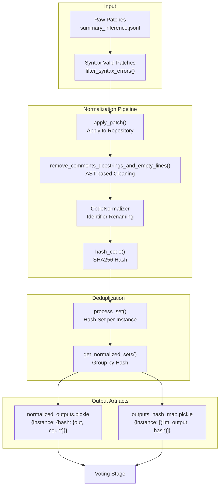
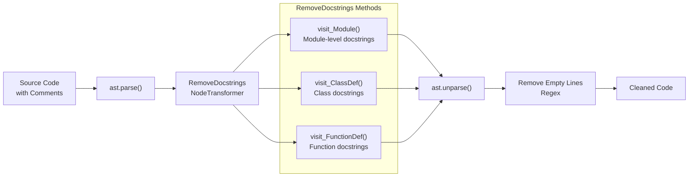
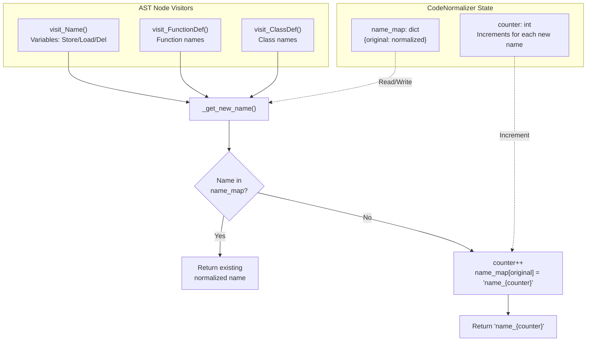
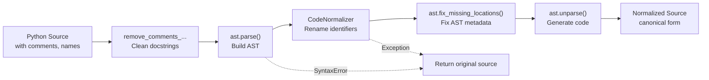
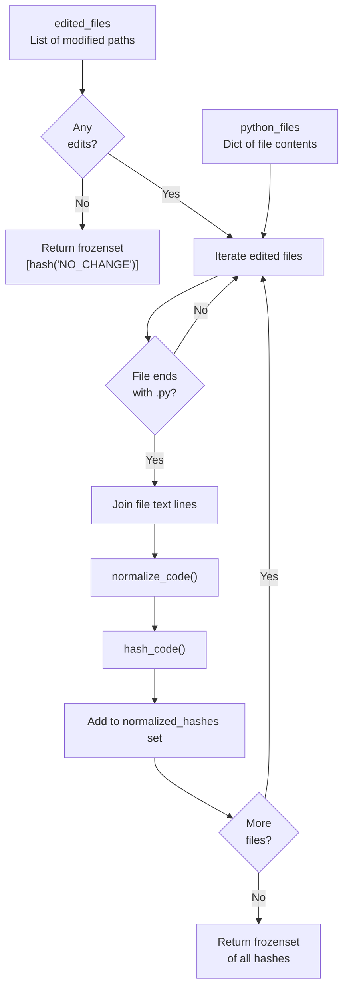
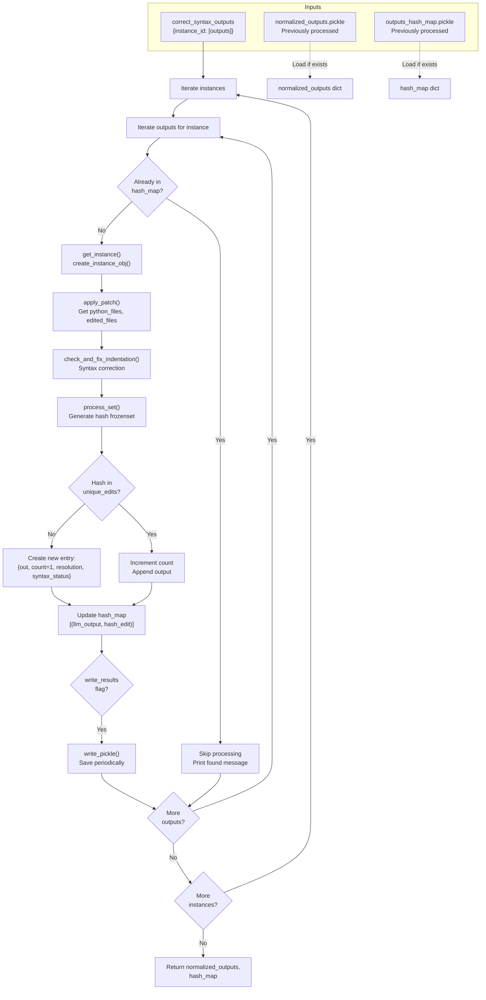
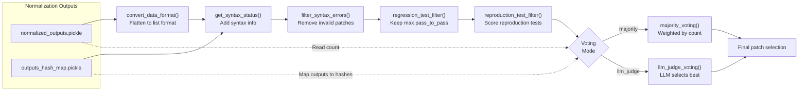
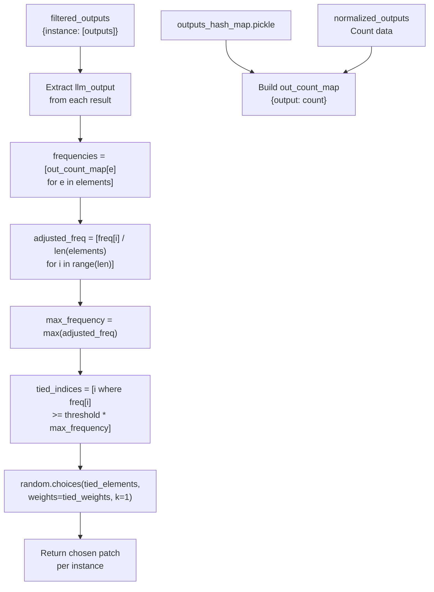

<!-- source: DeepWiki mcp.deepwiki.com · repo NVIDIA/Nemotron-CORTEXA · page 7.3 Code Normalization · fetched 2026-10-26 -->

# Code Normalization

<details>
<summary>Relevant source files</summary>

The following files were used as context for generating this wiki page:

- [src/cortexa/evaluate/filter_solution.py](src/cortexa/evaluate/filter_solution.py)

</details>


## Purpose and Scope

This document describes the code normalization system used in Nemotron-CORTEXA for deduplicating generated patches. Code normalization transforms syntactically different but semantically equivalent code patches into a canonical form, enabling the system to identify when multiple generation attempts produce the same solution with different variable names, comments, or formatting.

The normalization process is a critical component of the solution filtering pipeline (see [Solution Filtering and Selection](#4.3)) that runs after patch generation but before final voting. It reduces the candidate set from potentially hundreds of patches to a smaller set of unique solutions, improving both efficiency and accuracy of the final selection.

**Sources**: [src/cortexa/evaluate/filter_solution.py:162-301]()

---

## Normalization Pipeline Overview

The normalization system operates on patches that have already passed syntax validation. It transforms each patch through a multi-stage pipeline that removes cosmetic differences and generates a unique hash for each structurally distinct solution.



**Sources**: [src/cortexa/evaluate/filter_solution.py:220-301](), [src/cortexa/evaluate/filter_solution.py:162-177]()

---

## AST-Based Code Transformation

The normalization process uses Python's Abstract Syntax Tree (AST) module to perform two key transformations that eliminate cosmetic differences while preserving program structure.

### Comment and Docstring Removal

The `RemoveDocstrings` class removes all documentation elements from the code:



The `RemoveDocstrings` transformer visits three node types:
- **`visit_Module`**: Removes module-level docstrings at the start of files
- **`visit_ClassDef`**: Removes docstrings at the beginning of class definitions
- **`visit_FunctionDef`**: Removes docstrings at the beginning of function definitions

All docstrings are detected as `ast.Expr` nodes containing `ast.Str` values as the first statement in the body.

**Sources**: [src/cortexa/evaluate/filter_solution.py:50-96](), [src/cortexa/evaluate/filter_solution.py:60-80]()

### Identifier Normalization

The `CodeNormalizer` class renames all identifiers to canonical forms, eliminating differences in variable, function, and class names:



The normalization process transforms identifiers as follows:
- **Variables**: All variable names in `Store`, `Load`, or `Del` contexts are renamed to `name_1`, `name_2`, etc.
- **Functions**: All function definitions get canonical names
- **Classes**: All class definitions get canonical names

The `name_map` ensures that multiple references to the same identifier receive the same normalized name, preserving program semantics.

**Sources**: [src/cortexa/evaluate/filter_solution.py:100-128](), [src/cortexa/evaluate/filter_solution.py:109-113]()

---

## Normalization Function Pipeline

The `normalize_code` function combines both transformations:

| Step | Function | Purpose |
|------|----------|---------|
| 1 | `remove_comments_docstrings_and_empty_lines()` | Remove all documentation and blank lines |
| 2 | `ast.parse()` | Parse cleaned code into AST |
| 3 | `CodeNormalizer().visit()` | Rename all identifiers |
| 4 | `ast.fix_missing_locations()` | Fix AST node locations |
| 5 | `ast.unparse()` | Convert normalized AST back to source code |



If normalization fails due to syntax errors or other exceptions, the function returns the original source code to ensure the pipeline can continue.

**Sources**: [src/cortexa/evaluate/filter_solution.py:162-173]()

---

## Hashing and Deduplication

### Hash Generation

The `hash_code` function generates a SHA256 hash of the normalized code string:

```python
# Conceptual implementation
def hash_code(code):
    return hashlib.sha256(code.encode('utf-8')).hexdigest()
```

This produces a 64-character hexadecimal string that uniquely identifies the code structure. Two patches with identical normalized code will produce identical hashes.

**Sources**: [src/cortexa/evaluate/filter_solution.py:175-177]()

### File Set Processing

The `process_set` function normalizes all edited files in a patch and creates a frozen set of hashes:



The function produces a `frozenset` (immutable set) of hashes, one per edited file. This set serves as the unique identifier for the entire patch. Using a frozen set ensures:
- **Order independence**: Files can be processed in any order
- **Hashability**: The set itself can be used as a dictionary key
- **Immutability**: The identifier cannot be modified after creation

**Sources**: [src/cortexa/evaluate/filter_solution.py:180-193]()

---

## Integration with Filtering Pipeline

The `get_normalized_sets` function orchestrates the normalization process for all patches:



### Key Data Structures

**normalized_outputs** structure:
```python
{
    instance_id: {
        hash_frozenset: {
            'out': [output1, output2, ...],  # All outputs with this hash
            'count': int,                     # Number of occurrences
            'resolution': [str, ...],         # Resolution status per output
            'syntax_status': [str, ...]       # Syntax check status per output
        },
        ...
    },
    ...
}
```

**hash_map** structure:
```python
{
    instance_id: [
        (llm_output_str, hash_frozenset),  # Map from raw output to hash
        ...
    ],
    ...
}
```

The `hash_map` enables quick lookup of previously processed outputs, while `normalized_outputs` groups all equivalent patches together for voting.

**Sources**: [src/cortexa/evaluate/filter_solution.py:220-301](), [src/cortexa/evaluate/filter_solution.py:236-299]()

---

## Normalization Usage in Filtering

The normalization artifacts are consumed by multiple filtering stages:



### Syntax Status Integration

The `get_syntax_status` function enriches inference results with normalization metadata:

| Field | Source | Purpose |
|-------|--------|---------|
| `resolution` | `normalized_outputs[instance][hash]['resolution'][0]` | Indicates if patch was applied successfully |
| `syntax_status` | `normalized_outputs[instance][hash]['syntax_status'][0]` | Contains syntax error messages if any |

The function matches each `llm_output` in inference results to its corresponding hash using the `hash_map`, then looks up the normalization results. If a match is not found, it assigns `resolution='NO_CHANGE'`.

**Sources**: [src/cortexa/evaluate/filter_solution.py:304-324]()

### Majority Voting with Normalization

The `majority_voting` function uses normalization counts to weight candidate patches:



The voting algorithm:
1. Maps each `llm_output` to its occurrence count across all generation runs
2. Computes adjusted frequency as `count / total_elements`
3. Finds all patches within `threshold * max_frequency` (default threshold=0.5)
4. Randomly selects from tied patches with probability proportional to their count

This approach gives higher weight to patches that were generated multiple times with different random seeds, suggesting they represent more stable solutions.

**Sources**: [src/cortexa/evaluate/filter_solution.py:489-518]()

---

## Special Cases and Error Handling

### Empty Edit Handling

When a patch produces no file modifications, `process_set` returns a special hash:
```python
if not edited_files:
    return frozenset([hash_code("NO_CHANGE")])
```

This ensures that no-op patches are grouped together and can be filtered out later.

**Sources**: [src/cortexa/evaluate/filter_solution.py:183-184]()

### Syntax Error Recovery

When `normalize_code` encounters parsing errors, it returns the original source:
```python
except Exception as e:
    print(f"Error normalizing code: {e}")
    return source
```

This fail-safe ensures that syntactically invalid code (which should have been filtered earlier) doesn't crash the normalization pipeline.

**Sources**: [src/cortexa/evaluate/filter_solution.py:172-173]()

### Cache Checking

The `get_normalized_sets` function checks if each output has already been processed:
```python
for out_llm, hash_edit in hash_map[instance]:
    if out_llm.strip() == output['llm_output'].strip():
        found = True
        break
```

This enables incremental processing when new patches are generated, avoiding re-normalization of previously seen outputs.

**Sources**: [src/cortexa/evaluate/filter_solution.py:244-250]()

---

## Performance Characteristics

### Computational Cost

The normalization process is computationally expensive:

| Operation | Complexity | Cost Factor |
|-----------|-----------|-------------|
| AST parsing | O(n) where n = code length | Python's AST parser |
| AST traversal | O(nodes) | Multiple passes for transformations |
| AST unparsing | O(n) | Code regeneration |
| SHA256 hashing | O(n) | Cryptographic hash |

For a typical patch with 100-500 lines across multiple files, normalization takes 10-100ms per patch. With hundreds of patches per instance, this can add several seconds to minutes to the filtering pipeline.

### Caching Strategy

The system uses pickle files to cache normalization results:
- **`normalized_outputs.pickle`**: Persisted after each instance completes
- **`outputs_hash_map.pickle`**: Persisted after each instance completes
- **Incremental updates**: The `write_results=True` flag enables periodic persistence

This caching enables:
- **Resumption**: If the process crashes, it can resume from the last saved state
- **Reuse**: Subsequent filter runs with different voting modes reuse normalization results
- **Inspection**: Developers can examine the pickle files to debug normalization issues

**Sources**: [src/cortexa/evaluate/filter_solution.py:297-299](), [src/cortexa/evaluate/filter_solution.py:231-234]()

---

## Example Normalization Flow

Consider two patches that differ only in variable naming:

**Patch 1**:
```python
def fix_bug(data):
    """Fix the bug"""
    result = process(data)
    return result
```

**Patch 2**:
```python
def fix_bug(input_data):
    # Fix the bug
    output = process(input_data)
    return output
```

**Normalization process**:

1. **Remove comments/docstrings**: Both become:
   ```python
   def fix_bug(param):
       result = process(param)
       return result
   ```

2. **Rename identifiers**: Both become:
   ```python
   def name_1(name_2):
       name_3 = name_4(name_2)
       return name_3
   ```

3. **Hash**: Both produce the same SHA256 hash: `a3f8c9e...`

4. **Group**: Both patches are grouped under the same hash in `normalized_outputs`, with `count=2`

This deduplication reduces the candidate set and increases the confidence that this solution structure is stable across multiple generation attempts.

**Sources**: [src/cortexa/evaluate/filter_solution.py:50-193]()

---

