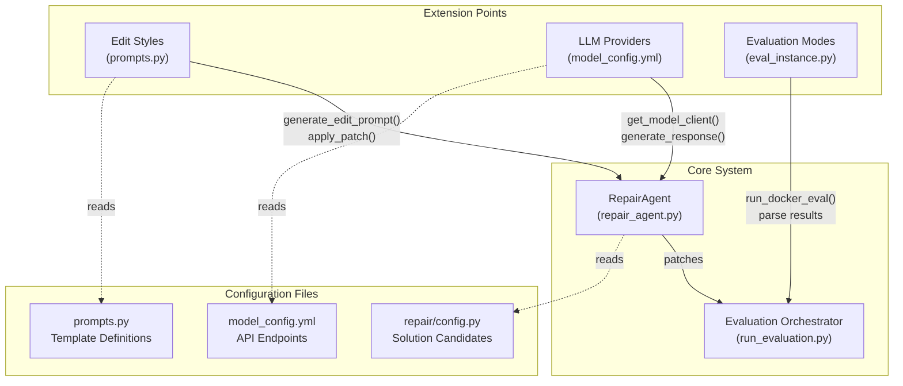
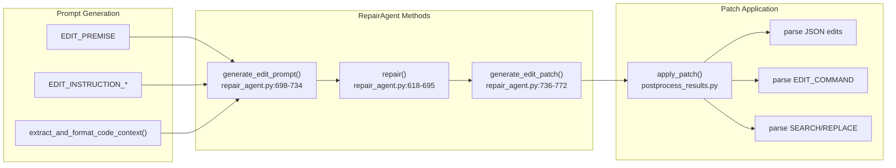
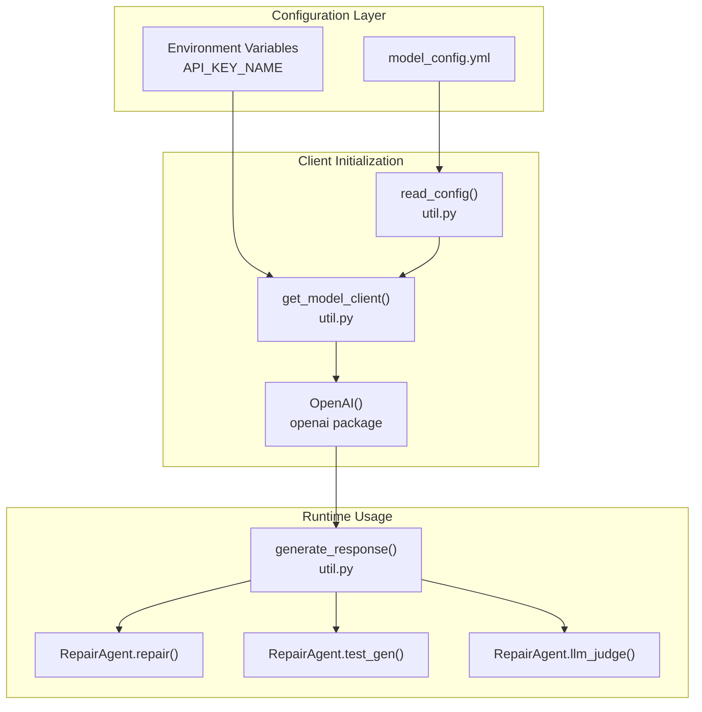
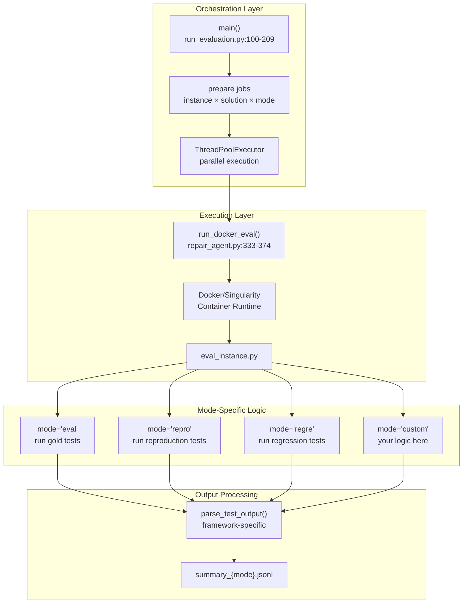

<!-- source: DeepWiki mcp.deepwiki.com · repo NVIDIA/Nemotron-CORTEXA · page 8 Extending Nemotron-CORTEXA · fetched 2026-10-26 -->

# Extending Nemotron-CORTEXA

<details>
<summary>Relevant source files</summary>

The following files were used as context for generating this wiki page:

- [model_config.yml](model_config.yml)
- [src/cortexa/repair/prompts.py](src/cortexa/repair/prompts.py)
- [src/cortexa/repair/repair_agent.py](src/cortexa/repair/repair_agent.py)

</details>


This document provides technical guidance for developers who want to extend Nemotron-CORTEXA with custom functionality. The system is designed with three primary extension points: **edit styles** for patch generation, **LLM providers** for model integration, and **evaluation modes** for testing strategies. Each extension point has well-defined interfaces and configuration patterns that enable customization without modifying core logic.

For information about configuring existing features, see [Configuration and Setup](#5). For details on the core repair and evaluation systems, see [Repair Stage](#3) and [Evaluation Stage](#4).

## Extension Architecture Overview

The following diagram shows the three main extension points and their integration with the core system:



**Sources**: [src/cortexa/repair/repair_agent.py](), [src/cortexa/repair/prompts.py](), [model_config.yml]()

---

## Adding New Edit Styles

Edit styles define the format and syntax that LLMs use to specify code modifications. Nemotron-CORTEXA supports three built-in styles: `JSON`, `EDIT_COMMAND`, and `SEARCH_REPLACE`. This section explains how to add custom edit styles.

### Edit Style Pipeline

The edit style pipeline involves three stages: prompt generation, LLM response, and patch application. The following diagram shows how these components interact:



**Sources**: [src/cortexa/repair/repair_agent.py:698-772](), [src/cortexa/repair/prompts.py:16-194](), [src/cortexa/utils/postprocess_results.py]()

### Step 1: Define Prompt Template

Add a new prompt instruction template to `prompts.py`. The template must specify the exact format the LLM should use for generating edits.

**Location**: [src/cortexa/repair/prompts.py]()

**Template Structure**:
- **Format specification**: Detailed syntax rules with examples
- **Field descriptions**: Explanation of required fields (filepath, line numbers, content)
- **Indentation rules**: Critical instructions about preserving whitespace
- **Constraints**: Line number ranges, content restrictions

**Example Template Pattern**:
```python
EDIT_INSTRUCTION_CUSTOM = """
<issue>
{problem_statement}
</issue>
<code>
{content}
</code>

[Define your custom edit format here]
Format specifications:
1. Field 1: description
2. Field 2: description
...

Important Instructions:
1. Preserve Indentation: [instructions]
2. Correct Format: [instructions]
...

Wrap the edit commands in ```python...``` blocks."""
```

**Key Requirements**:
- Template must accept `{problem_statement}` and `{content}` placeholders
- Must include clear indentation preservation instructions
- Should specify delimiters for parsing (e.g., code blocks, JSON markers)

**Sources**: [src/cortexa/repair/prompts.py:22-194]()

### Step 2: Extend Prompt Generation Logic

Modify the `generate_edit_prompt()` method in `RepairAgent` to support your new edit style.

**Location**: [src/cortexa/repair/repair_agent.py:698-734]()

**Implementation Pattern**:
```python
def generate_edit_prompt(self, code_context, edit_style):
    issue_text = self.instance['problem_statement']
    
    if edit_style == 'JSON':
        edit_format_instruction = EDIT_INSTRUCTION_JSON
        add_line_numbers = True
    elif edit_style == 'EDIT_COMMAND':
        edit_format_instruction = EDIT_INSTRUCTION_COMMAND
        add_line_numbers = True
    elif edit_style == 'SEARCH_REPLACE':
        edit_format_instruction = EDIT_INSTRUCTION_SEARCH_REPLACE
        add_line_numbers = False
    elif edit_style == 'YOUR_CUSTOM_STYLE':  # Add this
        edit_format_instruction = EDIT_INSTRUCTION_CUSTOM
        add_line_numbers = [True/False based on your format]
    else:
        raise ValueError(f'Unknown edit style: {edit_style}')
```

**Configuration Parameters**:

| Parameter | Type | Description |
|-----------|------|-------------|
| `add_line_numbers` | bool | Whether to prefix code lines with line numbers in the prompt |
| `edit_format_instruction` | str | The prompt template from `prompts.py` |

**Sources**: [src/cortexa/repair/repair_agent.py:698-734]()

### Step 3: Implement Patch Parsing Logic

Add parsing logic to `apply_patch()` in the postprocessing utilities to extract edits from LLM responses in your custom format.

**Location**: [src/cortexa/utils/postprocess_results.py]()

**Parsing Requirements**:
- Extract structured edit commands from the LLM's text response
- Validate field completeness (filepath, start, end, content)
- Handle malformed responses gracefully (log errors, skip invalid edits)
- Return standardized edit objects compatible with `instance_obj.python_files`

**Integration Point**: The `apply_patch()` function is called from [src/cortexa/repair/repair_agent.py:754-757]()

**Expected Return Format**:
```python
python_files: Dict[str, Dict]  # Modified file contents
edited_files: List[str]         # List of filenames that were changed
```

**Sources**: [src/cortexa/repair/repair_agent.py:754-757](), [src/cortexa/utils/postprocess_results.py]()

### Step 4: Register in Configuration

Add your edit style to the candidate solutions in `repair/config.py` to make it available for evaluation.

**Location**: [src/cortexa/repair/config.py]()

**Example Configuration**:
```python
PATCH_GENERATION_CANDIDATES = [
    {
        'model': 'deepseek-v3-0324',
        'context': 'LA_DP_entity',
        'edit_style': 'YOUR_CUSTOM_STYLE',
        'temp': 0,
        'runs': 1,
        'retrieval_hits': 1
    },
    # ... other candidates
]
```

**Sources**: [src/cortexa/repair/config.py]()

### Edit Style Comparison Table

| Edit Style | Line Numbers | Format | Complexity | Parsing Robustness |
|------------|--------------|--------|------------|--------------------|
| `JSON` | Yes | Structured JSON objects | Medium | High |
| `EDIT_COMMAND` | Yes | Function call syntax | Low | High |
| `SEARCH_REPLACE` | No | Git-style diff blocks | High | Medium |
| `SEARCH_REPLACE_THINKING` | No | Diff with reasoning trace | High | Medium |

**Sources**: [src/cortexa/repair/prompts.py:22-194]()

---

## Integrating New LLM Providers

Nemotron-CORTEXA uses the OpenAI API client interface for LLM communication. Any provider that exposes an OpenAI-compatible endpoint can be integrated through configuration.

### LLM Provider Integration Flow



**Sources**: [model_config.yml](), [src/cortexa/utils/util.py](), [src/cortexa/repair/repair_agent.py:476-488]()

### Configuration Schema

**File**: [model_config.yml]()

**Structure**:
```yaml
provider-name:
  base_url: 'https://api.provider.com/v1'
  api_key_name: 'PROVIDER_API_KEY'
  model_name: 'provider/model-identifier'
```

**Field Descriptions**:

| Field | Type | Required | Description |
|-------|------|----------|-------------|
| `base_url` | string | Yes | OpenAI-compatible API endpoint URL |
| `api_key_name` | string | Yes | Environment variable name containing the API key |
| `model_name` | string | Yes | Model identifier passed to the API |

**Example - Existing Providers**:

```yaml
deepseek-v3-0324:
  base_url: 'https://api.deepseek.com'
  api_key_name: 'DEEPSEEK_API_KEY'
  model_name: 'deepseek-chat'

llama-3.3-70b-instruct:
  base_url: 'https://integrate.api.nvidia.com/v1'
  api_key_name: 'NVIDIA_API_KEY'
  model_name: 'nvdev/meta/llama-3.3-70b-instruct'
```

**Sources**: [model_config.yml:1-14]()

### API Compatibility Requirements

**OpenAI Client Interface**: The provider must support the standard OpenAI API format for chat completions.

**Required Endpoint**:
```
POST {base_url}/chat/completions
```

**Request Format**:
```json
{
  "model": "model_name",
  "messages": [
    {"role": "system", "content": "..."},
    {"role": "user", "content": "..."}
  ],
  "temperature": 0.0,
  "max_tokens": 4096
}
```

**Response Format**:
```json
{
  "choices": [
    {
      "message": {
        "content": "..."
      }
    }
  ]
}
```

**Integration Point**: The `get_model_client()` function in `util.py` creates an OpenAI client instance using the configuration:

```python
client = OpenAI(
    base_url=model_info['base_url'],
    api_key=os.environ[model_info['api_key_name']]
)
```

**Sources**: [src/cortexa/utils/util.py]()

### Environment Variables

Set the API key environment variable referenced in `api_key_name`:

```bash
export PROVIDER_API_KEY="your-api-key-here"
```

**Security Note**: Never commit API keys to the repository. The system reads keys from environment variables at runtime to maintain security.

**Sources**: [model_config.yml:3,8,13]()

### Adding to Solution Configurations

After adding a provider to `model_config.yml`, reference it in `repair/config.py` to use it for patch or test generation.

**Location**: [src/cortexa/repair/config.py]()

**Example**:
```python
PATCH_GENERATION_CANDIDATES = [
    {
        'model': 'your-new-provider',  # Must match model_config.yml key
        'context': 'LA_DP_entity',
        'edit_style': 'SEARCH_REPLACE',
        'temp': 0,
        'runs': 1,
        'retrieval_hits': 1
    }
]
```

**Sources**: [src/cortexa/repair/config.py]()

### Model Selection in RepairAgent

The `RepairAgent` class accepts model configuration and initializes the client during construction:

**Initialization**: [src/cortexa/repair/repair_agent.py:446-481]()

```python
def __init__(self, log_dir, repair_model_info, ...):
    if isinstance(repair_model_info, str):
        self.repair_model_name = repair_model_info
    else:
        self.repair_model_name = repair_model_info['model_name']
    
    self.repair_model = get_model_client(model_info=repair_model_info)
```

**Dynamic Model Updates**: [src/cortexa/repair/repair_agent.py:482-488]()

```python
def update_repair_model(self, model_info):
    if isinstance(model_info, str):
        self.model_name = model_info
    else:
        self.model_name = model_info['model_name']
    
    self.repair_model = get_model_client(model_info=model_info)
```

**Sources**: [src/cortexa/repair/repair_agent.py:446-488]()

---

## Custom Evaluation Modes

Nemotron-CORTEXA provides three built-in evaluation modes: `eval` (gold tests), `repro` (reproduction tests), and `regre` (regression tests). Custom modes can be added to test patches against different criteria.

### Evaluation Mode Architecture



**Sources**: [src/cortexa/evaluate/run_evaluation.py:100-209](), [src/cortexa/repair/repair_agent.py:333-374](), [src/cortexa/evaluate/eval_instance.py]()

### Step 1: Define Mode Logic

Add mode-specific logic to `eval_instance.py` to handle your custom testing strategy.

**Location**: [src/cortexa/evaluate/eval_instance.py]()

**Key Decision Points**:
- **Test script selection**: Which tests to run (gold tests, reproduction tests, or custom tests)
- **Test script location**: Where to find the test files
- **Exit code semantics**: How to interpret test results
- **Timeout values**: How long to wait for tests to complete

**Mode Comparison**:

| Mode | Test Source | Success Criteria | Typical Use Case |
|------|-------------|------------------|------------------|
| `eval` | Gold tests from dataset | All gold tests pass | Validate fix doesn't break existing tests |
| `repro` | Generated reproduction tests | Reproduction test passes (exit 0) | Verify issue is resolved |
| `regre` | Full test suite | All tests pass | Ensure no regressions introduced |
| `custom` | Your test source | Your criteria | Domain-specific validation |

**Implementation Pattern**:
```python
if mode == 'custom':
    # 1. Determine test script location
    test_script = get_custom_test_script(instance_id)
    
    # 2. Apply patch
    apply_patch_to_instance(instance_id, patch)
    
    # 3. Execute tests
    result = run_test_script(test_script)
    
    # 4. Parse output
    parsed_result = parse_custom_output(result)
    
    return parsed_result
```

**Sources**: [src/cortexa/evaluate/eval_instance.py]()

### Step 2: Extend Run Evaluation Orchestrator

Modify `run_evaluation.py` to include your custom mode in the evaluation job preparation.

**Location**: [src/cortexa/evaluate/run_evaluation.py:198-207]()

**Job Preparation Pattern**:
```python
for instance_id in instance_ids:
    for solution in solutions:
        for mode in ['eval', 'repro', 'regre', 'custom']:  # Add 'custom'
            jobs.append((instance_id, solution, mode))
```

**Parallel Execution**: Jobs are executed using `ThreadPoolExecutor` with configurable worker count.

**Sources**: [src/cortexa/evaluate/run_evaluation.py:198-207]()

### Step 3: Handle Container Execution

The `run_docker_eval()` function handles containerized test execution. Ensure your custom mode is passed correctly to the container.

**Location**: [src/cortexa/repair/repair_agent.py:333-374]()

**Command Construction**: [src/cortexa/repair/repair_agent.py:215-228]()

```python
def _build_cortexa_eval_command(work_dir, instance_id, dataset_name_or_path, 
                                patch_id, out_inf_file, out_eval_file, 
                                mode, repro_test_dir, dataset_info_file):
    return (
        f"python {work_dir}/evaluate/eval_instance.py "
        f"--instance_id={instance_id} "
        f"--dataset_name_or_path={dataset_name_or_path} "
        f"--patch_id={patch_id} "
        f"--out_inference_file={out_inf_file} "
        f"--out_eval_file={out_eval_file} "
        f"--script_dir={os.path.dirname(os.path.dirname(work_dir))}/eval_scripts "
        f"--mode={mode} "  # Your custom mode passed here
        f"--repro_test_dir={repro_test_dir} "
        f"--dataset_info_file={dataset_info_file}")
```

**Container Runtime Selection**: The function automatically selects Docker, Singularity, or SLURM based on available commands.

**Sources**: [src/cortexa/repair/repair_agent.py:215-374]()

### Step 4: Define Output Format

Create a dedicated output file for your custom mode following the naming convention `summary_{mode}.jsonl`.

**Location**: Results are written to `{log_dir}/summary_custom.jsonl`

**JSONL Schema**:
```json
{
  "instance_id": "repo-owner__repo-name-1234",
  "patch_id": "model_context_editstyle_temp_run",
  "mode": "custom",
  "status": "passed|failed|error",
  "exit_code": 0,
  "output": "test output text",
  "duration": 12.34,
  "custom_metrics": {
    "metric1": "value1",
    "metric2": "value2"
  }
}
```

**Field Descriptions**:

| Field | Type | Description |
|-------|------|-------------|
| `instance_id` | string | Dataset instance identifier |
| `patch_id` | string | Unique identifier for the patch candidate |
| `mode` | string | Evaluation mode name |
| `status` | string | Test result: passed, failed, or error |
| `exit_code` | int | Process exit code |
| `output` | string | Raw test output for debugging |
| `duration` | float | Execution time in seconds |
| `custom_metrics` | dict | Mode-specific evaluation metrics |

**Sources**: [src/cortexa/evaluate/eval_instance.py]()

### Step 5: Integrate with Filtering

Update the filtering logic to consume results from your custom mode when selecting the final patch.

**Location**: [src/cortexa/evaluate/filter_solution.py](), [src/cortexa/evaluate/run_filtering.py]()

**Filtering Integration Points**:
1. **Load custom mode results**: Read from `summary_custom.jsonl`
2. **Define scoring criteria**: How to weight your custom mode vs. other modes
3. **Update voting logic**: Incorporate custom mode results into solution selection

**Voting Mechanisms**:
- **Majority voting**: Select patch that passes most modes
- **LLM judge**: Use LLM to evaluate patches passing all modes
- **Custom heuristic**: Weight modes differently based on importance

**Sources**: [src/cortexa/evaluate/filter_solution.py](), [src/cortexa/evaluate/run_filtering.py]()

### Custom Mode Examples

**Example 1: Performance Testing Mode**
```
mode='perf'
- Run performance benchmarks
- Measure execution time before/after patch
- Fail if performance degrades beyond threshold
```

**Example 2: Security Testing Mode**
```
mode='security'
- Run static analysis tools (bandit, semgrep)
- Check for common vulnerabilities
- Fail if security issues detected
```

**Example 3: Code Quality Mode**
```
mode='quality'
- Run linters (pylint, flake8)
- Check code coverage
- Fail if quality metrics below threshold
```

**Sources**: [src/cortexa/evaluate/eval_instance.py](), [src/cortexa/evaluate/run_evaluation.py]()

---

## Extension Development Best Practices

### Testing Your Extensions

1. **Unit Testing**: Test parsing logic independently with mock LLM responses
2. **Integration Testing**: Run end-to-end on small test cases before full evaluation
3. **Fallback Handling**: Implement graceful degradation when extensions fail
4. **Logging**: Add detailed logging to debug extension behavior

**Logging Example**:
```python
import logging

logging.info(f'Processing edit style: {edit_style}')
logging.warning(f'Invalid edit format detected: {response}')
logging.error(f'Failed to apply patch: {error}')
```

### Configuration Management

| Configuration File | Purpose | Extension Impact |
|-------------------|---------|------------------|
| `model_config.yml` | LLM provider endpoints | Add new providers here |
| `repair/config.py` | Solution candidates | Register new edit styles and models |
| `prompts.py` | Prompt templates | Define new edit instructions |

### Performance Considerations

- **Token Limits**: Monitor input/output token usage with `count_llm_tokens()`
- **Timeout Values**: Set appropriate timeouts for custom evaluation modes
- **Parallel Workers**: Adjust worker pool size based on available resources
- **Container Resources**: Ensure sufficient memory/CPU for custom test suites

**Sources**: [src/cortexa/repair/repair_agent.py](), [src/cortexa/evaluate/run_evaluation.py]()

### Error Handling Patterns

**Graceful Failures**:
```python
try:
    result = apply_custom_edit(edit)
except Exception as e:
    logging.error(f'Failed to apply custom edit: {e}')
    return None  # Skip this edit, continue with others
```

**Validation**:
```python
if not validate_edit_format(edit):
    logging.warning(f'Invalid edit format, skipping: {edit}')
    continue
```

**Sources**: [src/cortexa/repair/repair_agent.py:754-757]()

---

