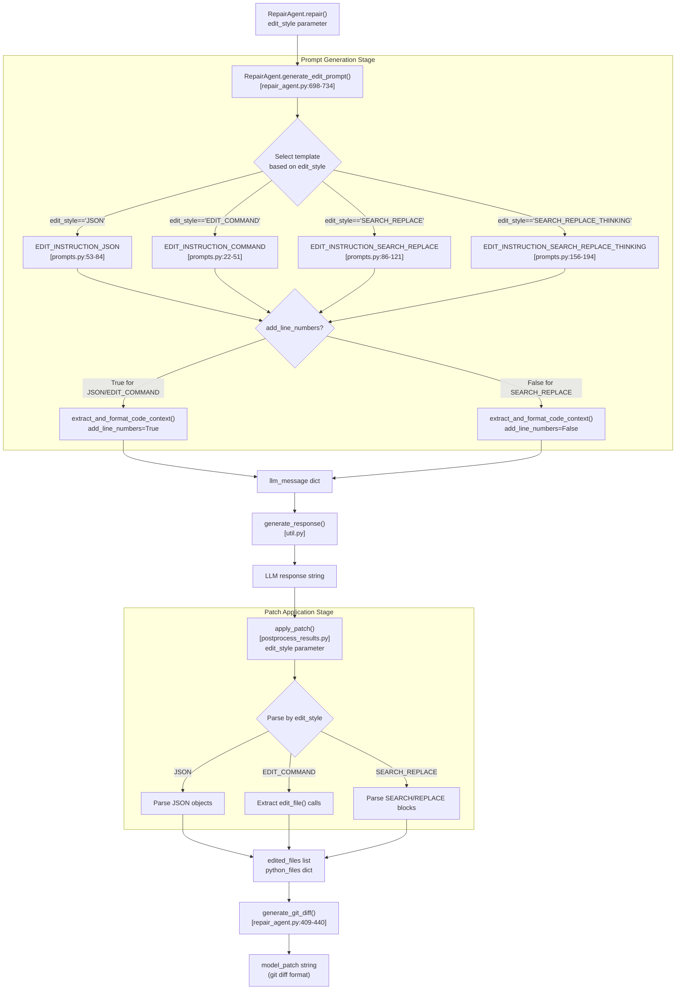
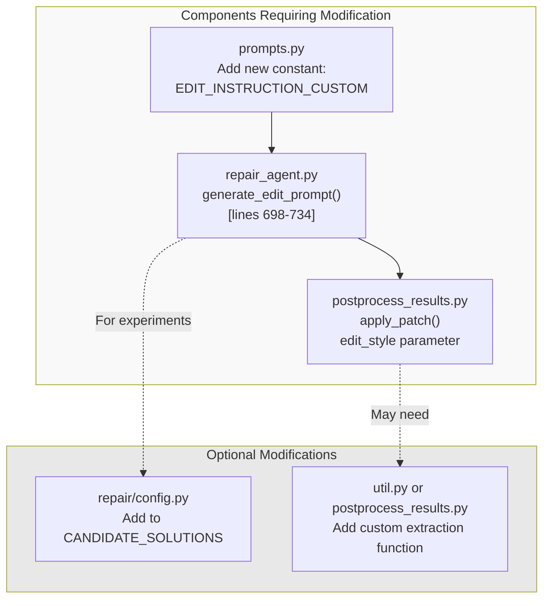

<!-- source: DeepWiki mcp.deepwiki.com · repo NVIDIA/Nemotron-CORTEXA · page 8.1 Adding New Edit Styles · fetched 2026-10-26 -->

# Adding New Edit Styles

<details>
<summary>Relevant source files</summary>

The following files were used as context for generating this wiki page:

- [src/cortexa/repair/prompts.py](src/cortexa/repair/prompts.py)
- [src/cortexa/repair/repair_agent.py](src/cortexa/repair/repair_agent.py)

</details>


## Purpose and Scope

This document provides a tutorial for extending Nemotron-CORTEXA with custom edit instruction formats. **Edit styles** define how the LLM is instructed to express code modifications (e.g., JSON objects, search/replace blocks, or line-based edit commands). This page covers the architecture of the edit style system, documents the four built-in styles, and provides a step-by-step guide for implementing custom formats.

For general information about the RepairAgent and patch generation, see [RepairAgent Core System](#3.1). For prompt engineering guidelines, see [Prompt Engineering and Templates](#3.2). For details on how patches are applied and validated, see [Patch Generation Workflow](#3.3).

**Sources**: [src/cortexa/repair/repair_agent.py:698-734](), [src/cortexa/repair/prompts.py:16-194]()

---

## Edit Style Data Flow

The edit style parameter affects three stages of the repair pipeline: prompt generation, LLM response formatting, and patch application.



**Sources**: [src/cortexa/repair/repair_agent.py:698-772](), [src/cortexa/repair/prompts.py:16-194](), [src/cortexa/utils/postprocess_results.py]()

---

## Built-in Edit Styles

Nemotron-CORTEXA ships with four edit instruction formats, each with distinct characteristics and use cases.

### Edit Style Comparison

| Edit Style | Line Numbers | Prompt Template | Parsing Logic | Typical Use Case |
|------------|--------------|-----------------|---------------|------------------|
| `JSON` | Yes (included) | `EDIT_INSTRUCTION_JSON` | Parse JSON objects with `filepath`, `start`, `end`, `content` | Structured, machine-parseable edits with explicit line ranges |
| `EDIT_COMMAND` | Yes (included) | `EDIT_INSTRUCTION_COMMAND` | Extract `edit_file(filepath, start, end, content)` function calls from Python blocks | Function-style API for programmatic edits |
| `SEARCH_REPLACE` | No (omitted) | `EDIT_INSTRUCTION_SEARCH_REPLACE` | Parse `<<<<<<< SEARCH` / `=======` / `>>>>>>> REPLACE` blocks | Natural patch-like format for context-based replacements |
| `SEARCH_REPLACE_THINKING` | No (omitted) | `EDIT_INSTRUCTION_SEARCH_REPLACE_THINKING` | Parse `

<solution>
### path/to/file.py
<<<<<<< SEARCH
def buggy_function():
    return False
=======
def fixed_function():
    return True
>>>>>>> REPLACE
</solution>
```

**Key characteristics**:
- Separates reasoning (`<think>`) from solution (`<solution>`)
- Same SEARCH/REPLACE format within `<solution>` tags
- Prompt explicitly instructs: "Please first localize the bug based on the issue statement"
- Useful for models with strong chain-of-thought capabilities

**Prompt template**: [src/cortexa/repair/prompts.py:156-194]()

**Sources**: [src/cortexa/repair/prompts.py:156-194]()

---

## Architecture: Key Components

To add a new edit style, you must modify three components and understand how they interact:



**Sources**: [src/cortexa/repair/repair_agent.py:698-734](), [src/cortexa/repair/prompts.py](), [src/cortexa/utils/postprocess_results.py]()

### Component 1: Prompt Template (prompts.py)

The prompt template is a string constant that instructs the LLM on the expected output format. All edit instruction templates follow this structure:

```
<issue>
{problem_statement}
</issue>
<code>
{content}
</code>

[Instructions on how to format edits]
[Examples of the edit format]
[Important guidelines about indentation, line numbers, etc.]
```

**Location**: [src/cortexa/repair/prompts.py:16-194]()

**Naming convention**: `EDIT_INSTRUCTION_<STYLE_NAME>` (e.g., `EDIT_INSTRUCTION_JSON`, `EDIT_INSTRUCTION_COMMAND`)

**Sources**: [src/cortexa/repair/prompts.py:16-194]()

### Component 2: Prompt Generation Logic (repair_agent.py)

The `generate_edit_prompt()` method maps edit style names to prompt templates and controls whether line numbers are included:

**Key decision points**:
1. **Template selection**: Which prompt constant to use (lines 708-721)
2. **Line number inclusion**: Whether to call `extract_and_format_code_context()` with `add_line_numbers=True` or `False` (line 723)
3. **Message formatting**: How to combine `EDIT_PREMISE` with the selected instruction template (lines 726-732)

**Location**: [src/cortexa/repair/repair_agent.py:698-734]()

**Sources**: [src/cortexa/repair/repair_agent.py:698-734]()

### Component 3: Patch Application Logic (postprocess_results.py)

The `apply_patch()` function parses the LLM's response and applies edits to files. This is where edit style-specific parsing logic is implemented.

**Key responsibilities**:
1. Extract structured edit information from free-form LLM text
2. Validate that edits are well-formed (e.g., valid line ranges, existing files)
3. Apply edits to the in-memory representation of files
4. Return lists of edited files and their new contents

**Location**: [src/cortexa/utils/postprocess_results.py]() (referenced but not shown in provided files)

**Sources**: [src/cortexa/repair/repair_agent.py:754-757]()

---

## Tutorial: Implementing a Custom Edit Style

This section provides a step-by-step guide to adding a new edit style called `DIFF_UNIFIED`, which uses unified diff format.

### Step 1: Define the Prompt Template

Add a new constant to `prompts.py` that instructs the LLM on the unified diff format:

```python
EDIT_INSTRUCTION_DIFF_UNIFIED = """
<issue>
{problem_statement}
</issue>
<code>
{content}
</code>

Please generate unified diff patches to fix the issue.

Every unified diff patch must use this format:
1. --- followed by the original file path
2. +++ followed by the modified file path  
3. @@ -X,Y +A,B @@ indicating line ranges
4. Context lines (unchanged, no prefix)
5. Removed lines (prefixed with -)
6. Added lines (prefixed with +)

Here is an example:

```python
--- a/path/to/file.py
+++ b/path/to/file.py
@@ -10,3 +10,4 @@
 def existing_function():
-    return False
+    # Fixed return value
+    return True
 ```
    
Important Instructions:
1. Use standard unified diff format with @@ markers for line ranges
2. Include at least 3 lines of context before and after changes
3. Prefix removed lines with - and added lines with +
4. Preserve exact indentation in all lines

Wrap the unified diff in ```python...``` blocks.
"""
```

**Location**: Add to [src/cortexa/repair/prompts.py]() after existing instruction constants

**Sources**: [src/cortexa/repair/prompts.py:53-194]()

### Step 2: Update generate_edit_prompt()

Modify the conditional logic in `generate_edit_prompt()` to handle the new style:

```python
def generate_edit_prompt(self, code_context, edit_style):
    """Returns the prompt to generate the patch
    
    The edit command can be in the json format, edit_file API, or search/replace format
        (refer to prompt.py for more details)

    """

    issue_text = self.instance['problem_statement']
    
    if edit_style == 'JSON':
        edit_format_instruction = EDIT_INSTRUCTION_JSON
        add_line_numbers = True
    elif edit_style == 'EDIT_COMMAND':
        edit_format_instruction = EDIT_INSTRUCTION_COMMAND
        add_line_numbers = True
    elif edit_style == 'SEARCH_REPLACE':
        edit_format_instruction = EDIT_INSTRUCTION_SEARCH_REPLACE
        add_line_numbers = False
    elif edit_style == 'SEARCH_REPLACE_THINKING':
        edit_format_instruction = EDIT_INSTRUCTION_SEARCH_REPLACE_THINKING
        add_line_numbers = False
    elif edit_style == 'DIFF_UNIFIED':  # NEW
        edit_format_instruction = EDIT_INSTRUCTION_DIFF_UNIFIED
        add_line_numbers = False  # Unified diffs include line numbers in @@ markers
    else:
        raise ValueError(f'Unknown edit style: {edit_style}')
    
    snippets = extract_and_format_code_context(
        code_context, 
        self.instance_obj, 
        add_line_numbers=add_line_numbers, 
        max_tokens=self.max_input_tokens
    )
    
    repair_message = {
        'system': "",
        'user': '\n'.join([
            EDIT_PREMISE,
            edit_format_instruction.format(
                problem_statement=issue_text, 
                content=snippets
            ),
        ])
    }
    
    return repair_message
```

**Location**: Modify [src/cortexa/repair/repair_agent.py:698-734]()

**Key decisions**:
- **Line numbers**: Set `add_line_numbers=False` because unified diffs embed line numbers in `@@` markers
- **Template selection**: Map `'DIFF_UNIFIED'` to `EDIT_INSTRUCTION_DIFF_UNIFIED`

**Sources**: [src/cortexa/repair/repair_agent.py:698-734]()

### Step 3: Implement Parsing Logic in apply_patch()

The `apply_patch()` function in `postprocess_results.py` needs a new code path to parse unified diffs. Based on the existing structure (inferred from calls in `generate_edit_patch()`), add:

```python
def apply_patch(llm_output, instance_obj, repo_playground, edit_style):
    """Apply patches from LLM output to file contents.
    
    Args:
        llm_output: String containing LLM's edit instructions
        instance_obj: Instance object with file contents
        repo_playground: Path to repository playground
        edit_style: One of 'JSON', 'EDIT_COMMAND', 'SEARCH_REPLACE', 'DIFF_UNIFIED'
        
    Returns:
        python_files: Dict mapping filenames to updated file contents
        edited_files: List of filenames that were modified
    """
    
    if edit_style == 'JSON':
        edits = parse_json_edits(llm_output)
    elif edit_style == 'EDIT_COMMAND':
        edits = parse_edit_commands(llm_output)
    elif edit_style == 'SEARCH_REPLACE':
        edits = parse_search_replace(llm_output)
    elif edit_style == 'DIFF_UNIFIED':  # NEW
        edits = parse_unified_diff(llm_output, instance_obj)
    else:
        raise ValueError(f'Unknown edit style: {edit_style}')
    
    # Apply edits to files
    python_files, edited_files = apply_edits_to_files(
        edits, 
        instance_obj, 
        repo_playground
    )
    
    return python_files, edited_files
```

**Helper function to implement**:

```python
def parse_unified_diff(llm_output, instance_obj):
    """Parse unified diff format from LLM output.
    
    Extracts file paths, line ranges, and changes from unified diff blocks.
    
    Returns:
        List of edit dictionaries with 'filepath', 'start', 'end', 'content'
    """
    import re
    
    edits = []
    python_blocks = extract_python_blocks(llm_output)
    
    for block in python_blocks:
        # Parse diff header: --- a/path +++ b/path
        file_match = re.search(r'---\s+a/(.+?)\n\+\+\+\s+b/(.+?)(?:\n|$)', block)
        if not file_match:
            continue
            
        filepath = file_match.group(2)  # Use +++ path as target
        
        # Parse hunks: @@ -X,Y +A,B @@
        hunk_pattern = r'@@\s+-(\d+),(\d+)\s+\+(\d+),(\d+)\s+@@'
        hunks = re.finditer(hunk_pattern, block)
        
        for hunk in hunks:
            old_start, old_count = int(hunk.group(1)), int(hunk.group(2))
            new_start, new_count = int(hunk.group(3)), int(hunk.group(4))
            
            # Extract hunk content (lines between @@ markers)
            hunk_start = hunk.end()
            next_hunk = re.search(r'@@', block[hunk_start:])
            hunk_end = hunk_start + next_hunk.start() if next_hunk else len(block)
            hunk_lines = block[hunk_start:hunk_end].split('\n')
            
            # Reconstruct new content from diff
            new_lines = []
            for line in hunk_lines:
                if line.startswith('+'):
                    new_lines.append(line[1:])  # Remove + prefix
                elif not line.startswith('-'):
                    new_lines.append(line)  # Keep context lines
                # Skip lines starting with - (removed)
            
            edits.append({
                'filepath': filepath,
                'start': old_start,
                'end': old_start + old_count - 1,
                'content': '\n'.join(new_lines)
            })
    
    return edits
```

**Location**: Modify [src/cortexa/utils/postprocess_results.py]()

**Key considerations**:
- **Regex patterns**: Unified diff has well-defined syntax; use regex to extract headers and hunks
- **Line number handling**: The `@@` markers specify old and new line ranges; map these to `start`/`end` for consistency
- **Content reconstruction**: Lines prefixed with `+` are added, `-` are removed, no prefix means context (keep)

**Sources**: [src/cortexa/repair/repair_agent.py:754-757]()

### Step 4: Test the New Edit Style

Create a test script to verify the new edit style works end-to-end:

```python
# test_diff_unified.py
from cortexa.repair.repair_agent import create_repair_agent
from cortexa.utils.util import read_config, default_config_path

# Load a sample instance from SWE-bench
instance = {
    'instance_id': 'test-instance',
    'problem_statement': 'Fix the function to return True instead of False',
    'repo': 'test/repo',
}

# Create agent
config = read_config(default_config_path())
solution = {
    'model': 'deepseek-v3-0324',  # Or any configured model
    'retrieval_hits': 1,
}

agent = create_repair_agent(
    solution=solution,
    repo_playground='/path/to/repo_playground',
    log_dir='/path/to/log_dir',
)

# Test repair with new edit style
context_data = {
    'test-instance': {
        'content_map': {
            'test/file.py': 'ALL'
        }
    }
}

agent.repair(
    instance=instance,
    context_file_or_data=context_data,
    edit_style='DIFF_UNIFIED',  # Use new style
    context_type='entity',
    temperature=0.0,
    run_num=0,
)

# Check output in log_dir/summary_inference.jsonl
```

**Validation checklist**:
1. ✅ Prompt is generated correctly with unified diff instructions
2. ✅ LLM response contains valid unified diff blocks
3. ✅ `parse_unified_diff()` extracts edits without errors
4. ✅ Files are modified correctly in `python_files` dict
5. ✅ `model_patch` in output is a valid git diff
6. ✅ Syntax checking passes (no indentation errors)

**Sources**: [src/cortexa/repair/repair_agent.py:618-695]()

### Step 5: Add to Configuration (Optional)

To use the new edit style in experiments, add it to `CANDIDATE_SOLUTIONS` in `repair/config.py`:

```python
CANDIDATE_SOLUTIONS = [
    {
        'model': 'deepseek-v3-0324',
        'context': 'LA_DP_entity',
        'edit_style': 'JSON',
        'temp': 0.0,
        'retrieval_hits': 1
    },
    # ... existing entries ...
    {
        'model': 'deepseek-v3-0324',
        'context': 'LA_DP_entity',
        'edit_style': 'DIFF_UNIFIED',  # NEW
        'temp': 0.0,
        'retrieval_hits': 1
    },
]
```

This allows the new edit style to be included in batch evaluation runs via `run_evaluation.py`.

**Location**: [src/cortexa/repair/config.py]()

**Sources**: [src/cortexa/repair/config.py]()

---

## Edit Style Selection Matrix

When choosing or implementing an edit style, consider these tradeoffs:

| Criterion | JSON | EDIT_COMMAND | SEARCH_REPLACE | DIFF_UNIFIED |
|-----------|------|--------------|----------------|--------------|
| **Precision** | High (explicit line numbers) | High (explicit line numbers) | Medium (fuzzy matching) | High (explicit line numbers) |
| **Robustness to changes** | Low (line numbers shift) | Low (line numbers shift) | High (context-based) | Low (line numbers shift) |
| **Parsing complexity** | Low (JSON parser) | Medium (function call extraction) | Medium (block parsing) | High (diff format parsing) |
| **LLM familiarity** | Medium | High (code-like) | High (git-like) | High (standard format) |
| **Multi-file edits** | Native (list of objects) | Native (multiple calls) | Native (multiple blocks) | Native (multiple hunks) |
| **Indentation preservation** | Explicit (in string) | Explicit (in string) | Implicit (from SEARCH) | Implicit (from context) |

**Design recommendations**:
- **For maximum precision**: Use JSON or EDIT_COMMAND with line numbers
- **For resilience to context shifts**: Use SEARCH_REPLACE without line numbers
- **For LLM-friendly format**: Use EDIT_COMMAND or SEARCH_REPLACE (mimics familiar patterns)
- **For standard tooling integration**: Use DIFF_UNIFIED (compatible with `patch` command)

**Sources**: [src/cortexa/repair/prompts.py:16-194]()

---

## Advanced: Supporting Custom Validation

Some edit styles may require specialized validation beyond syntax checking. To add custom validation:

### Validation Hook in RepairAgent

The `repair()` method performs syntax validation after applying patches [src/cortexa/repair/repair_agent.py:677-692](). To add custom validation:

```python
def repair(self, instance, context_file_or_data, edit_style, 
           context_type, temperature, run_num, repo_graph_file=None):
    # ... existing code ...
    
    for idx, result in enumerate(results):
        edit_results = {
            'llm_output': result['response'],
            'edited_files': result['edited_files'],
            'python_files': result['python_files'], 
            'model_patch': result['model_patch']
        }
        
        # Existing syntax validation
        syntax_status = ''
        for file in edit_results['edited_files']:
            status, revised_code = check_and_fix_indentation(
                '\n'.join(edit_results['python_files'][file]['text'])
            )
            edit_results['python_files'][file]['text'] = revised_code.splitlines()
            syntax_status += f'{file}: {status}'
        
        # NEW: Custom validation based on edit style
        if edit_style == 'DIFF_UNIFIED':
            validation_status = validate_unified_diff_consistency(
                result['model_patch'],
                edit_results['python_files']
            )
            syntax_status += f' | Diff consistency: {validation_status}'
        
        # ... rest of method ...
```

### Example Validation Function

```python
def validate_unified_diff_consistency(model_patch, python_files):
    """Verify that the git diff matches the actual file changes.
    
    Args:
        model_patch: Git diff string generated by generate_git_diff()
        python_files: Dict of modified files with their new contents
        
    Returns:
        'CONSISTENT' if diff matches changes, 'INCONSISTENT' otherwise
    """
    import difflib
    
    # Extract file changes from diff
    diff_changes = parse_git_diff(model_patch)
    
    # Compare with actual changes
    for filepath, (old_content, new_content) in diff_changes.items():
        if filepath not in python_files:
            return f'INCONSISTENT: {filepath} in diff but not in python_files'
        
        actual_new = '\n'.join(python_files[filepath]['text'])
        if actual_new != new_content:
            return f'INCONSISTENT: {filepath} content mismatch'
    
    return 'CONSISTENT'
```

**Sources**: [src/cortexa/repair/repair_agent.py:677-692]()

---

## Reference: Code Locations Summary

| Component | File | Lines | Purpose |
|-----------|------|-------|---------|
| Prompt templates | `prompts.py` | 16-194 | Define instruction formats for each edit style |
| `EDIT_PREMISE` | `prompts.py` | 16-20 | Common prefix for all edit prompts |
| `generate_edit_prompt()` | `repair_agent.py` | 698-734 | Maps edit style to template and line number settings |
| `generate_edit_patch()` | `repair_agent.py` | 736-772 | Calls LLM and applies patches using edit style |
| `apply_patch()` | `postprocess_results.py` | (not shown) | Parses LLM response by edit style and modifies files |
| `extract_and_format_code_context()` | `repair_agent.py` | 68-107 | Formats code with or without line numbers |
| `generate_git_diff()` | `repair_agent.py` | 409-440 | Converts file changes to git diff format |
| `check_and_fix_indentation()` | `postprocess_results.py` | (not shown) | Validates Python syntax after edits |
| `CANDIDATE_SOLUTIONS` | `repair/config.py` | (not shown) | Configuration for batch experiments |

**Sources**: [src/cortexa/repair/repair_agent.py](), [src/cortexa/repair/prompts.py]()

---

## Common Pitfalls and Solutions

### Pitfall 1: Indentation Errors

**Problem**: LLMs often fail to preserve exact indentation when generating multi-line code.

**Solution**: 
- Include explicit instructions in the prompt template about indentation (see lines 76-78 in `EDIT_INSTRUCTION_JSON`)
- Use `check_and_fix_indentation()` to detect and attempt automatic correction
- For context-based formats (SEARCH_REPLACE), include surrounding context lines to give the LLM indentation hints

**Sources**: [src/cortexa/repair/prompts.py:76-78]()

### Pitfall 2: Line Number Confusion

**Problem**: When `add_line_numbers=True`, LLMs may include line numbers in the `content` field, causing syntax errors.

**Solution**:
- Explicitly state in prompt: "Do not include the line numbers in the content"
- For formats that don't need line numbers (SEARCH_REPLACE), use `add_line_numbers=False`
- Parse extracted code blocks and strip leading numbers if detected

**Sources**: [src/cortexa/repair/prompts.py:73](), [src/cortexa/repair/repair_agent.py:723]()

### Pitfall 3: Overlapping Edits

**Problem**: Multiple edits to the same file may have overlapping line ranges.

**Solution**:
- Sort edits by starting line number (see `postprocess_dict_edits()` in [repair_agent.py:1097-1131]())
- Use `verify_edit_results()` to detect overlaps ([repair_agent.py:1133-1145]())
- For SEARCH_REPLACE format, apply edits sequentially and update line numbers after each edit

**Sources**: [src/cortexa/repair/repair_agent.py:1097-1145]()

### Pitfall 4: File Path Ambiguity

**Problem**: LLMs may output shortened file paths (e.g., `utils.py` instead of `src/cortexa/utils/util.py`).

**Solution**:
- Prompt instructs: "Give the full file path with all directories. Do NOT shorten it."
- Code context shows full paths in `[start of FULL_PATH]` markers
- Parsing logic can attempt fuzzy matching via `repo_graph.match_file_name()` if exact path not found

**Sources**: [src/cortexa/repair/prompts.py:37](), [src/cortexa/repair/repair_agent.py:1106-1109]()

---

## Integration Testing Checklist

Before merging a new edit style:

- [ ] **Unit tests**: Parsing function handles all valid formats and rejects invalid ones
- [ ] **Prompt validation**: LLM generates expected format (test on 10+ diverse instances)
- [ ] **Syntax validation**: `check_and_fix_indentation()` passes for generated patches
- [ ] **Evaluation**: Patches apply successfully in Docker containers (`eval_instance.py`)
- [ ] **Git diff generation**: `generate_git_diff()` produces valid diffs from edited files
- [ ] **Edge cases**: Empty edits, multi-file edits, edits at file boundaries
- [ ] **Regression**: Existing edit styles still work after code changes

**Test harness location**: [tests/] (not shown in provided files, but should exist)

**Sources**: [src/cortexa/repair/repair_agent.py:677-692]()

---

