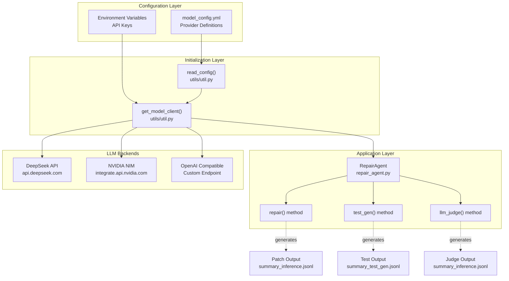
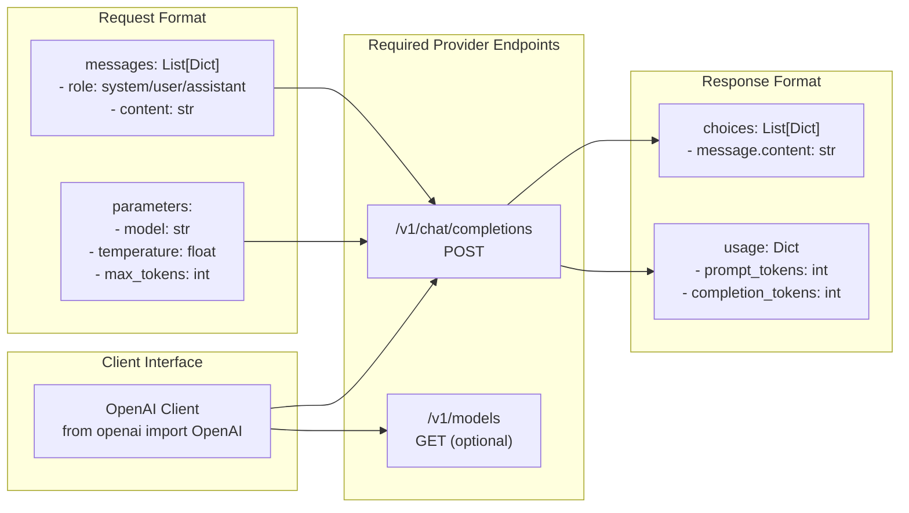
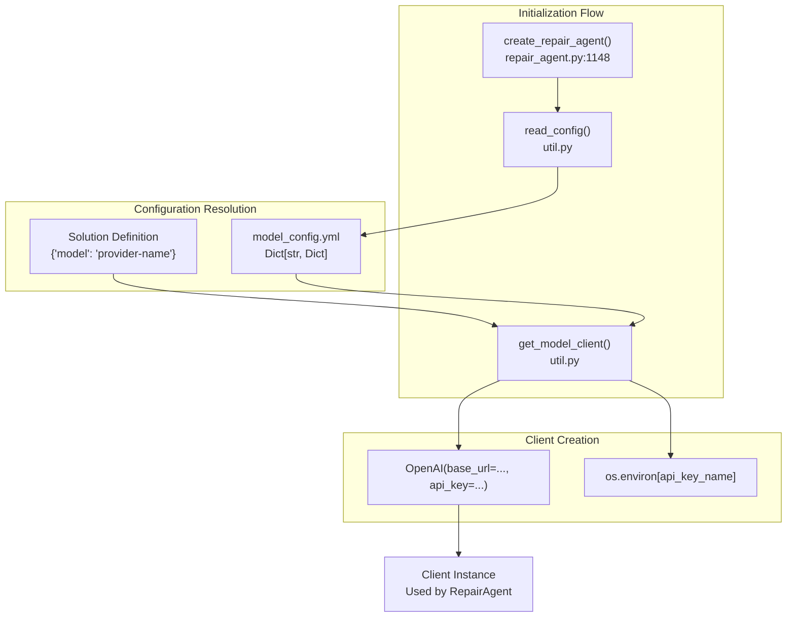
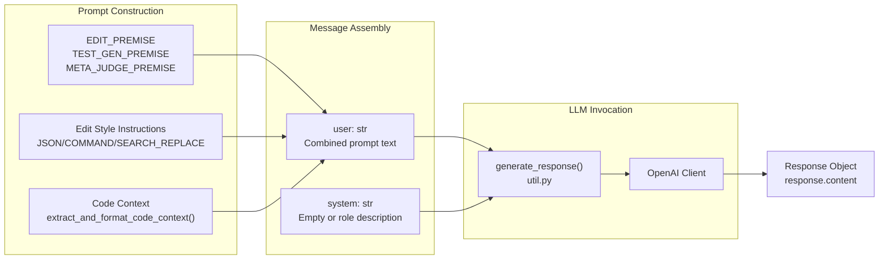

<!-- source: DeepWiki mcp.deepwiki.com · repo NVIDIA/Nemotron-CORTEXA · page 8.2 Integrating New LLM Providers · fetched 2026-10-26 -->

# Integrating New LLM Providers

<details>
<summary>Relevant source files</summary>

The following files were used as context for generating this wiki page:

- [model_config.yml](model_config.yml)
- [src/cortexa/repair/prompts.py](src/cortexa/repair/prompts.py)
- [src/cortexa/repair/repair_agent.py](src/cortexa/repair/repair_agent.py)

</details>


## Purpose and Scope

This guide explains how to integrate new LLM providers into Nemotron-CORTEXA by configuring API endpoints and ensuring OpenAI API compatibility. The system's modular architecture allows easy addition of new LLM backends without modifying core application logic.

For information about configuring which models are used for specific tasks (patch generation, test generation, etc.), see [Candidate Solution Configuration](#5.2). For details on the prompt templates that work with these models, see [Prompt Engineering and Templates](#3.2).

---

## LLM Provider Architecture Overview

Nemotron-CORTEXA uses a centralized configuration system for managing LLM providers. All provider configurations are defined in `model_config.yml`, and the system uses an OpenAI-compatible client interface to interact with different backends.

### System Component Flow



**Sources:** [model_config.yml:1-15](), [src/cortexa/repair/repair_agent.py:446-488]()

---

## Configuration File Structure

The `model_config.yml` file defines all available LLM providers. Each provider entry consists of three required fields that enable the system to authenticate and route requests correctly.

### Configuration Schema

| Field | Type | Description | Example |
|-------|------|-------------|---------|
| `base_url` | string | API endpoint URL | `https://api.deepseek.com` |
| `api_key_name` | string | Environment variable name for API key | `DEEPSEEK_API_KEY` |
| `model_name` | string | Model identifier sent to the provider | `deepseek-chat` |

### Example Configurations

```yaml
# DeepSeek Direct API
deepseek-v3-0324:
  base_url: 'https://api.deepseek.com'
  api_key_name: 'DEEPSEEK_API_KEY'
  model_name: 'deepseek-chat'

# NVIDIA NIM Hosted Models
llama-3.3-70b-instruct:
  base_url: 'https://integrate.api.nvidia.com/v1'
  api_key_name: 'NVIDIA_API_KEY'
  model_name: 'nvdev/meta/llama-3.3-70b-instruct'
```

The configuration key (e.g., `deepseek-v3-0324`) is the identifier used throughout the system to reference this specific model configuration. This key is used in [repair/config.py]() to define candidate solutions.

**Sources:** [model_config.yml:1-15]()

---

## Step-by-Step Integration Guide

### Step 1: Add Configuration Entry

Add a new entry to `model_config.yml` following the schema above:

```yaml
your-provider-name:
  base_url: 'https://your-provider-api.com/v1'
  api_key_name: 'YOUR_PROVIDER_API_KEY'
  model_name: 'your-model-identifier'
```

**Configuration Key Naming Convention:**
- Use lowercase with hyphens
- Include model version if applicable (e.g., `gpt-4-turbo`, `claude-3-opus`)
- Keep names concise but descriptive

**Sources:** [model_config.yml:1-15]()

### Step 2: Set Environment Variable

Export the API key using the environment variable name specified in `api_key_name`:

```bash
export YOUR_PROVIDER_API_KEY="your-actual-api-key-here"
```

The system retrieves this value at runtime when initializing the model client. API keys are never stored in configuration files for security.

**Sources:** [model_config.yml:3](), [model_config.yml:8](), [model_config.yml:13]()

### Step 3: Update Candidate Solution Definitions

Modify `src/cortexa/repair/config.py` to use your new model in candidate solutions. Reference the configuration key from Step 1:

```python
CANDIDATE_SOLUTIONS_PATCH_GEN = [
    {
        'model': 'your-provider-name',  # Must match model_config.yml key
        'context': 'LA_DP_entity',
        'edit_style': 'SEARCH_REPLACE',
        'temperature': 0.0,
        'retrieval_hits': 1,
        'run_num': 1
    },
    # ... other candidates
]
```

**Sources:** [src/cortexa/repair/repair_agent.py:466-469]()

### Step 4: Verify Integration

Test the configuration with a simple repair task:

```bash
python src/cortexa/repair/repair_agent.py \
    --instance_id "test-instance" \
    --dataset_name_or_path "princeton-nlp/SWE-bench_Verified" \
    --log_dir "./test_log"
```

The system will attempt to load your model configuration and initialize a client. Check logs for successful initialization or configuration errors.

**Sources:** [src/cortexa/repair/repair_agent.py:476-488]()

---

## API Compatibility Requirements

Nemotron-CORTEXA uses the OpenAI Python client library to interact with all LLM providers. Your provider must expose an OpenAI-compatible API interface.

### Required API Endpoints



**Sources:** [src/cortexa/repair/repair_agent.py:739-745]()

### Message Format

The system sends messages in OpenAI format with `system` and `user` roles:

```python
messages = {
    'system': "",  # Optional system prompt
    'user': prompt_text  # Main instruction
}
```

Your provider must accept this format and return responses with a `content` field accessible via `response.content`.

**Sources:** [src/cortexa/repair/repair_agent.py:726-733](), [src/cortexa/repair/repair_agent.py:742-744]()

### Response Handling

The system expects responses with the following structure:

```python
response.content  # Must be either:
                 # - A string (standard response)
                 # - A list with single dict containing 'text' key (Claude format)
```

The code handles both formats automatically:

```python
response_content = response.content
if isinstance(response_content, list):
    assert len(response_content) == 1
    response_content = response_content[0]['text']
```

**Sources:** [src/cortexa/repair/repair_agent.py:751-753](), [src/cortexa/repair/repair_agent.py:933-935](), [src/cortexa/repair/repair_agent.py:1084-1086]()

---

## Integration Points in Code

### Model Client Initialization

The `get_model_client()` function in `src/cortexa/utils/util.py` creates OpenAI-compatible clients for all providers:



**Sources:** [src/cortexa/repair/repair_agent.py:1148-1165](), [src/cortexa/repair/repair_agent.py:476]()

### RepairAgent Usage

The `RepairAgent` class uses the model client for three primary operations:

| Method | Purpose | Output | Configuration Field |
|--------|---------|--------|-------------------|
| `repair()` | Generate code patches | `summary_inference.jsonl` | `repair_model_info` |
| `test_gen()` | Generate reproduction tests | `summary_test_gen.jsonl` | `repair_model_info` |
| `llm_judge()` | Select best patch from candidates | `summary_inference.jsonl` | `repair_model_info` |

Each method uses `generate_response()` internally, which calls the model client with appropriate parameters:

```python
responses = generate_response(
    model_client=self.repair_model,  # From get_model_client()
    model_name=self.repair_model_name,
    temperature=self.temperature,
    messages={'system': system_prompt, 'user': user_prompt},
    max_tokens=self.max_tokens,
)
```

**Sources:** [src/cortexa/repair/repair_agent.py:618-695](), [src/cortexa/repair/repair_agent.py:774-840](), [src/cortexa/repair/repair_agent.py:953-1009]()

### Request Generation

The system constructs prompts from templates in `src/cortexa/repair/prompts.py` and sends them to the LLM:



**Sources:** [src/cortexa/repair/repair_agent.py:698-734](), [src/cortexa/repair/repair_agent.py:736-772](), [src/cortexa/repair/prompts.py:16-20]()

---

## Model-Specific Considerations

### Token Limits

Different providers have varying context window sizes. Configure `max_input_tokens` when creating the `RepairAgent`:

```python
agent = RepairAgent(
    log_dir=log_dir,
    repair_model_info=model_info,
    max_input_tokens=115000,  # Adjust based on provider limits
    max_tokens=4096,           # Max output tokens
)
```

The system truncates context if it exceeds `max_input_tokens` to prevent API errors:

```python
encoder = tiktoken.encoding_for_model('gpt-4-turbo')
tokens = encoder.encode(all_text)
if len(tokens) > max_tokens:
    all_text = encoder.decode(tokens[:max_tokens])
```

**Sources:** [src/cortexa/repair/repair_agent.py:1154-1164](), [src/cortexa/repair/repair_agent.py:68-107]()

### Temperature Settings

Temperature controls output randomness and is configured per candidate solution:

| Use Case | Recommended Temperature | Rationale |
|----------|------------------------|-----------|
| Patch Generation | 0.0 - 0.2 | Deterministic, minimal hallucination |
| Test Generation | 0.0 - 0.3 | Consistent test behavior |
| LLM Judge | 0.0 | Reproducible selection decisions |

**Sources:** [src/cortexa/repair/repair_agent.py:472](), [src/cortexa/repair/repair_agent.py:631](), [src/cortexa/repair/repair_agent.py:786]()

### Response Parsing

The system extracts structured information from LLM responses:

- **Patch Generation:** Parses JSON edits, edit commands, or SEARCH/REPLACE blocks
- **Test Generation:** Extracts Python code blocks using `extract_python_blocks()`
- **LLM Judge:** Extracts choice label using `extract_llm_choice()`

Ensure your provider returns well-formatted responses that match the expected patterns in prompt templates.

**Sources:** [src/cortexa/repair/repair_agent.py:754-757](), [src/cortexa/repair/repair_agent.py:936](), [src/cortexa/repair/repair_agent.py:1090]()

---

## Testing and Validation

### Configuration Validation

After adding a new provider, verify the configuration loads correctly:

```python
from cortexa.utils.util import read_config, default_config_path

config = read_config(default_config_path())
assert 'your-provider-name' in config
assert 'base_url' in config['your-provider-name']
assert 'api_key_name' in config['your-provider-name']
assert 'model_name' in config['your-provider-name']
```

**Sources:** [src/cortexa/repair/repair_agent.py:1158]()

### Client Initialization Test

Verify the client can be created with your configuration:

```python
from cortexa.utils.util import get_model_client, read_config, default_config_path

config = read_config(default_config_path())
model_info = config['your-provider-name']
client = get_model_client(model_info=model_info)

# Client should be initialized without errors
assert client is not None
```

**Sources:** [src/cortexa/repair/repair_agent.py:476-488]()

### End-to-End Integration Test

Run a complete repair workflow on a simple test case:

```bash
# Set API key
export YOUR_PROVIDER_API_KEY="your-key"

# Run patch generation
python scripts/run_repair.py \
    --dataset_name_or_path "princeton-nlp/SWE-bench_Verified" \
    --split "test" \
    --model_config "your-provider-name" \
    --output_dir "./test_output" \
    --max_workers 1
```

Check `test_output/summary_inference.jsonl` for successful generation results.

**Sources:** [src/cortexa/repair/repair_agent.py:633-695]()

---

## Common Issues and Troubleshooting

### Issue: API Key Not Found

**Symptom:** Error message about missing environment variable

**Solution:** Ensure the environment variable name in `model_config.yml` matches your export:

```bash
# Check what's exported
env | grep API_KEY

# Verify config matches
cat model_config.yml | grep api_key_name
```

**Sources:** [model_config.yml:3](), [model_config.yml:8](), [model_config.yml:13]()

### Issue: Incompatible API Response Format

**Symptom:** AttributeError when accessing `response.content`

**Solution:** Verify your provider returns OpenAI-compatible responses. Add logging to inspect the response structure:

```python
import logging
logging.info(f"Response type: {type(response)}")
logging.info(f"Response attributes: {dir(response)}")
```

The response must have a `content` attribute that is either a string or a list with a single dict containing a `text` key.

**Sources:** [src/cortexa/repair/repair_agent.py:751-753](), [src/cortexa/repair/repair_agent.py:933-935]()

### Issue: Context Window Exceeded

**Symptom:** API error about token limits

**Solution:** Reduce `max_input_tokens` in the `RepairAgent` initialization:

```python
agent = RepairAgent(
    max_input_tokens=75000,  # Reduce from default 115000
    # ... other params
)
```

The system will automatically truncate context to fit within this limit.

**Sources:** [src/cortexa/repair/repair_agent.py:480](), [src/cortexa/repair/repair_agent.py:68-107]()

### Issue: Base URL Path Mismatch

**Symptom:** 404 errors when making API calls

**Solution:** Ensure `base_url` includes the correct API version path. Some providers require `/v1` suffix:

```yaml
# Correct
base_url: 'https://api.provider.com/v1'

# Incorrect (missing /v1)
base_url: 'https://api.provider.com'
```

The OpenAI client appends endpoints like `/chat/completions` to this base URL.

**Sources:** [model_config.yml:2](), [model_config.yml:7](), [model_config.yml:12]()

---

## Advanced Configuration

### Custom Model Parameters

The `RepairAgent` class supports additional model-specific parameters through the `repair_model_info` dictionary. Extend the configuration structure in `model_config.yml` as needed:

```yaml
your-provider-name:
  base_url: 'https://api.provider.com/v1'
  api_key_name: 'YOUR_PROVIDER_API_KEY'
  model_name: 'your-model'
  # Add custom parameters here
  timeout: 120
  max_retries: 3
```

Modify `get_model_client()` in `src/cortexa/utils/util.py` to pass these parameters to the OpenAI client initialization.

**Sources:** [src/cortexa/repair/repair_agent.py:466-469]()

### Multiple Models from Same Provider

You can configure multiple model variants from the same provider:

```yaml
provider-small:
  base_url: 'https://api.provider.com/v1'
  api_key_name: 'PROVIDER_API_KEY'
  model_name: 'small-model'

provider-large:
  base_url: 'https://api.provider.com/v1'
  api_key_name: 'PROVIDER_API_KEY'
  model_name: 'large-model'
```

This allows experimenting with different model sizes or variants while sharing the same API credentials.

**Sources:** [model_config.yml:1-15]()

---

**Sources:** [model_config.yml:1-15](), [src/cortexa/repair/repair_agent.py:446-488](), [src/cortexa/repair/repair_agent.py:618-695](), [src/cortexa/repair/repair_agent.py:774-840](), [src/cortexa/repair/repair_agent.py:953-1009](), [src/cortexa/repair/prompts.py:16-20]()

---

