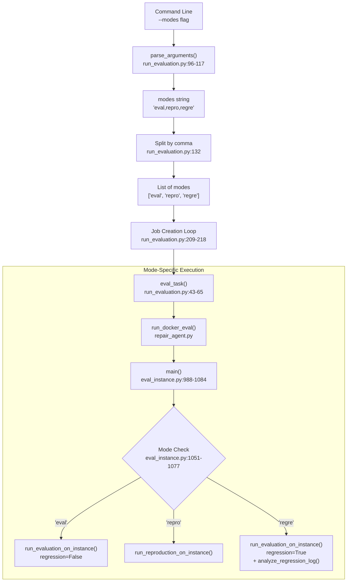
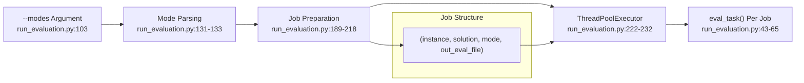
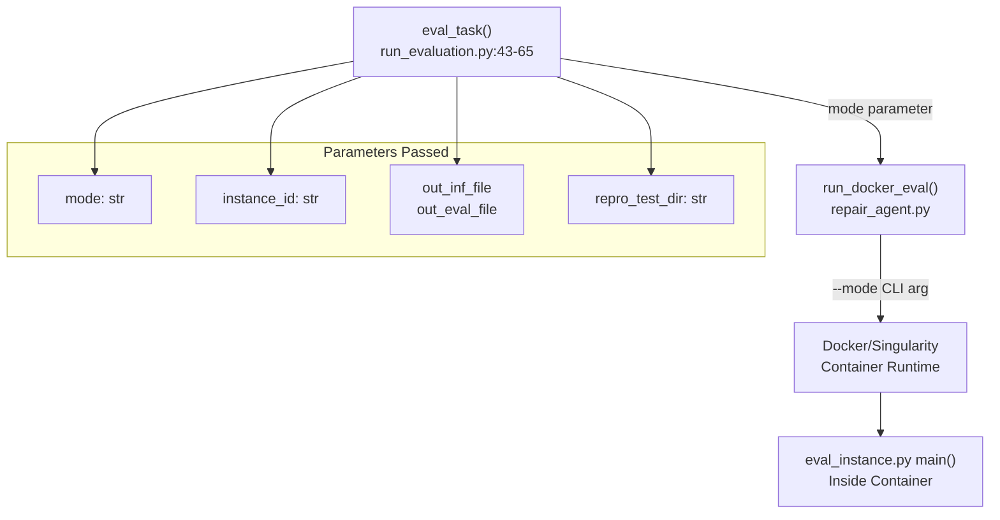
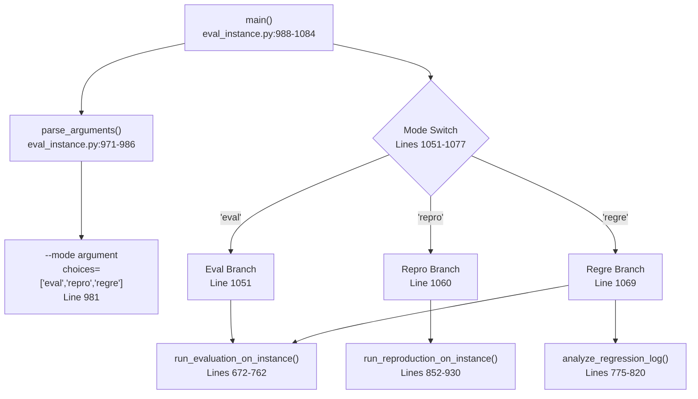
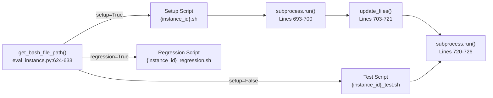
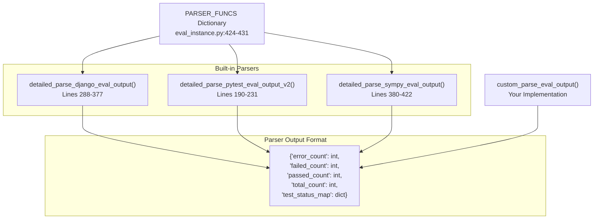
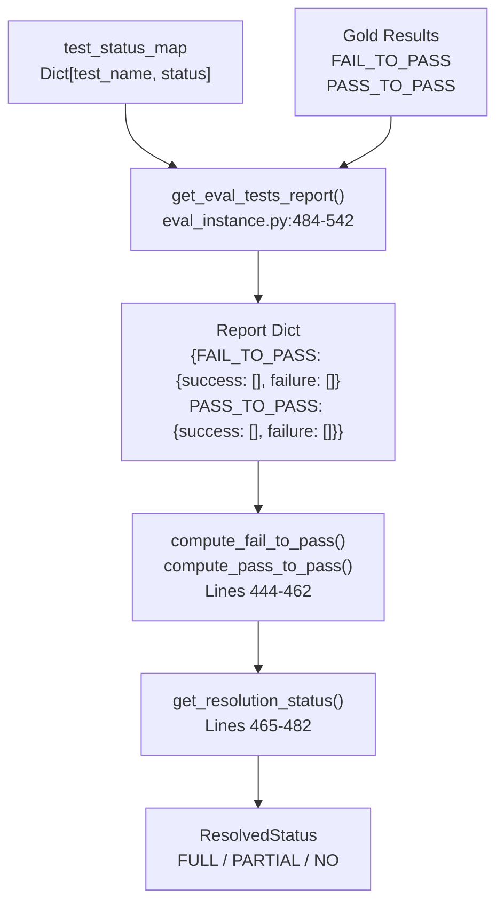
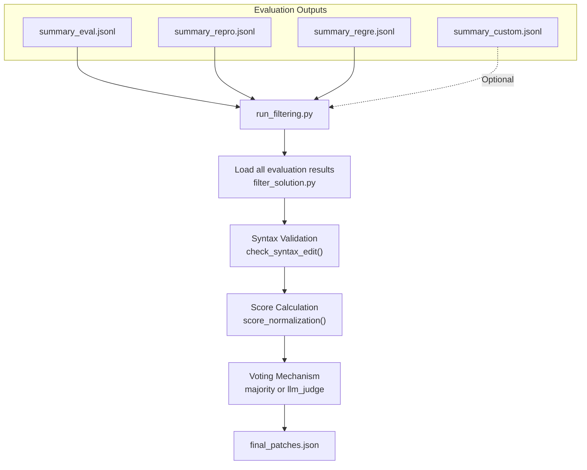

<!-- source: DeepWiki mcp.deepwiki.com · repo NVIDIA/Nemotron-CORTEXA · page 8.3 Custom Evaluation Modes · fetched 2026-10-26 -->

# Custom Evaluation Modes

<details>
<summary>Relevant source files</summary>

The following files were used as context for generating this wiki page:

- [src/cortexa/evaluate/eval_instance.py](src/cortexa/evaluate/eval_instance.py)
- [src/cortexa/evaluate/run_evaluation.py](src/cortexa/evaluate/run_evaluation.py)
- [src/cortexa/repair/repro_test_gen.py](src/cortexa/repair/repro_test_gen.py)

</details>


This page explains how to extend Nemotron-CORTEXA with custom evaluation modes beyond the three built-in modes (`eval`, `repro`, `regre`). Evaluation modes determine how patches are tested and what success criteria are applied. This guide is intended for developers who want to add specialized testing workflows, such as performance benchmarking, security testing, or domain-specific validation.

For information about the existing evaluation modes and their usage, see [Evaluation Stage](#4) and [Instance Evaluation and Testing](#4.2). For details on the evaluation orchestration pipeline, see [Evaluation Orchestration](#4.1).

---

## Overview of Existing Evaluation Modes

Before implementing a custom mode, it's important to understand the three built-in evaluation modes and their architecture.

### Mode Comparison

| Mode | Purpose | Test Source | Output File Pattern | Special Handling |
|------|---------|-------------|-------------------|------------------|
| `eval` | Validate against gold tests | SWE-bench FAIL_TO_PASS and PASS_TO_PASS lists | `summary_eval.jsonl` | Computes resolution status (FULL/PARTIAL/NO) |
| `repro` | Test with LLM-generated reproduction tests | `{repro_test_dir}/{instance_id}_reproduction.json` | `summary_repro.jsonl` | Extracts exit codes, no resolution computation |
| `regre` | Regression testing on passing tests | SWE-bench PASS_TO_PASS list + regression test list | `summary_regre.jsonl` | Requires `analyze_regression_log` post-processing |

### Mode Selection Flow



**Sources:** [src/cortexa/evaluate/run_evaluation.py:43-65](), [src/cortexa/evaluate/run_evaluation.py:96-117](), [src/cortexa/evaluate/run_evaluation.py:131-133](), [src/cortexa/evaluate/run_evaluation.py:209-218](), [src/cortexa/evaluate/eval_instance.py:1051-1077]()

---

## Architecture: Mode Implementation Layers

Custom evaluation modes involve three architectural layers:

### Layer 1: Orchestration (run_evaluation.py)

The orchestration layer manages parallel execution and job distribution across instances and patches.



**Key extension points:**
- **Mode parsing**: No changes needed; any string mode works
- **Job creation loop**: [run_evaluation.py:209-218]() iterates through all modes
- **Output file naming**: `summary_{mode}{file_tag}.jsonl` pattern at [run_evaluation.py:210]()

**Sources:** [src/cortexa/evaluate/run_evaluation.py:103](), [src/cortexa/evaluate/run_evaluation.py:131-133](), [src/cortexa/evaluate/run_evaluation.py:189-218](), [src/cortexa/evaluate/run_evaluation.py:222-232]()

### Layer 2: Container Invocation (repair_agent.py)

The `run_docker_eval` function bridges the orchestration layer to the container execution layer.



**Extension point:** The `mode` parameter is passed through unchanged to the container, so no modifications needed here.

**Sources:** [src/cortexa/evaluate/run_evaluation.py:52-64]()

### Layer 3: Instance Evaluation (eval_instance.py)

The instance evaluation layer contains the mode-specific logic for applying patches, running tests, and analyzing results.



**Primary extension point:** Add a new `elif args.mode == 'custom_mode':` branch at [eval_instance.py:1077]() after the existing mode checks.

**Sources:** [src/cortexa/evaluate/eval_instance.py:971-986](), [src/cortexa/evaluate/eval_instance.py:988-1084](), [src/cortexa/evaluate/eval_instance.py:672-762](), [src/cortexa/evaluate/eval_instance.py:852-930](), [src/cortexa/evaluate/eval_instance.py:775-820]()

---

## Implementation Guide: Adding a Custom Mode

This section provides a step-by-step guide for implementing a custom evaluation mode called `performance` that measures patch execution time.

### Step 1: Extend Argument Parser

Modify the `choices` list in the `--mode` argument to include your custom mode.

**File:** `src/cortexa/evaluate/eval_instance.py`

**Location:** [eval_instance.py:981]()

**Current code:**
```python
parser.add_argument("--mode", choices=['eval', 'repro', 'regre'], 
                    help="Choose between patch evaluation and bug reproduction and regression testing")
```

**Modified code:**
```python
parser.add_argument("--mode", choices=['eval', 'repro', 'regre', 'performance'], 
                    help="Choose between patch evaluation and bug reproduction and regression testing")
```

**Sources:** [src/cortexa/evaluate/eval_instance.py:981]()

### Step 2: Implement Mode Logic

Add a new conditional branch in the `main()` function to handle your custom mode. You have three options:

#### Option A: Reuse Existing Evaluation Function

If your mode is similar to `eval` or `regre`, you can reuse `run_evaluation_on_instance` with different parameters:

**File:** `src/cortexa/evaluate/eval_instance.py`

**Location:** After [eval_instance.py:1077]()

```python
elif args.mode == 'performance':
    import time
    start_time = time.time()
    res_instance_stats = run_evaluation_on_instance(
        instance,
        instance_stats,
        out_eval_file, 
        script_dir=args.script_dir,
        regression=False,  # Not regression testing
        edit_file=edit_file
    )
    execution_time = time.time() - start_time
    res_instance_stats[args.instance_id]['execution_time'] = execution_time
```

#### Option B: Create New Evaluation Function

For significantly different logic, create a new evaluation function similar to `run_evaluation_on_instance` or `run_reproduction_on_instance`:

**Function signature pattern:**
```python
def run_custom_evaluation_on_instance(
        instance,
        instance_stats,
        out_file, 
        script_dir=f'{os.path.dirname(os.path.dirname(get_root_path()))}/eval_scripts',
        edit_file=True,
        custom_param=None
        ):
    """
    Custom evaluation logic.
    
    Args:
        instance: SWE-bench instance dictionary
        instance_stats: Dictionary to populate with results
        out_file: Output JSONL file path
        script_dir: Directory containing test scripts
        edit_file: Whether to apply patch before testing
        custom_param: Mode-specific parameter
    
    Returns:
        instance_stats: Updated dictionary with evaluation results
    """
    # Your custom logic here
    pass
```

**Key components to include:**
1. **Script execution**: See [eval_instance.py:693-700]() for setup script pattern
2. **Patch application**: See [eval_instance.py:703-721]() for patch application logic
3. **Result parsing**: Implement custom parser or reuse existing parsers from [eval_instance.py:424-431]()
4. **Output writing**: Use `write_jsonl` with `FileLock` pattern at [eval_instance.py:757-760]()

#### Option C: Chain Multiple Evaluation Functions

For complex modes that combine multiple evaluation types:

```python
elif args.mode == 'comprehensive':
    # First run standard evaluation
    res_instance_stats = run_evaluation_on_instance(
        instance, instance_stats, out_eval_file, 
        script_dir=args.script_dir, regression=False, edit_file=edit_file
    )
    
    # Then run reproduction tests
    res_instance_stats = run_reproduction_on_instance(
        instance, res_instance_stats, out_eval_file,
        script_dir=args.script_dir, repro_test_dir=args.repro_test_dir, edit_file=False
    )
    
    # Add custom analysis
    res_instance_stats[args.instance_id]['combined_score'] = compute_combined_score(res_instance_stats)
```

**Sources:** [src/cortexa/evaluate/eval_instance.py:1051-1077](), [src/cortexa/evaluate/eval_instance.py:672-762](), [src/cortexa/evaluate/eval_instance.py:852-930]()

### Step 3: Handle Mode-Specific Output Files

The orchestration layer automatically creates mode-specific output files using the pattern `summary_{mode}.jsonl`. Ensure your mode writes results in the expected JSONL format.

**Output file path generation:**
```python
# In run_evaluation.py:210
out_eval_file = os.path.join(os.path.abspath(args.log_dir), f'summary_{mode}{file_tag}.jsonl')
```

**Expected JSONL structure:**
```json
{
  "instance_id": "django__django-12345",
  "patch_id": "model_context_edit_temp_run",
  "resolution": "RESOLVED_FULL",
  "custom_metric": 42.0,
  ...
}
```

**Sources:** [src/cortexa/evaluate/run_evaluation.py:210](), [src/cortexa/evaluate/eval_instance.py:757-760]()

---

## Common Implementation Patterns

### Pattern 1: Using Existing Test Infrastructure

Most custom modes can leverage the existing test script infrastructure at [eval_instance.py:624-633]():



**Key functions:**
- `get_bash_file_path(instance_id, base_dir, setup, regression)`: Returns path to test script
- `update_files(edit_file_path, patch)`: Applies patch to repository files
- Test scripts are generated by `generate_scripts()` in [eval_util.py]()

**Sources:** [src/cortexa/evaluate/eval_instance.py:624-633](), [src/cortexa/evaluate/eval_instance.py:571-622](), [src/cortexa/evaluate/eval_instance.py:693-726]()

### Pattern 2: Custom Test Parsing

If your mode requires custom test result parsing, follow the parser function pattern used by the existing framework-specific parsers:



**Parser function signature:**
```python
def custom_parse_eval_output(log: str) -> dict:
    """
    Parse test output and return standardized statistics.
    
    Args:
        log: Raw test output string from subprocess
        
    Returns:
        Dictionary with keys:
        - error_count (int)
        - failed_count (int)
        - passed_count (int)
        - skipped_count (int)
        - total_count (int)
        - test_status_map (dict): Maps test case names to status strings
    """
    stat = {
        'error_count': 0,
        'failed_count': 0,
        'skipped_count': 0,
        'passed_count': 0,
        'total_count': 0,
    }
    test_status_map = {}
    
    # Your parsing logic here
    # ...
    
    stat['total_count'] = sum([count for key, count in stat.items() if key != 'total_count'])
    stat.update({'test_status_map': test_status_map})
    return stat
```

**Sources:** [src/cortexa/evaluate/eval_instance.py:424-431](), [src/cortexa/evaluate/eval_instance.py:288-377](), [src/cortexa/evaluate/eval_instance.py:190-231](), [src/cortexa/evaluate/eval_instance.py:380-422]()

### Pattern 3: Resolution Status Computation

The evaluation system uses a standardized resolution status enum. Custom modes should compute resolution status to integrate with filtering:



**Resolution criteria:**
- **RESOLVED_FULL**: `f2p == 1 and p2p == 1` (all tests pass)
- **RESOLVED_PARTIAL**: `0 < f2p < 1 and p2p == 1` (some tests pass, no regressions)
- **RESOLVED_NO**: Otherwise (tests still failing or regressions introduced)

**Usage example:**
```python
# After parsing test output
instance_eval_results = custom_parse_eval_output(content)
instance_stats[instance_id]['resolution'] = analyze_eval_tests(
    instance, 
    instance_eval_results['test_status_map']
)
```

**Sources:** [src/cortexa/evaluate/eval_instance.py:444-482](), [src/cortexa/evaluate/eval_instance.py:484-542](), [src/cortexa/evaluate/eval_instance.py:545-554]()

---

## Complete Example: Security Testing Mode

This example demonstrates a complete custom mode implementation for security vulnerability testing.

### Use Case

After generating a patch, run static analysis tools (e.g., Bandit for Python) to ensure the patch doesn't introduce security vulnerabilities.

### Implementation

**File: src/cortexa/evaluate/eval_instance.py**

```python
# Step 1: Add to argument parser (Line 981)
parser.add_argument("--mode", 
                    choices=['eval', 'repro', 'regre', 'security'], 
                    help="Evaluation mode")

# Step 2: Create custom evaluation function
def run_security_on_instance(
        instance,
        instance_stats,
        out_file, 
        script_dir=f'{os.path.dirname(os.path.dirname(get_root_path()))}/eval_scripts',
        edit_file=True
        ):
    """Run security scanning on patched code."""
    
    log_dir = os.path.dirname(out_file)
    instance_id = instance['instance_id']
    script_setup_path = get_bash_file_path(instance_id, script_dir, setup=True, regression=False)
    file_code = instance_stats[instance_id]['patch_id']
    
    try:
        # Setup environment
        result = subprocess.run([script_setup_path], text=True, 
                              stdout=subprocess.PIPE, stderr=subprocess.PIPE)
        content = format_output_stream(result)
        
        # Apply patch
        if edit_file:
            patch = instance_stats[instance_id].get('model_patch')
            if not patch:
                edit_file_path = f"{log_dir}/pickles/{instance_id}_edited_python_{file_code}.pickle"
                if not os.path.exists(edit_file_path):
                    instance_stats[instance_id]['security_status'] = 'PATCH_NOT_FOUND'
                    return instance_stats
            update_status = update_files(edit_file_path, patch)
            content += update_status
        
        # Run security scanner (Bandit)
        result = subprocess.run(
            ['bandit', '-r', '/testbed', '-f', 'json', '-o', '/tmp/security_report.json'],
            text=True, stdout=subprocess.PIPE, stderr=subprocess.PIPE
        )
        
        # Parse security results
        with open('/tmp/security_report.json', 'r') as f:
            security_report = json.load(f)
        
        # Analyze results
        high_severity = len([i for i in security_report['results'] 
                           if i['issue_severity'] == 'HIGH'])
        medium_severity = len([i for i in security_report['results'] 
                             if i['issue_severity'] == 'MEDIUM'])
        
        instance_stats[instance_id]['security_high_issues'] = high_severity
        instance_stats[instance_id]['security_medium_issues'] = medium_severity
        instance_stats[instance_id]['security_status'] = (
            'PASS' if high_severity == 0 else 'FAIL'
        )
        
    except Exception as e:
        logging.error(f"Security scan failed: {e}")
        instance_stats[instance_id]['security_status'] = 'ERROR'
    
    # Write results
    with FileLock(out_file + ".lock"):
        write_jsonl(filename=out_file, data=instance_stats, append=True)
    
    return instance_stats

# Step 3: Add mode branch in main() (After Line 1077)
elif args.mode == 'security':
    res_instance_stats = run_security_on_instance(
        instance,
        instance_stats,
        out_eval_file, 
        script_dir=args.script_dir,
        edit_file=edit_file
    )
```

### Running the Security Mode

```bash
# Generate patches first
python -m cortexa.evaluate.run_evaluation \
    --dataset_name_or_path princeton-nlp/SWE-bench_Verified \
    --instance_id django__django-12345 \
    --run_patch_generation \
    --modes security \
    --log_dir ./logs

# Results will be in: ./logs/summary_security.jsonl
```

### Output Format

```json
{
  "instance_id": "django__django-12345",
  "patch_id": "model_context_edit_temp_run",
  "security_status": "PASS",
  "security_high_issues": 0,
  "security_medium_issues": 2,
  "model_patch": "diff --git a/file.py b/file.py\n..."
}
```

**Sources:** [src/cortexa/evaluate/eval_instance.py:672-762](), [src/cortexa/evaluate/eval_instance.py:1051-1077]()

---

## Integration with Filtering Pipeline

Custom modes should be compatible with the filtering pipeline to enable solution selection. The filtering system consumes evaluation results from JSONL files.

### Filtering Integration Points



**Required fields for filtering compatibility:**
- `instance_id`: Instance identifier
- `patch_id`: Patch identifier
- `resolution`: Resolution status (optional, but recommended)
- `model_patch`: Git diff format patch (if using patch-based filtering)

**Optional fields for enhanced filtering:**
- `error_count`, `failed_count`, `passed_count`: Test statistics
- Custom metrics (e.g., `execution_time`, `security_score`)

The filtering pipeline automatically includes all available JSONL files when selecting solutions. Custom modes that provide a `resolution` field will be included in the resolution-based filtering logic.

**Sources:** [src/cortexa/evaluate/run_evaluation.py:210-215]()

---

## Testing and Debugging Custom Modes

### Unit Testing Approach

Test your custom mode in isolation before full pipeline integration:

```python
# test_custom_mode.py
import json
from cortexa.evaluate.eval_instance import run_custom_evaluation_on_instance

def test_custom_mode():
    # Load test instance
    with open('test_instance.json') as f:
        instance = json.load(f)
    
    # Prepare instance stats
    instance_stats = {
        instance['instance_id']: {
            'instance_id': instance['instance_id'],
            'patch_id': 'test_patch',
            'model_patch': '...'
        }
    }
    
    # Run custom mode
    result = run_custom_evaluation_on_instance(
        instance, instance_stats, '/tmp/test_output.jsonl',
        script_dir='./eval_scripts', edit_file=True
    )
    
    # Validate results
    assert 'custom_metric' in result[instance['instance_id']]
    print("Custom mode test passed!")

if __name__ == '__main__':
    test_custom_mode()
```

### Common Issues and Solutions

| Issue | Symptom | Solution |
|-------|---------|----------|
| **Mode not recognized** | `ValueError: invalid choice: 'custom'` | Add mode to `choices` list in [eval_instance.py:981]() |
| **Output file not created** | Empty results, no JSONL file | Ensure `write_jsonl()` is called with `FileLock` |
| **Container errors** | Docker/Singularity errors | Verify `run_docker_eval()` passes mode parameter correctly |
| **Missing test scripts** | `FileNotFoundError` for bash scripts | Call `generate_scripts()` before evaluation |
| **Patch not applied** | Tests run on unmodified code | Check `edit_file=True` and patch availability |

### Debug Logging

Enable detailed logging to trace mode execution:

```python
import logging
logging.basicConfig(level=logging.DEBUG)

# In your custom evaluation function
logging.debug(f"Mode: {args.mode}")
logging.debug(f"Instance: {instance_id}")
logging.debug(f"Patch applied: {update_status}")
logging.debug(f"Test output: {content[:500]}")
```

**Sources:** [src/cortexa/evaluate/eval_instance.py:33-35]()

---

## Advanced: Multi-Stage Custom Modes

For complex evaluation workflows, implement multi-stage modes that combine multiple evaluation types.

### Example: Progressive Evaluation Mode

This mode runs evaluations in stages, short-circuiting if earlier stages fail:

```python
elif args.mode == 'progressive':
    # Stage 1: Syntax check
    if not check_syntax(instance_stats[args.instance_id]['model_patch']):
        instance_stats[args.instance_id]['progressive_stage'] = 'syntax_failed'
        write_jsonl(filename=out_eval_file, data=instance_stats, append=True)
        exit()
    
    # Stage 2: Unit tests (reproduction)
    res_instance_stats = run_reproduction_on_instance(
        instance, instance_stats, out_eval_file,
        script_dir=args.script_dir, repro_test_dir=args.repro_test_dir, edit_file=edit_file
    )
    
    exit_codes = extract_test_exit_code(res_instance_stats[args.instance_id])
    if exit_codes and exit_codes[0] != 2:  # Reproduction test failed
        res_instance_stats[args.instance_id]['progressive_stage'] = 'repro_failed'
        write_jsonl(filename=out_eval_file, data=res_instance_stats, append=True)
        exit()
    
    # Stage 3: Full evaluation (gold tests)
    res_instance_stats = run_evaluation_on_instance(
        instance, res_instance_stats, out_eval_file,
        script_dir=args.script_dir, regression=False, edit_file=False
    )
    
    res_instance_stats[args.instance_id]['progressive_stage'] = 'complete'
```

This pattern is useful for optimizing evaluation time by avoiding expensive operations when early indicators predict failure.

**Sources:** [src/cortexa/evaluate/eval_instance.py:932-943](), [src/cortexa/evaluate/eval_instance.py:1060-1068]()

---

## Summary

To add a custom evaluation mode:

1. **Extend argument parser**: Add mode to `choices` in [eval_instance.py:981]()
2. **Implement mode logic**: Add `elif args.mode == 'custom':` branch in [eval_instance.py:1077]()
3. **Write results**: Use `write_jsonl()` with `FileLock` for thread-safe output
4. **Test independently**: Verify mode works before full pipeline integration
5. **Document output schema**: Define what fields your mode produces

The mode will automatically integrate with:
- Parallel execution via `ThreadPoolExecutor` 
- Output file naming convention (`summary_{mode}.jsonl`)
- Container execution (Docker/Singularity)
- Optional filtering pipeline integration

**Sources:** [src/cortexa/evaluate/eval_instance.py:971-1084](), [src/cortexa/evaluate/run_evaluation.py:43-233]()