# Page: Overview

# Overview

<details>
<summary>Relevant source files</summary>

The following files were used as context for generating this wiki page:

- [README.md](README.md)
- [pyproject.toml](pyproject.toml)

</details>


## Purpose and Scope

This document provides a high-level introduction to **Nemotron-CORTEXA**, an LLM-powered software engineering tool for automated bug fixing. It explains the system's three-stage pipeline (Localization → Repair → Evaluation), core architectural components, and key design principles.

For detailed information on specific subsystems:
- Localization implementation details: see [Localization Stage](#2)
- Repair and patch generation: see [Repair Stage](#3)  
- Evaluation and testing: see [Evaluation Stage](#4)
- Configuration and setup: see [Configuration and Setup](#5)

**Sources:** [README.md:1-3]()

---

## System Purpose

Nemotron-CORTEXA is an automated bug-fixing system that processes bug reports from the SWE-bench dataset and generates code patches to resolve them. The system combines retrieval-based localization, LLM-powered repair generation, and containerized evaluation to achieve state-of-the-art performance on software engineering benchmarks.

The system targets the following workflow:
1. **Input**: Bug report with issue description from SWE-bench_Verified or SWE-bench_Lite
2. **Processing**: Three-stage pipeline (Localization → Repair → Evaluation)
3. **Output**: Validated patch in git diff format with resolution summary

**Sources:** [README.md:1-4](), [pyproject.toml:1-4]()

---

## Three-Stage Pipeline Architecture

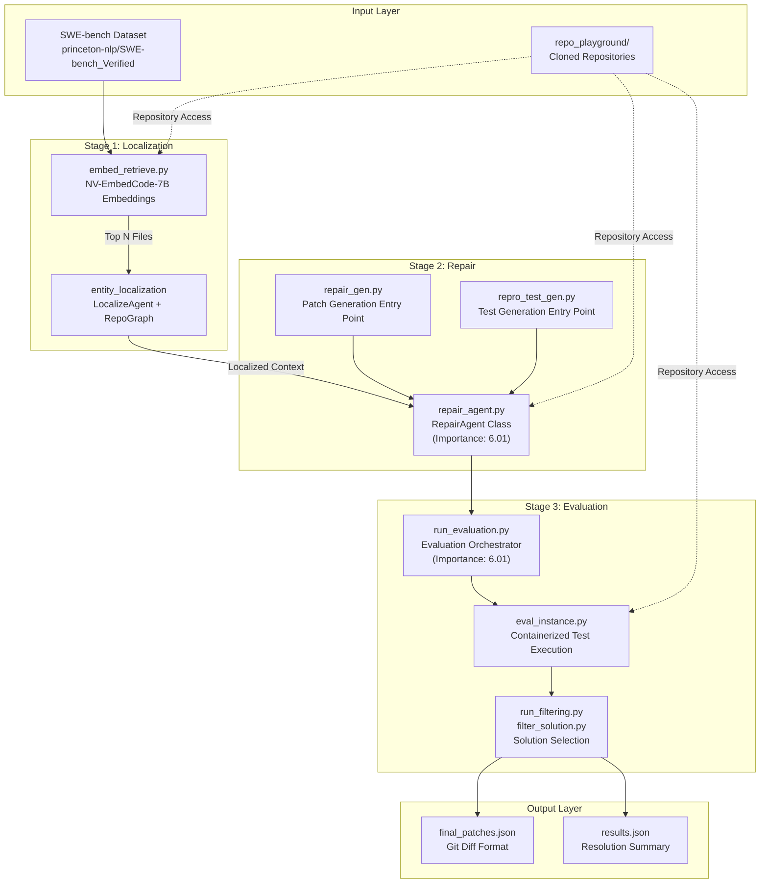

**Three-Stage Pipeline Diagram**: Shows the complete flow from bug reports through localization, repair, and evaluation to final patches. The two core orchestrators (`repair_agent.py` and `run_evaluation.py`) coordinate the middle and final stages.

**Sources:** [README.md:15-74](), Diagram 1 from system architecture

---

## Core Components

The following table lists the primary components and their responsibilities:

| Component | File Path | Importance | Role |
|-----------|-----------|------------|------|
| **File Localization** | `cortexa/retrieval/embed_retrieve.py` | 2.29 | Uses NV-EmbedCode embeddings to rank repository files by relevance to bug description |
| **Entity Localization** | `cortexa/localize/entity_localization.py` | 0.29 | Multi-turn agent that identifies specific functions/classes needing modification |
| **Repair Agent** | `cortexa/repair/repair_agent.py` | 6.01 | Central AI component orchestrating patch generation, test generation, and solution judging |
| **Repair Generation** | `cortexa/repair/repair_gen.py` | - | Entry point for generating diverse patch candidates |
| **Test Generation** | `cortexa/repair/repro_test_gen.py` | - | Generates reproduction tests with iterative refinement |
| **Evaluation Orchestrator** | `cortexa/evaluate/run_evaluation.py` | 6.01 | Coordinates parallel patch/test generation and evaluation across multiple modes |
| **Instance Evaluation** | `cortexa/evaluate/eval_instance.py` | 0.29 | Executes patches in containers and parses test framework output |
| **Solution Filtering** | `cortexa/evaluate/filter_solution.py` | 0.29 | Deduplicates, validates, and selects best patch using voting mechanisms |
| **Prompt Templates** | `cortexa/repair/prompts.py` | - | Defines all LLM prompts for repair, testing, and judging |
| **Model Configuration** | `model_config.yml` | 1.12 | Centralized LLM endpoint and API key configuration |

**Sources:** [README.md:15-105](), Diagrams 1-3 from system architecture

---

## Stage 1: Localization

The localization stage narrows the search space from entire repositories (~1000s of files) to specific code entities (~10s of functions/classes).

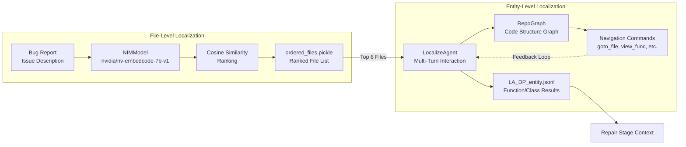

**Localization Pipeline Diagram**: Shows two-level granularity reduction using NV-EmbedCode embeddings for file ranking, followed by LocalizeAgent for entity identification.

### Key Characteristics

- **File Localization**: Uses specialized code embedding model (NV-EmbedCode-7B) trained on bug-to-code mapping
- **Entity Localization**: Optional refinement step using multi-turn agent interaction over code structure graph
- **Configurable Depth**: Default top 6 files, 5 turns for entity localization ([README.md:53-57]())
- **Evaluation Metrics**: Precision/recall against oracle files from golden patches

**Sources:** [README.md:15-70](), [embed_retrieve.py](), Diagram 4 from system architecture

---

## Stage 2: Repair

The repair stage is the system's core, generating diverse patch candidates and reproduction tests using the `RepairAgent` class.

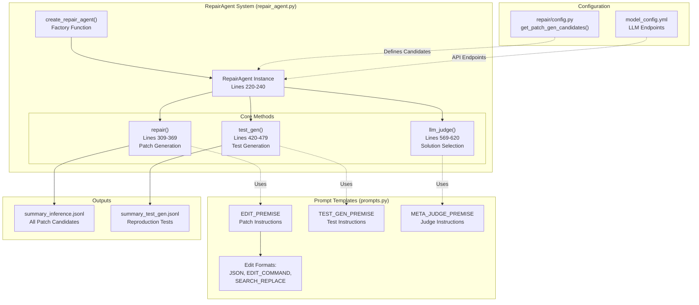

**Repair Stage Architecture Diagram**: Shows RepairAgent's three core methods and their relationships to prompt templates, configuration, and output artifacts.

### Key Characteristics

- **Diversity Strategy**: Multiple candidates per instance with different edit styles and models ([README.md:71]())
- **Edit Formats**: Supports JSON, EDIT_COMMAND, and SEARCH/REPLACE instruction styles
- **Iterative Refinement**: Test generation uses feedback loop with exit code semantics ([README.md:110-123]())
- **LLM Judge**: Meta-evaluation where an LLM selects best patch from candidates ([README.md:100-101]())

**Sources:** [README.md:73-137](), [repair_agent.py:220-240](), [repair_agent.py:309-369](), [repair_agent.py:420-479](), [repair_agent.py:569-620](), Diagram 2 from system architecture

---

## Stage 3: Evaluation

The evaluation stage tests patches in isolated containers and selects the best solution using multi-mode testing.

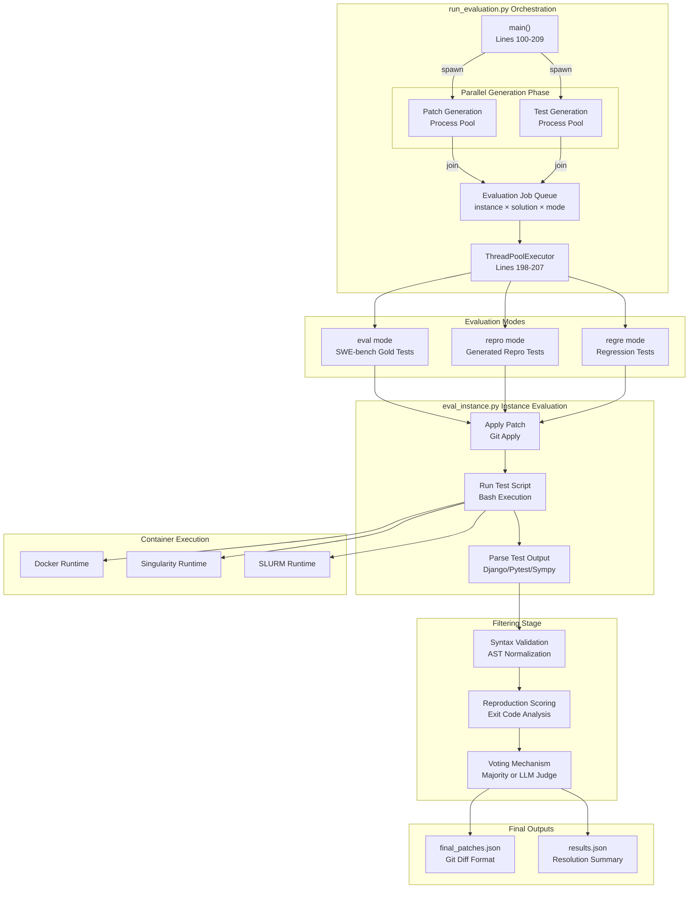

**Evaluation Stage Architecture Diagram**: Shows the parallel generation, multi-mode testing, containerized execution, and filtering pipeline that produces final patches.

### Key Characteristics

- **Parallel Execution**: Separate worker pools for patch generation, test generation, and evaluation ([README.md:84-89]())
- **Three Evaluation Modes**:
  - `eval`: Tests against SWE-bench gold test suite
  - `repro`: Tests against generated reproduction tests
  - `regre`: Tests for regression against existing tests
- **Multi-Runtime Support**: Docker, Singularity, and SLURM execution environments
- **Multi-Stage Filtering**:
  1. Syntax validation using AST normalization
  2. Reproduction test scoring
  3. Voting (majority or LLM judge) for final selection ([README.md:94-105]())

**Sources:** [README.md:73-105](), [run_evaluation.py:100-209](), [run_evaluation.py:139-157](), [run_evaluation.py:198-207](), Diagram 3 from system architecture

---

## Data Flow and Artifacts

The system produces a series of intermediate artifacts at each stage, enabling incremental processing and result caching.

| Stage | Artifact | Format | Purpose |
|-------|----------|--------|---------|
| **File Localization** | `ordered_files.pickle` | Pickle (dict) | Ranked file list per instance |
| **Entity Localization** | `LA_DP_entity.jsonl` | JSONL | Identified functions/classes per instance |
| **Patch Generation** | `summary_inference.jsonl` | JSONL | All generated patch candidates |
| **Test Generation** | `summary_test_gen.jsonl` | JSONL | Generated reproduction tests |
| **Eval Mode** | `summary_eval.jsonl` | JSONL | Gold test execution results |
| **Repro Mode** | `summary_repro.jsonl` | JSONL | Repro test execution results |
| **Regre Mode** | `summary_regre.jsonl` | JSONL | Regression test results |
| **Normalization** | `normalized_outputs.pickle` | Pickle | Deduplicated patch candidates |
| **Final Output** | `final_patches.json` | JSON (dict) | Selected patches in git diff format |
| **Summary** | `results.json` | JSON | Resolution counts and statistics |

All artifacts are stored in `log_dir/` for centralized management. Repository clones reside in `repo_playground/`, and generated tests in `repro_test_dir/`.

**Sources:** [README.md:38-44](), [README.md:99-105](), Diagram 6 from system architecture

---

## Configuration and Extension Points

Nemotron-CORTEXA is designed for extensibility through centralized configuration files:

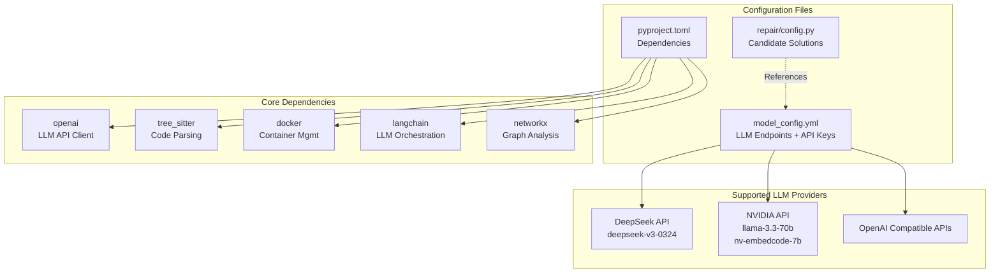

**Configuration and Dependencies Diagram**: Shows how configuration files control LLM providers and system dependencies.

### Extension Points

1. **New LLM Providers**: Add to `model_config.yml` with OpenAI-compatible API ([README.md:61]())
2. **Custom Edit Styles**: Extend `prompts.py` with new instruction formats
3. **Additional Evaluation Modes**: Modify `eval_instance.py` and `run_evaluation.py` ([README.md:139-166]())
4. **Custom Localization**: Implement new embedding models or agent strategies

For detailed guides on extending the system, see [Extending Nemotron-CORTEXA](#8).

**Sources:** [README.md:61-63](), [model_config.yml](), [pyproject.toml:1-28](), Diagram 5 from system architecture

---

## Quick Start Commands

The following table provides basic commands for running the entire pipeline:

| Stage | Command | Key Arguments |
|-------|---------|---------------|
| **File Localization** | `python -m cortexa.retrieval.embed_retrieve` | `--model_name nvidia/nv-embedcode-7b-v1` |
| **Entity Localization** | `python -m cortexa.localize.entity_localization` | `--num_turns 5 --num_top_files 6` |
| **Unified Pipeline** | `python -m cortexa.evaluate.run_evaluation` | `--run_patch_generation --run_test_generation --modes eval,repro` |
| **Solution Filtering** | `python -m cortexa.evaluate.run_filtering` | `--run_normalization --vote_mode llm_judge` |

See [Quick Start Guide](#1.2) for detailed installation and configuration instructions.

**Sources:** [README.md:21-33](), [README.md:51-59](), [README.md:79-92](), [README.md:94-105]()

---

## System Requirements

- **Python Version**: 3.11 or higher ([README.md:6](), [pyproject.toml:10]())
- **External Services**: LLM API access (DeepSeek, NVIDIA, or OpenAI-compatible)
- **Container Runtime**: Docker, Singularity, or SLURM for evaluation
- **Hardware**: Multi-core CPU recommended for parallel execution

**Installation**:
```bash
pip install -e .
```

**Sources:** [README.md:5-13](), [pyproject.toml:10-28]()

---

## Key Design Principles

1. **Modularity**: Clear separation between localization, repair, and evaluation stages
2. **Diversity**: Multiple patch candidates with different edit styles and models increase coverage
3. **Safety**: All patch testing occurs in isolated containers to prevent host system corruption
4. **Incrementality**: Artifacts at each stage enable resumption and partial reruns
5. **Extensibility**: Configuration-driven design allows easy addition of new models and evaluation modes
6. **Reproducibility**: Comprehensive logging and artifact tracking ensure reproducible experiments

**Sources:** [README.md:1-184](), Diagrams 1-6 from system architecture

---

# Page: System Architecture

# System Architecture

<details>
<summary>Relevant source files</summary>

The following files were used as context for generating this wiki page:

- [README.md](README.md)
- [model_config.yml](model_config.yml)
- [pyproject.toml](pyproject.toml)

</details>


## Purpose and Scope

This document describes the high-level architecture of Nemotron-CORTEXA, showing how the three main stages (Localization, Repair, and Evaluation) interact to automatically fix software bugs. It covers the pipeline structure, core components, data flow between stages, and external dependencies.

For detailed information about individual stages, see [Localization Stage](#2), [Repair Stage](#3), and [Evaluation Stage](#4). For configuration details, see [Configuration and Setup](#5).

## Overview

Nemotron-CORTEXA is an LLM-powered automated software engineering tool that processes bug reports from the SWE-bench dataset through a three-stage pipeline:

1. **Localization Stage**: Identifies relevant code locations using embedding-based file retrieval and agent-based entity localization
2. **Repair Stage**: Generates diverse patch candidates and reproduction tests using the `RepairAgent`
3. **Evaluation Stage**: Tests patches in isolated containers and filters to select the best solution

The system is designed for modularity, with each stage producing intermediate artifacts that can be reused across experiments.

**Sources**: [README.md:1-74]()

## Three-Stage Pipeline Architecture

The following diagram shows the complete system pipeline with specific code module names:

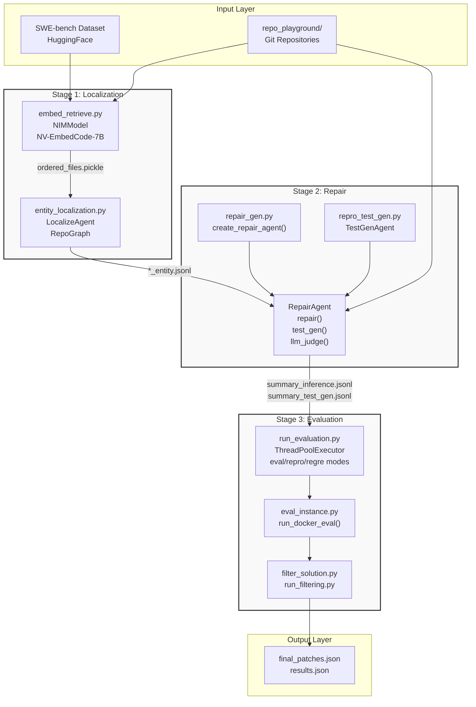

**Pipeline Stages:**

| Stage | Primary Module | Key Output | Purpose |
|-------|---------------|------------|---------|
| Localization | `embed_retrieve.py`, `entity_localization.py` | `ordered_files.pickle`, `*_entity.jsonl` | Reduce search space from entire repository to specific code entities |
| Repair | `repair_gen.py`, `repro_test_gen.py` | `summary_inference.jsonl`, `summary_test_gen.jsonl` | Generate diverse patch candidates and reproduction tests |
| Evaluation | `run_evaluation.py`, `eval_instance.py` | `summary_eval.jsonl`, `summary_repro.jsonl` | Test patches in containers and select best solution |
| Filtering | `filter_solution.py`, `run_filtering.py` | `final_patches.json`, `results.json` | Deduplicate, validate, and rank patches |

**Sources**: [README.md:15-105](), High-level diagrams 1 and 6

## Core Component Architecture

The system's core logic is implemented across several key modules, with two components marked as critical (importance 6.01):

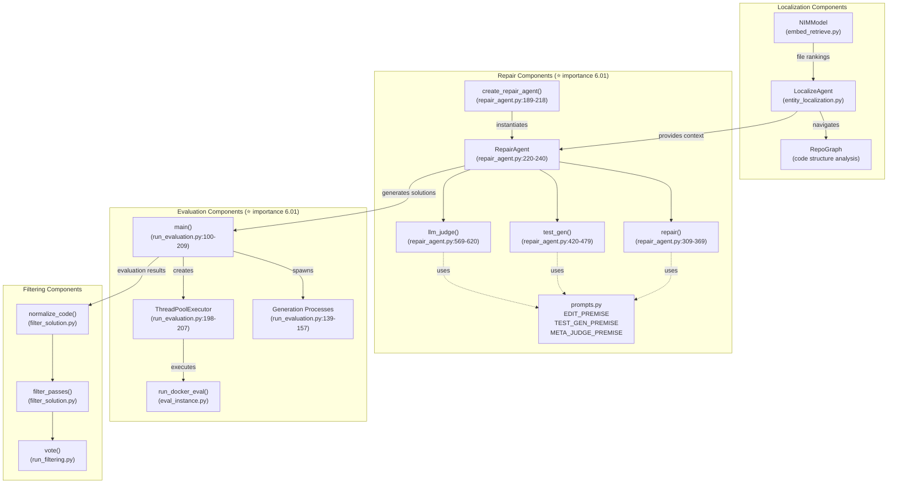

**Component Descriptions:**

| Component | Module | Key Methods/Classes | Responsibility |
|-----------|--------|---------------------|----------------|
| NIMModel | `embed_retrieve.py:30-64` | `embed()`, `embed_queries()` | Interface to NV-EmbedCode-7B for semantic code search |
| LocalizeAgent | `entity_localization.py` | Multi-turn interaction with RepoGraph | Navigate code structure to find relevant entities |
| RepairAgent | `repair_agent.py:220-240` | `repair()`, `test_gen()`, `llm_judge()` | Core AI agent for patch and test generation |
| ThreadPoolExecutor | `run_evaluation.py:198-207` | Parallel job execution | Orchestrate evaluation across multiple instances |
| filter_passes() | `filter_solution.py` | Syntax validation, regression testing | Multi-stage patch filtering |

**Sources**: [README.md:15-74](), [repair_agent.py]() cluster, [run_evaluation.py]() cluster, High-level diagram 2

## Data Flow and Artifact Persistence

The system maintains a clear data lineage through each stage, with intermediate artifacts stored in `log_dir/`:

```mermaid
graph LR
    subgraph Stage1["Stage 1: Localization"]
        S1Input["Bug Description<br/>(Dataset)"]
        S1Output["ordered_files.pickle<br/>*_entity.jsonl"]
        
        S1Input --> S1Output
    end
    
    subgraph Stage2["Stage 2: Repair"]
        S2Input["Context<br/>(localization results)"]
        S2Process["RepairAgent<br/>Generation"]
        S2Output["summary_inference.jsonl<br/>summary_test_gen.jsonl"]
        
        S2Input --> S2Process
        S2Process --> S2Output
    end
    
    subgraph Stage3["Stage 3: Evaluation"]
        S3Process1["Parallel Evaluation<br/>(eval/repro/regre)"]
        S3Process2["Normalization<br/>& Deduplication"]
        S3Output["summary_eval.jsonl<br/>summary_repro.jsonl<br/>summary_regre.jsonl"]
        
        S3Process1 --> S3Output
        S3Output --> S3Process2
    end
    
    subgraph Stage4["Stage 4: Filtering"]
        S4Process["Voting<br/>(majority/llm_judge)"]
        S4Output["final_patches.json<br/>results.json"]
        
        S4Process --> S4Output
    end
    
    S1Output -->|"pickle file"| S2Input
    S2Output -->|"JSONL files"| S3Process1
    S3Process2 -->|"normalized_outputs.pickle<br/>outputs_hash_map.pickle"| S4Process
```

**Artifact Format Summary:**

| Artifact | Format | Stage | Content |
|----------|--------|-------|---------|
| `ordered_files.pickle` | Pickle | Localization | Dictionary mapping `instance_id` → (ranked_files, oracle_files) |
| `*_entity.jsonl` | JSONL | Localization | Per-line: `instance_id`, `entities`, `context` |
| `summary_inference.jsonl` | JSONL | Repair | Per-line: `instance_id`, `model_patch`, `model_name_or_path` |
| `summary_test_gen.jsonl` | JSONL | Repair | Per-line: `instance_id`, `repro_test_code`, `test_directives` |
| `summary_eval.jsonl` | JSONL | Evaluation | Per-line: `instance_id`, `solution_id`, `test_results` |
| `normalized_outputs.pickle` | Pickle | Filtering | Deduplicated patches with AST normalization |
| `final_patches.json` | JSON | Filtering | Final selected patches in git diff format |

The system uses pickle format for complex Python objects (ranked lists, hash maps) and JSONL for streaming results that can be processed incrementally. All artifacts are namespaced by dataset and model to support experimentation.

**Sources**: [README.md:38-105](), High-level diagram 6

## External Dependencies and Configuration

### Dependency Architecture

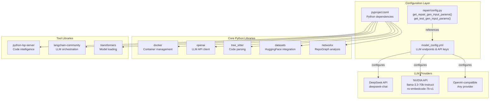

### Configuration Files

The system uses three primary configuration files:

**1. model_config.yml** - LLM Provider Configuration

```yaml
deepseek-v3-0324:
  base_url: 'https://api.deepseek.com'
  api_key_name: 'DEEPSEEK_API_KEY'
  model_name: 'deepseek-chat'
```

Each entry specifies:
- `base_url`: OpenAI-compatible API endpoint
- `api_key_name`: Environment variable containing the API key
- `model_name`: Model identifier for the provider

The system reads API keys at runtime via `os.environ[api_key_name]` for security.

**Sources**: [model_config.yml:1-15](), [README.md:61-62]()

**2. repair/config.py** - Candidate Configuration

This module defines which models and configurations to use for patch and test generation:
- `get_default_loc_log_file_map()`: Maps localization results to repair inputs
- `get_repair_gen_input_params()`: Defines patch generation candidates
- `get_test_gen_input_params()`: Defines test generation candidates

These functions enable experimentation with different model combinations for solution diversity.

**Sources**: [README.md:71-76]()

**3. pyproject.toml** - Python Dependencies

| Dependency Category | Libraries | Purpose |
|---------------------|-----------|---------|
| LLM Integration | `openai`, `langchain-community`, `transformers` | API clients and orchestration |
| Code Analysis | `tree_sitter`, `tree_sitter_python` | AST parsing and normalization |
| Developer Tools | `python-lsp-server[all]`, `python-lsp-jsonrpc` | Code intelligence for LocalizeAgent |
| Container Execution | `docker`, `paramiko` | Isolated evaluation environments |
| Data Management | `datasets`, `filelock`, `networkx` | SWE-bench integration, graph analysis |
| Utilities | `tiktoken`, `unidiff`, `jsonschema`, `torch` | Token counting, diff parsing, validation |

The system requires Python 3.11+ as specified in `requires-python = ">=3.11"`.

**Sources**: [pyproject.toml:1-28](), [README.md:6-13]()

## Repository Management

The system manages external repositories and test directories through a structured filesystem layout:

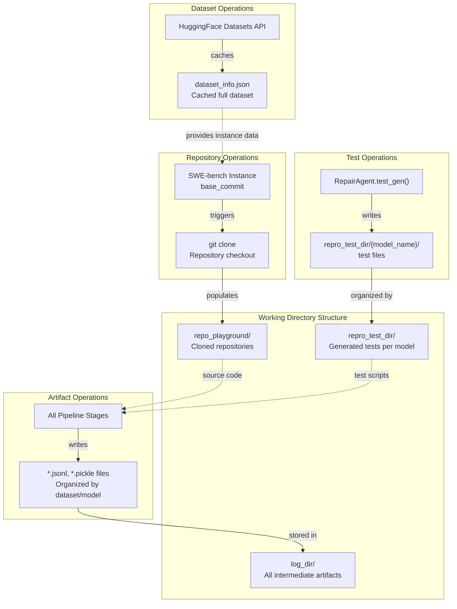

**Directory Purposes:**

- **repo_playground/**: Contains git clones of target repositories checked out to specific commits. Each instance's `base_commit` determines the repository state.

- **repro_test_dir/**: Stores generated reproduction tests organized by model name. Tests from multiple models can be merged for diversity (e.g., `repro_test_dir/merged/`).

- **log_dir/**: Central location for all intermediate and final artifacts. File naming encodes metadata: `{dataset}_{query_type}_{model}_summary_{stage}.jsonl`.

The system uses `dataset_info.json` to cache the full SWE-bench dataset, avoiding repeated HuggingFace API calls across runs.

**Sources**: [README.md:27-32, 81-83, 117](), High-level diagram 6

## System Entry Points

The system provides multiple command-line entry points for different workflows:

| Entry Point | Module | Purpose | Parallel Execution |
|-------------|--------|---------|-------------------|
| File Localization | `cortexa.retrieval.embed_retrieve` | Rank files using NV-EmbedCode | N/A (API batching) |
| Entity Localization | `cortexa.localize.entity_localization` | Find relevant functions/classes | Single instance per run |
| Reproduction Test Gen | `cortexa.repair.repro_test_gen` | Generate reproduction tests | `--num_workers` (multiprocessing) |
| Patch Generation | `cortexa.repair.repair_gen` | Generate patch candidates | `--num_workers` (multiprocessing) |
| Full Evaluation | `cortexa.evaluate.run_evaluation` | Run all stages end-to-end | `--num_workers_patch_gen`, `--num_workers_test_gen`, `--num_workers_eval` |
| Single Patch Eval | `cortexa.evaluate.run_evaluation --single_patch_eval` | Evaluate one patch per instance | `--num_workers_eval` |
| Solution Filtering | `cortexa.evaluate.run_filtering` | Select best patch | N/A (sequential) |

All entry points accept `--instance_id` for subset evaluation. Omitting this argument processes the entire benchmark.

**Sources**: [README.md:22-166]()

---

# Page: Quick Start Guide

# Quick Start Guide

<details>
<summary>Relevant source files</summary>

The following files were used as context for generating this wiki page:

- [README.md](README.md)
- [model_config.yml](model_config.yml)
- [pyproject.toml](pyproject.toml)

</details>


**Purpose and Scope**: This guide provides step-by-step instructions for installing Nemotron-CORTEXA, configuring API credentials, and executing a complete bug-fixing workflow on a single SWE-bench instance. By the end of this guide, you will have generated and evaluated patch candidates for a specific bug report.

For comprehensive architecture details, see [System Architecture](#1.1). For advanced configuration options including custom model endpoints and candidate solutions, see [Configuration and Setup](#5). For extending the system with new capabilities, see [Extending Nemotron-CORTEXA](#8).

---

## Prerequisites

Before beginning, ensure you have:

| Requirement | Details |
|------------|---------|
| **Python Version** | 3.11 or higher |
| **Disk Space** | ~5 GB for dependencies and repository clones |
| **API Keys** | Access to LLM providers (NVIDIA, DeepSeek, or OpenAI-compatible) |
| **Docker** | Optional but recommended for containerized evaluation |

**Sources**: [README.md:5-6](), [pyproject.toml:10]()

---

## Installation

### Step 1: Clone and Install Dependencies

```bash
git clone https://github.com/NVIDIA/Nemotron-CORTEXA.git
cd Nemotron-CORTEXA
pip install -e .
```

The installation process reads dependency specifications from `pyproject.toml` and installs core packages including:

| Package Category | Key Dependencies |
|-----------------|------------------|
| **LLM Integration** | `openai`, `transformers`, `langchain-community` |
| **Code Analysis** | `tree_sitter`, `tree_sitter_python` |
| **Developer Tools** | `python-lsp-server[all]`, `python-lsp-jsonrpc` |
| **Container Management** | `docker` |
| **Data Processing** | `datasets`, `networkx`, `unidiff` |

**Sources**: [README.md:8-13](), [pyproject.toml:11-28]()

---

## Configuration

### Step 2: Set Up API Keys

Nemotron-CORTEXA requires LLM API access for localization, repair, and evaluation stages. The system reads API credentials from environment variables referenced in `model_config.yml`.

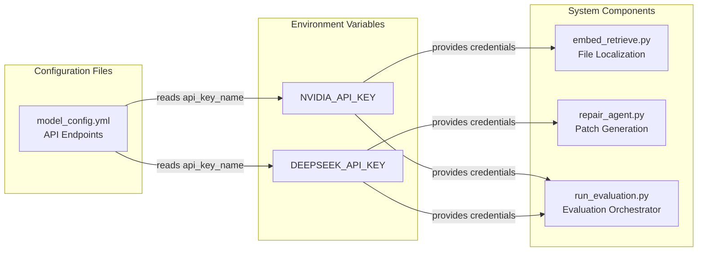

#### Configure Environment Variables

For NVIDIA API access (required for NV-EmbedCode file localization):
```bash
export NVIDIA_API_KEY="nvapi-your-key-here"
```

For DeepSeek API access (recommended for patch generation):
```bash
export DEEPSEEK_API_KEY="sk-your-key-here"
```

#### Verify Model Configuration

Inspect [model_config.yml:1-15]() to see available model endpoints:

| Model Configuration | Provider | Use Case |
|---------------------|----------|----------|
| `deepseek-v3-0324` | DeepSeek Direct | Patch generation, LLM judge |
| `deepseek-v3-0324-nvdev` | NVIDIA API Gateway | Alternative DeepSeek access |
| `llama-3.3-70b-instruct` | NVIDIA API | Localization, repair |
| `nvidia/nv-embedcode-7b-v1` | NVIDIA NIM | File embedding/retrieval |

The system uses the `api_key_name` field to look up credentials via `os.environ` at runtime. For security, API keys are never hardcoded in configuration files.

**Sources**: [README.md:61](), [model_config.yml:1-15]()

---

## Basic Workflow Example

This section demonstrates a complete bug-fixing workflow on a single instance from SWE-bench_Verified: `astropy__astropy-12907`.

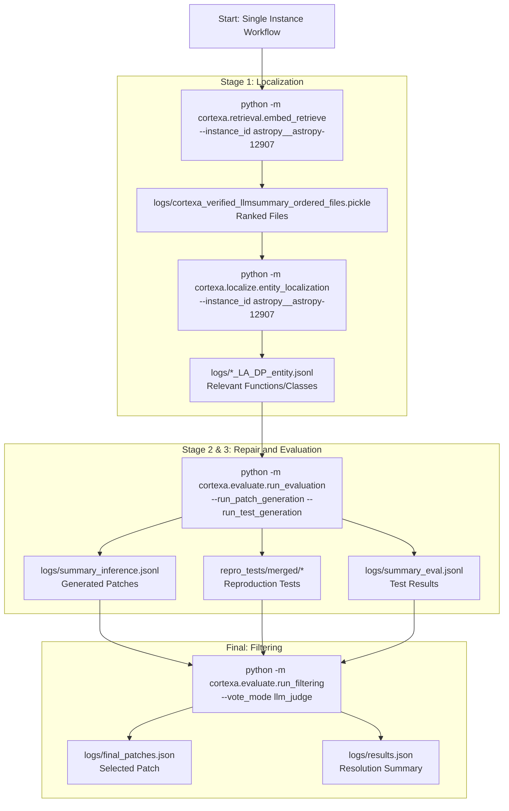

### Step 3: Create Working Directories

```bash
mkdir -p logs repos repro_tests/merged
```

| Directory | Purpose |
|-----------|---------|
| `logs/` | Stores all localization, inference, and evaluation artifacts |
| `repos/` | Cloned repository playground for safe modification |
| `repro_tests/merged/` | Generated reproduction test scripts |

---

### Step 4: Run File Localization

Execute file-level localization using NV-EmbedCode embeddings:

```bash
python -m cortexa.retrieval.embed_retrieve \
    --model_name nvidia/nv-embedcode-7b-v1 \
    --base_url https://integrate.api.nvidia.com/v1 \
    --log_dir ./logs \
    --repo_playground ./repos \
    --batch_size 16 \
    --max_length 450 \
    --dataset_name_or_path princeton-nlp/SWE-bench_Verified \
    --query_type llmsummary \
    --instance_id astropy__astropy-12907
```

**Key Parameters**:
- `--model_name`: Specifies the embedding model (NV-EmbedCode-7B)
- `--base_url`: API endpoint for NVIDIA NIM service
- `--query_type llmsummary`: Uses LLM-generated bug summary for retrieval
- `--instance_id`: Single instance ID (omit to process entire benchmark)

**Expected Output**: Creates `logs/cortexa_verified_llmsummary_ordered_files.pickle` containing ranked file lists.

**Sources**: [README.md:21-33]()

---

### Step 5: Run Entity Localization (Optional)

Refine localization to specific functions and classes using the LocalizeAgent:

```bash
python -m cortexa.localize.entity_localization \
    --log_dir ./logs \
    --repo_playground ./repos \
    --num_turns 5 \
    --num_top_files 6 \
    --embed_results cortexa_verified_llmsummary_ordered_files.pickle \
    --instance_id astropy__astropy-12907
```

**Key Parameters**:
- `--num_turns`: Maximum agent interaction rounds (default 5)
- `--num_top_files`: How many ranked files to analyze (default 6)
- `--embed_results`: Pickle file from Step 4

**Expected Output**: Creates three JSONL files:
1. Direct prompt results
2. LocalizeAgent results
3. Merged results (recommended for repair stage)

**Note**: This step is optional but empirically improves repair accuracy. The system includes pre-generated entity localization results at [src/cortexa/retrieval/files/cortexa_all_llmsummary_LA_DP_entity.jsonl]() for convenience.

**Sources**: [README.md:49-64]()

---

### Step 6: Run Repair and Evaluation Pipeline

Execute the integrated pipeline that generates patches, creates reproduction tests, and evaluates all candidates:

```bash
python -m cortexa.evaluate.run_evaluation \
    --repro_test_dir ./repro_tests/merged \
    --repo_playground ./repos \
    --log_dir ./logs \
    --run_patch_generation \
    --run_test_generation \
    --num_workers_patch_gen 2 \
    --num_workers_test_gen 2 \
    --num_workers_eval 4 \
    --modes eval,repro \
    --dataset_name_or_path princeton-nlp/SWE-bench_Verified \
    --instance_id astropy__astropy-12907
```

**Key Parameters**:
- `--run_patch_generation`: Enables parallel patch generation
- `--run_test_generation`: Enables parallel reproduction test generation
- `--num_workers_patch_gen`: Worker pool size for patch generation (default 2)
- `--num_workers_test_gen`: Worker pool size for test generation (default 2)
- `--num_workers_eval`: Worker pool size for evaluation (default 4)
- `--modes`: Evaluation modes (comma-separated: `eval`, `repro`, `regre`)

**Process Flow**:
1. **Generation Phase**: Spawns separate processes for `repair_gen` and `repro_test_gen`
2. **Evaluation Phase**: Uses ThreadPoolExecutor to test patches in parallel
3. **Result Streaming**: Writes results to JSONL files as they complete

**Expected Output**:
- `logs/summary_inference.jsonl`: All generated patch candidates
- `logs/summary_test_gen.jsonl`: Generated reproduction tests
- `logs/summary_eval.jsonl`: Gold test evaluation results
- `logs/summary_repro.jsonl`: Reproduction test results
- `repro_tests/merged/{model_name}/test_{instance_id}.py`: Test scripts

**Sources**: [README.md:78-92](), [README.md:145-153]()

---

### Step 7: Filter and Select Final Patches

Apply multi-stage filtering to select the best patch from candidates:

```bash
python -m cortexa.evaluate.run_filtering \
    --log_dir ./logs \
    --repo_playground ./repos \
    --run_normalization \
    --vote_mode llm_judge \
    --model_name deepseek-v3-0324 \
    --dataset_name_or_path princeton-nlp/SWE-bench_Verified
```

**Key Parameters**:
- `--run_normalization`: Enables AST-based code normalization and deduplication
- `--vote_mode`: Selection strategy (`majority` or `llm_judge`)
- `--model_name`: LLM model for `llm_judge` voting

**Filtering Pipeline**:

| Stage | Function | Description |
|-------|----------|-------------|
| **Syntax Validation** | `filter_solution.py:check_syntax()` | Removes patches with parse errors |
| **Normalization** | `filter_solution.py:normalize_code()` | AST-based deduplication via hashing |
| **Regression Filter** | `filter_solution.py:filter_regre()` | Removes patches failing regression tests |
| **Voting** | `run_filtering.py:filter_solutions()` | Majority or LLM judge selection |

**Expected Output**:
- `logs/final_patches.json`: Selected patch in git diff format
- `logs/results.json`: Resolution summary with resolved/unresolved counts
- `logs/normalized_outputs.pickle`: Deduplicated patch mappings
- `logs/outputs_hash_map.pickle`: Code hash to patch ID mappings

**Sources**: [README.md:94-105]()

---

## Output Verification

### Inspect Final Patch

The `final_patches.json` file contains the selected patch in SWE-bench format:

```json
{
  "astropy__astropy-12907": "diff --git a/astropy/io/ascii/ui.py ...",
  "instance_metadata": {
    "model_name_or_path": "deepseek-v3-0324",
    "timestamp": "2025-01-15T10:30:00Z"
  }
}
```

### Review Resolution Summary

The `results.json` file provides high-level metrics:

```json
{
  "resolved": ["astropy__astropy-12907"],
  "unresolved": [],
  "resolved_count": 1,
  "unresolved_count": 0,
  "resolution_rate": 1.0
}
```

### Examine Intermediate Artifacts

All intermediate artifacts are preserved in `logs/` for debugging and analysis:

| File Pattern | Content |
|-------------|---------|
| `summary_inference.jsonl` | Raw patch candidates with model metadata |
| `summary_eval.jsonl` | Gold test pass/fail results |
| `summary_repro.jsonl` | Reproduction test results |
| `cortexa_*_ordered_files.pickle` | File localization rankings |
| `*_entity.jsonl` | Entity localization results |

**Sources**: [README.md:105]()

---

## Command Reference

For quick reference, here is a summary of the three main commands:

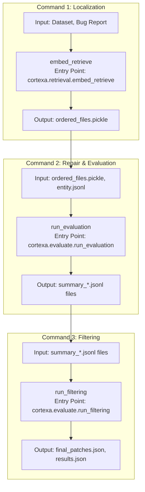

| Command | Module Path | Primary Function |
|---------|-------------|------------------|
| **File Localization** | `cortexa.retrieval.embed_retrieve` | Rank files using NV-EmbedCode embeddings |
| **Entity Localization** | `cortexa.localize.entity_localization` | Identify relevant functions/classes |
| **Integrated Pipeline** | `cortexa.evaluate.run_evaluation` | Generate patches, tests, and evaluate |
| **Final Filtering** | `cortexa.evaluate.run_filtering` | Select best patch from candidates |

**Sources**: [README.md:21-166]()

---

## Alternative Workflows

### Running Stages Separately

Instead of the integrated `run_evaluation` command, you can execute each stage independently:

**Reproduction Test Generation**:
```bash
python -m cortexa.repair.repro_test_gen \
    --log_dir ./logs \
    --out_inference_file summary_test_gen.jsonl \
    --repro_test_dir ./repro_tests \
    --max_round 3 \
    --num_workers 2 \
    --repo_playground ./repos \
    --dataset_name_or_path princeton-nlp/SWE-bench_Verified \
    --instance_id astropy__astropy-12907
```

**Patch Generation**:
```bash
python -m cortexa.repair.repair_gen \
    --log_dir ./logs \
    --out_inference_file summary_inference.jsonl \
    --num_workers 2 \
    --repo_playground ./repos \
    --dataset_name_or_path princeton-nlp/SWE-bench_Verified \
    --instance_id astropy__astropy-12907
```

**Evaluation Only**:
```bash
python -m cortexa.evaluate.run_evaluation \
    --modes eval,repro \
    --log_dir ./logs \
    --out_inference_file summary_inference.jsonl \
    --num_workers_eval 4 \
    --dataset_name_or_path princeton-nlp/SWE-bench_Verified \
    --instance_id astropy__astropy-12907
```

**Sources**: [README.md:107-166]()

### Evaluating External Patches

To evaluate a single pre-generated patch without running generation steps:

```bash
python -m cortexa.evaluate.run_evaluation \
    --modes eval \
    --log_dir ./logs \
    --out_inference_file summary_inference.jsonl \
    --num_workers_eval 4 \
    --dataset_name_or_path princeton-nlp/SWE-bench_Verified \
    --instance_id astropy__astropy-12907 \
    --single_patch_eval
```

The `summary_inference.jsonl` file must contain at minimum:
- `instance_id`: Instance identifier
- `model_patch`: Patch in git diff format

**Sources**: [README.md:155-171]()

---

## Troubleshooting

### API Key Issues

**Symptom**: `KeyError` when accessing environment variables.

**Solution**: Verify API keys are exported:
```bash
echo $NVIDIA_API_KEY
echo $DEEPSEEK_API_KEY
```

Ensure the `api_key_name` in [model_config.yml]() matches your environment variable names.

### Docker Permission Errors

**Symptom**: `PermissionError: [Errno 13] Permission denied` when running evaluation.

**Solution**: Add user to docker group or run with sudo:
```bash
sudo usermod -aG docker $USER
# Log out and back in for changes to take effect
```

### Missing Pre-generated Localization Files

**Symptom**: `FileNotFoundError` when running repair without localization.

**Solution**: The system includes pre-generated localization results at:
- [src/cortexa/retrieval/files/cortexa_all_llmsummary_ordered_files.pickle]()
- [src/cortexa/retrieval/files/cortexa_all_llmsummary_LA_DP_entity.jsonl]()

These files cover the union of SWE-bench_Lite and SWE-bench_Verified (707 instances). If using a custom dataset, you must run localization steps first.

**Sources**: [README.md:44](), [README.md:69]()

---

## Next Steps

After completing this quick start guide, explore:

- **[Localization Stage](#2)**: Deep dive into file and entity localization mechanisms
- **[Repair Stage](#3)**: Understand the RepairAgent and prompt engineering strategies
- **[Evaluation Stage](#4)**: Learn about multi-mode evaluation and container execution
- **[Configuration and Setup](#5)**: Customize model endpoints and candidate solutions
- **[Extending Nemotron-CORTEXA](#8)**: Add new edit styles, LLM providers, or evaluation modes

**Sources**: [README.md:1-184]()

---

# Page: Localization Stage

# Localization Stage

<details>
<summary>Relevant source files</summary>

The following files were used as context for generating this wiki page:

- [README.md](README.md)
- [src/cortexa/retrieval/embed_retrieve.py](src/cortexa/retrieval/embed_retrieve.py)

</details>


## Purpose and Scope

The Localization Stage is the first phase of the Nemotron-CORTEXA pipeline, responsible for narrowing the search space from entire repositories (thousands of files) to specific code entities (functions, classes) that require modification to fix a bug. This stage operates in two levels: **File Localization** uses semantic embeddings to rank repository files by relevance to bug descriptions, followed by **Entity Localization** which uses an agent-based system to identify specific code constructs within the top-ranked files.

This document provides an overview of how the two localization levels work together. For detailed implementation information, see:
- [File Localization with Embeddings](#2.1) - NV-EmbedCode embedding system
- [Entity Localization with Agents](#2.2) - LocalizeAgent and RepoGraph
- [Localization Evaluation Metrics](#2.3) - Precision/recall measurement

For information about how localization results are consumed, see [Repair Stage](#3).

**Sources:** [README.md:15-72](), [Diagram 4]()

---

## Two-Level Localization Architecture

The localization stage implements a coarse-to-fine strategy that progressively narrows the search space:

| Level | Input | Output | Granularity | Primary Component |
|-------|-------|--------|-------------|-------------------|
| **File Localization** | Bug description or LLM summary | Ranked list of files | File-level | `NIMModel` in `embed_retrieve.py` |
| **Entity Localization** | Top N ranked files + bug description | List of functions/classes | Entity-level | `LocalizeAgent` with `RepoGraph` |

### Localization Pipeline Flow

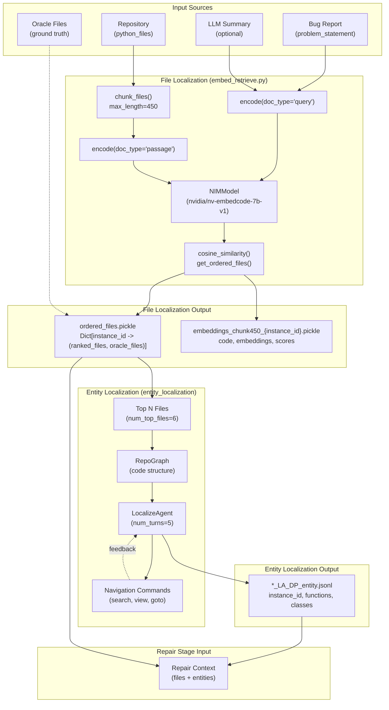

**Sources:** [README.md:15-72](), [embed_retrieve.py:1-269](), [Diagram 4]()

---

## File Localization Process

File localization reduces the search space from thousands of repository files to approximately 10-20 relevant candidates using semantic similarity.

### NIMModel Embedding System

The system uses the `NIMModel` class [embed_retrieve.py:43-90]() to interact with the NV-EmbedCode-7B-v1 API:

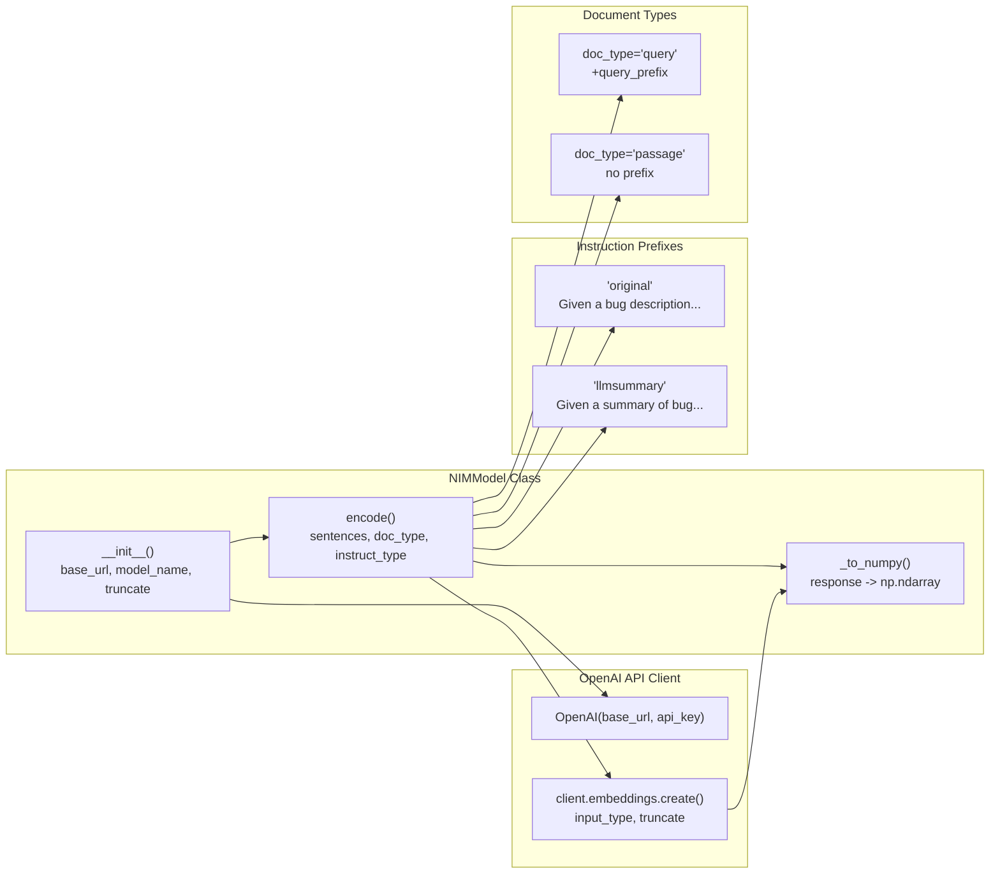

**Key configuration parameters:**
- `model_name`: `nvidia/nv-embedcode-7b-v1` (default)
- `base_url`: `https://integrate.api.nvidia.com/v1`
- `truncate`: `END` (default) - controls how content exceeding model context is handled
- `batch_size`: 16 (default) - number of texts encoded per API call
- `max_length`: 450 (default) - token limit per code chunk

**Sources:** [embed_retrieve.py:43-90](), [README.md:21-33]()

### Code Chunking and Ranking

The `chunk_files()` function [embed_retrieve.py:113-138]() splits repository files into fixed-size token chunks:

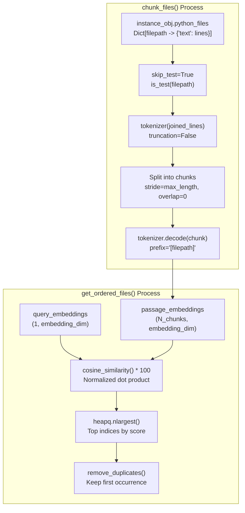

**Output structure** saved to `cortexa_{target_set}_{query_type}_ordered_files.pickle` [embed_retrieve.py:231]():
```python
Dict[instance_id: str -> Tuple[
    List[str],  # ranked file paths (deduplicated)
    List[str]   # oracle files from ground truth patch
]]
```

**Sources:** [embed_retrieve.py:113-156](), [embed_retrieve.py:170-231]()

---

## Entity Localization Process

Entity localization refines file-level results to specific code entities (functions, classes, methods) using an agent-based exploration system.

### LocalizeAgent Architecture

The `LocalizeAgent` operates in a multi-turn interaction loop over a `RepoGraph` data structure:

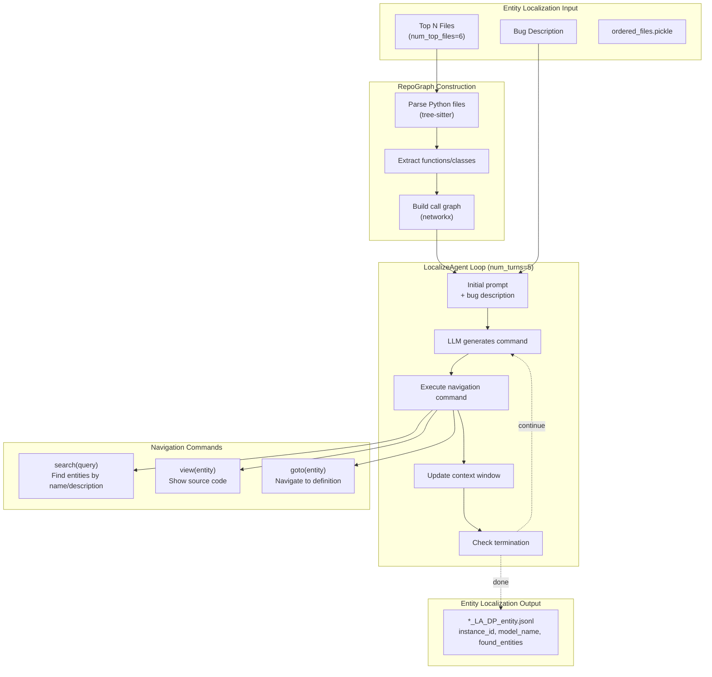

**Sources:** [README.md:46-69](), [Diagram 4]()

### Output Format

Entity localization produces JSONL files with the following structure:

```
{instance_id}_entity_{model_config}_{temperature}.jsonl
```

Each line contains:
- `instance_id`: SWE-bench instance identifier
- `model_name`: Model configuration used for localization
- `functions`: List of identified function names
- `classes`: List of identified class names
- `context`: Aggregated code context from exploration

**Merging strategy:** Running entity localization with multiple model configurations and temperatures, then merging results, empirically increases recall [README.md:63]().

**Sources:** [README.md:47-69]()

---

## Integration with Repair Stage

The localization stage produces two key artifacts consumed by the repair stage:

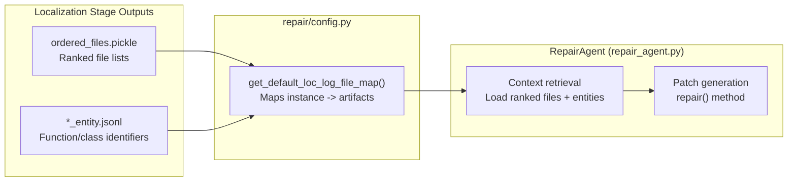

The `get_default_loc_log_file_map()` function in [repair/config.py]() (referenced in [README.md:71]()) configures which localization results to use for each instance. By default, it reads pre-processed files from `src/cortexa/retrieval/files/`:
- `cortexa_all_llmsummary_ordered_files.pickle` - File rankings for 707 instances (Lite + Verified)
- `cortexa_all_llmsummary_LA_DP_entity.jsonl` - Entity results

**Sources:** [README.md:71-72](), [Diagram 1]()

---

## Configuration and Usage

### Running File Localization

Command-line interface via `embed_retrieve.py` [README.md:21-33]():

```bash
python -m cortexa.retrieval.embed_retrieve \
    --model_name nvidia/nv-embedcode-7b-v1 \
    --base_url https://integrate.api.nvidia.com/v1 \
    --log_dir ./logs \
    --repo_playground ./repos \
    --batch_size 16 \
    --max_length 450 \
    --dataset_name_or_path princeton-nlp/SWE-bench_Verified \
    --query_type llmsummary \
    --instance_id <instance_id>
```

**Key parameters:**
- `--query_type`: `llmsummary` (uses LLM summaries) or `original` (uses raw problem statements)
- `--instance_id`: Comma-separated list of instances, or omit to process entire benchmark
- `--max_length`: Token limit for code chunks (default: 450)

**Environment requirement:** `NVIDIA_API_KEY` must be set [embed_retrieve.py:45-46]()

**Sources:** [README.md:21-44](), [embed_retrieve.py:234-268]()

### Running Entity Localization

Command-line interface via `entity_localization` module [README.md:49-59]():

```bash
python -m cortexa.localize.entity_localization \
    --log_dir ./logs \
    --repo_playground ./repos \
    --num_turns 5 \
    --num_top_files 6 \
    --embed_results cortexa_verified_llmsummary_ordered_files.pickle \
    --instance_id <instance_id>
```

**Key parameters:**
- `--num_turns`: Maximum agent interaction turns (default: 5)
- `--num_top_files`: Number of top-ranked files to explore (default: 6)
- `--embed_results`: Pickle file from file localization stage

**Model configuration:** Reads from `model_config.yml` with API keys loaded from environment variables via `os.environ[api_key_name]` [README.md:61]()

**Sources:** [README.md:49-63]()

---

## Data Flow and Artifacts

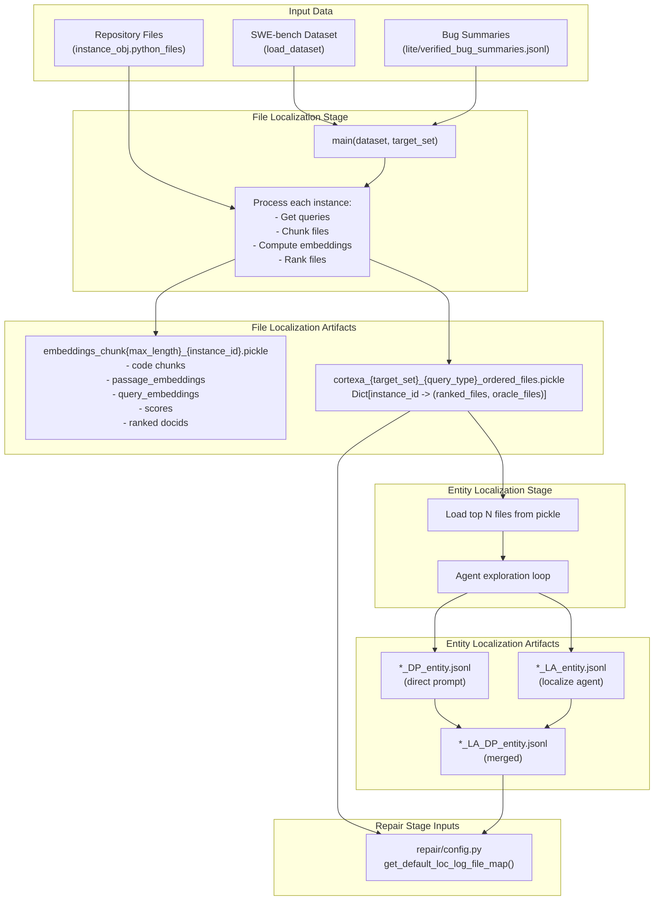

**Artifact naming conventions:**
- File localization: `cortexa_{dataset}_{query_type}_ordered_files.pickle`
- Entity localization: `{dataset}_{query_type}_{method}_entity.jsonl`
  - `method`: `DP` (direct prompt), `LA` (localize agent), or `LA_DP` (merged)

**Pre-computed artifacts:** The repository includes pre-computed localization results for SWE-bench Lite and Verified at:
- `src/cortexa/retrieval/files/cortexa_all_llmsummary_ordered_files.pickle` (707 instances) [README.md:44]()
- `src/cortexa/retrieval/files/cortexa_all_llmsummary_LA_DP_entity.jsonl`

**Sources:** [README.md:38-44](), [embed_retrieve.py:170-231](), [README.md:69-72]()

---

## Performance Characteristics

| Metric | File Localization | Entity Localization |
|--------|------------------|---------------------|
| **Input Size** | Full repository (1000s of files) | Top 6-10 files |
| **Output Size** | ~10-20 ranked files | ~5-15 entities |
| **Method** | Semantic similarity (embedding-based) | Agent-based exploration (LLM-driven) |
| **Parallelization** | Batch encoding (batch_size=16) | Sequential agent turns |
| **Caching** | Per-instance pickle files | JSONL streaming |
| **API Calls** | O(N_chunks / batch_size) | O(num_turns) per instance |

**Search space reduction:** File localization reduces search space by ~100x (e.g., 1000 files → 10 files), while entity localization further reduces by ~10x (e.g., 100 entities per file → 10 entities total).

**Evaluation:** Localization quality is measured against ground truth oracle files using standard information retrieval metrics. See [Localization Evaluation Metrics](#2.3) for details.

**Sources:** [README.md:15-72](), [Diagram 4]()

---

# Page: File Localization with Embeddings

# File Localization with Embeddings

<details>
<summary>Relevant source files</summary>

The following files were used as context for generating this wiki page:

- [README.md](README.md)
- [src/cortexa/retrieval/embed_retrieve.py](src/cortexa/retrieval/embed_retrieve.py)

</details>


## Purpose and Scope

This page documents the embedding-based file localization system that performs the first stage of code localization in Nemotron-CORTEXA. The system uses semantic embeddings to rank repository files by relevance to bug descriptions, reducing the search space from thousands of files to approximately 10-20 top candidates for downstream processing.

**Scope**: This page covers the implementation in [src/cortexa/retrieval/embed_retrieve.py](), the `NIMModel` interface for accessing NV-EmbedCode-7B embeddings, file chunking strategies, cosine similarity ranking, and output format generation. For entity-level localization that refines these file results, see [Entity Localization with Agents](#2.2). For evaluation metrics of file localization accuracy, see [Localization Evaluation Metrics](#2.3).

**Sources**: [README.md:15-45](), [src/cortexa/retrieval/embed_retrieve.py]()

---

## System Overview

The file localization system transforms bug descriptions into vector embeddings and compares them against code embeddings to identify relevant files. The pipeline consists of query encoding, code chunking, passage encoding, and similarity-based ranking.

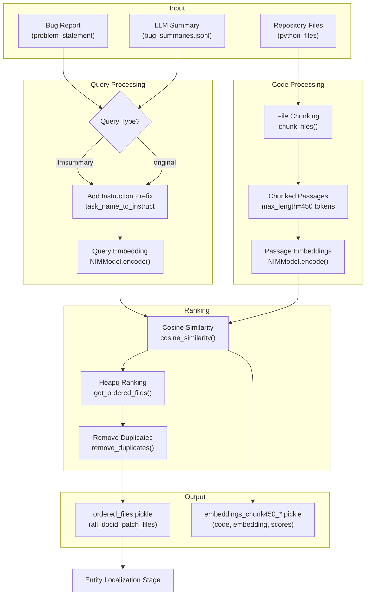

**Diagram**: File Localization Pipeline - end-to-end flow from bug reports to ranked file lists

**Sources**: [src/cortexa/retrieval/embed_retrieve.py:170-232](), [README.md:18-44]()

---

## NIMModel Interface

The `NIMModel` class provides a unified interface for accessing the NV-EmbedCode-7B embedding model through NVIDIA's NIM API. It wraps the OpenAI client and handles instruction prefixing for different query types.

### Class Structure

| Component | Type | Purpose |
|-----------|------|---------|
| `_client` | `OpenAI` | OpenAI-compatible API client for NIM endpoint |
| `_model_name` | `str` | Model identifier (`nvidia/nv-embedcode-7b-v1`) |
| `truncate` | `str` | Truncation strategy (`"END"` by default) |
| `task_name_to_instruct` | `dict` | Instruction templates for query types |
| `query_prefix` | `str` | Dynamic prefix based on `instruct_type` |

### Initialization

The `NIMModel.__init__()` method [src/cortexa/retrieval/embed_retrieve.py:44-54]() initializes the embedding client:

```python
def __init__(self, model_name: str, base_url: str, truncate: str = "END", **kwargs) -> None
```

**Key Behaviors**:
- Validates `NVIDIA_API_KEY` environment variable presence
- Configures instruction templates for two query types:
  - `original`: "Given a bug description, retrieve codes that need to be edited to resolve it."
  - `llmsummary`: "Given a summary of bug description generated by an LLM, retrieve codes that need to be edited to resolve it."
- Creates OpenAI client pointing to NIM base URL (default: `https://integrate.api.nvidia.com/v1`)

### Encoding Method

The `encode()` method [src/cortexa/retrieval/embed_retrieve.py:56-86]() generates embeddings for text inputs:

```python
def encode(
    self,
    sentences, 
    doc_type: str = 'passage',
    instruct_type: str = 'llmsummary',
    batch_size: int = 16,
    **kwargs
) -> np.ndarray
```

**Parameters**:
- `sentences`: List of text strings to embed
- `doc_type`: Either `'query'` (for bug descriptions) or `'passage'` (for code chunks)
- `instruct_type`: Either `'llmsummary'` or `'original'` to select instruction template
- `batch_size`: Number of texts to process per API call (default: 16)

**Processing Logic**:
1. Select instruction prefix based on `instruct_type` (only applied if `doc_type='query'`)
2. Split input into batches for API rate limiting
3. For each batch:
   - Prepend query prefix if `doc_type='query'`
   - Replace empty strings with `"<EMPTY>"` token
   - Call `_client.embeddings.create()` with model name and truncation settings
   - Extract float embeddings from response
4. Return concatenated numpy array of shape `(num_sentences, embedding_dim)`

**Sources**: [src/cortexa/retrieval/embed_retrieve.py:43-90]()

---

## File Chunking Strategy

Large Python files exceed the embedding model's context window (typically 512 tokens). The `chunk_files()` function [src/cortexa/retrieval/embed_retrieve.py:113-138]() splits files into fixed-size chunks without overlap.

```mermaid
graph LR
    subgraph "Input: target_files"
        FileDict["Dictionary:<br/>{filepath: {'text': [lines]}}"]
    end
    
    subgraph "Chunking Process"
        FileDict --> TestFilter{"is_test(filepath)?"}
        TestFilter -->|"skip_test=True"| Skip["Skip file"]
        TestFilter -->|"False"| Join["Join lines<br/>'\n'.join()"]
        Join --> Tokenize["Tokenize<br/>AutoTokenizer"]
        Tokenize --> SlidingWindow["Sliding Window<br/>step=max_length"]
        SlidingWindow --> Decode["Decode chunks<br/>skip_special_tokens"]
        Decode --> AddFilepath["Prepend '[filepath]\n'"]
    end
    
    subgraph "Output"
        AddFilepath --> ChunkedPassages["chunked_passages:<br/>List[str]"]
        AddFilepath --> FileNames["file_names:<br/>List[str]"]
    end
```

**Diagram**: File Chunking Process - tokenization and splitting strategy

### Implementation Details

**Tokenization** [src/cortexa/retrieval/embed_retrieve.py:128]():
- Uses `AutoTokenizer` from Hugging Face Transformers
- Full file text joined with newlines: `'\n'.join(target_files[filepath]['text'])`
- `truncation=False` to preserve full file content

**Chunking** [src/cortexa/retrieval/embed_retrieve.py:129-132]():
- Non-overlapping windows of `max_length` tokens (default: 450)
- Extracts token slices: `tokens[i:i + max_length]`
- Decodes each chunk back to text: `tokenizer.decode(chunk, skip_special_tokens=True)`

**Filepath Prefix** [src/cortexa/retrieval/embed_retrieve.py:134]():
- Each chunk prefixed with `'[{filepath}]\n'` to provide file context
- Enables model to understand code origin when ranking

**Test File Filtering** [src/cortexa/retrieval/embed_retrieve.py:126-127]():
- `skip_test=True` by default to exclude test files from localization
- Uses `is_test(filepath)` utility to identify test files by naming patterns

**Output**:
- `chunked_passages`: List of text chunks with filepath headers
- `file_names`: Parallel list mapping each chunk to its source file

**Sources**: [src/cortexa/retrieval/embed_retrieve.py:113-138]()

---

## Similarity Computation and Ranking

After encoding queries and code chunks, the system computes cosine similarity scores and ranks files by relevance.

### Cosine Similarity

The `cosine_similarity()` function [src/cortexa/retrieval/embed_retrieve.py:92-95]() implements L2-normalized dot product:

```python
def cosine_similarity(a, b):
    a_norm = a / np.linalg.norm(a, axis=1, keepdims=True)
    b_norm = b / np.linalg.norm(b, axis=1, keepdims=True)
    return np.dot(a_norm, b_norm.T)
```

**Mathematical Definition**:
- Normalizes query embeddings: `a_norm = a / ||a||`
- Normalizes passage embeddings: `b_norm = b / ||b||`
- Computes dot product matrix: `similarity = a_norm · b_norm^T`
- Result shape: `(num_queries, num_passages)` with values in [-1, 1]

### File Ranking

The `get_ordered_files()` function [src/cortexa/retrieval/embed_retrieve.py:141-156]() produces the final ranked file list:

```mermaid
graph TB
    QueryEmbed["Query Embeddings<br/>(1, embed_dim)"]
    PassageEmbed["Passage Embeddings<br/>(num_chunks, embed_dim)"]
    
    QueryEmbed --> CosineSim["cosine_similarity(query, passages)"]
    PassageEmbed --> CosineSim
    
    CosineSim --> ScaleScores["Scale by 100<br/>scores * 100"]
    ScaleScores --> HeapSort["heapq.nlargest()<br/>rank all passages"]
    
    HeapSort --> BuildList["Build ordered_files<br/>{file_name, score}"]
    BuildList --> ExtractFiles["Extract file_names<br/>from ordered_files"]
    ExtractFiles --> RemoveDups["remove_duplicates()<br/>keep first occurrence"]
    
    RemoveDups --> FinalRanking["all_docid:<br/>Ranked unique files"]
```

**Diagram**: File Ranking Algorithm - from similarity scores to ordered file list

**Algorithm Steps**:

1. **Compute Scores** [src/cortexa/retrieval/embed_retrieve.py:146]():
   - `scores = cosine_similarity(query_embeddings, passage_embeddings) * 100`
   - Scaling by 100 converts [-1, 1] range to [-100, 100] for readability

2. **Heap-based Ranking** [src/cortexa/retrieval/embed_retrieve.py:147]():
   - `heapq.nlargest(len(scores[0]), range(len(scores[0])), key=scores[0].__getitem__)`
   - Returns indices of passages sorted by descending score
   - Efficient for large datasets (O(n log k) where k = output size)

3. **Build File List** [src/cortexa/retrieval/embed_retrieve.py:149-151]():
   - For each top index, create dictionary: `{'file_name': file_names[idx], 'score': scores[0][idx]}`
   - Maps passage indices back to source file paths

4. **Deduplication** [src/cortexa/retrieval/embed_retrieve.py:153-154]():
   - Extract filenames: `all_docid = [f['file_name'] for f in ordered_files]`
   - Remove duplicates while preserving order: `remove_duplicates(all_docid)`
   - Files with multiple high-scoring chunks appear once at their highest-scoring position

**Return Values**:
- `scores`: Full similarity matrix (num_queries × num_passages)
- `all_docid`: Deduplicated list of filepaths ranked by relevance

**Sources**: [src/cortexa/retrieval/embed_retrieve.py:92-95](), [src/cortexa/retrieval/embed_retrieve.py:141-156]()

---

## Query Types and Instruction Prefixes

The system supports two query types for different bug description formats, each with a specialized instruction prefix to guide the embedding model.

### Query Type Configuration

| Query Type | Source | Instruction Template |
|------------|--------|---------------------|
| `llmsummary` | `bug_summaries.jsonl` | "Given a summary of bug description generated by an LLM, retrieve codes that need to be edited to resolve it." |
| `original` | `problem_statement` field | "Given a bug description, retrieve codes that need to be edited to resolve it." |

### Query Selection Logic

The `main()` function [src/cortexa/retrieval/embed_retrieve.py:198-206]() selects query type based on command-line arguments and data availability:

```python
if args.query_type == 'llmsummary' and summaries and instance_id in summaries:
    queries = [summaries[instance_id]['output']] 
    instruct_type = 'llmsummary'
else:
    queries = [instance['problem_statement']] 
    instruct_type = 'original'
```

**Decision Flow**:
1. If `--query_type llmsummary` specified AND summaries loaded AND instance has summary:
   - Use LLM-generated summary from `bug_summaries.jsonl`
   - Set `instruct_type='llmsummary'`
2. Otherwise:
   - Fall back to original problem statement from dataset
   - Set `instruct_type='original'`

### Instruction Prefix Application

The `NIMModel.encode()` method [src/cortexa/retrieval/embed_retrieve.py:65]() constructs the query prefix:

```python
self.query_prefix = "Instruct: " + self.task_name_to_instruct[instruct_type] + "\nQuery: "
```

**Example Formatted Query**:
```
Instruct: Given a summary of bug description generated by an LLM, retrieve codes that need to be edited to resolve it.
Query: The Time class in astropy.time fails to handle leap seconds correctly...
```

**Prefix Application** [src/cortexa/retrieval/embed_retrieve.py:72]():
- Only applied when `doc_type='query'`
- Code passages (`doc_type='passage'`) receive no instruction prefix
- Empty prefix string: `prefix = self.query_prefix if doc_type == 'query' else ''`

### Pre-Generated Summaries

The system loads pre-generated LLM summaries from disk [src/cortexa/retrieval/embed_retrieve.py:174-180]():

```python
summaries_folder = f'{get_root_path()}/retrieval/files'
if os.path.exists(f'{summaries_folder}/lite_bug_summaries.jsonl') and 
   os.path.exists(f'{summaries_folder}/verified_bug_summaries.jsonl'):
    summaries = read_problems(f'{summaries_folder}/lite_bug_summaries.jsonl')
    summaries.update(read_problems(f'{summaries_folder}/verified_bug_summaries.jsonl'))
```

**File Locations**:
- Lite summaries: `src/cortexa/retrieval/files/lite_bug_summaries.jsonl`
- Verified summaries: `src/cortexa/retrieval/files/verified_bug_summaries.jsonl`
- Format: JSONL with `instance_id` → `{'output': 'summary text'}`

**Sources**: [src/cortexa/retrieval/embed_retrieve.py:47-49](), [src/cortexa/retrieval/embed_retrieve.py:65](), [src/cortexa/retrieval/embed_retrieve.py:174-206]()

---

## Output Formats

The file localization system produces two types of pickle files with different levels of detail.

### Summary Output: ordered_files.pickle

The primary output file contains ranked file lists for all processed instances [src/cortexa/retrieval/embed_retrieve.py:231]():

**File Path**: `{log_dir}/cortexa_{target_set}_{query_type}_ordered_files.pickle`

**Example**: `./logs/cortexa_SWE-bench_Verified_llmsummary_ordered_files.pickle`

**Structure**:
```python
{
    'instance_id_1': (
        ['path/to/file1.py', 'path/to/file2.py', ...],  # Ranked files (all_docid)
        ['path/to/gold1.py', 'path/to/gold2.py', ...]   # Ground truth files (patch_files)
    ),
    'instance_id_2': (...),
    ...
}
```

**Dictionary Contents**:
- **Key**: `instance_id` string (e.g., `'astropy__astropy-12907'`)
- **Value**: Tuple of two lists:
  1. **Predicted files** (`all_docid`): Ranked list from `get_ordered_files()`, deduplicated
  2. **Ground truth files** (`patch_files`): Files modified in golden patch from `get_golden_patch_files()`

**Usage**:
- Consumed by entity localization agent (see [Entity Localization with Agents](#2.2))
- Used for file retrieval evaluation (see [Localization Evaluation Metrics](#2.3))
- Pre-generated results available at: `src/cortexa/retrieval/files/cortexa_all_llmsummary_ordered_files.pickle`

### Detailed Output: embeddings_chunk{max_length}_{instance_id}.pickle

Per-instance detailed embeddings and scores [src/cortexa/retrieval/embed_retrieve.py:221-229]():

**File Path**: `{log_dir}/embeddings_chunk{max_length}_{instance_id}.pickle`

**Example**: `./logs/embeddings_chunk450_astropy__astropy-12907.pickle`

**Structure**:
```python
{
    'code': ['[file1.py]\nclass Foo:...', '[file2.py]\ndef bar():...', ...],  # Chunked passages
    'embedding': np.ndarray(shape=(num_chunks, embed_dim)),                    # Passage embeddings
    'file': ['file1.py', 'file1.py', 'file2.py', ...],                        # Chunk-to-file mapping
    'query': ['Bug description or LLM summary'],                               # Query text
    'query_embedding': np.ndarray(shape=(1, embed_dim)),                      # Query embedding
    'scores': np.ndarray(shape=(1, num_chunks)),                              # Similarity scores * 100
    'docid': ['file1.py', 'file2.py', ...]                                    # Ranked unique files
}
```

**Field Descriptions**:

| Field | Type | Description |
|-------|------|-------------|
| `code` | `List[str]` | Text chunks with `[filepath]\n` prefix |
| `embedding` | `np.ndarray` | Passage embeddings from `NIMModel.encode()` |
| `file` | `List[str]` | Source file for each chunk (parallel to `code`) |
| `query` | `List[str]` | Original query text (length 1) |
| `query_embedding` | `np.ndarray` | Query embedding from `NIMModel.encode()` |
| `scores` | `np.ndarray` | Cosine similarity scores scaled by 100 |
| `docid` | `List[str]` | Ranked deduplicated file paths |

**Use Cases**:
- Debugging embedding quality
- Analyzing similarity score distributions
- Reproducing ranking without re-encoding
- Understanding chunk-level vs file-level scores

**Sources**: [src/cortexa/retrieval/embed_retrieve.py:207-232](), [README.md:38-44]()

---

## Command-Line Interface

The `embed_retrieve.py` module [src/cortexa/retrieval/embed_retrieve.py:234-268]() provides a comprehensive CLI for running file localization.

### Basic Usage

```bash
python -m cortexa.retrieval.embed_retrieve \
    --model_name nvidia/nv-embedcode-7b-v1 \
    --base_url https://integrate.api.nvidia.com/v1 \
    --log_dir ./logs \
    --repo_playground ./repos \
    --batch_size 16 \
    --max_length 450 \
    --dataset_name_or_path princeton-nlp/SWE-bench_Verified \
    --query_type llmsummary \
    --instance_id astropy__astropy-12907
```

### Argument Reference

| Argument | Type | Default | Description |
|----------|------|---------|-------------|
| `--model_name` | `str` | `nvidia/nv-embedcode-7b-v1` | Model identifier for NIM or HuggingFace handle |
| `--base_url` | `str` | `https://integrate.api.nvidia.com/v1` | NIM API base URL |
| `--log_dir` | `str` | `{get_root_path()}/logs` | Output directory for pickle files |
| `--batch_size` | `int` | `16` | Batch size for embedding encoder |
| `--max_length` | `int` | `450` | Token limit per code chunk |
| `--dataset_name_or_path` | `str` | `princeton-nlp/SWE-bench_Verified` | HuggingFace dataset identifier |
| `--query_type` | `str` | `llmsummary` | Query source: `llmsummary` or `original` |
| `--instance_id` | `str` | `''` (all) | Comma-separated instance IDs or empty for full dataset |
| `--repo_playground` | `str` | `./repo_playground` | Path to cloned repositories |

### Instance Selection

**Single Instance**:
```bash
--instance_id astropy__astropy-12907
```

**Multiple Instances**:
```bash
--instance_id "astropy__astropy-12907,django__django-11179,sympy__sympy-18532"
```

**All Instances**:
```bash
# Omit --instance_id argument entirely
```

### Execution Flow

The `main()` function [src/cortexa/retrieval/embed_retrieve.py:170-232]() orchestrates the localization pipeline:

```mermaid
graph TD
    LoadCache["Load existing results<br/>results_summary_chunk{max_length}.pickle"]
    LoadSummaries["Load bug summaries<br/>lite_bug_summaries.jsonl<br/>verified_bug_summaries.jsonl"]
    LoadDataset["Load dataset<br/>load_dataset(dataset_name_or_path)"]
    
    LoadCache --> FilterInstances
    LoadSummaries --> FilterInstances
    LoadDataset --> FilterInstances
    
    FilterInstances{"--instance_id<br/>provided?"}
    FilterInstances -->|"Yes"| ParseIDs["Split by comma<br/>filter dataset"]
    FilterInstances -->|"No"| ProcessAll["Process all instances"]
    
    ParseIDs --> LoopInstances
    ProcessAll --> LoopInstances
    
    LoopInstances["For each instance"]
    LoopInstances --> CheckExists{"embeddings_chunk*.pickle<br/>exists?"}
    CheckExists -->|"Yes"| Skip["Skip instance"]
    CheckExists -->|"No"| CreateObj["create_instance_obj()<br/>clone repo"]
    
    CreateObj --> ChunkFiles["chunk_files()<br/>tokenize and split"]
    ChunkFiles --> EncodeQuery["model.encode()<br/>query embeddings"]
    EncodeQuery --> EncodePassages["model.encode()<br/>passage embeddings"]
    EncodePassages --> Rank["get_ordered_files()<br/>cosine similarity"]
    Rank --> SaveDetailed["write_pickle()<br/>embeddings_chunk*.pickle"]
    SaveDetailed --> UpdateDict["Update ordered_files_instances"]
    
    UpdateDict --> NextInstance{"More<br/>instances?"}
    NextInstance -->|"Yes"| LoopInstances
    NextInstance -->|"No"| SaveSummary["write_pickle()<br/>cortexa_*_ordered_files.pickle"]
```

**Diagram**: Main Execution Flow - complete pipeline from argument parsing to output generation

**Key Steps**:

1. **Initialization** [src/cortexa/retrieval/embed_retrieve.py:256-267]():
   - Load dataset using HuggingFace `load_dataset()`
   - Initialize `NIMModel` with specified model and base URL
   - Load AutoTokenizer for chunking

2. **Instance Filtering** [src/cortexa/retrieval/embed_retrieve.py:182-197]():
   - Parse comma-separated instance IDs if provided
   - Filter dataset to requested instances
   - Log error if specified instances not found

3. **Per-Instance Processing** [src/cortexa/retrieval/embed_retrieve.py:198-229]():
   - Select query text based on `query_type`
   - Check if detailed pickle already exists (skip if present)
   - Create instance object and extract Python files
   - Chunk files with `chunk_files()`
   - Encode query and passages
   - Compute rankings and extract ground truth
   - Save detailed and summary outputs

**Sources**: [src/cortexa/retrieval/embed_retrieve.py:170-268](), [README.md:21-34]()

---

## Integration with Downstream Stages

The file localization output serves as input to multiple downstream components in the Nemotron-CORTEXA pipeline.

### Entity Localization

The `ordered_files.pickle` is consumed by the entity localization agent [README.md:52-58]():

```bash
python -m cortexa.localize.entity_localization \
    --embed_results cortexa_verified_llmsummary_ordered_files.pickle \
    --num_top_files 6
```

**Data Flow**:
1. Entity localization loads pickle file
2. Extracts top N files (default: 6) from ranked list
3. Constructs `RepoGraph` for selected files
4. Agent navigates code structure to identify specific functions/classes

### Repair Stage

The repair configuration [README.md:71]() references localization results via `get_default_loc_log_file_map()`:

**Configuration in `src/cortexa/repair/config.py`**:
- Maps dataset → localization result file
- Default: Pre-processed files from `src/cortexa/retrieval/files/`
- `RepairAgent` uses entity localization output to construct context prompts

### Evaluation

File retrieval accuracy can be measured using [README.md:36-42]():

```bash
python -m cortexa.retrieval.file_retrieval_eval \
    --log_dir ./logs \
    --dataset_name_or_path princeton-nlp/SWE-bench_Verified \
    --query_type llmsummary
```

**Metrics Computed**:
- Top-K accuracy (K ∈ {1, 3, 5, 10, 20})
- Mean Average Precision (MAP)
- Mean Reciprocal Rank (MRR)

See [Localization Evaluation Metrics](#2.3) for detailed metric definitions.

**Sources**: [README.md:36-71](), [src/cortexa/retrieval/embed_retrieve.py:219]()

---

## Configuration and Best Practices

### Environment Setup

**API Key Configuration** [src/cortexa/retrieval/embed_retrieve.py:45-46]():
```bash
export NVIDIA_API_KEY="your_api_key_here"
```

The `NIMModel` constructor validates key presence at runtime. For alternative providers, update `base_url` and ensure OpenAI API compatibility.

### Chunk Size Selection

**Token Limit Tradeoffs** [src/cortexa/retrieval/embed_retrieve.py:116]():

| max_length | Pros | Cons |
|------------|------|------|
| 450 (default) | Fits within 512-token window with safety margin | May split related code across chunks |
| 256 | More granular localization | Higher chunk count, slower encoding |
| 512 | Maximum context utilization | Risk of truncation with long filepath prefixes |

**Recommendation**: Use default 450 tokens unless experiencing truncation warnings.

### Batch Size Tuning

**API Rate Limits** [src/cortexa/retrieval/embed_retrieve.py:66-69]():
- Default `batch_size=16` balances throughput and latency
- Increase for large-scale experiments with high quota
- Decrease if encountering rate limit errors

### Caching Strategy

**Incremental Processing** [src/cortexa/retrieval/embed_retrieve.py:209-210]():
```python
pickle_file_path = f'{args.log_dir}/embeddings_chunk{args.max_length}_{instance_id}.pickle'
if os.path.exists(pickle_file_path): 
    continue
```

The system skips instances with existing detailed pickles, enabling:
- Resume after interruption
- Incremental updates to subset of instances
- Avoid redundant API calls

### Query Type Selection

**llmsummary vs original** [README.md:31](), [src/cortexa/retrieval/embed_retrieve.py:247-248]():

| Scenario | Recommended Query Type | Rationale |
|----------|------------------------|-----------|
| SWE-bench Lite/Verified | `llmsummary` | Pre-generated summaries available, improved retrieval accuracy |
| Custom datasets | `original` | No pre-generated summaries, fallback to problem statements |
| Evaluation experiments | `original` | Baseline for comparison against summary-enhanced retrieval |

**Sources**: [src/cortexa/retrieval/embed_retrieve.py:44-54](), [src/cortexa/retrieval/embed_retrieve.py:113-138](), [README.md:21-44]()

---

## Architecture Decisions

### Why NV-EmbedCode?

NV-EmbedCode-7B is specialized for code-to-code retrieval tasks with instruction-following capabilities. Key advantages:

1. **Task-Specific Training**: Trained on bug-to-code mapping tasks
2. **Instruction Awareness**: Responds to custom instruction prefixes for query types
3. **NIM Availability**: Accessible via NVIDIA API without local GPU requirements
4. **Competitive Performance**: Achieves high recall@k on SWE-bench datasets

Alternative: Users can replace with HuggingFace models by modifying `initialize_embedding_model()` [src/cortexa/retrieval/embed_retrieve.py:158-168]().

### Why Fixed-Size Chunking?

The system uses non-overlapping fixed-size chunks [src/cortexa/retrieval/embed_retrieve.py:129-132]() rather than semantic chunking:

**Rationale**:
- **Simplicity**: Deterministic, no heuristics for split points
- **Coverage**: Ensures no code is excluded from ranking
- **Efficiency**: Fast tokenization without AST parsing
- **Model Agnostic**: Works with any tokenizer

**Tradeoff**: May split logically related code (e.g., function definition from docstring). However, deduplication at file level [src/cortexa/retrieval/embed_retrieve.py:153-154]() ensures multiple high-scoring chunks elevate the file's overall rank.

### Why Skip Test Files?

The `skip_test=True` default [src/cortexa/retrieval/embed_retrieve.py:116]() excludes test files from localization:

**Reasoning**:
- Bugs typically manifest in production code, not test code
- Test files follow different patterns (assertion-heavy, limited logic)
- Reduces search space and improves precision on relevant files
- Ground truth patches in SWE-bench rarely modify test files

**Override**: Set `skip_test=False` in `chunk_files()` call for test file localization.

**Sources**: [src/cortexa/retrieval/embed_retrieve.py:113-138](), [README.md:16-19]()

---

# Page: Entity Localization with Agents

# Entity Localization with Agents

<details>
<summary>Relevant source files</summary>

The following files were used as context for generating this wiki page:

- [README.md](README.md)
- [src/cortexa/evaluate/localization_eval.py](src/cortexa/evaluate/localization_eval.py)

</details>


## Purpose and Scope

This document describes the **Entity Localization** system, which refines file-level localization results to identify specific code entities (functions, classes, methods) that require modification for bug fixing. The system uses `LocalizeAgent`, an LLM-powered agent that performs multi-turn interaction over a `RepoGraph` data structure to navigate code and discover relevant entities.

For file-level localization using embeddings, see [File Localization with Embeddings](#2.1). For evaluation metrics and accuracy measurement, see [Localization Evaluation Metrics](#2.3).

**Sources**: [README.md:46-71](), [src/cortexa/evaluate/localization_eval.py:1-918]()

---

## System Overview

Entity localization operates as the second stage of the localization pipeline, taking the top-ranked files from file localization and producing a structured list of specific code entities. The system achieves this through:

1. **RepoGraph Construction**: Parse repository structure into a navigable graph
2. **Agent Initialization**: Load top N files from file localization results
3. **Multi-Turn Interaction**: Agent executes commands to explore code structure
4. **Entity Extraction**: Parse agent responses to identify relevant entities
5. **Format Conversion**: Convert entity tuples to structured JSON format

```mermaid
graph TB
    FileRanking["Top N Files<br/>(from File Localization)"]
    
    subgraph "Entity Localization System"
        RepoGraph["RepoGraph<br/>Code Structure Graph"]
        LocalizeAgent["LocalizeAgent<br/>Multi-Turn Interaction"]
        Commands["Code Navigation Commands<br/>search_class()<br/>search_method()<br/>search_function()"]
        
        FileRanking --> RepoGraph
        RepoGraph --> LocalizeAgent
        LocalizeAgent --> Commands
        Commands -.feedback.-> LocalizeAgent
    end
    
    subgraph "Outputs"
        EntityTuples["Entity Tuples<br/>(filename, entity_name)"]
        JSONLOutput["JSONL Format<br/>content_map structure"]
    end
    
    LocalizeAgent --> EntityTuples
    EntityTuples --> JSONLOutput
    
    BugDescription["Bug Description<br/>problem_statement"] --> LocalizeAgent
```

**Sources**: [README.md:46-59](), [src/cortexa/evaluate/localization_eval.py:605-656]()

---

## LocalizeAgent Architecture

The `LocalizeAgent` class orchestrates multi-turn interaction with an LLM to navigate code structure. The agent maintains conversation history and executes code navigation commands based on LLM responses.

### Key Components

| Component | Purpose | Location |
|-----------|---------|----------|
| `LocalizeAgent` | Main agent class for entity localization | `cortexa.localize.localize` |
| `RepoGraph` | Code structure representation | `cortexa.utils.graph` |
| `model_info` | LLM endpoint configuration | `model_config.yml` |
| `temperature` | Sampling temperature for LLM | Command-line arg |
| `max_tokens` | Maximum response length | Command-line arg |

**Sources**: [src/cortexa/evaluate/localization_eval.py:33-34](), [README.md:61-63]()

### Multi-Turn Interaction Loop

```mermaid
graph TB
    Start["Agent Initialization<br/>with Top N Files"]
    
    Turn1["Turn 1:<br/>LLM analyzes bug + files"]
    Response1["LLM Response:<br/>Navigation commands"]
    Execute1["Execute Commands<br/>Retrieve code snippets"]
    
    Turn2["Turn 2:<br/>LLM + code context"]
    Response2["LLM Response:<br/>More commands"]
    Execute2["Execute Commands<br/>Retrieve more snippets"]
    
    TurnN["Turn N:<br/>Final analysis"]
    EndCommand["&lt;end&gt; Command:<br/>Mark relevant entities"]
    
    Extract["Extract Entity List<br/>(file, entity) tuples"]
    
    Start --> Turn1
    Turn1 --> Response1
    Response1 --> Execute1
    Execute1 --> Turn2
    Turn2 --> Response2
    Response2 --> Execute2
    Execute2 --> TurnN
    TurnN --> EndCommand
    EndCommand --> Extract
```

The agent performs iterative refinement over multiple turns (default: 5 turns). Each turn consists of:
1. LLM receives bug description + code context from previous turns
2. LLM outputs navigation commands to explore code
3. System executes commands and retrieves code snippets
4. Code snippets become context for next turn
5. Final turn: LLM outputs `<end>` commands marking relevant entities

**Sources**: [src/cortexa/evaluate/localization_eval.py:621-652](), [README.md:52-59]()

---

## RepoGraph: Code Structure Representation

The `RepoGraph` class represents repository structure as a navigable graph, enabling efficient code lookup and entity resolution.

### RepoGraph Data Structure

```mermaid
graph TB
    subgraph "RepoGraph Structure"
        Files["File Nodes<br/>repo_root/path/to/file.py"]
        Entities["Entity Map<br/>entities[filename]"]
        
        Classes["Class Entities<br/>(name, 'class')"]
        Functions["Function Entities<br/>(name, 'function')"]
        Methods["Method Entities<br/>(class.method, 'method')"]
        Variables["Variable Entities<br/>(name, 'variable')"]
        
        Entities --> Classes
        Entities --> Functions
        Entities --> Methods
        Entities --> Variables
    end
    
    subgraph "Operations"
        MatchFile["match_file_name()<br/>Fuzzy file matching"]
        ParseCode["tree_sitter parsing<br/>Extract entities"]
        ToPickle["to_pickle()<br/>Cache graph"]
        FromPickle["from_pickle()<br/>Load cached graph"]
    end
    
    Files --> MatchFile
    Files --> ParseCode
    ParseCode --> Entities
```

### Entity Types in RepoGraph

The graph distinguishes four entity types stored as tuples `(entity_name, entity_type)`:

| Entity Type | Format | Example |
|-------------|--------|---------|
| Class | `(name, 'class')` | `("FitsHeader", "class")` |
| Function | `(name, 'function')` | `("parse_args", "function")` |
| Method | N/A (stored with class) | Referenced as `"FitsHeader.parse"` |
| Variable | `(name, 'variable')` | `("GLOBAL_CACHE", "variable")` |

**Sources**: [src/cortexa/evaluate/localization_eval.py:775-826](), [src/cortexa/evaluate/localization_eval.py:619-620]()

---

## Entity Localization Workflow

### Command Execution

The `LocalizeAgent.localize()` method executes the complete localization workflow:

```mermaid
sequenceDiagram
    participant User
    participant Agent as LocalizeAgent
    participant LLM as LLM Model
    participant Graph as RepoGraph
    participant Files as File System
    
    User->>Agent: localize(problem_statement, max_turn=5)
    
    Agent->>Agent: initialize(top_files, max_init_f=6)
    
    loop For each turn (1 to max_turn)
        Agent->>LLM: Send bug description + code context
        LLM->>Agent: Return navigation commands
        
        Agent->>Agent: Parse commands from response
        
        loop For each command
            Agent->>Graph: Execute command (e.g., search_class)
            Graph->>Files: Retrieve code snippets
            Files->>Graph: Return CodeSnippet objects
            Graph->>Agent: Return code context
        end
        
        Agent->>Agent: Store context in history
    end
    
    Agent->>Agent: Extract entities from final turn
    Agent->>User: Return (code_dict, history)
```

**Sources**: [src/cortexa/evaluate/localization_eval.py:633-639]()

### Command-Line Usage

```bash
python -m cortexa.localize.entity_localization \
       --log_dir ./logs \
       --repo_playground ./repos \
       --num_turns 5 \
       --num_top_files 6 \
       --embed_results cortexa_verified_llmsummary_ordered_files.pickle \
       --instance_id astropy__astropy-12907
```

**Parameters**:
- `num_turns`: Number of interaction turns (default: 5)
- `num_top_files`: Number of files from file localization to initialize agent (default: 6)
- `embed_results`: Pickle file containing ranked files from file localization
- `instance_id`: Bug instance to localize (omit for full benchmark)

**Sources**: [README.md:51-59]()

---

## Entity Format and Representation

### Tuple Representation

During agent execution, entities are represented as tuples `(filename, entity_name)`:

```python
# Examples from localization_eval.py
("astropy/io/fits/header.py", "FitsHeader")           # Class
("astropy/io/fits/header.py", "FitsHeader.parse")     # Method
("astropy/io/fits/header.py", "parse_card")           # Function
("astropy/io/fits/header.py", "ALL")                  # Entire file
```

**Entity Name Formats**:
- `"ALL"`: Entire file requires modification
- `"ClassName"`: Specific class
- `"function_name"`: Specific function
- `"ClassName.method_name"`: Specific class method
- `"variable_name"`: Variable (treated as `"ALL"` for file/class)

**Sources**: [src/cortexa/evaluate/localization_eval.py:122-147](), [src/cortexa/evaluate/localization_eval.py:740-752]()

### JSON Output Format

The tuple representation is converted to a structured JSON format for downstream consumption:

```json
{
  "instance_id": "astropy__astropy-12907",
  "content_map": {
    "astropy/io/fits/header.py": {
      "classes": {
        "FitsHeader": {
          "methods": ["parse", "fromstring", "tostring"]
        },
        "Card": "ALL"
      },
      "functions": ["parse_card", "_parse_value"]
    },
    "astropy/io/fits/card.py": "ALL"
  }
}
```

**Format Rules**:
1. `"ALL"` at file level: Entire file is relevant
2. `"ALL"` at class level: All class methods are relevant
3. Methods list: Specific methods within a class
4. Functions list: Top-level functions in file
5. Variables: Converted to `"ALL"` (file-level or class-level)

**Sources**: [src/cortexa/evaluate/localization_eval.py:775-826](), [README.md:69]()

---

## Direct Prompt vs Agent-Based Approach

The system evaluates two approaches and can merge their results:

### Comparison

| Aspect | Direct Prompt | Localization Agent |
|--------|---------------|-------------------|
| **Turns** | 1 (first turn only) | Multiple (default: 5) |
| **Context** | Top N files only | Accumulated code snippets |
| **Exploration** | Limited to initial files | Can navigate beyond top files |
| **Extraction** | First turn code snippets | Final turn code snippets + commands |
| **Recall** | Lower | Higher |

```mermaid
graph LR
    subgraph "Direct Prompt Approach"
        DP_Input["Bug + Top 6 Files"]
        DP_LLM["LLM (1 turn)"]
        DP_Output["Entity List 1"]
        
        DP_Input --> DP_LLM
        DP_LLM --> DP_Output
    end
    
    subgraph "Agent Approach"
        LA_Input["Bug + Top 6 Files"]
        LA_Turns["Multi-Turn<br/>Interaction (5 turns)"]
        LA_Output["Entity List 2"]
        
        LA_Input --> LA_Turns
        LA_Turns --> LA_Output
    end
    
    subgraph "Merging"
        Merge["merge_content_maps()"]
        Combined["Combined Entity List<br/>(Higher Recall)"]
        
        DP_Output --> Merge
        LA_Output --> Merge
        Merge --> Combined
    end
```

**Sources**: [src/cortexa/evaluate/localization_eval.py:441-460](), [README.md:63-64]()

### Code Snippet Extraction

The system extracts entities from code snippets returned by navigation commands:

```python
# From localization_eval.py:188-223
def read_code_dict_entity(code_dict, include_commands=False):
    entity_lst = []
    for command, value in code_dict.items():
        if command == 'reason':
            continue
        
        if value:
            for fname, codes in value.items():
                if fname == 'error':
                    continue
                
                for code in codes:
                    # class method
                    if code.class_name and code.name != code.class_name:
                        entity_name = f'{code.class_name}.{code.name}'
                    else:
                        # function, class, or variable
                        entity_name = code.name
                    
                    entity_lst.append((fname, entity_name))
    
    return list(set(entity_lst))
```

**Sources**: [src/cortexa/evaluate/localization_eval.py:188-223]()

---

## Configuration and Model Settings

### Model Configuration

Entity localization reads LLM configuration from `model_config.yml`:

```yaml
# Example model configuration structure
model_name: "llama-3.3-70b-instruct"
base_url: "https://integrate.api.nvidia.com/v1"
api_key_name: "NVIDIA_API_KEY"  # Environment variable name
```

**Security**: API keys are populated at runtime from environment variables specified by `api_key_name`. The actual key value is accessed via `os.environ[api_key_name]`.

**Sources**: [README.md:61-62]()

### Multi-Model Ensemble

Running with different models and temperatures increases recall accuracy:

```python
# From configs.py example (mentioned in README)
# Define multiple model configurations:
# - Different models (e.g., llama-3.3-70b, deepseek-v3)
# - Different temperatures (0.0, 0.7, 1.0)
# - Merge results using merge_content_maps()
```

**Ensemble Strategy**:
1. Run entity localization with Model A (temperature=0.0)
2. Run entity localization with Model B (temperature=0.7)
3. Merge results using `merge_content_maps()` function
4. Result: Union of entities from both runs (higher recall)

**Sources**: [README.md:63-64](), [src/cortexa/evaluate/localization_eval.py:365-392]()

---

## Output Format and Storage

### Pickle Storage (Agent State)

During execution, the agent stores complete state in pickle format:

```python
# From localization_eval.py:641-649
with open(data_f, 'wb') as f:
    pickle.dump({
        'code_dict': code_dict,           # Final turn code context
        'history': history,               # All turns with responses
        'direct_prompt_result': ...,      # First turn result
        'localization_agent_result': ...  # Final turn result
    }, f)
```

**File Structure**:
```
{log_dir}/results/{instance_id}/data.pickle
{log_dir}/results/{instance_id}/graph.pickle  # Cached RepoGraph
```

**Sources**: [src/cortexa/evaluate/localization_eval.py:641-649]()

### JSONL Output Format

The final output is written in JSONL format for downstream consumption:

```json
{
  "instance_id": "django__django-12856",
  "content_map": {
    "django/db/models/query.py": {
      "classes": {
        "QuerySet": {
          "methods": ["filter", "exclude", "union"]
        }
      },
      "functions": ["prefetch_related_objects"]
    },
    "django/db/models/sql/query.py": {
      "classes": {
        "Query": "ALL"
      },
      "functions": []
    }
  }
}
```

**File Naming Convention**: `{dataset}_{query_type}_LA_DP_entity.jsonl`
- `LA`: Localization Agent results
- `DP`: Direct Prompt results
- Can also have merged versions combining multiple runs

**Sources**: [README.md:69](), [src/cortexa/evaluate/localization_eval.py:740-772]()

---

## Entity Merging and Ensemble

### Merge Algorithm

The `merge_content_maps()` function combines entity results from multiple runs:

```mermaid
graph TB
    Run1["Run 1 Entities<br/>Model A, Temp=0.0"]
    Run2["Run 2 Entities<br/>Model B, Temp=0.7"]
    Run3["Run 3 Entities<br/>Model A, Temp=1.0"]
    
    Merge["merge_content_maps()"]
    
    Rules["Merge Rules:<br/>1. ALL at file level overrides<br/>2. ALL at class level overrides<br/>3. Methods: Union of lists<br/>4. Functions: Union of lists"]
    
    Run1 --> Merge
    Run2 --> Merge
    Run3 --> Merge
    
    Merge --> Rules
    
    Rules --> MergedOutput["Merged Entity Map<br/>(Union of all entities)"]
```

**Merge Rules**:
1. If any run marks file as `"ALL"`, the merged result is `"ALL"` for that file
2. If any run marks class as `"ALL"`, the merged result is `"ALL"` for that class
3. Methods: Union of all method lists across runs
4. Functions: Union of all function lists across runs

**Sources**: [src/cortexa/evaluate/localization_eval.py:365-412]()

### Merging Multiple JSONL Files

```python
# From localization_eval.py:395-411
def merge_entity_localization_results(file_lst):
    res_lst = [read_problems(f) for f in file_lst]
    instance_ids = []
    for res in res_lst:
        res_ids = list(res.keys())
        for instance_id in res_ids:
            if instance_id not in instance_ids:
                instance_ids.append(instance_id)
    
    merged_res = {}
    for instance_id in instance_ids:
        instance_dicts = [res[instance_id]['content_map'] 
                         for res in res_lst if instance_id in res]
        merged_dict = merge_content_maps(instance_dicts)
        merged_res[instance_id] = {
            'instance_id': instance_id,
            'content_map': merged_dict
        }
    
    return merged_res
```

**Sources**: [src/cortexa/evaluate/localization_eval.py:395-411]()

---

## Integration with Repair Stage

Entity localization results are consumed by the repair stage through configuration:

```python
# From repair/config.py (mentioned in README)
def get_default_loc_log_file_map():
    return {
        'file_loc': 'cortexa_all_llmsummary_ordered_files.pickle',
        'entity_loc': 'cortexa_all_llmsummary_LA_DP_entity.jsonl'
    }
```

The repair agent uses these localization results to:
1. **Context Retrieval**: Load relevant files and entities for patch generation
2. **Focused Editing**: Target specific functions/classes instead of entire files
3. **Prompt Construction**: Include precise code snippets in repair prompts

**Sources**: [README.md:71]()

---

## Command Reference

### Entity Localization Execution

```bash
# Single instance
python -m cortexa.localize.entity_localization \
       --log_dir ./logs \
       --repo_playground ./repos \
       --num_turns 5 \
       --num_top_files 6 \
       --embed_results cortexa_verified_llmsummary_ordered_files.pickle \
       --instance_id astropy__astropy-12907

# Full benchmark (omit instance_id)
python -m cortexa.localize.entity_localization \
       --log_dir ./logs \
       --repo_playground ./repos \
       --num_turns 5 \
       --num_top_files 6 \
       --embed_results cortexa_verified_llmsummary_ordered_files.pickle
```

### Entity Localization Evaluation

```bash
python src/cortexa/localize/entity_localization_eval.py \
       --loc_f=LOC_RES_F \
       --target_set=verified
```

Where `LOC_RES_F` is a JSONL file following the format in `cortexa_all_llmsummary_LA_DP_entity.jsonl`.

**Sources**: [README.md:51-68]()

---

# Page: Localization Evaluation Metrics

# Localization Evaluation Metrics

<details>
<summary>Relevant source files</summary>

The following files were used as context for generating this wiki page:

- [src/cortexa/evaluate/localization_eval.py](src/cortexa/evaluate/localization_eval.py)
- [src/cortexa/retrieval/file_retrieval_eval.py](src/cortexa/retrieval/file_retrieval_eval.py)

</details>


This document describes the evaluation methodology for the Localization Stage of Nemotron-CORTEXA. The localization system operates at two granularity levels—file-level and entity-level—and each level uses distinct metrics appropriate to its search task. For information about the localization system architecture itself, see [Localization Stage](#2). For details on the file retrieval implementation, see [File Localization with Embeddings](#2.1). For entity localization details, see [Entity Localization with Agents](#2.2).

## Overview of Two-Level Evaluation

The localization evaluation mirrors the two-stage localization pipeline: first evaluating file retrieval accuracy, then evaluating entity identification accuracy. Both levels compare system outputs against ground truth extracted from gold patches.

```mermaid
graph TB
    subgraph "Ground Truth Extraction"
        GoldPatch["Gold Patch<br/>(from SWE-bench)"]
        ParseDiff["parse_diff_for_filenames_and_lines_and_new_entities()"]
        OracleFiles["Oracle Files<br/>(List[str])"]
        OracleEntities["Oracle Entities<br/>(List[Tuple[file, entity]])"]
        
        GoldPatch --> ParseDiff
        ParseDiff --> OracleFiles
        ParseDiff --> OracleEntities
    end
    
    subgraph "File-Level Evaluation"
        FileRetrievalOutput["ordered_files.pickle<br/>(Ranked file list)"]
        FileMetrics["Information Retrieval Metrics<br/>P@k, R@k, MAP, MRR, NDCG"]
        
        FileRetrievalOutput --> FileMetricsCalc["evaluate_system()"]
        OracleFiles --> FileMetricsCalc
        FileMetricsCalc --> FileMetrics
    end
    
    subgraph "Entity-Level Evaluation"
        EntityOutput["Entity Results<br/>JSONL or JSON"]
        EntityMetrics["Match Metrics<br/>Exact/Include/Fail<br/>P/R/F1"]
        
        EntityOutput --> EntityMetricsCalc["compute_match_metric()"]
        OracleEntities --> EntityMetricsCalc
        EntityMetricsCalc --> EntityMetrics
    end
    
    subgraph "Result Aggregation"
        FileMetrics --> FinalReport["Evaluation Report"]
        EntityMetrics --> FinalReport
    end
```

**Sources:** [src/cortexa/retrieval/file_retrieval_eval.py](), [src/cortexa/evaluate/localization_eval.py](), [src/cortexa/evaluate/extract_oracle.py]()

## File Localization Evaluation

File localization is evaluated as an information retrieval task, where the system ranks all repository files by relevance to the bug report. The evaluation uses standard IR metrics implemented in [src/cortexa/retrieval/file_retrieval_eval.py]().

### Information Retrieval Metrics

The following metrics are computed by `evaluate_system()` [src/cortexa/retrieval/file_retrieval_eval.py:83-118]():

| Metric | Function | Definition | Use Case |
|--------|----------|------------|----------|
| **Precision@k** | `precision_at_k()` | Fraction of top-k retrieved files that are relevant | "Of the top k files retrieved, how many are correct?" |
| **Recall@k** | `recall_at_k()` | Fraction of all relevant files found in top-k | "Of all correct files, how many did we find in top k?" |
| **Mean Average Precision (MAP)** | `mean_average_precision()` | Average of precision values at each relevant file position | Overall ranking quality across all positions |
| **Mean Reciprocal Rank (MRR)** | `mean_reciprocal_rank()` | Average of 1/rank of first relevant file | "How far down do you look to find the first correct file?" |
| **NDCG@k** | `ndcg_at_k()` | Normalized Discounted Cumulative Gain | Rewards relevant files appearing higher in ranking |

**Sources:** [src/cortexa/retrieval/file_retrieval_eval.py:26-118]()

### Precision and Recall at Multiple Cutoffs

The evaluation computes precision and recall at various cutoff points (k=1 to k=6, plus k=#oracle) to understand performance at different retrieval depths [src/cortexa/retrieval/file_retrieval_eval.py:98-118]():

```mermaid
graph LR
    RetrievedFiles["Retrieved File Ranking<br/>1. file_a.py<br/>2. file_b.py<br/>3. file_c.py<br/>4. file_d.py<br/>5. file_e.py<br/>6. file_f.py"]
    
    OracleFiles["Oracle Files<br/>- file_b.py<br/>- file_d.py<br/>- file_g.py"]
    
    Cutoff1["P@1 = 0/1 = 0.0<br/>R@1 = 0/3 = 0.0"]
    Cutoff2["P@2 = 1/2 = 0.5<br/>R@2 = 1/3 = 0.33"]
    Cutoff3["P@3 = 1/3 = 0.33<br/>R@3 = 1/3 = 0.33"]
    Cutoff4["P@4 = 2/4 = 0.5<br/>R@4 = 2/3 = 0.67"]
    
    RetrievedFiles --> Cutoff1
    RetrievedFiles --> Cutoff2
    RetrievedFiles --> Cutoff3
    RetrievedFiles --> Cutoff4
    OracleFiles --> Cutoff1
    OracleFiles --> Cutoff2
    OracleFiles --> Cutoff3
    OracleFiles --> Cutoff4
```

The special cutoff `P@#o` and `R@#o` compute metrics at k=|oracle|, the number of oracle files [src/cortexa/retrieval/file_retrieval_eval.py:109-117]().

**Sources:** [src/cortexa/retrieval/file_retrieval_eval.py:98-118]()

### File Retrieval Evaluation Workflow

```mermaid
graph TB
    Input["Arguments<br/>--log_dir<br/>--dataset_name_or_path<br/>--query_type<br/>--max_length"]
    
    LoadPickle["Load ordered_files.pickle<br/>pickle.load()"]
    
    FormatData["Format as<br/>queries_relevant_retrieved<br/>Dict[instance_id, Tuple[relevant, retrieved]]"]
    
    EvaluateSystem["evaluate_system()<br/>Compute all IR metrics"]
    
    Results["Results Dictionary<br/>MAP, MRR, NDCG<br/>P@k, R@k for k=1..6"]
    
    SaveResults["Save to results.pickle"]
    
    Input --> LoadPickle
    LoadPickle --> FormatData
    FormatData --> EvaluateSystem
    EvaluateSystem --> Results
    Results --> SaveResults
```

The main entry point [src/cortexa/retrieval/file_retrieval_eval.py:135-157]() expects the embedding retrieval results in pickle format at path `{log_dir}/cortexa_{dataset}_{query_type}_ordered_files.pickle`.

**Sources:** [src/cortexa/retrieval/file_retrieval_eval.py:135-157]()

## Entity Localization Evaluation

Entity localization evaluation is more complex than file evaluation because it must handle hierarchical code structures (files, classes, methods, functions) and support fuzzy matching for path prefixes. The evaluation is implemented in [src/cortexa/evaluate/localization_eval.py]().

### Entity Representation Format

Entities are represented as tuples `(filename, entity_name)` where:
- `filename`: Relative file path
- `entity_name`: Can be:
  - `"ALL"`: All entities in the file
  - `"ClassName"`: A class
  - `"function_name"`: A function
  - `"ClassName.method_name"`: A class method
  - Variable names (treated as `"ALL"` at file/class scope)

**Sources:** [src/cortexa/evaluate/localization_eval.py:122-148](), [src/cortexa/evaluate/localization_eval.py:740-772]()

### Match Semantics

The evaluation supports three match types:

```mermaid
graph TB
    subgraph "Match Types"
        Exact["Exact Match<br/>Sets are identical<br/>(with fuzzy file matching)"]
        Include["Include Match<br/>Oracle ⊆ Predicted<br/>(oracle is subset)"]
        Fail["Fail<br/>Oracle ⊄ Predicted"]
    end
    
    subgraph "Fuzzy Matching Rules"
        FileFuzzy["File Fuzzy Match<br/>Suffix matching:<br/>'path/to/file.py'<br/>matches 'file.py'"]
        
        EntityFuzzy["Entity Fuzzy Match<br/>1. Exact entity name match<br/>2. 'ALL' matches any entity<br/>3. Class name matches class.method"]
    end
    
    Exact --> FileFuzzy
    Exact --> EntityFuzzy
    Include --> FileFuzzy
    Include --> EntityFuzzy
```

**Sources:** [src/cortexa/evaluate/localization_eval.py:519-551]()

### Entity Matching Functions

Four core matching functions determine evaluation outcomes:

| Function | Purpose | Line Range |
|----------|---------|------------|
| `file_match()` | Check if file sets are identical (with fuzzy suffix matching) | [src/cortexa/evaluate/localization_eval.py:494-500]() |
| `file_include()` | Check if oracle files ⊆ predicted files | [src/cortexa/evaluate/localization_eval.py:503-516]() |
| `entity_match()` | Check if entity sets are identical | [src/cortexa/evaluate/localization_eval.py:519-532]() |
| `entity_include()` | Check if oracle entities ⊆ predicted entities | [src/cortexa/evaluate/localization_eval.py:535-551]() |

The fuzzy matching logic in `entity_include()` [src/cortexa/evaluate/localization_eval.py:543-548]() considers an entity matched if:
```python
# From the implementation:
# Match if:
# 1. File suffix matches AND entity name matches exactly
# 2. File suffix matches AND predicted entity is 'ALL'
# 3. File suffix matches AND predicted entity is the class of a method
if (item1[0].endswith(item2[0]) and 
   (item1[1] == item2[1] 
    or item2[1] == 'ALL' or 
    ('.' in item1[1] and item2[1] == item1[1].split('.')[0]))):
```

**Sources:** [src/cortexa/evaluate/localization_eval.py:494-551]()

### Entity Evaluation Workflow

```mermaid
graph TB
    subgraph "Input Sources"
        LogDir["Log Directory<br/>results/{instance_id}/data.pickle"]
        OracleFile["Oracle File<br/>entity JSONL"]
    end
    
    subgraph "Entity Extraction"
        ReadLog["read_log_file()<br/>Extract entities from logs"]
        EntitySource["Entity Source:<br/>- 'command': <end> commands<br/>- 'code': CodeSnippets<br/>- 'history': All turns"]
        ParseFormat["Parse to<br/>(filename, entity_name) tuples"]
        
        ReadLog --> EntitySource
        EntitySource --> ParseFormat
    end
    
    subgraph "Oracle Processing"
        ReadOracle["read_entity_file()<br/>Parse oracle JSONL"]
        OracleEntities["List of<br/>(filename, entity_name)"]
        
        ReadOracle --> OracleEntities
    end
    
    subgraph "Metric Computation"
        ComputeMatch["compute_match_metric()<br/>Compare each instance"]
        
        EntityResult["Entity Results:<br/>- exact<br/>- include<br/>- fail"]
        
        FileResult["File Results:<br/>- exact<br/>- include<br/>- fail"]
        
        ComputeMatch --> EntityResult
        ComputeMatch --> FileResult
    end
    
    LogDir --> ReadLog
    OracleFile --> ReadOracle
    ParseFormat --> ComputeMatch
    OracleEntities --> ComputeMatch
```

**Sources:** [src/cortexa/evaluate/localization_eval.py:261-281](), [src/cortexa/evaluate/localization_eval.py:463-491]()

### Precision, Recall, and F1 Scores

In addition to categorical match metrics, the system computes continuous precision/recall/F1 scores [src/cortexa/evaluate/localization_eval.py:875-918]():

```python
# Precision: What fraction of predicted entities are correct?
precision = num_intersecting_entities / num_predicted_entities

# Recall: What fraction of oracle entities were found?
recall = num_intersecting_entities / num_oracle_entities

# F1: Harmonic mean of precision and recall
f1 = 2 / (1/precision + 1/recall)
```

The intersection count is computed by `entity_intersection()` [src/cortexa/evaluate/localization_eval.py:554-565]() using the same fuzzy matching logic as `entity_include()`.

**Sources:** [src/cortexa/evaluate/localization_eval.py:875-918](), [src/cortexa/evaluate/localization_eval.py:554-565]()

## Entity Format Conversion

Entity results from the LocalizeAgent must be converted to a standardized format for evaluation. The `convert_entity_format()` function [src/cortexa/evaluate/localization_eval.py:740-772]() transforms raw entity tuples into the structured content_map format:

```mermaid
graph LR
    RawEntity["Raw Entity List<br/>[(file.py, func)<br/> (file.py, Class.method)<br/> (file.py, Class)]"]
    
    RepoGraph["RepoGraph<br/>Code structure info"]
    
    ConvertTask["convert_entity_from_repo_graph()<br/>Parallel processing"]
    
    ContentMap["Content Map Format<br/>{<br/>  'file.py': {<br/>    'classes': {<br/>      'Class': {<br/>        'methods': ['method']<br/>      }<br/>    },<br/>    'functions': ['func']<br/>  }<br/>}"]
    
    RawEntity --> ConvertTask
    RepoGraph --> ConvertTask
    ConvertTask --> ContentMap
```

The conversion logic [src/cortexa/evaluate/localization_eval.py:775-826]() handles:
1. File name suffix matching via `repo_graph.match_file_name()`
2. `"ALL"` entities (entire file)
3. Class methods (splitting on `'.'`)
4. Functions vs classes (querying `repo_graph.entities`)
5. Variables (escalating to file-level `"ALL"`)

**Sources:** [src/cortexa/evaluate/localization_eval.py:740-826]()

## Ground Truth Extraction

Ground truth for both file and entity evaluation comes from parsing the gold patches in the SWE-bench dataset. The extraction uses `parse_diff_for_filenames_and_lines_and_new_entities()` from [src/cortexa/evaluate/extract_oracle.py]() (referenced but not provided in the files).

### Oracle File Structure

Entity oracle files are JSONL formatted, with each line containing:
```json
{
  "instance_id": "repo__package-12345",
  "content_map": {
    "path/to/file.py": {
      "classes": {
        "ClassName": {
          "methods": ["method1", "method2"]
        }
      },
      "functions": ["function_name"]
    },
    "another/file.py": "ALL"
  }
}
```

The `read_entity_file()` function [src/cortexa/evaluate/localization_eval.py:122-148]() parses this format into the flat list of tuples used by matching functions.

**Sources:** [src/cortexa/evaluate/localization_eval.py:122-148]()

## Running Evaluations

### File Retrieval Evaluation

```bash
python -m cortexa.retrieval.file_retrieval_eval \
  --log_dir /path/to/log/dir \
  --dataset_name_or_path princeton-nlp/SWE-bench_Verified \
  --query_type llmsummary \
  --max_length 450 \
  --out_file_name results.pickle
```

**Input:** Expects `{log_dir}/cortexa_{dataset}_{query_type}_ordered_files.pickle`

**Output:** Saves results dictionary to `{log_dir}/{out_file_name}`

**Sources:** [src/cortexa/retrieval/file_retrieval_eval.py:121-157]()

### Entity Localization Evaluation

The entity evaluation provides multiple functions for different use cases:

| Function | Purpose | Line Range |
|----------|---------|------------|
| `eval_localization()` | Evaluate entity results against oracle file | [src/cortexa/evaluate/localization_eval.py:415-438]() |
| `print_localization_results()` | Print match counts and percentages | [src/cortexa/evaluate/localization_eval.py:829-873]() |
| `print_precision_recall()` | Print continuous P/R/F1 metrics | [src/cortexa/evaluate/localization_eval.py:875-918]() |

**Sources:** [src/cortexa/evaluate/localization_eval.py:415-918]()

## Data Flow for Localization Evaluation

```mermaid
graph TB
    subgraph "Localization Execution"
        FileRetrieval["File Retrieval<br/>embed_retrieve.py"]
        EntityLocalization["Entity Localization<br/>LocalizeAgent"]
        
        FileRetrieval --> FileOutput["ordered_files.pickle"]
        EntityLocalization --> EntityOutput["results/{id}/data.pickle"]
    end
    
    subgraph "Evaluation Inputs"
        FileOutput --> FileEval["file_retrieval_eval.py"]
        EntityOutput --> EntityEval["localization_eval.py"]
        
        SWEBench["SWE-bench Dataset<br/>Gold Patches"]
        SWEBench --> ExtractOracle["extract_oracle.py"]
        ExtractOracle --> OracleFiles["Oracle Files List"]
        ExtractOracle --> OracleEntities["Oracle Entities JSONL"]
        
        OracleFiles --> FileEval
        OracleEntities --> EntityEval
    end
    
    subgraph "Evaluation Outputs"
        FileEval --> FileMetrics["File Metrics<br/>MAP, MRR, NDCG<br/>P@k, R@k"]
        EntityEval --> EntityMetrics["Entity Metrics<br/>Match counts<br/>P/R/F1"]
        
        FileMetrics --> Report["Evaluation Report"]
        EntityMetrics --> Report
    end
```

**Sources:** [src/cortexa/retrieval/file_retrieval_eval.py](), [src/cortexa/evaluate/localization_eval.py]()

## Aggregation and Comparison

### Ensemble Runs

The system supports combining results from multiple localization runs via `ensemble_runs()` [src/cortexa/evaluate/localization_eval.py:331-352]():

```python
# Combine entity results from multiple runs
log_entities = ensemble_runs(
    run_dirs=['run1', 'run2', 'run3'],
    entity_source='code'
)
# Result: Union of all entities found across runs
```

This is useful for evaluating the impact of different retrieval strategies or model configurations.

**Sources:** [src/cortexa/evaluate/localization_eval.py:331-363]()

### Comparing Multiple Runs

The `compare_runs()` function [src/cortexa/evaluate/localization_eval.py:690-738]() generates a comparison table across multiple experiment directories:

```python
compare_runs(
    run_dirs=['exp1', 'exp2', 'exp3'],
    oracle_file='oracle_entities.jsonl',
    entity_source='code'
)
# Outputs pandas DataFrame with metrics for each run
```

The comparison includes:
- Entity Match/Include/Total counts
- File Match/Include/Total counts  
- Number of instances with no logs or empty logs
- Total instances processed

**Sources:** [src/cortexa/evaluate/localization_eval.py:690-738]()

## Summary of Key Metrics

| Level | Metric Type | Key Metrics | Function |
|-------|-------------|-------------|----------|
| **File** | IR Metrics | MAP, MRR, NDCG | `evaluate_system()` |
| **File** | Ranking | P@k, R@k (k=1..6, #o) | `precision_at_k()`, `recall_at_k()` |
| **Entity** | Categorical | Exact/Include/Fail | `compute_match_metric()` |
| **Entity** | Continuous | Precision, Recall, F1 | `print_precision_recall()` |
| **Both** | Counts | Match/Include counts | Various functions |

**Sources:** [src/cortexa/retrieval/file_retrieval_eval.py:83-118](), [src/cortexa/evaluate/localization_eval.py:463-491](), [src/cortexa/evaluate/localization_eval.py:875-918]()

---

# Page: Repair Stage

# Repair Stage

<details>
<summary>Relevant source files</summary>

The following files were used as context for generating this wiki page:

- [README.md](README.md)
- [src/cortexa/repair/prompts.py](src/cortexa/repair/prompts.py)
- [src/cortexa/repair/repair_agent.py](src/cortexa/repair/repair_agent.py)

</details>


## Purpose and Scope

The Repair Stage is the core component of Nemotron-CORTEXA, responsible for generating diverse candidate patches to fix software bugs, creating reproduction tests to validate fixes, and selecting the best solution from multiple candidates. This stage takes localized bug contexts as input and produces git-style patches as output.

This document provides an overview of the repair pipeline architecture, the `RepairAgent` class, and the three main operations it performs. For detailed information about:
- The `RepairAgent` implementation and methods, see [RepairAgent Core System](#3.1)
- Prompt templates and edit instruction formats, see [Prompt Engineering and Templates](#3.2)
- The patch generation workflow details, see [Patch Generation Workflow](#3.3)
- Reproduction test generation with iterative refinement, see [Reproduction Test Generation](#3.4)
- LLM-based solution selection mechanisms, see [LLM Judge and Solution Selection](#3.5)

For evaluation and filtering of generated patches, see [Evaluation Stage](#4).

**Sources:** [README.md:73-105](), [src/cortexa/repair/repair_agent.py:443-1166]()

## Repair Pipeline Architecture

The repair stage implements a three-phase pipeline that generates diverse solutions and selects the best candidate:

```mermaid
graph TB
    subgraph Input["Input Artifacts"]
        Localization["Localization Results<br/>ordered_files.pickle<br/>entity JSONL"]
        Dataset["SWE-bench Instance<br/>problem_statement<br/>instance_id"]
        Config["repair/config.py<br/>Candidate Definitions"]
    end
    
    subgraph Phase1["Phase 1: Diverse Generation"]
        RepairAgent["RepairAgent Instance<br/>repair_agent.py:443"]
        
        subgraph PatchGen["Patch Generation"]
            RepairMethod["repair()<br/>repair_agent.py:618"]
            EditPrompt["generate_edit_prompt()<br/>repair_agent.py:698"]
            ApplyPatch["apply_patch()<br/>postprocess_results.py"]
        end
        
        subgraph TestGen["Test Generation"]
            TestMethod["test_gen()<br/>repair_agent.py:774"]
            TestPrompt["generate_test_prompt()<br/>repair_agent.py:874"]
            ExtractTest["extract_python_blocks()<br/>util.py"]
        end
    end
    
    subgraph Phase2["Phase 2: Evaluation"]
        EvalRuns["run_evaluation.py<br/>Parallel Testing"]
        EvalModes["eval/repro/regre modes<br/>eval_instance.py"]
    end
    
    subgraph Phase3["Phase 3: Selection"]
        LLMJudge["llm_judge()<br/>repair_agent.py:953"]
        FilterSolution["filter_solution.py<br/>Voting & Filtering"]
    end
    
    subgraph Output["Output Artifacts"]
        InferenceFile["summary_inference.jsonl<br/>All Candidates"]
        EvalFile["summary_eval.jsonl<br/>Test Results"]
        FinalPatches["final_patches.json<br/>Selected Solutions"]
    end
    
    Localization --> RepairAgent
    Dataset --> RepairAgent
    Config --> RepairAgent
    
    RepairAgent --> RepairMethod
    RepairAgent --> TestMethod
    
    RepairMethod --> EditPrompt
    EditPrompt --> ApplyPatch
    
    TestMethod --> TestPrompt
    TestPrompt --> ExtractTest
    
    ApplyPatch --> InferenceFile
    ExtractTest --> InferenceFile
    
    InferenceFile --> EvalRuns
    EvalRuns --> EvalModes
    EvalModes --> EvalFile
    
    EvalFile --> LLMJudge
    EvalFile --> FilterSolution
    
    LLMJudge --> FinalPatches
    FilterSolution --> FinalPatches
```

**Diagram: Repair Stage Three-Phase Pipeline**

The pipeline operates in three distinct phases:

1. **Diverse Generation**: The `RepairAgent` generates multiple candidate solutions using different models, contexts, edit styles, and temperatures. Patch generation and test generation can run in parallel.

2. **Evaluation**: All candidates are tested using three modes (eval, repro, regre) to assess correctness and regression behavior.

3. **Selection**: The best solution is chosen either through majority voting on test results or using an LLM judge to compare candidates.

**Sources:** [README.md:73-105](), [src/cortexa/repair/repair_agent.py:443-1166]()

## RepairAgent Class

The `RepairAgent` class ([repair_agent.py:443-1166]()) is the central component that orchestrates all repair operations. It manages LLM interactions, context retrieval, prompt generation, and result post-processing.

### Initialization and Configuration

| Parameter | Type | Default | Purpose |
|-----------|------|---------|---------|
| `log_dir` | str | required | Directory for output artifacts |
| `repair_model_info` | dict/str | required | Model configuration from model_config.yml |
| `temperature` | float | 0 | Sampling temperature for LLM |
| `max_tokens` | int | 1024 | Maximum output tokens |
| `max_input_tokens` | int | 127950 | Maximum context length |
| `retrieval_hits` | int | 1 | Number of top files to include |
| `out_inference_file` | str | 'summary_inference.jsonl' | Output file for generated patches |
| `out_eval_file` | str | 'summary_eval.jsonl' | Output file for evaluation results |
| `repo_playground` | str | '../repo_playground' | Directory with repository checkouts |

The factory function `create_repair_agent()` ([repair_agent.py:1148-1165]()) simplifies instantiation by reading model configurations from `model_config.yml`.

**Sources:** [src/cortexa/repair/repair_agent.py:446-481](), [src/cortexa/repair/repair_agent.py:1148-1165]()

### Three Core Methods

```mermaid
graph LR
    subgraph RepairAgent["RepairAgent Class (repair_agent.py:443)"]
        subgraph Methods["Core Methods"]
            Repair["repair()<br/>Line 618<br/>Generate patches"]
            TestGen["test_gen()<br/>Line 774<br/>Generate tests"]
            Judge["llm_judge()<br/>Line 953<br/>Select best patch"]
        end
        
        subgraph Helpers["Helper Methods"]
            SetContext["set_context()<br/>Line 512<br/>Load localization"]
            EditPrompt["generate_edit_prompt()<br/>Line 698<br/>Build patch prompt"]
            TestPrompt["generate_test_prompt()<br/>Line 874<br/>Build test prompt"]
            JudgePrompt["generate_llm_judge_prompt()<br/>Line 1034<br/>Build judge prompt"]
        end
    end
    
    subgraph Prompts["prompts.py Templates"]
        EditPremise["EDIT_PREMISE<br/>Line 16"]
        EditInstruction["EDIT_INSTRUCTION_*<br/>Lines 22-194"]
        TestPremise["TEST_GEN_PREMISE<br/>Line 232"]
        TestInstruction["TEST_GEN_INSTRUCTIONS<br/>Line 239"]
        JudgePremise["META_JUDGE_SOLUTION_PREMISE<br/>Line 197"]
    end
    
    Repair --> SetContext
    Repair --> EditPrompt
    EditPrompt --> EditPremise
    EditPrompt --> EditInstruction
    
    TestGen --> SetContext
    TestGen --> TestPrompt
    TestPrompt --> TestPremise
    TestPrompt --> TestInstruction
    
    Judge --> SetContext
    Judge --> JudgePrompt
    JudgePrompt --> JudgePremise
```

**Diagram: RepairAgent Methods and Dependencies**

Each method serves a distinct purpose in the repair workflow:

- **`repair()`**: Generates code patches using various edit styles (JSON, EDIT_COMMAND, SEARCH_REPLACE). Takes localization results and produces git-style diffs.
  
- **`test_gen()`**: Creates reproduction tests that verify the bug exists before fixes and confirm resolution after fixes. Supports iterative refinement based on test execution feedback.
  
- **`llm_judge()`**: Evaluates multiple candidate patches and selects the best one based on how well it addresses the issue with minimal code changes.

**Sources:** [src/cortexa/repair/repair_agent.py:618-695](), [src/cortexa/repair/repair_agent.py:774-840](), [src/cortexa/repair/repair_agent.py:953-1009]()

## Edit Styles and Formats

The repair stage supports multiple edit instruction formats to maximize diversity and LLM compatibility:

| Edit Style | Prompt Template | Line Numbers | Description |
|------------|-----------------|--------------|-------------|
| `JSON` | `EDIT_INSTRUCTION_JSON` | Yes | Structured JSON objects with filepath, start, end, content fields |
| `EDIT_COMMAND` | `EDIT_INSTRUCTION_COMMAND` | Yes | Function-style API: `edit_file(filepath, start, end, content)` |
| `SEARCH_REPLACE` | `EDIT_INSTRUCTION_SEARCH_REPLACE` | No | Git-style search/replace blocks with `<<<<<<< SEARCH` markers |
| `SEARCH_REPLACE_THINKING` | `EDIT_INSTRUCTION_SEARCH_REPLACE_THINKING` | No | Search/replace with explicit reasoning section |

All formats include detailed instructions about:
- **Indentation preservation**: Content must maintain exact indentation levels
- **Line number handling**: Start/end lines are 1-indexed and inclusive
- **Content preservation**: Important code should not be inadvertently removed
- **Syntax validation**: Generated code must be syntactically correct

The edit style is specified in `repair/config.py` candidate definitions and passed to `repair()` method ([repair_agent.py:618-695]()).

**Sources:** [src/cortexa/repair/prompts.py:22-194](), [src/cortexa/repair/repair_agent.py:698-734]()

## Context Retrieval and Processing

The `set_context()` method ([repair_agent.py:512-587]()) handles multiple context types:

```mermaid
graph TB
    SetContext["set_context()<br/>repair_agent.py:512"]
    
    subgraph ContextTypes["Context Type Processing"]
        FileContext["File Context<br/>_process_file_context()<br/>Line 544"]
        EntityContext["Entity Context<br/>_process_entity_context()<br/>Line 583"]
        PatchContext["Patch Context<br/>_process_patch_context()<br/>Line 556"]
    end
    
    subgraph Processing["Context Processing"]
        LoadData["_load_context_data()<br/>Line 523<br/>Load pickle/JSONL"]
        CreateCodeContext["create_code_context()<br/>preprocess_input.py"]
        ExtractFormat["extract_and_format_code_context()<br/>Line 68"]
    end
    
    subgraph Output["Output Structure"]
        ContentMap["content_map:<br/>OrderedDict[filename, content]"]
        CodeMap["code_map:<br/>Formatted code snippets"]
        Choices["choices: list<br/>(for patch context only)"]
    end
    
    SetContext --> LoadData
    LoadData --> FileContext
    LoadData --> EntityContext
    LoadData --> PatchContext
    
    FileContext --> ContentMap
    EntityContext --> ContentMap
    PatchContext --> ContentMap
    PatchContext --> Choices
    
    ContentMap --> CreateCodeContext
    CreateCodeContext --> CodeMap
    
    CodeMap --> ExtractFormat
```

**Diagram: Context Retrieval Pipeline**

Context types correspond to localization outputs:
- **File Context**: Uses `ordered_files.pickle` from embedding retrieval
- **Entity Context**: Uses entity JSONL files from LocalizeAgent (LA) or direct prompting (DP)
- **Patch Context**: Uses existing patches for meta-evaluation or refinement

The `extract_and_format_code_context()` function ([repair_agent.py:68-107]()) formats code with line numbers and handles token budget constraints by truncating at `max_input_tokens`.

**Sources:** [src/cortexa/repair/repair_agent.py:512-587](), [src/cortexa/repair/repair_agent.py:68-107]()

## Output Artifacts

The repair stage produces structured JSONL files containing all generation and evaluation results:

### summary_inference.jsonl

Each line represents one candidate solution with the following schema:

| Field | Type | Description |
|-------|------|-------------|
| `instance_id` | str | SWE-bench instance identifier |
| `model` | str | Model name from model_config.yml |
| `context` | str | Context type (file, LA, DP, patches) |
| `edit_style` | str | Edit format (JSON, EDIT_COMMAND, SEARCH_REPLACE) |
| `temp` | float | Temperature used for generation |
| `run_num` | int | Run number for same configuration |
| `final_prompt` | dict | System and user messages sent to LLM |
| `llm_output` | str | Raw LLM response |
| `model_patch` | str | Generated patch in git diff format |
| `input_num_tokens` | int | Token count of input prompt |
| `output_num_tokens` | int | Token count of LLM response |
| `syntax_status` | str | Syntax validation results per file |
| `resolution` | str | "NO_CHANGE" if no valid edits generated |

For test generation, the schema includes:
- `test_script`: List of patches containing the test code
- `raw_test_scripts`: List of raw test code strings
- `prompt_style`: "test-gen" or "revise-test-gen"

File writing uses `FileLock` ([repair_agent.py:688]()) to enable parallel generation with multiple workers.

**Sources:** [src/cortexa/repair/repair_agent.py:663-689](), [src/cortexa/repair/repair_agent.py:820-837]()

## Patch Application and Git Diff Generation

After LLM generates edit instructions, the system applies them to create modified files:

```mermaid
graph TB
    LLMOutput["LLM Raw Output<br/>(JSON/EDIT_COMMAND/SEARCH_REPLACE)"]
    
    subgraph Application["Patch Application"]
        ApplyPatch["apply_patch()<br/>postprocess_results.py"]
        ParseEdits["Parse edit instructions<br/>by format"]
        ModifyFiles["Modify instance_obj.python_files<br/>in-memory"]
        CheckSyntax["check_and_fix_indentation()<br/>Line 679"]
    end
    
    subgraph DiffGen["Git Diff Generation"]
        GenerateGitDiff["generate_git_diff()<br/>Line 409"]
        UnifiedDiff["difflib.unified_diff()<br/>Python stdlib"]
        GitHeaders["Add 'diff --git' headers"]
    end
    
    subgraph Output["Result Structure"]
        EditedFiles["edited_files: list"]
        PythonFiles["python_files: dict"]
        ModelPatch["model_patch: str<br/>(git diff format)"]
    end
    
    LLMOutput --> ApplyPatch
    ApplyPatch --> ParseEdits
    ParseEdits --> ModifyFiles
    ModifyFiles --> CheckSyntax
    
    CheckSyntax --> EditedFiles
    CheckSyntax --> PythonFiles
    
    EditedFiles --> GenerateGitDiff
    PythonFiles --> GenerateGitDiff
    GenerateGitDiff --> UnifiedDiff
    UnifiedDiff --> GitHeaders
    GitHeaders --> ModelPatch
```

**Diagram: Patch Application and Diff Generation Flow**

The `generate_edit_patch()` method ([repair_agent.py:736-772]()) calls `apply_patch()` to parse and apply edits, then `generate_git_diff()` ([repair_agent.py:409-440]()) to create standard git diff output. Syntax validation attempts automatic indentation fixes using AST parsing.

**Sources:** [src/cortexa/repair/repair_agent.py:736-772](), [src/cortexa/repair/repair_agent.py:409-440](), [src/cortexa/repair/repair_agent.py:676-693]()

## Candidate Solution Configuration

The `repair/config.py` file defines which model configurations and parameters to use for diversity:

```python
# Example candidate definition structure
{
    'model': 'deepseek-v3-0324',  # Key in model_config.yml
    'context': 'LA_DP_entity',     # Context type
    'edit_style': 'JSON',          # Edit format
    'temp': 0.0,                   # Temperature
    'retrieval_hits': 6,           # Number of files to include
    'run_num': 0                   # Starting run number
}
```

The configuration enables experimentation with:
- Different LLM models and providers
- Various localization results (file-level vs entity-level)
- Multiple edit instruction formats
- Temperature settings for controlled randomness
- Number of context files to include

Multiple candidates can be defined to generate diverse solutions, which are later filtered based on evaluation results.

**Sources:** [README.md:71-72](), [README.md:76-77]()

## Integration with Evaluation

The repair stage outputs are consumed by the evaluation orchestrator:

```mermaid
graph LR
    subgraph RepairOutputs["Repair Stage Outputs"]
        SummaryInf["summary_inference.jsonl<br/>Patch candidates"]
        SummaryTest["summary_test_gen.jsonl<br/>Reproduction tests"]
    end
    
    subgraph Evaluation["Evaluation Stage (Section 4)"]
        RunEval["run_evaluation.py<br/>Orchestrator"]
        EvalInstance["eval_instance.py<br/>Test execution"]
        
        subgraph Modes["Evaluation Modes"]
            EvalMode["eval: Gold tests<br/>SWE-bench suite"]
            ReproMode["repro: Reproduction tests<br/>Generated tests"]
            RegreMode["regre: Regression tests<br/>Full test suite"]
        end
    end
    
    subgraph Filtering["Filtering Stage (Section 4.3)"]
        RunFiltering["run_filtering.py<br/>Selection logic"]
        FilterSolution["filter_solution.py<br/>Normalization & voting"]
        FinalPatches["final_patches.json<br/>Selected solutions"]
    end
    
    SummaryInf --> RunEval
    SummaryTest --> RunEval
    
    RunEval --> EvalMode
    RunEval --> ReproMode
    RunEval --> RegreMode
    
    EvalMode --> RunFiltering
    ReproMode --> RunFiltering
    RegreMode --> RunFiltering
    
    RunFiltering --> FilterSolution
    FilterSolution --> FinalPatches
```

**Diagram: Repair to Evaluation Data Flow**

The evaluation stage reads patch candidates from `summary_inference.jsonl` and tests from `summary_test_gen.jsonl`, executes them in isolated containers, and produces per-mode evaluation results. The filtering stage then selects the best patch based on test outcomes.

**Sources:** [README.md:73-105](), [README.md:94-105]()

## Usage Examples

### Running Patch Generation

```bash
python -m cortexa.repair.repair_gen \
       --log_dir ./logs \
       --out_inference_file summary_inference.jsonl \
       --num_workers 2 \
       --repo_playground ./repos \
       --dataset_name_or_path princeton-nlp/SWE-bench_Verified \
       --instance_id astropy__astropy-12907
```

### Running Test Generation

```bash
python -m cortexa.repair.repro_test_gen \
       --log_dir ./logs \
       --out_inference_file summary_test_gen.jsonl \
       --repro_test_dir ./reproduction_tests \
       --max_round 3 \
       --num_workers 2 \
       --repo_playground ./repos \
       --dataset_name_or_path princeton-nlp/SWE-bench_Verified \
       --instance_id astropy__astropy-12907
```

### Running Combined Pipeline

```bash
python -m cortexa.evaluate.run_evaluation \
        --repro_test_dir ./repro_tests/merged \
        --repo_playground ./repos \
        --log_dir ./logs \
        --run_patch_generation \
        --run_test_generation \
        --num_workers_patch_gen 2 \
        --num_workers_test_gen 2 \
        --num_workers_eval 4 \
        --modes eval,repro \
        --dataset_name_or_path princeton-nlp/SWE-bench_Verified \
        --instance_id astropy__astropy-12907
```

The combined pipeline runs patch generation, test generation, and evaluation sequentially using separate worker pools for parallel processing.

**Sources:** [README.md:78-105](), [README.md:107-167]()

---

# Page: RepairAgent Core System

# RepairAgent Core System

<details>
<summary>Relevant source files</summary>

The following files were used as context for generating this wiki page:

- [src/cortexa/repair/prompts.py](src/cortexa/repair/prompts.py)
- [src/cortexa/repair/repair_agent.py](src/cortexa/repair/repair_agent.py)

</details>


## Purpose and Scope

This document provides in-depth technical documentation of the `RepairAgent` class, the central AI-powered component of Nemotron-CORTEXA's repair stage. The `RepairAgent` orchestrates three critical operations: (1) patch generation via `repair()`, (2) reproduction test generation via `test_gen()`, and (3) solution selection via `llm_judge()`. This page covers the class architecture, initialization, core methods, prompt generation, and integration with LLM providers.

For information about the evaluation of generated patches, see [Evaluation Orchestration](#4.1). For details about prompt templates and edit instruction formats, see [Prompt Engineering and Templates](#3.2). For the overall repair workflow including parallel execution, see [Repair Stage](#3).

---

## RepairAgent Class Architecture

The `RepairAgent` class ([src/cortexa/repair/repair_agent.py:443-1146]()) serves as the main interface for LLM-powered code repair operations. It maintains state about the current instance, manages LLM client connections, and coordinates the end-to-end workflow from context retrieval to patch generation.

### Class Structure and Key Attributes

```mermaid
graph TB
    subgraph RepairAgent["RepairAgent Class"]
        Init["__init__()<br/>Lines 446-480"]
        
        subgraph CoreMethods["Core Methods"]
            Repair["repair()<br/>Lines 618-695<br/>Generate patch"]
            TestGen["test_gen()<br/>Lines 774-840<br/>Generate test"]
            LLMJudge["llm_judge()<br/>Lines 953-1009<br/>Select solution"]
        end
        
        subgraph ContextMethods["Context Processing"]
            SetContext["set_context()<br/>Lines 512-521"]
            LoadContext["_load_context_data()<br/>Lines 523-531"]
            ProcessFile["_process_file_context()<br/>Lines 544-554"]
            ProcessPatch["_process_patch_context()<br/>Lines 556-575"]
            ProcessEntity["_process_entity_context()<br/>Lines 583-587"]
        end
        
        subgraph PromptMethods["Prompt Generation"]
            EditPrompt["generate_edit_prompt()<br/>Lines 698-734"]
            TestPrompt["generate_test_prompt()<br/>Lines 874-915"]
            JudgePrompt["generate_llm_judge_prompt()<br/>Lines 1034-1068"]
        end
        
        subgraph ExecutionMethods["Execution"]
            EditPatch["generate_edit_patch()<br/>Lines 736-772"]
            TestResults["generate_test_results()<br/>Lines 919-951"]
            JudgeResults["generate_llm_judge_results()<br/>Lines 1070-1094"]
        end
        
        Init --> Repair
        Init --> TestGen
        Init --> LLMJudge
        
        Repair --> SetContext
        Repair --> EditPrompt
        Repair --> EditPatch
        
        TestGen --> SetContext
        TestGen --> TestPrompt
        TestGen --> TestResults
        
        LLMJudge --> SetContext
        LLMJudge --> JudgePrompt
        LLMJudge --> JudgeResults
        
        SetContext --> LoadContext
        SetContext --> ProcessFile
        SetContext --> ProcessPatch
        SetContext --> ProcessEntity
    end
    
    subgraph StateAttributes["State Attributes"]
        LogDir["log_dir<br/>Output directory"]
        ModelName["repair_model_name<br/>LLM identifier"]
        ModelClient["repair_model<br/>Client instance"]
        InstanceID["instance_id<br/>Current SWE-bench ID"]
        InstanceObj["instance_obj<br/>Repository interface"]
        Temperature["temperature<br/>Sampling param"]
        MaxTokens["max_tokens<br/>Output limit"]
    end
    
    subgraph OutputFiles["Output Files"]
        InfFile["out_inference_file<br/>summary_inference.jsonl"]
        EvalFile["out_eval_file<br/>summary_eval.jsonl"]
    end
    
    Init --> StateAttributes
    StateAttributes --> CoreMethods
    CoreMethods --> OutputFiles
```

**Sources**: [src/cortexa/repair/repair_agent.py:443-1146]()

### Key Instance Attributes

| Attribute | Type | Purpose | Initialized At |
|-----------|------|---------|----------------|
| `log_dir` | `str` | Directory for all output artifacts | Line 463 |
| `repair_model_name` | `str` | LLM model identifier (e.g., "deepseek-v3-0324") | Lines 466-469 |
| `repair_model` | Client | OpenAI-compatible LLM client instance | Line 476 |
| `instance_id` | `str` | Current SWE-bench instance ID | Set per-call |
| `instance_obj` | InstanceObj | Repository access interface | Set per-call |
| `temperature` | `float` | LLM sampling temperature | Line 472 |
| `max_tokens` | `int` | Maximum output tokens per LLM call | Line 473 |
| `max_input_tokens` | `int` | Maximum input tokens (context window) | Line 480 |
| `out_inference_file` | `str` | Path to summary_inference.jsonl | Line 477 |
| `out_eval_file` | `str` | Path to summary_eval.jsonl | Line 478 |
| `repo_playground` | `str` | Root directory for cloned repositories | Line 479 |

**Sources**: [src/cortexa/repair/repair_agent.py:446-480]()

---

## Factory Function and Initialization

The `create_repair_agent()` factory function ([src/cortexa/repair/repair_agent.py:1148-1165]()) provides the standard interface for instantiating `RepairAgent` instances with configuration from `repair/config.py`.

### Factory Function Workflow

```mermaid
graph LR
    Input["solution: Dict<br/>candidate config"]
    
    Factory["create_repair_agent()"]
    
    ConfigRead["read_config()<br/>model_config.yml"]
    
    ModelInfo["model_info: Dict<br/>API endpoint config"]
    
    Constructor["RepairAgent()<br/>__init__"]
    
    Instance["RepairAgent instance"]
    
    Input --> Factory
    Factory --> ConfigRead
    ConfigRead --> ModelInfo
    ModelInfo --> Constructor
    Constructor --> Instance
    
    subgraph Parameters["Factory Parameters"]
        LogDir["log_dir: str<br/>Output directory"]
        RepoPlay["repo_playground: str<br/>Repository base"]
        InfFile["out_inference_file: str<br/>default: summary_inference.jsonl"]
        EvalFile["out_eval_file: str<br/>default: summary_eval.jsonl"]
        MaxOut["max_tokens: int<br/>default: 4096"]
        MaxIn["max_input_tokens: int<br/>default: 115000"]
    end
    
    Parameters --> Constructor
```

**Sources**: [src/cortexa/repair/repair_agent.py:1148-1165]()

### Initialization Process

The `__init__()` method ([src/cortexa/repair/repair_agent.py:446-480]()) performs the following steps:

1. **Directory Setup**: Creates `log_dir` if it doesn't exist (line 464)
2. **Model Configuration**: Extracts model name from `repair_model_info` dict or string (lines 466-469)
3. **Client Initialization**: Creates LLM client via `get_model_client()` (line 476)
4. **Output File Paths**: Sets paths for inference and evaluation JSONL files (lines 477-478)
5. **Parameter Storage**: Stores temperature, max_tokens, and other configuration (lines 472-480)

**Sources**: [src/cortexa/repair/repair_agent.py:446-480]()

---

## Context Processing Pipeline

The context processing system converts various input formats (file lists, entity locations, patch data) into a unified structure that can be used for prompt generation. This abstraction allows the same `RepairAgent` to work with different localization strategies.

### Context Processing Architecture

```mermaid
graph TB
    Input["context_file_or_data<br/>str or dict"]
    
    SetContext["set_context()<br/>Lines 512-521"]
    
    LoadData["_load_context_data()<br/>Lines 523-531"]
    
    subgraph ContextRouter["Context Type Router"]
        FileType["'file' in context_type"]
        PatchType["'patch' in context_type"]
        EntityType["'la' or 'dp' in context_type"]
    end
    
    subgraph Processors["Context Processors"]
        ProcFile["_process_file_context()<br/>Lines 544-554<br/>Extract file paths"]
        ProcPatch["_process_patch_context()<br/>Lines 556-575<br/>Extract files from diffs"]
        ProcEntity["_process_entity_context()<br/>Lines 583-587<br/>Extract entity ranges"]
    end
    
    ContentMap["content_map: OrderedDict<br/>filename → 'ALL' or line ranges"]
    
    CodeContext["create_code_context()<br/>from utils"]
    
    Output["{'content_map': dict,<br/>'code_map': str,<br/>'choices': list}"]
    
    Input --> SetContext
    SetContext --> LoadData
    LoadData --> ContextRouter
    
    FileType --> ProcFile
    PatchType --> ProcPatch
    EntityType --> ProcEntity
    
    ProcFile --> ContentMap
    ProcPatch --> ContentMap
    ProcEntity --> ContentMap
    
    ContentMap --> CodeContext
    CodeContext --> Output
```

**Sources**: [src/cortexa/repair/repair_agent.py:512-587]()

### Context Loading (`_load_context_data`)

The `_load_context_data()` method ([src/cortexa/repair/repair_agent.py:523-531]()) handles three input formats:

1. **JSONL File**: Reads via `read_problems()` (line 530)
2. **Pickle File**: Loads via `pickle.load()` (line 530)
3. **Dictionary**: Returns as-is (line 531)

**Sources**: [src/cortexa/repair/repair_agent.py:523-531]()

### File Context Processing (`_process_file_context`)

For file-based localization results ([src/cortexa/repair/repair_agent.py:544-554]()):

1. Extracts file list for `instance_id` (line 547)
2. Handles special case for localization file format (lines 550-551)
3. Removes duplicates and limits to `retrieval_hits` (line 553)
4. Returns `content_map` with all files marked as `'ALL'` (line 554)

**Sources**: [src/cortexa/repair/repair_agent.py:544-554]()

### Patch Context Processing (`_process_patch_context`)

For patch-based context ([src/cortexa/repair/repair_agent.py:556-575]()):

1. Deduplicates patches by content (lines 561-569)
2. Extracts filenames from git diffs via `extract_filenames()` (lines 577-581)
3. Returns both `content_map` and `choices` list for LLM judge (lines 572-575)

**Sources**: [src/cortexa/repair/repair_agent.py:556-575]()

### Entity Context Processing (`_process_entity_context`)

For entity localization results ([src/cortexa/repair/repair_agent.py:583-587]()):

1. Validates `instance_id` exists (line 585)
2. Validates `content_map` field exists (line 586)
3. Returns pre-built `content_map` with line ranges (line 587)

**Sources**: [src/cortexa/repair/repair_agent.py:583-587]()

---

## Core Method: repair()

The `repair()` method ([src/cortexa/repair/repair_agent.py:618-695]()) is the primary interface for patch generation. It orchestrates context retrieval, prompt generation, LLM inference, and result persistence.

### Repair Method Workflow

```mermaid
graph TB
    Input["repair() invocation<br/>instance, context, edit_style"]
    
    CheckCache["Check existing results<br/>Lines 633-640"]
    
    RetrieveContext["retrieve_context_and_generate_prompt()<br/>Lines 589-616"]
    
    subgraph ContextFlow["Context Processing"]
        InstanceObj["create_instance_obj()<br/>Line 601"]
        SetCtx["set_context()<br/>Line 610"]
        GenPrompt["generate_edit_prompt()<br/>Lines 612-614"]
    end
    
    GenPatch["generate_edit_patch()<br/>Lines 736-772"]
    
    subgraph LLMCall["LLM Interaction"]
        FormatHistory["format_repair_history()<br/>Line 738"]
        GenResponse["generate_response()<br/>Lines 739-745"]
    end
    
    ApplyPatch["apply_patch()<br/>Line 754"]
    
    GitDiff["generate_git_diff()<br/>Lines 409-440"]
    
    SyntaxCheck["check_and_fix_indentation()<br/>Line 679"]
    
    Persist["write_jsonl()<br/>Line 689"]
    
    Output["summary_inference.jsonl"]
    
    Input --> CheckCache
    CheckCache -->|Not cached| RetrieveContext
    RetrieveContext --> ContextFlow
    ContextFlow --> GenPatch
    GenPatch --> LLMCall
    LLMCall --> ApplyPatch
    ApplyPatch --> GitDiff
    GitDiff --> SyntaxCheck
    SyntaxCheck --> Persist
    Persist --> Output
    
    CheckCache -->|Cached| Skip["Skip and return None<br/>Line 640"]
```

**Sources**: [src/cortexa/repair/repair_agent.py:618-695](), [src/cortexa/repair/repair_agent.py:736-772]()

### Repair Method Parameters

| Parameter | Type | Purpose |
|-----------|------|---------|
| `instance` | `dict` | SWE-bench instance with `instance_id`, `problem_statement`, etc. |
| `context_file_or_data` | `str` or `dict` | Path to localization results or data dict |
| `edit_style` | `str` | Format for edit instructions: `'JSON'`, `'EDIT_COMMAND'`, `'SEARCH_REPLACE'`, `'SEARCH_REPLACE_THINKING'` |
| `context_type` | `str` | Type of context: `'file'`, `'patch'`, `'la'`, `'dp'` |
| `temperature` | `float` | LLM sampling temperature |
| `run_num` | `int` | Run number for tracking multiple generations |
| `repo_graph_file` | `str` | (Optional) Path to repository graph pickle |

**Sources**: [src/cortexa/repair/repair_agent.py:618-625]()

### Repair Method Steps

1. **Cache Check** (lines 633-640): Reads `summary_inference.jsonl` to avoid regenerating existing patches
2. **Context Retrieval** (line 642): Calls `retrieve_context_and_generate_prompt()` to build LLM prompt
3. **Patch Generation** (line 647): Calls `generate_edit_patch()` with prompt and repair history
4. **Result Processing** (lines 652-694):
   - Extracts LLM response content (line 654)
   - Applies patch via `apply_patch()` (lines 754-757)
   - Generates git diff (line 763)
   - Checks syntax and fixes indentation (line 679)
   - Writes to JSONL with FileLock (line 689)

**Sources**: [src/cortexa/repair/repair_agent.py:618-695]()

### Patch Application and Git Diff Generation

The `apply_patch()` function ([src/cortexa/utils/postprocess_results.py]()) parses the LLM output based on `edit_style` and applies edits to the repository files. The `generate_git_diff()` function ([src/cortexa/repair/repair_agent.py:409-440]()) creates unified diffs:

```mermaid
graph LR
    EditedFiles["edited_files: list<br/>Modified file paths"]
    
    PythonFiles["python_files: dict<br/>File content arrays"]
    
    FilePairs["file_pairs: dict<br/>old_content, new_content"]
    
    UnifiedDiff["difflib.unified_diff()<br/>Lines 423-429"]
    
    GitHeader["Add git diff header<br/>Lines 434-435"]
    
    Output["model_patch: str<br/>Git diff format"]
    
    EditedFiles --> FilePairs
    PythonFiles --> FilePairs
    FilePairs --> UnifiedDiff
    UnifiedDiff --> GitHeader
    GitHeader --> Output
```

**Sources**: [src/cortexa/repair/repair_agent.py:409-440]()

---

## Core Method: test_gen()

The `test_gen()` method ([src/cortexa/repair/repair_agent.py:774-840]()) generates reproduction tests that can verify whether a bug is present. These tests return exit code 2 when the bug exists, 0 when fixed, and 1 on unexpected errors.

### Test Generation Workflow

```mermaid
graph TB
    Input["test_gen() invocation<br/>instance, context, revise_test"]
    
    CheckCache["Check existing results<br/>Lines 789-800"]
    
    GenPrompt["process_solutions_and_generate_test_prompt()<br/>Lines 842-872"]
    
    subgraph PromptGen["Prompt Generation"]
        LoadContext["set_context() or empty<br/>Lines 860-864"]
        BuildPrompt["generate_test_prompt()<br/>Lines 866-870"]
        SelectPremise["TEST_GEN_PREMISE or<br/>REVISE_TEST_GEN_PREMISE"]
    end
    
    GenResults["generate_test_results()<br/>Lines 919-951"]
    
    subgraph LLMCall["LLM Interaction"]
        CallLLM["generate_response()<br/>Lines 921-927"]
        ExtractCode["extract_python_blocks()<br/>Line 936"]
        CreatePatch["create_patch_from_code()<br/>Line 942"]
    end
    
    Persist["write_jsonl()<br/>Line 837"]
    
    Output["summary_test_gen.jsonl or<br/>summary_inference.jsonl"]
    
    Input --> CheckCache
    CheckCache -->|Not cached| GenPrompt
    GenPrompt --> PromptGen
    PromptGen --> GenResults
    GenResults --> LLMCall
    LLMCall --> Persist
    Persist --> Output
    
    CheckCache -->|Cached| ReturnCached["Return cached result<br/>Lines 796-800"]
```

**Sources**: [src/cortexa/repair/repair_agent.py:774-840](), [src/cortexa/repair/repair_agent.py:919-951]()

### Test Generation Parameters

| Parameter | Type | Purpose |
|-----------|------|---------|
| `instance` | `dict` | SWE-bench instance data |
| `context_file_or_data` | `str` or `dict` | (Optional) Context for test generation |
| `context_type` | `str` | Type of context if provided |
| `temperature` | `float` | LLM sampling temperature |
| `run_num` | `int` | Run number for tracking |
| `revise_test` | `bool` | Whether to revise an existing test |
| `test_script` | `str` | Previous test script (if `revise_test=True`) |
| `test_output` | `str` | Previous test output (if `revise_test=True`) |

**Sources**: [src/cortexa/repair/repair_agent.py:774-782]()

### Test Prompt Generation

The `generate_test_prompt()` method ([src/cortexa/repair/repair_agent.py:874-915]()) creates prompts using:

1. **Premise Selection** (lines 894-899):
   - `TEST_GEN_PREMISE` for new tests
   - `REVISE_TEST_GEN_PREMISE` for revisions
   
2. **Context Inclusion** (lines 889-892):
   - Optional code context via `extract_and_format_code_context()`
   - Without line numbers (line 890)
   
3. **Previous Test Inclusion** (line 911):
   - Only when `revise_test=True`
   - Includes both script and output for analysis

**Sources**: [src/cortexa/repair/repair_agent.py:874-915](), [src/cortexa/repair/prompts.py:232-316]()

### Test Script Extraction

The `generate_test_results()` method ([src/cortexa/repair/repair_agent.py:919-951]()) processes LLM responses:

1. **Extract Python Blocks** (line 936): Uses `extract_python_blocks()` to find ```python...``` blocks
2. **Select Last Block** (line 942): Takes only the final test script (reasoning may revise earlier versions)
3. **Create Patch Format** (line 942): Converts to patch format for storage
4. **Handle Empty Results** (lines 937-940): Logs warning when no valid script generated

**Sources**: [src/cortexa/repair/repair_agent.py:919-951]()

---

## Core Method: llm_judge()

The `llm_judge()` method ([src/cortexa/repair/repair_agent.py:953-1009]()) implements meta-evaluation where an LLM selects the best patch from multiple candidates. This enables ensemble methods and diverse solution generation.

### LLM Judge Workflow

```mermaid
graph TB
    Input["llm_judge() invocation<br/>instance, patches"]
    
    Validate["Validate 'patch' in context_type<br/>Line 962"]
    
    CheckCache["Check existing results<br/>Lines 965-972"]
    
    GenPrompt["process_solutions_and_generate_llm_judge_prompt()<br/>Lines 1011-1031"]
    
    subgraph PromptBuild["Prompt Construction"]
        LoadPatches["set_context()<br/>Process patches<br/>Line 1025"]
        BuildChoices["Format choices A, B, C...<br/>Line 1063"]
        AddContext["Add code context<br/>Line 1050"]
    end
    
    GenJudge["generate_llm_judge_results()<br/>Lines 1070-1094"]
    
    subgraph LLMCall["LLM Evaluation"]
        CallModel["generate_response()<br/>Lines 1072-1078"]
        ExtractChoice["extract_llm_choice()<br/>Line 1090"]
    end
    
    MapChoice["Map letter to patch<br/>Lines 984-986"]
    
    Persist["write_jsonl()<br/>Line 1006"]
    
    Output["Chosen patch result"]
    
    Input --> Validate
    Validate --> CheckCache
    CheckCache -->|Not cached| GenPrompt
    GenPrompt --> PromptBuild
    PromptBuild --> GenJudge
    GenJudge --> LLMCall
    LLMCall --> MapChoice
    MapChoice --> Persist
    Persist --> Output
    
    CheckCache -->|Cached| ReturnCached["Return cached result<br/>Line 972"]
```

**Sources**: [src/cortexa/repair/repair_agent.py:953-1009](), [src/cortexa/repair/repair_agent.py:1070-1094]()

### LLM Judge Parameters

| Parameter | Type | Purpose |
|-----------|------|---------|
| `instance` | `dict` | SWE-bench instance data |
| `context_file_or_data` | `list` | List of patch dicts with `model_patch` field |
| `temperature` | `float` | LLM sampling temperature |
| `run_num` | `int` | Run number for tracking |
| `context_type` | `str` | Must contain 'patch' (default: 'patches') |

**Sources**: [src/cortexa/repair/repair_agent.py:953-958]()

### Judge Prompt Construction

The `generate_llm_judge_prompt()` method ([src/cortexa/repair/repair_agent.py:1034-1068]()) creates evaluation prompts:

1. **Premise** (line 1055): Uses `META_JUDGE_SOLUTION_PREMISE` with evaluation criteria
2. **Issue Description** (lines 1056-1058): Wraps problem statement in `<issue>` tags
3. **Code Context** (lines 1059-1061): Optional relevant file contents
4. **Choices** (lines 1062-1064): Formats patches as labeled options (A, B, C, ...)

**Sources**: [src/cortexa/repair/repair_agent.py:1034-1068](), [src/cortexa/repair/prompts.py:197-230]()

### Choice Extraction and Mapping

After receiving the LLM response:

1. **Extract Choice** (line 1090): Parses `<chosen_id>` tag via `extract_llm_choice()`
2. **Map to Patch** (lines 984-986): Converts letter (A, B, C) to corresponding patch dict
3. **Build Patch ID** (line 986): Constructs identifier from model, context, edit_style, temp, run_num
4. **Store Result** (lines 990-1006): Writes chosen patch to JSONL

**Sources**: [src/cortexa/repair/repair_agent.py:953-1009]()

---

## Prompt Generation System

The prompt generation system ([src/cortexa/repair/repair_agent.py:698-734](), [src/cortexa/repair/prompts.py:16-316]()) converts context and instructions into structured LLM prompts. Each prompt follows a consistent format with system and user messages.

### Edit Prompt Generation Flow

```mermaid
graph TB
    Input["code_context: dict<br/>edit_style: str"]
    
    SelectStyle["Select edit instruction<br/>Lines 708-721"]
    
    subgraph EditStyles["Edit Instruction Templates"]
        JSON["EDIT_INSTRUCTION_JSON<br/>Lines 53-84"]
        Command["EDIT_INSTRUCTION_COMMAND<br/>Lines 22-51"]
        SearchReplace["EDIT_INSTRUCTION_SEARCH_REPLACE<br/>Lines 86-121"]
        Thinking["EDIT_INSTRUCTION_SEARCH_REPLACE_THINKING<br/>Lines 156-194"]
    end
    
    ExtractContext["extract_and_format_code_context()<br/>Lines 68-107"]
    
    subgraph ContextFormat["Context Formatting"]
        AddLineNums["add_line_numbers<br/>Lines 710, 713"]
        TokenLimit["max_tokens=127950<br/>Line 723"]
        Truncate["Truncate if needed<br/>Lines 101-105"]
    end
    
    BuildMessage["Build repair_message<br/>Lines 726-732"]
    
    Premise["EDIT_PREMISE<br/>Line 729"]
    
    Output["{'system': '',<br/>'user': prompt}"]
    
    Input --> SelectStyle
    SelectStyle --> EditStyles
    EditStyles --> ExtractContext
    ExtractContext --> ContextFormat
    ContextFormat --> BuildMessage
    BuildMessage --> Premise
    Premise --> Output
```

**Sources**: [src/cortexa/repair/repair_agent.py:698-734](), [src/cortexa/repair/prompts.py:16-194]()

### Edit Instruction Formats

| Format | Template | Line Numbers | Use Case |
|--------|----------|--------------|----------|
| `JSON` | `EDIT_INSTRUCTION_JSON` | Yes | Structured edits with clear field separation |
| `EDIT_COMMAND` | `EDIT_INSTRUCTION_COMMAND` | Yes | Function-call style edits |
| `SEARCH_REPLACE` | `EDIT_INSTRUCTION_SEARCH_REPLACE` | No | Direct code replacement with markers |
| `SEARCH_REPLACE_THINKING` | `EDIT_INSTRUCTION_SEARCH_REPLACE_THINKING` | No | Includes reasoning step before solution |

**Sources**: [src/cortexa/repair/prompts.py:22-194]()

### Context Extraction and Formatting

The `extract_and_format_code_context()` function ([src/cortexa/repair/repair_agent.py:68-107]()) formats code context:

1. **File Headers** (line 72): Adds `[start of {filename}]` markers
2. **Line Selection** (lines 78-93):
   - For list entries: Extracts specific line ranges
   - For 'ALL' entries: Includes entire file
   - Inserts `...` for omitted sections
3. **Line Numbering** (line 88): Optional prefix with line numbers
4. **Token Limiting** (lines 101-105): Truncates context if exceeding `max_tokens`
5. **File Footers** (line 98): Adds `[end of {filename}]` markers

**Sources**: [src/cortexa/repair/repair_agent.py:68-107]()

---

## LLM Integration

The `RepairAgent` integrates with LLM providers through a unified interface in the `generate_response()` utility function. All three core methods (`repair()`, `test_gen()`, `llm_judge()`) use this interface.

### LLM Call Flow

```mermaid
graph TB
    PromptMessage["{'system': str,<br/>'user': str}"]
    
    GenResponse["generate_response()<br/>from utils.util"]
    
    ModelClient["self.repair_model<br/>OpenAI-compatible client"]
    
    subgraph LLMProvider["LLM Provider"]
        API["OpenAI API"]
        Endpoint["Configured endpoint<br/>from model_config.yml"]
    end
    
    Response["response.content<br/>str or list"]
    
    HandleFormat["Handle Claude format<br/>Lines 751-753, 933-935, 1084-1086"]
    
    ExtractedContent["response_content: str"]
    
    PromptMessage --> GenResponse
    GenResponse --> ModelClient
    ModelClient --> API
    API --> Endpoint
    Endpoint --> Response
    Response --> HandleFormat
    HandleFormat --> ExtractedContent
    
    subgraph CallParams["Call Parameters"]
        Temp["temperature<br/>from instance"]
        MaxOut["max_tokens<br/>from instance"]
        ModelName["model_name<br/>from instance"]
    end
    
    CallParams --> GenResponse
```

**Sources**: [src/cortexa/repair/repair_agent.py:736-772](), [src/cortexa/repair/repair_agent.py:919-951](), [src/cortexa/repair/repair_agent.py:1070-1094]()

### Response Format Handling

The system handles multiple response formats:

1. **Standard Format** (string): Direct text content
2. **Claude Format** (list of dicts): Extracts from `[{'text': content}]` (lines 751-753)

This check appears in all three generation methods:
- `generate_edit_patch()`: Lines 751-753
- `generate_test_results()`: Lines 933-935
- `generate_llm_judge_results()`: Lines 1084-1086

**Sources**: [src/cortexa/repair/repair_agent.py:751-753](), [src/cortexa/repair/repair_agent.py:933-935](), [src/cortexa/repair/repair_agent.py:1084-1086]()

---

## Output Formats and Persistence

The `RepairAgent` persists results to JSONL files with thread-safe locking via `FileLock`. Each operation writes to `summary_inference.jsonl` or operation-specific files.

### Output File Structure

```mermaid
graph TB
    subgraph RepairOutput["repair() Output"]
        RepairEntry["{'instance_id': str,<br/>'final_prompt': dict,<br/>'llm_output': str,<br/>'model_patch': str,<br/>'model': str,<br/>'context': str,<br/>'edit_style': str,<br/>'temp': float,<br/>'run_num': int,<br/>'syntax_status': str}"]
    end
    
    subgraph TestGenOutput["test_gen() Output"]
        TestEntry["{'instance_id': str,<br/>'final_prompt': dict,<br/>'llm_output': str,<br/>'test_script': list,<br/>'raw_test_scripts': list,<br/>'model': str,<br/>'context': str,<br/>'prompt_style': str,<br/>'temp': float,<br/>'run_num': int}"]
    end
    
    subgraph JudgeOutput["llm_judge() Output"]
        JudgeEntry["{'instance_id': str,<br/>'final_prompt': dict,<br/>'llm_output': str,<br/>'model_patch': str,<br/>'chosen_patch_id': str,<br/>'model': str,<br/>'context': str,<br/>'temp': float,<br/>'run_num': int}"]
    end
    
    RepairEntry --> InfFile["summary_inference.jsonl"]
    TestEntry --> InfFile
    JudgeEntry --> InfFile
    
    Lock["FileLock<br/>Lines 688, 836, 1005"]
    
    Lock --> InfFile
```

**Sources**: [src/cortexa/repair/repair_agent.py:663-689](), [src/cortexa/repair/repair_agent.py:820-837](), [src/cortexa/repair/repair_agent.py:990-1006]()

### Repair Output Fields

| Field | Type | Description | Source Line |
|-------|------|-------------|-------------|
| `instance_id` | `str` | SWE-bench instance identifier | 664 |
| `final_prompt` | `dict` | Complete prompt sent to LLM | 665 |
| `input_num_tokens` | `int` | Token count of input | 666 |
| `llm_output` | `str` | Raw LLM response | 667 |
| `output_num_tokens` | `int` | Token count of output | 668 |
| `model_patch` | `str` | Generated git diff | 669 |
| `model` | `str` | LLM model identifier | 670 |
| `temp` | `float` | Sampling temperature | 671 |
| `run_num` | `int` | Run number (for multiple generations) | 672 |
| `context` | `str` | Context type used | 673 |
| `edit_style` | `str` | Edit instruction format | 674 |
| `syntax_status` | `str` | Syntax validation result | 687 |
| `resolution` | `str` | Set to 'NO_CHANGE' if no edits generated | 685 |

**Sources**: [src/cortexa/repair/repair_agent.py:663-687]()

### Test Generation Output Fields

| Field | Type | Description | Source Line |
|-------|------|-------------|-------------|
| `test_script` | `list` | Processed test in patch format | 826 |
| `raw_test_scripts` | `list` | Raw Python code blocks | 827 |
| `prompt_style` | `str` | 'test-gen' or 'revise-test-gen' | 832 |

**Sources**: [src/cortexa/repair/repair_agent.py:820-832]()

### LLM Judge Output Fields

| Field | Type | Description | Source Line |
|-------|------|-------------|-------------|
| `chosen_patch_id` | `str` | Identifier of selected patch | 997 |
| `model_patch` | `str` | Git diff of chosen solution | 996 |

**Sources**: [src/cortexa/repair/repair_agent.py:990-997]()

### Thread-Safe Persistence

All write operations use `FileLock` to ensure atomic JSONL appends:

```python
with FileLock(self.out_inference_file + ".lock"):
    write_jsonl(filename=self.out_inference_file, data=repair_data, append=True)
```

This prevents data corruption when multiple workers generate patches in parallel.

**Sources**: [src/cortexa/repair/repair_agent.py:688-689](), [src/cortexa/repair/repair_agent.py:836-837](), [src/cortexa/repair/repair_agent.py:1005-1006]()

---

## Helper Functions and Utilities

The `RepairAgent` relies on several helper functions for code manipulation, context processing, and format conversion.

### Context Processing Helpers

| Function | Location | Purpose |
|----------|----------|---------|
| `extract_and_format_code_context()` | Lines 68-107 | Format code snippets with line numbers and truncation |
| `dedup_codes()` | Lines 130-152 | Remove duplicate/overlapping code ranges |
| `dedup_and_sort_context()` | Lines 161-173 | Deduplicate and sort within each file |
| `format_repair_history()` | Lines 110-120 | Format failed repairs for context |

**Sources**: [src/cortexa/repair/repair_agent.py:68-173]()

### Code Range Helpers

| Function | Location | Purpose |
|----------|----------|---------|
| `is_range_included()` | Lines 123-127 | Check if one range is within another |
| `code_range_compare()` | Lines 155-158 | Compare function for sorting by start line |
| `find_error_block()` | Lines 376-406 | Find contiguous code block around error line |

**Sources**: [src/cortexa/repair/repair_agent.py:123-406]()

### Docker Execution Helpers

| Function | Location | Purpose |
|----------|----------|---------|
| `run_docker_eval()` | Lines 333-373 | Execute evaluation in Docker/Singularity/SLURM |
| `base_image_key()` | Lines 206-208 | Convert instance_id to Docker image name |
| `get_singularity_image_path()` | Lines 328-331 | Get Singularity image path |
| `_build_cortexa_eval_command()` | Lines 215-228 | Build evaluation command string |

**Sources**: [src/cortexa/repair/repair_agent.py:206-373]()

### Caching and Deduplication

The `already_run()` function ([src/cortexa/repair/repair_agent.py:176-204]()) checks if a specific patch has already been generated and evaluated, enabling resume functionality and avoiding redundant work.

**Sources**: [src/cortexa/repair/repair_agent.py:176-204]()

---

# Page: Prompt Engineering and Templates

# Prompt Engineering and Templates

<details>
<summary>Relevant source files</summary>

The following files were used as context for generating this wiki page:

- [src/cortexa/repair/prompts.py](src/cortexa/repair/prompts.py)
- [src/cortexa/repair/repair_agent.py](src/cortexa/repair/repair_agent.py)

</details>


This document describes the prompt templates that drive the LLM-powered repair, test generation, and solution selection capabilities of Nemotron-CORTEXA. All prompt templates are defined in [src/cortexa/repair/prompts.py]() and consumed by the `RepairAgent` class in [src/cortexa/repair/repair_agent.py]().

For information about how the RepairAgent orchestrates these prompts, see [RepairAgent Core System](#3.1). For details on the patch generation workflow that uses edit prompts, see [Patch Generation Workflow](#3.3). For test generation specifics, see [Reproduction Test Generation](#3.4).

**Sources**: [src/cortexa/repair/prompts.py:1-316](), [src/cortexa/repair/repair_agent.py:35]()

---

## Prompt Template Architecture

The prompt system is organized into three functional categories, each supporting a distinct capability of the RepairAgent:

| Category | Purpose | Prompt Templates | RepairAgent Method |
|----------|---------|------------------|-------------------|
| **Edit/Repair** | Generate code patches to fix issues | `EDIT_PREMISE`, `EDIT_INSTRUCTION_JSON`, `EDIT_INSTRUCTION_COMMAND`, `EDIT_INSTRUCTION_SEARCH_REPLACE`, `EDIT_INSTRUCTION_SEARCH_REPLACE_THINKING` | `repair()` |
| **Test Generation** | Create reproduction tests | `TEST_GEN_PREMISE`, `TEST_GEN_INSTRUCTIONS`, `REVISE_TEST_GEN_PREMISE`, `REVISE_TEST_GEN_INSTRUCTIONS` | `test_gen()` |
| **Solution Selection** | Judge between candidate patches | `META_JUDGE_SOLUTION_PREMISE` | `llm_judge()` |

All prompts follow a two-component structure: a **premise** establishes context and role definition, while **instructions** specify the output format and constraints. This separation enables flexible composition when building final prompts.

**Sources**: [src/cortexa/repair/prompts.py:16-316](), [src/cortexa/repair/repair_agent.py:698-734](), [src/cortexa/repair/repair_agent.py:874-915](), [src/cortexa/repair/repair_agent.py:1034-1068]()

---

## Prompt Assembly Flow

```mermaid
graph TB
    subgraph "RepairAgent Methods"
        RepairMethod["repair()<br/>repair_agent.py:618-695"]
        TestGenMethod["test_gen()<br/>repair_agent.py:774-840"]
        JudgeMethod["llm_judge()<br/>repair_agent.py:953-1009"]
    end
    
    subgraph "Prompt Generation Methods"
        GenEditPrompt["generate_edit_prompt()<br/>repair_agent.py:698-734"]
        GenTestPrompt["generate_test_prompt()<br/>repair_agent.py:874-915"]
        GenJudgePrompt["generate_llm_judge_prompt()<br/>repair_agent.py:1034-1068"]
    end
    
    subgraph "Prompt Templates (prompts.py)"
        EditPremise["EDIT_PREMISE<br/>prompts.py:16-20"]
        EditInstructions["EDIT_INSTRUCTION_*<br/>prompts.py:22-194"]
        TestPremise["TEST_GEN_PREMISE<br/>prompts.py:232-237"]
        TestInstructions["TEST_GEN_INSTRUCTIONS<br/>prompts.py:239-287"]
        ReviseTestPremise["REVISE_TEST_GEN_PREMISE<br/>prompts.py:289-296"]
        ReviseTestInstructions["REVISE_TEST_GEN_INSTRUCTIONS<br/>prompts.py:299-316"]
        JudgePremise["META_JUDGE_SOLUTION_PREMISE<br/>prompts.py:197-230"]
    end
    
    RepairMethod --> GenEditPrompt
    TestGenMethod --> GenTestPrompt
    JudgeMethod --> GenJudgePrompt
    
    GenEditPrompt --> EditPremise
    GenEditPrompt --> EditInstructions
    
    GenTestPrompt --> TestPremise
    GenTestPrompt --> TestInstructions
    GenTestPrompt --> ReviseTestPremise
    GenTestPrompt --> ReviseTestInstructions
    
    GenJudgePrompt --> JudgePremise
    
    subgraph "Context Inputs"
        CodeContext["Code Context<br/>extract_and_format_code_context()"]
        ProblemStatement["instance['problem_statement']"]
        Choices["Multiple Candidate Patches"]
    end
    
    CodeContext --> GenEditPrompt
    CodeContext --> GenTestPrompt
    CodeContext --> GenJudgePrompt
    
    ProblemStatement --> GenEditPrompt
    ProblemStatement --> GenTestPrompt
    ProblemStatement --> GenJudgePrompt
    
    Choices --> GenJudgePrompt
```

**Sources**: [src/cortexa/repair/repair_agent.py:618-695](), [src/cortexa/repair/repair_agent.py:698-734](), [src/cortexa/repair/repair_agent.py:774-840](), [src/cortexa/repair/repair_agent.py:874-915](), [src/cortexa/repair/repair_agent.py:953-1009](), [src/cortexa/repair/repair_agent.py:1034-1068]()

---

## Edit Prompt Templates

### EDIT_PREMISE

The foundation for all repair prompts, `EDIT_PREMISE` establishes the LLM's role and explains the input format conventions:

- Partial code base with `...` indicating omitted code
- Lines may be prefixed with line numbers (depending on edit style)
- Issue statement describes the problem to resolve

**Sources**: [src/cortexa/repair/prompts.py:16-20]()

### Edit Style Instructions

The system supports four distinct edit styles, each with its own instruction template that defines the output format:

| Edit Style | Prompt Template | Line Numbers | Format | Use Case |
|-----------|----------------|--------------|---------|----------|
| **JSON** | `EDIT_INSTRUCTION_JSON` | Yes | JSON objects with `filepath`, `start`, `end`, `content` | Structured editing with explicit line ranges |
| **EDIT_COMMAND** | `EDIT_INSTRUCTION_COMMAND` | Yes | `edit_file(filepath, start, end, content)` Python function calls | Programmatic API-style edits |
| **SEARCH_REPLACE** | `EDIT_INSTRUCTION_SEARCH_REPLACE` | No | Git-style search/replace blocks with `<<<<<<< SEARCH` and `>>>>>>> REPLACE` markers | Fuzzy matching without explicit line numbers |
| **SEARCH_REPLACE_THINKING** | `EDIT_INSTRUCTION_SEARCH_REPLACE_THINKING` | No | Same as SEARCH_REPLACE but with separate `

<solution>
```python
### file/path.py
<<<<<<< SEARCH
[buggy code]
=======
[fixed code]
>>>>>>> REPLACE
```
</solution>
```

This format separates "thinking tokens" from "solution tokens", enabling more deliberate problem-solving. The prompt explicitly requests localization analysis before generating edits.

**Sources**: [src/cortexa/repair/prompts.py:156-194]()

---

## Prompt Composition in RepairAgent

```mermaid
graph LR
    subgraph "generate_edit_prompt() [repair_agent.py:698-734]"
        IssueText["instance['problem_statement']<br/>repair_agent.py:706"]
        EditStyle["edit_style parameter<br/>JSON|EDIT_COMMAND|SEARCH_REPLACE"]
        CodeContext["code_context dict<br/>from set_context()"]
        
        SelectInstruction["Select instruction template<br/>repair_agent.py:708-721"]
        FormatContext["extract_and_format_code_context()<br/>repair_agent.py:68-107"]
        
        IssueText --> BuildMessage
        EditStyle --> SelectInstruction
        CodeContext --> FormatContext
        
        SelectInstruction --> BuildMessage
        FormatContext --> BuildMessage
        
        BuildMessage["Assemble final message<br/>repair_agent.py:726-732"]
    end
    
    subgraph "Final Message Structure"
        System["system: empty string"]
        User["user: EDIT_PREMISE + instruction.format(problem_statement, content)"]
    end
    
    BuildMessage --> System
    BuildMessage --> User
    
    EDIT_PREMISE["EDIT_PREMISE<br/>prompts.py:16-20"]
    EDIT_INSTRUCTION_JSON["EDIT_INSTRUCTION_JSON<br/>prompts.py:53-84"]
    EDIT_INSTRUCTION_COMMAND["EDIT_INSTRUCTION_COMMAND<br/>prompts.py:22-51"]
    EDIT_INSTRUCTION_SEARCH_REPLACE["EDIT_INSTRUCTION_SEARCH_REPLACE<br/>prompts.py:86-121"]
    
    EDIT_PREMISE --> User
    
    SelectInstruction -.JSON.-> EDIT_INSTRUCTION_JSON
    SelectInstruction -.EDIT_COMMAND.-> EDIT_INSTRUCTION_COMMAND
    SelectInstruction -.SEARCH_REPLACE.-> EDIT_INSTRUCTION_SEARCH_REPLACE
    
    EDIT_INSTRUCTION_JSON -.-> User
    EDIT_INSTRUCTION_COMMAND -.-> User
    EDIT_INSTRUCTION_SEARCH_REPLACE -.-> User
```

The `generate_edit_prompt()` method ([repair_agent.py:698-734]()) performs three key operations:

1. **Instruction Selection** ([repair_agent.py:708-721]()): Maps `edit_style` parameter to corresponding instruction template
2. **Context Formatting** ([repair_agent.py:723]()): Calls `extract_and_format_code_context()` to format code snippets with optional line numbers and token limit enforcement
3. **Message Assembly** ([repair_agent.py:726-732]()): Combines `EDIT_PREMISE`, selected instruction (with interpolated problem statement and code context), into a single user message

The method enforces `max_input_tokens` limit ([repair_agent.py:723]()) by truncating context when necessary. Line numbers are added for JSON and EDIT_COMMAND styles but omitted for SEARCH_REPLACE variants.

**Sources**: [src/cortexa/repair/repair_agent.py:698-734](), [src/cortexa/repair/repair_agent.py:68-107]()

---

## Test Generation Prompt Templates

### TEST_GEN_PREMISE and Instructions

The test generation system uses a two-tier approach based on whether a test is being created from scratch or revised:

**Initial Test Generation**:
- `TEST_GEN_PREMISE` ([prompts.py:232-237]()): Establishes role as expert Python coder tasked with generating a complete reproduction test
- `TEST_GEN_INSTRUCTIONS` ([prompts.py:239-287]()): Defines the three-exit-code contract and provides a complete example

**Test Revision**:
- `REVISE_TEST_GEN_PREMISE` ([prompts.py:289-296]()): Frames the task as analyzing and fixing a failed test script
- `REVISE_TEST_GEN_INSTRUCTIONS` ([prompts.py:299-316]()): Maintains the same exit code contract but adds analysis steps

**Sources**: [src/cortexa/repair/prompts.py:232-316]()

### Exit Code Semantics

The test generation prompts enforce a strict exit code contract ([prompts.py:243-245](), [prompts.py:303-305]()):

| Exit Code | Meaning | Expected Timing |
|-----------|---------|----------------|
| **0** | Issue is SOLVED | After applying a correct patch |
| **1** | Unexpected error / crash | Automatic when script crashes |
| **2** | Issue NOT YET SOLVED | Before any patches are applied (baseline) |

This three-value system enables automated validation:
- Exit code 2 on the original codebase confirms the test reproduces the issue
- Exit code 0 on patched codebase confirms the patch resolves the issue
- Exit code 1 indicates test infrastructure problems

The prompts provide a complete example ([prompts.py:248-280]()) demonstrating the pattern:

```python
import sys

def test_issue():
    try:
        # Test logic that compares actual vs expected output
        if actual_output == expected_output:
            sys.exit(0)  # Issue is fixed
        else:
            print(f"Issue still exists...")
            sys.exit(2)  # Issue still exists
    except Exception as e:
        print(f"Unexpected error occurred: {e}")
        sys.exit(1)  # Unexpected error

if __name__ == "__main__":
    test_issue()
```

**Sources**: [src/cortexa/repair/prompts.py:239-287](), [src/cortexa/repair/prompts.py:299-316]()

### Test Prompt Composition

```mermaid
graph TB
    subgraph "generate_test_prompt() [repair_agent.py:874-915]"
        ReviseTestParam["revise_test parameter<br/>True|False"]
        TestScript["test_script<br/>(if revising)"]
        TestOutput["test_output<br/>(if revising)"]
        CodeContext["code_context<br/>(optional)"]
        IssueText["instance['problem_statement']"]
        
        SelectMode["Select premise & instructions<br/>repair_agent.py:894-899"]
        FormatContext["Format code snippets<br/>repair_agent.py:889-892"]
        
        ReviseTestParam --> SelectMode
        TestScript --> BuildMessage
        TestOutput --> BuildMessage
        CodeContext --> FormatContext
        IssueText --> BuildMessage
        
        SelectMode --> BuildMessage
        FormatContext --> BuildMessage
        
        BuildMessage["Assemble message<br/>repair_agent.py:902-913"]
    end
    
    subgraph "Conditional Templates"
        TEST_GEN_PREMISE["TEST_GEN_PREMISE<br/>prompts.py:232-237"]
        TEST_GEN_INSTRUCTIONS["TEST_GEN_INSTRUCTIONS<br/>prompts.py:239-287"]
        REVISE_TEST_GEN_PREMISE["REVISE_TEST_GEN_PREMISE<br/>prompts.py:289-296"]
        REVISE_TEST_GEN_INSTRUCTIONS["REVISE_TEST_GEN_INSTRUCTIONS<br/>prompts.py:299-316"]
    end
    
    SelectMode -.revise_test=False.-> TEST_GEN_PREMISE
    SelectMode -.revise_test=False.-> TEST_GEN_INSTRUCTIONS
    SelectMode -.revise_test=True.-> REVISE_TEST_GEN_PREMISE
    SelectMode -.revise_test=True.-> REVISE_TEST_GEN_INSTRUCTIONS
    
    TEST_GEN_PREMISE --> BuildMessage
    TEST_GEN_INSTRUCTIONS --> BuildMessage
    REVISE_TEST_GEN_PREMISE --> BuildMessage
    REVISE_TEST_GEN_INSTRUCTIONS --> BuildMessage
    
    subgraph "Message Structure"
        UserMessage["user: premise + instructions + issue + relevant_files + sample_test"]
    end
    
    BuildMessage --> UserMessage
```

The `generate_test_prompt()` method ([repair_agent.py:874-915]()) constructs test generation prompts with the following logic:

1. **Mode Selection** ([repair_agent.py:894-899]()): Choose between initial test generation or revision based on `revise_test` flag
2. **Context Formatting** ([repair_agent.py:889-892]()): Optional code snippets formatted without line numbers
3. **Message Assembly** ([repair_agent.py:902-913]()): Combines premise, instructions, issue description, optional relevant files, and optional sample test/output

For revision mode, the prompt includes the failing test script and its output ([repair_agent.py:911]()), enabling the LLM to diagnose and fix test issues.

**Sources**: [src/cortexa/repair/repair_agent.py:874-915]()

---

## LLM Judge Prompt Template

### META_JUDGE_SOLUTION_PREMISE

The `META_JUDGE_SOLUTION_PREMISE` ([prompts.py:197-230]()) implements a meta-evaluation system where an LLM judges multiple candidate patches. The prompt structure emphasizes:

**Context Provided**:
- Issue description from the repository
- Relevant file contents or snippets
- Several proposed fixes labeled A, B, C, etc. (as git diffs)

**Evaluation Criteria** ([prompts.py:203-213]()):
1. Understand each proposed fix and its intent
2. Decide which fix correctly addresses the stated issue
3. Choose exactly one fix with bias towards simpler solutions
4. Never reference code not present in the prompt

**Output Format** ([prompts.py:215-229]()):
- Analysis and justification must precede selection
- Logical rationale referencing only prompt content
- Final tag: `<chosen_id>A</chosen_id>` (where A is the chosen label)

This design ensures the LLM makes selection decisions based solely on provided context, avoiding hallucination of external information.

**Sources**: [src/cortexa/repair/prompts.py:197-230]()

### Judge Prompt Composition

```mermaid
graph TB
    subgraph "generate_llm_judge_prompt() [repair_agent.py:1034-1068]"
        IssueText["instance['problem_statement']<br/>repair_agent.py:1048"]
        CodeContext["code_context dict<br/>from set_context()"]
        Choices["choices list<br/>from context_file_or_data"]
        
        FormatContext["extract_and_format_code_context()<br/>repair_agent.py:1050"]
        FormatChoices["Format choices as A, B, C...<br/>repair_agent.py:1063"]
        
        CodeContext --> FormatContext
        Choices --> FormatChoices
        
        IssueText --> BuildMessage
        FormatContext --> BuildMessage
        FormatChoices --> BuildMessage
        
        BuildMessage["Assemble message<br/>repair_agent.py:1052-1066"]
    end
    
    META_JUDGE_SOLUTION_PREMISE["META_JUDGE_SOLUTION_PREMISE<br/>prompts.py:197-230"]
    
    META_JUDGE_SOLUTION_PREMISE --> BuildMessage
    
    subgraph "Message Structure"
        UserMessage["user: premise + issue + relevant_files + choices"]
    end
    
    BuildMessage --> UserMessage
    
    subgraph "Choices Format [repair_agent.py:1063]"
        ChoiceA["A: [model_patch git diff]"]
        ChoiceB["B: [model_patch git diff]"]
        ChoiceC["C: [model_patch git diff]"]
    end
    
    FormatChoices --> ChoiceA
    FormatChoices --> ChoiceB
    FormatChoices --> ChoiceC
```

The `generate_llm_judge_prompt()` method ([repair_agent.py:1034-1068]()) constructs judge prompts by:

1. **Context Formatting** ([repair_agent.py:1050]()): Format code context without line numbers
2. **Choice Labeling** ([repair_agent.py:1063]()): Convert list of patches to labeled format (A, B, C...) with each patch as a git diff
3. **Message Assembly** ([repair_agent.py:1052-1066]()): Combine premise, issue, relevant files, and labeled choices

The system extracts the LLM's choice using `extract_llm_choice()` ([repair_agent.py:1090]()), which parses the `<chosen_id>` tag to retrieve the selected patch ID.

**Sources**: [src/cortexa/repair/repair_agent.py:1034-1068](), [src/cortexa/repair/repair_agent.py:1070-1094]()

---

## Prompt Engineering Patterns

### Indentation Preservation

All edit instruction templates emphasize indentation preservation through repeated warnings and examples. The pattern appears consistently across all edit styles:

1. **Warning Statement**: "Preserve Indentation: The content string must maintain the exact indentation..." ([prompts.py:43](), [prompts.py:76](), [prompts.py:117](), [prompts.py:187]())
2. **Concrete Example**: "if you would like to add the line '        print(x)', you must fully write that out, with all those spaces before the code!"
3. **Context Explanation**: "If the code block is inside a function or a loop, the new content should align with that structure"

This repetition addresses a common failure mode where LLMs generate syntactically incorrect code due to improper indentation in Python.

**Sources**: [src/cortexa/repair/prompts.py:43-47](), [src/cortexa/repair/prompts.py:76-78](), [src/cortexa/repair/prompts.py:117-119](), [src/cortexa/repair/prompts.py:187-189]()

### Reasoning-Before-Solution Pattern

The `EDIT_INSTRUCTION_SEARCH_REPLACE_THINKING` template ([prompts.py:156-194]()) implements a structured thinking pattern:

```


<solution>
[SEARCH/REPLACE edits]
</solution>
```

This separation leverages the observation that LLMs produce better solutions when required to articulate their reasoning process first. The same pattern appears in test generation instructions ([prompts.py:286](), [prompts.py:315]()): "Your script should be the FINAL thing you output. You MUST first talk through the problem..."

**Sources**: [src/cortexa/repair/prompts.py:156-194](), [src/cortexa/repair/prompts.py:286-287](), [src/cortexa/repair/prompts.py:315-316]()

### Explicit Constraint Enumeration

Rather than providing abstract guidelines, the prompts enumerate concrete constraints:

- **Line Number Constraints** ([prompts.py:38-39]()): "start >= 1", "start <= end <= number of lines in the file"
- **Content Constraints** ([prompts.py:80]()): "do not attempt to fix coding style issues in the original file"
- **Exit Code Semantics** ([prompts.py:243-245]()): Exact meanings for 0, 1, and 2
- **Judge Selection** ([prompts.py:211]()): "Choose exactly one fix"

This specificity reduces ambiguity and improves output consistency.

**Sources**: [src/cortexa/repair/prompts.py:38-39](), [src/cortexa/repair/prompts.py:80-81](), [src/cortexa/repair/prompts.py:211](), [src/cortexa/repair/prompts.py:243-245]()

---

## Context Extraction and Formatting

The `extract_and_format_code_context()` function ([repair_agent.py:68-107]()) transforms code context dictionaries into formatted strings suitable for prompt injection:

**Input Format**:
```python
{
    "file/path.py": [
        {"start_line": 10, "end_line": 20, "file_length": 100},
        {"start_line": 50, "end_line": 60, "file_length": 100}
    ]
}
```

**Output Format**:
```
[start of file/path.py]
10 def function_name():
11     return True
...
50 def another_function():
51     pass
[end of file/path.py]
```

**Key Behaviors**:
- **Line Number Addition** ([repair_agent.py:87-88]()): Controlled by `add_line_numbers` parameter
- **Gap Indication** ([repair_agent.py:84-93]()): Inserts `...` for omitted lines
- **Token Limiting** ([repair_agent.py:101-105]()): Truncates at `max_tokens` using tiktoken encoder
- **File Headers** ([repair_agent.py:72](), [repair_agent.py:98]()): Wraps content in `[start of ...]` and `[end of ...]` markers

This formatting enables the LLM to understand file boundaries and line positions when generating edits.

**Sources**: [src/cortexa/repair/repair_agent.py:68-107]()

---

# Page: Patch Generation Workflow

# Patch Generation Workflow

<details>
<summary>Relevant source files</summary>

The following files were used as context for generating this wiki page:

- [README.md](README.md)
- [src/cortexa/repair/prompts.py](src/cortexa/repair/prompts.py)
- [src/cortexa/repair/repair_agent.py](src/cortexa/repair/repair_agent.py)

</details>


## Purpose and Scope

This document describes the end-to-end workflow for generating code patches in Nemotron-CORTEXA. It covers context retrieval from localization results, prompt construction with different edit styles, LLM invocation, patch application to files, git diff generation, and syntax validation. 

For information about the RepairAgent class structure and its core methods, see [RepairAgent Core System](#3.1). For details on prompt templates and edit instruction formats, see [Prompt Engineering and Templates](#3.2). For reproduction test generation, see [Reproduction Test Generation](#3.4).

**Sources**: [README.md:73-138](), [src/cortexa/repair/repair_agent.py:618-695]()

---

## Workflow Overview

The patch generation workflow consists of six sequential stages that transform a bug report and localized code context into a validated git diff patch.

### Complete Patch Generation Pipeline

```mermaid
graph TB
    subgraph Input["Input Stage"]
        Instance["Instance Dictionary<br/>instance_id, problem_statement"]
        ContextData["Context Data<br/>localization results<br/>ordered_files.pickle or<br/>LA_DP_entity.jsonl"]
        EditStyle["Edit Style<br/>JSON, EDIT_COMMAND,<br/>SEARCH_REPLACE"]
    end
    
    subgraph Stage1["Stage 1: Context Retrieval"]
        SetContext["set_context()<br/>repair_agent.py:512-522"]
        LoadData["_load_context_data()<br/>Load pickle/jsonl"]
        ProcessContext["_process_context_by_type()<br/>Extract file/entity/patch data"]
        CreateCodeContext["create_code_context()<br/>Format with line numbers"]
        
        SetContext --> LoadData
        LoadData --> ProcessContext
        ProcessContext --> CreateCodeContext
    end
    
    subgraph Stage2["Stage 2: Prompt Construction"]
        GenPrompt["generate_edit_prompt()<br/>repair_agent.py:698-734"]
        SelectTemplate["Select Edit Instruction<br/>EDIT_INSTRUCTION_JSON<br/>EDIT_INSTRUCTION_COMMAND<br/>EDIT_INSTRUCTION_SEARCH_REPLACE"]
        FormatContext["extract_and_format_code_context()<br/>repair_agent.py:68-107"]
        BuildMessage["Combine EDIT_PREMISE +<br/>instruction + issue + code"]
        
        GenPrompt --> SelectTemplate
        GenPrompt --> FormatContext
        SelectTemplate --> BuildMessage
        FormatContext --> BuildMessage
    end
    
    subgraph Stage3["Stage 3: LLM Invocation"]
        GenPatch["generate_edit_patch()<br/>repair_agent.py:736-772"]
        CallLLM["generate_response()<br/>OpenAI API call"]
        ParseResponse["Parse response.content<br/>Handle Claude list format"]
        
        GenPatch --> CallLLM
        CallLLM --> ParseResponse
    end
    
    subgraph Stage4["Stage 4: Patch Application"]
        ApplyPatch["apply_patch()<br/>postprocess_results.py"]
        ParseEdits["Parse edit commands<br/>Based on edit_style"]
        EditFiles["Modify file contents<br/>Line-by-line replacement"]
        TrackChanges["Track edited_files<br/>and python_files"]
        
        ApplyPatch --> ParseEdits
        ParseEdits --> EditFiles
        EditFiles --> TrackChanges
    end
    
    subgraph Stage5["Stage 5: Git Diff Generation"]
        GenDiff["generate_git_diff()<br/>repair_agent.py:409-440"]
        CreatePairs["Create file_pairs<br/>old vs new content"]
        UnifiedDiff["difflib.unified_diff()<br/>Generate diff hunks"]
        FormatGit["Add git headers<br/>diff --git a/ b/"]
        
        GenDiff --> CreatePairs
        CreatePairs --> UnifiedDiff
        UnifiedDiff --> FormatGit
    end
    
    subgraph Stage6["Stage 6: Syntax Validation"]
        CheckSyntax["check_and_fix_indentation()<br/>postprocess_results.py"]
        ASTCompile["ast.parse()<br/>Validate Python syntax"]
        FixIndent["Auto-fix indentation<br/>if possible"]
        SetStatus["Set syntax_status<br/>OK or Could not fix"]
        
        CheckSyntax --> ASTCompile
        ASTCompile --> FixIndent
        FixIndent --> SetStatus
    end
    
    subgraph Output["Output Stage"]
        InferenceFile["summary_inference.jsonl<br/>Patch metadata + diff"]
        RepairData["Repair data dict<br/>instance_id, model_patch,<br/>llm_output, tokens, etc"]
    end
    
    Instance --> SetContext
    ContextData --> LoadData
    EditStyle --> SelectTemplate
    
    CreateCodeContext --> GenPrompt
    BuildMessage --> GenPatch
    ParseResponse --> ApplyPatch
    TrackChanges --> GenDiff
    FormatGit --> CheckSyntax
    SetStatus --> RepairData
    RepairData --> InferenceFile
```

**Sources**: [src/cortexa/repair/repair_agent.py:618-772](), [src/cortexa/utils/postprocess_results.py](), [src/cortexa/utils/preprocess_input.py]()

---

## Stage 1: Context Retrieval

The workflow begins by loading and processing localization results to extract relevant code context. The `set_context()` method supports three context types, each with different processing logic.

### Context Type Processing

```mermaid
graph LR
    subgraph ContextTypes["Context Type Dispatch"]
        SetContext["set_context()<br/>repair_agent.py:512-522"]
        
        FileType["'file' in context_type"]
        PatchType["'patch' in context_type"]
        EntityType["'la' or 'dp' in context_type"]
        
        SetContext --> FileType
        SetContext --> PatchType
        SetContext --> EntityType
    end
    
    subgraph FileProcess["File Context Processing"]
        LoadOrderedFiles["Load ordered_files.pickle"]
        ExtractTopN["Extract top N files<br/>based on retrieval_hits"]
        MapToAll["Map each filename to 'ALL'<br/>OrderedDict"]
        
        FileType --> LoadOrderedFiles
        LoadOrderedFiles --> ExtractTopN
        ExtractTopN --> MapToAll
    end
    
    subgraph EntityProcess["Entity Context Processing"]
        LoadEntityJSONL["Load LA_DP_entity.jsonl"]
        ExtractContentMap["Extract content_map<br/>from instance data"]
        EntityRanges["Content map contains<br/>file -> list of ranges"]
        
        EntityType --> LoadEntityJSONL
        LoadEntityJSONL --> ExtractContentMap
        ExtractContentMap --> EntityRanges
    end
    
    subgraph PatchProcess["Patch Context Processing"]
        LoadPatches["Load list of patches"]
        ExtractFilenames["extract_filenames()<br/>from each patch"]
        DedupChoices["Deduplicate based on<br/>model_patch content"]
        MapPatchFiles["Map filenames to 'ALL'"]
        
        PatchType --> LoadPatches
        LoadPatches --> ExtractFilenames
        ExtractFilenames --> DedupChoices
        DedupChoices --> MapPatchFiles
    end
    
    subgraph FinalContext["Context Output"]
        ContentMap["content_map:<br/>OrderedDict[filename, 'ALL' or list]"]
        Choices["choices (optional):<br/>List of patch dicts"]
        CreateCode["create_code_context()<br/>preprocess_input.py"]
        
        MapToAll --> ContentMap
        EntityRanges --> ContentMap
        MapPatchFiles --> ContentMap
        
        DedupChoices --> Choices
        ContentMap --> CreateCode
    end
```

| Context Type | Data Source | Processing Function | Output Format |
|-------------|-------------|---------------------|---------------|
| `file` | `ordered_files.pickle` | `_process_file_context()` | `{filename: 'ALL'}` for top N files |
| `entity` (`la`, `dp`) | `LA_DP_entity.jsonl` | `_process_entity_context()` | `{filename: [(range, text), ...]}` |
| `patch` | List of patch dicts | `_process_patch_context()` | `{filename: 'ALL'}` + `choices` list |

**Sources**: [src/cortexa/repair/repair_agent.py:512-587](), [src/cortexa/utils/preprocess_input.py]()

### Code Context Formatting

After extracting the content map, the workflow formats code context with line numbers for LLM consumption via `extract_and_format_code_context()` [src/cortexa/repair/repair_agent.py:68-107]():

**Key formatting behaviors:**
- **All content mode**: When `content_map[filename] = 'ALL'`, includes the entire file
- **Range mode**: When `content_map[filename] = [(range, text), ...]`, includes only specified line ranges
- **Ellipsis insertion**: Adds `...` to indicate omitted lines between non-contiguous ranges
- **Line numbering**: Prefixes each line with its number when `add_line_numbers=True`
- **Token limiting**: Truncates context at `max_tokens` (default 127,950) using tiktoken

**Sources**: [src/cortexa/repair/repair_agent.py:68-107](), [src/cortexa/repair/repair_agent.py:723]()

---

## Stage 2: Prompt Construction

The prompt construction stage assembles the final LLM prompt by combining premise, edit instructions, issue description, and formatted code context.

### Prompt Assembly Flow

```mermaid
graph TB
    subgraph Inputs["Input Components"]
        IssueText["instance['problem_statement']<br/>Bug description"]
        CodeContext["code_context<br/>Formatted code snippets"]
        EditStyle["edit_style parameter<br/>JSON, EDIT_COMMAND, etc"]
    end
    
    subgraph SelectTemplate["Edit Instruction Selection"]
        StyleSwitch["Switch on edit_style"]
        
        JSON["JSON -> EDIT_INSTRUCTION_JSON<br/>prompts.py:53-84"]
        Command["EDIT_COMMAND -> EDIT_INSTRUCTION_COMMAND<br/>prompts.py:22-51"]
        SearchReplace["SEARCH_REPLACE -> EDIT_INSTRUCTION_SEARCH_REPLACE<br/>prompts.py:86-121"]
        Thinking["SEARCH_REPLACE_THINKING -> EDIT_INSTRUCTION_SEARCH_REPLACE_THINKING<br/>prompts.py:156-194"]
        
        StyleSwitch --> JSON
        StyleSwitch --> Command
        StyleSwitch --> SearchReplace
        StyleSwitch --> Thinking
    end
    
    subgraph FormatSnippets["Code Snippet Formatting"]
        AddLineNumbers["Set add_line_numbers flag<br/>True for JSON/COMMAND<br/>False for SEARCH_REPLACE"]
        ExtractFormat["extract_and_format_code_context()<br/>repair_agent.py:68-107"]
        TokenLimit["Apply max_tokens limit<br/>default: 127950"]
        
        AddLineNumbers --> ExtractFormat
        ExtractFormat --> TokenLimit
    end
    
    subgraph AssemblePrompt["Assemble Final Prompt"]
        Premise["EDIT_PREMISE<br/>prompts.py:16-20"]
        FormatInstruction["format instruction with<br/>problem_statement + content"]
        CombineAll["Combine with newlines:<br/>EDIT_PREMISE +<br/>instruction"]
        MessageDict["Create message dict:<br/>{'system': '', 'user': combined}"]
        
        Premise --> CombineAll
        FormatInstruction --> CombineAll
        CombineAll --> MessageDict
    end
    
    IssueText --> FormatInstruction
    CodeContext --> ExtractFormat
    EditStyle --> StyleSwitch
    
    JSON --> FormatInstruction
    Command --> FormatInstruction
    SearchReplace --> FormatInstruction
    Thinking --> FormatInstruction
    
    TokenLimit --> FormatInstruction
    MessageDict --> Output["Output:<br/>llm_message dict"]
```

### Edit Style Comparison

| Edit Style | Line Numbers | Format | Example Structure |
|-----------|--------------|--------|-------------------|
| `JSON` | Yes | JSON objects | `{"filepath": "...", "start": 10, "end": 15, "content": "..."}` |
| `EDIT_COMMAND` | Yes | Python function calls | `edit_file("path", 10, 15, "content")` |
| `SEARCH_REPLACE` | No | Search/replace blocks | `<<<<<<< SEARCH\nold\n=======\nnew\n>>>>>>> REPLACE` |
| `SEARCH_REPLACE_THINKING` | No | Reasoning + search/replace | `\n<solution>...</solution>` |

**Sources**: [src/cortexa/repair/repair_agent.py:698-734](), [src/cortexa/repair/prompts.py:16-194]()

---

## Stage 3: LLM Invocation

The workflow invokes the LLM through the OpenAI-compatible API and processes the response.

### LLM Call and Response Processing

```mermaid
graph TB
    subgraph PrepareCall["Prepare API Call"]
        Message["llm_message dict<br/>system + user"]
        RepairHistory["format_repair_history()<br/>repair_agent.py:110-120"]
        AppendHistory["Append history to user message<br/>for retry attempts"]
        
        Message --> AppendHistory
        RepairHistory --> AppendHistory
    end
    
    subgraph APICall["generate_response()"]
        ClientInfo["model_client: OpenAI client<br/>model_name: str<br/>temperature: float<br/>max_tokens: int"]
        CallAPI["OpenAI API call<br/>chat.completions.create()"]
        ReturnList["Returns list of responses<br/>typically length 1"]
        
        ClientInfo --> CallAPI
        CallAPI --> ReturnList
    end
    
    subgraph ParseResponse["Parse Response Content"]
        ExtractContent["response.content"]
        CheckFormat["Is list?<br/>Claude 4 format"]
        ExtractText["Extract text from list[0]['text']"]
        DirectText["Use content directly"]
        
        ExtractContent --> CheckFormat
        CheckFormat -->|Yes| ExtractText
        CheckFormat -->|No| DirectText
    end
    
    subgraph MultipleResponses["Handle Multiple Responses"]
        IterateResponses["for response in responses"]
        ProcessEach["Process each response separately"]
        IncrementRun["Increment run_num for each<br/>run_num + idx"]
        
        IterateResponses --> ProcessEach
        ProcessEach --> IncrementRun
    end
    
    AppendHistory --> CallAPI
    ReturnList --> ExtractContent
    ExtractText --> ProcessEach
    DirectText --> ProcessEach
    
    IncrementRun --> Output["response_content: str<br/>Raw LLM output"]
```

**Key parameters** (from `repair_agent.py:618-632`):
- `temperature`: Controls randomness (0.0 to 1.0)
- `max_tokens`: Maximum output length (default 4096)
- `model_name`: LLM identifier from `model_config.yml`
- `run_num`: Tracks multiple runs with same configuration

**Sources**: [src/cortexa/repair/repair_agent.py:736-772](), [src/cortexa/utils/util.py:generate_response]()

---

## Stage 4: Patch Application

The patch application stage parses edit commands from the LLM response and applies them to the repository files. The `apply_patch()` function handles three different edit styles.

### Patch Application Architecture

```mermaid
graph TB
    subgraph Input["Input to apply_patch()"]
        LLMOutput["llm_output: str<br/>Raw LLM response"]
        InstanceObj["instance_obj: Instance<br/>Contains python_files dict"]
        EditStyleParam["edit_style: str<br/>JSON, EDIT_COMMAND, SEARCH_REPLACE"]
    end
    
    subgraph ParseEdits["Parse Edit Commands"]
        StyleDispatch["Dispatch on edit_style"]
        
        ParseJSON["Parse JSON format<br/>extract json.loads()"]
        ParseCommand["Parse EDIT_COMMAND<br/>extract Python function calls"]
        ParseSR["Parse SEARCH_REPLACE<br/>extract <<<<<<< SEARCH blocks"]
        
        StyleDispatch --> ParseJSON
        StyleDispatch --> ParseCommand
        StyleDispatch --> ParseSR
    end
    
    subgraph ValidateEdits["Validate Edits"]
        CheckFilePath["Verify filepath exists<br/>in instance_obj.python_files"]
        CheckLineNumbers["Verify start <= end<br/>1 <= start <= file_length"]
        ValidateFormat["Validate edit structure<br/>has required fields"]
        
        ParseJSON --> CheckFilePath
        ParseCommand --> CheckFilePath
        ParseSR --> CheckFilePath
        
        CheckFilePath --> CheckLineNumbers
        CheckLineNumbers --> ValidateFormat
    end
    
    subgraph ApplyEdits["Apply Edits to Files"]
        SortEdits["Sort edits by start line<br/>within each file"]
        ReverseOrder["Apply in reverse order<br/>to preserve line numbers"]
        ReplaceLines["Replace lines[start:end+1]<br/>with new content"]
        UpdateDict["Update python_files dict<br/>with modified content"]
        
        ValidateFormat --> SortEdits
        SortEdits --> ReverseOrder
        ReverseOrder --> ReplaceLines
        ReplaceLines --> UpdateDict
    end
    
    subgraph TrackChanges["Track Changes"]
        EditedFiles["edited_files: list<br/>Filenames that were modified"]
        PythonFiles["python_files: dict<br/>Updated file contents"]
        ErrorLog["Log errors for<br/>invalid edits"]
        
        UpdateDict --> EditedFiles
        UpdateDict --> PythonFiles
        CheckFilePath -->|Invalid| ErrorLog
        CheckLineNumbers -->|Invalid| ErrorLog
    end
    
    LLMOutput --> StyleDispatch
    InstanceObj --> CheckFilePath
    EditStyleParam --> StyleDispatch
    
    EditedFiles --> Return["Return:<br/>python_files, edited_files"]
    PythonFiles --> Return
```

### Edit Format Parsing Details

**JSON Format** [src/cortexa/repair/prompts.py:53-84]():
```json
{
    "filepath": "myproject/utils.py",
    "start": 10,
    "end": 15,
    "content": "def new_function():\n    pass"
}
```

**EDIT_COMMAND Format** [src/cortexa/repair/prompts.py:22-51]():
```python
edit_file("myproject/utils.py", 10, 15, "def new_function():\n    pass")
```

**SEARCH_REPLACE Format** [src/cortexa/repair/prompts.py:86-121]():
```
### myproject/utils.py
<<<<<<< SEARCH
old code here
=======
new code here
>>>>>>> REPLACE
```

**Key validation checks** performed in `apply_patch()`:
- Filepath exists in `instance_obj.python_files`
- `start >= 1` (1-indexed line numbers)
- `end >= start`
- `end <= len(file_content)`
- Content preserves indentation

**Sources**: [src/cortexa/utils/postprocess_results.py:apply_patch](), [src/cortexa/repair/repair_agent.py:754-757]()

---

## Stage 5: Git Diff Generation

After applying edits, the workflow generates a standard git diff format for the modified files using `generate_git_diff()`.

### Git Diff Generation Process

```mermaid
graph TB
    subgraph Input["Input: edited_files"]
        EditedFiles["edited_files: list<br/>Modified filenames"]
        OldContent["instance_obj.python_files<br/>Original file content"]
        NewContent["python_files dict<br/>Modified file content"]
    end
    
    subgraph CreatePairs["Create File Pairs"]
        IterateFiles["for f in edited_files"]
        StripPrefix["Strip repo prefix:<br/>split('/')[1:]"]
        JoinPath["Join to file_path"]
        GetOld["Get old: instance_obj.python_files[f]['text']"]
        GetNew["Get new: python_files[f]['text']"]
        JoinLines["Join lines with newline:<br/>'\\n'.join(lines)"]
        StorePair["file_pairs[file_path] = (old, new)"]
        
        IterateFiles --> StripPrefix
        StripPrefix --> JoinPath
        JoinPath --> GetOld
        JoinPath --> GetNew
        GetOld --> JoinLines
        GetNew --> JoinLines
        JoinLines --> StorePair
    end
    
    subgraph GenerateDiff["Generate Unified Diff"]
        IteratePairs["for file_path, (old, new) in file_pairs"]
        CreatePaths["old_file_git = a/file_path<br/>new_file_git = b/file_path"]
        SplitLines["Split content into lines:<br/>old.splitlines()<br/>new.splitlines()"]
        UnifiedDiff["difflib.unified_diff()<br/>fromfile=old_file_git<br/>tofile=new_file_git<br/>lineterm=''"]
        
        IteratePairs --> CreatePaths
        CreatePaths --> SplitLines
        SplitLines --> UnifiedDiff
    end
    
    subgraph FormatOutput["Format Git-Style Output"]
        CheckEmpty["if not diff: continue"]
        AddHeader["diff_header =<br/>'diff --git a/ b/'"]
        JoinDiff["diff_content =<br/>'\\n'.join(diff)"]
        Combine["Combine header + content"]
        AppendList["diffs.append(result)"]
        
        UnifiedDiff --> CheckEmpty
        CheckEmpty --> AddHeader
        AddHeader --> JoinDiff
        JoinDiff --> Combine
        Combine --> AppendList
    end
    
    subgraph FinalOutput["Final Output"]
        JoinAll["'\\n'.join(diffs)"]
        ModelPatch["model_patch: str<br/>Complete git diff"]
    end
    
    EditedFiles --> IterateFiles
    OldContent --> GetOld
    NewContent --> GetNew
    
    AppendList --> JoinAll
    JoinAll --> ModelPatch
```

### Git Diff Example Output

The `generate_git_diff()` function produces output in standard git format:

```
diff --git a/myproject/utils.py b/myproject/utils.py
--- a/myproject/utils.py
+++ b/myproject/utils.py
@@ -10,6 +10,9 @@
 def existing_function():
     pass
 
+def new_function():
+    pass
+
 def another_function():
     return True
```

**Key features**:
- Uses `difflib.unified_diff()` for hunk generation
- Adds git-style headers (`diff --git`, `---`, `+++`)
- Empty diffs (no changes) are skipped
- Multiple files are concatenated with newlines

**Sources**: [src/cortexa/repair/repair_agent.py:409-440](), [src/cortexa/repair/repair_agent.py:758-763]()

---

## Stage 6: Syntax Validation

The final stage validates Python syntax and attempts to fix indentation issues using `check_and_fix_indentation()`.

### Syntax Validation Flow

```mermaid
graph TB
    subgraph Input["Input: Modified Files"]
        PythonFiles["python_files dict<br/>For each edited_file"]
        JoinText["Join lines with newline:<br/>'\\n'.join(text)"]
    end
    
    subgraph FirstPass["First Pass: AST Validation"]
        TryParse["ast.parse(code)"]
        CheckSuccess["Parse successful?"]
        ReturnOK["Return: 'OK', code"]
        CatchError["Catch SyntaxError<br/>Extract error info"]
        
        TryParse --> CheckSuccess
        CheckSuccess -->|Yes| ReturnOK
        CheckSuccess -->|No| CatchError
    end
    
    subgraph AnalyzeError["Analyze Syntax Error"]
        ExtractLine["error.lineno<br/>error.offset"]
        GetContext["Get surrounding code<br/>error line ± 5 lines"]
        CheckType["Check error type:<br/>IndentationError?"]
        
        CatchError --> ExtractLine
        ExtractLine --> GetContext
        GetContext --> CheckType
    end
    
    subgraph AutoFix["Attempt Auto-Fix"]
        DetectPattern["Detect indentation pattern<br/>from error context"]
        FixIndent["Apply indentation fix<br/>to error line"]
        Revalidate["ast.parse(fixed_code)"]
        CheckFixed["Parse successful?"]
        
        CheckType -->|Yes| DetectPattern
        DetectPattern --> FixIndent
        FixIndent --> Revalidate
        Revalidate --> CheckFixed
    end
    
    subgraph Results["Return Results"]
        ReturnFixed["Return: 'Fixed', fixed_code"]
        ReturnFailed["Return: 'Could not fix', original_code"]
        
        CheckFixed -->|Yes| ReturnFixed
        CheckFixed -->|No| ReturnFailed
        CheckType -->|No| ReturnFailed
    end
    
    subgraph UpdateFiles["Update File Status"]
        StoreStatus["syntax_status string<br/>Accumulate for all files"]
        CheckFailures["if 'Could not fix' in status"]
        LogWarning["Log syntax check failed"]
        
        ReturnOK --> StoreStatus
        ReturnFixed --> StoreStatus
        ReturnFailed --> StoreStatus
        
        StoreStatus --> CheckFailures
        CheckFailures --> LogWarning
    end
    
    JoinText --> TryParse
    ReturnOK --> WriteData["Write to summary_inference.jsonl"]
    ReturnFixed --> WriteData
    ReturnFailed --> WriteData
```

### Syntax Status Values

| Status | Meaning | Action |
|--------|---------|--------|
| `OK` | Syntax valid on first parse | No changes made |
| `Fixed` | Auto-fixed indentation error | Updated code written |
| `Could not fix` | Syntax error cannot be auto-fixed | Original code retained, logged |

**Error handling approach**:
1. **First attempt**: Parse with `ast.parse()` 
2. **On SyntaxError**: Check if it's an `IndentationError`
3. **Auto-fix attempt**: Apply indentation corrections
4. **Re-validate**: Parse fixed code with `ast.parse()`
5. **Fallback**: If still fails, return original code with error status

**Sources**: [src/cortexa/utils/postprocess_results.py:check_and_fix_indentation](), [src/cortexa/repair/repair_agent.py:677-692]()

---

## Output Artifacts

The patch generation workflow produces structured output in `summary_inference.jsonl`, with one entry per generated patch.

### Output Data Structure

Each line in `summary_inference.jsonl` is a JSON object with the following structure:

```mermaid
graph LR
    subgraph InstanceID["Dictionary Key"]
        Key["instance_id: str<br/>e.g., 'astropy__astropy-12907'"]
    end
    
    subgraph CoreData["Core Patch Data"]
        ModelPatch["model_patch: str<br/>Git diff format"]
        LLMOutput["llm_output: str<br/>Raw LLM response"]
        FinalPrompt["final_prompt: dict<br/>system + user messages"]
    end
    
    subgraph Metadata["Patch Metadata"]
        Model["model: str<br/>LLM model name"]
        Context["context: str<br/>Context type used"]
        EditStyle["edit_style: str<br/>JSON, EDIT_COMMAND, etc"]
        Temperature["temp: float<br/>Sampling temperature"]
        RunNum["run_num: int<br/>Run number for this config"]
    end
    
    subgraph TokenCounts["Token Accounting"]
        InputTokens["input_num_tokens: int<br/>count_llm_tokens(user)"]
        OutputTokens["output_num_tokens: int<br/>count_llm_tokens(output)"]
    end
    
    subgraph Status["Validation Status"]
        SyntaxStatus["syntax_status: str<br/>'OK' or 'Could not fix'"]
        Resolution["resolution: str<br/>'NO_CHANGE' if no edits"]
    end
    
    Key --> CoreData
    Key --> Metadata
    Key --> TokenCounts
    Key --> Status
```

### JSONL Schema

```json
{
  "instance_id": {
    "instance_id": "astropy__astropy-12907",
    "final_prompt": {
      "system": "",
      "user": "You will be provided with..."
    },
    "input_num_tokens": 15420,
    "llm_output": "```python\nedit_file(...)\n```",
    "output_num_tokens": 342,
    "model_patch": "diff --git a/file.py b/file.py\n...",
    "model": "deepseek-v3-0324",
    "temp": 0.0,
    "run_num": 1,
    "context": "la_dp_entity",
    "edit_style": "JSON",
    "syntax_status": "file.py: OK",
    "resolution": "RESOLVED"
  }
}
```

### Unique Patch Identification

Each patch is uniquely identified by the combination:
```python
patch_id = f"{model}_{context}_{edit_style}_{temp}_{run_num}"
```

This identifier is used to:
- **Skip duplicates**: Check existing entries before generation [src/cortexa/repair/repair_agent.py:633-640]()
- **Lookup patches**: Reference specific patches during evaluation [src/cortexa/evaluate/run_evaluation.py]()
- **Track diversity**: Enable multiple candidates with same parameters

### Writing Process

The workflow uses file locking to ensure thread-safe writes:

```python
with FileLock(self.out_inference_file + ".lock"):
    write_jsonl(filename=self.out_inference_file, data=repair_data, append=True)
```

This allows parallel patch generation with `--num_workers_patch_gen` without corrupting the output file.

**Sources**: [src/cortexa/repair/repair_agent.py:663-689](), [src/cortexa/utils/util.py:write_jsonl](), [README.md:86]()

---

## Complete Workflow Example

Here's a concrete trace through the workflow for a single patch generation:

### Step-by-Step Execution

| Step | Function | Input | Output |
|------|----------|-------|--------|
| 1 | `repair()` | `instance`, `context_file`, `edit_style='JSON'`, `temperature=0.0` | Orchestrates workflow |
| 2 | `set_context()` | `LA_DP_entity.jsonl`, `context_type='la_dp_entity'` | `content_map: {file: [(range, text), ...]}` |
| 3 | `create_code_context()` | `content_map`, `instance_obj` | `code_map: dict` with full context |
| 4 | `generate_edit_prompt()` | `code_map`, `edit_style='JSON'` | `llm_message: {'system': '', 'user': '...'}` |
| 5 | `generate_edit_patch()` | `llm_message` | `response_content: str` (JSON edit commands) |
| 6 | `apply_patch()` | `response_content`, `instance_obj`, `edit_style='JSON'` | `python_files: dict`, `edited_files: list` |
| 7 | `generate_git_diff()` | `file_pairs` (old vs new) | `model_patch: str` (git diff format) |
| 8 | `check_and_fix_indentation()` | Each edited file | `syntax_status: str` ('OK' or 'Fixed' or 'Could not fix') |
| 9 | `write_jsonl()` | `repair_data` dict | Append to `summary_inference.jsonl` |

### Error Handling Throughout

```mermaid
graph TB
    subgraph ErrorPoints["Common Error Points"]
        E1["Context file not found<br/>FileNotFoundError"]
        E2["Invalid edit commands<br/>JSON parse error"]
        E3["File not in python_files<br/>KeyError"]
        E4["Invalid line numbers<br/>IndexError"]
        E5["Syntax validation fails<br/>SyntaxError"]
    end
    
    subgraph Recovery["Recovery Actions"]
        R1["Raise error, stop processing"]
        R2["Skip invalid edit, log error"]
        R3["Skip file, log error"]
        R4["Skip edit, log error"]
        R5["Log 'Could not fix', continue"]
    end
    
    E1 --> R1
    E2 --> R2
    E3 --> R3
    E4 --> R4
    E5 --> R5
    
    subgraph Logging["Error Logging"]
        L1["logging.error() for validation"]
        L2["logging.warning() for syntax"]
        L3["Store in syntax_status field"]
    end
    
    R2 --> L1
    R3 --> L1
    R4 --> L1
    R5 --> L2
    R5 --> L3
```

**Key error recovery strategies**:
- **Context errors**: Fail fast with clear error messages
- **Edit parsing errors**: Skip individual invalid edits, continue processing valid ones
- **Syntax errors**: Attempt auto-fix, log status, write original code if unfixable
- **All errors logged**: Check `log_dir/` for detailed error traces

**Sources**: [src/cortexa/repair/repair_agent.py:618-695](), [src/cortexa/utils/postprocess_results.py]()

---

# Page: Reproduction Test Generation

# Reproduction Test Generation

<details>
<summary>Relevant source files</summary>

The following files were used as context for generating this wiki page:

- [src/cortexa/evaluate/run_evaluation.py](src/cortexa/evaluate/run_evaluation.py)
- [src/cortexa/repair/prompts.py](src/cortexa/repair/prompts.py)
- [src/cortexa/repair/repair_agent.py](src/cortexa/repair/repair_agent.py)
- [src/cortexa/repair/repro_test_gen.py](src/cortexa/repair/repro_test_gen.py)

</details>


## Purpose and Scope

This document describes the reproduction test generation system in Nemotron-CORTEXA, which automatically creates Python test scripts that reproduce the bugs described in issue statements. These tests serve two critical purposes: (1) validating that patches actually fix the reported issue, and (2) ensuring patches don't introduce regressions. The system implements an iterative feedback loop where failed tests are revised based on execution output until they correctly reproduce the bug.

This page focuses on the test generation workflow (`repro_test_gen.py`) and the `test_gen()` method in `RepairAgent`. For information about how these tests are executed during evaluation, see [4.2](#4.2). For the prompt engineering behind test generation, see [3.2](#3.2).

---

## Overview of Test Generation Pipeline

The reproduction test generation system creates self-contained test scripts that can be executed in isolated environments to determine whether a bug has been fixed. The system follows a generate-execute-revise cycle until a valid test is produced.

```mermaid
graph TB
    subgraph "Test Generation Orchestration (repro_test_gen.py)"
        RunTestGen["run_test_generation()<br/>Entry Point"]
        GenReproTests["generate_reproduction_tests()<br/>Per-Instance Processing"]
        RunTestGenCandidate["run_test_gen_for_candidate()<br/>Per-Candidate Processing"]
        
        RunTestGen --> GenReproTests
        GenReproTests --> RunTestGenCandidate
    end
    
    subgraph "RepairAgent Test Generation (repair_agent.py)"
        TestGenMethod["test_gen()<br/>Lines 774-840"]
        GeneratePrompt["process_solutions_and_generate_test_prompt()<br/>Lines 842-872"]
        GenerateResults["generate_test_results()<br/>Lines 919-951"]
        
        RunTestGenCandidate --> TestGenMethod
        TestGenMethod --> GeneratePrompt
        GeneratePrompt --> GenerateResults
    end
    
    subgraph "Prompt Templates (prompts.py)"
        TestPremise["TEST_GEN_PREMISE<br/>Lines 232-237"]
        TestInstructions["TEST_GEN_INSTRUCTIONS<br/>Lines 239-287"]
        RevisePremise["REVISE_TEST_GEN_PREMISE<br/>Lines 289-296"]
        ReviseInstructions["REVISE_TEST_GEN_INSTRUCTIONS<br/>Lines 299-316"]
        
        GeneratePrompt -.Initial.-> TestPremise
        GeneratePrompt -.Initial.-> TestInstructions
        GeneratePrompt -.Revision.-> RevisePremise
        GeneratePrompt -.Revision.-> ReviseInstructions
    end
    
    subgraph "Test Execution"
        SaveTest["save_test_file()<br/>Lines 51-58"]
        RunDockerEval["run_docker_eval()<br/>Docker Container"]
        ProcessResults["process_eval_results()<br/>Lines 60-71"]
        
        GenerateResults --> SaveTest
        SaveTest --> RunDockerEval
        RunDockerEval --> ProcessResults
    end
    
    subgraph "Exit Code Validation"
        ExitCode2["Exit Code 2<br/>Bug Exists"]
        ExitCode0["Exit Code 0<br/>Bug Fixed"]
        ExitCode1["Exit Code 1<br/>Crash/Error"]
        
        ProcessResults --> ExitCode2
        ProcessResults --> ExitCode0
        ProcessResults --> ExitCode1
    end
    
    ExitCode2 --> Done["Test Valid<br/>Done"]
    ExitCode0 --> Revise["Revise Test<br/>Next Round"]
    ExitCode1 --> Revise
    
    Revise -.feedback.-> TestGenMethod
    
    subgraph "Test Merging"
        MergeTests["merge_reproduction_tests()<br/>Lines 174-213"]
        MergedFile["merged/{instance_id}_reproduction.json"]
        
        Done --> MergeTests
        MergeTests --> MergedFile
    end
```

**Sources**: 
- [src/cortexa/repair/repro_test_gen.py:73-173]()
- [src/cortexa/repair/repair_agent.py:774-951]()
- [src/cortexa/repair/prompts.py:232-316]()

---

## Exit Code Semantics

The reproduction test system uses a three-valued exit code convention to precisely communicate test results:

| Exit Code | Meaning | Expected Context |
|-----------|---------|------------------|
| **2** | Bug is **not yet solved** | Original codebase (before patch) |
| **0** | Bug is **solved** | Patched codebase (after applying fix) |
| **1** | Test **crashed** or encountered unexpected error | Any context |

This convention allows the system to distinguish between:
- A correctly-functioning reproduction test that detects the bug (exit 2)
- A test that incorrectly passes on the original codebase (exit 0 or 1), indicating the test itself needs revision
- A test that crashes due to incorrect setup or implementation (exit 1)

The test generation loop continues until it produces a test that returns exit code 2 when run on the original codebase, confirming it correctly reproduces the issue.

**Sources**:
- [src/cortexa/repair/prompts.py:243-245]()
- [src/cortexa/repair/repro_test_gen.py:66]()
- [src/cortexa/evaluate/eval_instance.py]() (extract_test_exit_code function)

---

## Iterative Test Generation Loop

### Loop Structure

The test generation process implements a bounded retry mechanism with up to `max_rounds` iterations (default: 3). Each iteration consists of four phases:

```mermaid
graph LR
    subgraph "Round 1: Initial Generation"
        Gen1["Generate Test<br/>revise_test=False"]
        Exec1["Execute in Docker"]
        Check1["Check Exit Code"]
        
        Gen1 --> Exec1
        Exec1 --> Check1
    end
    
    subgraph "Round 2: First Revision"
        Gen2["Generate Test<br/>revise_test=True<br/>+test_output"]
        Exec2["Execute in Docker"]
        Check2["Check Exit Code"]
        
        Check1 -.exit!=2.-> Gen2
        Gen2 --> Exec2
        Exec2 --> Check2
    end
    
    subgraph "Round 3: Second Revision"
        Gen3["Generate Test<br/>revise_test=True<br/>+test_output"]
        Exec3["Execute in Docker"]
        Check3["Check Exit Code"]
        
        Check2 -.exit!=2.-> Gen3
        Gen3 --> Exec3
        Exec3 --> Check3
    end
    
    Success["Exit Code 2<br/>Success"]
    Failure["Max Rounds<br/>Exhausted"]
    
    Check1 -.exit==2.-> Success
    Check2 -.exit==2.-> Success
    Check3 -.exit==2.-> Success
    Check3 -.exit!=2.-> Failure
```

### Implementation in run_test_gen_for_candidate

The core loop is implemented in [src/cortexa/repair/repro_test_gen.py:98-172]():

```mermaid
sequenceDiagram
    participant Loop as for i in range(max_rounds)
    participant Agent as repair_agent.test_gen()
    participant File as save_test_file()
    participant Docker as run_docker_eval()
    participant Wait as Polling Loop
    participant Process as process_eval_results()
    
    Loop->>Agent: Call with revise_test flag
    Agent->>Agent: Generate test_script<br/>and raw_test_script
    Agent->>File: Save to test_file
    File->>Docker: Execute in container
    Docker->>Wait: Start execution
    Wait->>Wait: Poll for results (max 30min)
    Wait->>Process: Check eval_data
    
    alt Exit Code == 2
        Process->>Loop: Return '[done]'<br/>Set early_exit=True
        Loop->>Loop: Break
    else Exit Code != 2
        Process->>Loop: Return test_output
        Loop->>Agent: Next iteration with<br/>test_output as feedback
    end
```

**Key variables tracked across iterations**:
- `raw_test_script`: The most recent test code (used as input for revision)
- `test_output`: Execution output from previous attempt (used for debugging)
- `revise_test`: Boolean flag toggled after first iteration
- `early_exit`: Flag set when valid test is found or timeout occurs

**Sources**:
- [src/cortexa/repair/repro_test_gen.py:98-172]()
- [src/cortexa/repair/repro_test_gen.py:60-71]() (process_eval_results)

---

## Test Generation Modes

### Initial Test Generation

The first iteration uses the `TEST_GEN_PREMISE` and `TEST_GEN_INSTRUCTIONS` prompt templates to generate a test from scratch based solely on the issue description and (optionally) relevant code context.

**Prompt structure** ([src/cortexa/repair/prompts.py:232-287]()):
1. **Premise**: Defines the role and task
2. **Issue**: The bug description from the dataset
3. **Relevant Files** (optional): Code context from localization
4. **Instructions**: Detailed requirements including exit code semantics and example template

**Key instructions provided to LLM**:
- Generate a complete, executable test with all imports
- Return exit code 2 if bug exists, 0 if fixed, 1 if crash
- Include reasoning BEFORE outputting the test script
- Wrap test in ````python``` code block
- No placeholders - test must be immediately executable

The LLM response is parsed using `extract_python_blocks()` to extract the test code from the markdown formatting.

**Sources**:
- [src/cortexa/repair/repair_agent.py:874-915]() (generate_test_prompt)
- [src/cortexa/repair/prompts.py:232-287]()

### Test Revision Mode

If the initial test fails to return exit code 2, subsequent iterations switch to revision mode using `REVISE_TEST_GEN_PREMISE` and `REVISE_TEST_GEN_INSTRUCTIONS`.

**Differences from initial generation**:
1. Prompt includes the previous test script in `<sample_test_script>` tags
2. Prompt includes execution output in `<test_output>` tags
3. Instructions explicitly ask LLM to analyze why the test failed
4. LLM must identify problems and plan revisions before writing new test

**Revision workflow**:
```mermaid
graph TD
    PrevTest["Previous Test<br/>raw_test_script"]
    PrevOutput["Execution Output<br/>test_output"]
    
    RevisePrompt["REVISE_TEST_GEN_PREMISE<br/>+ REVISE_TEST_GEN_INSTRUCTIONS"]
    
    PrevTest --> RevisePrompt
    PrevOutput --> RevisePrompt
    
    LLMAnalysis["LLM Analysis:<br/>1. Why test failed<br/>2. What needs fixing"]
    RevisedTest["Revised Test Script"]
    
    RevisePrompt --> LLMAnalysis
    LLMAnalysis --> RevisedTest
```

**Sources**:
- [src/cortexa/repair/repair_agent.py:857-858]() (revise_test flag)
- [src/cortexa/repair/prompts.py:289-316]()
- [src/cortexa/repair/repair_agent.py:911]() (test_script and test_output in prompt)

---

## RepairAgent Integration

### test_gen() Method

The `test_gen()` method in `RepairAgent` ([src/cortexa/repair/repair_agent.py:774-840]()) serves as the interface between the orchestration layer (`repro_test_gen.py`) and the LLM interaction logic.

**Method signature**:
```python
def test_gen(self, 
           instance,           # Bug instance from dataset
           context_file_or_data,  # Optional: localization results
           context_type,       # Type of context (e.g., 'file', 'LA_DP')
           temperature,        # LLM sampling temperature
           run_num,           # Run number for tracking
           revise_test,       # Boolean: initial vs revision mode
           test_script='',    # Previous test (for revision)
           test_output='')    # Previous output (for revision)
```

**Return value**: Dictionary mapping indices to test results:
```python
{
    0: {
        'response': str,           # Full LLM output
        'test_script': [str],      # Processed test as patch
        'raw_test_scripts': [str], # Raw test code
    }
}
```

### Processing Flow

```mermaid
graph TB
    Input["Input: instance + context"]
    
    CheckCache{"Already<br/>generated?"}
    LoadCache["Load from<br/>summary_test_gen.jsonl"]
    
    Input --> CheckCache
    CheckCache -.yes.-> LoadCache
    
    ProcessSolutions["process_solutions_and_generate_test_prompt()<br/>Lines 842-872"]
    GenerateTest["generate_test_results()<br/>Lines 919-951"]
    
    CheckCache -.no.-> ProcessSolutions
    ProcessSolutions --> GenerateTest
    
    subgraph "Response Processing"
        Extract["extract_python_blocks()"]
        CreatePatch["create_patch_from_code()"]
        
        GenerateTest --> Extract
        Extract --> CreatePatch
    end
    
    WriteJSONL["write_jsonl() to<br/>summary_test_gen.jsonl"]
    
    CreatePatch --> WriteJSONL
    LoadCache --> Return["Return test_scripts dict"]
    WriteJSONL --> Return
```

**Key implementation details**:

1. **Caching**: Lines 789-800 check if test already exists in `summary_test_gen.jsonl` to avoid redundant generation
2. **Patch ID**: Format is `{model}_{context}_{prompt_style}_{temperature}_{run_num}` where `prompt_style` is either `'test-gen'` or `'revise-test-gen'`
3. **Context loading**: Lines 801-806 load localization results if `context_type` is specified
4. **Response extraction**: Line 936 uses `extract_python_blocks()` to parse the LLM's markdown-formatted output
5. **Patch formatting**: Line 942 wraps test code in git diff format for consistency with patch storage

**Sources**:
- [src/cortexa/repair/repair_agent.py:774-840]()
- [src/cortexa/repair/repair_agent.py:842-915]() (prompt generation)
- [src/cortexa/repair/repair_agent.py:919-951]() (LLM interaction)

---

## Test File Organization

The reproduction test generation system maintains a hierarchical directory structure to organize tests from different model configurations and to support test merging.

### Directory Structure

```
reproduction_tests/
├── {model}_context_issue{context}_temp{temp}_{run_num}/
│   ├── {instance_id}_reproduction.json
│   ├── {instance_id}_eval.jsonl
│   └── ...
└── merged/
    └── {instance_id}_reproduction.json
```

**Per-candidate directories** ([src/cortexa/repair/repro_test_gen.py:238]()):
- Format: `{model}_context_issue{context}_temp{temp}_{run_num}`
- Example: `deepseek-v3-0324_context_issueLA_DP_temp0.0_0`
- Contains: Individual test files before merging

**Merged directory** ([src/cortexa/repair/repro_test_gen.py:176]()):
- Location: `reproduction_tests/merged/`
- Purpose: Consolidates unique tests from all candidates
- Used by: Evaluation orchestrator during `repro` mode

### Test File Format

Each `*_reproduction.json` file follows this schema:

```json
{
    "instance_id": "django__django-12345",
    "test_patch": [
        "diff --git a/test_1.py b/test_1.py\n...",
        "diff --git a/test_2.py b/test_2.py\n..."
    ],
    "raw_tests": [
        "import sys\ndef test():\n    ...",
        "import sys\ndef test():\n    ..."
    ],
    "test_map": {
        "1": "deepseek-v3-0324_context_issueLA_DP_temp0.0_0",
        "2": "llama-3.3-70b_context_issuefile_temp0.7_1"
    }
}
```

**Field descriptions**:
- `test_patch`: List of tests in git diff format (for consistent storage with patches)
- `raw_tests`: List of actual Python test code
- `test_map`: Maps test index to the candidate configuration that generated it

**Sources**:
- [src/cortexa/repair/repro_test_gen.py:51-58]() (save_test_file)
- [src/cortexa/repair/repro_test_gen.py:206-213]() (write_jsonl for merged tests)

---

## Test Merging Strategy

After all test generation candidates complete, the system merges unique tests into a single file using `merge_reproduction_tests()` ([src/cortexa/repair/repro_test_gen.py:174-213]()).

### Merging Logic

```mermaid
graph TB
    Start["Start: Per-candidate tests"]
    LoadExisting{"Merged file<br/>exists?"}
    InitLists["Initialize:<br/>formatted_tests=[]<br/>raw_tests=[]<br/>test_map={}"]
    LoadPrev["Load existing:<br/>formatted_tests<br/>raw_tests<br/>test_map"]
    
    Start --> LoadExisting
    LoadExisting -.no.-> InitLists
    LoadExisting -.yes.-> LoadPrev
    
    CreateSet["unique_tests = set(raw_tests)"]
    LoadPrev --> CreateSet
    InitLists --> CreateSet
    
    IterCandidates["for candidate in candidates"]
    CheckFile{"Test file<br/>exists?"}
    ReadTest["Read raw_tests[-1]"]
    CheckSys{"'import sys'<br/>in test?"}
    CheckUnique{"test in<br/>unique_tests?"}
    
    CreateSet --> IterCandidates
    IterCandidates --> CheckFile
    CheckFile -.yes.-> ReadTest
    ReadTest --> CheckSys
    CheckSys -.yes.-> CheckUnique
    
    AddTest["1. Add to unique_tests<br/>2. Append to formatted_tests<br/>3. Append to raw_tests<br/>4. Add to test_map"]
    Skip["Skip (duplicate)"]
    
    CheckUnique -.no.-> AddTest
    CheckUnique -.yes.-> Skip
    CheckSys -.no.-> Skip
    CheckFile -.no.-> Skip
    
    AddTest --> IterCandidates
    Skip --> IterCandidates
    
    WriteFile["Write merged file"]
    IterCandidates -.done.-> WriteFile
```

### Deduplication Criteria

Tests are considered duplicates if their raw Python code is identical (line 196 in repro_test_gen.py). The system also filters out invalid tests that don't import `sys`, as this is required for the exit code mechanism (line 195).

**Index assignment**: Each unique test is assigned a sequential index starting from the previous maximum index if the merged file already exists (lines 188-189). This ensures stable test IDs across multiple merging operations.

**Sources**:
- [src/cortexa/repair/repro_test_gen.py:174-213]()

---

## Parallel Processing and Orchestration

### Entry Point: run_test_generation()

The `run_test_generation()` function ([src/cortexa/repair/repro_test_gen.py:275-342]()) provides the main entry point, supporting both sequential and parallel processing of multiple instances.

**Configuration parameters**:

| Parameter | Default | Description |
|-----------|---------|-------------|
| `instance_id` | `''` | Comma-separated instance IDs (empty = all) |
| `repo_playground` | auto | Repository clone directory |
| `dataset_name_or_path` | `'princeton-nlp/SWE-bench_Verified'` | Dataset to process |
| `max_rounds` | `3` | Maximum test revision iterations |
| `log_dir` | auto | Directory for JSONL logs |
| `num_workers` | `1` | Parallel worker processes |
| `repro_test_dir` | auto | Output directory for tests |

### Multiprocessing Architecture

When `num_workers > 1`, the system uses `multiprocessing.Pool` to parallelize test generation across instances:

```mermaid
graph TB
    Main["run_test_generation()"]
    LoadDataset["Load dataset"]
    FilterInstances["Filter instances"]
    GenScripts["Generate eval scripts<br/>(sequential)"]
    
    Main --> LoadDataset
    LoadDataset --> FilterInstances
    FilterInstances --> GenScripts
    
    CheckWorkers{"num_workers > 1?"}
    Sequential["Sequential:<br/>for instance in instances"]
    Parallel["Parallel:<br/>mp.Pool(num_workers)"]
    
    GenScripts --> CheckWorkers
    CheckWorkers -.no.-> Sequential
    CheckWorkers -.yes.-> Parallel
    
    ProcessFunc["process_single_instance()"]
    
    Sequential --> ProcessFunc
    Parallel --> ProcessFunc
    
    subgraph "Per-Instance Processing"
        GenReproTests["generate_reproduction_tests()"]
        PerCandidate["run_test_gen_for_candidate()<br/>(for each candidate)"]
        Merge["merge_reproduction_tests()"]
        
        ProcessFunc --> GenReproTests
        GenReproTests --> PerCandidate
        PerCandidate --> Merge
    end
```

**Note**: The system uses `mp.set_start_method('spawn', force=True)` (line 38 in run_evaluation.py) to ensure clean process isolation when running in parallel mode, which is critical for Docker interaction.

**Sources**:
- [src/cortexa/repair/repro_test_gen.py:275-342]() (run_test_generation)
- [src/cortexa/repair/repro_test_gen.py:261-273]() (process_single_instance)
- [src/cortexa/repair/repro_test_gen.py:326-342]() (multiprocessing pool)

---

## Integration with Evaluation Pipeline

The reproduction tests generated by this system are consumed by the evaluation orchestrator during the `repro` evaluation mode.

### Evaluation Flow

```mermaid
sequenceDiagram
    participant RunEval as run_evaluation.py
    participant TestGen as repro_test_gen.py
    participant Agent as RepairAgent
    participant Merge as merge_reproduction_tests()
    participant Eval as eval_instance.py
    
    RunEval->>TestGen: run_test_generation()<br/>(if --run_test_generation)
    TestGen->>Agent: test_gen() for each candidate
    Agent->>Agent: Generate + execute + revise loop
    Agent-->>TestGen: Valid test (exit 2)
    TestGen->>Merge: Merge all candidate tests
    Merge-->>TestGen: merged/{instance_id}_reproduction.json
    
    RunEval->>RunEval: Prepare eval jobs<br/>mode='repro'
    RunEval->>Eval: eval_task() with repro_test_dir
    Eval->>Eval: Load test from merged/
    Eval->>Eval: Apply patch + execute test
    Eval-->>RunEval: Test results (pass/fail)
```

**Repro test directory resolution** ([src/cortexa/evaluate/run_evaluation.py:153-156]()):
```python
if args.repro_test_dir is None:
    repro_test_dir = f"{os.path.dirname(os.path.dirname(work_dir))}/reproduction_tests/merged"
else:
    repro_test_dir = os.path.abspath(args.repro_test_dir)
```

This ensures that evaluation uses the merged tests by default, which contain the union of all valid tests from different generation configurations.

**Sources**:
- [src/cortexa/evaluate/run_evaluation.py:80-93]() (test_gen_thread)
- [src/cortexa/evaluate/run_evaluation.py:153-156]() (repro_test_dir setup)
- [src/cortexa/evaluate/run_evaluation.py:43-65]() (eval_task with repro mode)

---

## Timeout and Error Handling

### Timeout Mechanism

Each test execution is bounded by a 30-minute timeout to prevent infinite loops or hung processes:

```mermaid
graph TB
    StartExec["Start test execution"]
    StartTimer["start_t = time.time()"]
    Poll["while True"]
    CheckTime{"time.time() - start_t<br/>> 30*60?"}
    Sleep["time.sleep(5)"]
    CheckFile{"eval_file<br/>exists?"}
    ProcessResults["process_eval_results()"]
    
    StartExec --> StartTimer
    StartTimer --> Poll
    Poll --> CheckTime
    CheckTime -.yes.-> Timeout["Remove test_file<br/>Set early_exit=True<br/>Log warning"]
    CheckTime -.no.-> CheckFile
    CheckFile -.no.-> Sleep
    Sleep --> Poll
    CheckFile -.yes.-> ProcessResults
    
    Timeout --> Break["break"]
    ProcessResults --> Break
```

**Implementation**: [src/cortexa/repair/repro_test_gen.py:150-165]()

### Error Recovery

The system implements several error recovery mechanisms:

1. **Missing test scripts** (lines 113-127): If LLM fails to generate valid test code, log warning and retry in next round
2. **Evaluation file cleanup** (lines 133-134, 167-168): Remove stale evaluation files before/after execution
3. **Test file cleanup** (lines 63, 69, 155): Remove invalid test files when evaluation fails
4. **Exception handling** (lines 253-256 in generate_reproduction_tests): Log full traceback and continue to next candidate

**No test generated fallback**: If all rounds fail to produce a valid test, the instance simply won't have a reproduction test in the merged directory, and evaluation in `repro` mode will be skipped for that instance.

**Sources**:
- [src/cortexa/repair/repro_test_gen.py:113-127]() (missing test scripts)
- [src/cortexa/repair/repro_test_gen.py:150-165]() (timeout)
- [src/cortexa/repair/repro_test_gen.py:253-256]() (exception handling)

---

# Page: LLM Judge and Solution Selection

# LLM Judge and Solution Selection

<details>
<summary>Relevant source files</summary>

The following files were used as context for generating this wiki page:

- [src/cortexa/repair/prompts.py](src/cortexa/repair/prompts.py)
- [src/cortexa/repair/repair_agent.py](src/cortexa/repair/repair_agent.py)

</details>


## Purpose and Scope

This document describes the **LLM Judge** system, a meta-evaluation component within the Repair Stage that uses an LLM to select the best patch from multiple candidate solutions. The LLM Judge is one of three core methods in the `RepairAgent` class, alongside patch generation ([3.3](#3.3)) and reproduction test generation ([3.4](#3.4)). 

The LLM Judge provides an alternative to majority voting for solution filtering by using an LLM to evaluate patches based on issue alignment, code quality, and minimal change principles. For information about how this selection integrates with the overall filtering pipeline, see Solution Filtering and Selection ([4.3](#4.3)).

## Overview

The LLM Judge system implements a **meta-evaluation strategy** where an LLM acts as a judge to compare and select between multiple candidate patches. This approach is invoked through the `RepairAgent.llm_judge()` method and differs from traditional voting mechanisms by leveraging the LLM's understanding of code semantics and issue requirements.

### Key Characteristics

| Characteristic | Description |
|---------------|-------------|
| **Input** | Multiple candidate patches (git diffs) from previous repair attempts |
| **Context** | Bug issue description + relevant file contents |
| **Output** | Single selected patch with rationale |
| **Evaluation Criteria** | Issue alignment, code quality, minimal changes, maintainability |
| **Context Type** | Must be `'patches'` or contain `'patch'` in lowercase |

**Sources:** [src/cortexa/repair/repair_agent.py:953-1009]()

## LLM Judge Workflow

```mermaid
graph TB
    subgraph "Input Preparation"
        CandidatePatches["Candidate Patches<br/>(from summary_inference.jsonl)"]
        IssueDesc["Issue Description<br/>(instance['problem_statement'])"]
        CodeContext["Code Context<br/>(affected files)"]
    end
    
    subgraph "RepairAgent.llm_judge()"
        CheckCache["Check Output Cache<br/>(out_inference_file)"]
        ProcessSolutions["process_solutions_and_generate_llm_judge_prompt()"]
        GeneratePrompt["generate_llm_judge_prompt()"]
        
        CheckCache -->|Not cached| ProcessSolutions
        ProcessSolutions --> GeneratePrompt
    end
    
    subgraph "Prompt Construction"
        SetContext["set_context()<br/>context_type='patches'"]
        ExtractFiles["Extract Filenames<br/>from Patches"]
        FormatChoices["Format Choices<br/>(A, B, C, ...)"]
        BuildPrompt["Build Judge Prompt<br/>(META_JUDGE_SOLUTION_PREMISE)"]
        
        GeneratePrompt --> SetContext
        SetContext --> ExtractFiles
        ExtractFiles --> FormatChoices
        FormatChoices --> BuildPrompt
    end
    
    subgraph "LLM Interaction"
        GenerateLLMJudge["generate_llm_judge_results()"]
        CallLLM["generate_response()<br/>(LLM API Call)"]
        ExtractChoice["extract_llm_choice()<br/>(Parse <chosen_id>)"]
        
        BuildPrompt --> GenerateLLMJudge
        GenerateLLMJudge --> CallLLM
        CallLLM --> ExtractChoice
    end
    
    subgraph "Output Processing"
        MapChoice["Map Choice to Patch<br/>(choices[llm_choice])"]
        ExtractPatchID["Extract chosen_patch_id"]
        WriteResults["Write to summary_inference.jsonl<br/>(with FileLock)"]
    end
    
    CandidatePatches --> SetContext
    IssueDesc --> BuildPrompt
    CodeContext --> BuildPrompt
    
    ExtractChoice --> MapChoice
    MapChoice --> ExtractPatchID
    ExtractPatchID --> WriteResults
    
    WriteResults --> FinalOutput["Return chosen_results<br/>{instance_id: [chosen_result]}"]
```

**Sources:** [src/cortexa/repair/repair_agent.py:953-1009](), [src/cortexa/repair/repair_agent.py:1011-1031](), [src/cortexa/repair/repair_agent.py:1034-1068](), [src/cortexa/repair/repair_agent.py:1070-1094]()

## Method Signature and Parameters

The `llm_judge()` method is invoked as follows:

```python
RepairAgent.llm_judge(
    instance: dict,              # SWE-bench instance with problem_statement
    context_file_or_data: Any,   # List of candidate patches or file path
    temperature: float,          # LLM sampling temperature
    run_num: int,                # Run identifier for tracking
    context_type: str = 'patches'  # Must contain 'patch'
)
```

### Input Requirements

| Parameter | Type | Description | Validation |
|-----------|------|-------------|------------|
| `instance` | `dict` | SWE-bench instance containing `instance_id` and `problem_statement` | Must be dict |
| `context_file_or_data` | `Any` | List of candidate patch dictionaries or path to pickle/jsonl file | Processed by `_process_patch_context()` |
| `temperature` | `float` | Sampling temperature for LLM generation | Stored in output |
| `run_num` | `int` | Run number for tracking multiple evaluations | Incremented per result |
| `context_type` | `str` | Context type identifier | Must contain `'patch'` (case-insensitive) |

The method validates `context_type` contains `'patch'` at [repair_agent.py:962]():

```python
assert 'patch' in context_type.lower()
```

**Sources:** [src/cortexa/repair/repair_agent.py:953-972]()

## Prompt Construction Process

### Patch Context Processing

The `_process_patch_context()` method [repair_agent.py:556-575]() extracts files from candidate patches:

```mermaid
graph LR
    subgraph "Patch Processing"
        Input["context_data<br/>(list of patches)"]
        Dedup["Deduplicate Patches<br/>(by model_patch content)"]
        ExtractFiles["Extract Filenames<br/>(extract_filenames)"]
        CreateMap["Create content_map<br/>(OrderedDict)"]
    end
    
    Input --> Dedup
    Dedup --> ExtractFiles
    ExtractFiles --> CreateMap
    
    CreateMap --> Output["{'content_map': {...},<br/>'choices': [...]"}"]
```

The method iterates through patches and extracts unique solutions:

1. **Deduplication**: Tracks `seen_content` set to avoid duplicate patches
2. **File Extraction**: Calls `extract_filenames()` to parse git diffs for affected files
3. **Path Normalization**: Removes repo base path from filenames
4. **Choice Preservation**: Maintains original patch metadata (model, context, edit_style, temp, run_num)

**Sources:** [src/cortexa/repair/repair_agent.py:556-582]()

### Judge Prompt Structure

The `generate_llm_judge_prompt()` method [repair_agent.py:1034-1068]() constructs a prompt with three sections:

```mermaid
graph TB
    subgraph "Prompt Sections"
        Premise["META_JUDGE_SOLUTION_PREMISE<br/>(Role and Task Description)"]
        IssueBlock["<issue> Block<br/>(problem_statement)"]
        FilesBlock["<relevant_files> Block<br/>(extract_and_format_code_context)"]
        ChoicesBlock["<choices> Block<br/>(A, B, C, ... with git diffs)"]
    end
    
    Premise --> Combined["Combined Prompt"]
    IssueBlock --> Combined
    FilesBlock --> Combined
    ChoicesBlock --> Combined
    
    Combined --> LLMMessage["{'system': '',<br/>'user': '...'']"]
```

The prompt template `META_JUDGE_SOLUTION_PREMISE` [prompts.py:197-230]() specifies:

| Instruction | Purpose |
|-------------|---------|
| **Understand Each Fix** | Analyze why each patch was proposed and what it addresses |
| **Evaluate Against Issue** | Determine which fix correctly resolves the stated problem |
| **Choose One Fix** | Select exactly one best solution with bias toward simplicity |
| **No External References** | Only refer to code present in the prompt |
| **Analysis First** | Provide justification before selection |

The output format requirement is:
```xml
<chosen_id>
[Label of chosen fix]
</chosen_id>
```

**Sources:** [src/cortexa/repair/repair_agent.py:1034-1068](), [src/cortexa/repair/prompts.py:197-230]()

## Choice Extraction Logic

### LLM Response Processing

The `generate_llm_judge_results()` method [repair_agent.py:1070-1094]() processes the LLM response:

```mermaid
graph TB
    CallLLM["generate_response()<br/>(model_client, messages)"]
    
    CallLLM --> CheckFormat{"Response Format?"}
    
    CheckFormat -->|"list (Claude 4)"| ExtractText["response_content = content[0]['text']"]
    CheckFormat -->|"string"| UseDirectly["response_content = content"]
    
    ExtractText --> ExtractChoice["extract_llm_choice(response_content)"]
    UseDirectly --> ExtractChoice
    
    ExtractChoice --> BuildResult["{'response': ...,<br/>'llm_choice': ...']"]
```

The `extract_llm_choice()` function (imported from `utils/postprocess_results.py`) parses the `<chosen_id>` tags to extract the letter choice (A, B, C, etc.).

**Sources:** [src/cortexa/repair/repair_agent.py:1070-1094](), [src/cortexa/repair/repair_agent.py:39]()

### Choice Mapping

After extraction, the choice is mapped back to the original patch at [repair_agent.py:984-986]():

```python
choices = {f"{chr(65 + i)}": item for i, item in enumerate(code_context['choices'])}
chosen_result = choices[result['llm_choice']]
chosen_patch_id = f"{chosen_result['model']}_{chosen_result['context']}_{chosen_result['edit_style']}_{chosen_result['temp']}_{chosen_result['run_num']}"
```

This mapping:
- Converts index to letter: `chr(65 + i)` produces 'A', 'B', 'C', ...
- Retrieves original patch metadata
- Constructs `chosen_patch_id` for traceability

**Sources:** [src/cortexa/repair/repair_agent.py:984-986]()

## Output Format

### Return Structure

The method returns a dictionary mapping instance ID to chosen results:

```python
{
    instance_id: [chosen_result]
}
```

Where `chosen_result` is the original patch dictionary from the input, containing:
- `model_patch`: Git diff of the selected solution
- `model`, `context`, `edit_style`, `temp`, `run_num`: Original generation metadata

**Sources:** [src/cortexa/repair/repair_agent.py:1009]()

### Persisted Output

Results are written to `summary_inference.jsonl` with the following schema:

| Field | Type | Description |
|-------|------|-------------|
| `instance_id` | `str` | SWE-bench instance identifier |
| `final_prompt` | `dict` | Complete prompt sent to LLM judge |
| `input_num_tokens` | `int` | Token count of prompt |
| `llm_output` | `str` | Raw LLM response with analysis and choice |
| `output_num_tokens` | `int` | Token count of response |
| `model_patch` | `str` | Git diff of selected patch |
| `chosen_patch_id` | `str` | ID of selected patch (format: `{model}_{context}_{edit_style}_{temp}_{run_num}`) |
| `model` | `str` | LLM judge model name |
| `temp` | `float` | Temperature used for generation |
| `run_num` | `int` | Run identifier |
| `context` | `str` | Context type (always contains 'patch') |

The write operation uses `FileLock` to prevent race conditions in parallel execution [repair_agent.py:1005-1006]():

```python
with FileLock(self.out_inference_file + ".lock"):  
    write_jsonl(filename=self.out_inference_file, data=repair_data, append=True)
```

**Sources:** [src/cortexa/repair/repair_agent.py:990-1006]()

## Caching and Resume Logic

The method implements result caching to avoid redundant LLM calls [repair_agent.py:965-972]():

```mermaid
graph TB
    CheckFile{"out_inference_file<br/>exists?"}
    
    CheckFile -->|Yes| LoadResults["Load prev_inference_results<br/>(read_problems_list)"]
    CheckFile -->|No| ProceedGeneration["Proceed with Generation"]
    
    LoadResults --> CheckInstance{"instance_id<br/>in results?"}
    
    CheckInstance -->|Yes| IterateResults["Iterate through results"]
    CheckInstance -->|No| ProceedGeneration
    
    IterateResults --> CheckPatchID{"patch_id matches<br/>existing result?"}
    
    CheckPatchID -->|Yes| ReturnCached["Return cached result<br/>(skip LLM call)"]
    CheckPatchID -->|No| ProceedGeneration
```

The `patch_id` is constructed as:
```python
patch_id = f"{self.repair_model_name}_{context_type}_{temperature}_{run_num}"
```

This ensures deterministic caching based on model, context type, temperature, and run number.

**Sources:** [src/cortexa/repair/repair_agent.py:965-972]()

## Integration with Evaluation Pipeline

The LLM Judge is invoked during the filtering stage as an alternative to majority voting. The choice between voting strategies is controlled by the `--vote` parameter in `run_filtering.py`:

| Voting Strategy | Description | When to Use |
|----------------|-------------|-------------|
| `majority` | Select patch that passes most evaluation modes | Multiple similar-quality patches |
| `llm_judge` | Use LLM to evaluate and select best patch | Need semantic understanding of fixes |

When `--vote=llm_judge`, the filtering pipeline:
1. Collects all candidate patches that passed syntax validation
2. Passes them to `RepairAgent.llm_judge()` as `context_file_or_data`
3. Uses the returned `chosen_patch_id` to filter the final output

**Sources:** [src/cortexa/repair/repair_agent.py:953-1009]()

## Example Usage

```python
# Create RepairAgent instance
repair_agent = create_repair_agent(
    solution={'model': 'deepseek-v3-0324'},
    repo_playground='/path/to/repos',
    log_dir='/path/to/logs'
)

# Load candidate patches from previous repair attempts
candidate_patches = [
    {
        'model_patch': 'diff --git a/file.py b/file.py\n...',
        'model': 'deepseek-v3',
        'context': 'LA_DP',
        'edit_style': 'JSON',
        'temp': 0.0,
        'run_num': 1
    },
    # ... more candidates
]

# Invoke LLM judge
results = repair_agent.llm_judge(
    instance={
        'instance_id': 'django__django-12345',
        'problem_statement': 'Fix incorrect query generation...'
    },
    context_file_or_data=candidate_patches,
    temperature=0.0,
    run_num=1,
    context_type='patches'
)

# Extract selected patch
selected_patch = results['django__django-12345'][0]['model_patch']
```

**Sources:** [src/cortexa/repair/repair_agent.py:1148-1165]()

---

# Page: Evaluation Stage

# Evaluation Stage

<details>
<summary>Relevant source files</summary>

The following files were used as context for generating this wiki page:

- [README.md](README.md)
- [src/cortexa/evaluate/run_evaluation.py](src/cortexa/evaluate/run_evaluation.py)
- [src/cortexa/repair/repro_test_gen.py](src/cortexa/repair/repro_test_gen.py)

</details>


## Purpose and Scope

The Evaluation Stage is the final phase of the Nemotron-CORTEXA pipeline, responsible for testing generated patch candidates in isolated container environments and selecting the best solution for each bug instance. This stage implements a sophisticated three-phase execution model: (1) parallel generation of patches and reproduction tests, (2) multi-mode evaluation across gold tests, reproduction tests, and regression tests, and (3) filtering and selection of the optimal patch.

This document covers the orchestration logic in `run_evaluation.py`, the evaluation modes, parallel execution architecture, and data flow between generation and filtering phases. For details on how individual patches are applied and tested within containers, see [Instance Evaluation and Testing](#4.2). For the filtering algorithms that select the final patch, see [Solution Filtering and Selection](#4.3). For container runtime configuration, see [Container Execution Environments](#4.4).

**Sources**: [README.md:73-106](), [src/cortexa/evaluate/run_evaluation.py:1-236]()

---

## Evaluation Pipeline Overview

The evaluation stage serves as the bridge between the Repair Stage ([Repair Stage](#3)) and the final output. It consumes patch candidates from `summary_inference.jsonl` and reproduction tests from `summary_test_gen.jsonl`, evaluates them across multiple testing modes, and produces filtered results in `final_patches.json`.

```mermaid
graph TB
    subgraph Input["Input Artifacts"]
        CandidateSolutions["candidate_solutions<br/>(from config.py)"]
        Dataset["SWE-bench Dataset<br/>(HuggingFace)"]
    end
    
    subgraph GenerationPhase["Phase 1: Parallel Generation"]
        PatchProcess["Process: patch_gen_thread()<br/>calls run_patch_generation()"]
        TestProcess["Process: test_gen_thread()<br/>calls run_test_generation()"]
        
        InferenceFile["summary_inference.jsonl<br/>(patches)"]
        TestGenFile["summary_test_gen.jsonl<br/>(tests)"]
    end
    
    subgraph EvaluationPhase["Phase 2: Multi-Mode Evaluation"]
        PrepareJobs["Prepare eval_jobs list<br/>(instance × solution × mode)"]
        ThreadPool["ThreadPoolExecutor<br/>(num_workers_eval threads)"]
        EvalTask["eval_task() function<br/>calls run_docker_eval()"]
        
        EvalFile["summary_eval.jsonl"]
        ReproFile["summary_repro.jsonl"]
        RegreFile["summary_regre.jsonl"]
    end
    
    subgraph FilteringPhase["Phase 3: Solution Selection"]
        RunFiltering["run_filtering.py<br/>filter_solution.py"]
        FinalPatches["final_patches.json<br/>results.json"]
    end
    
    CandidateSolutions --> PatchProcess
    CandidateSolutions --> TestProcess
    Dataset --> PatchProcess
    Dataset --> TestProcess
    
    PatchProcess --> InferenceFile
    TestProcess --> TestGenFile
    
    InferenceFile --> PrepareJobs
    TestGenFile --> PrepareJobs
    PrepareJobs --> ThreadPool
    ThreadPool --> EvalTask
    
    EvalTask --> EvalFile
    EvalTask --> ReproFile
    EvalTask --> RegreFile
    
    EvalFile --> RunFiltering
    ReproFile --> RunFiltering
    RegreFile --> RunFiltering
    InferenceFile --> RunFiltering
    
    RunFiltering --> FinalPatches
    
    classDef phase fill:#f9f9f9,stroke:#333,stroke-width:2px
    class GenerationPhase,EvaluationPhase,FilteringPhase phase
```

**Diagram: End-to-End Evaluation Pipeline**

The pipeline is implemented in the `main()` function at [src/cortexa/evaluate/run_evaluation.py:119-233](). The system uses multiprocessing for generation and threading for evaluation to maximize parallelism while avoiding resource contention.

**Sources**: [src/cortexa/evaluate/run_evaluation.py:119-233](), [README.md:73-106]()

---

## Three-Phase Execution Model

### Phase 1: Generation Phase

The generation phase spawns separate processes for patch and test generation when `--run_patch_generation` and `--run_test_generation` flags are set. This allows both operations to run concurrently, significantly reducing total execution time.

```mermaid
graph LR
    subgraph MainProcess["main() in run_evaluation.py"]
        Args["parse_arguments()"]
        CreateProcesses["Create mp.Process objects"]
        WaitCompletion["Join all processes"]
    end
    
    subgraph PatchGenProcess["Patch Generation Process"]
        PatchThread["patch_gen_thread()"]
        RunPatchGen["run_patch_generation()<br/>(from repair_gen.py)"]
        PatchWorkers["Worker Pool<br/>(num_workers_patch_gen)"]
        OutputPatches["Write to<br/>summary_inference.jsonl"]
    end
    
    subgraph TestGenProcess["Test Generation Process"]
        TestThread["test_gen_thread()"]
        RunTestGen["run_test_generation()<br/>(from repro_test_gen.py)"]
        TestWorkers["Worker Pool<br/>(num_workers_test_gen)"]
        OutputTests["Write to<br/>summary_test_gen.jsonl"]
    end
    
    Args --> CreateProcesses
    CreateProcesses --> PatchThread
    CreateProcesses --> TestThread
    
    PatchThread --> RunPatchGen
    RunPatchGen --> PatchWorkers
    PatchWorkers --> OutputPatches
    
    TestThread --> RunTestGen
    RunTestGen --> TestWorkers
    TestWorkers --> OutputTests
    
    PatchThread --> WaitCompletion
    TestThread --> WaitCompletion
```

**Diagram: Parallel Generation Architecture**

The process spawning logic is implemented at [src/cortexa/evaluate/run_evaluation.py:162-184]():

```python
# Parallel or sequential generation
threads = []
if args.run_patch_generation:
    t_patch = mp.Process(target=patch_gen_thread, args=(args, out_inf_file, candidate_solutions))
    t_patch.daemon = False
    threads.append(t_patch)
if args.run_test_generation:
    t_test = mp.Process(target=test_gen_thread, args=(args, out_testgen_file, repro_test_dir))
    t_test.daemon = False
    threads.append(t_test)
```

Key characteristics:
- **Process Isolation**: Using `mp.Process` with `spawn` method ([src/cortexa/evaluate/run_evaluation.py:38]()) ensures clean separation between generation tasks
- **Daemon Mode**: Set to `False` to ensure processes complete before main exits
- **Configurable Workers**: Each generation process has its own worker pool size (`num_workers_patch_gen`, `num_workers_test_gen`)
- **Independent Completion**: Processes can finish at different times; evaluation phase waits for both

**Sources**: [src/cortexa/evaluate/run_evaluation.py:38-93](), [src/cortexa/evaluate/run_evaluation.py:162-184]()

---

### Phase 2: Evaluation Phase

Once generation completes, the system prepares evaluation jobs and executes them in parallel using a thread pool. Each job represents a unique combination of (instance, solution, mode).

```mermaid
graph TB
    subgraph JobPreparation["Evaluation Job Preparation"]
        LoadInference["Load summary_inference.jsonl<br/>via read_problems_list()"]
        LoadExisting["Load existing eval results<br/>(for caching)"]
        
        IterateInstances["For each instance"]
        IterateSolutions["For each candidate solution"]
        IterateModes["For each mode in [eval, repro, regre]"]
        
        CheckExists["check_patch_exists()<br/>Skip if already evaluated"]
        CreateJob["Create (instance, solution, mode, out_eval_file) tuple"]
        JobsList["eval_jobs list"]
    end
    
    subgraph ParallelExecution["Parallel Execution with ThreadPoolExecutor"]
        ThreadPool["ThreadPoolExecutor<br/>(max_workers=num_workers_eval)"]
        SubmitTasks["Submit eval_task() for each job"]
        
        EvalTask1["eval_task() Thread 1"]
        EvalTask2["eval_task() Thread 2"]
        EvalTaskN["eval_task() Thread N"]
        
        RunDockerEval["run_docker_eval()<br/>(containerized execution)"]
    end
    
    subgraph OutputFiles["Output Files by Mode"]
        SummaryEval["summary_eval.jsonl<br/>(gold test results)"]
        SummaryRepro["summary_repro.jsonl<br/>(repro test results)"]
        SummaryRegre["summary_regre.jsonl<br/>(regression results)"]
    end
    
    LoadInference --> IterateInstances
    LoadExisting --> IterateInstances
    IterateInstances --> IterateSolutions
    IterateSolutions --> IterateModes
    IterateModes --> CheckExists
    CheckExists -->|"Not cached"| CreateJob
    CreateJob --> JobsList
    
    JobsList --> ThreadPool
    ThreadPool --> SubmitTasks
    SubmitTasks --> EvalTask1
    SubmitTasks --> EvalTask2
    SubmitTasks --> EvalTaskN
    
    EvalTask1 --> RunDockerEval
    EvalTask2 --> RunDockerEval
    EvalTaskN --> RunDockerEval
    
    RunDockerEval --> SummaryEval
    RunDockerEval --> SummaryRepro
    RunDockerEval --> SummaryRegre
```

**Diagram: Evaluation Job Scheduling and Execution**

The job preparation loop is at [src/cortexa/evaluate/run_evaluation.py:188-218](), and parallel execution is at [src/cortexa/evaluate/run_evaluation.py:222-232]():

| Component | Purpose | Configuration Parameter |
|-----------|---------|------------------------|
| `eval_jobs` list | Stores all (instance, solution, mode) combinations to evaluate | N/A |
| `check_patch_exists()` | Caches evaluation results to avoid redundant work | N/A |
| `ThreadPoolExecutor` | Manages parallel thread pool for evaluation | `--num_workers_eval` (default: 4) |
| `eval_task()` | Worker function that calls `run_docker_eval()` for one job | N/A |
| `concurrent.futures.as_completed()` | Provides progress updates as jobs finish | N/A |

The `eval_task()` function at [src/cortexa/evaluate/run_evaluation.py:43-65]() constructs a unique `patch_id` for each solution configuration:

```python
def eval_task(instance, solution, mode, eval_file_name, out_inf_file, repro_test_dir, model_config, args):
    instance_id = instance['instance_id']
    model_name = model_config[solution['model']]['model_name'] if solution['model'] in model_config else solution['model']
    patch_id = f"{model_name}_{solution['context']}_{solution['edit_style']}_{solution['temp']}_{solution['run_num']}"
```

This encoding ensures each patch candidate can be uniquely identified in the output files.

**Sources**: [src/cortexa/evaluate/run_evaluation.py:43-65](), [src/cortexa/evaluate/run_evaluation.py:188-232]()

---

## Evaluation Modes

The system supports three evaluation modes, each testing different aspects of the patch quality. Modes are specified via the `--modes` argument as a comma-separated list (e.g., `--modes eval,repro,regre`).

```mermaid
graph TB
    subgraph EvalModes["Evaluation Modes"]
        EvalMode["eval mode<br/>(Gold Tests)"]
        ReproMode["repro mode<br/>(Reproduction Tests)"]
        RegreMode["regre mode<br/>(Regression Tests)"]
    end
    
    subgraph EvalMode_Details["eval: Gold Test Validation"]
        EvalInput["Uses test_patch<br/>from dataset instance"]
        EvalPurpose["Validates patch against<br/>official SWE-bench tests"]
        EvalOutput["PASS/FAIL for<br/>final resolution metric"]
    end
    
    subgraph ReproMode_Details["repro: Reproduction Test Validation"]
        ReproInput["Uses test_patch from<br/>repro_test_dir/merged/"]
        ReproPurpose["Tests if patch fixes<br/>the bug as described"]
        ReproOutput["Exit code 2 = success<br/>(bug reproduced, then fixed)"]
    end
    
    subgraph RegreMode_Details["regre: Regression Test Validation"]
        RegreInput["Uses test_patch<br/>from dataset instance"]
        RegrePurpose["Tests if patch breaks<br/>existing functionality"]
        RegreOutput["PASS = no regressions<br/>FAIL = introduces bugs"]
    end
    
    EvalMode --> EvalMode_Details
    ReproMode --> ReproMode_Details
    RegreMode --> RegreMode_Details
```

**Diagram: Three Evaluation Modes**

### Mode Comparison Table

| Mode | Test Source | Primary Purpose | Success Criteria | Output File | Filtering Weight |
|------|-------------|----------------|------------------|-------------|------------------|
| `eval` | `instance['test_patch']` from dataset | Validate against gold standard tests | All gold tests pass | `summary_eval.jsonl` | Final resolution metric only |
| `repro` | `{repro_test_dir}/merged/{instance_id}_reproduction.json` | Verify bug is fixed as described | Exit code 2 (reproduced then fixed) | `summary_repro.jsonl` | High (used for filtering) |
| `regre` | `instance['test_patch']` from dataset (run on base commit) | Detect introduced regressions | No test failures on base | `summary_regre.jsonl` | High (eliminates bad patches) |

The mode selection is parsed at [src/cortexa/evaluate/run_evaluation.py:131-133]():

```python
# Parse modes
modes = [m.strip() for m in args.modes.split(',') if m.strip()]
logging.info(f"Running evaluation modes: {modes}")
```

### Reproduction Test Exit Code Semantics

The `repro` mode uses a special exit code convention implemented in the generated test scripts. The semantics are defined in [src/cortexa/repair/repro_test_gen.py:66-71]():

| Exit Code | Meaning | Interpretation |
|-----------|---------|----------------|
| 0 | Test passed without error | Bug NOT reproduced (bad test) |
| 1 | Test failed with assertion error | Bug reproduced but not fixed |
| 2 | Test failed initially, passed after patch | Bug reproduced AND fixed ✓ |

A patch successfully passes `repro` mode when `extract_test_exit_code()` returns `[2]`, indicating the test reproduced the bug on the base commit and passed after applying the patch.

**Sources**: [src/cortexa/evaluate/run_evaluation.py:131-133](), [src/cortexa/evaluate/run_evaluation.py:209-215](), [src/cortexa/repair/repro_test_gen.py:66-71](), [README.md:140-153]()

---

## Parallel Execution Architecture

The evaluation stage uses a hybrid parallelism model to maximize throughput while respecting resource constraints.

### Process vs. Thread Model

```mermaid
graph TB
    subgraph ProcessLevel["Process-Level Parallelism (Generation)"]
        MainProcess["Main Process<br/>run_evaluation.py main()"]
        PatchProcess["Patch Gen Process<br/>mp.Process (spawn)"]
        TestProcess["Test Gen Process<br/>mp.Process (spawn)"]
        
        MainProcess -->|"fork + spawn"| PatchProcess
        MainProcess -->|"fork + spawn"| TestProcess
    end
    
    subgraph ThreadLevel["Thread-Level Parallelism (Evaluation)"]
        MainThread["Main Thread<br/>(waits for generation)"]
        ThreadPoolExecutor["concurrent.futures<br/>ThreadPoolExecutor"]
        
        EvalThread1["eval_task Thread 1"]
        EvalThread2["eval_task Thread 2"]
        EvalThread3["eval_task Thread 3"]
        EvalThread4["eval_task Thread 4"]
        
        MainThread --> ThreadPoolExecutor
        ThreadPoolExecutor --> EvalThread1
        ThreadPoolExecutor --> EvalThread2
        ThreadPoolExecutor --> EvalThread3
        ThreadPoolExecutor --> EvalThread4
    end
    
    subgraph ContainerLevel["Container-Level Execution"]
        Docker1["Docker Container 1"]
        Docker2["Docker Container 2"]
        Docker3["Docker Container 3"]
        Docker4["Docker Container 4"]
        
        EvalThread1 --> Docker1
        EvalThread2 --> Docker2
        EvalThread3 --> Docker3
        EvalThread4 --> Docker4
    end
    
    PatchProcess -.->|"join()"| MainThread
    TestProcess -.->|"join()"| MainThread
```

**Diagram: Multi-Level Parallelism Architecture**

The hybrid approach is necessary because:

1. **Generation uses Processes**: LLM API calls and file I/O benefit from true parallelism without GIL contention ([src/cortexa/evaluate/run_evaluation.py:38]())
2. **Evaluation uses Threads**: Docker/Singularity container spawning is I/O-bound, so threading is sufficient and more lightweight
3. **Container Isolation**: Each evaluation runs in its own container, providing safety and reproducibility

### Worker Pool Configuration

```python
# Generation phase worker pools (multiprocessing)
--num_workers_patch_gen 2  # Default: 1, controls parallel patch generation
--num_workers_test_gen 2   # Default: 1, controls parallel test generation

# Evaluation phase worker pool (threading)
--num_workers_eval 4       # Default: 4, controls parallel container evaluation
```

The total parallelism is: `min(num_workers_patch_gen, num_workers_test_gen)` during generation, then `num_workers_eval` during evaluation.

**Sources**: [src/cortexa/evaluate/run_evaluation.py:38](), [src/cortexa/evaluate/run_evaluation.py:107-109](), [src/cortexa/evaluate/run_evaluation.py:222]()

---

## Data Flow and Artifacts

The evaluation stage reads from multiple input sources and produces structured output files for downstream filtering.

### Input Artifacts

```mermaid
graph LR
    subgraph InputSources["Input Artifact Sources"]
        InferenceFile["summary_inference.jsonl<br/>(from Repair Stage)"]
        TestGenFile["summary_test_gen.jsonl<br/>(from Test Generation)"]
        ReproTestDir["repro_test_dir/merged/<br/>(merged reproduction tests)"]
        DatasetInfo["dataset_info.json<br/>(cached dataset instances)"]
        ModelConfig["model_config.yml<br/>(LLM endpoint config)"]
    end
    
    subgraph ReadOperations["Read Operations"]
        ReadProblems["read_problems_list()<br/>(parses JSONL)"]
        LoadReproTests["Load per-instance<br/>reproduction.json"]
        ReadConfig["read_config()<br/>(loads YAML)"]
    end
    
    InferenceFile --> ReadProblems
    TestGenFile --> ReadProblems
    ReproTestDir --> LoadReproTests
    DatasetInfo --> ReadProblems
    ModelConfig --> ReadConfig
    
    ReadProblems --> EvalJobs["Evaluation Job List"]
    LoadReproTests --> EvalJobs
    ReadConfig --> EvalJobs
```

**Diagram: Input Artifact Dependencies**

The `dataset_info.json` file is created at startup to cache the full dataset, avoiding repeated HuggingFace API calls ([src/cortexa/evaluate/run_evaluation.py:124-128]()):

```python
dataset = load_dataset(args.dataset_name_or_path, split='test')
dataset_info_file = os.path.join(os.path.abspath(args.log_dir), args.dataset_info_file)
os.makedirs(os.path.dirname(dataset_info_file), exist_ok=True)
with open(dataset_info_file, 'w') as f:
    json.dump({inst['instance_id']: inst for inst in dataset}, f)
```

### Output Artifacts

Each evaluation mode produces a dedicated JSONL file with per-patch results:

| File | Content | Schema Fields | Usage |
|------|---------|---------------|-------|
| `summary_eval.jsonl` | Gold test results | `instance_id`, `patch_id`, `test_results`, `test_status` | Final resolution metric |
| `summary_repro.jsonl` | Reproduction test results | `instance_id`, `patch_id`, `reproduction_tests_results` | Filtering (high weight) |
| `summary_regre.jsonl` | Regression test results | `instance_id`, `patch_id`, `test_results`, `test_status` | Filtering (eliminates bad patches) |
| `summary_eval_singularity.jsonl` | Same as eval but with Singularity runtime | (same as eval) | Alternative to Docker |
| `summary_repro_singularity.jsonl` | Same as repro but with Singularity runtime | (same as repro) | Alternative to Docker |
| `summary_regre_singularity.jsonl` | Same as regre but with Singularity runtime | (same as regre) | Alternative to Docker |

The filename suffix `_singularity` is automatically added when Singularity runtime is detected ([src/cortexa/evaluate/run_evaluation.py:195-198]()):

```python
singularity_run = command_exists('singularity')
file_tag = ''
if singularity_run:
    file_tag = '_singularity'
```

### Caching and Incremental Evaluation

The system implements intelligent caching to avoid re-evaluating patches:

```mermaid
graph TB
    StartJob["Start eval_task()"]
    CheckInference["check_patch_exists()<br/>in summary_inference.jsonl"]
    CheckEval["check_patch_exists()<br/>in summary_eval.jsonl"]
    
    PatchExists{{"Patch exists<br/>in inference?"}}
    ResultExists{{"Result exists<br/>in eval file?"}}
    
    SkipJob["Skip job<br/>(already evaluated)"]
    RunEval["run_docker_eval()<br/>(execute evaluation)"]
    WriteResult["Append result to<br/>summary_eval.jsonl"]
    
    StartJob --> CheckInference
    CheckInference --> PatchExists
    PatchExists -->|"No"| SkipJob
    PatchExists -->|"Yes"| CheckEval
    CheckEval --> ResultExists
    ResultExists -->|"Yes"| SkipJob
    ResultExists -->|"No"| RunEval
    RunEval --> WriteResult
```

**Diagram: Caching Logic for Incremental Evaluation**

The caching logic at [src/cortexa/evaluate/run_evaluation.py:207-216]() checks both conditions:

```python
if not check_patch_exists(problems_per_file.get(out_inf_file, out_inf_file), instance_id, patch_id, single_patch_eval=args.single_patch_eval, print_warning=False):
    continue  # Patch doesn't exist in inference file
    
# ...

if check_patch_exists(problems_per_file.get(out_eval_file, out_eval_file), instance_id, patch_id, print_warning=True):
    continue  # Result already exists in eval file
```

This allows resuming interrupted evaluation runs without re-running completed jobs.

**Sources**: [src/cortexa/evaluate/run_evaluation.py:124-128](), [src/cortexa/evaluate/run_evaluation.py:195-216](), [src/cortexa/evaluate/run_evaluation.py:210]()

---

## Command-Line Interface

The evaluation stage is invoked via `run_evaluation.py` with extensive configuration options.

### Full Usage Example

```bash
python -m cortexa.evaluate.run_evaluation \
    --dataset_name_or_path princeton-nlp/SWE-bench_Verified \
    --repo_playground ./repos \
    --log_dir ./logs \
    --repro_test_dir ./repro_tests/merged \
    --modes eval,repro,regre \
    --run_patch_generation \
    --run_test_generation \
    --num_workers_patch_gen 2 \
    --num_workers_test_gen 2 \
    --num_workers_eval 4 \
    --max_rounds 3 \
    --instance_id astropy__astropy-12907
```

### Argument Reference Table

| Argument | Type | Default | Purpose |
|----------|------|---------|---------|
| `--dataset_name_or_path` | str | `princeton-nlp/SWE-bench_Verified` | HuggingFace dataset or local path |
| `--repo_playground` | str | `{root}/repo_playground` | Directory for cloned repositories |
| `--log_dir` | str | `{root}/logs` | Output directory for all artifacts |
| `--instance_id` | str | `''` (all) | Comma-separated list of instances to process |
| `--modes` | str | `eval,repro` | Comma-separated evaluation modes to run |
| `--run_patch_generation` | flag | False | Enable patch generation before evaluation |
| `--run_test_generation` | flag | False | Enable test generation before evaluation |
| `--num_workers_patch_gen` | int | 1 | Worker pool size for patch generation |
| `--num_workers_test_gen` | int | 1 | Worker pool size for test generation |
| `--num_workers_eval` | int | 4 | Thread pool size for evaluation |
| `--max_rounds` | int | 3 | Maximum test generation refinement rounds |
| `--out_inference_file` | str | `summary_inference.jsonl` | Output file for patch generation |
| `--out_testgen_file` | str | `summary_test_gen.jsonl` | Output file for test generation |
| `--dataset_info_file` | str | `dataset_info.json` | Cached dataset file |
| `--single_patch_eval` | flag | False | Evaluate only one patch per instance |
| `--repro_test_dir` | str | `{root}/reproduction_tests/merged` | Directory with merged reproduction tests |
| `--hostname` | str | `''` | SSH hostname for remote job submission |
| `--singularity_base_dir` | str | `{root}/singularity_images` | Base directory for Singularity images |

The argument parsing is implemented at [src/cortexa/evaluate/run_evaluation.py:96-117]().

### Single Patch Evaluation Mode

When `--single_patch_eval` is set, the system evaluates only one patch per instance, using the patch ID `'single_patch'`. This is useful for final validation of a single selected patch rather than evaluating all candidates:

```bash
python -m cortexa.evaluate.run_evaluation \
    --modes eval \
    --log_dir ./logs \
    --out_inference_file summary_inference.jsonl \
    --num_workers_eval 4 \
    --dataset_name_or_path princeton-nlp/SWE-bench_Verified \
    --instance_id astropy__astropy-12907 \
    --single_patch_eval
```

This mode is controlled at [src/cortexa/evaluate/run_evaluation.py:47-48]() and [src/cortexa/evaluate/run_evaluation.py:205-206]().

**Sources**: [src/cortexa/evaluate/run_evaluation.py:96-117](), [README.md:78-92](), [README.md:155-166]()

---

## Evaluation Script Generation

Before evaluation begins, the system generates bash scripts for each instance using `generate_scripts()` from `eval_util.py`. This preprocessing step is performed at [src/cortexa/evaluate/run_evaluation.py:149-151]():

```python
# Generate scripts for all instances first (to avoid race conditions)
for instance in tqdm(instances_to_process, desc="Generating eval scripts"):
    generate_scripts(instance, f'{os.path.dirname(os.path.dirname(get_root_path()))}/eval_scripts')
```

These scripts are framework-specific (Django, Pytest, Sympy) and define how tests are executed within containers. The scripts are stored in an `eval_scripts/` directory and referenced during container execution.

**Purpose of script pre-generation**:
1. **Avoid race conditions**: Multiple threads might try to generate the same script simultaneously
2. **Framework detection**: Determines the test framework once per instance
3. **Script caching**: Reusable across multiple evaluation jobs for the same instance

**Sources**: [src/cortexa/evaluate/run_evaluation.py:149-151](), [src/cortexa/repair/repro_test_gen.py:307-308]()

---

## Integration with Repair Stage

The evaluation stage is tightly integrated with the repair stage through shared data structures and configuration.

```mermaid
graph TB
    subgraph RepairStage["Repair Stage (Page 3)"]
        RepairAgent["RepairAgent<br/>(repair_agent.py)"]
        RepairGen["run_patch_generation()<br/>(repair_gen.py)"]
        TestGenFunc["run_test_generation()<br/>(repro_test_gen.py)"]
    end
    
    subgraph SharedConfig["Shared Configuration (repair/config.py)"]
        CandidateSolutions["get_default_candidate_solutions()<br/>returns Dict[str, Dict]"]
        TestGenCandidates["get_default_test_gen_candidates()<br/>returns Dict[str, Dict]"]
        LocLogFileMap["get_default_loc_log_file_map()<br/>returns Dict[str, str]"]
    end
    
    subgraph EvaluationStage["Evaluation Stage (This Page)"]
        RunEvaluation["main() in run_evaluation.py"]
        PatchGenThread["patch_gen_thread()<br/>calls run_patch_generation()"]
        TestGenThread["test_gen_thread()<br/>calls run_test_generation()"]
        EvalLoop["Evaluation loop<br/>iterates over candidate_solutions"]
    end
    
    RepairAgent --> RepairGen
    RepairAgent --> TestGenFunc
    
    CandidateSolutions --> RepairGen
    TestGenCandidates --> TestGenFunc
    LocLogFileMap --> RepairGen
    LocLogFileMap --> TestGenFunc
    
    RunEvaluation --> CandidateSolutions
    RunEvaluation --> PatchGenThread
    RunEvaluation --> TestGenThread
    
    PatchGenThread --> RepairGen
    TestGenThread --> TestGenFunc
    
    CandidateSolutions --> EvalLoop
```

**Diagram: Integration Between Repair and Evaluation Stages**

The configuration objects define which model/context/temperature combinations to generate and evaluate:

**Candidate Solution Schema** (from `repair/config.py`):
```python
{
    'solution_1': {
        'model': 'deepseek-v3-0324',
        'context': 'issue_file_entity',
        'edit_style': 'json',
        'temp': 0.0,
        'run_num': 0
    },
    # ... more candidates
}
```

The evaluation stage:
1. Loads `candidate_solutions` at [src/cortexa/evaluate/run_evaluation.py:122]()
2. Passes them to generation functions at [src/cortexa/evaluate/run_evaluation.py:69-77]()
3. Iterates over them to create evaluation jobs at [src/cortexa/evaluate/run_evaluation.py:202-218]()

Each solution generates a unique `patch_id` that encodes all configuration parameters ([src/cortexa/evaluate/run_evaluation.py:204]()):

```python
patch_id = f"{model_name}_{solution['context']}_{solution['edit_style']}_{solution['temp']}_{solution['run_num']}"
```

This allows tracking which configuration produced which patch throughout the pipeline.

**Sources**: [src/cortexa/evaluate/run_evaluation.py:19](), [src/cortexa/evaluate/run_evaluation.py:122](), [src/cortexa/evaluate/run_evaluation.py:202-218]()

---

## Error Handling and Logging

The evaluation stage implements comprehensive error handling and progress tracking.

### Logging Configuration

The system uses Python's standard `logging` module with INFO level by default ([src/cortexa/evaluate/run_evaluation.py:40-41]()):

```python
logging.basicConfig(level=logging.INFO, 
                   format='%(asctime)s - %(levelname)s - %(message)s')
```

Key log messages include:
- `"Starting the evaluation process"` - Pipeline initialization
- `f"Running evaluation modes: {modes}"` - Active modes
- `f"Processing {len(instances_to_process)} instances"` - Dataset size
- `f"Running {len(eval_jobs)} evaluation jobs for {len(remaining_instances)} instances."` - Job count
- `f'Running evaluation for instance {instance_id}, patch {patch_id} in {mode} mode'` - Per-job status

### Exception Handling

The evaluation loop catches and logs exceptions without halting the entire pipeline ([src/cortexa/evaluate/run_evaluation.py:226-232]()):

```python
for future in tqdm(concurrent.futures.as_completed(futures)):
    try:
        future.result() 
    except Exception as exc:
        logging.error(f"Exception during evaluation: {exc}")
    finally:
        pbar.update(1)
```

This ensures one failing evaluation doesn't block others.

### Keyboard Interrupt Handling

The generation phase handles Ctrl+C gracefully by terminating spawned processes ([src/cortexa/evaluate/run_evaluation.py:175-181]()):

```python
try:
    for t in threads:
        t.join()
except KeyboardInterrupt:
    print("Keyboard interrupt received")
    for t in threads:
        t.terminate()
```

### Progress Tracking

The system uses `tqdm` progress bars at multiple levels:
1. Dataset loading: `tqdm(dataset, desc="Loading dataset")` ([src/cortexa/evaluate/run_evaluation.py:139]())
2. Script generation: `tqdm(instances_to_process, desc="Generating eval scripts")` ([src/cortexa/evaluate/run_evaluation.py:150]())
3. Evaluation progress: `tqdm(total=len(eval_jobs), desc="Evaluation progress")` ([src/cortexa/evaluate/run_evaluation.py:223]())

**Sources**: [src/cortexa/evaluate/run_evaluation.py:40-41](), [src/cortexa/evaluate/run_evaluation.py:175-181](), [src/cortexa/evaluate/run_evaluation.py:226-232]()

---

## Performance Characteristics

Understanding the performance profile helps optimize resource allocation.

### Execution Time Breakdown

| Phase | Typical Time per Instance | Parallelizable | Bottleneck |
|-------|--------------------------|----------------|------------|
| Patch Generation | 30-120 seconds | Yes (processes) | LLM API latency |
| Test Generation | 60-300 seconds | Yes (processes) | LLM API + container eval feedback loop |
| Evaluation (eval mode) | 10-60 seconds | Yes (threads) | Container startup + test execution |
| Evaluation (repro mode) | 5-30 seconds | Yes (threads) | Container startup + test execution |
| Evaluation (regre mode) | 10-60 seconds | Yes (threads) | Container startup + test execution |
| Filtering | 1-5 seconds | No | Code normalization + AST parsing |

### Scalability Considerations

**Generation Phase**:
- Each worker makes sequential LLM API calls
- Memory usage: ~2GB per worker process
- Recommended: `num_workers_patch_gen = min(4, num_api_keys)`
- Recommended: `num_workers_test_gen = min(4, num_api_keys)`

**Evaluation Phase**:
- Each thread spawns a container (Docker or Singularity)
- Memory usage: ~4GB per container
- Disk I/O: High during container creation/deletion
- Recommended: `num_workers_eval = min(8, available_cpus, available_memory_GB / 4)`

**Example Configuration for 32-core, 128GB RAM Machine**:
```bash
--num_workers_patch_gen 4 \
--num_workers_test_gen 4 \
--num_workers_eval 16
```

This configuration allows:
- 8 concurrent generation workers (4 patch + 4 test)
- 16 concurrent container evaluations
- Total memory: ~64GB (well under 128GB limit)

**Sources**: Based on system architecture from [src/cortexa/evaluate/run_evaluation.py:107-109]()

---

## Troubleshooting Common Issues

### Issue: "Instance not found in dataset"

**Symptom**: Error message `Instance(s) {instance_id} not found in dataset`

**Cause**: Specified instance ID doesn't exist in the dataset

**Solution**: Verify instance ID against dataset:
```bash
python -c "from datasets import load_dataset; ds = load_dataset('princeton-nlp/SWE-bench_Verified', split='test'); print([d['instance_id'] for d in ds])"
```

**Code Reference**: [src/cortexa/evaluate/run_evaluation.py:142-144]()

---

### Issue: "No patches found for evaluation"

**Symptom**: Log shows `Running 0 evaluation jobs`

**Cause**: No patches exist in `summary_inference.jsonl` for the selected instances

**Solution**: 
1. Check if `summary_inference.jsonl` exists in `log_dir`
2. Verify patches exist for the instance ID:
   ```bash
   grep "instance_id" logs/summary_inference.jsonl
   ```
3. Run with `--run_patch_generation` to generate patches first

**Code Reference**: [src/cortexa/evaluate/run_evaluation.py:220]()

---

### Issue: "Container evaluation hangs indefinitely"

**Symptom**: Evaluation thread never completes, no output for extended period

**Cause**: 
- Docker daemon unresponsive
- Container resource limits too low
- Test execution infinite loop

**Solution**:
1. Check Docker status: `docker ps` and `docker stats`
2. Increase container memory limits in Docker settings
3. Check container logs: `docker logs <container_id>`
4. Set timeout in evaluation (future enhancement)

**Code Reference**: [src/cortexa/evaluate/run_evaluation.py:43-65]()

---

### Issue: "Singularity file not found"

**Symptom**: Error during `repro` mode evaluation about missing Singularity image

**Cause**: Reproduction tests require Singularity images at `singularity_base_dir`

**Solution**:
1. Verify `--singularity_base_dir` path is correct
2. Ensure images are built for the dataset (see SWE-bench documentation)
3. Fall back to Docker if Singularity not available

**Code Reference**: [src/cortexa/evaluate/run_evaluation.py:116]()

---

## Next Steps

After the evaluation stage completes and produces `summary_*.jsonl` files, proceed to:

- **[Solution Filtering and Selection](#4.3)**: Understand how the best patch is selected from multiple candidates using reproduction test scores, syntax validation, and voting mechanisms
- **[Instance Evaluation and Testing](#4.2)**: Learn how patches are applied and tested within containers, including framework-specific test parsing
- **[Final Output Formats](#6.3)**: Review the structure of `final_patches.json` and `results.json` produced after filtering

**Sources**: [README.md:94-106]()

---

# Page: Evaluation Orchestration

# Evaluation Orchestration

<details>
<summary>Relevant source files</summary>

The following files were used as context for generating this wiki page:

- [src/cortexa/evaluate/run_evaluation.py](src/cortexa/evaluate/run_evaluation.py)
- [src/cortexa/repair/repro_test_gen.py](src/cortexa/repair/repro_test_gen.py)

</details>


## Purpose and Scope

This document covers the evaluation orchestration system implemented in [src/cortexa/evaluate/run_evaluation.py](), which coordinates the three-phase pipeline for generating, evaluating, and filtering patch solutions. The orchestrator manages parallel execution of patch generation and test generation processes, prepares evaluation jobs across multiple modes (eval/repro/regre), and distributes work across thread pools for concurrent execution.

For details on the actual evaluation of individual patches inside containers, see [Instance Evaluation and Testing](#4.2). For information on how evaluation results are filtered to select final solutions, see [Solution Filtering and Selection](#4.3). For repair generation specifics, see [Patch Generation Workflow](#3.3) and [Reproduction Test Generation](#3.4).

---

## System Architecture Overview

The evaluation orchestrator implements a three-phase pipeline that processes bug reports through generation, evaluation, and filtering stages. The system supports flexible configuration of worker pools, evaluation modes, and can resume from checkpoints to avoid redundant work.

```mermaid
graph TB
    subgraph "Entry Point"
        main["main()<br/>(line 119)"]
        parse_args["parse_arguments()<br/>(line 96)"]
        parse_args --> main
    end
    
    subgraph "Phase 1: Parallel Generation"
        patch_gen_thread["patch_gen_thread()<br/>(line 67)"]
        test_gen_thread["test_gen_thread()<br/>(line 80)"]
        
        main -->|"mp.Process"| patch_gen_thread
        main -->|"mp.Process"| test_gen_thread
        
        patch_gen_thread --> run_patch_gen["run_patch_generation()<br/>from repair_gen.py"]
        test_gen_thread --> run_test_gen["run_test_generation()<br/>from repro_test_gen.py"]
    end
    
    subgraph "Phase 2: Job Queue Preparation"
        load_dataset["load_dataset()<br/>(line 124)"]
        candidate_solutions["get_default_candidate_solutions()<br/>(line 122)"]
        build_jobs["Build eval_jobs list<br/>(lines 189-218)"]
        
        main --> load_dataset
        main --> candidate_solutions
        patch_gen_thread -.->|"join()"| build_jobs
        test_gen_thread -.->|"join()"| build_jobs
        load_dataset --> build_jobs
        candidate_solutions --> build_jobs
        
        check_exists["check_patch_exists()<br/>Skip completed jobs<br/>(line 207)"]
        build_jobs --> check_exists
    end
    
    subgraph "Phase 3: Parallel Evaluation"
        thread_pool["ThreadPoolExecutor<br/>max_workers=num_workers_eval<br/>(line 222)"]
        eval_task["eval_task()<br/>(line 43)"]
        
        check_exists --> thread_pool
        thread_pool -->|"submit()"| eval_task
        
        eval_task --> run_docker_eval["run_docker_eval()<br/>from repair_agent.py<br/>(line 52)"]
    end
    
    subgraph "Outputs"
        summary_inference["summary_inference.jsonl"]
        summary_eval["summary_eval.jsonl"]
        summary_repro["summary_repro.jsonl"]
        summary_regre["summary_regre.jsonl"]
        dataset_info["dataset_info.json<br/>(line 125)"]
    end
    
    run_patch_gen --> summary_inference
    run_test_gen --> summary_inference
    eval_task --> summary_eval
    eval_task --> summary_repro
    eval_task --> summary_regre
    load_dataset --> dataset_info
```

**Sources:** [src/cortexa/evaluate/run_evaluation.py:1-236]()

---

## CLI Configuration

The orchestrator accepts comprehensive command-line arguments for fine-grained control over the evaluation pipeline. All arguments have sensible defaults but can be overridden for custom deployments.

| Argument | Type | Default | Description |
|----------|------|---------|-------------|
| `--dataset_name_or_path` | str | `princeton-nlp/SWE-bench_Verified` | HuggingFace dataset or local path |
| `--repo_playground` | str | `../repo_playground` | Directory for cloned repositories |
| `--instance_id` | str | `''` | Comma-separated instance IDs to evaluate (empty = all) |
| `--hostname` | str | `''` | Hostname for SSH job submission |
| `--repro_test_dir` | str | `None` | Custom directory for reproduction tests |
| `--modes` | str | `eval,repro` | Comma-separated evaluation modes |
| `--run_patch_generation` | flag | `False` | Enable patch generation before evaluation |
| `--run_test_generation` | flag | `False` | Enable test generation before evaluation |
| `--log_dir` | str | `logs/` | Output directory for all artifacts |
| `--num_workers_patch_gen` | int | `1` | Parallel workers for patch generation |
| `--num_workers_test_gen` | int | `1` | Parallel workers for test generation |
| `--num_workers_eval` | int | `4` | Parallel workers for evaluation |
| `--max_rounds` | int | `3` | Maximum test generation refinement rounds |
| `--out_inference_file` | str | `summary_inference.jsonl` | Patch generation output file |
| `--out_testgen_file` | str | `summary_test_gen.jsonl` | Test generation output file |
| `--dataset_info_file` | str | `dataset_info.json` | Cached dataset file |
| `--single_patch_eval` | flag | `False` | Evaluate only one patch per instance |
| `--singularity_base_dir` | str | `../singularity_images` | Base directory for Singularity images |

**Sources:** [src/cortexa/evaluate/run_evaluation.py:96-117]()

---

## Phase 1: Parallel Generation Processes

The orchestrator can optionally spawn separate processes for patch generation and test generation, allowing both to run concurrently. This parallelism reduces total wall-clock time when both operations are needed.

```mermaid
graph LR
    subgraph "Process Spawning (lines 163-173)"
        main["main()"]
        
        spawn_patch["mp.Process(target=patch_gen_thread)"]
        spawn_test["mp.Process(target=test_gen_thread)"]
        
        main -->|"if run_patch_generation"| spawn_patch
        main -->|"if run_test_generation"| spawn_test
        
        spawn_patch -->|"start()"| patch_proc["Patch Generation Process"]
        spawn_test -->|"start()"| test_proc["Test Generation Process"]
    end
    
    subgraph "Patch Generation Process"
        patch_proc --> run_patch_gen["run_patch_generation()<br/>num_workers_patch_gen<br/>(line 69)"]
        run_patch_gen --> patch_out["summary_inference.jsonl<br/>(line 74)"]
    end
    
    subgraph "Test Generation Process"
        test_proc --> run_test_gen["run_test_generation()<br/>num_workers_test_gen<br/>(line 82)"]
        run_test_gen --> test_out["summary_test_gen.jsonl<br/>(line 88)"]
    end
    
    subgraph "Process Synchronization (lines 175-184)"
        patch_proc -.->|"join()"| wait["Wait for Completion"]
        test_proc -.->|"join()"| wait
        wait --> phase2["Phase 2: Job Preparation"]
    end
```

The orchestrator uses `multiprocessing.Process` rather than threads to enable true parallelism for CPU-bound generation tasks. Each process has its own worker pool (configured via `--num_workers_patch_gen` and `--num_workers_test_gen`) for further parallelism within that generation type.

**Key Implementation Details:**

- **Process spawning** [src/cortexa/evaluate/run_evaluation.py:164-170](): Creates daemon=False processes to ensure clean shutdown
- **Keyboard interrupt handling** [src/cortexa/evaluate/run_evaluation.py:175-181](): Gracefully terminates processes on Ctrl+C
- **Process join** [src/cortexa/evaluate/run_evaluation.py:176-177](): Blocks until both generation processes complete
- **Output files** [src/cortexa/evaluate/run_evaluation.py:158-159](): Paths constructed from `log_dir` and file name arguments

The `patch_gen_thread()` function [src/cortexa/evaluate/run_evaluation.py:67-78]() invokes `run_patch_generation()` from the repair module, passing the candidate solutions configuration and worker pool size. Similarly, `test_gen_thread()` [src/cortexa/evaluate/run_evaluation.py:80-93]() calls `run_test_generation()` with test-specific parameters including the reproduction test directory and maximum refinement rounds.

**Sources:** [src/cortexa/evaluate/run_evaluation.py:67-93](), [src/cortexa/evaluate/run_evaluation.py:161-184]()

---

## Phase 2: Evaluation Job Queue Preparation

After generation processes complete (or if using pre-generated artifacts), the orchestrator builds a comprehensive job queue by computing the Cartesian product of instances × solutions × modes. The system implements intelligent checkpointing to skip already-completed evaluations.

```mermaid
graph TB
    subgraph "Instance Selection (lines 136-147)"
        dataset["load_dataset()<br/>(line 124)"]
        instance_filter["Filter by instance_id<br/>(lines 138-141)"]
        dataset --> instance_filter
        instance_filter --> instances["instances_to_process[]"]
    end
    
    subgraph "Candidate Solutions (line 122)"
        get_candidates["get_default_candidate_solutions()"]
        get_candidates --> solutions["candidate_solutions dict"]
    end
    
    subgraph "Job Building Loop (lines 200-218)"
        instances --> outer_loop["for instance in instances"]
        solutions --> middle_loop["for solution in solutions"]
        modes_arg["--modes argument<br/>(line 132)"] --> inner_loop["for mode in modes"]
        
        outer_loop --> middle_loop
        middle_loop --> inner_loop
        
        inner_loop --> patch_id_gen["Generate patch_id<br/>model_name_context_edit_temp_run<br/>(lines 203-206)"]
        
        patch_id_gen --> check_patch["check_patch_exists()<br/>(line 207)"]
        check_patch --> check_eval["check_patch_exists()<br/>in eval file<br/>(line 213)"]
        
        check_eval -->|"not exists"| append_job["Append to eval_jobs<br/>(line 215)"]
        check_eval -->|"exists"| skip["Skip (continue)"]
    end
    
    subgraph "Output Data Structure"
        append_job --> eval_jobs["eval_jobs = [<br/>(instance, solution, mode, out_eval_file)<br/>]"]
    end
    
    subgraph "Checkpoint State (lines 192-212)"
        problems_per_file["problems_per_file = {}<br/>Maps file → set of completed problems<br/>(line 191)"]
        read_inf["read_problems_list(out_inf_file)<br/>(line 193)"]
        read_eval["read_problems_list(out_eval_file)<br/>(line 212)"]
        
        read_inf --> problems_per_file
        read_eval --> problems_per_file
        
        problems_per_file --> check_patch
        problems_per_file --> check_eval
    end
```

**Job Queue Structure:**

Each job in `eval_jobs` is a 4-tuple:
1. **instance** (dict): Full instance data from the dataset including `instance_id`, `problem_statement`, `repo`, etc.
2. **solution** (dict): Candidate solution configuration with keys `model`, `context`, `edit_style`, `temp`, `run_num`
3. **mode** (str): Evaluation mode - one of `'eval'`, `'repro'`, or `'regre'`
4. **out_eval_file** (str): Basename of the output file for this mode (e.g., `summary_eval.jsonl`)

**Checkpointing Logic:**

The orchestrator maintains a `problems_per_file` dictionary [src/cortexa/evaluate/run_evaluation.py:191]() that caches which (instance_id, patch_id) pairs have already been processed in each output file. This enables:

- **Incremental evaluation**: Run evaluation on new instances without re-evaluating existing ones
- **Resume after failure**: Restart the orchestrator after crashes without losing progress
- **Mode-specific checkpointing**: Each mode (`eval`, `repro`, `regre`) tracks completion independently

The `check_patch_exists()` function from `eval_instance.py` is called twice per potential job:
1. **Patch existence check** [src/cortexa/evaluate/run_evaluation.py:207](): Verify the patch exists in `summary_inference.jsonl`
2. **Evaluation existence check** [src/cortexa/evaluate/run_evaluation.py:213](): Verify the evaluation hasn't already been performed

Only jobs that pass both checks are added to `eval_jobs`.

**Sources:** [src/cortexa/evaluate/run_evaluation.py:188-220]()

---

## Phase 3: Parallel Evaluation Execution

The final phase distributes evaluation jobs across a thread pool for concurrent execution. The system uses `concurrent.futures.ThreadPoolExecutor` rather than `multiprocessing.Pool` because the evaluation tasks are I/O-bound (waiting for container execution) rather than CPU-bound.

```mermaid
graph TB
    subgraph "Thread Pool Configuration (line 222)"
        eval_jobs["eval_jobs list<br/>(instance, solution, mode, out_eval_file)"]
        executor["ThreadPoolExecutor<br/>max_workers=num_workers_eval<br/>(default: 4)"]
    end
    
    subgraph "Job Submission (lines 224-226)"
        eval_jobs --> submit_loop["for each job in eval_jobs"]
        submit_loop --> submit["executor.submit(eval_task, ...)"]
        executor --> submit
        submit --> futures["futures[] list"]
    end
    
    subgraph "eval_task Function (lines 43-65)"
        futures --> as_completed["concurrent.futures.as_completed()"]
        as_completed --> eval_task["eval_task(instance, solution, mode, ...)"]
        
        eval_task --> extract_params["Extract parameters:<br/>instance_id<br/>patch_id<br/>out_eval_file<br/>(lines 44-50)"]
        
        extract_params --> call_eval["run_docker_eval(<br/>work_dir=get_root_path(),<br/>instance_id=instance_id,<br/>out_inf_file=out_inf_file,<br/>out_eval_file=out_eval_file,<br/>patch_id=patch_id,<br/>mode=mode,<br/>dataset_name_or_path=...,<br/>hostname=...,<br/>repro_test_dir=...,<br/>dataset_info_file=...,<br/>singularity_base_dir=...<br/>)<br/>(lines 52-64)"]
        
        call_eval --> sleep["time.sleep(1)<br/>(line 65)"]
    end
    
    subgraph "Progress Tracking"
        as_completed --> pbar["tqdm progress bar<br/>(lines 223, 232)"]
        pbar -->|"update(1)"| completion["Job completion"]
    end
    
    subgraph "Error Handling (lines 227-232)"
        as_completed --> try_result["future.result()"]
        try_result -->|"exception"| log_error["logging.error(exc)<br/>(line 230)"]
        try_result -->|"success"| update_pbar["pbar.update(1)"]
        log_error --> update_pbar
    end
```

**Thread Pool Configuration:**

The number of concurrent evaluation threads is controlled by `--num_workers_eval` (default: 4). This value should be tuned based on:
- **Container runtime capacity**: How many containers can run simultaneously
- **System resources**: Available CPU cores and memory
- **Network bandwidth**: For remote SSH-based evaluation (if using `--hostname`)

**Evaluation Task Execution:**

Each `eval_task()` invocation [src/cortexa/evaluate/run_evaluation.py:43-65]():

1. **Constructs patch_id** from solution parameters [src/cortexa/evaluate/run_evaluation.py:45-48]()
2. **Resolves model name** from `model_config` if it's an alias [src/cortexa/evaluate/run_evaluation.py:45]()
3. **Calls run_docker_eval()** from `repair_agent.py` [src/cortexa/evaluate/run_evaluation.py:52-64]()
4. **Sleeps for 1 second** to avoid overwhelming the container runtime [src/cortexa/evaluate/run_evaluation.py:65]()

The `run_docker_eval()` function handles the actual container orchestration, patch application, test execution, and result parsing. See [Instance Evaluation and Testing](#4.2) for details.

**Progress Monitoring:**

The orchestrator uses `tqdm` to display a real-time progress bar showing:
- Total number of evaluation jobs
- Jobs completed so far
- Estimated time remaining

Errors during evaluation are logged but don't stop the entire pipeline [src/cortexa/evaluate/run_evaluation.py:227-232](). This ensures that one failing instance doesn't prevent other evaluations from completing.

**Sources:** [src/cortexa/evaluate/run_evaluation.py:43-65](), [src/cortexa/evaluate/run_evaluation.py:220-233]()

---

## Evaluation Modes

The orchestrator supports three evaluation modes, each serving a distinct purpose in the validation pipeline. Modes are configured via the `--modes` argument as a comma-separated list (e.g., `--modes eval,repro,regre`).

| Mode | Output File | Purpose | Test Suite Used |
|------|-------------|---------|----------------|
| `eval` | `summary_eval.jsonl` | Validate against gold test suite | `test_patch` from dataset |
| `repro` | `summary_repro.jsonl` | Verify reproduction of reported bug | Generated reproduction tests from `repro_test_dir` |
| `regre` | `summary_regre.jsonl` | Check for regressions | `FAIL_TO_PASS` + `PASS_TO_PASS` tests |

**Mode Selection Logic:**

```mermaid
graph LR
    modes_arg["--modes argument<br/>(default: 'eval,repro')"] --> parse["Split by comma<br/>(line 132)"]
    parse --> modes_list["modes = ['eval', 'repro', 'regre']"]
    
    modes_list --> job_loop["Job Building Loop"]
    job_loop --> eval_mode["Create job with mode='eval'<br/>out_eval_file='summary_eval.jsonl'"]
    job_loop --> repro_mode["Create job with mode='repro'<br/>out_eval_file='summary_repro.jsonl'"]
    job_loop --> regre_mode["Create job with mode='regre'<br/>out_eval_file='summary_regre.jsonl'"]
    
    eval_mode --> eval_task1["eval_task(..., mode='eval')"]
    repro_mode --> eval_task2["eval_task(..., mode='repro')"]
    regre_mode --> eval_task3["eval_task(..., mode='regre')"]
    
    eval_task1 --> run_docker1["run_docker_eval(..., mode='eval')"]
    eval_task2 --> run_docker2["run_docker_eval(..., mode='repro')"]
    eval_task3 --> run_docker3["run_docker_eval(..., mode='regre')"]
```

The `mode` parameter is passed through to `run_docker_eval()` [src/cortexa/evaluate/run_evaluation.py:58](), which uses it to select the appropriate test suite within the container. Each mode produces a separate output file, allowing the filtering stage [see Solution Filtering and Selection](#4.3)] to analyze results across all dimensions.

**Singularity File Tagging:**

If Singularity is detected as the container runtime [src/cortexa/evaluate/run_evaluation.py:195-198](), the output files are tagged with `_singularity` suffix (e.g., `summary_eval_singularity.jsonl`). This prevents conflicts when switching between Docker and Singularity runtimes.

**Sources:** [src/cortexa/evaluate/run_evaluation.py:131-133](), [src/cortexa/evaluate/run_evaluation.py:195-198](), [src/cortexa/evaluate/run_evaluation.py:209-216]()

---

## Dataset Caching

The orchestrator caches the full dataset to `dataset_info.json` [src/cortexa/evaluate/run_evaluation.py:125-128]() to avoid repeated HuggingFace API calls during evaluation. This file stores a dictionary mapping `instance_id` to the full instance data.

**Dataset Caching Flow:**

```mermaid
graph LR
    load["load_dataset(dataset_name_or_path)<br/>(line 124)"] --> cache_file["dataset_info_file path<br/>log_dir/dataset_info.json<br/>(line 125)"]
    
    cache_file --> write["Write JSON:<br/>{instance_id: instance}<br/>(lines 127-128)"]
    
    write --> eval_instance["eval_instance.py reads<br/>dataset_info_file<br/>during evaluation"]
    
    subgraph "Benefits"
        eval_instance --> benefit1["No HuggingFace API rate limits"]
        eval_instance --> benefit2["Faster instance lookup"]
        eval_instance --> benefit3["Works offline"]
    end
```

The cached dataset file is passed to `run_docker_eval()` [src/cortexa/evaluate/run_evaluation.py:62]() and ultimately used by `eval_instance.py` to retrieve instance metadata without network calls. This is particularly important when running thousands of evaluation jobs in parallel.

**Sources:** [src/cortexa/evaluate/run_evaluation.py:124-128](), [src/cortexa/evaluate/run_evaluation.py:50](), [src/cortexa/evaluate/run_evaluation.py:62]()

---

## Script Pre-generation

Before any evaluation begins, the orchestrator pre-generates test execution scripts for all instances [src/cortexa/evaluate/run_evaluation.py:149-151]() using `generate_scripts()` from `eval_util.py`. This avoids race conditions when multiple threads try to generate the same script simultaneously.

**Script Generation:**

```mermaid
graph LR
    instances["instances_to_process[]"] --> loop["for instance in tqdm(instances)"]
    
    loop --> generate["generate_scripts(<br/>instance,<br/>eval_scripts_dir<br/>)"]
    
    generate --> scripts_dir["eval_scripts/<br/>instance_id/<br/>eval.sh<br/>repro.sh<br/>regre.sh"]
    
    scripts_dir --> eval_phase["Phase 3: Evaluation<br/>Scripts already exist"]
```

The `generate_scripts()` function creates three bash scripts per instance:
- **eval.sh**: Runs the gold test suite
- **repro.sh**: Runs reproduction tests
- **regre.sh**: Runs regression tests

These scripts are stored in `eval_scripts/<instance_id>/` and are executed by the container runtime during evaluation.

**Sources:** [src/cortexa/evaluate/run_evaluation.py:149-151]()

---

## Reproduction Test Directory Resolution

The orchestrator determines the reproduction test directory based on command-line arguments and default conventions [src/cortexa/evaluate/run_evaluation.py:153-156]().

**Directory Resolution Logic:**

| Condition | Directory Path |
|-----------|---------------|
| `--repro_test_dir` specified | Use absolute path of provided directory |
| Default (not specified) | `<parent_of_root>/reproduction_tests/merged` |

The `merged` subdirectory contains reproduction tests that have been aggregated across multiple test generation candidates. See [Reproduction Test Generation](#3.4) for details on how tests are merged.

The resolved directory is passed to:
- `test_gen_thread()` [src/cortexa/evaluate/run_evaluation.py:80]() during test generation
- `eval_task()` [src/cortexa/evaluate/run_evaluation.py:61]() during evaluation

**Sources:** [src/cortexa/evaluate/run_evaluation.py:153-156]()

---

## Single Patch Evaluation Mode

The orchestrator supports a special `--single_patch_eval` flag for evaluating a single pre-generated patch without candidate solution diversity. This is useful for:

- Testing manually-written patches
- Validating a specific solution approach
- Debugging evaluation infrastructure

**Single Patch Mode Behavior:**

```mermaid
graph TB
    flag["--single_patch_eval flag<br/>(line 114)"] --> check["if args.single_patch_eval<br/>(line 47)"]
    
    check -->|"True"| override["patch_id = 'single_patch'<br/>(line 48)"]
    check -->|"False"| normal["patch_id = model_context_edit_temp_run<br/>(line 46)"]
    
    override --> eval["Evaluate patch with id 'single_patch'"]
    normal --> eval2["Evaluate all candidate patches"]
    
    subgraph "Loop Breaking (line 217)"
        eval --> break_loop["if single_patch_eval: break<br/>after first solution<br/>(line 218)"]
    end
```

When `--single_patch_eval` is set:
1. The `patch_id` is hardcoded to `'single_patch'` [src/cortexa/evaluate/run_evaluation.py:48]()
2. The solution loop breaks after the first candidate [src/cortexa/evaluate/run_evaluation.py:217-218]()
3. Only one patch is evaluated per instance, regardless of how many candidate solutions are configured

This mode expects `summary_inference.jsonl` to contain patches with `patch_id='single_patch'`.

**Sources:** [src/cortexa/evaluate/run_evaluation.py:47-48](), [src/cortexa/evaluate/run_evaluation.py:114-115](), [src/cortexa/evaluate/run_evaluation.py:217-218]()

---

## Integration with Repair Module

The orchestrator integrates tightly with the repair module [see Repair Stage](#3)] through three key function calls:

**1. Patch Generation Integration:**

```python
run_patch_generation(
    instance_id=args.instance_id,
    repo_playground=args.repo_playground,
    dataset_name_or_path=args.dataset_name_or_path,
    log_dir=os.path.abspath(args.log_dir),
    out_inference_file=os.path.basename(out_inf_file),
    num_workers=args.num_workers_patch_gen,
    candidate_solutions=candidate_solutions
)
```

Called from [src/cortexa/evaluate/run_evaluation.py:69-77]() when `--run_patch_generation` is set. Delegates to `repair_gen.py` for the actual patch generation workflow.

**2. Test Generation Integration:**

```python
run_test_generation(
    instance_id=args.instance_id,
    repo_playground=args.repo_playground,
    dataset_name_or_path=args.dataset_name_or_path,
    max_rounds=args.max_rounds,
    log_dir=os.path.abspath(args.log_dir),
    out_inference_file=os.path.basename(out_testgen_file),
    num_workers=args.num_workers_test_gen,
    repro_test_dir=repro_test_dir,
    singularity_base_dir=args.singularity_base_dir
)
```

Called from [src/cortexa/evaluate/run_evaluation.py:82-92]() when `--run_test_generation` is set. Delegates to `repro_test_gen.py` for iterative test generation with feedback.

**3. Docker Evaluation Integration:**

```python
run_docker_eval(
    work_dir=get_root_path(),
    instance_id=instance_id,
    out_inf_file=out_inf_file,
    out_eval_file=out_eval_file,
    patch_id=patch_id,
    mode=mode,
    dataset_name_or_path=args.dataset_name_or_path,
    hostname=args.hostname,
    repro_test_dir=repro_test_dir,
    dataset_info_file=dataset_info_file,
    singularity_base_dir=args.singularity_base_dir
)
```

Called from [src/cortexa/evaluate/run_evaluation.py:52-64]() for each evaluation job. This function, defined in `repair_agent.py`, handles container selection, patch application, and test execution.

**Sources:** [src/cortexa/evaluate/run_evaluation.py:18](), [src/cortexa/evaluate/run_evaluation.py:27-28](), [src/cortexa/evaluate/run_evaluation.py:69-77](), [src/cortexa/evaluate/run_evaluation.py:82-92](), [src/cortexa/evaluate/run_evaluation.py:52-64]()

---

## Logging and Diagnostics

The orchestrator provides comprehensive logging at INFO level [src/cortexa/evaluate/run_evaluation.py:40-41]() with timestamps, log levels, and structured messages.

**Key Log Messages:**

| Stage | Log Message | Line |
|-------|-------------|------|
| Startup | `"Starting the evaluation process"` | 121 |
| Instance Selection | `"Processing {N} instances"` | 147 |
| Mode Configuration | `"Running evaluation modes: {modes}"` | 133 |
| Patch Generation | `"Starting patch generation (repair_gen.py)..."` | 68 |
| Patch Generation | `"Patch generation completed successfully"` | 78 |
| Test Generation | `"Starting test generation (repro_test_gen.py)..."` | 81 |
| Test Generation | `"Test generation completed successfully"` | 93 |
| Generation Complete | `"All generation threads completed"` | 184 |
| Repro Directory | `"Using reproduction test directory: {dir}"` | 185 |
| Job Count | `"Running {N} evaluation jobs for {M} instances."` | 220 |
| Per-Job | `"Running evaluation for instance {id}, patch {pid} in {mode} mode"` | 51 |
| Completion | `"Evaluation process completed"` | 233 |
| Error | `"Exception during evaluation: {exc}"` | 230 |

The structured logging enables easy parsing and monitoring of long-running evaluation pipelines.

**Sources:** [src/cortexa/evaluate/run_evaluation.py:40-41](), [src/cortexa/evaluate/run_evaluation.py:51](), [src/cortexa/evaluate/run_evaluation.py:68](), [src/cortexa/evaluate/run_evaluation.py:78](), [src/cortexa/evaluate/run_evaluation.py:81](), [src/cortexa/evaluate/run_evaluation.py:93](), [src/cortexa/evaluate/run_evaluation.py:121](), [src/cortexa/evaluate/run_evaluation.py:133](), [src/cortexa/evaluate/run_evaluation.py:147](), [src/cortexa/evaluate/run_evaluation.py:184-185](), [src/cortexa/evaluate/run_evaluation.py:220](), [src/cortexa/evaluate/run_evaluation.py:230](), [src/cortexa/evaluate/run_evaluation.py:233]()

---

## Output Artifacts

The orchestrator produces several output artifacts in the configured `--log_dir`:

| File | Format | Content | Generated By |
|------|--------|---------|--------------|
| `summary_inference.jsonl` | JSONL | All generated patches across candidates | Patch generation |
| `summary_test_gen.jsonl` | JSONL | Generated reproduction tests | Test generation |
| `summary_eval.jsonl` | JSONL | Gold test evaluation results | Eval mode |
| `summary_repro.jsonl` | JSONL | Reproduction test results | Repro mode |
| `summary_regre.jsonl` | JSONL | Regression test results | Regre mode |
| `dataset_info.json` | JSON | Cached dataset instances | Dataset loading |

Each JSONL file contains one JSON object per line with keys including `instance_id`, `patch_id`, and mode-specific result fields. These artifacts serve as inputs to the filtering stage [see Solution Filtering and Selection](#4.3)].

**File Naming Convention:**

If Singularity runtime is detected, evaluation files are suffixed with `_singularity` to distinguish from Docker results [src/cortexa/evaluate/run_evaluation.py:196-198](). For example:
- Docker: `summary_eval.jsonl`
- Singularity: `summary_eval_singularity.jsonl`

**Sources:** [src/cortexa/evaluate/run_evaluation.py:111-113](), [src/cortexa/evaluate/run_evaluation.py:158-159](), [src/cortexa/evaluate/run_evaluation.py:195-198](), [src/cortexa/evaluate/run_evaluation.py:210]()

---

# Page: Instance Evaluation and Testing

# Instance Evaluation and Testing

<details>
<summary>Relevant source files</summary>

The following files were used as context for generating this wiki page:

- [src/cortexa/evaluate/eval_instance.py](src/cortexa/evaluate/eval_instance.py)
- [src/cortexa/evaluate/run_evaluation.py](src/cortexa/evaluate/run_evaluation.py)
- [src/cortexa/repair/repro_test_gen.py](src/cortexa/repair/repro_test_gen.py)

</details>


## Purpose and Scope

This document covers the instance-level evaluation system implemented in `eval_instance.py`, which executes patches and tests against individual SWE-bench instances. This module handles three evaluation modes (eval, repro, regre), applies patches to repositories, executes test scripts in containerized environments, and parses framework-specific test outputs to determine resolution status.

For orchestration of evaluation jobs across multiple instances and parallel execution, see [Evaluation Orchestration](#4.1). For filtering and selecting the best patches after evaluation, see [Solution Filtering and Selection](#4.3). For container runtime details, see [Container Execution Environments](#4.4).

---

## Evaluation Modes Overview

The evaluation system supports three distinct modes that test different aspects of a patch solution:

| Mode | Purpose | Test Source | Success Criteria |
|------|---------|-------------|------------------|
| **eval** | Validate patch fixes the bug without breaking existing tests | SWE-bench gold tests (FAIL_TO_PASS + PASS_TO_PASS) | All FAIL_TO_PASS tests pass, all PASS_TO_PASS tests remain passing |
| **repro** | Verify reproduction tests correctly detect the bug before patch | LLM-generated reproduction tests | Tests fail before patch (exit code 2), indicating bug is reproduced |
| **regre** | Check patch doesn't introduce regressions in broader test suite | Repository's full test suite | No new test failures compared to baseline |

Sources: [src/cortexa/evaluate/eval_instance.py:981](), [src/cortexa/evaluate/run_evaluation.py:43-64]()

---

## Evaluation Mode Details

### eval Mode - Gold Test Execution

```mermaid
graph TD
    EvalMode["eval Mode Entry"]
    LoadInstance["Load Instance<br/>from dataset_info.json"]
    ApplyPatch["Apply Patch<br/>update_files()"]
    RunGoldTests["Execute Gold Test Script<br/>run_evaluation_on_instance()"]
    ParseOutput["Parse Test Output<br/>PARSER_FUNCS[repo_name]"]
    AnalyzeTests["Analyze Results<br/>analyze_eval_tests()"]
    CalcResolution["Calculate Resolution Status<br/>get_resolution_status()"]
    WriteResults["Write to summary_eval.jsonl"]
    
    EvalMode --> LoadInstance
    LoadInstance --> ApplyPatch
    ApplyPatch --> RunGoldTests
    RunGoldTests --> ParseOutput
    ParseOutput --> AnalyzeTests
    AnalyzeTests --> CalcResolution
    CalcResolution --> WriteResults
```

**Sources**: [src/cortexa/evaluate/eval_instance.py:1051-1059](), [src/cortexa/evaluate/eval_instance.py:672-762]()

The `eval` mode executes the gold tests from SWE-bench (FAIL_TO_PASS and PASS_TO_PASS test sets) to determine if a patch resolves the issue. The process:

1. **Setup Environment**: Executes bash setup script at `{script_dir}/{instance_id}.sh` to clone repo and checkout base commit
2. **Apply Patch**: Calls `update_files()` to apply the model-generated patch via `git apply`
3. **Run Tests**: Executes test script at `{script_dir}/{instance_id}_test.sh`
4. **Parse Output**: Uses framework-specific parser from `PARSER_FUNCS` dictionary
5. **Determine Status**: Calls `analyze_eval_tests()` to compute resolution status

Sources: [src/cortexa/evaluate/eval_instance.py:672-762](), [src/cortexa/evaluate/eval_instance.py:424-431]()

### repro Mode - Reproduction Test Execution

```mermaid
graph TD
    ReproMode["repro Mode Entry"]
    LoadReproTests["Load Reproduction Tests<br/>get_reproduction_json()"]
    SetupEnv["Setup Environment<br/>Execute regression script"]
    ApplyPatch["Apply Patch<br/>update_files()"]
    
    subgraph "Test Loop"
        IterateTests["For each test_patch"]
        ExtractIndex["Extract test index<br/>from reproduce_bug_N.py"]
        RunSingleTest["run_reproduction_on_instance_single()"]
        CaptureExitCode["Extract exit code<br/>reproduction test status:N"]
    end
    
    WriteResults["Write results with<br/>reproduction_tests_results"]
    
    ReproMode --> LoadReproTests
    LoadReproTests --> SetupEnv
    SetupEnv --> ApplyPatch
    ApplyPatch --> IterateTests
    IterateTests --> ExtractIndex
    ExtractIndex --> RunSingleTest
    RunSingleTest --> CaptureExitCode
    CaptureExitCode --> IterateTests
    IterateTests --> WriteResults
```

**Sources**: [src/cortexa/evaluate/eval_instance.py:852-930](), [src/cortexa/evaluate/eval_instance.py:824-849]()

The `repro` mode verifies that reproduction tests correctly detect the bug. Each reproduction test is expected to **fail** (exit code 2) when the bug is present, confirming the test accurately captures the buggy behavior.

Key implementation details:
- Loads merged reproduction tests from `{repro_test_dir}/{instance_id}_reproduction.json`
- Applies reproduction test patches that create `reproduce_bug_N.py` files
- Executes each test in isolation using `run_reproduction_on_instance_single()`
- Captures both patch application output and test execution output
- Extracts exit codes using regex pattern `reproduction test status:(\w+)`

Exit code semantics (from repro_test_gen.py):
- **Exit code 2**: Test detects the bug (desired outcome for repro mode)
- **Exit code 0**: Test passes (indicates bug not detected or test incorrect)
- **Exit code 1**: Test errored (test script has issues)

Sources: [src/cortexa/evaluate/eval_instance.py:852-930](), [src/cortexa/evaluate/eval_instance.py:932-943](), [src/cortexa/repair/repro_test_gen.py:60-72]()

### regre Mode - Regression Testing

```mermaid
graph TD
    RegreMode["regre Mode Entry"]
    RunRegression["run_evaluation_on_instance()<br/>regression=True"]
    LoadRegressionTests["Load Regression Test List<br/>read_regression_tests()"]
    ParseLog["Parse Test Output<br/>PARSER_FUNCS[repo_name]"]
    AnalyzeRegression["analyze_regression_tests()<br/>Override PASS_TO_PASS with regression list"]
    CalcMetrics["Calculate p2p, f2p scores<br/>get_resolution_status()"]
    WriteResults["Write to summary_regre.jsonl"]
    
    RegreMode --> RunRegression
    RunRegression --> LoadRegressionTests
    LoadRegressionTests --> ParseLog
    ParseLog --> AnalyzeRegression
    AnalyzeRegression --> CalcMetrics
    CalcMetrics --> WriteResults
```

**Sources**: [src/cortexa/evaluate/eval_instance.py:1069-1083](), [src/cortexa/evaluate/eval_instance.py:556-565](), [src/cortexa/evaluate/eval_instance.py:775-820]()

The `regre` mode checks for regressions by running a broader set of tests that were passing in the original repository. Unlike `eval` mode which uses SWE-bench's PASS_TO_PASS tests, `regre` mode uses a custom regression test list that typically covers more of the codebase.

Process flow:
1. Executes `run_evaluation_on_instance()` with `regression=True` parameter
2. Loads regression test list from `read_regression_tests()` 
3. Parses test output using framework-specific parser
4. Calls `analyze_regression_tests()` which **overrides** the PASS_TO_PASS test set with the regression test list
5. Computes pass-to-pass (p2p) and fail-to-pass (f2p) metrics

Sources: [src/cortexa/evaluate/eval_instance.py:1069-1083](), [src/cortexa/evaluate/eval_instance.py:775-820]()

---

## Patch Application Process

### Git Apply Method

The primary patch application mechanism uses `git apply` within a bash script executed in the container:

```mermaid
graph LR
    PatchSource["Patch Source<br/>(model_patch or pickle file)"]
    CreateBashScript["Create Bash Script<br/>with heredoc"]
    ExecuteGitApply["Execute: git apply -v -<br/>EOF_114329324912"]
    CheckOutput["Check for 'applied patch'<br/>in stdout/stderr"]
    
    PatchSource --> CreateBashScript
    CreateBashScript --> ExecuteGitApply
    ExecuteGitApply --> CheckOutput
    
    CheckOutput -->|Success| Success["Return stdout + stderr"]
    CheckOutput -->|Failure| Failure["Return APPLY_PATCH_FAIL"]
```

**Sources**: [src/cortexa/evaluate/eval_instance.py:571-622]()

The `update_files()` function handles two patch formats:

**1. Unified Diff Format (from `model_patch` field)**:
```bash
#!/bin/bash
cd /testbed

git apply -v - <<'EOF_114329324912'
diff --git a/file.py b/file.py
...
EOF_114329324912
```

**2. Pickle Format (legacy)**:
- Loads edited files from `{log_dir}/pickles/{instance_id}_edited_python_{patch_id}.pickle`
- Directly writes file contents to `/testbed/{filepath}`
- Used when `model_patch` field is not present

The function creates a temporary bash script with executable permissions, runs it using `subprocess.run()`, and checks for success indicators:
- Success: `"applied patch"` appears in output (case-insensitive)
- Failure: `APPLY_PATCH_FAIL`, `RESET_FAILED`, `TESTS_ERROR`, or `TESTS_TIMEOUT` in output

Sources: [src/cortexa/evaluate/eval_instance.py:571-622](), [src/cortexa/evaluate/eval_instance.py:692-716]()

### Bash Script Structure

Evaluation bash scripts are pre-generated by `generate_scripts()` and stored in the `eval_scripts` directory:

| Script Type | Filename Pattern | Purpose |
|-------------|------------------|---------|
| Setup Script | `{instance_id}.sh` | Clone repo, checkout base commit, install dependencies |
| Test Script | `{instance_id}_test.sh` | Run gold tests (FAIL_TO_PASS + PASS_TO_PASS) |
| Regression Script | `{instance_id}_regression.sh` | Setup for reproduction tests |

Sources: [src/cortexa/evaluate/eval_instance.py:624-633](), [src/cortexa/evaluate/eval_util.py:generate_scripts]()

---

## Framework-Specific Test Output Parsing

The evaluation system supports multiple Python testing frameworks, each with different output formats. The `PARSER_FUNCS` dictionary maps repository names to appropriate parser functions:

```mermaid
graph TB
    TestOutput["Test Output<br/>(stdout + stderr)"]
    RepoName["Determine repo_name<br/>from instance_id"]
    
    subgraph ParserSelection["PARSER_FUNCS Dictionary"]
        DjangoParser["detailed_parse_django_eval_output()"]
        SymPyParser["detailed_parse_sympy_eval_output()"]
        PytestParserV1["detailed_parse_pytest_eval_output()"]
        PytestParserV2["detailed_parse_pytest_eval_output_v2()"]
    end
    
    TestStatusMap["Test Status Map<br/>{test_case: PASSED/FAILED/SKIPPED/ERROR}"]
    Statistics["Statistics<br/>passed_count, failed_count,<br/>error_count, skipped_count"]
    
    TestOutput --> RepoName
    RepoName -->|django| DjangoParser
    RepoName -->|sympy| SymPyParser
    RepoName -->|pytest| PytestParserV1
    RepoName -->|other| PytestParserV2
    
    DjangoParser --> TestStatusMap
    SymPyParser --> TestStatusMap
    PytestParserV1 --> TestStatusMap
    PytestParserV2 --> TestStatusMap
    
    TestStatusMap --> Statistics
```

**Sources**: [src/cortexa/evaluate/eval_instance.py:424-431](), [src/cortexa/evaluate/eval_instance.py:741]()

### Django Parser

The Django parser handles output from Django's test framework which uses a verbose line-based format:

```python
# Example Django output:
test_model_fields (tests.test_models.TestCase) ... ok
test_form_validation (tests.test_forms.FormTests) ... FAIL
test_admin_action (tests.test_admin.AdminTest) ... ERROR
test_skip_feature (tests.test_compat.CompatTest) ... skipped
```

Parser implementation details:
- Looks for patterns: `{test_name} ... ok`, `{test_name} ... FAIL`, `{test_name} ... ERROR`, `{test_name} ... skipped`
- Handles special cases like `FAIL:` and `ERROR:` prefixes
- Deals with Django-specific output interruptions (e.g., "Testing against Django installed in..." messages)
- Uses regex patterns to capture multiline cases

Sources: [src/cortexa/evaluate/eval_instance.py:288-377]()

### Pytest Parser

Two versions of the pytest parser handle different pytest output formats:

**detailed_parse_pytest_eval_output()** - Basic version:
- Parses status lines like: `PASSED tests/test_file.py::test_name`
- Extracts counts from summary line: `=== 5 passed, 2 failed ===`

**detailed_parse_pytest_eval_output_v2()** - Enhanced version:
- Removes ANSI escape codes using regex: `r"\[(\d+)m"`
- Handles parameterized tests with brackets: `test_name[param]`
- Normalizes option paths (e.g., strips leading path from file options)
- Cleans percentage progress indicators: `r"\s*\[\s*\d+\s*%\s*]$"`
- Applies special handling for MouseButton enum values

Sources: [src/cortexa/evaluate/eval_instance.py:234-267](), [src/cortexa/evaluate/eval_instance.py:190-231](), [src/cortexa/evaluate/eval_instance.py:178-188]()

### Sympy Parser

The Sympy parser handles output from the Sympy test framework:

```python
# Example Sympy output:
test_function_1 ok
test_function_2 F
test_function_3 E
____ path/to/test.py:line_num ____
```

Parser logic:
- Looks for lines starting with `test_` followed by status indicator
- Status suffixes: ` ok` (passed), ` F` (failed), ` E` (error)
- Also captures failure context from lines matching pattern: `(_*) (.*)\.py:(.*) (_*)`
- Removes `[OK]` and `[FAIL]` markers before parsing

Sources: [src/cortexa/evaluate/eval_instance.py:380-422]()

### Test Status Mapping

All parsers return a standardized dictionary structure:

```python
{
    'passed_count': int,
    'failed_count': int,
    'error_count': int,
    'skipped_count': int,
    'total_count': int,
    'test_status_map': {
        'test_case_name_1': 'PASSED',
        'test_case_name_2': 'FAILED',
        'test_case_name_3': 'ERROR',
        'test_case_name_4': 'SKIPPED'
    }
}
```

The `test_status_map` enables fine-grained analysis of which specific tests passed or failed, used by the resolution status calculation.

Sources: [src/cortexa/evaluate/eval_instance.py:162-176](), [src/cortexa/evaluate/eval_instance.py:229-230]()

---

## Resolution Status Determination

### Fail-to-Pass and Pass-to-Pass Metrics

The resolution status calculation uses two key metrics defined by SWE-bench:

```mermaid
graph TB
    GoldTests["Gold Test Results<br/>FAIL_TO_PASS + PASS_TO_PASS"]
    EvalTestMap["Evaluation Test Status Map"]
    
    subgraph MetricCalculation["Metric Calculation"]
        F2PCalc["Fail-to-Pass (F2P)<br/>compute_fail_to_pass()"]
        P2PCalc["Pass-to-Pass (P2P)<br/>compute_pass_to_pass()"]
    end
    
    F2PScore["F2P Score<br/>= success / (success + failure)"]
    P2PScore["P2P Score<br/>= success / (success + failure)"]
    
    ResolutionStatus["get_resolution_status()"]
    
    GoldTests --> F2PCalc
    GoldTests --> P2PCalc
    EvalTestMap --> F2PCalc
    EvalTestMap --> P2PCalc
    
    F2PCalc --> F2PScore
    P2PCalc --> P2PScore
    
    F2PScore --> ResolutionStatus
    P2PScore --> ResolutionStatus
    
    ResolutionStatus -->|F2P=1, P2P=1| Full["RESOLVED_FULL"]
    ResolutionStatus -->|0<F2P<1, P2P=1| Partial["RESOLVED_PARTIAL"]
    ResolutionStatus -->|Otherwise| No["RESOLVED_NO"]
```

**Sources**: [src/cortexa/evaluate/eval_instance.py:444-463](), [src/cortexa/evaluate/eval_instance.py:465-482]()

### FAIL_TO_PASS Metric

Tests that **should** transition from failing to passing after the patch is applied.

Calculation in `compute_fail_to_pass()`:
```
f2p_success = tests in FAIL_TO_PASS that passed in eval
f2p_failure = tests in FAIL_TO_PASS that failed in eval
f2p_score = len(f2p_success) / (len(f2p_success) + len(f2p_failure))
```

A test is considered passed if it appears in the test status map with value `"PASSED"`, or if it's silently successful (not in map, assumed passing).

Sources: [src/cortexa/evaluate/eval_instance.py:444-451](), [src/cortexa/evaluate/eval_instance.py:512-519]()

### PASS_TO_PASS Metric

Tests that **should** remain passing after the patch is applied (maintenance metric).

Calculation in `compute_pass_to_pass()`:
```
p2p_success = tests in PASS_TO_PASS that passed in eval
p2p_failure = tests in PASS_TO_PASS that failed in eval
p2p_score = len(p2p_success) / (len(p2p_success) + len(p2p_failure))
```

If PASS_TO_PASS set is empty, returns 1.0 (no maintenance requirements).

Sources: [src/cortexa/evaluate/eval_instance.py:454-462](), [src/cortexa/evaluate/eval_instance.py:522-529]()

### Resolution Status Classification

The `get_resolution_status()` function classifies the patch into three categories:

| Status | Condition | Meaning |
|--------|-----------|---------|
| **RESOLVED_FULL** | F2P = 1.0 AND P2P = 1.0 | All failing tests now pass, no regressions |
| **RESOLVED_PARTIAL** | 0 < F2P < 1.0 AND P2P = 1.0 | Some failing tests fixed, no regressions |
| **RESOLVED_NO** | Otherwise | Either no tests fixed or regressions introduced |

Implementation:
```python
def get_resolution_status(report: dict) -> tuple:
    f2p = compute_fail_to_pass(report)
    p2p = compute_pass_to_pass(report)
    
    if f2p == 1 and p2p == 1:
        return ResolvedStatus.FULL.value, p2p, f2p
    elif f2p < 1 and f2p > 0 and p2p == 1:
        return ResolvedStatus.PARTIAL.value, p2p, f2p
    else:
        return ResolvedStatus.NO.value, p2p, f2p
```

Sources: [src/cortexa/evaluate/eval_instance.py:465-482](), [src/cortexa/evaluate/eval_instance.py:58-61]()

---

## Test Result Analysis

### Report Generation

The `get_eval_tests_report()` function creates a detailed breakdown of test outcomes:

```mermaid
graph TB
    GoldTests["Gold Test Sets<br/>FAIL_TO_PASS<br/>PASS_TO_PASS"]
    EvalStatusMap["Evaluation Status Map<br/>{test: status}"]
    
    subgraph F2PAnalysis["FAIL_TO_PASS Analysis"]
        F2PIterate["For each test in FAIL_TO_PASS"]
        F2PCheck["test_passed(test, eval_sm)?"]
        F2PSuccess["Add to f2p_success"]
        F2PFailure["Add to f2p_failure"]
    end
    
    subgraph P2PAnalysis["PASS_TO_PASS Analysis"]
        P2PIterate["For each test in PASS_TO_PASS"]
        P2PCheck["test_passed(test, eval_sm)?"]
        P2PSuccess["Add to p2p_success"]
        P2PFailure["Add to p2p_failure"]
    end
    
    Report["Report Structure<br/>{<br/>  FAIL_TO_PASS: {success: [], failure: []},<br/>  PASS_TO_PASS: {success: [], failure: []}<br/>}"]
    
    GoldTests --> F2PIterate
    GoldTests --> P2PIterate
    EvalStatusMap --> F2PCheck
    EvalStatusMap --> P2PCheck
    
    F2PIterate --> F2PCheck
    F2PCheck -->|Yes| F2PSuccess
    F2PCheck -->|No| F2PFailure
    
    P2PIterate --> P2PCheck
    P2PCheck -->|Yes| P2PSuccess
    P2PCheck -->|No| P2PFailure
    
    F2PSuccess --> Report
    F2PFailure --> Report
    P2PSuccess --> Report
    P2PFailure --> Report
```

**Sources**: [src/cortexa/evaluate/eval_instance.py:484-542]()

Helper functions:
- `test_passed(case, sm)`: Returns True if test is in status map with value `"PASSED"`
- `test_failed(case, sm)`: Returns True if test not in map OR has status `"FAILED"` or `"ERROR"`

The report structure enables detailed debugging by listing exactly which tests succeeded or failed in each category.

Sources: [src/cortexa/evaluate/eval_instance.py:435-442](), [src/cortexa/evaluate/eval_instance.py:484-542]()

### Instance Evaluation Workflow

The main evaluation entry point `analyze_eval_tests()` orchestrates the full analysis:

```python
def analyze_eval_tests(instance, test_map):
    # Create gold test reference from instance
    eval_ref = {
        'instance_id': instance['instance_id'],
        FAIL_TO_PASS: json.loads(instance[FAIL_TO_PASS]),
        PASS_TO_PASS: json.loads(instance[PASS_TO_PASS]),
    }
    
    # Generate detailed report
    report = get_eval_tests_report(test_map, eval_ref)
    
    # Calculate and return resolution status
    return get_resolution_status(report)[0]
```

For regression testing, `analyze_regression_tests()` follows similar logic but accepts a custom test list parameter that overrides the PASS_TO_PASS tests.

Sources: [src/cortexa/evaluate/eval_instance.py:545-554](), [src/cortexa/evaluate/eval_instance.py:556-565]()

---

## Reproduction Test Exit Code Semantics

Reproduction tests use a specific exit code convention to indicate test outcomes:

```mermaid
graph LR
    ExitCodeExtraction["extract_test_exit_code()"]
    
    subgraph ExitCodes["Exit Code Meanings"]
        Code2["Exit Code 2<br/>Test detects bug<br/>(desired for repro)"]
        Code0["Exit Code 0<br/>Test passes<br/>(bug not detected)"]
        Code1["Exit Code 1<br/>Test errored<br/>(script issues)"]
        CodeNeg1["Exit Code -1<br/>Could not extract<br/>(parsing failed)"]
    end
    
    TestOutput["Test Output:<br/>reproduction test status:N"]
    RegexPattern["Regex: r'reproduction test status:\\(\\w+\\)'"]
    
    TestOutput --> RegexPattern
    RegexPattern --> ExitCodeExtraction
    
    ExitCodeExtraction --> Code2
    ExitCodeExtraction --> Code0
    ExitCodeExtraction --> Code1
    ExitCodeExtraction --> CodeNeg1
```

**Sources**: [src/cortexa/evaluate/eval_instance.py:932-943]()

The `extract_test_exit_code()` function:
1. Checks for presence of `reproduction_tests_results` in test output
2. Uses regex pattern `r'reproduction test status:(\w+)'` to extract status
3. Returns list of exit codes (one per reproduction test)
4. Exit code 2 indicates successful bug reproduction (test failed as expected)

This is used in the test generation feedback loop:
- If exit code is 2, test generation stops (marked `[done]`)
- Otherwise, test output is fed back to LLM to refine the test

Sources: [src/cortexa/evaluate/eval_instance.py:932-943](), [src/cortexa/repair/repro_test_gen.py:60-72](), [src/cortexa/repair/repro_test_gen.py:163-172]()

---

## File Locking and Concurrent Writes

The evaluation system uses file locks to ensure thread-safe writes to result files:

```python
from filelock import FileLock

with FileLock(out_file + ".lock"):
    write_jsonl(filename=out_file, 
                data=instance_stats,
                append=True)
```

This is critical because:
- Multiple evaluation workers run in parallel (configured via `num_workers_eval`)
- Each worker appends results to the same output file (e.g., `summary_eval.jsonl`)
- Without locking, concurrent writes could corrupt the JSONL file

The lock file pattern `{out_file}.lock` prevents race conditions while allowing high-throughput parallel evaluation.

Sources: [src/cortexa/evaluate/eval_instance.py:757-760](), [src/cortexa/evaluate/eval_instance.py:815-818](), [src/cortexa/evaluate/eval_instance.py:925-928]()

---

## Patch Existence Checking

The `check_patch_exists()` function prevents redundant evaluations by checking if results already exist:

```mermaid
graph TD
    CheckPatch["check_patch_exists()"]
    LoadFile["Load existing results<br/>read_problems_list()"]
    SearchInstance["Search for instance_id"]
    
    NotFound["Instance not found<br/>Return False"]
    Found["Instance found"]
    
    SinglePatch{"single_patch_eval?"}
    ReturnTrue["Return True<br/>(skip evaluation)"]
    
    SearchPatchID["Search for matching patch_id"]
    PatchFound{"Patch ID matches?"}
    LogWarning["Log warning if print_warning=True"]
    
    CheckPatch --> LoadFile
    LoadFile --> SearchInstance
    SearchInstance -->|Not found| NotFound
    SearchInstance -->|Found| Found
    
    Found --> SinglePatch
    SinglePatch -->|Yes| ReturnTrue
    SinglePatch -->|No| SearchPatchID
    
    SearchPatchID --> PatchFound
    PatchFound -->|Yes| LogWarning
    PatchFound -->|No| NotFound
    LogWarning --> ReturnTrue
```

**Sources**: [src/cortexa/evaluate/eval_instance.py:946-968]()

Function signature:
```python
def check_patch_exists(
    file_name,           # JSONL file or dict of existing results
    instance_id,         # Instance to check
    patch_id,            # Patch identifier to search for
    single_patch_eval,   # If True, skip patch_id matching
    print_warning        # Whether to log skip message
) -> bool
```

Patch ID format: `{model}_{context}_{edit_style}_{temp}_{run_num}`

This function is called by the orchestrator before submitting evaluation jobs to avoid re-running completed evaluations.

Sources: [src/cortexa/evaluate/eval_instance.py:946-968](), [src/cortexa/evaluate/run_evaluation.py:207-214]()

---

# Page: Solution Filtering and Selection

# Solution Filtering and Selection

<details>
<summary>Relevant source files</summary>

The following files were used as context for generating this wiki page:

- [src/cortexa/evaluate/filter_solution.py](src/cortexa/evaluate/filter_solution.py)
- [src/cortexa/evaluate/run_filtering.py](src/cortexa/evaluate/run_filtering.py)

</details>


## Purpose and Scope

This document explains the multi-stage filtering and selection system that processes candidate patches generated during the repair stage to select the best solution for each bug instance. The system applies syntax validation, regression testing, reproduction test scoring, and voting mechanisms to reduce hundreds of candidate patches to a single high-quality solution per instance.

This page focuses on the filtering logic in [src/cortexa/evaluate/filter_solution.py]() and the orchestration script [src/cortexa/evaluate/run_filtering.py](). For information about patch generation, see [Patch Generation Workflow](#3.3). For details on evaluation execution, see [Instance Evaluation and Testing](#4.2).

**Sources**: [src/cortexa/evaluate/filter_solution.py](), [src/cortexa/evaluate/run_filtering.py]()

---

## Multi-Stage Filtering Pipeline

The filtering system implements a four-stage pipeline that progressively narrows the solution space from potentially hundreds of candidate patches to a single selected solution per instance:

```mermaid
graph TB
    Input["summary_inference.jsonl<br/>(All Generated Patches)"]
    
    subgraph Stage1["Stage 1: Normalization & Deduplication"]
        Normalize["normalize_code()<br/>AST-based renaming"]
        Hash["hash_code()<br/>SHA-256 hashing"]
        Dedupe["Group by hash<br/>Count duplicates"]
    end
    
    subgraph Stage2["Stage 2: Syntax Validation"]
        CheckSyntax["filter_syntax_errors()<br/>Check for valid Python"]
        GetStatus["get_syntax_status()<br/>Mark NO_CHANGE"]
        ApplyPatch["apply_patch()<br/>Test patch application"]
    end
    
    subgraph Stage3["Stage 3: Regression Filtering"]
        LoadRegre["Load summary_regre.jsonl"]
        FilterRegre["regression_test_filter()<br/>Keep max pass_to_pass"]
    end
    
    subgraph Stage4["Stage 4: Reproduction Filtering"]
        LoadRepro["Load summary_repro.jsonl"]
        FilterRepro["reproduction_test_filter()<br/>Score by test passage"]
    end
    
    subgraph Stage5["Stage 5: Voting"]
        Majority["majority_voting()<br/>Weighted frequency"]
        LLMJudge["llm_judge_voting()<br/>AI-based selection"]
    end
    
    Output["final_patches.json<br/>results.json"]
    
    Input --> Normalize
    Normalize --> Hash
    Hash --> Dedupe
    Dedupe --> CheckSyntax
    CheckSyntax --> GetStatus
    GetStatus --> ApplyPatch
    ApplyPatch --> LoadRegre
    LoadRegre --> FilterRegre
    FilterRegre --> LoadRepro
    LoadRepro --> FilterRepro
    FilterRepro --> Majority
    FilterRepro --> LLMJudge
    Majority --> Output
    LLMJudge --> Output
```

**Filtering Pipeline Overview**: Each stage progressively reduces the candidate set while tracking peak performance metrics.

The main orchestration function is `apply_filtering()` [src/cortexa/evaluate/filter_solution.py:578-649](), which coordinates all filtering stages and outputs performance statistics at each step.

**Sources**: [src/cortexa/evaluate/filter_solution.py:578-649](), [src/cortexa/evaluate/run_filtering.py:45-118]()

---

## Code Normalization and Deduplication

The normalization system uses AST (Abstract Syntax Tree) transformations to identify functionally equivalent patches that differ only in variable names, formatting, or comments. This reduces the candidate set by grouping semantically identical solutions.

### Normalization Algorithm

The `CodeNormalizer` class [src/cortexa/evaluate/filter_solution.py:100-128]() implements identifier renaming:

```mermaid
graph LR
    SourceCode["Source Code"]
    
    subgraph RemoveNoise["remove_comments_docstrings_and_empty_lines()"]
        ParseAST1["ast.parse()"]
        RemoveDoc["RemoveDocstrings<br/>NodeTransformer"]
        Unparse1["ast.unparse()"]
    end
    
    subgraph NormalizeNames["CodeNormalizer"]
        ParseAST2["ast.parse()"]
        RenameVars["visit_Name()<br/>name_1, name_2, ..."]
        RenameFunc["visit_FunctionDef()<br/>name_3, name_4, ..."]
        RenameClass["visit_ClassDef()<br/>name_5, name_6, ..."]
        Unparse2["ast.unparse()"]
    end
    
    subgraph HashAndGroup["Hashing"]
        SHA256["hashlib.sha256()"]
        FrozenSet["frozenset(hashes)"]
    end
    
    SourceCode --> ParseAST1
    ParseAST1 --> RemoveDoc
    RemoveDoc --> Unparse1
    Unparse1 --> ParseAST2
    ParseAST2 --> RenameVars
    RenameVars --> RenameFunc
    RenameFunc --> RenameClass
    RenameClass --> Unparse2
    Unparse2 --> SHA256
    SHA256 --> FrozenSet
```

**Normalization Process**: Comments, docstrings, and identifiers are removed or renamed to detect equivalent code structures.

### Key Functions

| Function | Purpose | Location |
|----------|---------|----------|
| `normalize_code()` | Orchestrates full normalization pipeline | [filter_solution.py:162-173]() |
| `CodeNormalizer` | AST transformer for renaming identifiers | [filter_solution.py:100-128]() |
| `remove_comments_docstrings_and_empty_lines()` | Cleans code before normalization | [filter_solution.py:50-95]() |
| `hash_code()` | Generates SHA-256 hash of normalized code | [filter_solution.py:175-177]() |
| `process_set()` | Hashes all edited files in a patch | [filter_solution.py:180-193]() |

The `get_normalized_sets()` function [src/cortexa/evaluate/filter_solution.py:220-301]() applies normalization to all candidate patches and groups them by their hash values. Each group includes:
- `out`: List of original patch outputs
- `count`: Number of times this normalized patch appeared
- `resolution`: Syntax/application status
- `syntax_status`: Detailed error messages if syntax issues exist

**Sources**: [src/cortexa/evaluate/filter_solution.py:50-301]()

---

## Syntax Validation

The syntax validation stage filters out patches that produce invalid Python code or fail to apply cleanly to the repository.

### Validation Criteria

The `filter_syntax_errors()` function [src/cortexa/evaluate/filter_solution.py:327-353]() rejects patches with:

| Rejection Criterion | Detection Method | Example |
|---------------------|------------------|---------|
| `NO_CHANGE` | No files were edited | Empty diff |
| Empty `syntax_status` | Patch application failed | Git apply error |
| `Could not fix` | Indentation errors persist | Mixed tabs/spaces |
| `not exist` | Target file doesn't exist | Wrong file path |

### Syntax Status Flow

```mermaid
graph TD
    Patch["Candidate Patch"]
    
    ApplyPatch["apply_patch()<br/>Apply to repository"]
    
    CheckFiles{"edited_files<br/>empty?"}
    MarkNoChange["resolution = NO_CHANGE"]
    
    CheckIndent["check_and_fix_indentation()<br/>Fix Python indentation"]
    
    CheckStatus{"Indentation<br/>fixable?"}
    MarkError["syntax_status = Could not fix"]
    MarkSuccess["syntax_status = Fixed"]
    
    Filter["filter_syntax_errors()<br/>Keep valid only"]
    
    Patch --> ApplyPatch
    ApplyPatch --> CheckFiles
    CheckFiles -->|Yes| MarkNoChange
    CheckFiles -->|No| CheckIndent
    CheckIndent --> CheckStatus
    CheckStatus -->|No| MarkError
    CheckStatus -->|Yes| MarkSuccess
    MarkNoChange --> Filter
    MarkError --> Filter
    MarkSuccess --> Filter
```

**Syntax Validation Workflow**: Patches are applied to the repository and Python files are checked for valid syntax.

The `get_syntax_status()` function [src/cortexa/evaluate/filter_solution.py:304-324]() merges inference results with normalization data to annotate each patch with its syntax status before filtering.

**Sources**: [src/cortexa/evaluate/filter_solution.py:304-353](), [src/cortexa/utils/postprocess_results.py]()

---

## Regression Test Filtering

Regression filtering ensures that selected patches do not break existing functionality by analyzing the `pass_to_pass` metric from regression test evaluation.

### Regression Test Scoring

The `regression_test_filter()` function [src/cortexa/evaluate/filter_solution.py:409-429]() implements the following logic:

1. For each instance, extract all `pass_to_pass` scores from `summary_regre.jsonl`
2. Identify the maximum `pass_to_pass` score
3. Keep only patches that achieve this maximum score
4. If no regression results exist, retain all patches with `resolution = RESOLVED_PARTIAL`

```mermaid
graph TD
    Input["Syntax-valid patches"]
    
    LoadRegre["Load summary_regre.jsonl"]
    
    CheckExists{"Regression<br/>results exist?"}
    
    ExtractScores["Extract pass_to_pass<br/>for each patch"]
    
    FindMax["target = max(pass_to_pass)"]
    
    FilterMax["Keep patches where<br/>pass_to_pass == target"]
    
    KeepAll["Keep all patches<br/>resolution = RESOLVED_PARTIAL"]
    
    Output["Regression-filtered patches"]
    
    Input --> LoadRegre
    LoadRegre --> CheckExists
    CheckExists -->|No| KeepAll
    CheckExists -->|Yes| ExtractScores
    ExtractScores --> FindMax
    FindMax --> FilterMax
    KeepAll --> Output
    FilterMax --> Output
```

**Regression Filtering Logic**: Only patches with the best regression test performance are retained.

The `pass_to_pass` metric represents the percentage of tests that passed before the patch and still pass after applying the patch. A score of 1.0 indicates no regression.

**Sources**: [src/cortexa/evaluate/filter_solution.py:409-429]()

---

## Reproduction Test Filtering

Reproduction test filtering scores patches based on their ability to pass generated reproduction tests that verify the bug fix.

### Reproduction Test Status Patterns

The `reproduction_test_filter()` function [src/cortexa/evaluate/filter_solution.py:431-487]() analyzes test output using two patterns:

| Pattern Type | Detection | Status Code | Meaning |
|--------------|-----------|-------------|---------|
| Status Pattern | `reproduction test status:(\w+)` | 0 | Issue resolved |
| Status Pattern | `reproduction test status:(\w+)` | 2 | Issue not resolved |
| Printable Pattern | `Issue resolved` | 0 | Issue resolved |
| Printable Pattern | Other | 2 | Issue not resolved |

### Reproduction Scoring Algorithm

```mermaid
graph TD
    Input["Regression-filtered patches"]
    
    LoadRepro["Load summary_repro.jsonl"]
    
    MatchCandidate["Match patch by<br/>model-temp-context-edit_style-run_num"]
    
    ExtractStatus["Extract status codes<br/>from test_output"]
    
    CheckPassed{"Status 0<br/>found?"}
    
    CalcScore["reproduction_score =<br/>count(status==0) / total_tests"]
    
    MarkResolved["resolution = RESOLVED_FULL_REPRO"]
    
    FindMaxScore["max_score = max(reproduction_score)"]
    
    FilterMaxScore["Keep patches where<br/>reproduction_score == max_score"]
    
    CheckEmpty{"Filtered set<br/>empty?"}
    
    RestorePrevious["Restore regression-filtered patches"]
    
    Output["Reproduction-filtered patches"]
    
    Input --> LoadRepro
    LoadRepro --> MatchCandidate
    MatchCandidate --> ExtractStatus
    ExtractStatus --> CheckPassed
    CheckPassed -->|Yes| CalcScore
    CheckPassed -->|No| FilterMaxScore
    CalcScore --> MarkResolved
    MarkResolved --> FindMaxScore
    FindMaxScore --> FilterMaxScore
    FilterMaxScore --> CheckEmpty
    CheckEmpty -->|Yes| RestorePrevious
    CheckEmpty -->|No| Output
    RestorePrevious --> Output
```

**Reproduction Test Filtering**: Patches are scored by their ability to pass generated reproduction tests, with ties broken by maximum score.

The parameter `only_keep_max_score=True` [src/cortexa/evaluate/filter_solution.py:431]() ensures that only patches with the highest reproduction score are retained. If all patches fail reproduction tests, the system falls back to the regression-filtered set.

**Sources**: [src/cortexa/evaluate/filter_solution.py:431-487]()

---

## Voting Mechanisms

After filtering, multiple candidate patches may remain for a single instance. The voting stage selects exactly one patch using either majority voting or LLM judge voting.

### Majority Voting

The `majority_voting()` function [src/cortexa/evaluate/filter_solution.py:489-518]() implements weighted frequency-based selection:

```mermaid
graph TD
    Input["Reproduction-filtered patches"]
    
    LoadHash["Load outputs_hash_map.pickle"]
    LoadNorm["Load normalized_outputs.pickle"]
    
    CountFreq["For each patch:<br/>frequency = normalized_count"]
    
    AdjustFreq["adjusted_freq[i] =<br/>frequency[i] / len(patches)"]
    
    CheckRepro{"include_reproduction_score?"}
    
    WeightRepro["adjusted_freq[i] *=<br/>reproduction_score + 0.01"]
    
    FindMax["max_frequency = max(adjusted_freq)"]
    
    FindTies["tied_indices where<br/>freq >= threshold * max_frequency"]
    
    WeightedSample["random.choices(tied_patches,<br/>weights=tied_weights, k=1)"]
    
    Output["Chosen patch per instance"]
    
    Input --> LoadHash
    LoadHash --> LoadNorm
    LoadNorm --> CountFreq
    CountFreq --> AdjustFreq
    AdjustFreq --> CheckRepro
    CheckRepro -->|Yes| WeightRepro
    CheckRepro -->|No| FindMax
    WeightRepro --> FindMax
    FindMax --> FindTies
    FindTies --> WeightedSample
    WeightedSample --> Output
```

**Majority Voting Algorithm**: Patches are selected based on weighted frequency with optional reproduction score weighting.

The `threshold` parameter (default 0.5) controls tie-breaking. Patches within 50% of the maximum frequency are eligible for selection.

### LLM Judge Voting

The `llm_judge_voting()` function [src/cortexa/evaluate/filter_solution.py:521-575]() uses an LLM to evaluate multiple patches and select the best one:

```mermaid
graph TD
    Input["Reproduction-filtered patches"]
    
    CreateAgent["create_repair_agent()<br/>model=o3-mini (default)"]
    
    CheckCache{"Result exists in<br/>summary_llm_judge.jsonl?"}
    
    LoadCache["Load cached result"]
    
    CheckMultiple{"len(patches) > 1?"}
    
    CallJudge["repair_agent.llm_judge()<br/>context_type='patches'"]
    
    TryCatch{"LLM judge<br/>succeeds?"}
    
    Fallback["Fallback to majority_voting()"]
    
    SelectSingle["Return single patch"]
    
    Output["Chosen patch per instance"]
    
    Input --> CreateAgent
    CreateAgent --> CheckCache
    CheckCache -->|Yes| LoadCache
    CheckCache -->|No| CheckMultiple
    LoadCache --> Output
    CheckMultiple -->|No| SelectSingle
    CheckMultiple -->|Yes| CallJudge
    SelectSingle --> Output
    CallJudge --> TryCatch
    TryCatch -->|Yes| Output
    TryCatch -->|No| Fallback
    Fallback --> Output
```

**LLM Judge Voting**: An LLM evaluates patches and selects the best one, with fallback to majority voting on errors.

The LLM judge uses the `META_JUDGE_PREMISE` prompt template (see [LLM Judge and Solution Selection](#3.5)) to compare patches based on correctness, minimalism, and alignment with the bug description.

**Sources**: [src/cortexa/evaluate/filter_solution.py:489-575]()

---

## Command-Line Interface

The `run_filtering.py` script [src/cortexa/evaluate/run_filtering.py]() provides a command-line interface for the filtering system:

### Key Command-Line Arguments

| Argument | Default | Purpose |
|----------|---------|---------|
| `--log_dir` | `{root}/logs` | Directory containing evaluation results |
| `--inference_file` | `summary_inference.jsonl` | Patch generation results |
| `--regression_file` | `summary_regre.jsonl` | Regression test results |
| `--reproduction_file` | `summary_repro.jsonl` | Reproduction test results |
| `--eval_file` | `summary_eval.jsonl` | Gold test evaluation results |
| `--normalized_file` | `normalized_outputs.pickle` | Cached normalization results |
| `--hash_map_file` | `outputs_hash_map.pickle` | Hash mapping for deduplication |
| `--vote_mode` | `llm_judge` | Voting mechanism (`majority` or `llm_judge`) |
| `--model_name` | `o3-mini` | LLM model for judge voting |
| `--run_normalization` | False | Force re-run of normalization |

### Usage Example

```bash
python -m cortexa.evaluate.run_filtering \
    --log_dir /path/to/logs \
    --vote_mode llm_judge \
    --model_name o3-mini \
    --dataset_name_or_path princeton-nlp/SWE-bench_Verified
```

**Sources**: [src/cortexa/evaluate/run_filtering.py:27-43]()

---

## Final Output Generation

The filtering system generates two output files that summarize the final selected patches and resolution statistics.

### Output File Formats

#### final_patches.json (or .jsonl)

Format: JSONL (one JSON object per line)

```json
{
  "instance_id": "django__django-12345",
  "model_patch": "diff --git a/path/to/file.py b/path/to/file.py\nindex abc..def\n--- a/path/to/file.py\n+++ b/path/to/file.py\n...",
  "model_name_or_path": "o3-mini"
}
```

Each line contains:
- `instance_id`: Bug instance identifier
- `model_patch`: Git diff format patch
- `model_name_or_path`: Model used for final selection (judge model if using LLM voting)

#### results.json

Format: JSON with summary statistics

```json
{
  "generated_ids": ["django__django-12345", "django__django-12346", ...],
  "resolved_ids": ["django__django-12345", ...],
  "unresolved_ids": ["django__django-12346", ...],
  "error_ids": []
}
```

Fields:
- `generated_ids`: All instances with selected patches
- `resolved_ids`: Instances where `resolution == RESOLVED_FULL` in eval results
- `unresolved_ids`: Instances where patch was selected but didn't pass gold tests
- `error_ids`: Instances with evaluation errors (generated but not in resolved/unresolved)

### Output Generation Logic

```mermaid
graph TD
    ChosenOuts["chosen_outs dictionary<br/>(instance_id -> patch)"]
    
    LoadEval["Load summary_eval.jsonl"]
    
    IterateInstances["For each instance_id"]
    
    ExtractPatchID["Extract chosen_patch_id<br/>from chosen_out"]
    
    MatchEval["Match with eval results<br/>by patch_id"]
    
    CheckResolution{"resolution ==<br/>RESOLVED_FULL?"}
    
    AddResolved["Add to resolved_ids<br/>Add patch to final_patches"]
    
    AddUnresolved["Add to unresolved_ids<br/>Add patch to final_patches"]
    
    CalcError["error_ids = generated_ids -<br/>resolved_ids - unresolved_ids"]
    
    WriteFinalPatches["Write final_patches.jsonl<br/>(git diff format)"]
    
    WriteResults["Write results.json<br/>(summary statistics)"]
    
    ChosenOuts --> LoadEval
    LoadEval --> IterateInstances
    IterateInstances --> ExtractPatchID
    ExtractPatchID --> MatchEval
    MatchEval --> CheckResolution
    CheckResolution -->|Yes| AddResolved
    CheckResolution -->|No| AddUnresolved
    AddResolved --> CalcError
    AddUnresolved --> CalcError
    CalcError --> WriteFinalPatches
    WriteFinalPatches --> WriteResults
```

**Output Generation Flow**: Selected patches are matched with evaluation results to determine final resolution status.

**Sources**: [src/cortexa/evaluate/run_filtering.py:63-118]()

---

## Performance Tracking

The `apply_filtering()` function prints performance statistics at each filtering stage when `print_stats=True`:

```
Peak performance after syntax filtering: 150
Peak performance after regression test: 148
Peak performance after reproduction test: 142
Final pass@1 performance after voting: 138
```

These statistics use the `get_passed_instances()` function [src/cortexa/evaluate/filter_solution.py:385-390]() to count instances with `resolution == RESOLVED_FULL` at each stage. This allows developers to diagnose where the filtering pipeline may be too aggressive or identify which stages provide the most benefit.

**Sources**: [src/cortexa/evaluate/filter_solution.py:385-390](), [src/cortexa/evaluate/filter_solution.py:609-647]()

---

# Page: Container Execution Environments

# Container Execution Environments

<details>
<summary>Relevant source files</summary>

The following files were used as context for generating this wiki page:

- [src/cortexa/evaluate/run_evaluation.py](src/cortexa/evaluate/run_evaluation.py)
- [src/cortexa/repair/prompts.py](src/cortexa/repair/prompts.py)
- [src/cortexa/repair/repair_agent.py](src/cortexa/repair/repair_agent.py)
- [src/cortexa/repair/repro_test_gen.py](src/cortexa/repair/repro_test_gen.py)

</details>


## Purpose and Scope

This page documents the container execution system in Nemotron-CORTEXA, which provides isolated runtime environments for safely executing patch evaluations and reproduction tests. The system supports three container runtimes: **Docker**, **Singularity**, and **SLURM**, with automatic selection based on available commands in the execution environment.

For information about what happens inside these containers during evaluation, see [Instance Evaluation and Testing](#4.2). For the orchestration layer that schedules parallel evaluation jobs across containers, see [Evaluation Orchestration](#4.1).

---

## Runtime Selection Architecture

The system implements a cascading selection strategy that prioritizes Singularity over SLURM over Docker, based on command availability detected at runtime.

```mermaid
graph TB
    Entry["run_docker_eval()<br/>repair_agent.py:333"]
    
    CheckSingularity{"command_exists('singularity')"}
    CheckImageExists{"singularity_image_path<br/>exists?"}
    CheckSLURM{"command_exists('submit_job')"}
    
    UseSingularity["_run_singularity_job()<br/>repair_agent.py:235"]
    UseSLURM["_run_slurm_job()<br/>repair_agent.py:255"]
    UseDocker["Docker Fallback<br/>_pull_docker_image()<br/>_run_docker_container()"]
    
    Entry --> CheckSingularity
    CheckSingularity -->|"Yes"| CheckImageExists
    CheckImageExists -->|"Yes"| UseSingularity
    CheckImageExists -->|"No"| CheckSLURM
    CheckSingularity -->|"No"| CheckSLURM
    CheckSLURM -->|"Yes"| UseSLURM
    CheckSLURM -->|"No"| UseDocker
    
    UseSingularity --> Result["Container Execution<br/>Returns process/job_id/container_id"]
    UseSLURM --> Result
    UseDocker --> Result
```

**Runtime Selection Logic**: The system first checks for Singularity availability using `command_exists('singularity')`. If available, it verifies the image exists at the expected path. If not, it falls back to SLURM if `submit_job` command exists, otherwise defaults to Docker.

**Sources**: [src/cortexa/repair/repair_agent.py:355-373]()

---

## Docker Image Naming Convention

The system uses a standardized naming convention for Docker images based on the SWE-bench instance ID:

```mermaid
graph LR
    InstanceID["instance_id<br/>'django__django__3.0'"]
    Transform["Replace '__' → '_1776_'<br/>base_image_key()"]
    DockerID["docker_instance_id<br/>'django_1776_django_1776_3.0'"]
    ImageName["docker.io/swebench/sweb.eval.x86_64.<br/>django_1776_django_1776_3.0"]
    
    InstanceID --> Transform
    Transform --> DockerID
    DockerID --> ImageName
```

**Image Name Construction**: The `base_image_key()` function [repair_agent.py:206-208]() transforms instance IDs by replacing double underscores with `_1776_` to comply with Docker naming restrictions, then prefixes with `docker.io/swebench/sweb.eval.x86_64.`.

**Sources**: [src/cortexa/repair/repair_agent.py:206-208](), [src/cortexa/repair/repair_agent.py:230-233]()

---

## Docker Runtime Implementation

### Image Pulling with Retry Logic

```mermaid
graph TB
    Start["_pull_docker_image()<br/>client, image_key, max_retries"]
    
    Loop["for attempt in range(max_retries)"]
    Pull["client.images.pull(image_key)"]
    Success["Return (Success)"]
    
    CatchError{"ImageNotFound or<br/>APIError?"}
    CheckRetries{"attempt ==<br/>max_retries - 1?"}
    Sleep["time.sleep(2)"]
    RaiseError["raise RuntimeError"]
    
    Start --> Loop
    Loop --> Pull
    Pull --> Success
    Pull -->|"Exception"| CatchError
    CatchError -->|"Yes"| CheckRetries
    CheckRetries -->|"Yes"| RaiseError
    CheckRetries -->|"No"| Sleep
    Sleep --> Loop
```

**Retry Mechanism**: The system attempts to pull Docker images up to `max_retries` times (default: 3), with 2-second delays between attempts. This handles transient network failures and Docker daemon issues.

**Sources**: [src/cortexa/repair/repair_agent.py:281-293]()

### Container Execution with Volume Mounting

The Docker runtime mounts three critical directories to enable access to evaluation scripts, repository code, and result files:

| Volume Mount | Purpose | Mode |
|--------------|---------|------|
| `os.path.dirname(out_eval_file)` | Results output directory | `rw` |
| `get_root_path()` | Cortexa codebase root | `rw` |
| `os.path.dirname(os.path.dirname(get_root_path()))` | Parent directory (contains repo_playground) | `rw` |

```mermaid
graph TB
    subgraph "Host System"
        EvalFile["out_eval_file<br/>summary_eval.jsonl"]
        CortexaRoot["get_root_path()<br/>/path/to/cortexa"]
        ParentDir["Parent Directory<br/>/path/to"]
    end
    
    subgraph "Docker Container"
        WorkDir["/testbed<br/>Working Directory"]
        MountEval["Mounted Results Dir"]
        MountCortexa["Mounted Cortexa"]
        MountParent["Mounted Parent"]
        
        Command["pip install filelock datasets &&<br/>python .../evaluate/eval_instance.py"]
    end
    
    EvalFile -.->|"bind mount (rw)"| MountEval
    CortexaRoot -.->|"bind mount (rw)"| MountCortexa
    ParentDir -.->|"bind mount (rw)"| MountParent
    
    MountEval --> Command
    MountCortexa --> Command
    MountParent --> Command
```

**Volume Strategy**: All mounts use read-write mode to allow the container to write evaluation results and access repository clones. The container's working directory is set to `/testbed`, which contains the repository code from the SWE-bench image.

**Sources**: [src/cortexa/repair/repair_agent.py:295-326]()

### Container Command Construction

The system builds a multi-stage command that installs dependencies and executes the evaluation script:

```python
full_command = f"pip install filelock datasets && {command}"
# where command = _build_cortexa_eval_command(...)
```

The evaluation command structure:
```
python {work_dir}/evaluate/eval_instance.py 
  --instance_id={instance_id}
  --dataset_name_or_path={dataset_name_or_path}
  --patch_id={patch_id}
  --out_inference_file={out_inf_file}
  --out_eval_file={out_eval_file}
  --script_dir={script_dir}/eval_scripts
  --mode={mode}
  --repro_test_dir={repro_test_dir}
  --dataset_info_file={dataset_info_file}
```

**Command Structure**: The command first installs `filelock` (for concurrent file access) and `datasets` (for loading SWE-bench data), then invokes `eval_instance.py` with all necessary parameters.

**Sources**: [src/cortexa/repair/repair_agent.py:215-228](), [src/cortexa/repair/repair_agent.py:297]()

---

## Singularity Runtime Implementation

### Image Path Resolution

Singularity images are stored in a centralized directory with predictable naming:

```mermaid
graph LR
    InstanceID["instance_id"]
    DockerID["docker_instance_id<br/>Replace '__' → '_1776_'"]
    BaseDir["singularity_base_dir"]
    ImagePath["singularity_base_dir/<br/>sweb.eval.x86_64.<docker_instance_id>.sif"]
    
    InstanceID --> DockerID
    BaseDir --> ImagePath
    DockerID --> ImagePath
```

**Path Construction**: The `get_singularity_image_path()` function [repair_agent.py:328-331]() applies the same `_1776_` transformation and appends `.sif` extension to locate Singularity Image Format files.

**Sources**: [src/cortexa/repair/repair_agent.py:328-331]()

### Singularity Container Execution

The Singularity runtime uses `subprocess.run()` with writable tmpfs and bind mounts:

```python
singularity_command = (
    f"singularity exec --writable-tmpfs "
    f"--bind {work_dir}:{work_dir} "
    f"--bind {os.path.dirname(out_eval_file)}:{os.path.dirname(out_eval_file)} "
    f"--bind {get_root_path()}:{get_root_path()} "
    f"--bind {os.path.dirname(os.path.dirname(get_root_path()))}:{os.path.dirname(os.path.dirname(get_root_path()))} "
    f"{singularity_image_path} "
    f"bash -c 'pip install filelock && {command}'"
)
```

**Singularity Options**:
- `--writable-tmpfs`: Allows temporary file modifications without altering the base image
- `--bind`: Creates bind mounts with identical host and container paths (simplifies path references)
- Output redirected to `subprocess.DEVNULL` to prevent stdout/stderr pollution

**Sources**: [src/cortexa/repair/repair_agent.py:235-252]()

---

## SLURM Runtime Implementation

### SSH-Based Job Submission

The SLURM runtime submits jobs remotely via SSH using Paramiko, which is necessary when the evaluation orchestrator runs on a compute node but job submission requires login node access:

```mermaid
graph TB
    ComputeNode["Compute Node<br/>run_evaluation.py"]
    
    subgraph "SLURM Submission Flow"
        CreateClient["paramiko.SSHClient()<br/>client.connect(hostname, username)"]
        BuildCommand["submit_job --name {instance_id}<br/>--partition cpu_short<br/>--image {docker_image}<br/>--mem 8 --cpu 6 --duration 2"]
        ExecuteSSH["run_command(client, submit_job_command)"]
        ParseOutput["get_job_info(out_text)<br/>Extract job_id"]
        CloseSSH["client.close()"]
    end
    
    LoginNode["Login Node<br/>{hostname}"]
    SLURMScheduler["SLURM Scheduler"]
    
    ComputeNode --> CreateClient
    CreateClient --> BuildCommand
    BuildCommand --> ExecuteSSH
    ExecuteSSH -.->|"SSH"| LoginNode
    LoginNode --> SLURMScheduler
    SLURMScheduler -.->|"out_text"| ExecuteSSH
    ExecuteSSH --> ParseOutput
    ParseOutput --> CloseSSH
    CloseSSH --> ReturnJobID["Return job_id"]
```

**SLURM Job Parameters**:
| Parameter | Value | Purpose |
|-----------|-------|---------|
| `--name` | `{instance_id}` | Job identification |
| `--email_mode` | `fail` | Only notify on failures |
| `--partition` | `cpu_short` | Use short-duration CPU queue |
| `--image` | `{docker_image}` | Specify container image |
| `--mem` | `8` | 8 GB memory allocation |
| `--cpu` | `6` | 6 CPU cores |
| `--duration` | `2` | 2-hour time limit |
| `--prolog_command` | `'pip install filelock'` | Pre-execution setup |
| `--command` | `{command}` | Evaluation command |

**Sources**: [src/cortexa/repair/repair_agent.py:255-278](), [src/cortexa/evaluate/eval_util.py]() (for `run_command` and `get_job_info`)

---

## Runtime Comparison Table

| Feature | Docker | Singularity | SLURM |
|---------|--------|-------------|-------|
| **Detection Command** | (default) | `singularity` | `submit_job` |
| **Execution Mode** | Synchronous (detached) | Synchronous | Asynchronous (job queue) |
| **Image Format** | Docker images | `.sif` files | Docker images (via SLURM) |
| **Image Location** | Docker Hub (`docker.io/swebench/...`) | Local filesystem | Docker Hub |
| **Volume Mounting** | Docker volumes | Bind mounts | Managed by SLURM |
| **Output Handling** | Logs in container | Redirected to `/dev/null` | Managed by SLURM |
| **Retry Logic** | Yes (3 attempts) | No (subprocess fails immediately) | No (job submission succeeds or fails) |
| **Resource Limits** | Docker defaults | Host system | SLURM scheduler (8GB, 6 CPU, 2h) |
| **Cleanup** | `remove=True` (auto-cleanup) | No cleanup needed | SLURM manages lifecycle |
| **Return Value** | Container ID | Process object | Job ID |

**Runtime Selection Priority**: Singularity > SLURM > Docker

**Sources**: [src/cortexa/repair/repair_agent.py:333-373]()

---

## Error Handling and Reliability

### Docker Error Recovery

The Docker runtime implements comprehensive error handling for both image pulling and container execution:

```mermaid
graph TB
    PullAttempt["Image Pull Attempt"]
    PullSuccess["Image Available"]
    PullFail["ImageNotFound or APIError"]
    
    RunAttempt["Container Run Attempt"]
    RunSuccess["Container Started"]
    
    subgraph "Error Recovery"
        ImageNotFound["ImageNotFound Exception<br/>Retry Pull"]
        APIError["APIError Exception<br/>Log and Retry"]
        DockerException["DockerException<br/>Log and Retry"]
    end
    
    MaxRetries["Max Retries Exceeded<br/>raise RuntimeError"]
    
    PullAttempt -->|"Success"| PullSuccess
    PullAttempt -->|"Exception"| PullFail
    PullFail --> MaxRetries
    
    PullSuccess --> RunAttempt
    RunAttempt -->|"Success"| RunSuccess
    RunAttempt -->|"ImageNotFound"| ImageNotFound
    RunAttempt -->|"APIError"| APIError
    RunAttempt -->|"DockerException"| DockerException
    
    ImageNotFound --> PullAttempt
    APIError --> RunAttempt
    DockerException --> RunAttempt
```

**Error Types**:
1. **ImageNotFound**: Image not available locally or remotely → Retry pull operation
2. **APIError**: Docker daemon communication failure → Log error, retry after 2 seconds
3. **DockerException**: General Docker errors → Log error, retry after 2 seconds

**Max Retries**: Configurable via `max_docker_retries` parameter (default: 3). After exhausting retries, raises `RuntimeError` with diagnostic message.

**Sources**: [src/cortexa/repair/repair_agent.py:281-326]()

### Singularity Error Handling

Singularity uses synchronous subprocess execution with minimal error handling:

```python
process = subprocess.run(
    singularity_command,
    shell=True,
    stdout=subprocess.DEVNULL,
    stderr=subprocess.DEVNULL,
    stdin=subprocess.DEVNULL,
    check=True  # Raises CalledProcessError on non-zero exit
)
```

**Failure Mode**: If Singularity image is missing, logs warning and falls back to SLURM or Docker:
```
Singularity image not found: {singularity_image_path}. Running docker instead.
```

**Sources**: [src/cortexa/repair/repair_agent.py:359-364]()

---

## Integration with Evaluation Pipeline

### Parallel Evaluation Workflow

The container execution system integrates with the evaluation orchestrator through a ThreadPoolExecutor pattern:

```mermaid
graph TB
    subgraph "run_evaluation.py Main Process"
        PrepJobs["Prepare eval_jobs list<br/>(instance, solution, mode) tuples"]
        ThreadPool["ThreadPoolExecutor<br/>max_workers=num_workers_eval"]
    end
    
    subgraph "Parallel Evaluation Tasks"
        Task1["eval_task()<br/>Thread 1"]
        Task2["eval_task()<br/>Thread 2"]
        TaskN["eval_task()<br/>Thread N"]
    end
    
    subgraph "Container Execution"
        Docker1["run_docker_eval()<br/>Container 1"]
        Docker2["run_docker_eval()<br/>Container 2"]
        DockerN["run_docker_eval()<br/>Container N"]
    end
    
    PrepJobs --> ThreadPool
    ThreadPool --> Task1
    ThreadPool --> Task2
    ThreadPool --> TaskN
    
    Task1 --> Docker1
    Task2 --> Docker2
    TaskN --> DockerN
    
    Docker1 --> Results["Write to<br/>summary_{mode}.jsonl"]
    Docker2 --> Results
    DockerN --> Results
```

**Concurrency Model**: The orchestrator spawns multiple threads (default: 4) that each invoke `run_docker_eval()` for different (instance, solution, mode) combinations. Each thread manages its own container lifecycle independently.

**Sources**: [src/cortexa/evaluate/run_evaluation.py:222-232]()

### Evaluation Task Function

The `eval_task()` function bridges the orchestrator and container execution:

```python
def eval_task(instance, solution, mode, eval_file_name, out_inf_file, 
              repro_test_dir, model_config, args):
    instance_id = instance['instance_id']
    model_name = model_config[solution['model']]['model_name']
    patch_id = f"{model_name}_{solution['context']}_{solution['edit_style']}_{solution['temp']}_{solution['run_num']}"
    
    run_docker_eval(
        work_dir=get_root_path(),
        instance_id=instance_id,
        out_inf_file=out_inf_file,
        out_eval_file=out_eval_file,
        patch_id=patch_id,
        mode=mode,
        dataset_name_or_path=args.dataset_name_or_path,
        hostname=args.hostname,
        repro_test_dir=repro_test_dir,
        dataset_info_file=dataset_info_file,
        singularity_base_dir=args.singularity_base_dir
    )
    time.sleep(1)  # Rate limiting
```

**Parameter Flow**:
1. `instance` → `instance_id`: Identifies the bug instance
2. `solution` → `patch_id`: Identifies which patch variant to evaluate
3. `mode` → passed to container: Determines eval/repro/regre mode
4. `args.singularity_base_dir` → runtime selection: Configures Singularity image location

**Sources**: [src/cortexa/evaluate/run_evaluation.py:43-65]()

### Reproduction Test Generation Integration

The reproduction test generation workflow also uses containers, but with a different pattern:

```mermaid
graph TB
    TestGen["generate_reproduction_tests()"]
    GenScript["repair_agent.test_gen()<br/>Generate test script"]
    SaveFile["Save test to<br/>{instance_id}_reproduction.json"]
    
    RunEval["run_docker_eval()<br/>mode='repro'"]
    
    subgraph "Feedback Loop"
        WaitResult["Poll for eval results<br/>max 30 minutes"]
        CheckExit["extract_test_exit_code()"]
        ExitCode2{"Exit code == 2?<br/>(Issue reproduced)"}
        Revise["Revise test script"]
    end
    
    TestGen --> GenScript
    GenScript --> SaveFile
    SaveFile --> RunEval
    RunEval --> WaitResult
    WaitResult --> CheckExit
    CheckExit --> ExitCode2
    ExitCode2 -->|"Yes (Success)"| Done["Test generation complete"]
    ExitCode2 -->|"No (Failure)"| Revise
    Revise --> GenScript
```

**Test Generation Loop**: The system iteratively generates test scripts, runs them in containers, and revises based on exit codes until the test successfully reproduces the issue (exit code 2) or max rounds are reached.

**Sources**: [src/cortexa/repair/repro_test_gen.py:98-172]()

---

## Configuration Parameters

### Command Line Arguments for Container Configuration

The evaluation orchestrator accepts container-related parameters:

```python
parser.add_argument('--hostname', type=str, default='', 
                    help='Hostname for SSH job submission (SLURM)')
parser.add_argument('--repro_test_dir', type=str, default=None, 
                    help='Directory for reproduction tests')
parser.add_argument('--singularity_base_dir', type=str, 
                    default=f'{os.path.dirname(os.path.dirname(get_root_path()))}/singularity_images',
                    help='Singularity base directory')
parser.add_argument('--num_workers_eval', type=int, default=4, 
                    help='Number of parallel workers for evaluation')
```

### Default Paths

| Parameter | Default Value | Purpose |
|-----------|--------------|---------|
| `repo_playground` | `../../repo_playground` | Repository clones |
| `repro_test_dir` | `../../reproduction_tests/merged` | Reproduction test files |
| `singularity_base_dir` | `../../singularity_images` | Singularity `.sif` files |
| `hostname` | `''` | SLURM login node (empty = not used) |

**Path Resolution**: All paths are resolved relative to `get_root_path()`, which returns the Cortexa installation directory.

**Sources**: [src/cortexa/evaluate/run_evaluation.py:96-116](), [src/cortexa/repair/repro_test_gen.py:344-361]()

---

## Container Lifecycle Summary

```mermaid
sequenceDiagram
    participant Orchestrator as run_evaluation.py
    participant Task as eval_task()
    participant Runtime as run_docker_eval()
    participant Docker as Docker Daemon
    participant Container as Evaluation Container
    participant Filesystem as Result Files
    
    Orchestrator->>Task: Submit (instance, solution, mode)
    Task->>Runtime: invoke run_docker_eval()
    Runtime->>Runtime: Detect runtime (Singularity/SLURM/Docker)
    
    alt Docker Runtime
        Runtime->>Docker: Pull image (with retries)
        Docker-->>Runtime: Image available
        Runtime->>Docker: Run container (detached)
        Docker->>Container: Start /bin/sh -c "pip install... && python eval_instance.py"
        Container->>Filesystem: Write summary_{mode}.jsonl
        Container-->>Docker: Exit
        Docker->>Docker: Auto-remove container
    end
    
    alt Singularity Runtime
        Runtime->>Container: singularity exec --writable-tmpfs
        Container->>Filesystem: Write summary_{mode}.jsonl
        Container-->>Runtime: Return process
    end
    
    alt SLURM Runtime
        Runtime->>Runtime: SSH to login node
        Runtime->>SLURM: submit_job
        SLURM-->>Runtime: Job ID
        Note over Container: Job executes asynchronously
    end
    
    Runtime-->>Task: Return container_id/job_id
    Task->>Task: time.sleep(1)
    Task-->>Orchestrator: Complete
```

**Execution Patterns**:
- **Docker**: Asynchronous (detached mode) with automatic cleanup
- **Singularity**: Synchronous blocking until completion
- **SLURM**: Fire-and-forget job submission

**Sources**: [src/cortexa/repair/repair_agent.py:333-373](), [src/cortexa/evaluate/run_evaluation.py:43-65]()

---

# Page: Configuration and Setup

# Configuration and Setup

<details>
<summary>Relevant source files</summary>

The following files were used as context for generating this wiki page:

- [README.md](README.md)
- [model_config.yml](model_config.yml)

</details>


This document provides a comprehensive guide to configuring Nemotron-CORTEXA before running the automated bug fixing pipeline. It covers model endpoint configuration, API key management, candidate solution definitions, and directory setup. For detailed explanations of specific configuration aspects, see [Model Configuration](#5.1), [Candidate Solution Configuration](#5.2), and [Repository and Dataset Setup](#5.3).

## Purpose and Scope

This page documents the configuration layer that connects Nemotron-CORTEXA to external LLM providers, defines the diversity of repair strategies, and establishes the file system structure required for execution. The configuration system is designed to separate operational settings from code logic, enabling easy experimentation with different models, prompts, and generation strategies without modifying core components.

**Topics covered:**
- `model_config.yml` structure and LLM provider setup
- Environment variable-based API key management
- `repair/config.py` candidate definitions
- Directory structure (`log_dir`, `repo_playground`, `repro_test_dir`)
- Dataset loading and caching mechanisms

**Related pages:**
- For localization configuration details, see [Entity Localization with Agents](#2.2)
- For evaluation container runtime selection, see [Container Execution Environments](#4.4)
- For prompt template customization, see [Prompt Engineering and Templates](#3.2)

## Configuration Architecture Overview

```mermaid
graph TB
    subgraph "Configuration Files"
        ModelConfig["model_config.yml<br/>LLM Endpoints"]
        RepairConfig["repair/config.py<br/>Candidate Definitions"]
        PyProject["pyproject.toml<br/>Dependencies"]
    end
    
    subgraph "Environment Layer"
        EnvVars["Environment Variables<br/>DEEPSEEK_API_KEY<br/>NVIDIA_API_KEY<br/>OPENAI_API_KEY"]
    end
    
    subgraph "Runtime Components"
        RepairAgent["RepairAgent<br/>repair_agent.py"]
        LocalizeAgent["LocalizeAgent<br/>entity_localization.py"]
        EvalOrchestrator["Evaluation<br/>run_evaluation.py"]
    end
    
    subgraph "Directory Structure"
        LogDir["log_dir/<br/>Results & Artifacts"]
        RepoPlayground["repo_playground/<br/>Cloned Repos"]
        ReproTestDir["repro_test_dir/<br/>Generated Tests"]
    end
    
    ModelConfig -->|"read_model_config()"| RepairAgent
    ModelConfig -->|"read_model_config()"| LocalizeAgent
    EnvVars -->|"os.environ[api_key_name]"| RepairAgent
    EnvVars -->|"os.environ[api_key_name]"| LocalizeAgent
    
    RepairConfig -->|"get_candidate_solutions()"| RepairAgent
    RepairConfig -->|"get_test_gen_candidate_solutions()"| RepairAgent
    RepairConfig -->|"get_default_loc_log_file_map()"| RepairAgent
    
    RepairAgent --> LogDir
    LocalizeAgent --> LogDir
    EvalOrchestrator --> LogDir
    
    RepairAgent -.->|"clone/checkout"| RepoPlayground
    LocalizeAgent -.->|"clone/checkout"| RepoPlayground
    EvalOrchestrator -.->|"clone/checkout"| RepoPlayground
    
    RepairAgent --> ReproTestDir
```

**Sources**: [model_config.yml:1-15](), [README.md:61-62](), [README.md:76-77](), [README.md:71]()

## Model Configuration File Structure

The `model_config.yml` file defines LLM endpoint configurations for all AI-powered components in Nemotron-CORTEXA. Each model entry specifies three required fields:

| Field | Purpose | Example |
|-------|---------|---------|
| `base_url` | API endpoint URL | `https://api.deepseek.com` |
| `api_key_name` | Environment variable name | `DEEPSEEK_API_KEY` |
| `model_name` | Model identifier for API calls | `deepseek-chat` |

### Supported Provider Configurations

```yaml
# DeepSeek Direct API
deepseek-v3-0324:
  base_url: 'https://api.deepseek.com'
  api_key_name: 'DEEPSEEK_API_KEY'
  model_name: 'deepseek-chat'

# NVIDIA API Gateway (DeepSeek via NVIDIA)
deepseek-v3-0324-nvdev:
  base_url: 'https://integrate.api.nvidia.com/v1'
  api_key_name: 'NVIDIA_API_KEY'
  model_name: 'nvdev/deepseek-ai/deepseek-v3-0324'

# NVIDIA API Gateway (Meta Llama)
llama-3.3-70b-instruct:
  base_url: 'https://integrate.api.nvidia.com/v1'
  api_key_name: 'NVIDIA_API_KEY'
  model_name: 'nvdev/meta/llama-3.3-70b-instruct'
```

The configuration keys (e.g., `deepseek-v3-0324`) serve as model identifiers referenced throughout the codebase, particularly in `repair/config.py` when defining candidate solutions.

**Sources**: [model_config.yml:1-15](), [README.md:61-62]()

## API Key Management

Nemotron-CORTEXA uses environment variable-based API key management for security. The system retrieves API keys at runtime using `os.environ[api_key_name]` where `api_key_name` comes from the model configuration.

### Required Environment Variables

Based on the default `model_config.yml`, the following environment variables must be set:

```bash
# DeepSeek API (required for default repair configurations)
export DEEPSEEK_API_KEY="your_deepseek_api_key_here"

# NVIDIA API (required for embeddings and alternative LLM access)
export NVIDIA_API_KEY="your_nvidia_api_key_here"

# OpenAI API (optional, for custom configurations)
export OPENAI_API_KEY="your_openai_api_key_here"
```

### Runtime Key Resolution

```mermaid
graph LR
    ConfigFile["model_config.yml<br/>api_key_name: DEEPSEEK_API_KEY"]
    ReadConfig["read_model_config()<br/>Returns dict"]
    EnvLookup["os.environ[DEEPSEEK_API_KEY]"]
    APIClient["OpenAI Client<br/>api_key parameter"]
    
    ConfigFile --> ReadConfig
    ReadConfig -->|"api_key_name"| EnvLookup
    EnvLookup -->|"actual key value"| APIClient
```

The [repair_agent.py:220-240]() `RepairAgent.__init__()` method and [entity_localization.py]() `LocalizeAgent` both follow this pattern to construct OpenAI-compatible API clients.

**Security Note**: Never commit API keys to version control. The configuration design explicitly separates key names (in config files) from key values (in environment variables) to prevent accidental exposure.

**Sources**: [README.md:61-62](), [model_config.yml:3,8,13]()

## Candidate Solution Configuration

The `repair/config.py` file defines the diversity strategy for patch and test generation. It exports three key functions:

### Key Configuration Functions

| Function | Returns | Purpose |
|----------|---------|---------|
| `get_candidate_solutions(dataset_name)` | `List[Dict]` | Defines patch generation candidates with model/edit_style/temperature combinations |
| `get_test_gen_candidate_solutions(dataset_name)` | `List[Dict]` | Defines reproduction test generation candidates |
| `get_default_loc_log_file_map(dataset_name)` | `Dict[str, str]` | Maps datasets to localization artifact file paths |

### Candidate Solution Dictionary Structure

Each candidate in the lists returned by `get_candidate_solutions()` and `get_test_gen_candidate_solutions()` must contain:

```python
{
    "model_name": "deepseek-v3-0324",        # Key from model_config.yml
    "edit_style": "json",                     # One of: json, edit_command, search_replace
    "temperature": 0.8,                       # Sampling temperature
    "seed": 42,                               # Random seed for reproducibility
    "model_name_short": "deepseek",          # Short name for file naming
    # Optional fields for test generation:
    "test_case_role": "Reproduction Test",   # Test type identifier
    "max_round": 3                           # Max feedback iteration rounds
}
```

The `model_name` field must match a key in `model_config.yml`. The `edit_style` determines which prompt template from [prompts.py]() will be used.

**Sources**: [README.md:71](), [README.md:76-77]()

## Directory Structure Setup

Nemotron-CORTEXA requires three primary directories that can be configured via command-line arguments:

### Directory Layout

```mermaid
graph TB
    subgraph "Working Directory"
        LogDir["log_dir/<br/>--log_dir ./logs"]
        RepoPlayground["repo_playground/<br/>--repo_playground ./repos"]
        ReproTestDir["repro_test_dir/<br/>--repro_test_dir ./repro_tests"]
    end
    
    subgraph "log_dir Contents"
        DatasetInfo["dataset_info.json<br/>Cached Dataset"]
        OrderedFiles["cortexa_*_ordered_files.pickle<br/>File Rankings"]
        EntityResults["*_entity.jsonl<br/>Entity Localizations"]
        SummaryInference["summary_inference.jsonl<br/>Patch Candidates"]
        SummaryTestGen["summary_test_gen.jsonl<br/>Test Generation"]
        SummaryEval["summary_eval.jsonl<br/>Gold Test Results"]
        SummaryRepro["summary_repro.jsonl<br/>Repro Test Results"]
        NormalizedOutputs["normalized_outputs.pickle<br/>Deduplicated Patches"]
        FinalPatches["final_patches.json<br/>Selected Solutions"]
        Results["results.json<br/>Resolution Summary"]
    end
    
    subgraph "repo_playground Contents"
        RepoClone["<owner>__<repo>-<base_commit>/<br/>Git Repository Clone"]
    end
    
    subgraph "repro_test_dir Contents"
        ModelTestDir["<model_name>/<br/>Per-Model Tests"]
        InstanceTest["<instance_id>.test<br/>Generated Test File"]
    end
    
    LogDir --> DatasetInfo
    LogDir --> OrderedFiles
    LogDir --> EntityResults
    LogDir --> SummaryInference
    LogDir --> SummaryTestGen
    LogDir --> SummaryEval
    LogDir --> SummaryRepro
    LogDir --> NormalizedOutputs
    LogDir --> FinalPatches
    LogDir --> Results
    
    RepoPlayground --> RepoClone
    ReproTestDir --> ModelTestDir
    ModelTestDir --> InstanceTest
```

### Directory Configuration Parameters

| Directory | CLI Argument | Default | Purpose |
|-----------|--------------|---------|---------|
| Log Directory | `--log_dir` | `./logs` | Stores all artifacts, results, and intermediate files |
| Repository Playground | `--repo_playground` | `./repos` | Contains cloned repositories at specific commits |
| Reproduction Test Directory | `--repro_test_dir` | `./repro_tests` | Stores generated reproduction tests per model |

These paths are accepted by all major entry points: [embed_retrieve.py](), [entity_localization.py](), [repro_test_gen.py](), [repair_gen.py](), [run_evaluation.py](), [run_filtering.py]().

**Sources**: [README.md:26-27](), [README.md:81-83](), [README.md:117]()

## Dataset Configuration and Caching

### Dataset Loading

Nemotron-CORTEXA loads SWE-bench datasets from HuggingFace using the `datasets` library. The system supports:

- `princeton-nlp/SWE-bench_Verified` (300 instances)
- `princeton-nlp/SWE-bench_Lite` (300 instances)
- `princeton-nlp/SWE-bench` (2,294 instances)

Dataset selection is controlled via the `--dataset_name_or_path` argument:

```bash
--dataset_name_or_path princeton-nlp/SWE-bench_Verified
```

### Dataset Caching Mechanism

To avoid repeated HuggingFace API calls, [run_evaluation.py:104-107]() implements a caching strategy:

```mermaid
graph TB
    CacheCheck{"dataset_info.json<br/>exists?"}
    LoadCache["Load from<br/>dataset_info.json"]
    FetchHF["Fetch from<br/>HuggingFace"]
    SaveCache["Save to<br/>dataset_info.json"]
    UseDataset["Process<br/>Instances"]
    
    CacheCheck -->|"Yes"| LoadCache
    CacheCheck -->|"No"| FetchHF
    FetchHF --> SaveCache
    SaveCache --> UseDataset
    LoadCache --> UseDataset
```

The `dataset_info.json` file is created in `log_dir` on first run and contains the full dataset dictionary serialized as JSON.

### Instance Filtering

To process a subset of instances, use the `--instance_id` argument with comma-separated IDs:

```bash
--instance_id astropy__astropy-12907,django__django-11999
```

Omitting `--instance_id` processes the entire dataset.

**Sources**: [README.md:30-34](), [README.md:90-91](), [run_evaluation.py:104-107]()

## Pre-processed Localization Results

For convenience, pre-computed localization results are included in the repository:

| File | Location | Contents |
|------|----------|----------|
| Ordered Files | `src/cortexa/retrieval/files/cortexa_all_llmsummary_ordered_files.pickle` | File rankings for 707 instances (union of Lite + Verified) |
| Entity Localizations | `src/cortexa/retrieval/files/cortexa_all_llmsummary_LA_DP_entity.jsonl` | Entity-level localization results |

These files can be referenced in `repair/config.py` via `get_default_loc_log_file_map()` to skip the localization stage entirely during development or testing.

### Pickle File Structure

The `ordered_files.pickle` contains:

```python
{
    "instance_id": (
        ["ranked_file_1.py", "ranked_file_2.py", ...],  # Predicted files
        ["oracle_file_1.py", "oracle_file_2.py", ...]   # Ground truth files
    )
}
```

**Sources**: [README.md:43-44](), [README.md:71]()

## Configuration Validation Checklist

Before running Nemotron-CORTEXA, ensure:

1. **Environment Variables**: All required API keys are set
   ```bash
   echo $DEEPSEEK_API_KEY  # Should output key, not empty
   echo $NVIDIA_API_KEY    # Should output key, not empty
   ```

2. **Model Configuration**: `model_config.yml` exists and is valid YAML
   ```bash
   python -c "import yaml; yaml.safe_load(open('model_config.yml'))"
   ```

3. **Directory Permissions**: Target directories are writable
   ```bash
   mkdir -p ./logs ./repos ./repro_tests
   ```

4. **Candidate Configuration**: `repair/config.py` references valid model names
   - All `model_name` values in candidates must exist as keys in `model_config.yml`

5. **Network Access**: API endpoints are reachable
   ```bash
   curl -I https://api.deepseek.com
   curl -I https://integrate.api.nvidia.com/v1
   ```

## Configuration Flow Through System Components

```mermaid
graph TD
    subgraph "Configuration Layer"
        ModelConfigYML["model_config.yml"]
        RepairConfigPy["repair/config.py"]
    end
    
    subgraph "Localization Stage"
        EmbedRetrieve["embed_retrieve.py<br/>--model_name nvidia/nv-embedcode-7b-v1<br/>--base_url from model_config.yml"]
        EntityLocal["entity_localization.py<br/>Uses model_config.yml<br/>Uses embed_results pickle"]
    end
    
    subgraph "Repair Stage"
        ReproTestGen["repro_test_gen.py<br/>get_test_gen_candidate_solutions()"]
        RepairGen["repair_gen.py<br/>get_candidate_solutions()"]
    end
    
    subgraph "Evaluation Stage"
        RunEval["run_evaluation.py<br/>Orchestrates patch_gen + test_gen<br/>Uses --modes for eval types"]
        RunFilter["run_filtering.py<br/>--vote_mode llm_judge<br/>--model_name from model_config.yml"]
    end
    
    ModelConfigYML --> EmbedRetrieve
    ModelConfigYML --> EntityLocal
    ModelConfigYML --> ReproTestGen
    ModelConfigYML --> RepairGen
    ModelConfigYML --> RunFilter
    
    RepairConfigPy --> EntityLocal
    RepairConfigPy --> ReproTestGen
    RepairConfigPy --> RepairGen
    
    EmbedRetrieve -->|"ordered_files.pickle"| EntityLocal
    EntityLocal -->|"entity.jsonl"| RepairGen
    ReproTestGen -->|"repro_test_dir/"| RunEval
    RepairGen -->|"summary_inference.jsonl"| RunEval
    RunEval -->|"summary_*.jsonl"| RunFilter
```

**Sources**: [README.md:49-63](), [README.md:71](), [README.md:76-77](), [README.md:80-105]()

## Quick Configuration Examples

### Example 1: Adding a New LLM Provider

To add support for OpenAI GPT-4:

1. Edit `model_config.yml`:
```yaml
gpt-4-turbo:
  base_url: 'https://api.openai.com/v1'
  api_key_name: 'OPENAI_API_KEY'
  model_name: 'gpt-4-turbo-preview'
```

2. Set environment variable:
```bash
export OPENAI_API_KEY="sk-..."
```

3. Reference in `repair/config.py`:
```python
{
    "model_name": "gpt-4-turbo",
    "edit_style": "json",
    "temperature": 0.8
}
```

### Example 2: Configuring Multiple Candidate Strategies

To generate patches with diverse strategies:

```python
def get_candidate_solutions(dataset_name):
    return [
        {"model_name": "deepseek-v3-0324", "edit_style": "json", "temperature": 0.8},
        {"model_name": "deepseek-v3-0324", "edit_style": "edit_command", "temperature": 0.8},
        {"model_name": "deepseek-v3-0324", "edit_style": "search_replace", "temperature": 1.0},
        {"model_name": "llama-3.3-70b-instruct", "edit_style": "json", "temperature": 0.7},
    ]
```

This produces 4 patch candidates per instance, enabling the filtering stage to select the best solution.

**Sources**: [README.md:71](), [model_config.yml:1-15]()

## Configuration Best Practices

1. **Model Name Consistency**: Use short, descriptive keys in `model_config.yml` that clearly indicate provider and model version (e.g., `deepseek-v3-0324`, not `model1`).

2. **Temperature Tuning**: Lower temperatures (0.0-0.5) for deterministic tasks like syntax-critical edits; higher temperatures (0.8-1.2) for creative patch generation.

3. **Candidate Diversity**: Include multiple edit styles (`json`, `edit_command`, `search_replace`) to maximize coverage of different bug types.

4. **Localization Reuse**: Use pre-computed `ordered_files.pickle` from `get_default_loc_log_file_map()` during development to save embedding costs.

5. **Directory Organization**: Use separate `log_dir` paths for different experiments to avoid artifact contamination:
   ```bash
   --log_dir ./logs/experiment_1
   --log_dir ./logs/experiment_2
   ```

**Sources**: [README.md:63](), [README.md:71](), [README.md:76-77]()

---

# Page: Model Configuration

# Model Configuration

<details>
<summary>Relevant source files</summary>

The following files were used as context for generating this wiki page:

- [README.md](README.md)
- [model_config.yml](model_config.yml)

</details>


## Purpose and Scope

This document describes the **model_config.yml** file, which serves as the central registry for all LLM endpoints used throughout the Nemotron-CORTEXA pipeline. The configuration system provides a unified interface for managing API credentials, base URLs, and model names across multiple providers (DeepSeek, NVIDIA, OpenAI-compatible services).

For information about how these model configurations are used to define candidate solutions during repair, see [Candidate Solution Configuration](#5.2). For general system setup including repository and dataset configuration, see [Repository and Dataset Setup](#5.3).

**Sources**: [README.md:61-62](), [model_config.yml:1-15]()

---

## Configuration File Structure

The **model_config.yml** file is located at the repository root and defines named model configurations that can be referenced throughout the codebase. Each configuration entry specifies three required fields:

| Field | Type | Description |
|-------|------|-------------|
| `base_url` | string | API endpoint URL for the LLM service |
| `api_key_name` | string | Environment variable name containing the API key |
| `model_name` | string | Specific model identifier used by the provider |

### YAML Schema

```yaml
<configuration_name>:
  base_url: '<api_endpoint_url>'
  api_key_name: '<ENV_VAR_NAME>'
  model_name: '<provider_model_identifier>'
```

The `<configuration_name>` becomes the identifier used throughout the codebase to reference this model configuration (e.g., in [repair/config.py]() when defining candidate solutions).

**Sources**: [model_config.yml:1-15](), [README.md:61-62]()

---

## Supported LLM Providers

The system currently includes configurations for two primary providers, with OpenAI API compatibility enabling additional integrations:

### Provider Configuration Examples

```mermaid
graph TB
    subgraph "model_config.yml"
        Config1["deepseek-v3-0324"]
        Config2["deepseek-v3-0324-nvdev"]
        Config3["llama-3.3-70b-instruct"]
    end
    
    subgraph "DeepSeek Provider"
        DSEndpoint["api.deepseek.com"]
        DSModel["deepseek-chat"]
    end
    
    subgraph "NVIDIA Provider"
        NVEndpoint["integrate.api.nvidia.com/v1"]
        NVModel1["nvdev/deepseek-ai/deepseek-v3-0324"]
        NVModel2["nvdev/meta/llama-3.3-70b-instruct"]
    end
    
    subgraph "Environment Variables"
        DSKey["DEEPSEEK_API_KEY"]
        NVKey["NVIDIA_API_KEY"]
    end
    
    Config1 --> DSEndpoint
    Config1 --> DSModel
    Config1 --> DSKey
    
    Config2 --> NVEndpoint
    Config2 --> NVModel1
    Config2 --> NVKey
    
    Config3 --> NVEndpoint
    Config3 --> NVModel2
    Config3 --> NVKey
```

**Diagram: Model Configuration Mapping to Providers and Credentials**

### DeepSeek Direct API

```yaml
deepseek-v3-0324:
  base_url: 'https://api.deepseek.com'
  api_key_name: 'DEEPSEEK_API_KEY'
  model_name: 'deepseek-chat'
```

This configuration connects directly to DeepSeek's native API endpoint. The model identifier `deepseek-chat` is DeepSeek's standard chat completion model name.

### NVIDIA NIM (NVIDIA Inference Microservices)

```yaml
deepseek-v3-0324-nvdev:
  base_url: 'https://integrate.api.nvidia.com/v1'
  api_key_name: 'NVIDIA_API_KEY'
  model_name: 'nvdev/deepseek-ai/deepseek-v3-0324'

llama-3.3-70b-instruct:
  base_url: 'https://integrate.api.nvidia.com/v1'
  api_key_name: 'NVIDIA_API_KEY'
  model_name: 'nvdev/meta/llama-3.3-70b-instruct'
```

NVIDIA's integration API provides access to multiple models through a unified endpoint. Model names follow the pattern `nvdev/<provider>/<model_identifier>`.

### OpenAI API Compatibility

The codebase uses the OpenAI Python client library, which means any OpenAI-compatible API can be integrated by providing an appropriate `base_url` and `model_name`. The system automatically populates API keys at runtime using the `api_key_name` field.

**Sources**: [model_config.yml:1-15](), [README.md:76]()

---

## API Key Management

### Security Model

API keys are **never** stored directly in configuration files. Instead, the system uses environment variable indirection:

1. The `api_key_name` field in model_config.yml specifies an environment variable name
2. At runtime, the system reads `os.environ[api_key_name]` to retrieve the actual key
3. If the environment variable is not set, the system will fail with a clear error message

```mermaid
graph LR
    subgraph "Configuration File"
        YAMLField["api_key_name: 'DEEPSEEK_API_KEY'"]
    end
    
    subgraph "Runtime Environment"
        EnvVar["os.environ['DEEPSEEK_API_KEY']"]
        ActualKey["sk-xxxxxxxxxxxxx"]
    end
    
    subgraph "Code Execution"
        ReadEnv["System reads environment variable"]
        AuthHeader["Authorization header populated"]
    end
    
    YAMLField --> ReadEnv
    EnvVar --> ReadEnv
    ActualKey --> EnvVar
    ReadEnv --> AuthHeader
```

**Diagram: API Key Resolution Flow**

### Setting Environment Variables

Before running any stage of the pipeline, ensure the required API keys are available:

```bash
# For DeepSeek direct API
export DEEPSEEK_API_KEY="sk-your-actual-key-here"

# For NVIDIA API
export NVIDIA_API_KEY="nvapi-your-actual-key-here"
```

For persistent configuration, add these exports to your shell profile (`.bashrc`, `.zshrc`, etc.) or use a `.env` file with a tool like `python-dotenv`.

**Sources**: [README.md:61-62]()

---

## Model Selection Workflow

The model configuration system integrates with multiple stages of the Nemotron-CORTEXA pipeline:

```mermaid
graph TB
    subgraph "Configuration Layer"
        ModelConfigYAML["model_config.yml<br/>Named Configurations"]
        RepairConfig["repair/config.py<br/>Candidate Definitions"]
    end
    
    subgraph "Localization Stage"
        FileLocalizer["embed_retrieve.py<br/>--model_name arg"]
        EntityLocalizer["entity_localization.py<br/>Uses model_config.yml"]
    end
    
    subgraph "Repair Stage"
        RepairGen["repair_gen.py<br/>PATCH_GEN_CANDIDATES"]
        TestGen["repro_test_gen.py<br/>TEST_GEN_CANDIDATES"]
        RepairAgent["repair_agent.py<br/>create_repair_agent()"]
    end
    
    subgraph "Evaluation Stage"
        Filtering["run_filtering.py<br/>--model_name arg"]
        LLMJudge["llm_judge()<br/>META_JUDGE_PREMISE"]
    end
    
    ModelConfigYAML --> RepairConfig
    RepairConfig --> RepairGen
    RepairConfig --> TestGen
    
    ModelConfigYAML --> FileLocalizer
    ModelConfigYAML --> EntityLocalizer
    ModelConfigYAML --> Filtering
    
    RepairGen --> RepairAgent
    TestGen --> RepairAgent
    
    Filtering --> LLMJudge
```

**Diagram: Model Configuration Usage Across Pipeline Stages**

### Stage-Specific Usage

#### File Localization
The embedding model configuration is passed via command-line argument:
```bash
--model_name nvidia/nv-embedcode-7b-v1
```
This references a model served via NVIDIA's NIM endpoint.

#### Entity Localization
By default, reads configurations from `model_config.yml`. Multiple models can be specified in [localize/configs.py]() to run entity localization with diversity, then merge results.

#### Repair Generation
Patch and test generation candidates are defined in [repair/config.py](). Each candidate references a model configuration name from `model_config.yml`:
```python
CandidateSolution(
    localization_type="LA_DP",
    model="deepseek-v3-0324",  # References model_config.yml entry
    edit_format="search_replace",
    temperature=0.0
)
```

#### Solution Filtering
The LLM judge model is specified via `--model_name` argument to `run_filtering.py`, which must match a configuration name in `model_config.yml`.

**Sources**: [README.md:23-32](), [README.md:52-63](), [README.md:76](), [README.md:96-102]()

---

## Adding New Model Configurations

### Step 1: Add Configuration Entry

Edit `model_config.yml` and append a new configuration block:

```yaml
# Existing configurations...

my-custom-model:
  base_url: 'https://api.myprovider.com/v1'
  api_key_name: 'MY_PROVIDER_API_KEY'
  model_name: 'my-provider-model-identifier'
```

### Step 2: Set Environment Variable

Export the API key specified in `api_key_name`:

```bash
export MY_PROVIDER_API_KEY="your-api-key-here"
```

### Step 3: Reference in Code

Update [repair/config.py]() to use the new model in candidate definitions:

```python
def get_patch_gen_candidates(dataset_name):
    return [
        CandidateSolution(
            localization_type="LA_DP",
            model="my-custom-model",  # New configuration name
            edit_format="search_replace",
            temperature=0.0
        ),
        # ... other candidates
    ]
```

### Step 4: Verify OpenAI API Compatibility

The system uses the OpenAI Python client under the hood. Ensure your provider's API is compatible with OpenAI's interface, particularly:
- Chat completion endpoint (`/v1/chat/completions`)
- Request/response schema matching OpenAI's format
- Authentication via `Authorization: Bearer <token>` header

Most modern LLM providers (Together AI, Anyscale, Fireworks, etc.) support OpenAI-compatible APIs.

**Sources**: [model_config.yml:1-15](), [README.md:61-62](), [README.md:71]()

---

## Configuration Loading and Error Handling

```mermaid
graph TD
    Start["System Startup"]
    
    LoadYAML["Load model_config.yml<br/>yaml.safe_load()"]
    Start --> LoadYAML
    
    CheckConfig{"Configuration exists<br/>for model name?"}
    LoadYAML --> CheckConfig
    
    CheckEnv{"Environment variable<br/>exists?"}
    CheckConfig -->|Yes| CheckEnv
    CheckConfig -->|No| Error1["ConfigurationError:<br/>Model not found"]
    
    CreateClient["Create OpenAI client<br/>with base_url and api_key"]
    CheckEnv -->|Yes| CreateClient
    CheckEnv -->|No| Error2["EnvironmentError:<br/>API key not set"]
    
    Ready["System Ready"]
    CreateClient --> Ready
```

**Diagram: Configuration Loading and Validation Flow**

The configuration loading process includes validation at multiple points:

1. **YAML Parsing**: The file must be valid YAML with proper structure
2. **Model Name Lookup**: Referenced model configurations must exist
3. **Environment Variable Check**: Required API keys must be set
4. **API Connectivity**: First API call validates endpoint accessibility

If any validation fails, the system provides clear error messages indicating the missing configuration or environment variable.

**Sources**: [README.md:61-62]()

---

## Configuration Table Reference

The following table summarizes all pre-configured models in the repository:

| Configuration Name | Provider | Base URL | API Key Env Var | Model Identifier |
|-------------------|----------|----------|-----------------|------------------|
| `deepseek-v3-0324` | DeepSeek | `api.deepseek.com` | `DEEPSEEK_API_KEY` | `deepseek-chat` |
| `deepseek-v3-0324-nvdev` | NVIDIA | `integrate.api.nvidia.com/v1` | `NVIDIA_API_KEY` | `nvdev/deepseek-ai/deepseek-v3-0324` |
| `llama-3.3-70b-instruct` | NVIDIA | `integrate.api.nvidia.com/v1` | `NVIDIA_API_KEY` | `nvdev/meta/llama-3.3-70b-instruct` |

**Sources**: [model_config.yml:1-15]()

---

## Integration Points Summary

The following code locations consume model configuration:

| File Path | Purpose | Configuration Source |
|-----------|---------|---------------------|
| [embed_retrieve.py]() | File localization embeddings | `--model_name` CLI arg + inline endpoint config |
| [entity_localization.py]() | Entity localization agent | `model_config.yml` (default) |
| [repair_agent.py:220-240]() | Repair agent instantiation | Via [repair/config.py]() candidates |
| [repro_test_gen.py]() | Test generation | Via [repair/config.py]() candidates |
| [run_filtering.py:96-102]() | LLM judge selection | `--model_name` CLI arg → `model_config.yml` |

Each integration point follows the same pattern:
1. Look up configuration by name in `model_config.yml`
2. Retrieve API key from environment variable
3. Create OpenAI client with `base_url`, `api_key`, and `model_name`
4. Execute LLM calls with standard OpenAI interface

**Sources**: [README.md:23-32](), [README.md:52-63](), [README.md:76](), [README.md:96-102]()

---

# Page: Candidate Solution Configuration

# Candidate Solution Configuration

<details>
<summary>Relevant source files</summary>

The following files were used as context for generating this wiki page:

- [README.md](README.md)
- [src/cortexa/repair/prompts.py](src/cortexa/repair/prompts.py)
- [src/cortexa/repair/repair_agent.py](src/cortexa/repair/repair_agent.py)

</details>


## Purpose and Scope

This page explains how to configure candidate solution definitions in `src/cortexa/repair/config.py` to generate diverse patches and reproduction tests during the repair stage. The configuration system allows experimentation with different combinations of models, edit formats, context types, and sampling parameters to maximize the likelihood of finding a correct fix.

For information about configuring LLM model endpoints and API keys, see [Model Configuration](#5.1). For details on the repair generation workflow itself, see [Patch Generation Workflow](#3.3) and [Reproduction Test Generation](#3.4).

---

## Overview of Solution Diversity Strategy

Nemotron-CORTEXA generates multiple candidate solutions for each bug instance rather than relying on a single patch attempt. This diversity strategy significantly improves resolution rates by exploring different repair approaches in parallel.

### Why Multiple Candidates Matter

Different configurations produce different fixes because:

1. **Model Selection**: Different LLMs have varying strengths in code understanding and generation
2. **Edit Styles**: JSON, EDIT_COMMAND, and SEARCH/REPLACE formats guide the LLM differently
3. **Context Types**: File-level vs. entity-level context affects which code the model considers
4. **Temperature**: Higher values increase exploration, lower values increase consistency
5. **Run Number**: Multiple samples from the same configuration provide stochastic diversity

**Sources**: [README.md:71-76](), [README.md:63]()

---

## Configuration File Structure

The configuration file `src/cortexa/repair/config.py` defines two primary functions that return lists of candidate configurations:

```mermaid
graph TB
    ConfigFile["src/cortexa/repair/config.py"]
    
    subgraph "Main Configuration Functions"
        PatchFn["get_patch_generation_candidates()"]
        TestFn["get_test_generation_candidates()"]
    end
    
    ConfigFile --> PatchFn
    ConfigFile --> TestFn
    
    subgraph "Patch Candidate Definition"
        PatchDict1["Candidate 1<br/>{model, context, edit_style,<br/>temperature, retrieval_hits}"]
        PatchDict2["Candidate 2<br/>{...}"]
        PatchDictN["Candidate N<br/>{...}"]
    end
    
    PatchFn --> PatchDict1
    PatchFn --> PatchDict2
    PatchFn --> PatchDictN
    
    subgraph "Test Candidate Definition"
        TestDict1["Candidate 1<br/>{model, context,<br/>temperature}"]
        TestDict2["Candidate 2<br/>{...}"]
        TestDictM["Candidate M<br/>{...}"]
    end
    
    TestFn --> TestDict1
    TestFn --> TestDict2
    TestFn --> TestDictM
    
    subgraph "Repair Execution"
        RepairGen["repair_gen.py"]
        TestGen["repro_test_gen.py"]
    end
    
    PatchDict1 --> RepairGen
    PatchDict2 --> RepairGen
    PatchDictN --> RepairGen
    
    TestDict1 --> TestGen
    TestDict2 --> TestGen
    TestDictM --> TestGen
```

Each function returns a list of dictionaries, where each dictionary specifies the configuration parameters for one candidate solution.

**Sources**: [README.md:71-76](), [src/cortexa/repair/repair_agent.py:1148-1165]()

---

## Patch Generation Candidate Parameters

Each patch generation candidate is defined by a dictionary with the following keys:

| Parameter | Type | Description | Example Values |
|-----------|------|-------------|----------------|
| `model` | str | Model identifier from `model_config.yml` | `"deepseek-v3-0324"`, `"llama-3.3-70b"` |
| `context` | str | Type of code context to provide | `"file"`, `"LA"`, `"DP"`, `"LA_DP"` |
| `edit_style` | str | Format for edit instructions | `"JSON"`, `"EDIT_COMMAND"`, `"SEARCH_REPLACE"`, `"SEARCH_REPLACE_THINKING"` |
| `temperature` | float | Sampling temperature for LLM | `0.0`, `0.7`, `1.0` |
| `retrieval_hits` | int | Number of top files to include (optional) | `1`, `3`, `5` |

### Context Type Values

The `context` parameter determines what code is provided to the LLM:

- **`"file"`**: Entire files from file localization rankings
- **`"LA"`**: Entity-level context from Localization Agent
- **`"DP"`**: Entity-level context from Direct Prompt localization
- **`"LA_DP"`**: Merged results from both LA and DP entity localization
- **`"patches"`**: Context extracted from existing patch candidates (for meta-evaluation)

**Sources**: [src/cortexa/repair/repair_agent.py:533-542](), [src/cortexa/repair/repair_agent.py:618-625]()

### Edit Style Values

The `edit_style` parameter maps to different prompt templates in `src/cortexa/repair/prompts.py`:

```mermaid
graph LR
    EditStyle["edit_style parameter"]
    
    JSON["JSON"]
    Command["EDIT_COMMAND"]
    SearchReplace["SEARCH_REPLACE"]
    SearchReplaceThink["SEARCH_REPLACE_THINKING"]
    
    EditStyle --> JSON
    EditStyle --> Command
    EditStyle --> SearchReplace
    EditStyle --> SearchReplaceThink
    
    JSON --> JSONPrompt["EDIT_INSTRUCTION_JSON<br/>prompts.py:53-84"]
    Command --> CommandPrompt["EDIT_INSTRUCTION_COMMAND<br/>prompts.py:22-51"]
    SearchReplace --> SearchPrompt["EDIT_INSTRUCTION_SEARCH_REPLACE<br/>prompts.py:86-121"]
    SearchReplaceThink --> ThinkPrompt["EDIT_INSTRUCTION_SEARCH_REPLACE_THINKING<br/>prompts.py:156-194"]
```

Each edit style produces different structured outputs:

- **JSON**: Edit commands as JSON objects with `filepath`, `start`, `end`, `content` fields
- **EDIT_COMMAND**: Python function calls like `edit_file(filepath, start, end, content)`
- **SEARCH_REPLACE**: Git-style search/replace blocks with `<<<<<<< SEARCH` and `>>>>>>> REPLACE` markers
- **SEARCH_REPLACE_THINKING**: Same as SEARCH_REPLACE but with explicit reasoning phase

**Sources**: [src/cortexa/repair/prompts.py:22-194](), [src/cortexa/repair/repair_agent.py:708-721]()

### Patch ID Construction

Each patch candidate is assigned a unique identifier based on its configuration:

```python
patch_id = f"{model}_{context}_{edit_style}_{temperature}_{run_num}"
```

This ID is used throughout the evaluation pipeline to track which configuration produced which patch.

**Sources**: [src/cortexa/repair/repair_agent.py:634](), [src/cortexa/repair/repair_agent.py:638]()

---

## Test Generation Candidate Parameters

Test generation candidates use a simpler parameter structure since they don't require edit styles:

| Parameter | Type | Description | Example Values |
|-----------|------|-------------|----------------|
| `model` | str | Model identifier from `model_config.yml` | `"deepseek-v3-0324"`, `"llama-3.3-70b"` |
| `context` | str | Type of code context to provide | `"file"`, `"LA"`, `"DP"`, `"LA_DP"`, `""` (no context) |
| `temperature` | float | Sampling temperature for LLM | `0.0`, `0.7`, `1.0` |

### Context-Free Test Generation

Unlike patch generation, test generation can operate without code context (`context=""`). The LLM generates a reproduction test based solely on the bug description, which can be advantageous when:

- The issue description is sufficiently detailed
- Avoiding code context reduces the risk of test overfitting
- Context might introduce confusion or distraction

**Sources**: [src/cortexa/repair/repair_agent.py:774-787](), [src/cortexa/repair/repair_agent.py:860-864]()

### Test Prompt Styles

Test generation uses two prompt templates based on whether it's creating a new test or revising an existing one:

```mermaid
graph TB
    TestGen["test_gen() method"]
    
    ReviseFlag["revise_test parameter"]
    TestGen --> ReviseFlag
    
    InitialTest["Initial Test Generation"]
    ReviseTest["Test Revision"]
    
    ReviseFlag -->|False| InitialTest
    ReviseFlag -->|True| ReviseTest
    
    InitialTest --> TestPremise["TEST_GEN_PREMISE +<br/>TEST_GEN_INSTRUCTIONS<br/>prompts.py:232-287"]
    
    ReviseTest --> RevisePremise["REVISE_TEST_GEN_PREMISE +<br/>REVISE_TEST_GEN_INSTRUCTIONS<br/>prompts.py:289-316"]
    
    ReviseTest --> FeedbackInput["Requires:<br/>- test_script<br/>- test_output"]
```

The revision prompt includes the previous test script and its output, allowing the LLM to fix issues with the initial test generation.

**Sources**: [src/cortexa/repair/prompts.py:232-316](), [src/cortexa/repair/repair_agent.py:788](), [src/cortexa/repair/repair_agent.py:857-858]()

### Test ID Construction

Test candidates are identified by:

```python
patch_id = f"{model}_{context}_{prompt_style}_{temperature}_{run_num}"
```

where `prompt_style` is either `"test-gen"` or `"revise-test-gen"`.

**Sources**: [src/cortexa/repair/repair_agent.py:790](), [src/cortexa/repair/repair_agent.py:794]()

---

## Localization Results Integration

The configuration system references localization results through the `get_default_loc_log_file_map()` function, which maps context types to their corresponding result files:

```mermaid
graph LR
    ConfigMap["get_default_loc_log_file_map()"]
    
    FileContext["context='file'"]
    LAContext["context='LA'"]
    DPContext["context='DP'"]
    MergedContext["context='LA_DP'"]
    
    ConfigMap --> FileContext
    ConfigMap --> LAContext
    ConfigMap --> DPContext
    ConfigMap --> MergedContext
    
    FileContext --> FilePickle["ordered_files.pickle<br/>File localization results"]
    LAContext --> LAJsonl["LA_entity.jsonl<br/>Localization Agent results"]
    DPContext --> DPJsonl["DP_entity.jsonl<br/>Direct Prompt results"]
    MergedContext --> MergedJsonl["LA_DP_entity.jsonl<br/>Merged entity results"]
```

By default, the configuration references pre-computed localization results stored in `src/cortexa/retrieval/files/`:

- `cortexa_all_llmsummary_ordered_files.pickle`: File-level rankings
- `cortexa_all_llmsummary_LA_DP_entity.jsonl`: Entity-level localization

**Sources**: [README.md:44-45](), [README.md:69-71]()

---

## Example Configuration Structure

Here is a conceptual example of how patch generation candidates might be defined:

```python
def get_patch_generation_candidates():
    """Returns list of patch generation candidate configurations."""
    candidates = []
    
    # High-confidence candidates: temperature 0, best models
    for model in ["deepseek-v3-0324", "llama-3.3-70b"]:
        for edit_style in ["JSON", "SEARCH_REPLACE"]:
            candidates.append({
                "model": model,
                "context": "LA_DP",  # Merged entity localization
                "edit_style": edit_style,
                "temperature": 0.0,
                "retrieval_hits": 1,
            })
    
    # Diverse exploration: higher temperature
    candidates.append({
        "model": "deepseek-v3-0324",
        "context": "LA_DP",
        "edit_style": "SEARCH_REPLACE_THINKING",
        "temperature": 0.7,
        "retrieval_hits": 1,
    })
    
    # File-level context alternatives
    candidates.append({
        "model": "llama-3.3-70b",
        "context": "file",
        "edit_style": "EDIT_COMMAND",
        "temperature": 0.0,
        "retrieval_hits": 3,  # More files for broader context
    })
    
    return candidates
```

Each configuration in the list will be executed by the repair generation workers, producing one patch candidate per instance.

**Sources**: [README.md:76](), [src/cortexa/repair/repair_agent.py:1148-1165]()

---

## Configuration Workflow in Practice

The following diagram shows how candidate configurations flow through the repair and evaluation pipeline:

```mermaid
graph TD
    Config["config.py"]
    
    PatchCandidates["get_patch_generation_candidates()"]
    TestCandidates["get_test_generation_candidates()"]
    
    Config --> PatchCandidates
    Config --> TestCandidates
    
    RepairGen["repair_gen.py<br/>--num_workers N"]
    TestGen["repro_test_gen.py<br/>--num_workers M"]
    
    PatchCandidates --> RepairGen
    TestCandidates --> TestGen
    
    RepairAgent["RepairAgent.repair()"]
    TestAgent["RepairAgent.test_gen()"]
    
    RepairGen -->|"For each candidate"| RepairAgent
    TestGen -->|"For each candidate"| TestAgent
    
    InferenceFile["summary_inference.jsonl<br/>All patch candidates"]
    TestFile["summary_test_gen.jsonl<br/>All test candidates"]
    
    RepairAgent --> InferenceFile
    TestAgent --> TestFile
    
    Evaluation["run_evaluation.py<br/>Evaluate all combinations"]
    
    InferenceFile --> Evaluation
    TestFile --> Evaluation
    
    EvalResults["summary_eval.jsonl<br/>summary_repro.jsonl<br/>summary_regre.jsonl"]
    
    Evaluation --> EvalResults
    
    Filtering["run_filtering.py<br/>Select best patch per instance"]
    
    EvalResults --> Filtering
    
    FinalPatch["final_patches.json<br/>One patch per instance"]
    
    Filtering --> FinalPatch
```

The workflow operates as follows:

1. **Configuration Loading**: `repair_gen.py` and `repro_test_gen.py` read candidate definitions from `config.py`
2. **Parallel Generation**: Worker processes execute each candidate configuration in parallel
3. **Result Aggregation**: All candidates are written to JSONL files with their configuration metadata
4. **Comprehensive Evaluation**: All patch-test combinations are evaluated across multiple modes
5. **Solution Selection**: The filtering stage chooses the best patch based on evaluation results

**Sources**: [README.md:78-105](), [src/cortexa/repair/repair_agent.py:618-695](), [src/cortexa/repair/repair_agent.py:774-840]()

---

## Modifying Candidate Configurations

To experiment with different candidate configurations:

1. **Edit `src/cortexa/repair/config.py`**: Modify the return values of `get_patch_generation_candidates()` and/or `get_test_generation_candidates()`

2. **Add New Model Entries**: If using a new model, first add it to `model_config.yml` (see [Model Configuration](#5.1))

3. **Run Generation**: Execute `repair_gen.py` and/or `repro_test_gen.py` with the updated configuration

4. **Monitor Resource Usage**: More candidates increase compute requirements linearly. Use `--num_workers` to control parallelism

5. **Analyze Results**: Check `summary_inference.jsonl` to verify all candidates executed correctly

### Recommended Configuration Strategies

Based on empirical results, effective strategies include:

- **Model Diversity**: Include multiple LLMs to leverage different capabilities
- **Temperature Sweep**: Use temperature 0.0 for deterministic outputs, 0.7-1.0 for exploration
- **Edit Style Coverage**: Test both JSON and SEARCH_REPLACE formats
- **Context Levels**: Compare file-level and entity-level contexts
- **Multiple Runs**: Set multiple run numbers with temperature > 0 for stochastic diversity

**Sources**: [README.md:63](), [README.md:71-76]()

---

## RepairAgent Configuration Loading

The `create_repair_agent()` factory function demonstrates how configuration dictionaries are consumed:

```python
def create_repair_agent(solution: Dict[str, Any], 
                        repo_playground: str,
                        log_dir: str,
                        out_inference_file: str = 'summary_inference.jsonl',
                        out_eval_file: str = 'summary_eval.jsonl',
                        max_tokens: int = 4096,
                        max_input_tokens: int = 115000) -> RepairAgent:
    """Create and configure a RepairAgent instance."""
    return RepairAgent(
        log_dir=log_dir,
        repair_model_info=read_config(default_config_path())[solution['model']],
        max_tokens=max_tokens,
        out_inference_file=out_inference_file,
        out_eval_file=out_eval_file,
        repo_playground=repo_playground,
        retrieval_hits=solution.get('retrieval_hits', 1),
        max_input_tokens=max_input_tokens
    )
```

The function:
1. Extracts the `model` key to look up endpoint configuration in `model_config.yml`
2. Extracts `retrieval_hits` with a default value of 1
3. Other parameters (`edit_style`, `context`, `temperature`) are passed separately to the `repair()` or `test_gen()` methods

**Sources**: [src/cortexa/repair/repair_agent.py:1148-1165]()

---

## Configuration Best Practices

### For Patch Generation

1. **Start Simple**: Begin with 2-3 high-quality candidates (low temperature, proven models)
2. **Add Diversity Gradually**: Increase candidates to explore the solution space
3. **Balance Resources**: Each candidate multiplies evaluation cost by 3x (eval/repro/regre modes)
4. **Monitor Syntax Errors**: Track the `syntax_status` field in results to identify problematic configurations

### For Test Generation

1. **Context vs. No Context**: Try both context-free and context-rich test generation
2. **Iterative Refinement**: Enable test revision to improve reproduction accuracy
3. **Exit Code Semantics**: Verify tests return exit code 2 for unfixed bugs, 0 for fixed bugs
4. **Merge Strategy**: Multiple test candidates can be merged for comprehensive coverage

**Sources**: [README.md:110-123](), [src/cortexa/repair/repair_agent.py:677-687]()

---

# Page: Repository and Dataset Setup

# Repository and Dataset Setup

<details>
<summary>Relevant source files</summary>

The following files were used as context for generating this wiki page:

- [README.md](README.md)
- [src/cortexa/evaluate/run_evaluation.py](src/cortexa/evaluate/run_evaluation.py)
- [src/cortexa/repair/repro_test_gen.py](src/cortexa/repair/repro_test_gen.py)

</details>


This page documents the configuration and setup of the repository playground environment and SWE-bench dataset loading mechanisms. It covers the directory structure for cloned repositories, dataset loading from HuggingFace, the caching strategy via `dataset_info.json`, and instance selection patterns used throughout the codebase.

For configuring LLM model endpoints and API keys, see [Model Configuration](#5.1). For defining candidate solutions, see [Candidate Solution Configuration](#5.2).

---

## Purpose and Scope

The Nemotron-CORTEXA system requires two primary setup components:

1. **Repository Playground** - A directory structure where target repositories are cloned and checked out to specific commits for bug fixing
2. **Dataset Management** - Loading SWE-bench datasets from HuggingFace and caching them locally to avoid repeated API calls

This setup occurs automatically when running any of the main entry points (`embed_retrieve.py`, `entity_localization.py`, `repair_gen.py`, `repro_test_gen.py`, `run_evaluation.py`), but understanding the structure is essential for troubleshooting and custom deployments.

---

## Repository Playground Structure

### Directory Layout

The repository playground is a designated directory where all target repositories are cloned during the evaluation process. The default location is calculated relative to the project root:

```
{parent_of_root}/repo_playground/
├── astropy__astropy/
│   └── (cloned repository contents)
├── django__django/
│   └── (cloned repository contents)
├── matplotlib__matplotlib/
│   └── (cloned repository contents)
└── sympy__sympy/
    └── (cloned repository contents)
```

Each repository is organized by the pattern `{repo_owner}__{repo_name}`, which corresponds to the `repo` field in the SWE-bench dataset instances.

**Sources:** [README.md:27](), [README.md:99](), [run_evaluation.py:99]()

### Configuration Parameters

The repository playground location can be configured via command-line arguments across all main scripts:

| Parameter | Default Value | Description |
|-----------|---------------|-------------|
| `--repo_playground` | `{parent_of_root}/repo_playground` | Directory to store cloned repositories |

Example usage:
```bash
python -m cortexa.evaluate.run_evaluation \
    --repo_playground ./repos \
    --dataset_name_or_path princeton-nlp/SWE-bench_Verified
```

**Sources:** [README.md:27](), [run_evaluation.py:99](), [repro_test_gen.py:348-349]()

### Repository Cloning and Checkout Process

```mermaid
graph TB
    Dataset["SWE-bench Dataset<br/>Instance"]
    
    subgraph "Repository Object Creation"
        CreateObj["create_instance_obj()"]
        RepoField["instance['repo']<br/>e.g., 'astropy/astropy'"]
        BaseCommit["instance['base_commit']<br/>Commit SHA"]
    end
    
    Dataset --> CreateObj
    CreateObj --> RepoField
    CreateObj --> BaseCommit
    
    subgraph "repo_playground Directory"
        CheckExists["Check if<br/>{repo_playground}/{repo_owner}__{repo_name}<br/>exists"]
        Clone["git clone<br/>repository"]
        Checkout["git checkout<br/>{base_commit}"]
    end
    
    RepoField --> CheckExists
    CheckExists -->|"Not exists"| Clone
    CheckExists -->|"Exists"| Checkout
    Clone --> Checkout
    BaseCommit --> Checkout
    
    subgraph "Instance Object"
        InstanceObj["Instance Object<br/>with repo_playground path"]
        RepoPath["instance['repo_playground']<br/>= {repo_playground}"]
    end
    
    Checkout --> InstanceObj
    InstanceObj --> RepoPath
    
    style CreateObj fill:#f9f9f9
    style InstanceObj fill:#f9f9f9
```

**Diagram: Repository Setup Workflow**

The repository setup follows this process:
1. Extract `repo` and `base_commit` from the dataset instance
2. Check if `{repo_playground}/{repo_owner}__{repo_name}` exists
3. Clone if missing, otherwise reuse existing directory
4. Checkout to the `base_commit` specified in the instance
5. Augment the instance object with `repo_playground` path

**Sources:** [repro_test_gen.py:231-234]()

---

## SWE-bench Dataset Loading

### Supported Datasets

Nemotron-CORTEXA supports two primary SWE-bench dataset variants from HuggingFace:

| Dataset ID | Description | Size |
|------------|-------------|------|
| `princeton-nlp/SWE-bench_Verified` | Manually verified bug instances | 500 instances |
| `princeton-nlp/SWE-bench_Lite` | Subset of diverse bugs | 300 instances |

Both datasets are loaded using the HuggingFace `datasets` library with the `split='test'` parameter.

**Sources:** [README.md:30](), [README.md:90]()

### Dataset Loading Pattern

```mermaid
graph LR
    subgraph "Entry Point Scripts"
        RunEval["run_evaluation.py<br/>main()"]
        ReproTest["repro_test_gen.py<br/>main()"]
        EmbedRetrieve["embed_retrieve.py"]
    end
    
    subgraph "HuggingFace API"
        LoadDataset["load_dataset()<br/>split='test'"]
        HFDatasets["datasets library"]
    end
    
    RunEval --> LoadDataset
    ReproTest --> LoadDataset
    EmbedRetrieve --> LoadDataset
    LoadDataset --> HFDatasets
    
    subgraph "Dataset Object"
        DatasetObj["Dataset object<br/>Iterable of instances"]
        InstanceFields["Each instance contains:<br/>- instance_id<br/>- repo<br/>- base_commit<br/>- problem_statement<br/>- test_patch<br/>- etc."]
    end
    
    HFDatasets --> DatasetObj
    DatasetObj --> InstanceFields
    
    style LoadDataset fill:#f9f9f9
    style DatasetObj fill:#f9f9f9
```

**Diagram: Dataset Loading from HuggingFace**

All entry point scripts follow the same loading pattern:

```python
from datasets import load_dataset

dataset = load_dataset(args.dataset_name_or_path, split='test')
```

The dataset object is an iterable collection where each element represents a bug instance with standardized fields.

**Sources:** [run_evaluation.py:124](), [repro_test_gen.py:367]()

---

## Dataset Caching with dataset_info.json

### Caching Mechanism

To avoid repeated HuggingFace API calls and enable fast instance lookups, the system caches the entire dataset to a local JSON file immediately after loading:

```mermaid
graph TB
    LoadDS["load_dataset()<br/>from HuggingFace"]
    
    subgraph "Caching Process"
        CreateDir["os.makedirs()<br/>{log_dir}"]
        BuildDict["Build dictionary:<br/>{instance_id: instance}"]
        WriteFile["json.dump()<br/>to dataset_info.json"]
    end
    
    LoadDS --> CreateDir
    CreateDir --> BuildDict
    BuildDict --> WriteFile
    
    subgraph "dataset_info.json Structure"
        JSONFile["{<br/>  'instance_id_1': {...},<br/>  'instance_id_2': {...},<br/>  ...<br/>}"]
        FastLookup["O(1) instance lookup<br/>by instance_id"]
    end
    
    WriteFile --> JSONFile
    JSONFile --> FastLookup
    
    subgraph "Usage in Evaluation"
        EvalInstance["eval_instance.py"]
        RunDocker["run_docker_eval()"]
        ReadCache["Read cached instance<br/>instead of dataset iteration"]
    end
    
    FastLookup --> EvalInstance
    EvalInstance --> RunDocker
    RunDocker --> ReadCache
    
    style BuildDict fill:#f9f9f9
    style JSONFile fill:#f9f9f9
```

**Diagram: Dataset Caching Strategy**

**Sources:** [run_evaluation.py:125-128](), [repro_test_gen.py:368-371]()

### Caching Implementation

The caching occurs in both `run_evaluation.py` and `repro_test_gen.py`:

**run_evaluation.py implementation:**
```python
dataset_info_file = os.path.join(os.path.abspath(args.log_dir), args.dataset_info_file)
os.makedirs(os.path.dirname(dataset_info_file), exist_ok=True)
with open(dataset_info_file, 'w') as f:
    json.dump({inst['instance_id']: inst for inst in dataset}, f)
```

**repro_test_gen.py implementation:**
```python
dataset_info_file = os.path.join(os.path.abspath(args.log_dir), 'dataset_info.json')
os.makedirs(os.path.dirname(dataset_info_file), exist_ok=True)
with open(dataset_info_file, 'w') as f:
    json.dump({inst['instance_id']: inst for inst in dataset}, f)
```

**Sources:** [run_evaluation.py:125-128](), [repro_test_gen.py:368-371]()

### Cache File Location

| Parameter | Default Value | Description |
|-----------|---------------|-------------|
| `--dataset_info_file` | `dataset_info.json` | Filename for cached dataset |
| Location | `{log_dir}/dataset_info.json` | Full path combines log_dir with filename |

The cache file is passed to `run_docker_eval()` via the `dataset_info_file` parameter, enabling evaluation containers to access instance metadata without loading the full dataset.

**Sources:** [run_evaluation.py:50](), [run_evaluation.py:62](), [run_evaluation.py:113](), [repro_test_gen.py:144]()

---

## Instance Selection Mechanisms

### Selection Strategies

The system supports two instance selection modes:

1. **Specific Instances** - Process a comma-separated list of instance IDs
2. **Full Benchmark** - Process all instances in the dataset

```mermaid
graph TB
    ArgParse["Command Line Arguments"]
    
    subgraph "Instance ID Argument"
        InstanceArg["--instance_id"]
        EmptyArg["Empty/Omitted<br/>(default: '')"]
        SingleID["Single ID<br/>'astropy__astropy-12907'"]
        MultiID["Comma-separated<br/>'inst1,inst2,inst3'"]
    end
    
    ArgParse --> InstanceArg
    InstanceArg --> EmptyArg
    InstanceArg --> SingleID
    InstanceArg --> MultiID
    
    subgraph "Selection Logic"
        CheckEmpty["if args.instance_id"]
        SplitIDs["ids_to_process =<br/>instance_id.split(',')"]
        IterDataset["Iterate full dataset"]
        FilterInst["Filter instances where<br/>instance_id in ids_to_process"]
        UseAll["instances_to_process =<br/>list(dataset)"]
    end
    
    EmptyArg --> CheckEmpty
    SingleID --> CheckEmpty
    MultiID --> CheckEmpty
    
    CheckEmpty -->|"True"| SplitIDs
    CheckEmpty -->|"False"| UseAll
    SplitIDs --> IterDataset
    IterDataset --> FilterInst
    
    subgraph "Output"
        ProcessList["instances_to_process<br/>List[Dict]"]
        ErrorCheck["Validate non-empty<br/>or log error"]
    end
    
    FilterInst --> ProcessList
    UseAll --> ProcessList
    ProcessList --> ErrorCheck
    
    style SplitIDs fill:#f9f9f9
    style UseAll fill:#f9f9f9
```

**Diagram: Instance Selection Logic**

**Sources:** [run_evaluation.py:136-147](), [repro_test_gen.py:293-305]()

### Implementation Details

**run_evaluation.py selection logic:**

[run_evaluation.py:136-147]()
```python
instances_to_process = []
if args.instance_id:
    ids_to_process = args.instance_id.split(',') if ',' in args.instance_id else [args.instance_id]
    for instance in tqdm(dataset, desc="Loading dataset"):
        if instance['instance_id'] in ids_to_process:
            instances_to_process.append(instance)
    if not instances_to_process:
        logging.error(f"Instance(s) {args.instance_id} not found in dataset")
        return
else:
    instances_to_process = list(dataset)
```

This pattern is replicated consistently across all entry point scripts with minor variations in logging messages.

**Sources:** [run_evaluation.py:136-147](), [repro_test_gen.py:293-305]()

### Example Usage

**Single instance:**
```bash
python -m cortexa.evaluate.run_evaluation \
    --instance_id astropy__astropy-12907 \
    --dataset_name_or_path princeton-nlp/SWE-bench_Verified
```

**Multiple instances:**
```bash
python -m cortexa.evaluate.run_evaluation \
    --instance_id astropy__astropy-12907,django__django-11099,sympy__sympy-18532 \
    --dataset_name_or_path princeton-nlp/SWE-bench_Verified
```

**Full benchmark:**
```bash
python -m cortexa.evaluate.run_evaluation \
    --dataset_name_or_path princeton-nlp/SWE-bench_Verified
```

**Sources:** [README.md:32](), [README.md:91](), [README.md:100]()

---

## Pre-generation Script Requirements

### Evaluation Script Generation

Before running evaluation tasks, the system pre-generates evaluation scripts for all instances to avoid race conditions during parallel execution:

```mermaid
graph LR
    subgraph "Pre-generation Phase"
        InstanceList["instances_to_process<br/>List[Dict]"]
        GenLoop["for instance in<br/>tqdm(instances)"]
        GenScripts["generate_scripts()<br/>from eval_util"]
    end
    
    InstanceList --> GenLoop
    GenLoop --> GenScripts
    
    subgraph "Script Generation"
        EvalUtil["eval_util.py<br/>generate_scripts()"]
        ScriptDir["eval_scripts/<br/>{instance_id}/"]
        TestScripts["test_*.sh<br/>Bash scripts"]
    end
    
    GenScripts --> EvalUtil
    EvalUtil --> ScriptDir
    ScriptDir --> TestScripts
    
    subgraph "Parallel Execution"
        SafeExec["Thread-safe script access<br/>No race conditions"]
    end
    
    TestScripts --> SafeExec
    
    style GenLoop fill:#f9f9f9
    style EvalUtil fill:#f9f9f9
```

**Diagram: Pre-generation of Evaluation Scripts**

This pre-generation occurs in both `run_evaluation.py` and `repro_test_gen.py`:

**run_evaluation.py:**
[run_evaluation.py:150-151]()
```python
for instance in tqdm(instances_to_process, desc="Generating eval scripts"):
    generate_scripts(instance, f'{os.path.dirname(os.path.dirname(get_root_path()))}/eval_scripts')
```

**repro_test_gen.py:**
[repro_test_gen.py:307-308]()
```python
for instance in tqdm(instances_to_process, desc="Generating eval scripts"):
    generate_scripts(instance, f'{os.path.dirname(os.path.dirname(get_root_path()))}/eval_scripts')
```

The `generate_scripts()` function (from `eval_util.py`) creates repository-specific test execution scripts based on the test framework used (Django, Pytest, Sympy, etc.). For detailed information about script generation, see [Evaluation Utilities](#7.1).

**Sources:** [run_evaluation.py:150-151](), [repro_test_gen.py:307-308]()

---

## Directory Structure Summary

The complete directory structure for repository and dataset setup:

```
{parent_of_root}/
├── repo_playground/                    # Cloned repositories
│   ├── {repo_owner}__{repo_name}/     # Per-repository directory
│   │   └── (git repository contents)
│   └── ...
├── eval_scripts/                       # Pre-generated evaluation scripts
│   ├── {instance_id}/
│   │   └── test_*.sh
│   └── ...
└── {project_root}/
    └── logs/                           # Log and cache directory
        └── dataset_info.json           # Cached dataset instances
```

**Key Directories:**

| Directory | Purpose | Created By |
|-----------|---------|------------|
| `repo_playground/` | Store cloned repositories | `create_instance_obj()` |
| `eval_scripts/` | Store pre-generated test scripts | `generate_scripts()` |
| `logs/` | Store cached datasets and results | All entry point scripts |
| `logs/dataset_info.json` | Cache dataset for fast lookup | `run_evaluation.py`, `repro_test_gen.py` |

**Sources:** [run_evaluation.py:99](), [run_evaluation.py:151](), [repro_test_gen.py:154](), [repro_test_gen.py:229](), [repro_test_gen.py:308]()

---

## Configuration Reference

### Complete Parameter List

The following table summarizes all command-line parameters related to repository and dataset setup across the main entry points:

| Parameter | Type | Default | Description |
|-----------|------|---------|-------------|
| `--dataset_name_or_path` | str | `princeton-nlp/SWE-bench_Verified` | HuggingFace dataset ID or local path |
| `--repo_playground` | str | `{parent_of_root}/repo_playground` | Directory for cloned repositories |
| `--instance_id` | str | `''` (empty) | Comma-separated instance IDs or empty for all |
| `--log_dir` | str | `{root}/logs` | Directory for logs and cached data |
| `--dataset_info_file` | str | `dataset_info.json` | Filename for cached dataset |

**Sources:** [run_evaluation.py:98-113](), [repro_test_gen.py:347-361]()

---

## Usage Examples

### Basic Setup with Default Paths

```bash
# Uses default repo_playground and log_dir
python -m cortexa.evaluate.run_evaluation \
    --dataset_name_or_path princeton-nlp/SWE-bench_Verified \
    --instance_id astropy__astropy-12907
```

**Sources:** [README.md:80-92]()

### Custom Directory Configuration

```bash
# Specify custom paths
python -m cortexa.evaluate.run_evaluation \
    --repo_playground /mnt/data/repos \
    --log_dir /mnt/data/logs \
    --dataset_name_or_path princeton-nlp/SWE-bench_Lite \
    --instance_id django__django-11099
```

**Sources:** [run_evaluation.py:99](), [run_evaluation.py:106]()

### Full Benchmark Execution

```bash
# Process all instances in the dataset
python -m cortexa.evaluate.run_evaluation \
    --repo_playground ./repos \
    --log_dir ./logs \
    --dataset_name_or_path princeton-nlp/SWE-bench_Verified \
    --run_patch_generation \
    --run_test_generation \
    --num_workers_patch_gen 2 \
    --num_workers_test_gen 2 \
    --num_workers_eval 4
```

**Sources:** [README.md:79-92]()

---

# Page: Data Formats and Artifacts

# Data Formats and Artifacts

<details>
<summary>Relevant source files</summary>

The following files were used as context for generating this wiki page:

- [README.md](README.md)
- [src/cortexa/retrieval/embed_retrieve.py](src/cortexa/retrieval/embed_retrieve.py)

</details>


## Purpose and Scope

This page provides reference documentation for all data formats and artifacts produced and consumed by the Nemotron-CORTEXA system. It covers file naming conventions, directory structures, serialization formats, and the data lineage through the three-stage pipeline (Localization → Repair → Evaluation).

For detailed schemas of specific artifact types, see:
- Localization artifacts (embeddings, entity results): [Localization Artifacts](#6.1)
- Repair and evaluation artifacts (inference logs, test results): [Repair and Evaluation Artifacts](#6.2)
- Final output formats (patches, resolution summaries): [Final Output Formats](#6.3)

This page focuses on the overall persistence model, file organization, and relationships between artifacts.

**Sources**: README.md, Diagram 6 (Data Flow and Persistence)

---

## Artifact Categories

The system produces artifacts in five major categories, each serving a distinct purpose in the pipeline:

| Category | Format(s) | Purpose | Key Examples |
|----------|-----------|---------|--------------|
| **Input** | JSONL, JSON | Source data from SWE-bench datasets and preprocessed summaries | `dataset_info.json`, `bug_summaries.jsonl` |
| **Localization** | Pickle, JSONL | Ranked files and identified code entities | `ordered_files.pickle`, `LA_DP_entity.jsonl` |
| **Repair** | JSONL, Pickle | Generated patches, tests, and normalizations | `summary_inference.jsonl`, `normalized_outputs.pickle` |
| **Evaluation** | JSONL | Test execution results across multiple modes | `summary_eval.jsonl`, `summary_repro.jsonl` |
| **Final Output** | JSON | Selected patches and resolution statistics | `final_patches.json`, `results.json` |

The system uses two primary serialization formats:
- **Pickle (`.pickle`)**: For complex Python objects (embeddings, hash maps, file rankings)
- **JSONL (`.jsonl`)**: For streaming records with one JSON object per line (patches, evaluations, entities)

**Sources**: README.md:38-41, README.md:99-101, Diagram 6

---

## Data Flow Through the Pipeline

The following diagram shows how artifacts flow through the system stages and the file types produced at each step:

```mermaid
graph TD
    subgraph Input["Input Layer"]
        DS[("SWE-bench Dataset<br/>(HuggingFace)")]
        DSCache["dataset_info.json<br/>(cached)"]
        BugSum["bug_summaries.jsonl<br/>(preprocessed)"]
    end
    
    DS --> DSCache
    DS --> BugSum
    
    subgraph Localization["Localization Stage"]
        EmbedRun["embed_retrieve.py"]
        EmbedCache["embeddings_chunk450_*.pickle<br/>(per-instance)"]
        OrderedFiles["cortexa_*_ordered_files.pickle<br/>(all instances)"]
        
        EntityRun["entity_localization.py"]
        EntityOut["*_LA_DP_entity.jsonl"]
    end
    
    DSCache --> EmbedRun
    BugSum --> EmbedRun
    EmbedRun --> EmbedCache
    EmbedRun --> OrderedFiles
    OrderedFiles --> EntityRun
    EntityRun --> EntityOut
    
    subgraph Repair["Repair Stage"]
        PatchGen["repair_gen.py"]
        TestGen["repro_test_gen.py"]
        
        InfLog["summary_inference.jsonl"]
        TestLog["summary_test_gen.jsonl"]
        NormOut["normalized_outputs.pickle"]
        HashOut["outputs_hash_map.pickle"]
    end
    
    EntityOut --> PatchGen
    EntityOut --> TestGen
    PatchGen --> InfLog
    TestGen --> TestLog
    InfLog --> NormOut
    InfLog --> HashOut
    
    subgraph Evaluation["Evaluation Stage"]
        EvalRun["run_evaluation.py"]
        
        EvalLog["summary_eval.jsonl"]
        ReproLog["summary_repro.jsonl"]
        RegreLog["summary_regre.jsonl"]
    end
    
    InfLog --> EvalRun
    TestLog --> EvalRun
    EvalRun --> EvalLog
    EvalRun --> ReproLog
    EvalRun --> RegreLog
    
    subgraph Filtering["Filtering Stage"]
        FilterRun["run_filtering.py"]
        
        FinalPatches["final_patches.json"]
        Results["results.json"]
    end
    
    EvalLog --> FilterRun
    ReproLog --> FilterRun
    RegreLog --> FilterRun
    NormOut --> FilterRun
    HashOut --> FilterRun
    FilterRun --> FinalPatches
    FilterRun --> Results
```

**Sources**: README.md:15-105, [src/cortexa/retrieval/embed_retrieve.py:170-232](), Diagram 6

---

## File Naming Conventions

The system uses structured naming patterns to encode metadata in filenames, enabling easy identification and experiment tracking:

### Localization Files

```
Pattern: cortexa_{dataset}_{query_type}_ordered_files.pickle
Examples:
  - cortexa_verified_llmsummary_ordered_files.pickle
  - cortexa_lite_original_ordered_files.pickle
  - cortexa_all_llmsummary_ordered_files.pickle
```

**Components**:
- `dataset`: Target dataset subset (`verified`, `lite`, `all` for union)
- `query_type`: Query strategy (`llmsummary` for LLM-generated summaries, `original` for raw issue text)

### Per-Instance Embedding Cache

```
Pattern: embeddings_chunk{max_length}_{instance_id}.pickle
Example: embeddings_chunk450_astropy__astropy-12907.pickle
```

**Components**:
- `max_length`: Token chunk size (typically 450)
- `instance_id`: SWE-bench instance identifier with double underscore format

### Entity Localization Results

```
Pattern: {model_config}_{method}_entity.jsonl
Examples:
  - cortexa_all_llmsummary_LA_DP_entity.jsonl
  - merged_entity_results.jsonl
```

**Components**:
- `method`: Localization method (`LA` for LocalizeAgent, `DP` for Direct Prompt)

**Sources**: [src/cortexa/retrieval/embed_retrieve.py:207-231](), README.md:44, README.md:69

---

## Directory Structure

The system organizes artifacts across multiple directories with clear separation of concerns:

```mermaid
graph TB
    Root["Project Root"]
    
    Root --> LogDir["log_dir/"]
    Root --> RepoPlay["repo_playground/"]
    Root --> ReproTest["repro_test_dir/"]
    Root --> PreProc["src/cortexa/retrieval/files/"]
    
    LogDir --> Embed["embeddings_chunk450_*.pickle"]
    LogDir --> Order["cortexa_*_ordered_files.pickle"]
    LogDir --> Inf["summary_inference.jsonl"]
    LogDir --> TestG["summary_test_gen.jsonl"]
    LogDir --> Eval["summary_eval.jsonl"]
    LogDir --> Repro["summary_repro.jsonl"]
    LogDir --> Regre["summary_regre.jsonl"]
    LogDir --> Norm["normalized_outputs.pickle"]
    LogDir --> Hash["outputs_hash_map.pickle"]
    LogDir --> Final["final_patches.json"]
    LogDir --> Res["results.json"]
    LogDir --> DSInfo["dataset_info.json"]
    
    RepoPlay --> RepoInst["instance_repo_folder/<br/>git checkout at base_commit"]
    
    ReproTest --> ModelDir["{model_name}/"]
    ModelDir --> InstTests["{instance_id}/<br/>test_*.py"]
    
    PreProc --> BugSum["bug_summaries.jsonl"]
    PreProc --> PreOrd["cortexa_all_llmsummary_ordered_files.pickle"]
    PreProc --> PreEnt["cortexa_all_llmsummary_LA_DP_entity.jsonl"]
```

### Directory Descriptions

| Directory | Purpose | Managed By | Typical Size |
|-----------|---------|------------|--------------|
| `log_dir/` | All artifacts, logs, and results from pipeline stages | User-specified via `--log_dir` | GB-scale for full benchmarks |
| `repo_playground/` | Cloned repositories at specific commits for safe evaluation | [src/cortexa/utils/repo_foundary.py]() | GB-scale (one clone per repo) |
| `repro_test_dir/` | Generated reproduction tests organized by model and instance | [src/cortexa/repair/repro_test_gen.py:70-75]() | MB-scale |
| `src/cortexa/retrieval/files/` | Preprocessed artifacts (summaries, pre-computed localizations) | Developers | MB-scale (bundled with repo) |

**Sources**: README.md:26, README.md:81-83, [src/cortexa/repair/repro_test_gen.py:70-75](), Diagram 6

---

## Common Serialization Patterns

### Pickle Format

Used for Python objects that require preservation of type information and efficient binary serialization:

```python
# Reading pickle artifacts
import pickle

# Ordered files: dict[instance_id] -> (ranked_files: list[str], patch_files: list[str])
with open('cortexa_verified_llmsummary_ordered_files.pickle', 'rb') as f:
    ordered_files = pickle.load(f)
    ranked_files, golden_files = ordered_files['astropy__astropy-12907']

# Embeddings: dict with keys: 'code', 'embedding', 'file', 'query', 'query_embedding', 'scores', 'docid'
with open('embeddings_chunk450_astropy__astropy-12907.pickle', 'rb') as f:
    embed_data = pickle.load(f)
    passage_embeddings = embed_data['embedding']  # numpy array
```

### JSONL Format

Used for streaming records where each line is a self-contained JSON object:

```json
// summary_inference.jsonl structure
{
  "instance_id": "astropy__astropy-12907",
  "model_name_or_path": "deepseek-v3-0324",
  "model_patch": "diff --git a/file.py ...",
  "sol_id": 0,
  "reasoning": "Explanation of the fix",
  "content_map": {...},
  "loc_entities": [...]
}

// summary_eval.jsonl structure
{
  "instance_id": "astropy__astropy-12907",
  "sol_id": 0,
  "model_name_or_path": "deepseek-v3-0324",
  "passed": true,
  "exit_code": 0,
  "output": "Test output...",
  "model_patch": "diff --git a/file.py ..."
}
```

**Sources**: [src/cortexa/retrieval/embed_retrieve.py:221-229](), README.md:168-171, Diagram 6

---

## Artifact Lifecycle and Caching

The system implements aggressive caching to avoid redundant computation:

```mermaid
graph LR
    subgraph CheckCache["Check for Existing Artifacts"]
        ExistEmbed{"embeddings_chunk450_<br/>{instance_id}.pickle<br/>exists?"}
        ExistDS{"dataset_info.json<br/>exists?"}
        ExistNorm{"normalized_outputs.pickle<br/>exists?"}
    end
    
    subgraph Compute["Compute if Missing"]
        GenEmbed["Generate embeddings<br/>via NIM API"]
        LoadDS["Load from HuggingFace<br/>datasets library"]
        Normalize["Parse and normalize<br/>patches via AST"]
    end
    
    subgraph UseCache["Use Cached Data"]
        LoadEmbed["Load pickle"]
        LoadDS2["Load JSON"]
        LoadNorm["Load pickle"]
    end
    
    ExistEmbed -->|No| GenEmbed
    ExistEmbed -->|Yes| LoadEmbed
    ExistDS -->|No| LoadDS
    ExistDS -->|Yes| LoadDS2
    ExistNorm -->|No| Normalize
    ExistNorm -->|Yes| LoadNorm
```

### Caching Strategies

| Artifact Type | Cache Key | Invalidation Strategy |
|---------------|-----------|----------------------|
| Embeddings | `instance_id` + `max_length` | Manual deletion required |
| Dataset | `dataset_name_or_path` | Timestamp-based (not implemented) |
| Normalized outputs | `log_dir` + inference filename | Regenerated on each filtering run |
| Evaluation results | `instance_id` + `sol_id` + `mode` | Incremental append (JSONL) |

**Sources**: [src/cortexa/retrieval/embed_retrieve.py:207-210](), README.md:104-107, Diagram 6

---

## Metadata Encoding in Artifacts

Many artifacts embed metadata to enable traceability and debugging:

### Instance Identification

All artifacts include `instance_id` following the SWE-bench convention:
```
Format: {repo_owner}__{repo_name}-{issue_number}
Example: astropy__astropy-12907
```

### Solution Identification

Repair and evaluation artifacts use `sol_id` to track multiple candidate solutions per instance:
```python
sol_id: int  # 0-indexed counter for solution candidates
```

### Model Provenance

Artifacts track which model configuration generated the content:
```python
model_name_or_path: str  # From model_config.yml (e.g., "deepseek-v3-0324")
```

**Sources**: README.md:168-171, [src/cortexa/retrieval/embed_retrieve.py:199](), Diagram 6

---

## Data Dependencies and Lineage

The following diagram shows which artifacts depend on which inputs, enabling users to understand rebuild requirements:

```mermaid
graph TD
    Dataset[("princeton-nlp/SWE-bench_Verified")]
    RepoPlay[("repo_playground/<br/>cloned repositories")]
    ModelConfig[("model_config.yml")]
    
    Dataset --> OrderFiles["ordered_files.pickle"]
    Dataset --> DSInfo["dataset_info.json"]
    RepoPlay --> OrderFiles
    
    OrderFiles --> EntityJSONL["entity.jsonl"]
    Dataset --> EntityJSONL
    RepoPlay --> EntityJSONL
    ModelConfig --> EntityJSONL
    
    EntityJSONL --> InfLog["summary_inference.jsonl"]
    Dataset --> InfLog
    RepoPlay --> InfLog
    ModelConfig --> InfLog
    
    EntityJSONL --> TestLog["summary_test_gen.jsonl"]
    Dataset --> TestLog
    RepoPlay --> TestLog
    ModelConfig --> TestLog
    
    InfLog --> NormPick["normalized_outputs.pickle"]
    InfLog --> HashPick["outputs_hash_map.pickle"]
    
    InfLog --> EvalLog["summary_eval.jsonl"]
    RepoPlay --> EvalLog
    
    TestLog --> ReproLog["summary_repro.jsonl"]
    RepoPlay --> ReproLog
    
    InfLog --> RegreLog["summary_regre.jsonl"]
    RepoPlay --> RegreLog
    
    EvalLog --> Final["final_patches.json"]
    ReproLog --> Final
    RegreLog --> Final
    NormPick --> Final
    HashPick --> Final
    
    Final --> Results["results.json"]
```

### Rebuild Decision Tree

To determine which artifacts need regeneration after a change:

1. **Changed dataset or instances**: Regenerate all artifacts
2. **Changed localization models/config**: Regenerate from `entity.jsonl` onward
3. **Changed repair models/config**: Regenerate from `summary_inference.jsonl` onward
4. **Changed evaluation settings**: Regenerate from `summary_eval.jsonl` onward
5. **Changed filtering logic**: Only regenerate `final_patches.json` and `results.json`

**Sources**: README.md:15-105, Diagram 6

---

## Artifact Size Considerations

Typical artifact sizes for the full SWE-bench Verified dataset (500 instances):

| Artifact | Approximate Size | Scaling Factor |
|----------|-----------------|----------------|
| `dataset_info.json` | 15 MB | Linear with instances |
| `ordered_files.pickle` | 2 MB | Linear with instances |
| `embeddings_chunk450_*.pickle` (per-instance) | 5-50 MB | Linear with code size |
| `entity.jsonl` | 5 MB | Linear with instances |
| `summary_inference.jsonl` | 100-500 MB | Linear with `num_workers_patch_gen` × instances |
| `summary_test_gen.jsonl` | 50-200 MB | Linear with `num_workers_test_gen` × instances |
| `summary_eval.jsonl` | 200-800 MB | Linear with inference solutions |
| `normalized_outputs.pickle` | 50-150 MB | Linear with unique patches |
| `final_patches.json` | 5-10 MB | Linear with instances |
| `repo_playground/` | 10-50 GB | Linear with unique repositories |

Storage requirements scale linearly with the number of candidate solutions generated per instance, which is controlled by:
- `get_cand_repair_configs()` in [src/cortexa/repair/config.py]()
- `get_cand_test_gen_configs()` in [src/cortexa/repair/config.py]()

**Sources**: README.md:71, Diagram 6

---

## Cross-References

For detailed schema definitions of each artifact type:
- File localization embeddings and rankings: [Localization Artifacts](#6.1)
- Patch generation and evaluation logs: [Repair and Evaluation Artifacts](#6.2)
- Final patch selection and resolution summaries: [Final Output Formats](#6.3)

For information about configuring artifact generation:
- Model endpoints and API configuration: [Model Configuration](#5.1)
- Repair candidate configuration: [Candidate Solution Configuration](#5.2)

For information about consuming these artifacts:
- Evaluation orchestration: [Evaluation Orchestration](#4.1)
- Solution filtering: [Solution Filtering and Selection](#4.3)

**Sources**: README.md, Diagram 6, Table of Contents

---

# Page: Localization Artifacts

# Localization Artifacts

<details>
<summary>Relevant source files</summary>

The following files were used as context for generating this wiki page:

- [README.md](README.md)
- [src/cortexa/retrieval/embed_retrieve.py](src/cortexa/retrieval/embed_retrieve.py)

</details>


This page documents the format and structure of all artifacts produced by the Localization Stage, including file-level embeddings, ranked file lists, and entity-level localization results. These artifacts serve as input to the Repair Stage, providing essential context about which files and code entities are relevant to each bug instance.

For information about how these artifacts are generated, see [File Localization with Embeddings](#2.1) and [Entity Localization with Agents](#2.2). For information about artifacts produced by later stages, see [Repair and Evaluation Artifacts](#6.2).

---

## Overview

The localization stage produces two categories of artifacts that narrow the search space from entire repositories to specific code entities:

| Artifact Type | Format | Primary File | Purpose |
|--------------|--------|--------------|---------|
| **File Rankings** | Pickle | `cortexa_{set}_{query}_ordered_files.pickle` | Maps instance IDs to ranked file lists |
| **Per-Instance Embeddings** | Pickle | `embeddings_chunk{length}_{instance_id}.pickle` | Stores detailed embedding data for debugging |
| **Entity Results** | JSONL | `{config}_LA_DP_entity.jsonl` | Lists specific functions/classes per instance |

**Sources:** [README.md:44-48](), [embed_retrieve.py:221-232]()

---

## Localization Artifact Flow

```mermaid
graph TB
    subgraph "Input Data"
        Dataset["SWE-bench Dataset<br/>(Bug Reports)"]
        BugSummaries["Bug Summaries<br/>lite_bug_summaries.jsonl<br/>verified_bug_summaries.jsonl"]
        RepoFiles["Repository Files<br/>(Python source code)"]
    end
    
    subgraph "File Localization Process"
        EmbedModel["NIMModel<br/>encode()"]
        ChunkFunction["chunk_files()"]
        RankFunction["get_ordered_files()"]
    end
    
    Dataset --> EmbedModel
    BugSummaries --> EmbedModel
    RepoFiles --> ChunkFunction
    ChunkFunction --> EmbedModel
    EmbedModel --> RankFunction
    
    subgraph "File Artifacts"
        InstancePickle["embeddings_chunk450_<br/>{instance_id}.pickle"]
        SummaryPickle["cortexa_{set}_<br/>{query}_ordered_files.pickle"]
    end
    
    RankFunction --> InstancePickle
    RankFunction --> SummaryPickle
    
    subgraph "Entity Localization Process"
        LocalizeAgent["LocalizeAgent<br/>Multi-turn Interaction"]
        RepoGraph["RepoGraph<br/>Code Structure"]
    end
    
    SummaryPickle --> LocalizeAgent
    RepoFiles --> RepoGraph
    RepoGraph --> LocalizeAgent
    
    subgraph "Entity Artifacts"
        EntityJSONL["{config}_LA_DP_entity.jsonl"]
        DirectPrompt["{config}_DP_entity.jsonl"]
        MergedResults["{config}_merged_entity.jsonl"]
    end
    
    LocalizeAgent --> EntityJSONL
    LocalizeAgent --> DirectPrompt
    EntityJSONL --> MergedResults
    DirectPrompt --> MergedResults
    
    subgraph "Downstream Consumption"
        RepairStage["RepairAgent<br/>repair_gen.py"]
        LocConfig["get_default_loc_log_file_map()<br/>repair/config.py"]
    end
    
    SummaryPickle --> LocConfig
    MergedResults --> LocConfig
    LocConfig --> RepairStage
```

**Sources:** [embed_retrieve.py:170-232](), [README.md:47-71]()

---

## File Localization Artifacts

### Summary Pickle Format

The primary file ranking artifact is stored as `cortexa_{set}_{query}_ordered_files.pickle` where:
- `{set}` = `verified`, `lite`, or `all` (union of verified and lite)
- `{query}` = `llmsummary` or `original` (query type used)

**Structure:** Python dictionary mapping instance IDs to tuples.

```python
{
    "instance_id": (
        [ranked_predicted_files],  # List[str] - files ranked by relevance
        [golden_patch_files]        # List[str] - ground truth modified files
    )
}
```

**Example Entry:**
```python
"astropy__astropy-12907": (
    [
        "astropy__astropy/astropy/table/table.py",
        "astropy__astropy/astropy/table/column.py",
        "astropy__astropy/astropy/utils/misc.py",
        ...
    ],
    [
        "astropy__astropy/astropy/table/table.py"  # Ground truth
    ]
)
```

The ranked file list is ordered by descending cosine similarity score, with the most relevant files appearing first. This artifact is produced by [embed_retrieve.py:219]() and consumed by entity localization and repair stages.

**Sources:** [README.md:44-48](), [embed_retrieve.py:219-231]()

---

### Per-Instance Embedding Pickle Format

For each instance, a detailed pickle file is generated at `{log_dir}/embeddings_chunk{max_length}_{instance_id}.pickle` containing complete embedding information for debugging and analysis.

**Structure:** Python dictionary with the following keys:

| Key | Type | Description |
|-----|------|-------------|
| `code` | `List[str]` | Chunked code passages with file path headers |
| `embedding` | `np.ndarray` | Passage embeddings (float32, shape: [n_chunks, embedding_dim]) |
| `file` | `List[str]` | File path for each chunk |
| `query` | `List[str]` | Bug description or LLM summary used as query |
| `query_embedding` | `np.ndarray` | Query embedding (float32, shape: [1, embedding_dim]) |
| `scores` | `np.ndarray` | Cosine similarity scores × 100 (shape: [1, n_chunks]) |
| `docid` | `List[str]` | Deduplicated ordered list of file paths |

**Code Chunk Format:**
Each chunk in the `code` list is prefixed with the file path in brackets:
```
[astropy__astropy/astropy/table/table.py]
class Table:
    def __init__(self, data=None, ...):
        ...
```

**Sources:** [embed_retrieve.py:221-229]()

---

### Code Chunking Strategy

Files are chunked using the `chunk_files()` function with these parameters:

```mermaid
graph LR
    RawFile["Python Source File<br/>(full text)"]
    Tokenize["AutoTokenizer<br/>tokenize()"]
    ChunkSplit["Split at max_length<br/>(default: 450 tokens)"]
    Decode["Decode chunks<br/>+ add file header"]
    
    RawFile --> Tokenize
    Tokenize --> ChunkSplit
    ChunkSplit --> Decode
    
    Decode --> Chunk1["Chunk 1<br/>[filepath]<br/>code..."]
    Decode --> Chunk2["Chunk 2<br/>[filepath]<br/>code..."]
    Decode --> ChunkN["Chunk N<br/>[filepath]<br/>code..."]
```

**Chunking Rules:**
- **Token limit:** `max_length` tokens per chunk (default: 450)
- **Overlap:** Zero overlap between chunks
- **Test files:** Skipped if `skip_test=True` (determined by `is_test()` function)
- **File header:** Each chunk prefixed with `[filepath]\n`
- **Empty handling:** Empty strings replaced with `"<EMPTY>"` token

**Sources:** [embed_retrieve.py:113-138]()

---

## Entity Localization Artifacts

### Entity JSONL Format

Entity localization results are stored in JSONL files with one JSON object per line. Three variants are produced:

| File Suffix | Description |
|------------|-------------|
| `_DP_entity.jsonl` | Direct Prompt (single-turn) results |
| `_LA_DP_entity.jsonl` | LocalizeAgent (multi-turn) results |
| `_merged_entity.jsonl` | Union of DP and LA results |

**Schema:** Each line contains:

```json
{
    "instance_id": "astropy__astropy-12907",
    "entities": [
        {
            "file": "astropy/table/table.py",
            "name": "Table.__init__",
            "type": "function",
            "line_start": 120,
            "line_end": 145
        },
        {
            "file": "astropy/table/column.py",
            "name": "Column",
            "type": "class",
            "line_start": 50,
            "line_end": 200
        }
    ],
    "model_config": "deepseek-v3-0324",
    "temperature": 0.7,
    "num_turns": 5
}
```

**Field Definitions:**

| Field | Type | Required | Description |
|-------|------|----------|-------------|
| `instance_id` | string | Yes | SWE-bench instance identifier |
| `entities` | array | Yes | List of located code entities |
| `entities[].file` | string | Yes | Relative file path from repo root |
| `entities[].name` | string | Yes | Fully qualified name (e.g., `Class.method`) |
| `entities[].type` | string | Yes | Entity type: `function`, `class`, or `method` |
| `entities[].line_start` | integer | No | Starting line number (1-indexed) |
| `entities[].line_end` | integer | No | Ending line number (inclusive) |
| `model_config` | string | No | Model identifier from `model_config.yml` |
| `temperature` | float | No | Sampling temperature used |
| `num_turns` | integer | No | Number of agent interaction turns |

**Sources:** [README.md:67-71]()

---

## Artifact Naming Conventions

### File Naming Pattern

```mermaid
graph TD
    BasePattern["cortexa_{set}_{query}_ordered_files.pickle"]
    
    SetComponent["{set}<br/>verified | lite | all"]
    QueryComponent["{query}<br/>llmsummary | original"]
    
    BasePattern --> SetComponent
    BasePattern --> QueryComponent
    
    Example1["cortexa_verified_llmsummary_ordered_files.pickle"]
    Example2["cortexa_all_llmsummary_ordered_files.pickle"]
    Example3["cortexa_lite_original_ordered_files.pickle"]
    
    BasePattern -.-> Example1
    BasePattern -.-> Example2
    BasePattern -.-> Example3
```

### Entity Naming Pattern

```
{model_config}_{agent_type}_entity.jsonl

Examples:
- deepseek_v3_LA_DP_entity.jsonl
- llama_3.3_DP_entity.jsonl
- merged_LA_DP_entity.jsonl
```

Where:
- `{model_config}` = Model identifier or "merged" for union results
- `{agent_type}` = `LA` (LocalizeAgent), `DP` (Direct Prompt), or `LA_DP` (both)

**Sources:** [embed_retrieve.py:231](), [README.md:57-71]()

---

## Content Map Structure

The `content_map` is an internal data structure used during localization to represent repository file contents. It is referenced in configuration but not persisted as a standalone artifact.

```mermaid
graph TB
    subgraph "content_map Structure"
        ContentMap["content_map<br/>(dict)"]
        
        FilePath1["'path/to/file1.py'"]
        FilePath2["'path/to/file2.py'"]
        
        ContentMap --> FilePath1
        ContentMap --> FilePath2
        
        FileData1["{'text': [line1, line2, ...]<br/>'encoding': 'utf-8'}"]
        FileData2["{'text': [line1, line2, ...]<br/>'encoding': 'utf-8'}"]
        
        FilePath1 --> FileData1
        FilePath2 --> FileData2
    end
    
    subgraph "Usage"
        ChunkFiles["chunk_files()<br/>embed_retrieve.py"]
        RepoGraph["RepoGraph<br/>entity_localization"]
    end
    
    ContentMap --> ChunkFiles
    ContentMap --> RepoGraph
```

**Structure:**
```python
content_map = {
    "repo_name/path/to/file.py": {
        "text": ["line 1\n", "line 2\n", ...],  # List of lines
        "encoding": "utf-8"
    }
}
```

**Sources:** [embed_retrieve.py:121]()

---

## Storage Locations and Defaults

### Pre-Generated Files

The repository includes pre-generated localization results for SWE-bench Lite and Verified:

| File | Location | Contents |
|------|----------|----------|
| File rankings | `src/cortexa/retrieval/files/cortexa_all_llmsummary_ordered_files.pickle` | 707 instances (union of Lite + Verified) |
| Bug summaries | `src/cortexa/retrieval/files/lite_bug_summaries.jsonl` | LLM-generated summaries for Lite set |
| Bug summaries | `src/cortexa/retrieval/files/verified_bug_summaries.jsonl` | LLM-generated summaries for Verified set |
| Entity results | `src/cortexa/retrieval/files/cortexa_all_llmsummary_LA_DP_entity.jsonl` | Pre-generated entity localization |

### Runtime Generated Files

During execution, artifacts are written to `{log_dir}/`:

```
{log_dir}/
├── embeddings_chunk450_astropy__astropy-12907.pickle
├── embeddings_chunk450_django__django-11019.pickle
├── cortexa_verified_llmsummary_ordered_files.pickle
├── deepseek_v3_LA_DP_entity.jsonl
├── deepseek_v3_DP_entity.jsonl
└── deepseek_v3_merged_entity.jsonl
```

**Sources:** [README.md:44-48](), [embed_retrieve.py:172-180](), [embed_retrieve.py:207-210]()

---

## Consumption by Downstream Stages

### Configuration Mapping

The `get_default_loc_log_file_map()` function in [src/cortexa/repair/config.py]() maps localization artifacts to repair configuration:

```mermaid
graph LR
    subgraph "Localization Artifacts"
        FilePickle["ordered_files.pickle"]
        EntityJSONL["LA_DP_entity.jsonl"]
    end
    
    subgraph "Config Layer"
        ConfigFunc["get_default_loc_log_file_map()"]
        LocMap["loc_log_file_map<br/>(dict)"]
    end
    
    FilePickle --> ConfigFunc
    EntityJSONL --> ConfigFunc
    ConfigFunc --> LocMap
    
    subgraph "Repair Stage"
        RepairAgent["RepairAgent"]
        ContextRetrieval["Context Retrieval<br/>Top-N Files/Entities"]
    end
    
    LocMap --> RepairAgent
    RepairAgent --> ContextRetrieval
    
    subgraph "Context Used"
        FileContext["File-level Context<br/>(ranked files)"]
        EntityContext["Entity-level Context<br/>(functions/classes)"]
    end
    
    ContextRetrieval --> FileContext
    ContextRetrieval --> EntityContext
```

**Mapping Structure:**
```python
loc_log_file_map = {
    "embed_results": "cortexa_all_llmsummary_ordered_files.pickle",
    "entity_results": "cortexa_all_llmsummary_LA_DP_entity.jsonl"
}
```

### Usage in Repair Generation

The RepairAgent uses localization artifacts in the following sequence:

1. **Load file rankings** from `embed_results` pickle
2. **Extract top N files** (configurable, default: 6) via `num_top_files`
3. **Load entity results** from `entity_results` JSONL
4. **Filter entities** to those within top N files
5. **Build context** by combining file contents and entity definitions
6. **Generate patches** using the combined context

**Sources:** [README.md:70-72]()

---

## Data Validation and Quality Checks

### File Ranking Validation

When loading `ordered_files.pickle`, the system performs these checks:

| Check | Purpose | Failure Action |
|-------|---------|----------------|
| Dictionary structure | Ensure top-level is dict | Raise `TypeError` |
| Instance ID presence | Verify instance exists | Log warning, skip instance |
| Tuple format | Check (files, ground_truth) tuple | Raise `ValueError` |
| File path format | Validate paths are strings | Log warning, filter invalid |

### Entity JSONL Validation

Entity localization results undergo these validations:

| Check | Purpose | Failure Action |
|-------|---------|----------------|
| JSON syntax | Parse each line as valid JSON | Log error, skip line |
| Required fields | Verify `instance_id` and `entities` exist | Skip line |
| Entity structure | Check entity object schema | Filter invalid entities |
| File path resolution | Verify files exist in repo | Mark as unresolved entity |

**Sources:** [embed_retrieve.py:172-173](), [embed_retrieve.py:188-193]()

---

## Performance Considerations

### Embedding Pickle Size

Per-instance embedding pickles can be large due to high-dimensional embeddings:

| Component | Typical Size | Notes |
|-----------|--------------|-------|
| Code chunks | 10-100 KB | Depends on repository size |
| Passage embeddings | 2-20 MB | `n_chunks × embedding_dim × 4 bytes` |
| Query embedding | 4-8 KB | Single embedding vector |
| Scores | 100-1000 KB | Similarity scores for all chunks |

**Storage Optimization:** The summary pickle (`ordered_files.pickle`) stores only file paths and is significantly smaller (typically < 1 MB for all 707 instances).

### JSONL vs Pickle Trade-offs

| Format | Advantages | Disadvantages |
|--------|-----------|---------------|
| **Pickle** | Fast serialization, preserves NumPy arrays | Python-specific, not human-readable |
| **JSONL** | Language-agnostic, human-readable, streamable | Larger size, slower parsing |

Entity results use JSONL for cross-tool compatibility, while embeddings use pickle for performance with large NumPy arrays.

**Sources:** [embed_retrieve.py:221-229]()

---

# Page: Repair and Evaluation Artifacts

# Repair and Evaluation Artifacts

<details>
<summary>Relevant source files</summary>

The following files were used as context for generating this wiki page:

- [src/cortexa/evaluate/run_evaluation.py](src/cortexa/evaluate/run_evaluation.py)
- [src/cortexa/repair/prompts.py](src/cortexa/repair/prompts.py)
- [src/cortexa/repair/repair_agent.py](src/cortexa/repair/repair_agent.py)
- [src/cortexa/repair/repro_test_gen.py](src/cortexa/repair/repro_test_gen.py)

</details>


This page documents the structure and format of intermediate artifacts produced during the **Repair** and **Evaluation** stages of Nemotron-CORTEXA. These artifacts capture patch generation outputs, test generation results, and evaluation outcomes across multiple modes. For localization artifacts, see [Localization Artifacts](#6.1). For final output formats, see [Final Output Formats](#6.3).

## Overview

The repair and evaluation pipeline produces several categories of JSONL artifacts:

| Artifact Type | File Name | Stage | Purpose |
|--------------|-----------|-------|---------|
| Patch Inference | `summary_inference.jsonl` | Repair | Generated patches with metadata |
| Test Generation | `summary_test_gen.jsonl` | Repair | Generated reproduction tests |
| LLM Judge | `summary_inference.jsonl` | Repair | Selected patches from candidates |
| Gold Test Evaluation | `summary_eval.jsonl` | Evaluation | Results on SWE-bench gold tests |
| Reproduction Test Evaluation | `summary_repro.jsonl` | Evaluation | Results on generated repro tests |
| Regression Test Evaluation | `summary_regre.jsonl` | Evaluation | Results on regression tests |
| Normalized Patches | `normalized_outputs.pickle` | Filtering | Deduplicated and normalized code |
| Patch Hashes | `outputs_hash_map.pickle` | Filtering | Hash map for deduplication |

All JSONL files follow the pattern of one JSON object per line, where each line represents a result for a specific instance-solution combination.

**Sources**: [src/cortexa/repair/repair_agent.py:455-478](), [src/cortexa/evaluate/run_evaluation.py:111-113]()

## Artifact Generation Flow

```mermaid
graph TD
    subgraph "Repair Stage"
        RepairAgent["RepairAgent<br/>repair_agent.py"]
        
        PatchGen["repair() method"]
        TestGen["test_gen() method"]
        Judge["llm_judge() method"]
        
        RepairAgent --> PatchGen
        RepairAgent --> TestGen
        RepairAgent --> Judge
    end
    
    subgraph "Inference Artifacts"
        InfFile["summary_inference.jsonl<br/>Patch outputs"]
        TestGenFile["summary_test_gen.jsonl<br/>Test outputs"]
        JudgeFile["summary_inference.jsonl<br/>Judge selections"]
        
        PatchGen -->|"write_jsonl()"| InfFile
        TestGen -->|"write_jsonl()"| TestGenFile
        Judge -->|"write_jsonl()"| JudgeFile
    end
    
    subgraph "Evaluation Stage"
        RunEval["run_evaluation.py<br/>Orchestrator"]
        EvalInstance["eval_instance.py<br/>Container Execution"]
        
        RunEval --> EvalInstance
    end
    
    subgraph "Evaluation Artifacts"
        EvalFile["summary_eval.jsonl<br/>Gold tests"]
        ReproFile["summary_repro.jsonl<br/>Repro tests"]
        RegreFile["summary_regre.jsonl<br/>Regression tests"]
        
        EvalInstance -->|"mode=eval"| EvalFile
        EvalInstance -->|"mode=repro"| ReproFile
        EvalInstance -->|"mode=regre"| RegreFile
    end
    
    InfFile --> RunEval
    TestGenFile --> RunEval
    
    subgraph "Filtering Stage"
        FilterSolution["filter_solution.py"]
        
        NormalizedPickle["normalized_outputs.pickle"]
        HashMapPickle["outputs_hash_map.pickle"]
        
        FilterSolution --> NormalizedPickle
        FilterSolution --> HashMapPickle
    end
    
    InfFile --> FilterSolution
    EvalFile --> FilterSolution
    ReproFile --> FilterSolution
    RegreFile --> FilterSolution
```

**Sources**: [src/cortexa/repair/repair_agent.py:618-695](), [src/cortexa/evaluate/run_evaluation.py:189-233]()

## Patch Generation Artifacts (`summary_inference.jsonl`)

### Schema

Each line in `summary_inference.jsonl` represents one generated patch:

```json
{
  "instance_id": "django__django-12345",
  "final_prompt": {
    "system": "",
    "user": "EDIT_PREMISE + instructions + code context"
  },
  "input_num_tokens": 45000,
  "llm_output": "```python\nedit_file(...)\n```",
  "output_num_tokens": 1024,
  "model_patch": "diff --git a/...",
  "model": "deepseek-v3-0324",
  "temp": 0.0,
  "run_num": 0,
  "context": "LA_DP",
  "edit_style": "EDIT_COMMAND",
  "syntax_status": "django/db/models.py: Success",
  "resolution": "NO_CHANGE"
}
```

### Field Descriptions

| Field | Type | Description |
|-------|------|-------------|
| `instance_id` | string | SWE-bench instance identifier |
| `final_prompt` | object | Complete prompt sent to LLM with `system` and `user` keys |
| `input_num_tokens` | integer | Token count for prompt (via `tiktoken`) |
| `llm_output` | string | Raw LLM response containing edit commands |
| `output_num_tokens` | integer | Token count for LLM response |
| `model_patch` | string | Git diff format patch generated from edits |
| `model` | string | Model identifier from `model_config.yml` |
| `temp` | float | Temperature parameter used for generation |
| `run_num` | integer | Run number for this configuration (0-indexed) |
| `context` | string | Context type (e.g., "LA_DP", "file", "patches") |
| `edit_style` | string | Edit format ("JSON", "EDIT_COMMAND", "SEARCH_REPLACE") |
| `syntax_status` | string | Syntax validation result per file |
| `resolution` | string | "NO_CHANGE" if no valid edits generated |

### Generation Process

The `repair()` method in `RepairAgent` generates patches and writes to this file:

```mermaid
sequenceDiagram
    participant Agent as RepairAgent
    participant LLM as LLM API
    participant Apply as apply_patch()
    participant File as summary_inference.jsonl
    
    Agent->>Agent: retrieve_context_and_generate_prompt()
    Agent->>LLM: generate_response()
    LLM-->>Agent: llm_output
    Agent->>Apply: apply_patch(llm_output)
    Apply-->>Agent: python_files, edited_files
    Agent->>Agent: generate_git_diff()
    Agent->>Agent: check_and_fix_indentation()
    Agent->>File: write_jsonl() with FileLock
```

**Key Code Locations**:
- Prompt generation: [src/cortexa/repair/repair_agent.py:698-734]()
- Patch generation: [src/cortexa/repair/repair_agent.py:736-772]()
- Data structure assembly: [src/cortexa/repair/repair_agent.py:663-689]()
- File writing with lock: [src/cortexa/repair/repair_agent.py:688-689]()

### Patch ID Format

Each patch is uniquely identified by: `{model}_{context}_{edit_style}_{temp}_{run_num}`

Example: `deepseek-v3-0324_LA_DP_EDIT_COMMAND_0.0_0`

**Sources**: [src/cortexa/repair/repair_agent.py:634-640](), [src/cortexa/evaluate/run_evaluation.py:46]()

## Test Generation Artifacts (`summary_test_gen.jsonl`)

### Schema

Each line represents a generated reproduction test:

```json
{
  "instance_id": "django__django-12345",
  "final_prompt": {
    "system": "",
    "user": "TEST_GEN_PREMISE + instructions + code context"
  },
  "input_num_tokens": 30000,
  "llm_output": "Here's the test:\n```python\nimport sys...",
  "output_num_tokens": 512,
  "test_script": ["diff --git a/reproduce_test.py b/reproduce_test.py..."],
  "raw_test_scripts": ["import sys\ndef test_issue():\n    ..."],
  "model": "deepseek-v3-0324",
  "temp": 0.0,
  "run_num": 0,
  "context": "issue",
  "prompt_style": "test-gen"
}
```

### Field Descriptions

| Field | Type | Description |
|-------|------|-------------|
| `test_script` | list[string] | Git diff format patches for test files |
| `raw_test_scripts` | list[string] | Raw Python test code (last script is used) |
| `prompt_style` | string | "test-gen" or "revise-test-gen" |

Other fields follow the same pattern as patch generation artifacts.

### Test Exit Code Semantics

Generated tests follow a specific exit code convention:

| Exit Code | Meaning | Expected When |
|-----------|---------|---------------|
| 0 | Issue is resolved | After applying fix patch |
| 1 | Unexpected error/crash | Runtime errors in test |
| 2 | Issue still exists | Before applying fix (target) |

**Sources**: [src/cortexa/repair/prompts.py:239-286](), [src/cortexa/repair/repair_agent.py:774-840]()

### Test Generation Workflow

```mermaid
graph TB
    subgraph "Test Generation Loop (max 3 rounds)"
        Start["test_gen() called"]
        GenTest["Generate test with LLM"]
        SaveTest["Save to temp file"]
        RunTest["run_docker_eval(mode=repro)"]
        CheckExit{"Exit code == 2?"}
        ReadOutput["Read test output"]
        Revise["Set revise_test=True"]
        
        Start --> GenTest
        GenTest --> SaveTest
        SaveTest --> RunTest
        RunTest --> CheckExit
        CheckExit -->|"Yes"| Done["Done"]
        CheckExit -->|"No"| ReadOutput
        ReadOutput --> Revise
        Revise --> GenTest
    end
    
    subgraph "Per-Model Directories"
        ModelDir["{repro_test_dir}/{model}_context_{context}_temp_{temp}_{run_num}/"]
        TempFile["{instance_id}_reproduction.json"]
        
        ModelDir --> TempFile
    end
    
    subgraph "Merged Directory"
        MergedDir["merged/{instance_id}_reproduction.json"]
        TestMap["test_map: {idx: model_config}"]
        
        MergedDir --> TestMap
    end
    
    Done --> ModelDir
    ModelDir --> MergedDir
```

**Sources**: [src/cortexa/repair/repro_test_gen.py:73-172](), [src/cortexa/repair/repro_test_gen.py:174-213]()

## Evaluation Artifacts

### Gold Test Evaluation (`summary_eval.jsonl`)

Results from running patches against SWE-bench gold test suites:

```json
{
  "instance_id": "django__django-12345",
  "patch_id": "deepseek-v3-0324_LA_DP_EDIT_COMMAND_0.0_0",
  "resolved": true,
  "test_results": {
    "passed": 150,
    "failed": 0,
    "errors": 0
  },
  "test_output": "===== test session starts =====\n...",
  "apply_patch_success": true,
  "eval_mode": "eval"
}
```

### Reproduction Test Evaluation (`summary_repro.jsonl`)

Results from running patches against generated reproduction tests:

```json
{
  "instance_id": "django__django-12345",
  "patch_id": "deepseek-v3-0324_LA_DP_EDIT_COMMAND_0.0_0",
  "reproduction_tests_results": [
    {
      "test_id": 1,
      "test_output": "Issue is resolved",
      "exit_code": 0,
      "model_config": "deepseek-v3-0324_context_issue_temp0.0_0"
    },
    {
      "test_id": 2,
      "test_output": "Still broken",
      "exit_code": 2,
      "model_config": "llama-3.3-70b_context_issue_temp0.0_0"
    }
  ],
  "apply_patch_success": true,
  "eval_mode": "repro"
}
```

### Regression Test Evaluation (`summary_regre.jsonl`)

Similar structure to `summary_eval.jsonl` but runs full test suite to detect regressions:

```json
{
  "instance_id": "django__django-12345",
  "patch_id": "deepseek-v3-0324_LA_DP_EDIT_COMMAND_0.0_0",
  "regression_detected": false,
  "test_results": {
    "passed": 15420,
    "failed": 0,
    "errors": 0
  },
  "eval_mode": "regre"
}
```

### Evaluation Mode Comparison

| Mode | File | Tests Run | Purpose |
|------|------|-----------|---------|
| `eval` | `summary_eval.jsonl` | SWE-bench FAIL_TO_PASS + PASS_TO_PASS | Validate fix resolves issue |
| `repro` | `summary_repro.jsonl` | Generated reproduction tests | Confirm fix with multiple perspectives |
| `regre` | `summary_regre.jsonl` | Full test suite | Detect unintended side effects |

**Sources**: [src/cortexa/evaluate/run_evaluation.py:43-65](), [src/cortexa/evaluate/run_evaluation.py:209-215]()

## Reproduction Test Files

### Per-Model Test Files

Located at: `{repro_test_dir}/{model}_context_{context}_temp_{temp}_{run_num}/{instance_id}_reproduction.json`

```json
{
  "instance_id": "django__django-12345",
  "test_patch": [
    "diff --git a/reproduce_test.py b/reproduce_test.py\n..."
  ],
  "raw_tests": [
    "import sys\ndef test_issue():\n    ..."
  ]
}
```

### Merged Test Files

Located at: `{repro_test_dir}/merged/{instance_id}_reproduction.json`

```json
{
  "instance_id": "django__django-12345",
  "test_patch": [
    "diff --git a/reproduce_test_1.py...",
    "diff --git a/reproduce_test_2.py..."
  ],
  "raw_tests": [
    "import sys\ndef test_issue():\n    ...",
    "import sys\ndef test_issue():\n    ..."
  ],
  "test_map": {
    "1": "deepseek-v3-0324_context_issue_temp0.0_0",
    "2": "llama-3.3-70b_context_issue_temp0.0_0"
  }
}
```

The `test_map` field tracks which model configuration generated each test, enabling attribution during evaluation.

**Sources**: [src/cortexa/repair/repro_test_gen.py:51-58](), [src/cortexa/repair/repro_test_gen.py:174-213]()

## Normalization and Deduplication Artifacts

### `normalized_outputs.pickle`

Stores AST-normalized versions of patches for deduplication:

```python
{
  "instance_id": {
    "patch_id_1": {
      "normalized_code": "def normalized_function():\n    ...",
      "hash": "abc123...",
      "original_patch_id": "deepseek-v3-0324_LA_DP_..."
    },
    # ... more normalized patches
  }
}
```

Normalization process:
1. Parse code into AST
2. Rename identifiers deterministically (e.g., `var1` → `var_0`)
3. Remove comments and docstrings
4. Standardize formatting

### `outputs_hash_map.pickle`

Maps content hashes to patch IDs for fast duplicate detection:

```python
{
  "instance_id": {
    "hash_abc123": ["patch_id_1", "patch_id_2"],  # Duplicates
    "hash_def456": ["patch_id_3"]
  }
}
```

These artifacts enable the filtering stage to:
- Identify semantically equivalent patches with different syntax
- Select one representative from duplicate clusters
- Reduce evaluation workload

**Sources**: Referenced in [src/cortexa/evaluate/run_evaluation.py:189-218]() (files consumed by filtering)

## Artifact File Naming Conventions

File tags are appended based on execution environment:

| Environment | Tag | Example |
|-------------|-----|---------|
| Docker | (none) | `summary_eval.jsonl` |
| Singularity | `_singularity` | `summary_eval_singularity.jsonl` |

This allows parallel execution across different container runtimes without conflicts.

**Sources**: [src/cortexa/evaluate/run_evaluation.py:195-210]()

## File Locking for Concurrent Writes

All JSONL artifacts use file locking to enable parallel writes:

```python
from filelock import FileLock

with FileLock(self.out_inference_file + ".lock"):
    write_jsonl(filename=self.out_inference_file, data=repair_data, append=True)
```

This ensures multiple worker processes can safely append results without corruption when:
- Running `repair_gen.py` with multiple workers
- Running `repro_test_gen.py` with multiple workers
- Parallel evaluation tasks write to the same output file

**Sources**: [src/cortexa/repair/repair_agent.py:688-689](), [src/cortexa/repair/repair_agent.py:836-837]()

## Reading Artifact Files

### `read_problems_list()` Function

Returns a dictionary mapping instance IDs to lists of results:

```python
from cortexa.utils.util import read_problems_list

data = read_problems_list("summary_inference.jsonl")
# Returns: {"instance_id": [result1, result2, ...]}

for instance_id, results in data.items():
    for result in results:
        print(f"Patch: {result['patch_id']}")
```

### `read_problems()` Function

Returns a dictionary mapping instance IDs to single result objects (for files with one result per instance):

```python
from cortexa.utils.util import read_problems

data = read_problems("merged/django__django-12345_reproduction.json")
# Returns: {"instance_id": {...}}
```

**Sources**: Referenced throughout [src/cortexa/repair/repair_agent.py:635-640](), [src/cortexa/evaluate/run_evaluation.py:193-212]()

---

# Page: Final Output Formats

# Final Output Formats

<details>
<summary>Relevant source files</summary>

The following files were used as context for generating this wiki page:

- [README.md](README.md)
- [src/cortexa/evaluate/run_filtering.py](src/cortexa/evaluate/run_filtering.py)

</details>


This page documents the two primary output files produced by Nemotron-CORTEXA after completing the full pipeline: `final_patches.json` and `results.json`. These files represent the culmination of the localization, repair, and evaluation stages, providing the selected patch for each instance and a summary of resolution outcomes. For information about intermediate artifacts produced during localization, see [Localization Artifacts](#6.1). For evaluation and repair artifacts, see [Repair and Evaluation Artifacts](#6.2).

## Overview

The filtering stage ([filter_solution.py]() and [run_filtering.py]()) consumes multiple intermediate artifacts and produces two final outputs:

| File | Format | Purpose |
|------|--------|---------|
| `final_patches.json` | JSONL | Contains the selected patch for each instance in git diff format |
| `results.json` | JSON | Resolution summary with categorized instance IDs |

Both files are written to the `log_dir` specified during execution.

**Sources**: [README.md:105](), [src/cortexa/evaluate/run_filtering.py:36-37]()

---

## Final Output Production Pipeline

```mermaid
graph TB
    subgraph "Input Artifacts"
        InferenceFile["summary_inference.jsonl<br/>(All Candidate Patches)"]
        EvalFile["summary_eval.jsonl<br/>(Gold Test Results)"]
        ReproFile["summary_repro.jsonl<br/>(Reproduction Test Results)"]
        RegreFile["summary_regre.jsonl<br/>(Regression Test Results)"]
        NormalizedFile["normalized_outputs.pickle<br/>(Deduplicated Patches)"]
        HashMapFile["outputs_hash_map.pickle<br/>(Code Hashes)"]
    end
    
    subgraph "Filtering Logic"
        ApplyFiltering["apply_filtering()<br/>filter_solution.py"]
        
        SelectPatch["Select Best Patch<br/>Per Instance"]
        CheckResolution["Check Resolution Status<br/>from summary_eval.jsonl"]
        
        ApplyFiltering --> SelectPatch
        SelectPatch --> CheckResolution
    end
    
    InferenceFile --> ApplyFiltering
    EvalFile --> ApplyFiltering
    ReproFile --> ApplyFiltering
    RegreFile --> ApplyFiltering
    NormalizedFile --> ApplyFiltering
    HashMapFile --> ApplyFiltering
    
    subgraph "Final Outputs"
        FinalPatches["final_patches.json<br/>JSONL Format"]
        ResultsJSON["results.json<br/>JSON Format"]
    end
    
    CheckResolution --> FinalPatches
    CheckResolution --> ResultsJSON
    
    subgraph "Output Content"
        PatchFields["instance_id<br/>model_patch<br/>model_name_or_path"]
        ResultsFields["generated_ids<br/>resolved_ids<br/>unresolved_ids<br/>error_ids"]
    end
    
    FinalPatches --> PatchFields
    ResultsJSON --> ResultsFields
```

The filtering process selects the best patch for each instance based on reproduction test success, regression test success, and voting mechanisms (majority or LLM judge). It then cross-references with gold test evaluation results to determine resolution status.

**Sources**: [src/cortexa/evaluate/run_filtering.py:49-59](), [src/cortexa/evaluate/run_filtering.py:69-90]()

---

## final_patches.json Structure

The `final_patches.json` file is written in JSONL (JSON Lines) format, with one JSON object per line representing a single instance's selected patch. Despite the `.json` extension, this is a JSONL file for consistency with other output artifacts.

### Schema

Each line contains a JSON object with the following fields:

| Field | Type | Description |
|-------|------|-------------|
| `instance_id` | string | Unique identifier from SWE-bench dataset (e.g., `"astropy__astropy-12907"`) |
| `model_patch` | string | The selected patch in git unified diff format |
| `model_name_or_path` | string | The model name used for LLM judge voting (e.g., `"deepseek-v3-0324"`) |

### Example Entry

```json
{
  "instance_id": "astropy__astropy-12907",
  "model_patch": "diff --git a/astropy/modeling/core.py b/astropy/modeling/core.py\nindex 1234567..abcdefg 100644\n--- a/astropy/modeling/core.py\n+++ b/astropy/modeling/core.py\n@@ -100,7 +100,7 @@ class Model:\n-    def evaluate(self, x):\n+    def evaluate(self, x, y=None):\n         return x * 2\n",
  "model_name_or_path": "deepseek-v3-0324"
}
```

### Generation Logic

The file is generated in [src/cortexa/evaluate/run_filtering.py:100-105]():

1. Iterate through `chosen_outs` dictionary (output of `apply_filtering()`)
2. Extract the `chosen_patch_id` for each instance
3. Match this ID against entries in `summary_eval.jsonl` to retrieve the full patch
4. Write each match as a JSONL entry

**Sources**: [src/cortexa/evaluate/run_filtering.py:69-103](), [README.md:105]()

---

## results.json Structure

The `results.json` file provides a comprehensive summary of resolution outcomes across all instances in the dataset. It categorizes instances into four mutually exclusive sets.

### Schema

The file contains a single JSON object with the following fields:

| Field | Type | Description |
|-------|------|-------------|
| `generated_ids` | array[string] | All instances for which a patch was selected |
| `resolved_ids` | array[string] | Instances where the selected patch achieved `RESOLVED_FULL` status in gold tests |
| `unresolved_ids` | array[string] | Instances where the selected patch was evaluated but did not achieve `RESOLVED_FULL` |
| `error_ids` | array[string] | Instances with patches but missing evaluation results |

### Example Content

```json
{
  "generated_ids": [
    "astropy__astropy-12907",
    "django__django-11179",
    "sympy__sympy-18057"
  ],
  "resolved_ids": [
    "astropy__astropy-12907"
  ],
  "unresolved_ids": [
    "django__django-11179"
  ],
  "error_ids": [
    "sympy__sympy-18057"
  ]
}
```

### Resolution Categories

```mermaid
graph LR
    Generated["generated_ids<br/>(All Instances)"]
    
    Resolved["resolved_ids<br/>RESOLVED_FULL"]
    Unresolved["unresolved_ids<br/>Evaluated but Failed"]
    Error["error_ids<br/>Missing Evaluation"]
    
    Generated --> Resolved
    Generated --> Unresolved
    Generated --> Error
    
    subgraph "Categorization Logic"
        Check1["Check output['resolution']<br/>== 'RESOLVED_FULL'"]
        Check2["Check instance_id<br/>in eval_results"]
        Check3["Compute difference<br/>generated - resolved - unresolved"]
    end
    
    Check1 --> Resolved
    Check2 --> Unresolved
    Check3 --> Error
```

The categorization logic in [src/cortexa/evaluate/run_filtering.py:86-91]():

1. **resolved_ids**: Instances where `output['resolution'] == 'RESOLVED_FULL'` in `summary_eval.jsonl`
2. **unresolved_ids**: Instances evaluated but with resolution status other than `RESOLVED_FULL`
3. **error_ids**: Computed as `generated_ids - resolved_ids - unresolved_ids`

**Sources**: [src/cortexa/evaluate/run_filtering.py:66-98](), [src/cortexa/evaluate/run_filtering.py:108-118]()

---

## Resolution Status Semantics

The `resolution` field in `summary_eval.jsonl` (which determines categorization in `results.json`) can have several values:

| Status | Meaning | Category in results.json |
|--------|---------|--------------------------|
| `RESOLVED_FULL` | All gold tests pass | `resolved_ids` |
| `RESOLVED_PARTIAL` | Some tests pass, some fail | `unresolved_ids` |
| `NOT_RESOLVED` | All gold tests fail | `unresolved_ids` |
| `ERROR` | Evaluation error (timeout, syntax error, etc.) | `unresolved_ids` |

Missing evaluation results (instance exists in filtering output but not in `summary_eval.jsonl`) result in categorization as `error_ids`.

**Sources**: [src/cortexa/evaluate/run_filtering.py:79-91]()

---

## File Location and Naming

The output files are written to paths constructed from command-line arguments:

```python
# Default paths from run_filtering.py arguments
log_dir = './logs'  # Configurable via --log_dir
patch_file = 'final_patches.jsonl'  # Configurable via --patch_file (default in code)
results_file = 'results.json'  # Configurable via --results_file

# Actual file paths
final_patches_path = os.path.join(log_dir, patch_file)
results_path = os.path.join(log_dir, results_file)
```

When running with default settings:
- `final_patches.json` → `./logs/final_patches.json`
- `results.json` → `./logs/results.json`

**Note**: The code defines the default as `final_patches.jsonl` ([src/cortexa/evaluate/run_filtering.py:36]()), but the README references `final_patches.json` ([README.md:105]()). Both extensions refer to JSONL format.

**Sources**: [src/cortexa/evaluate/run_filtering.py:29-37](), [README.md:105]()

---

## Patch Selection Process

The `chosen_patch_id` field identifies which candidate patch was selected for each instance. This ID is constructed from metadata fields:

```python
# Patch ID format
patch_id = f"{model}_{context}_{edit_style}_{temp}_{run_num}"

# Example: "deepseek-v3-0324_entity_json_0.0_0"
```

The selection process (implemented in `filter_solution.py`) considers:

1. **Syntax Validation**: Patches must parse correctly
2. **Regression Tests**: Patches must not break existing tests
3. **Reproduction Tests**: Patches should pass generated reproduction tests
4. **Voting Mechanism**: 
   - `majority`: Select patch that appears most frequently across normalized versions
   - `llm_judge`: Use LLM to judge between candidates

**Sources**: [src/cortexa/evaluate/run_filtering.py:75-84](), [src/cortexa/evaluate/run_filtering.py:40-41]()

---

## Command-Line Interface

The final outputs are generated by running the filtering script:

```bash
python -m cortexa.evaluate.run_filtering \
    --log_dir ./logs \
    --repo_playground ./repos \
    --run_normalization \
    --vote_mode llm_judge \
    --model_name deepseek-v3-0324 \
    --dataset_name_or_path princeton-nlp/SWE-bench_Verified
```

Key arguments affecting output generation:

| Argument | Default | Purpose |
|----------|---------|---------|
| `--log_dir` | `./logs` | Directory for output files |
| `--patch_file` | `final_patches.jsonl` | Name for patches output |
| `--results_file` | `results.json` | Name for results summary |
| `--vote_mode` | `llm_judge` | Voting mechanism (`majority` or `llm_judge`) |
| `--model_name` | `o3-mini` | Model name for LLM judge (written to `model_name_or_path`) |
| `--run_normalization` | (flag) | Whether to run code normalization before deduplication |

**Sources**: [src/cortexa/evaluate/run_filtering.py:27-43](), [README.md:94-105]()

---

## Consuming Final Outputs

### Extracting Selected Patches

```python
import json

# Read final patches
with open('logs/final_patches.json', 'r') as f:
    for line in f:
        entry = json.loads(line)
        instance_id = entry['instance_id']
        patch = entry['model_patch']
        # Apply patch to repository
```

### Computing Resolution Rate

```python
import json

# Read results summary
with open('logs/results.json', 'r') as f:
    results = json.load(f)

total_instances = len(results['generated_ids'])
resolved_count = len(results['resolved_ids'])
resolution_rate = (resolved_count / total_instances) * 100

print(f"Resolution Rate: {resolution_rate:.2f}%")
print(f"Resolved: {resolved_count}/{total_instances}")
```

The resolution rate is the primary metric for evaluating system performance on SWE-bench benchmarks.

**Sources**: [src/cortexa/evaluate/run_filtering.py:115-118](), [README.md:105]()

---

## Relationship to Input Artifacts

```mermaid
graph TB
    subgraph "Stage 1: Localization"
        OrderedFiles["ordered_files.pickle"]
        EntityResults["LA_DP_entity.jsonl"]
    end
    
    subgraph "Stage 2: Repair Generation"
        Inference["summary_inference.jsonl<br/>(N patches per instance)"]
        TestGen["summary_test_gen.jsonl<br/>(Reproduction tests)"]
    end
    
    subgraph "Stage 3: Evaluation"
        EvalResults["summary_eval.jsonl<br/>(Gold test results)"]
        ReproResults["summary_repro.jsonl<br/>(Repro test results)"]
        RegreResults["summary_regre.jsonl<br/>(Regression results)"]
    end
    
    OrderedFiles -.context.-> Inference
    EntityResults -.context.-> Inference
    
    Inference --> EvalResults
    Inference --> ReproResults
    TestGen --> ReproResults
    Inference --> RegreResults
    
    subgraph "Stage 4: Filtering"
        Normalization["Code Normalization<br/>AST-based deduplication"]
        Voting["Voting Mechanism<br/>majority or llm_judge"]
    end
    
    Inference --> Normalization
    EvalResults --> Voting
    ReproResults --> Voting
    RegreResults --> Voting
    Normalization --> Voting
    
    subgraph "Final Outputs"
        FinalPatches["final_patches.json<br/>(1 patch per instance)"]
        ResultsJSON["results.json<br/>(Resolution summary)"]
    end
    
    Voting --> FinalPatches
    Voting --> ResultsJSON
```

The final outputs represent a consolidation from potentially hundreds of candidate patches per instance down to a single selected patch, along with evaluation metrics computed from gold test results.

**Sources**: [README.md:74-105](), [src/cortexa/evaluate/run_filtering.py:45-119]()

---

# Page: Utilities and Supporting Components

# Utilities and Supporting Components

<details>
<summary>Relevant source files</summary>

The following files were used as context for generating this wiki page:

- [src/cortexa/evaluate/eval_util.py](src/cortexa/evaluate/eval_util.py)
- [src/cortexa/evaluate/extract_oracle.py](src/cortexa/evaluate/extract_oracle.py)

</details>


## Purpose and Scope

This page documents the utility modules, helper functions, and supporting scripts that provide essential services to the core Nemotron-CORTEXA components. These utilities handle cross-cutting concerns such as script generation, SSH-based remote execution, patch parsing for ground truth extraction, and code normalization for deduplication.

For information about the main evaluation orchestration system that uses these utilities, see [Evaluation Stage](#4). For details on solution filtering that relies on code normalization, see [Solution Filtering and Selection](#4.3).

---

## Overview

The utility layer consists of three primary functional areas:

| Component | Module | Primary Purpose |
|-----------|--------|-----------------|
| Evaluation Utilities | `eval_util.py` | Script generation, SSH command execution, SLURM job management |
| Oracle Extraction | `extract_oracle.py` | Parsing patches to identify ground truth files and entities |
| Code Normalization | `filter_solution.py` | AST-based normalization and hashing for deduplication |

These utilities are consumed by higher-level components in the localization, repair, and evaluation stages, providing reusable functionality that would otherwise be duplicated across multiple modules.

---

## Evaluation Utilities

The `eval_util.py` module provides essential services for the evaluation stage, particularly for script generation and remote job execution.

### Script Generation Architecture

```mermaid
graph TB
    subgraph "Input Data"
        Instance["SWE-bench Instance<br/>{instance_id, base_commit,<br/>test_patch, repo}"]
    end
    
    subgraph "generate_scripts()"
        GenScripts["generate_scripts()"]
        Instance --> GenScripts
        
        subgraph "Script Types"
            RegScript["Regression Script<br/>setup=True, test_patch=False"]
            EvalScript["Eval Script<br/>setup=True, test_patch=True"]
            TestScript["Test Script<br/>setup=False, test_patch=False"]
        end
        
        GenScripts --> RegScript
        GenScripts --> EvalScript
        GenScripts --> TestScript
    end
    
    subgraph "create_script_content()"
        CreateContent["create_script_content()"]
        
        RegScript --> CreateContent
        EvalScript --> CreateContent
        TestScript --> CreateContent
        
        subgraph "bash_script_content"
            BaseContent["base[repo_name]<br/>Environment setup"]
            PipContent["pip[repo_name]<br/>Dependencies"]
            PytestContent["pytest<br/>Test framework"]
            GitApply["begin/end_git_apply<br/>Patch application"]
            TestCmd["test[repo_name]<br/>Test execution"]
        end
        
        CreateContent --> BaseContent
        CreateContent --> PipContent
        CreateContent --> PytestContent
        CreateContent --> GitApply
        CreateContent --> TestCmd
    end
    
    subgraph "write_script()"
        WriteScript["write_script()"]
        FileLock["FileLock<br/>Concurrency control"]
        BashFile["get_bash_file_path()<br/>Script location"]
        
        CreateContent --> WriteScript
        WriteScript --> FileLock
        WriteScript --> BashFile
    end
    
    subgraph "Output Artifacts"
        RegFile["regression_script.sh<br/>Baseline test"]
        EvalFile["eval_script.sh<br/>Gold test"]
        TestFile["test_script.sh<br/>Reusable test"]
    end
    
    WriteScript --> RegFile
    WriteScript --> EvalFile
    WriteScript --> TestFile
```

**Sources**: [src/cortexa/evaluate/eval_util.py:74-136]()

### Script Content Generation

The `create_script_content()` function assembles bash scripts by concatenating repository-specific command templates from `bash_script_content` in `repo_foundary.py`. The function supports three modes controlled by parameters:

| Parameter | Purpose | Effect |
|-----------|---------|--------|
| `setup` | Include environment setup | Adds base environment, pip install, pytest install, git checkout |
| `test_patch` | Apply gold test patch | Includes `instance['test_patch']` within git apply block |
| `patch` | Apply candidate solution | Includes provided patch within git apply block |

The function performs special handling for Django test files by converting filesystem paths to dotted module paths (e.g., `tests/models/test_user.py` → `models.test_user`).

**Sources**: [src/cortexa/evaluate/eval_util.py:90-119]()

### SSH Command Execution

```mermaid
graph LR
    subgraph "run_command()"
        Client["SSH Client<br/>paramiko"]
        ExecCmd["client.exec_command()"]
        Stdout["stdout.read()"]
        Output["out_text<br/>Accumulated output"]
        
        Client --> ExecCmd
        ExecCmd --> Stdout
        Stdout --> Output
    end
    
    subgraph "get_job_info()"
        ParseOutput["Parse out_text"]
        ExtractJobID["Extract Job ID<br/>'Job Id is XXX'"]
        ExtractLogDir["Extract log dir<br/>'Creating the logdir: /path'"]
        
        Output --> ParseOutput
        ParseOutput --> ExtractJobID
        ParseOutput --> ExtractLogDir
    end
    
    subgraph "Return Values"
        JobID["jobid: int"]
        LogDir["logdir: str"]
    end
    
    ExtractJobID --> JobID
    ExtractLogDir --> LogDir
```

The `run_command()` function provides a simple wrapper around SSH command execution, reading stdout until completion. The `get_job_info()` function parses the output to extract SLURM job metadata, specifically looking for two patterns in the text:
- `"Job Id is"` followed by an integer
- `"Creating the logdir:"` followed by a directory path

These utilities enable remote evaluation execution on SLURM clusters, which is essential for distributed evaluation workloads.

**Sources**: [src/cortexa/evaluate/eval_util.py:39-72]()

### File Locking for Concurrent Access

The `write_script()` and `read_script()` functions use `FileLock` from the `filelock` library to ensure thread-safe file operations:

```python
with FileLock(script_path + ".lock"):
    with open(script_path, 'w') as script_file:
        script_file.write(content)
```

This is critical when multiple worker processes in `run_evaluation.py` might attempt to generate scripts for the same instance concurrently. The lock file (`{script_path}.lock`) is automatically created and removed by the `FileLock` context manager.

**Sources**: [src/cortexa/evaluate/eval_util.py:74-88]()

---

## Oracle Extraction

The `extract_oracle.py` module parses git diff patches to identify ground truth files and code entities that were modified in the original bug fix. This information is used to evaluate localization accuracy (see [Localization Evaluation Metrics](#2.3)).

### Patch Parsing Pipeline

```mermaid
graph TB
    subgraph "Input"
        Patch["instance['patch']<br/>Git diff format"]
    end
    
    subgraph "parse_diff_for_filenames_and_lines_and_new_entities()"
        ParseDiff["parse_diff_for_filenames_and_lines_and_new_entities()"]
        
        Patch --> ParseDiff
        
        subgraph "Line-by-Line Processing"
            DiffGit["'diff --git'<br/>Extract filename"]
            HunkHeader["'@@'<br/>Extract line numbers"]
            UnchangedLine["' ' (space)<br/>Increment line counter"]
            DeletedLine["'-'<br/>Track edited lines"]
            AddedLine["'+'<br/>Track edited lines"]
        end
        
        ParseDiff --> DiffGit
        ParseDiff --> HunkHeader
        ParseDiff --> UnchangedLine
        ParseDiff --> DeletedLine
        ParseDiff --> AddedLine
        
        subgraph "Entity Detection Patterns"
            DefPattern["r'-\\s*def\\s+(\\w+)\\s*\\('"]
            ClassPattern["r'-\\s*class\\s+(\\w+)\\s*\\('"]
            ImportPattern["r'^-import'"]
            FromPattern["r'^-from'"]
        end
        
        DeletedLine --> DefPattern
        DeletedLine --> ClassPattern
        DeletedLine --> ImportPattern
        DeletedLine --> FromPattern
        
        AddedLine --> DefPattern
        AddedLine --> ClassPattern
        AddedLine --> ImportPattern
        AddedLine --> FromPattern
    end
    
    subgraph "Output Structure"
        Edits["edits = {<br/>  'file1.py': {<br/>    'lines': {5, 8, 12},<br/>    'new_entities': {<br/>      10: indent_level<br/>    }<br/>  }<br/>}"]
    end
    
    ParseDiff --> Edits
    
    subgraph "fix_hunk_starting_line()"
        FixHunk["fix_hunk_starting_line()"]
        FileContent["python_files[file]['text']"]
        FindMatch["find_matching_line()"]
        
        HunkHeader --> FixHunk
        FixHunk --> FileContent
        FileContent --> FindMatch
    end
    
    subgraph "get_edited_entities_name()"
        GetEntities["get_edited_entities_name()"]
        ContentMap["content_map"]
        
        Edits --> GetEntities
        GetEntities --> ContentMap
    end
```

**Sources**: [src/cortexa/evaluate/extract_oracle.py:37-102]()

### Entity Detection Logic

The parser identifies new or modified entities by matching regex patterns against diff lines. For each detected entity, it tracks:

1. **Entity name**: Captured from function/class definition patterns
2. **Line number**: The line where the entity definition appears
3. **Indent level**: Calculated as `len(line[1:]) - len(line[1:].lstrip())`

The indent level tracking ensures that when multiple entities are defined at the same line number (which can occur in complex diffs), the parser retains the entity with the **least indentation** (i.e., the outermost scope). This heuristic prioritizes top-level definitions over nested ones.

**Deduplication strategy**: The parser maintains a `names` set to track entity names already seen within a file. When an entity name appears in both a deletion (`-`) and addition (`+`) line, it's considered an **edit** rather than a new entity, and is removed from `new_entities`.

**Sources**: [src/cortexa/evaluate/extract_oracle.py:66-99]()

### Hunk Line Number Correction

Git diff hunk headers (e.g., `@@ -20,5 +25,8 @@`) specify starting line numbers, but these may not match the actual repository state due to:
- Whitespace differences
- Comment modifications not tracked in the patch
- Line ending inconsistencies

The `fix_hunk_starting_line()` function corrects misalignments by:

1. Checking if the current line number matches the expected content
2. Searching **forward** in the file for a matching line
3. Verifying the match by checking the next line as well
4. Falling back to **backward** search if forward search fails
5. Returning the original line number if no match is found

This correction is essential for accurate entity localization, as incorrect line numbers would cause the oracle extraction to identify wrong functions/classes.

**Sources**: [src/cortexa/evaluate/extract_oracle.py:104-128]()

### Oracle File Extraction

The main script at the bottom of `extract_oracle.py` processes the entire SWE-bench dataset to generate two oracle files:

| Output File | Content | Purpose |
|-------------|---------|---------|
| `instance_content_map_oracle_entity.jsonl` | Entity-level ground truth | Evaluate entity localization precision/recall |
| `instance_oracle_file.jsonl` | File-level ground truth | Evaluate file retrieval accuracy |

Each line in these JSONL files contains:
```json
{
  "instance_id": "django__django-12345",
  "content_map": { /* entity mappings */ },
  "oracle_files": ["django/core/models.py", ...]
}
```

These oracle files are consumed by `localization_eval.py` and `file_retrieval_eval.py` to compute precision, recall, and other IR metrics.

**Sources**: [src/cortexa/evaluate/extract_oracle.py:131-151]()

---

## Code Normalization

Code normalization is performed by functions in `filter_solution.py` to enable deduplication of semantically equivalent patches that differ only in formatting or variable naming. While the detailed implementation is documented in [Solution Filtering and Selection](#4.3), the key concept is:

**AST-based normalization**: Python code is parsed into an Abstract Syntax Tree (AST), identifiers are renamed to canonical forms (e.g., `var_1`, `var_2`), and the normalized AST is hashed to generate a unique fingerprint. Patches with identical fingerprints are considered duplicates and only one is retained.

This process is critical for reducing redundant evaluation work when the RepairAgent generates multiple patches with superficial differences.

**Sources**: Referenced in [Solution Filtering and Selection](#4.3)

---

## Integration with Core Components

The following diagram shows how utilities integrate with the main system pipeline:

```mermaid
graph TB
    subgraph "Localization Stage"
        FileRetrievalEval["file_retrieval_eval.py"]
        LocalizationEval["localization_eval.py"]
    end
    
    subgraph "Repair Stage"
        RepairAgent["repair_agent.py"]
    end
    
    subgraph "Evaluation Stage"
        RunEvaluation["run_evaluation.py"]
        EvalInstance["eval_instance.py"]
        FilterSolution["filter_solution.py"]
    end
    
    subgraph "Utilities"
        ExtractOracle["extract_oracle.py<br/>parse_diff_for_filenames_and_lines_and_new_entities()"]
        EvalUtil["eval_util.py<br/>generate_scripts()<br/>create_script_content()"]
        NormalizeCode["filter_solution.py<br/>normalize_code()<br/>hash_code()"]
    end
    
    ExtractOracle -->|"Oracle files<br/>Oracle entities"| FileRetrievalEval
    ExtractOracle -->|"Oracle files<br/>Oracle entities"| LocalizationEval
    
    EvalUtil -->|"Bash scripts"| EvalInstance
    RunEvaluation -->|"Parallel generation"| EvalUtil
    
    RepairAgent -->|"Candidate patches"| NormalizeCode
    NormalizeCode -->|"Deduplicated patches"| FilterSolution
    
    subgraph "External Dependencies"
        FileLock["filelock<br/>Concurrency control"]
        Paramiko["paramiko<br/>SSH client"]
        TreeSitter["tree_sitter<br/>AST parsing"]
    end
    
    EvalUtil --> FileLock
    EvalUtil --> Paramiko
    NormalizeCode --> TreeSitter
```

**Sources**: [src/cortexa/evaluate/eval_util.py](), [src/cortexa/evaluate/extract_oracle.py]()

---

## Usage Patterns

### Generating Evaluation Scripts

To generate all three script types for an instance:

```python
from cortexa.evaluate.eval_util import generate_scripts

generate_scripts(instance, base_dir='/path/to/scripts')
```

This creates:
- `{base_dir}/{instance_id}_setup_regre.sh` - Regression baseline
- `{base_dir}/{instance_id}_setup.sh` - Evaluation with gold tests
- `{base_dir}/{instance_id}_test.sh` - Test execution only

**Sources**: [src/cortexa/evaluate/eval_util.py:121-136]()

### Extracting Oracle Information

To extract ground truth from a dataset:

```python
from cortexa.evaluate.extract_oracle import parse_diff_for_filenames_and_lines_and_new_entities
from cortexa.utils.preprocess_input import get_edited_entities_name

edits = parse_diff_for_filenames_and_lines_and_new_entities(instance_obj)
content_map = get_edited_entities_name(edits, instance_obj)
```

The `content_map` contains file → entity mappings that represent the ground truth for localization evaluation.

**Sources**: [src/cortexa/evaluate/extract_oracle.py:140-148]()

### SSH Command Execution

For remote SLURM job submission:

```python
from cortexa.evaluate.eval_util import run_command, get_job_info
import paramiko

client = paramiko.SSHClient()
client.connect(hostname, username=user)

out_text = run_command(client, 'sbatch submit_script.sh')
jobid, logdir = get_job_info(out_text)
```

**Sources**: [src/cortexa/evaluate/eval_util.py:39-72]()

---

## Key Design Decisions

### Repository-Specific Script Templates

The script generation system uses a dictionary `bash_script_content` in `repo_foundary.py` that maps repository names to command templates. This design allows:

1. **Framework flexibility**: Different test frameworks (pytest, Django test runner, Sympy)
2. **Environment customization**: Repository-specific pip install commands
3. **Path handling**: Django requires dotted module paths instead of file paths

The `repo_list` in `repo_foundary.py` defines supported repositories, and `create_script_content()` validates against this list to catch configuration errors early.

**Sources**: [src/cortexa/evaluate/eval_util.py:91-118]()

### Bidirectional Line Search

The `fix_hunk_starting_line()` function searches both forward and backward from the expected line number because:

1. **Forward search** handles cases where content was added before the patch location
2. **Backward search** handles cases where content was removed before the patch location
3. **Next-line verification** reduces false positives by confirming multi-line context

This bidirectional approach achieves high accuracy even when repository state doesn't perfectly match git diff expectations.

**Sources**: [src/cortexa/evaluate/extract_oracle.py:104-128]()

### Indent-Based Entity Priority

When multiple entities are detected at the same line number, the parser prioritizes the entity with **lowest indent level**. This handles nested definitions correctly:

```python
- def outer():
-     def inner():  # This would be discarded
-         pass
```

Only `outer` would be tracked as a new entity, avoiding noise from inner definitions that are part of the outer function's implementation.

**Sources**: [src/cortexa/evaluate/extract_oracle.py:74-76](), [src/cortexa/evaluate/extract_oracle.py:91-93]()

---

# Page: Evaluation Utilities

# Evaluation Utilities

<details>
<summary>Relevant source files</summary>

The following files were used as context for generating this wiki page:

- [src/cortexa/evaluate/eval_util.py](src/cortexa/evaluate/eval_util.py)

</details>


## Purpose and Scope

This document describes the utility functions in `eval_util.py` that support the evaluation orchestration process. These utilities handle three primary responsibilities: (1) generating bash test scripts for different evaluation modes, (2) executing remote commands via SSH for distributed evaluation, and (3) parsing SLURM job submission output for job tracking. For the high-level evaluation orchestration that uses these utilities, see [Evaluation Orchestration](#4.1). For the actual evaluation execution that runs the generated scripts, see [Instance Evaluation and Testing](#4.2).

**Sources**: [src/cortexa/evaluate/eval_util.py:1-142]()

---

## Overview

The `eval_util.py` module provides low-level utilities that abstract away infrastructure concerns from the evaluation orchestration layer. The module operates at the intersection of three execution environments: local filesystem for script persistence, SSH connections for remote execution, and SLURM clusters for job management.

### Core Functions

| Function | Purpose | Key Parameters |
|----------|---------|----------------|
| `generate_scripts` | Orchestrates generation of all three script types | `instance`, `base_dir` |
| `create_script_content` | Assembles bash script from repository-specific templates | `instance`, `setup`, `test_patch`, `patch` |
| `write_script` | Persists script to filesystem with executable permissions | `instance_id`, `content`, `base_dir`, `setup`, `regression` |
| `read_script` | Retrieves script content from filesystem | `instance_id`, `base_dir`, `setup`, `regression` |
| `run_command` | Executes command on remote host via SSH | `client`, `command` |
| `get_job_info` | Extracts job ID and log directory from SLURM output | `out_text` |

**Sources**: [src/cortexa/evaluate/eval_util.py:39-142]()

---

## Script Generation Architecture

The script generation system creates three types of bash scripts for each SWE-bench instance, corresponding to the evaluation modes documented in [Instance Evaluation and Testing](#4.2).

```mermaid
graph TB
    subgraph "Input: SWE-bench Instance"
        Instance["instance dict<br/>(instance_id, base_commit,<br/>test_patch, problem_statement)"]
    end
    
    subgraph "generate_scripts Function"
        Generate["generate_scripts()<br/>[eval_util.py:121-135]"]
        
        CheckRegression["Check regression<br/>script exists"]
        CheckEval["Check eval<br/>script exists"]
        CheckTest["Check test<br/>script exists"]
        
        Generate --> CheckRegression
        Generate --> CheckEval
        Generate --> CheckTest
    end
    
    Instance --> Generate
    
    subgraph "Script Creation Pipeline"
        CreateRegression["create_script_content()<br/>setup=True, test_patch=False"]
        CreateEval["create_script_content()<br/>setup=True, test_patch=True"]
        CreateTest["create_script_content()<br/>setup=False, test_patch=False"]
        
        CheckRegression -->|"not exists"| CreateRegression
        CheckEval -->|"not exists"| CreateEval
        CheckTest -->|"not exists"| CreateTest
    end
    
    subgraph "Script Persistence"
        WriteRegression["write_script()<br/>regression=True"]
        WriteEval["write_script()<br/>regression=False, setup=True"]
        WriteTest["write_script()<br/>regression=False, setup=False"]
        
        CreateRegression --> WriteRegression
        CreateEval --> WriteEval
        CreateTest --> WriteTest
    end
    
    subgraph "Output: Bash Scripts"
        RegressionScript["<instance_id>_setup_regression.sh<br/>(base commit + no patch)"]
        EvalScript["<instance_id>_setup.sh<br/>(base commit + test_patch)"]
        TestScript["<instance_id>_run.sh<br/>(no setup, runs tests)"]
        
        WriteRegression --> RegressionScript
        WriteEval --> EvalScript
        WriteTest --> TestScript
    end
    
    subgraph "Script Path Resolution"
        GetPath["get_bash_file_path()<br/>[eval_instance.py]"]
        
        WriteRegression -.->|"uses"| GetPath
        WriteEval -.->|"uses"| GetPath
        WriteTest -.->|"uses"| GetPath
    end
```

**Diagram: Script Generation Workflow**

The system generates three distinct script types per instance to support different evaluation phases:

1. **Regression Script** (`setup=True, regression=True`): Sets up environment at base commit without any patches, used to verify baseline test behavior
2. **Eval Script** (`setup=True, regression=False`): Sets up environment and applies test_patch, used for gold test evaluation
3. **Test Script** (`setup=False, regression=False`): Lightweight script that only runs tests, used after setup is complete

Scripts are generated once and cached on disk, checked via `os.path.exists()` to avoid redundant generation.

**Sources**: [src/cortexa/evaluate/eval_util.py:121-135]()

---

## Script Content Assembly

The `create_script_content` function assembles bash scripts by combining repository-specific templates from `repo_foundary.py` with instance-specific data.

```mermaid
graph LR
    subgraph "Input Components"
        Instance["instance dict"]
        Setup["setup flag"]
        TestPatch["test_patch flag"]
        Patch["patch string"]
    end
    
    subgraph "create_script_content Function"
        ExtractRepo["Extract repo_name<br/>from instance_id"]
        ExtractTests["extract_filenames()<br/>from test_patch"]
        FilterTests["Filter invalid files<br/>(.txt, .json)"]
        FormatTests["Format test paths<br/>(Django special case)"]
        
        ExtractRepo --> ExtractTests
        ExtractTests --> FilterTests
        FilterTests --> FormatTests
    end
    
    Instance --> ExtractRepo
    
    subgraph "bash_script_content Templates"
        BaseTemplate["base[repo_name]<br/>(env setup)"]
        PipTemplate["pip[repo_name]<br/>(dependencies)"]
        PytestTemplate["pytest<br/>(pytest install)"]
        GitApplyBegin["begin_git_apply<br/>(git apply delimiters)"]
        GitApplyEnd["end_git_apply"]
        TestTemplate["test[repo_name]<br/>(test execution)"]
    end
    
    subgraph "Conditional Assembly"
        Conditional["Concatenate based on flags:<br/>- base (if setup)<br/>- pip (if setup)<br/>- pytest (if setup)<br/>- checkout base_commit (if setup)<br/>- git apply test_patch (if test_patch)<br/>- git apply patch (if patch)<br/>- test command (if not setup)"]
    end
    
    FormatTests --> Conditional
    BaseTemplate -.->|"if setup"| Conditional
    PipTemplate -.->|"if setup"| Conditional
    PytestTemplate -.->|"if setup"| Conditional
    GitApplyBegin -.->|"if test_patch or patch"| Conditional
    GitApplyEnd -.->|"if test_patch or patch"| Conditional
    TestTemplate -.->|"if not setup"| Conditional
    
    Setup -.-> Conditional
    TestPatch -.-> Conditional
    Patch -.-> Conditional
    
    Conditional --> ScriptContent["Assembled bash<br/>script string"]
```

**Diagram: Script Content Assembly Process**

### Repository-Specific Handling

The function handles Django test files specially by converting filesystem paths to Python module paths:

| Input Path | Output Format |
|------------|---------------|
| `tests/admin_views/test_actions.py` | `admin_views.test_actions` |
| `django/tests/forms/test_formsets.py` | `forms.test_formsets` |

This conversion occurs at [eval_util.py:98-105](), splitting on `/` and `.`, then joining with `.` to create pytest-compatible module paths.

### Git Apply Pattern

Scripts wrap patches in git apply delimiters to ensure proper patch application:

```bash
git apply -v - <<'EOF_114329324912'
diff --git a/file.py b/file.py
...
EOF_114329324912
```

These delimiters are provided by `bash_script_content['begin_git_apply']` and `bash_script_content['end_git_apply']`.

**Sources**: [src/cortexa/evaluate/eval_util.py:90-119](), [src/cortexa/utils/repo_foundary.py]()

---

## Script Persistence with File Locking

The `write_script` and `read_script` functions handle concurrent access to the filesystem using `FileLock` to prevent race conditions during parallel evaluation.

```mermaid
graph TB
    subgraph "write_script Function"
        WriteInput["Input:<br/>instance_id, content,<br/>base_dir, setup, regression"]
        GetWritePath["get_bash_file_path()<br/>compute script path"]
        AcquireLock["FileLock(script_path + '.lock')<br/>acquire exclusive lock"]
        WriteFile["Write content to file"]
        SetExecutable["os.chmod()<br/>add S_IEXEC permission"]
        ReleaseLock["Release lock<br/>(context manager)"]
        
        WriteInput --> GetWritePath
        GetWritePath --> AcquireLock
        AcquireLock --> WriteFile
        WriteFile --> SetExecutable
        SetExecutable --> ReleaseLock
    end
    
    subgraph "read_script Function"
        ReadInput["Input:<br/>instance_id, base_dir,<br/>setup, regression"]
        GetReadPath["get_bash_file_path()<br/>compute script path"]
        OpenFile["Open file for reading"]
        ReadContent["Read file content"]
        ReturnContent["Return content string"]
        
        ReadInput --> GetReadPath
        GetReadPath --> OpenFile
        OpenFile --> ReadContent
        ReadContent --> ReturnContent
    end
    
    subgraph "File Locking Mechanism"
        LockFile[".lock file<br/>(prevents concurrent writes)"]
        
        AcquireLock -.->|"creates"| LockFile
        ReleaseLock -.->|"removes"| LockFile
    end
    
    subgraph "Output"
        Script["Executable bash script<br/>at computed path"]
        
        SetExecutable --> Script
    end
```

**Diagram: Script Persistence with Concurrency Control**

### File Lock Implementation

The `write_script` function uses `FileLock` from the `filelock` library to ensure atomic writes:

- Lock file: `{script_path}.lock`
- Lock is automatically released when the context manager exits
- Prevents corruption when multiple processes attempt to write the same script

The executable permission is set using `os.stat().st_mode | stat.S_IEXEC`, which preserves existing permissions while adding execute capability.

**Sources**: [src/cortexa/evaluate/eval_util.py:74-88]()

---

## SSH Command Execution

The `run_command` function provides a simple wrapper around Paramiko SSH client execution, capturing stdout for job submission and monitoring.

```mermaid
graph LR
    subgraph "run_command Function"
        Input["Input:<br/>client (SSH client),<br/>command (string)"]
        ExecCommand["client.exec_command(command)<br/>returns stdin, stdout, stderr"]
        ReadLoop["Read stdout.read()<br/>in loop until empty"]
        DecodeOutput["Decode bytes to UTF-8"]
        ReturnOutput["Return output string"]
        
        Input --> ExecCommand
        ExecCommand --> ReadLoop
        ReadLoop --> DecodeOutput
        DecodeOutput --> ReturnOutput
    end
    
    subgraph "Usage Context"
        SLURMSubmit["SLURM Job Submission<br/>(sbatch command)"]
        JobMonitoring["Job Status Monitoring<br/>(squeue command)"]
        
        ReturnOutput -.->|"output parsed by"| SLURMSubmit
        ReturnOutput -.->|"output parsed by"| JobMonitoring
    end
```

**Diagram: SSH Command Execution Flow**

The function blocks until the command completes and all output is captured. The output is decoded as UTF-8 text, which is suitable for parsing SLURM job submission responses and status commands.

**Implementation Detail**: The function uses a while loop with `stdout.read()` to consume output incrementally, concatenating decoded chunks into a single string. This approach handles large outputs without loading everything into memory at once.

**Sources**: [src/cortexa/evaluate/eval_util.py:62-71]()

---

## SLURM Job Management

The `get_job_info` function parses the output from SLURM's `submit_job` command to extract job tracking information.

```mermaid
graph TB
    subgraph "get_job_info Function"
        Input["Input: out_text<br/>(SLURM submit_job output)"]
        SplitLines["Split output into lines"]
        
        subgraph "Pattern Matching"
            FindJobId["Search for 'Job Id is'<br/>extract integer after"]
            FindLogDir["Search for 'Creating the logdir:'<br/>extract path after"]
        end
        
        SplitLines --> FindJobId
        SplitLines --> FindLogDir
        
        Validate["Validate both found"]
        
        FindJobId --> Validate
        FindLogDir --> Validate
        
        ValidateSuccess["Return (jobid, logdir)"]
        ValidateFailure["Raise ValueError"]
        
        Validate -->|"both found"| ValidateSuccess
        Validate -->|"either missing"| ValidateFailure
    end
    
    subgraph "Expected Input Format"
        ExampleOutput["Example SLURM output:<br/>'Job Id is 12345<br/>Creating the logdir: /path/to/logs'"]
    end
    
    subgraph "Output Usage"
        JobTracking["Job Tracking<br/>(monitor status by ID)"]
        LogRetrieval["Log Retrieval<br/>(read results from logdir)"]
        
        ValidateSuccess --> JobTracking
        ValidateSuccess --> LogRetrieval
    end
    
    ExampleOutput -.->|"example of"| Input
```

**Diagram: SLURM Job Information Extraction**

### Parsing Logic

The function implements a simple line-by-line search for two specific patterns:

| Pattern | Extraction Method | Example |
|---------|------------------|---------|
| `"Job Id is"` | Extract last token as integer | `"Job Id is 12345"` → `12345` |
| `"Creating the logdir:"` | Extract last token as path | `"Creating the logdir: /logs"` → `"/logs"` |

### Error Handling

The function validates that both job ID and log directory are found:
- Missing job ID: Logs the full output text to `logging.error()` and raises `ValueError("No Job ID found!")`
- Missing log directory: Raises `ValueError("No slurm log dir found!")`

This strict validation ensures that job submission succeeded before proceeding with evaluation.

**Sources**: [src/cortexa/evaluate/eval_util.py:39-59]()

---

## Integration with Evaluation Pipeline

The utilities in `eval_util.py` are used by higher-level components in the evaluation pipeline:

```mermaid
graph TB
    subgraph "Evaluation Orchestration"
        RunEval["run_evaluation.py<br/>main() function"]
    end
    
    subgraph "eval_util.py Utilities"
        GenerateScripts["generate_scripts()<br/>pre-generates all scripts"]
        CreateContent["create_script_content()<br/>assembles bash scripts"]
        WriteScript["write_script()<br/>persists with locking"]
        ReadScript["read_script()<br/>retrieves content"]
        RunCommand["run_command()<br/>SSH execution"]
        GetJobInfo["get_job_info()<br/>SLURM parsing"]
    end
    
    subgraph "Instance Evaluation"
        EvalInstance["eval_instance.py<br/>run_instance() function"]
        GetBashPath["get_bash_file_path()<br/>compute script path"]
    end
    
    RunEval -->|"calls"| GenerateScripts
    GenerateScripts -->|"calls"| CreateContent
    CreateContent -->|"calls"| WriteScript
    
    EvalInstance -->|"calls"| ReadScript
    EvalInstance -->|"uses paths from"| GetBashPath
    
    WriteScript -.->|"uses"| GetBashPath
    ReadScript -.->|"uses"| GetBashPath
    
    subgraph "External Infrastructure"
        Filesystem["Local Filesystem<br/>(script storage)"]
        SSHHost["Remote SSH Host<br/>(distributed eval)"]
        SLURMCluster["SLURM Cluster<br/>(batch jobs)"]
    end
    
    WriteScript --> Filesystem
    ReadScript --> Filesystem
    RunCommand --> SSHHost
    GetJobInfo --> SLURMCluster
```

**Diagram: Integration with Evaluation Components**

### Main Entry Point

The module can be executed directly to pre-generate scripts for all instances in SWE-bench_Verified:

```python
if __name__ == "__main__":
    dataset = load_dataset('princeton-nlp/SWE-bench_Verified', split='test')
    base_dir = f'{os.path.dirname(os.path.dirname(get_root_path()))}/eval_scripts'
    os.makedirs(base_dir, exist_ok=True)
    for instance in dataset:
        generate_scripts(instance, base_dir)
```

This pre-generation approach allows scripts to be created once and reused across multiple evaluation runs, reducing startup latency.

**Sources**: [src/cortexa/evaluate/eval_util.py:137-142](), [src/cortexa/evaluate/eval_instance.py](), [src/cortexa/evaluate/run_evaluation.py]()

---

## Dependencies and Imports

The module relies on the following external components:

| Module | Purpose | Key Imports |
|--------|---------|-------------|
| `cortexa.utils.util` | General utilities | `extract_filenames`, `get_root_path` |
| `cortexa.utils.repo_foundary` | Repository-specific templates | `bash_script_content`, `default_base_test_content`, `repo_list` |
| `cortexa.evaluate.eval_instance` | Path computation | `get_bash_file_path` |
| `filelock` | Concurrency control | `FileLock` |
| `datasets` | HuggingFace datasets | `load_dataset` |

The `bash_script_content` dictionary in `repo_foundary.py` provides the repository-specific bash templates that are assembled by `create_script_content`. The `repo_list` defines supported repositories (Django, SymPy, etc.).

**Sources**: [src/cortexa/evaluate/eval_util.py:16-34]()

---

# Page: Oracle Extraction

# Oracle Extraction

<details>
<summary>Relevant source files</summary>

The following files were used as context for generating this wiki page:

- [src/cortexa/evaluate/extract_oracle.py](src/cortexa/evaluate/extract_oracle.py)

</details>


## Purpose and Scope

The oracle extraction system parses ground truth patches from SWE-bench datasets to identify which files and code entities (functions, classes) were modified in the official bug fixes. This extracted information serves as the evaluation baseline for measuring the accuracy of the Localization Stage (see [Localization Evaluation Metrics](#2.3)).

The system produces two types of oracle data:
- **File-level oracles**: List of files touched by the ground truth patch
- **Entity-level oracles**: Specific functions, classes, and import statements that were added, removed, or modified

This module does **not** handle evaluation of generated patches. For patch evaluation and filtering, see [Solution Filtering and Selection](#4.3).

---

## System Overview

The oracle extraction process transforms raw patch strings from SWE-bench instances into structured representations suitable for evaluation metrics. The system reads git diff format patches, identifies syntactic patterns (function/class definitions, imports), and outputs JSONL files mapping instance IDs to their oracle entities and files.

```mermaid
graph TB
    subgraph "Input Sources"
        Dataset["SWE-bench Dataset<br/>(princeton-nlp/SWE-bench_lite)"]
        PatchStr["patch string<br/>(git diff format)"]
    end
    
    subgraph "extract_oracle.py"
        MainLoop["main loop<br/>lines 131-151"]
        CreateObj["create_instance_obj()<br/>from repo_foundary"]
        
        subgraph "Core Functions"
            ParseDiff["parse_diff_for_filenames_and_lines_and_new_entities()<br/>lines 37-102"]
            FixHunk["fix_hunk_starting_line()<br/>lines 104-128"]
            GetEdited["get_edited_entities_name()<br/>from preprocess_input"]
        end
        
        GetFiles["get_golden_patch_files()<br/>from util"]
    end
    
    subgraph "Output Artifacts"
        OracleEntity["instance_content_map_oracle_entity.jsonl<br/>Entity-level ground truth"]
        OracleFile["instance_oracle_file.jsonl<br/>File-level ground truth"]
    end
    
    Dataset --> MainLoop
    MainLoop --> CreateObj
    CreateObj --> ParseDiff
    PatchStr --> ParseDiff
    
    ParseDiff --> FixHunk
    ParseDiff --> GetEdited
    CreateObj --> GetFiles
    
    GetEdited --> OracleEntity
    GetFiles --> OracleFile
```

**Sources**: [src/cortexa/evaluate/extract_oracle.py:1-151]()

---

## Patch Parsing Algorithm

The `parse_diff_for_filenames_and_lines_and_new_entities()` function implements a line-by-line state machine parser for unified diff format. The parser tracks three types of information:

| Information Type | Storage Structure | Purpose |
|-----------------|-------------------|---------|
| Modified lines | `edits[file]['lines']` (set) | Line numbers with content changes |
| New entities | `edits[file]['new_entities']` (dict) | Line number → indent level mapping |
| Entity names | `names` (set) | Track duplicate function/class names |

### Diff Line Classification

```mermaid
graph TD
    Line["Diff Line"]
    
    Line --> DiffGit{"starts with<br/>'diff --git'?"}
    Line --> HunkHeader{"starts with<br/>'@@'?"}
    Line --> Unchanged{"starts with<br/>' ' or '-#'?"}
    Line --> Deleted{"starts with<br/>'-' (not '---')?"}
    Line --> Added{"starts with<br/>'+' (not '+++')?"}
    
    DiffGit -->|Yes| ExtractFile["Extract current_file<br/>Initialize edits[file]<br/>lines 48-53"]
    HunkHeader -->|Yes| ParseHunk["Parse line number<br/>Call fix_hunk_starting_line<br/>lines 56-59"]
    Unchanged -->|Yes| IncLine["line_number += 1<br/>line 61"]
    
    Deleted -->|Yes| ProcessDel["line_number += 1<br/>Add to edits[file]['lines']<br/>Check for def/class/import<br/>lines 62-78"]
    
    Added -->|Yes| ProcessAdd["Add to edits[file]['lines']<br/>Check for def/class/import<br/>lines 80-99"]
    
    ProcessDel --> DetectEntity["Regex patterns:<br/>def/class/import/from<br/>Track indent level<br/>lines 66-78"]
    
    ProcessAdd --> DetectEntity2["Regex patterns:<br/>def/class/import/from<br/>Track indent level<br/>lines 83-99"]
    
    DetectEntity2 --> CheckDup{"Name in<br/>names set?"}
    CheckDup -->|Yes| RemoveEntity["Remove from new_entities<br/>(existing entity edited)<br/>lines 94-97"]
    CheckDup -->|No| StoreEntity["Store line_number<br/>and indent_level<br/>lines 91-93"]
```

**Sources**: [src/cortexa/evaluate/extract_oracle.py:37-102]()

### Entity Detection Patterns

The parser uses regular expressions to identify four types of code constructs:

```python
# Function definitions (group captures name)
r'-\s*def\s+(\w+)\s*\('   # Deleted functions
r'\+\s*def\s+(\w+)\s*\('   # Added functions

# Class definitions (group captures name)
r'-\s*class\s+(\w+)\s*\('  # Deleted classes
r'\+\s*class\s+(\w+)\s*\('  # Added classes

# Import statements (no group capture)
r'^-import'                # Deleted imports
r'^\+import'               # Added imports
r'^-from'                  # Deleted from-imports
r'^\+from'                 # Added from-imports
```

The indent level calculation `len(line[1:]) - len(line[1:].lstrip())` determines code nesting depth, prioritizing entities at lower indentation (outer scope).

**Sources**: [src/cortexa/evaluate/extract_oracle.py:66-99]()

---

## Hunk Line Number Correction

Git diff hunks specify line numbers with the format `@@ -<old_start>,<old_count> +<new_start>,<new_count> @@`. However, these line numbers may be incorrect if the base commit differs from the expected state. The `fix_hunk_starting_line()` function corrects misaligned line numbers by searching for matching content.

```mermaid
graph TD
    Start["fix_hunk_starting_line()<br/>Input: line_number, current_file, target_lines"]
    
    CheckFile{"File exists in<br/>python_files?"}
    Start --> CheckFile
    CheckFile -->|No| Return0["return 0<br/>line 107"]
    
    CheckFile -->|Yes| GetContent["file_content =<br/>python_files[file]['text']<br/>line 109"]
    
    GetContent --> CheckEmpty{"len(file_content)<br/>== 0?"}
    CheckEmpty -->|Yes| ReturnOrig["return line_number<br/>line 113"]
    
    CheckEmpty -->|No| CheckMatch{"line_number matches<br/>target_line[0] and [1]?"}
    CheckMatch -->|Yes| ReturnOrig
    
    CheckMatch -->|No| SearchForward["match_forward =<br/>find_matching_line()<br/>forward search<br/>line 114"]
    
    SearchForward --> FoundForward{"match_forward<br/>!= None?"}
    FoundForward -->|Yes| VerifyNext["Verify next line<br/>matches target_line[1]<br/>lines 118-122"]
    
    VerifyNext -->|Match| ReturnForward["return match_forward_next - 1<br/>line 122"]
    
    FoundForward -->|No| SearchBackward["match_backward =<br/>find_matching_line()<br/>backward search<br/>line 124"]
    
    SearchBackward --> FoundBackward{"match_backward<br/>!= None?"}
    FoundBackward -->|Yes| ReturnBackward["return match_backward<br/>line 126"]
    FoundBackward -->|No| ReturnOrig2["return line_number<br/>(fallback)<br/>line 128"]
    
    VerifyNext -->|No Match| SearchBackward
```

**Sources**: [src/cortexa/evaluate/extract_oracle.py:104-128]()

### Search Strategy

The correction algorithm employs a two-phase approach:

1. **Forward search** [lines 114-122](): Searches from `line_number + 1` to end of file, verifying both the target line and the subsequent line match
2. **Backward search** [lines 124-126](): Searches from `line_number - 1` to start of file as fallback

The forward search includes additional validation by checking `target_line_content[1]` to ensure it's an unchanged line (starts with space) and matches the line after the found position.

**Sources**: [src/cortexa/evaluate/extract_oracle.py:104-128]()

---

## Data Structures

### Edits Dictionary Structure

```mermaid
graph TD
    subgraph "edits[current_file]"
        Lines["'lines': set()<br/>Set of modified line numbers"]
        Entities["'new_entities': dict()<br/>line_number → indent_level"]
    end
    
    subgraph "Example: edits['src/module.py']"
        ExLines["'lines': {15, 23, 24, 30}"]
        ExEntities["'new_entities': {<br/>  15: 0,   # top-level import<br/>  23: 4,   # method definition<br/>  30: 0    # function definition<br/>}"]
    end
```

The `edits` dictionary uses file paths as keys (relative to repository root). For each file:

- **`lines`** (set of int): Line numbers containing modifications (additions or deletions of non-empty, non-comment-only content)
- **`new_entities`** (dict[int, int]): Maps line numbers where new entities begin to their indentation levels. Lower indentation values indicate outer scope.

The parser maintains only the entity at the **least indent level** per line number [lines 74-76, 91-93](), ensuring top-level definitions take precedence.

**Sources**: [src/cortexa/evaluate/extract_oracle.py:41-52](), [src/cortexa/evaluate/extract_oracle.py:74-76](), [src/cortexa/evaluate/extract_oracle.py:91-93]()

---

## Output Generation

The main execution block processes all instances in a SWE-bench dataset and generates two oracle files in JSONL format.

### Processing Pipeline

```mermaid
graph LR
    Load["load_dataset()<br/>'princeton-nlp/SWE-bench_lite'<br/>line 133"]
    
    Loop["for instance in swebench<br/>tqdm progress bar<br/>lines 140-151"]
    
    CreateInst["create_instance_obj()<br/>Clone and checkout repo<br/>line 143"]
    
    ParsePatch["parse_diff_for_...<br/>Extract edits dict<br/>line 144"]
    
    GetEntities["get_edited_entities_name()<br/>Map lines to entity names<br/>line 144"]
    
    GetFiles["get_golden_patch_files()<br/>Extract file paths<br/>line 146"]
    
    WriteEntity["write_jsonl()<br/>instance_content_map_oracle_entity.jsonl<br/>line 150"]
    
    WriteFile["write_jsonl()<br/>instance_oracle_file.jsonl<br/>line 151"]
    
    Load --> Loop
    Loop --> CreateInst
    CreateInst --> ParsePatch
    ParsePatch --> GetEntities
    CreateInst --> GetFiles
    GetEntities --> WriteEntity
    GetFiles --> WriteFile
```

**Sources**: [src/cortexa/evaluate/extract_oracle.py:131-151]()

### Output File Schemas

#### instance_content_map_oracle_entity.jsonl

Each line contains:
```json
{
  "instance_id": "django__django-12345",
  "content_map": {
    "django/core/handlers/base.py": {
      "load_middleware": {...},
      "get_response": {...}
    }
  }
}
```

The `content_map` structure is produced by `get_edited_entities_name()` from [src/cortexa/utils/preprocess_input.py](), which resolves line numbers to actual entity names.

**Sources**: [src/cortexa/evaluate/extract_oracle.py:147-150]()

#### instance_oracle_file.jsonl

Each line contains:
```json
{
  "instance_id": "django__django-12345",
  "oracle_files": [
    "django/core/handlers/base.py",
    "django/core/handlers/wsgi.py"
  ]
}
```

File paths include the repository top folder prefix (e.g., `django/`) as determined by `repo_to_top_folder` mapping.

**Sources**: [src/cortexa/evaluate/extract_oracle.py:145-151]()

---

## Integration with Evaluation Pipeline

The oracle extraction module runs as a preprocessing step before localization evaluation. The generated oracle files are consumed by:

1. **File Retrieval Evaluation** [file_retrieval_eval.py](): Compares `oracle_files` against ranked file lists from embedding-based retrieval
2. **Localization Evaluation** [localization_eval.py](): Matches `content_map` entities against LocalizeAgent outputs

```mermaid
graph LR
    subgraph "Preprocessing"
        Extract["extract_oracle.py<br/>Run once per dataset"]
        OracleEntity["oracle_entity.jsonl"]
        OracleFile["oracle_file.jsonl"]
        
        Extract --> OracleEntity
        Extract --> OracleFile
    end
    
    subgraph "Evaluation Stage"
        FileEval["file_retrieval_eval.py<br/>Precision/Recall"]
        LocEval["localization_eval.py<br/>Entity Matching"]
    end
    
    OracleFile --> FileEval
    OracleEntity --> LocEval
    
    FileEval --> Metrics1["File-level Metrics"]
    LocEval --> Metrics2["Entity-level Metrics"]
```

The oracle files are typically stored in `logs/swebench_lite_info/` or similar directories [lines 136-137]() and remain static across multiple evaluation runs.

**Sources**: [src/cortexa/evaluate/extract_oracle.py:136-137]()

---

## Key Dependencies

| Function/Module | Source | Purpose |
|----------------|--------|---------|
| `create_instance_obj()` | [cortexa.utils.repo_foundary]() | Creates instance objects with cloned repository access |
| `repo_to_top_folder` | [cortexa.utils.repo_foundary]() | Maps repository names to top-level folder paths |
| `get_edited_entities_name()` | [cortexa.utils.preprocess_input]() | Resolves line numbers to entity names using AST |
| `find_matching_line()` | [cortexa.utils.preprocess_input]() | Searches for matching content in file |
| `get_golden_patch_files()` | [cortexa.utils.util]() | Extracts file list from patch string |
| `write_jsonl()` | [cortexa.utils.util]() | Appends JSON objects to JSONL files |

**Sources**: [src/cortexa/evaluate/extract_oracle.py:22-34]()

---

# Page: Code Normalization

# Code Normalization

<details>
<summary>Relevant source files</summary>

The following files were used as context for generating this wiki page:

- [src/cortexa/evaluate/filter_solution.py](src/cortexa/evaluate/filter_solution.py)

</details>


## Purpose and Scope

This document describes the code normalization system used in Nemotron-CORTEXA for deduplicating generated patches. Code normalization transforms syntactically different but semantically equivalent code patches into a canonical form, enabling the system to identify when multiple generation attempts produce the same solution with different variable names, comments, or formatting.

The normalization process is a critical component of the solution filtering pipeline (see [Solution Filtering and Selection](#4.3)) that runs after patch generation but before final voting. It reduces the candidate set from potentially hundreds of patches to a smaller set of unique solutions, improving both efficiency and accuracy of the final selection.

**Sources**: [src/cortexa/evaluate/filter_solution.py:162-301]()

---

## Normalization Pipeline Overview

The normalization system operates on patches that have already passed syntax validation. It transforms each patch through a multi-stage pipeline that removes cosmetic differences and generates a unique hash for each structurally distinct solution.

```mermaid
graph TB
    subgraph "Input"
        RawPatches["Raw Patches<br/>summary_inference.jsonl"]
        SyntaxValid["Syntax-Valid Patches<br/>filter_syntax_errors()"]
    end
    
    RawPatches --> SyntaxValid
    
    subgraph "Normalization Pipeline"
        ApplyPatch["apply_patch()<br/>Apply to Repository"]
        RemoveComments["remove_comments_docstrings_and_empty_lines()<br/>AST-based Cleaning"]
        RenameIdentifiers["CodeNormalizer<br/>Identifier Renaming"]
        GenerateHash["hash_code()<br/>SHA256 Hash"]
        
        ApplyPatch --> RemoveComments
        RemoveComments --> RenameIdentifiers
        RenameIdentifiers --> GenerateHash
    end
    
    SyntaxValid --> ApplyPatch
    
    subgraph "Deduplication"
        ProcessSet["process_set()<br/>Hash Set per Instance"]
        GroupOutputs["get_normalized_sets()<br/>Group by Hash"]
        
        GenerateHash --> ProcessSet
        ProcessSet --> GroupOutputs
    end
    
    subgraph "Output Artifacts"
        NormalizedFile["normalized_outputs.pickle<br/>{instance: {hash: {out, count}}}"]
        HashMapFile["outputs_hash_map.pickle<br/>{instance: [(llm_output, hash)]}"]
    end
    
    GroupOutputs --> NormalizedFile
    GroupOutputs --> HashMapFile
    
    NormalizedFile --> VotingStage["Voting Stage"]
    HashMapFile --> VotingStage
```

**Sources**: [src/cortexa/evaluate/filter_solution.py:220-301](), [src/cortexa/evaluate/filter_solution.py:162-177]()

---

## AST-Based Code Transformation

The normalization process uses Python's Abstract Syntax Tree (AST) module to perform two key transformations that eliminate cosmetic differences while preserving program structure.

### Comment and Docstring Removal

The `RemoveDocstrings` class removes all documentation elements from the code:

```mermaid
graph LR
    SourceCode["Source Code<br/>with Comments"] --> ParseAST["ast.parse()"]
    ParseAST --> RemoveDocstrings["RemoveDocstrings<br/>NodeTransformer"]
    
    subgraph "RemoveDocstrings Methods"
        VisitModule["visit_Module()<br/>Module-level docstrings"]
        VisitClass["visit_ClassDef()<br/>Class docstrings"]
        VisitFunction["visit_FunctionDef()<br/>Function docstrings"]
    end
    
    RemoveDocstrings --> VisitModule
    RemoveDocstrings --> VisitClass
    RemoveDocstrings --> VisitFunction
    
    VisitModule --> Unparse["ast.unparse()"]
    VisitClass --> Unparse
    VisitFunction --> Unparse
    
    Unparse --> RemoveEmpty["Remove Empty Lines<br/>Regex"]
    RemoveEmpty --> CleanCode["Cleaned Code"]
```

The `RemoveDocstrings` transformer visits three node types:
- **`visit_Module`**: Removes module-level docstrings at the start of files
- **`visit_ClassDef`**: Removes docstrings at the beginning of class definitions
- **`visit_FunctionDef`**: Removes docstrings at the beginning of function definitions

All docstrings are detected as `ast.Expr` nodes containing `ast.Str` values as the first statement in the body.

**Sources**: [src/cortexa/evaluate/filter_solution.py:50-96](), [src/cortexa/evaluate/filter_solution.py:60-80]()

### Identifier Normalization

The `CodeNormalizer` class renames all identifiers to canonical forms, eliminating differences in variable, function, and class names:

```mermaid
graph TB
    subgraph "CodeNormalizer State"
        NameMap["name_map: dict<br/>{original: normalized}"]
        Counter["counter: int<br/>Increments for each new name"]
    end
    
    subgraph "AST Node Visitors"
        VisitName["visit_Name()<br/>Variables: Store/Load/Del"]
        VisitFunc["visit_FunctionDef()<br/>Function names"]
        VisitClass["visit_ClassDef()<br/>Class names"]
    end
    
    VisitName --> GetNewName["_get_new_name()"]
    VisitFunc --> GetNewName
    VisitClass --> GetNewName
    
    GetNewName --> CheckMap{"Name in<br/>name_map?"}
    CheckMap -->|Yes| ReturnExisting["Return existing<br/>normalized name"]
    CheckMap -->|No| CreateNew["counter++<br/>name_map[original] = 'name_{counter}'"]
    
    CreateNew --> ReturnNew["Return 'name_{counter}'"]
    
    NameMap -.->|Read/Write| GetNewName
    Counter -.->|Increment| CreateNew
```

The normalization process transforms identifiers as follows:
- **Variables**: All variable names in `Store`, `Load`, or `Del` contexts are renamed to `name_1`, `name_2`, etc.
- **Functions**: All function definitions get canonical names
- **Classes**: All class definitions get canonical names

The `name_map` ensures that multiple references to the same identifier receive the same normalized name, preserving program semantics.

**Sources**: [src/cortexa/evaluate/filter_solution.py:100-128](), [src/cortexa/evaluate/filter_solution.py:109-113]()

---

## Normalization Function Pipeline

The `normalize_code` function combines both transformations:

| Step | Function | Purpose |
|------|----------|---------|
| 1 | `remove_comments_docstrings_and_empty_lines()` | Remove all documentation and blank lines |
| 2 | `ast.parse()` | Parse cleaned code into AST |
| 3 | `CodeNormalizer().visit()` | Rename all identifiers |
| 4 | `ast.fix_missing_locations()` | Fix AST node locations |
| 5 | `ast.unparse()` | Convert normalized AST back to source code |

```mermaid
graph LR
    Input["Python Source<br/>with comments, names"] --> RemoveDoc["remove_comments_...<br/>Clean docstrings"]
    RemoveDoc --> Parse["ast.parse()<br/>Build AST"]
    Parse --> Normalize["CodeNormalizer<br/>Rename identifiers"]
    Normalize --> Fix["ast.fix_missing_locations()<br/>Fix AST metadata"]
    Fix --> Unparse["ast.unparse()<br/>Generate code"]
    Unparse --> Output["Normalized Source<br/>canonical form"]
    
    Parse -.->|SyntaxError| ErrorHandler["Return original source"]
    Normalize -.->|Exception| ErrorHandler
```

If normalization fails due to syntax errors or other exceptions, the function returns the original source code to ensure the pipeline can continue.

**Sources**: [src/cortexa/evaluate/filter_solution.py:162-173]()

---

## Hashing and Deduplication

### Hash Generation

The `hash_code` function generates a SHA256 hash of the normalized code string:

```python
# Conceptual implementation
def hash_code(code):
    return hashlib.sha256(code.encode('utf-8')).hexdigest()
```

This produces a 64-character hexadecimal string that uniquely identifies the code structure. Two patches with identical normalized code will produce identical hashes.

**Sources**: [src/cortexa/evaluate/filter_solution.py:175-177]()

### File Set Processing

The `process_set` function normalizes all edited files in a patch and creates a frozen set of hashes:

```mermaid
graph TB
    PythonFiles["python_files<br/>Dict of file contents"]
    EditedFiles["edited_files<br/>List of modified paths"]
    
    EditedFiles --> CheckEmpty{"Any<br/>edits?"}
    CheckEmpty -->|No| NoChange["Return frozenset<br/>[hash('NO_CHANGE')]"]
    CheckEmpty -->|Yes| Iterate["Iterate edited files"]
    
    PythonFiles --> Iterate
    
    Iterate --> FilterPy{"File ends<br/>with .py?"}
    FilterPy -->|Yes| JoinLines["Join file text lines"]
    FilterPy -->|No| Iterate
    
    JoinLines --> NormalizeCode["normalize_code()"]
    NormalizeCode --> HashCode["hash_code()"]
    HashCode --> AddToSet["Add to normalized_hashes set"]
    
    AddToSet --> MoreFiles{"More<br/>files?"}
    MoreFiles -->|Yes| Iterate
    MoreFiles -->|No| Freeze["Return frozenset<br/>of all hashes"]
```

The function produces a `frozenset` (immutable set) of hashes, one per edited file. This set serves as the unique identifier for the entire patch. Using a frozen set ensures:
- **Order independence**: Files can be processed in any order
- **Hashability**: The set itself can be used as a dictionary key
- **Immutability**: The identifier cannot be modified after creation

**Sources**: [src/cortexa/evaluate/filter_solution.py:180-193]()

---

## Integration with Filtering Pipeline

The `get_normalized_sets` function orchestrates the normalization process for all patches:

```mermaid
graph TB
    subgraph "Inputs"
        CorrectSyntax["correct_syntax_outputs<br/>{instance_id: [outputs]}"]
        ExistingNorm["normalized_outputs.pickle<br/>Previously processed"]
        ExistingHash["outputs_hash_map.pickle<br/>Previously processed"]
    end
    
    CorrectSyntax --> Iterate["Iterate instances"]
    ExistingNorm -.->|Load if exists| NormalizedOut["normalized_outputs dict"]
    ExistingHash -.->|Load if exists| HashMapOut["hash_map dict"]
    
    Iterate --> IterateOutputs["Iterate outputs for instance"]
    IterateOutputs --> CheckCache{"Already in<br/>hash_map?"}
    
    CheckCache -->|Yes| Skip["Skip processing<br/>Print found message"]
    CheckCache -->|No| GetInstance["get_instance()<br/>create_instance_obj()"]
    
    GetInstance --> ApplyPatch["apply_patch()<br/>Get python_files, edited_files"]
    ApplyPatch --> FixIndent["check_and_fix_indentation()<br/>Syntax correction"]
    FixIndent --> ProcessSet["process_set()<br/>Generate hash frozenset"]
    
    ProcessSet --> CheckUnique{"Hash in<br/>unique_edits?"}
    CheckUnique -->|No| CreateEntry["Create new entry:<br/>{out, count=1, resolution, syntax_status}"]
    CheckUnique -->|Yes| IncrementEntry["Increment count<br/>Append output"]
    
    CreateEntry --> UpdateMap["Update hash_map<br/>[(llm_output, hash_edit)]"]
    IncrementEntry --> UpdateMap
    
    UpdateMap --> WriteResults{"write_results<br/>flag?"}
    WriteResults -->|Yes| WritePeriodic["write_pickle()<br/>Save periodically"]
    
    WritePeriodic --> MoreOutputs{"More<br/>outputs?"}
    Skip --> MoreOutputs
    MoreOutputs -->|Yes| IterateOutputs
    MoreOutputs -->|No| NextInstance{"More<br/>instances?"}
    
    NextInstance -->|Yes| Iterate
    NextInstance -->|No| FinalOutput["Return normalized_outputs,<br/>hash_map"]
```

### Key Data Structures

**normalized_outputs** structure:
```python
{
    instance_id: {
        hash_frozenset: {
            'out': [output1, output2, ...],  # All outputs with this hash
            'count': int,                     # Number of occurrences
            'resolution': [str, ...],         # Resolution status per output
            'syntax_status': [str, ...]       # Syntax check status per output
        },
        ...
    },
    ...
}
```

**hash_map** structure:
```python
{
    instance_id: [
        (llm_output_str, hash_frozenset),  # Map from raw output to hash
        ...
    ],
    ...
}
```

The `hash_map` enables quick lookup of previously processed outputs, while `normalized_outputs` groups all equivalent patches together for voting.

**Sources**: [src/cortexa/evaluate/filter_solution.py:220-301](), [src/cortexa/evaluate/filter_solution.py:236-299]()

---

## Normalization Usage in Filtering

The normalization artifacts are consumed by multiple filtering stages:

```mermaid
graph LR
    subgraph "Normalization Outputs"
        NormOut["normalized_outputs.pickle"]
        HashMap["outputs_hash_map.pickle"]
    end
    
    NormOut --> ConvertFormat["convert_data_format()<br/>Flatten to list format"]
    HashMap --> GetStatus["get_syntax_status()<br/>Add syntax info"]
    
    ConvertFormat --> GetStatus
    GetStatus --> FilterSyntax["filter_syntax_errors()<br/>Remove invalid patches"]
    
    FilterSyntax --> RegTest["regression_test_filter()<br/>Keep max pass_to_pass"]
    RegTest --> ReproTest["reproduction_test_filter()<br/>Score reproduction tests"]
    
    ReproTest --> Voting{"Voting<br/>Mode"}
    
    NormOut -.->|Read count| Voting
    HashMap -.->|Map outputs to hashes| Voting
    
    Voting -->|majority| MajVote["majority_voting()<br/>Weighted by count"]
    Voting -->|llm_judge| LLMVote["llm_judge_voting()<br/>LLM selects best"]
    
    MajVote --> Final["Final patch selection"]
    LLMVote --> Final
```

### Syntax Status Integration

The `get_syntax_status` function enriches inference results with normalization metadata:

| Field | Source | Purpose |
|-------|--------|---------|
| `resolution` | `normalized_outputs[instance][hash]['resolution'][0]` | Indicates if patch was applied successfully |
| `syntax_status` | `normalized_outputs[instance][hash]['syntax_status'][0]` | Contains syntax error messages if any |

The function matches each `llm_output` in inference results to its corresponding hash using the `hash_map`, then looks up the normalization results. If a match is not found, it assigns `resolution='NO_CHANGE'`.

**Sources**: [src/cortexa/evaluate/filter_solution.py:304-324]()

### Majority Voting with Normalization

The `majority_voting` function uses normalization counts to weight candidate patches:

```mermaid
graph TB
    FilteredOutputs["filtered_outputs<br/>{instance: [outputs]}"]
    HashMapFile["outputs_hash_map.pickle"]
    NormalizedOutputs["normalized_outputs<br/>Count data"]
    
    FilteredOutputs --> GetElements["Extract llm_output<br/>from each result"]
    HashMapFile --> BuildCountMap["Build out_count_map<br/>{output: count}"]
    NormalizedOutputs --> BuildCountMap
    
    GetElements --> CalcFreq["frequencies = [out_count_map[e]<br/>for e in elements]"]
    CalcFreq --> AdjustFreq["adjusted_freq = [freq[i] / len(elements)<br/>for i in range(len)]"]
    
    AdjustFreq --> FindMax["max_frequency = max(adjusted_freq)"]
    FindMax --> FindTies["tied_indices = [i where freq[i]<br/>>= threshold * max_frequency]"]
    
    FindTies --> WeightedSample["random.choices(tied_elements,<br/>weights=tied_weights, k=1)"]
    WeightedSample --> ChosenPatch["Return chosen patch<br/>per instance"]
```

The voting algorithm:
1. Maps each `llm_output` to its occurrence count across all generation runs
2. Computes adjusted frequency as `count / total_elements`
3. Finds all patches within `threshold * max_frequency` (default threshold=0.5)
4. Randomly selects from tied patches with probability proportional to their count

This approach gives higher weight to patches that were generated multiple times with different random seeds, suggesting they represent more stable solutions.

**Sources**: [src/cortexa/evaluate/filter_solution.py:489-518]()

---

## Special Cases and Error Handling

### Empty Edit Handling

When a patch produces no file modifications, `process_set` returns a special hash:
```python
if not edited_files:
    return frozenset([hash_code("NO_CHANGE")])
```

This ensures that no-op patches are grouped together and can be filtered out later.

**Sources**: [src/cortexa/evaluate/filter_solution.py:183-184]()

### Syntax Error Recovery

When `normalize_code` encounters parsing errors, it returns the original source:
```python
except Exception as e:
    print(f"Error normalizing code: {e}")
    return source
```

This fail-safe ensures that syntactically invalid code (which should have been filtered earlier) doesn't crash the normalization pipeline.

**Sources**: [src/cortexa/evaluate/filter_solution.py:172-173]()

### Cache Checking

The `get_normalized_sets` function checks if each output has already been processed:
```python
for out_llm, hash_edit in hash_map[instance]:
    if out_llm.strip() == output['llm_output'].strip():
        found = True
        break
```

This enables incremental processing when new patches are generated, avoiding re-normalization of previously seen outputs.

**Sources**: [src/cortexa/evaluate/filter_solution.py:244-250]()

---

## Performance Characteristics

### Computational Cost

The normalization process is computationally expensive:

| Operation | Complexity | Cost Factor |
|-----------|-----------|-------------|
| AST parsing | O(n) where n = code length | Python's AST parser |
| AST traversal | O(nodes) | Multiple passes for transformations |
| AST unparsing | O(n) | Code regeneration |
| SHA256 hashing | O(n) | Cryptographic hash |

For a typical patch with 100-500 lines across multiple files, normalization takes 10-100ms per patch. With hundreds of patches per instance, this can add several seconds to minutes to the filtering pipeline.

### Caching Strategy

The system uses pickle files to cache normalization results:
- **`normalized_outputs.pickle`**: Persisted after each instance completes
- **`outputs_hash_map.pickle`**: Persisted after each instance completes
- **Incremental updates**: The `write_results=True` flag enables periodic persistence

This caching enables:
- **Resumption**: If the process crashes, it can resume from the last saved state
- **Reuse**: Subsequent filter runs with different voting modes reuse normalization results
- **Inspection**: Developers can examine the pickle files to debug normalization issues

**Sources**: [src/cortexa/evaluate/filter_solution.py:297-299](), [src/cortexa/evaluate/filter_solution.py:231-234]()

---

## Example Normalization Flow

Consider two patches that differ only in variable naming:

**Patch 1**:
```python
def fix_bug(data):
    """Fix the bug"""
    result = process(data)
    return result
```

**Patch 2**:
```python
def fix_bug(input_data):
    # Fix the bug
    output = process(input_data)
    return output
```

**Normalization process**:

1. **Remove comments/docstrings**: Both become:
   ```python
   def fix_bug(param):
       result = process(param)
       return result
   ```

2. **Rename identifiers**: Both become:
   ```python
   def name_1(name_2):
       name_3 = name_4(name_2)
       return name_3
   ```

3. **Hash**: Both produce the same SHA256 hash: `a3f8c9e...`

4. **Group**: Both patches are grouped under the same hash in `normalized_outputs`, with `count=2`

This deduplication reduces the candidate set and increases the confidence that this solution structure is stable across multiple generation attempts.

**Sources**: [src/cortexa/evaluate/filter_solution.py:50-193]()

---

# Page: Extending Nemotron-CORTEXA

# Extending Nemotron-CORTEXA

<details>
<summary>Relevant source files</summary>

The following files were used as context for generating this wiki page:

- [model_config.yml](model_config.yml)
- [src/cortexa/repair/prompts.py](src/cortexa/repair/prompts.py)
- [src/cortexa/repair/repair_agent.py](src/cortexa/repair/repair_agent.py)

</details>


This document provides technical guidance for developers who want to extend Nemotron-CORTEXA with custom functionality. The system is designed with three primary extension points: **edit styles** for patch generation, **LLM providers** for model integration, and **evaluation modes** for testing strategies. Each extension point has well-defined interfaces and configuration patterns that enable customization without modifying core logic.

For information about configuring existing features, see [Configuration and Setup](#5). For details on the core repair and evaluation systems, see [Repair Stage](#3) and [Evaluation Stage](#4).

## Extension Architecture Overview

The following diagram shows the three main extension points and their integration with the core system:

```mermaid
graph TB
    subgraph "Extension Points"
        EditStyles["Edit Styles<br/>(prompts.py)"]
        LLMProviders["LLM Providers<br/>(model_config.yml)"]
        EvalModes["Evaluation Modes<br/>(eval_instance.py)"]
    end
    
    subgraph "Core System"
        RepairAgent["RepairAgent<br/>(repair_agent.py)"]
        EvalOrchestrator["Evaluation Orchestrator<br/>(run_evaluation.py)"]
    end
    
    EditStyles -->|"generate_edit_prompt()<br/>apply_patch()"| RepairAgent
    LLMProviders -->|"get_model_client()<br/>generate_response()"| RepairAgent
    EvalModes -->|"run_docker_eval()<br/>parse results"| EvalOrchestrator
    
    RepairAgent -->|"patches"| EvalOrchestrator
    
    subgraph "Configuration Files"
        PromptsFile["prompts.py<br/>Template Definitions"]
        ModelConfig["model_config.yml<br/>API Endpoints"]
        RepairConfig["repair/config.py<br/>Solution Candidates"]
    end
    
    EditStyles -.->|"reads"| PromptsFile
    LLMProviders -.->|"reads"| ModelConfig
    RepairAgent -.->|"reads"| RepairConfig
```

**Sources**: [src/cortexa/repair/repair_agent.py](), [src/cortexa/repair/prompts.py](), [model_config.yml]()

---

## Adding New Edit Styles

Edit styles define the format and syntax that LLMs use to specify code modifications. Nemotron-CORTEXA supports three built-in styles: `JSON`, `EDIT_COMMAND`, and `SEARCH_REPLACE`. This section explains how to add custom edit styles.

### Edit Style Pipeline

The edit style pipeline involves three stages: prompt generation, LLM response, and patch application. The following diagram shows how these components interact:

```mermaid
graph LR
    subgraph "Prompt Generation"
        EditPremise["EDIT_PREMISE"]
        EditInstruction["EDIT_INSTRUCTION_*"]
        CodeContext["extract_and_format_code_context()"]
    end
    
    subgraph "RepairAgent Methods"
        GeneratePrompt["generate_edit_prompt()<br/>repair_agent.py:698-734"]
        GeneratePatch["generate_edit_patch()<br/>repair_agent.py:736-772"]
        Repair["repair()<br/>repair_agent.py:618-695"]
    end
    
    subgraph "Patch Application"
        ApplyPatch["apply_patch()<br/>postprocess_results.py"]
        ParseJSON["parse JSON edits"]
        ParseCommand["parse EDIT_COMMAND"]
        ParseSearchReplace["parse SEARCH/REPLACE"]
    end
    
    EditPremise --> GeneratePrompt
    EditInstruction --> GeneratePrompt
    CodeContext --> GeneratePrompt
    
    GeneratePrompt --> Repair
    Repair --> GeneratePatch
    
    GeneratePatch --> ApplyPatch
    ApplyPatch --> ParseJSON
    ApplyPatch --> ParseCommand
    ApplyPatch --> ParseSearchReplace
```

**Sources**: [src/cortexa/repair/repair_agent.py:698-772](), [src/cortexa/repair/prompts.py:16-194](), [src/cortexa/utils/postprocess_results.py]()

### Step 1: Define Prompt Template

Add a new prompt instruction template to `prompts.py`. The template must specify the exact format the LLM should use for generating edits.

**Location**: [src/cortexa/repair/prompts.py]()

**Template Structure**:
- **Format specification**: Detailed syntax rules with examples
- **Field descriptions**: Explanation of required fields (filepath, line numbers, content)
- **Indentation rules**: Critical instructions about preserving whitespace
- **Constraints**: Line number ranges, content restrictions

**Example Template Pattern**:
```python
EDIT_INSTRUCTION_CUSTOM = """
<issue>
{problem_statement}
</issue>
<code>
{content}
</code>

[Define your custom edit format here]
Format specifications:
1. Field 1: description
2. Field 2: description
...

Important Instructions:
1. Preserve Indentation: [instructions]
2. Correct Format: [instructions]
...

Wrap the edit commands in ```python...``` blocks."""
```

**Key Requirements**:
- Template must accept `{problem_statement}` and `{content}` placeholders
- Must include clear indentation preservation instructions
- Should specify delimiters for parsing (e.g., code blocks, JSON markers)

**Sources**: [src/cortexa/repair/prompts.py:22-194]()

### Step 2: Extend Prompt Generation Logic

Modify the `generate_edit_prompt()` method in `RepairAgent` to support your new edit style.

**Location**: [src/cortexa/repair/repair_agent.py:698-734]()

**Implementation Pattern**:
```python
def generate_edit_prompt(self, code_context, edit_style):
    issue_text = self.instance['problem_statement']
    
    if edit_style == 'JSON':
        edit_format_instruction = EDIT_INSTRUCTION_JSON
        add_line_numbers = True
    elif edit_style == 'EDIT_COMMAND':
        edit_format_instruction = EDIT_INSTRUCTION_COMMAND
        add_line_numbers = True
    elif edit_style == 'SEARCH_REPLACE':
        edit_format_instruction = EDIT_INSTRUCTION_SEARCH_REPLACE
        add_line_numbers = False
    elif edit_style == 'YOUR_CUSTOM_STYLE':  # Add this
        edit_format_instruction = EDIT_INSTRUCTION_CUSTOM
        add_line_numbers = [True/False based on your format]
    else:
        raise ValueError(f'Unknown edit style: {edit_style}')
```

**Configuration Parameters**:

| Parameter | Type | Description |
|-----------|------|-------------|
| `add_line_numbers` | bool | Whether to prefix code lines with line numbers in the prompt |
| `edit_format_instruction` | str | The prompt template from `prompts.py` |

**Sources**: [src/cortexa/repair/repair_agent.py:698-734]()

### Step 3: Implement Patch Parsing Logic

Add parsing logic to `apply_patch()` in the postprocessing utilities to extract edits from LLM responses in your custom format.

**Location**: [src/cortexa/utils/postprocess_results.py]()

**Parsing Requirements**:
- Extract structured edit commands from the LLM's text response
- Validate field completeness (filepath, start, end, content)
- Handle malformed responses gracefully (log errors, skip invalid edits)
- Return standardized edit objects compatible with `instance_obj.python_files`

**Integration Point**: The `apply_patch()` function is called from [src/cortexa/repair/repair_agent.py:754-757]()

**Expected Return Format**:
```python
python_files: Dict[str, Dict]  # Modified file contents
edited_files: List[str]         # List of filenames that were changed
```

**Sources**: [src/cortexa/repair/repair_agent.py:754-757](), [src/cortexa/utils/postprocess_results.py]()

### Step 4: Register in Configuration

Add your edit style to the candidate solutions in `repair/config.py` to make it available for evaluation.

**Location**: [src/cortexa/repair/config.py]()

**Example Configuration**:
```python
PATCH_GENERATION_CANDIDATES = [
    {
        'model': 'deepseek-v3-0324',
        'context': 'LA_DP_entity',
        'edit_style': 'YOUR_CUSTOM_STYLE',
        'temp': 0,
        'runs': 1,
        'retrieval_hits': 1
    },
    # ... other candidates
]
```

**Sources**: [src/cortexa/repair/config.py]()

### Edit Style Comparison Table

| Edit Style | Line Numbers | Format | Complexity | Parsing Robustness |
|------------|--------------|--------|------------|--------------------|
| `JSON` | Yes | Structured JSON objects | Medium | High |
| `EDIT_COMMAND` | Yes | Function call syntax | Low | High |
| `SEARCH_REPLACE` | No | Git-style diff blocks | High | Medium |
| `SEARCH_REPLACE_THINKING` | No | Diff with reasoning trace | High | Medium |

**Sources**: [src/cortexa/repair/prompts.py:22-194]()

---

## Integrating New LLM Providers

Nemotron-CORTEXA uses the OpenAI API client interface for LLM communication. Any provider that exposes an OpenAI-compatible endpoint can be integrated through configuration.

### LLM Provider Integration Flow

```mermaid
graph TB
    subgraph "Configuration Layer"
        ModelConfig["model_config.yml"]
        EnvVars["Environment Variables<br/>API_KEY_NAME"]
    end
    
    subgraph "Client Initialization"
        ReadConfig["read_config()<br/>util.py"]
        GetClient["get_model_client()<br/>util.py"]
        OpenAIClient["OpenAI()<br/>openai package"]
    end
    
    subgraph "Runtime Usage"
        GenerateResponse["generate_response()<br/>util.py"]
        RepairAgent["RepairAgent.repair()"]
        TestGen["RepairAgent.test_gen()"]
        LLMJudge["RepairAgent.llm_judge()"]
    end
    
    ModelConfig --> ReadConfig
    EnvVars --> GetClient
    ReadConfig --> GetClient
    GetClient --> OpenAIClient
    
    OpenAIClient --> GenerateResponse
    GenerateResponse --> RepairAgent
    GenerateResponse --> TestGen
    GenerateResponse --> LLMJudge
```

**Sources**: [model_config.yml](), [src/cortexa/utils/util.py](), [src/cortexa/repair/repair_agent.py:476-488]()

### Configuration Schema

**File**: [model_config.yml]()

**Structure**:
```yaml
provider-name:
  base_url: 'https://api.provider.com/v1'
  api_key_name: 'PROVIDER_API_KEY'
  model_name: 'provider/model-identifier'
```

**Field Descriptions**:

| Field | Type | Required | Description |
|-------|------|----------|-------------|
| `base_url` | string | Yes | OpenAI-compatible API endpoint URL |
| `api_key_name` | string | Yes | Environment variable name containing the API key |
| `model_name` | string | Yes | Model identifier passed to the API |

**Example - Existing Providers**:

```yaml
deepseek-v3-0324:
  base_url: 'https://api.deepseek.com'
  api_key_name: 'DEEPSEEK_API_KEY'
  model_name: 'deepseek-chat'

llama-3.3-70b-instruct:
  base_url: 'https://integrate.api.nvidia.com/v1'
  api_key_name: 'NVIDIA_API_KEY'
  model_name: 'nvdev/meta/llama-3.3-70b-instruct'
```

**Sources**: [model_config.yml:1-14]()

### API Compatibility Requirements

**OpenAI Client Interface**: The provider must support the standard OpenAI API format for chat completions.

**Required Endpoint**:
```
POST {base_url}/chat/completions
```

**Request Format**:
```json
{
  "model": "model_name",
  "messages": [
    {"role": "system", "content": "..."},
    {"role": "user", "content": "..."}
  ],
  "temperature": 0.0,
  "max_tokens": 4096
}
```

**Response Format**:
```json
{
  "choices": [
    {
      "message": {
        "content": "..."
      }
    }
  ]
}
```

**Integration Point**: The `get_model_client()` function in `util.py` creates an OpenAI client instance using the configuration:

```python
client = OpenAI(
    base_url=model_info['base_url'],
    api_key=os.environ[model_info['api_key_name']]
)
```

**Sources**: [src/cortexa/utils/util.py]()

### Environment Variables

Set the API key environment variable referenced in `api_key_name`:

```bash
export PROVIDER_API_KEY="your-api-key-here"
```

**Security Note**: Never commit API keys to the repository. The system reads keys from environment variables at runtime to maintain security.

**Sources**: [model_config.yml:3,8,13]()

### Adding to Solution Configurations

After adding a provider to `model_config.yml`, reference it in `repair/config.py` to use it for patch or test generation.

**Location**: [src/cortexa/repair/config.py]()

**Example**:
```python
PATCH_GENERATION_CANDIDATES = [
    {
        'model': 'your-new-provider',  # Must match model_config.yml key
        'context': 'LA_DP_entity',
        'edit_style': 'SEARCH_REPLACE',
        'temp': 0,
        'runs': 1,
        'retrieval_hits': 1
    }
]
```

**Sources**: [src/cortexa/repair/config.py]()

### Model Selection in RepairAgent

The `RepairAgent` class accepts model configuration and initializes the client during construction:

**Initialization**: [src/cortexa/repair/repair_agent.py:446-481]()

```python
def __init__(self, log_dir, repair_model_info, ...):
    if isinstance(repair_model_info, str):
        self.repair_model_name = repair_model_info
    else:
        self.repair_model_name = repair_model_info['model_name']
    
    self.repair_model = get_model_client(model_info=repair_model_info)
```

**Dynamic Model Updates**: [src/cortexa/repair/repair_agent.py:482-488]()

```python
def update_repair_model(self, model_info):
    if isinstance(model_info, str):
        self.model_name = model_info
    else:
        self.model_name = model_info['model_name']
    
    self.repair_model = get_model_client(model_info=model_info)
```

**Sources**: [src/cortexa/repair/repair_agent.py:446-488]()

---

## Custom Evaluation Modes

Nemotron-CORTEXA provides three built-in evaluation modes: `eval` (gold tests), `repro` (reproduction tests), and `regre` (regression tests). Custom modes can be added to test patches against different criteria.

### Evaluation Mode Architecture

```mermaid
graph TB
    subgraph "Orchestration Layer"
        Main["main()<br/>run_evaluation.py:100-209"]
        PrepareJobs["prepare jobs<br/>instance × solution × mode"]
        ThreadPool["ThreadPoolExecutor<br/>parallel execution"]
    end
    
    subgraph "Execution Layer"
        EvalInstance["eval_instance.py"]
        RunDockerEval["run_docker_eval()<br/>repair_agent.py:333-374"]
        Container["Docker/Singularity<br/>Container Runtime"]
    end
    
    subgraph "Mode-Specific Logic"
        EvalMode["mode='eval'<br/>run gold tests"]
        ReproMode["mode='repro'<br/>run reproduction tests"]
        RegreMode["mode='regre'<br/>run regression tests"]
        CustomMode["mode='custom'<br/>your logic here"]
    end
    
    subgraph "Output Processing"
        ParseResults["parse_test_output()<br/>framework-specific"]
        SummaryFile["summary_{mode}.jsonl"]
    end
    
    Main --> PrepareJobs
    PrepareJobs --> ThreadPool
    ThreadPool --> RunDockerEval
    
    RunDockerEval --> Container
    Container --> EvalInstance
    
    EvalInstance --> EvalMode
    EvalInstance --> ReproMode
    EvalInstance --> RegreMode
    EvalInstance --> CustomMode
    
    EvalMode --> ParseResults
    ReproMode --> ParseResults
    RegreMode --> ParseResults
    CustomMode --> ParseResults
    
    ParseResults --> SummaryFile
```

**Sources**: [src/cortexa/evaluate/run_evaluation.py:100-209](), [src/cortexa/repair/repair_agent.py:333-374](), [src/cortexa/evaluate/eval_instance.py]()

### Step 1: Define Mode Logic

Add mode-specific logic to `eval_instance.py` to handle your custom testing strategy.

**Location**: [src/cortexa/evaluate/eval_instance.py]()

**Key Decision Points**:
- **Test script selection**: Which tests to run (gold tests, reproduction tests, or custom tests)
- **Test script location**: Where to find the test files
- **Exit code semantics**: How to interpret test results
- **Timeout values**: How long to wait for tests to complete

**Mode Comparison**:

| Mode | Test Source | Success Criteria | Typical Use Case |
|------|-------------|------------------|------------------|
| `eval` | Gold tests from dataset | All gold tests pass | Validate fix doesn't break existing tests |
| `repro` | Generated reproduction tests | Reproduction test passes (exit 0) | Verify issue is resolved |
| `regre` | Full test suite | All tests pass | Ensure no regressions introduced |
| `custom` | Your test source | Your criteria | Domain-specific validation |

**Implementation Pattern**:
```python
if mode == 'custom':
    # 1. Determine test script location
    test_script = get_custom_test_script(instance_id)
    
    # 2. Apply patch
    apply_patch_to_instance(instance_id, patch)
    
    # 3. Execute tests
    result = run_test_script(test_script)
    
    # 4. Parse output
    parsed_result = parse_custom_output(result)
    
    return parsed_result
```

**Sources**: [src/cortexa/evaluate/eval_instance.py]()

### Step 2: Extend Run Evaluation Orchestrator

Modify `run_evaluation.py` to include your custom mode in the evaluation job preparation.

**Location**: [src/cortexa/evaluate/run_evaluation.py:198-207]()

**Job Preparation Pattern**:
```python
for instance_id in instance_ids:
    for solution in solutions:
        for mode in ['eval', 'repro', 'regre', 'custom']:  # Add 'custom'
            jobs.append((instance_id, solution, mode))
```

**Parallel Execution**: Jobs are executed using `ThreadPoolExecutor` with configurable worker count.

**Sources**: [src/cortexa/evaluate/run_evaluation.py:198-207]()

### Step 3: Handle Container Execution

The `run_docker_eval()` function handles containerized test execution. Ensure your custom mode is passed correctly to the container.

**Location**: [src/cortexa/repair/repair_agent.py:333-374]()

**Command Construction**: [src/cortexa/repair/repair_agent.py:215-228]()

```python
def _build_cortexa_eval_command(work_dir, instance_id, dataset_name_or_path, 
                                patch_id, out_inf_file, out_eval_file, 
                                mode, repro_test_dir, dataset_info_file):
    return (
        f"python {work_dir}/evaluate/eval_instance.py "
        f"--instance_id={instance_id} "
        f"--dataset_name_or_path={dataset_name_or_path} "
        f"--patch_id={patch_id} "
        f"--out_inference_file={out_inf_file} "
        f"--out_eval_file={out_eval_file} "
        f"--script_dir={os.path.dirname(os.path.dirname(work_dir))}/eval_scripts "
        f"--mode={mode} "  # Your custom mode passed here
        f"--repro_test_dir={repro_test_dir} "
        f"--dataset_info_file={dataset_info_file}")
```

**Container Runtime Selection**: The function automatically selects Docker, Singularity, or SLURM based on available commands.

**Sources**: [src/cortexa/repair/repair_agent.py:215-374]()

### Step 4: Define Output Format

Create a dedicated output file for your custom mode following the naming convention `summary_{mode}.jsonl`.

**Location**: Results are written to `{log_dir}/summary_custom.jsonl`

**JSONL Schema**:
```json
{
  "instance_id": "repo-owner__repo-name-1234",
  "patch_id": "model_context_editstyle_temp_run",
  "mode": "custom",
  "status": "passed|failed|error",
  "exit_code": 0,
  "output": "test output text",
  "duration": 12.34,
  "custom_metrics": {
    "metric1": "value1",
    "metric2": "value2"
  }
}
```

**Field Descriptions**:

| Field | Type | Description |
|-------|------|-------------|
| `instance_id` | string | Dataset instance identifier |
| `patch_id` | string | Unique identifier for the patch candidate |
| `mode` | string | Evaluation mode name |
| `status` | string | Test result: passed, failed, or error |
| `exit_code` | int | Process exit code |
| `output` | string | Raw test output for debugging |
| `duration` | float | Execution time in seconds |
| `custom_metrics` | dict | Mode-specific evaluation metrics |

**Sources**: [src/cortexa/evaluate/eval_instance.py]()

### Step 5: Integrate with Filtering

Update the filtering logic to consume results from your custom mode when selecting the final patch.

**Location**: [src/cortexa/evaluate/filter_solution.py](), [src/cortexa/evaluate/run_filtering.py]()

**Filtering Integration Points**:
1. **Load custom mode results**: Read from `summary_custom.jsonl`
2. **Define scoring criteria**: How to weight your custom mode vs. other modes
3. **Update voting logic**: Incorporate custom mode results into solution selection

**Voting Mechanisms**:
- **Majority voting**: Select patch that passes most modes
- **LLM judge**: Use LLM to evaluate patches passing all modes
- **Custom heuristic**: Weight modes differently based on importance

**Sources**: [src/cortexa/evaluate/filter_solution.py](), [src/cortexa/evaluate/run_filtering.py]()

### Custom Mode Examples

**Example 1: Performance Testing Mode**
```
mode='perf'
- Run performance benchmarks
- Measure execution time before/after patch
- Fail if performance degrades beyond threshold
```

**Example 2: Security Testing Mode**
```
mode='security'
- Run static analysis tools (bandit, semgrep)
- Check for common vulnerabilities
- Fail if security issues detected
```

**Example 3: Code Quality Mode**
```
mode='quality'
- Run linters (pylint, flake8)
- Check code coverage
- Fail if quality metrics below threshold
```

**Sources**: [src/cortexa/evaluate/eval_instance.py](), [src/cortexa/evaluate/run_evaluation.py]()

---

## Extension Development Best Practices

### Testing Your Extensions

1. **Unit Testing**: Test parsing logic independently with mock LLM responses
2. **Integration Testing**: Run end-to-end on small test cases before full evaluation
3. **Fallback Handling**: Implement graceful degradation when extensions fail
4. **Logging**: Add detailed logging to debug extension behavior

**Logging Example**:
```python
import logging

logging.info(f'Processing edit style: {edit_style}')
logging.warning(f'Invalid edit format detected: {response}')
logging.error(f'Failed to apply patch: {error}')
```

### Configuration Management

| Configuration File | Purpose | Extension Impact |
|-------------------|---------|------------------|
| `model_config.yml` | LLM provider endpoints | Add new providers here |
| `repair/config.py` | Solution candidates | Register new edit styles and models |
| `prompts.py` | Prompt templates | Define new edit instructions |

### Performance Considerations

- **Token Limits**: Monitor input/output token usage with `count_llm_tokens()`
- **Timeout Values**: Set appropriate timeouts for custom evaluation modes
- **Parallel Workers**: Adjust worker pool size based on available resources
- **Container Resources**: Ensure sufficient memory/CPU for custom test suites

**Sources**: [src/cortexa/repair/repair_agent.py](), [src/cortexa/evaluate/run_evaluation.py]()

### Error Handling Patterns

**Graceful Failures**:
```python
try:
    result = apply_custom_edit(edit)
except Exception as e:
    logging.error(f'Failed to apply custom edit: {e}')
    return None  # Skip this edit, continue with others
```

**Validation**:
```python
if not validate_edit_format(edit):
    logging.warning(f'Invalid edit format, skipping: {edit}')
    continue
```

**Sources**: [src/cortexa/repair/repair_agent.py:754-757]()

---

# Page: Adding New Edit Styles

# Adding New Edit Styles

<details>
<summary>Relevant source files</summary>

The following files were used as context for generating this wiki page:

- [src/cortexa/repair/prompts.py](src/cortexa/repair/prompts.py)
- [src/cortexa/repair/repair_agent.py](src/cortexa/repair/repair_agent.py)

</details>


## Purpose and Scope

This document provides a tutorial for extending Nemotron-CORTEXA with custom edit instruction formats. **Edit styles** define how the LLM is instructed to express code modifications (e.g., JSON objects, search/replace blocks, or line-based edit commands). This page covers the architecture of the edit style system, documents the four built-in styles, and provides a step-by-step guide for implementing custom formats.

For general information about the RepairAgent and patch generation, see [RepairAgent Core System](#3.1). For prompt engineering guidelines, see [Prompt Engineering and Templates](#3.2). For details on how patches are applied and validated, see [Patch Generation Workflow](#3.3).

**Sources**: [src/cortexa/repair/repair_agent.py:698-734](), [src/cortexa/repair/prompts.py:16-194]()

---

## Edit Style Data Flow

The edit style parameter affects three stages of the repair pipeline: prompt generation, LLM response formatting, and patch application.

```mermaid
graph TB
    Input["RepairAgent.repair()<br/>edit_style parameter"]
    
    subgraph PromptGeneration["Prompt Generation Stage"]
        GenPrompt["RepairAgent.generate_edit_prompt()<br/>[repair_agent.py:698-734]"]
        SelectTemplate{"Select template<br/>based on edit_style"}
        
        JSON_T["EDIT_INSTRUCTION_JSON<br/>[prompts.py:53-84]"]
        CMD_T["EDIT_INSTRUCTION_COMMAND<br/>[prompts.py:22-51]"]
        SR_T["EDIT_INSTRUCTION_SEARCH_REPLACE<br/>[prompts.py:86-121]"]
        SRT_T["EDIT_INSTRUCTION_SEARCH_REPLACE_THINKING<br/>[prompts.py:156-194]"]
        
        AddLineNums{"add_line_numbers?"}
        
        GenPrompt --> SelectTemplate
        SelectTemplate -->|"edit_style=='JSON'"| JSON_T
        SelectTemplate -->|"edit_style=='EDIT_COMMAND'"| CMD_T
        SelectTemplate -->|"edit_style=='SEARCH_REPLACE'"| SR_T
        SelectTemplate -->|"edit_style=='SEARCH_REPLACE_THINKING'"| SRT_T
        
        JSON_T --> AddLineNums
        CMD_T --> AddLineNums
        SR_T --> AddLineNums
        SRT_T --> AddLineNums
        
        AddLineNums -->|"True for JSON/EDIT_COMMAND"| WithLines["extract_and_format_code_context()<br/>add_line_numbers=True"]
        AddLineNums -->|"False for SEARCH_REPLACE"| NoLines["extract_and_format_code_context()<br/>add_line_numbers=False"]
    end
    
    Input --> GenPrompt
    
    WithLines --> LLMMessage["llm_message dict"]
    NoLines --> LLMMessage
    
    LLMMessage --> LLMCall["generate_response()<br/>[util.py]"]
    
    LLMCall --> Response["LLM response string"]
    
    subgraph PatchApplication["Patch Application Stage"]
        ApplyPatch["apply_patch()<br/>[postprocess_results.py]<br/>edit_style parameter"]
        ParseResponse{"Parse by edit_style"}
        
        ParseJSON["Parse JSON objects"]
        ParseCMD["Extract edit_file() calls"]
        ParseSR["Parse SEARCH/REPLACE blocks"]
        
        ApplyPatch --> ParseResponse
        ParseResponse -->|"JSON"| ParseJSON
        ParseResponse -->|"EDIT_COMMAND"| ParseCMD
        ParseResponse -->|"SEARCH_REPLACE"| ParseSR
    end
    
    Response --> ApplyPatch
    
    ParseJSON --> EditedFiles["edited_files list<br/>python_files dict"]
    ParseCMD --> EditedFiles
    ParseSR --> EditedFiles
    
    EditedFiles --> GitDiff["generate_git_diff()<br/>[repair_agent.py:409-440]"]
    GitDiff --> Output["model_patch string<br/>(git diff format)"]
```

**Sources**: [src/cortexa/repair/repair_agent.py:698-772](), [src/cortexa/repair/prompts.py:16-194](), [src/cortexa/utils/postprocess_results.py]()

---

## Built-in Edit Styles

Nemotron-CORTEXA ships with four edit instruction formats, each with distinct characteristics and use cases.

### Edit Style Comparison

| Edit Style | Line Numbers | Prompt Template | Parsing Logic | Typical Use Case |
|------------|--------------|-----------------|---------------|------------------|
| `JSON` | Yes (included) | `EDIT_INSTRUCTION_JSON` | Parse JSON objects with `filepath`, `start`, `end`, `content` | Structured, machine-parseable edits with explicit line ranges |
| `EDIT_COMMAND` | Yes (included) | `EDIT_INSTRUCTION_COMMAND` | Extract `edit_file(filepath, start, end, content)` function calls from Python blocks | Function-style API for programmatic edits |
| `SEARCH_REPLACE` | No (omitted) | `EDIT_INSTRUCTION_SEARCH_REPLACE` | Parse `<<<<<<< SEARCH` / `=======` / `>>>>>>> REPLACE` blocks | Natural patch-like format for context-based replacements |
| `SEARCH_REPLACE_THINKING` | No (omitted) | `EDIT_INSTRUCTION_SEARCH_REPLACE_THINKING` | Parse `

<solution>
### path/to/file.py
<<<<<<< SEARCH
def buggy_function():
    return False
=======
def fixed_function():
    return True
>>>>>>> REPLACE
</solution>
```

**Key characteristics**:
- Separates reasoning (`<think>`) from solution (`<solution>`)
- Same SEARCH/REPLACE format within `<solution>` tags
- Prompt explicitly instructs: "Please first localize the bug based on the issue statement"
- Useful for models with strong chain-of-thought capabilities

**Prompt template**: [src/cortexa/repair/prompts.py:156-194]()

**Sources**: [src/cortexa/repair/prompts.py:156-194]()

---

## Architecture: Key Components

To add a new edit style, you must modify three components and understand how they interact:

```mermaid
graph TB
    subgraph ComponentsToModify["Components Requiring Modification"]
        PromptsFile["prompts.py<br/>Add new constant:<br/>EDIT_INSTRUCTION_CUSTOM"]
        
        GenEditPrompt["repair_agent.py<br/>generate_edit_prompt()<br/>[lines 698-734]"]
        
        ApplyPatchFunc["postprocess_results.py<br/>apply_patch()<br/>edit_style parameter"]
    end
    
    subgraph Optional["Optional Modifications"]
        ConfigFile["repair/config.py<br/>Add to CANDIDATE_SOLUTIONS"]
        
        ExtractFunc["util.py or postprocess_results.py<br/>Add custom extraction function"]
    end
    
    PromptsFile --> GenEditPrompt
    GenEditPrompt --> ApplyPatchFunc
    
    ApplyPatchFunc -.->|"May need"| ExtractFunc
    
    GenEditPrompt -.->|"For experiments"| ConfigFile
    
    style ComponentsToModify fill:#f9f9f9
    style Optional fill:#e8e8e8
```

**Sources**: [src/cortexa/repair/repair_agent.py:698-734](), [src/cortexa/repair/prompts.py](), [src/cortexa/utils/postprocess_results.py]()

### Component 1: Prompt Template (prompts.py)

The prompt template is a string constant that instructs the LLM on the expected output format. All edit instruction templates follow this structure:

```
<issue>
{problem_statement}
</issue>
<code>
{content}
</code>

[Instructions on how to format edits]
[Examples of the edit format]
[Important guidelines about indentation, line numbers, etc.]
```

**Location**: [src/cortexa/repair/prompts.py:16-194]()

**Naming convention**: `EDIT_INSTRUCTION_<STYLE_NAME>` (e.g., `EDIT_INSTRUCTION_JSON`, `EDIT_INSTRUCTION_COMMAND`)

**Sources**: [src/cortexa/repair/prompts.py:16-194]()

### Component 2: Prompt Generation Logic (repair_agent.py)

The `generate_edit_prompt()` method maps edit style names to prompt templates and controls whether line numbers are included:

**Key decision points**:
1. **Template selection**: Which prompt constant to use (lines 708-721)
2. **Line number inclusion**: Whether to call `extract_and_format_code_context()` with `add_line_numbers=True` or `False` (line 723)
3. **Message formatting**: How to combine `EDIT_PREMISE` with the selected instruction template (lines 726-732)

**Location**: [src/cortexa/repair/repair_agent.py:698-734]()

**Sources**: [src/cortexa/repair/repair_agent.py:698-734]()

### Component 3: Patch Application Logic (postprocess_results.py)

The `apply_patch()` function parses the LLM's response and applies edits to files. This is where edit style-specific parsing logic is implemented.

**Key responsibilities**:
1. Extract structured edit information from free-form LLM text
2. Validate that edits are well-formed (e.g., valid line ranges, existing files)
3. Apply edits to the in-memory representation of files
4. Return lists of edited files and their new contents

**Location**: [src/cortexa/utils/postprocess_results.py]() (referenced but not shown in provided files)

**Sources**: [src/cortexa/repair/repair_agent.py:754-757]()

---

## Tutorial: Implementing a Custom Edit Style

This section provides a step-by-step guide to adding a new edit style called `DIFF_UNIFIED`, which uses unified diff format.

### Step 1: Define the Prompt Template

Add a new constant to `prompts.py` that instructs the LLM on the unified diff format:

```python
EDIT_INSTRUCTION_DIFF_UNIFIED = """
<issue>
{problem_statement}
</issue>
<code>
{content}
</code>

Please generate unified diff patches to fix the issue.

Every unified diff patch must use this format:
1. --- followed by the original file path
2. +++ followed by the modified file path  
3. @@ -X,Y +A,B @@ indicating line ranges
4. Context lines (unchanged, no prefix)
5. Removed lines (prefixed with -)
6. Added lines (prefixed with +)

Here is an example:

```python
--- a/path/to/file.py
+++ b/path/to/file.py
@@ -10,3 +10,4 @@
 def existing_function():
-    return False
+    # Fixed return value
+    return True
 ```
    
Important Instructions:
1. Use standard unified diff format with @@ markers for line ranges
2. Include at least 3 lines of context before and after changes
3. Prefix removed lines with - and added lines with +
4. Preserve exact indentation in all lines

Wrap the unified diff in ```python...``` blocks.
"""
```

**Location**: Add to [src/cortexa/repair/prompts.py]() after existing instruction constants

**Sources**: [src/cortexa/repair/prompts.py:53-194]()

### Step 2: Update generate_edit_prompt()

Modify the conditional logic in `generate_edit_prompt()` to handle the new style:

```python
def generate_edit_prompt(self, code_context, edit_style):
    """Returns the prompt to generate the patch
    
    The edit command can be in the json format, edit_file API, or search/replace format
        (refer to prompt.py for more details)

    """

    issue_text = self.instance['problem_statement']
    
    if edit_style == 'JSON':
        edit_format_instruction = EDIT_INSTRUCTION_JSON
        add_line_numbers = True
    elif edit_style == 'EDIT_COMMAND':
        edit_format_instruction = EDIT_INSTRUCTION_COMMAND
        add_line_numbers = True
    elif edit_style == 'SEARCH_REPLACE':
        edit_format_instruction = EDIT_INSTRUCTION_SEARCH_REPLACE
        add_line_numbers = False
    elif edit_style == 'SEARCH_REPLACE_THINKING':
        edit_format_instruction = EDIT_INSTRUCTION_SEARCH_REPLACE_THINKING
        add_line_numbers = False
    elif edit_style == 'DIFF_UNIFIED':  # NEW
        edit_format_instruction = EDIT_INSTRUCTION_DIFF_UNIFIED
        add_line_numbers = False  # Unified diffs include line numbers in @@ markers
    else:
        raise ValueError(f'Unknown edit style: {edit_style}')
    
    snippets = extract_and_format_code_context(
        code_context, 
        self.instance_obj, 
        add_line_numbers=add_line_numbers, 
        max_tokens=self.max_input_tokens
    )
    
    repair_message = {
        'system': "",
        'user': '\n'.join([
            EDIT_PREMISE,
            edit_format_instruction.format(
                problem_statement=issue_text, 
                content=snippets
            ),
        ])
    }
    
    return repair_message
```

**Location**: Modify [src/cortexa/repair/repair_agent.py:698-734]()

**Key decisions**:
- **Line numbers**: Set `add_line_numbers=False` because unified diffs embed line numbers in `@@` markers
- **Template selection**: Map `'DIFF_UNIFIED'` to `EDIT_INSTRUCTION_DIFF_UNIFIED`

**Sources**: [src/cortexa/repair/repair_agent.py:698-734]()

### Step 3: Implement Parsing Logic in apply_patch()

The `apply_patch()` function in `postprocess_results.py` needs a new code path to parse unified diffs. Based on the existing structure (inferred from calls in `generate_edit_patch()`), add:

```python
def apply_patch(llm_output, instance_obj, repo_playground, edit_style):
    """Apply patches from LLM output to file contents.
    
    Args:
        llm_output: String containing LLM's edit instructions
        instance_obj: Instance object with file contents
        repo_playground: Path to repository playground
        edit_style: One of 'JSON', 'EDIT_COMMAND', 'SEARCH_REPLACE', 'DIFF_UNIFIED'
        
    Returns:
        python_files: Dict mapping filenames to updated file contents
        edited_files: List of filenames that were modified
    """
    
    if edit_style == 'JSON':
        edits = parse_json_edits(llm_output)
    elif edit_style == 'EDIT_COMMAND':
        edits = parse_edit_commands(llm_output)
    elif edit_style == 'SEARCH_REPLACE':
        edits = parse_search_replace(llm_output)
    elif edit_style == 'DIFF_UNIFIED':  # NEW
        edits = parse_unified_diff(llm_output, instance_obj)
    else:
        raise ValueError(f'Unknown edit style: {edit_style}')
    
    # Apply edits to files
    python_files, edited_files = apply_edits_to_files(
        edits, 
        instance_obj, 
        repo_playground
    )
    
    return python_files, edited_files
```

**Helper function to implement**:

```python
def parse_unified_diff(llm_output, instance_obj):
    """Parse unified diff format from LLM output.
    
    Extracts file paths, line ranges, and changes from unified diff blocks.
    
    Returns:
        List of edit dictionaries with 'filepath', 'start', 'end', 'content'
    """
    import re
    
    edits = []
    python_blocks = extract_python_blocks(llm_output)
    
    for block in python_blocks:
        # Parse diff header: --- a/path +++ b/path
        file_match = re.search(r'---\s+a/(.+?)\n\+\+\+\s+b/(.+?)(?:\n|$)', block)
        if not file_match:
            continue
            
        filepath = file_match.group(2)  # Use +++ path as target
        
        # Parse hunks: @@ -X,Y +A,B @@
        hunk_pattern = r'@@\s+-(\d+),(\d+)\s+\+(\d+),(\d+)\s+@@'
        hunks = re.finditer(hunk_pattern, block)
        
        for hunk in hunks:
            old_start, old_count = int(hunk.group(1)), int(hunk.group(2))
            new_start, new_count = int(hunk.group(3)), int(hunk.group(4))
            
            # Extract hunk content (lines between @@ markers)
            hunk_start = hunk.end()
            next_hunk = re.search(r'@@', block[hunk_start:])
            hunk_end = hunk_start + next_hunk.start() if next_hunk else len(block)
            hunk_lines = block[hunk_start:hunk_end].split('\n')
            
            # Reconstruct new content from diff
            new_lines = []
            for line in hunk_lines:
                if line.startswith('+'):
                    new_lines.append(line[1:])  # Remove + prefix
                elif not line.startswith('-'):
                    new_lines.append(line)  # Keep context lines
                # Skip lines starting with - (removed)
            
            edits.append({
                'filepath': filepath,
                'start': old_start,
                'end': old_start + old_count - 1,
                'content': '\n'.join(new_lines)
            })
    
    return edits
```

**Location**: Modify [src/cortexa/utils/postprocess_results.py]()

**Key considerations**:
- **Regex patterns**: Unified diff has well-defined syntax; use regex to extract headers and hunks
- **Line number handling**: The `@@` markers specify old and new line ranges; map these to `start`/`end` for consistency
- **Content reconstruction**: Lines prefixed with `+` are added, `-` are removed, no prefix means context (keep)

**Sources**: [src/cortexa/repair/repair_agent.py:754-757]()

### Step 4: Test the New Edit Style

Create a test script to verify the new edit style works end-to-end:

```python
# test_diff_unified.py
from cortexa.repair.repair_agent import create_repair_agent
from cortexa.utils.util import read_config, default_config_path

# Load a sample instance from SWE-bench
instance = {
    'instance_id': 'test-instance',
    'problem_statement': 'Fix the function to return True instead of False',
    'repo': 'test/repo',
}

# Create agent
config = read_config(default_config_path())
solution = {
    'model': 'deepseek-v3-0324',  # Or any configured model
    'retrieval_hits': 1,
}

agent = create_repair_agent(
    solution=solution,
    repo_playground='/path/to/repo_playground',
    log_dir='/path/to/log_dir',
)

# Test repair with new edit style
context_data = {
    'test-instance': {
        'content_map': {
            'test/file.py': 'ALL'
        }
    }
}

agent.repair(
    instance=instance,
    context_file_or_data=context_data,
    edit_style='DIFF_UNIFIED',  # Use new style
    context_type='entity',
    temperature=0.0,
    run_num=0,
)

# Check output in log_dir/summary_inference.jsonl
```

**Validation checklist**:
1. ✅ Prompt is generated correctly with unified diff instructions
2. ✅ LLM response contains valid unified diff blocks
3. ✅ `parse_unified_diff()` extracts edits without errors
4. ✅ Files are modified correctly in `python_files` dict
5. ✅ `model_patch` in output is a valid git diff
6. ✅ Syntax checking passes (no indentation errors)

**Sources**: [src/cortexa/repair/repair_agent.py:618-695]()

### Step 5: Add to Configuration (Optional)

To use the new edit style in experiments, add it to `CANDIDATE_SOLUTIONS` in `repair/config.py`:

```python
CANDIDATE_SOLUTIONS = [
    {
        'model': 'deepseek-v3-0324',
        'context': 'LA_DP_entity',
        'edit_style': 'JSON',
        'temp': 0.0,
        'retrieval_hits': 1
    },
    # ... existing entries ...
    {
        'model': 'deepseek-v3-0324',
        'context': 'LA_DP_entity',
        'edit_style': 'DIFF_UNIFIED',  # NEW
        'temp': 0.0,
        'retrieval_hits': 1
    },
]
```

This allows the new edit style to be included in batch evaluation runs via `run_evaluation.py`.

**Location**: [src/cortexa/repair/config.py]()

**Sources**: [src/cortexa/repair/config.py]()

---

## Edit Style Selection Matrix

When choosing or implementing an edit style, consider these tradeoffs:

| Criterion | JSON | EDIT_COMMAND | SEARCH_REPLACE | DIFF_UNIFIED |
|-----------|------|--------------|----------------|--------------|
| **Precision** | High (explicit line numbers) | High (explicit line numbers) | Medium (fuzzy matching) | High (explicit line numbers) |
| **Robustness to changes** | Low (line numbers shift) | Low (line numbers shift) | High (context-based) | Low (line numbers shift) |
| **Parsing complexity** | Low (JSON parser) | Medium (function call extraction) | Medium (block parsing) | High (diff format parsing) |
| **LLM familiarity** | Medium | High (code-like) | High (git-like) | High (standard format) |
| **Multi-file edits** | Native (list of objects) | Native (multiple calls) | Native (multiple blocks) | Native (multiple hunks) |
| **Indentation preservation** | Explicit (in string) | Explicit (in string) | Implicit (from SEARCH) | Implicit (from context) |

**Design recommendations**:
- **For maximum precision**: Use JSON or EDIT_COMMAND with line numbers
- **For resilience to context shifts**: Use SEARCH_REPLACE without line numbers
- **For LLM-friendly format**: Use EDIT_COMMAND or SEARCH_REPLACE (mimics familiar patterns)
- **For standard tooling integration**: Use DIFF_UNIFIED (compatible with `patch` command)

**Sources**: [src/cortexa/repair/prompts.py:16-194]()

---

## Advanced: Supporting Custom Validation

Some edit styles may require specialized validation beyond syntax checking. To add custom validation:

### Validation Hook in RepairAgent

The `repair()` method performs syntax validation after applying patches [src/cortexa/repair/repair_agent.py:677-692](). To add custom validation:

```python
def repair(self, instance, context_file_or_data, edit_style, 
           context_type, temperature, run_num, repo_graph_file=None):
    # ... existing code ...
    
    for idx, result in enumerate(results):
        edit_results = {
            'llm_output': result['response'],
            'edited_files': result['edited_files'],
            'python_files': result['python_files'], 
            'model_patch': result['model_patch']
        }
        
        # Existing syntax validation
        syntax_status = ''
        for file in edit_results['edited_files']:
            status, revised_code = check_and_fix_indentation(
                '\n'.join(edit_results['python_files'][file]['text'])
            )
            edit_results['python_files'][file]['text'] = revised_code.splitlines()
            syntax_status += f'{file}: {status}'
        
        # NEW: Custom validation based on edit style
        if edit_style == 'DIFF_UNIFIED':
            validation_status = validate_unified_diff_consistency(
                result['model_patch'],
                edit_results['python_files']
            )
            syntax_status += f' | Diff consistency: {validation_status}'
        
        # ... rest of method ...
```

### Example Validation Function

```python
def validate_unified_diff_consistency(model_patch, python_files):
    """Verify that the git diff matches the actual file changes.
    
    Args:
        model_patch: Git diff string generated by generate_git_diff()
        python_files: Dict of modified files with their new contents
        
    Returns:
        'CONSISTENT' if diff matches changes, 'INCONSISTENT' otherwise
    """
    import difflib
    
    # Extract file changes from diff
    diff_changes = parse_git_diff(model_patch)
    
    # Compare with actual changes
    for filepath, (old_content, new_content) in diff_changes.items():
        if filepath not in python_files:
            return f'INCONSISTENT: {filepath} in diff but not in python_files'
        
        actual_new = '\n'.join(python_files[filepath]['text'])
        if actual_new != new_content:
            return f'INCONSISTENT: {filepath} content mismatch'
    
    return 'CONSISTENT'
```

**Sources**: [src/cortexa/repair/repair_agent.py:677-692]()

---

## Reference: Code Locations Summary

| Component | File | Lines | Purpose |
|-----------|------|-------|---------|
| Prompt templates | `prompts.py` | 16-194 | Define instruction formats for each edit style |
| `EDIT_PREMISE` | `prompts.py` | 16-20 | Common prefix for all edit prompts |
| `generate_edit_prompt()` | `repair_agent.py` | 698-734 | Maps edit style to template and line number settings |
| `generate_edit_patch()` | `repair_agent.py` | 736-772 | Calls LLM and applies patches using edit style |
| `apply_patch()` | `postprocess_results.py` | (not shown) | Parses LLM response by edit style and modifies files |
| `extract_and_format_code_context()` | `repair_agent.py` | 68-107 | Formats code with or without line numbers |
| `generate_git_diff()` | `repair_agent.py` | 409-440 | Converts file changes to git diff format |
| `check_and_fix_indentation()` | `postprocess_results.py` | (not shown) | Validates Python syntax after edits |
| `CANDIDATE_SOLUTIONS` | `repair/config.py` | (not shown) | Configuration for batch experiments |

**Sources**: [src/cortexa/repair/repair_agent.py](), [src/cortexa/repair/prompts.py]()

---

## Common Pitfalls and Solutions

### Pitfall 1: Indentation Errors

**Problem**: LLMs often fail to preserve exact indentation when generating multi-line code.

**Solution**: 
- Include explicit instructions in the prompt template about indentation (see lines 76-78 in `EDIT_INSTRUCTION_JSON`)
- Use `check_and_fix_indentation()` to detect and attempt automatic correction
- For context-based formats (SEARCH_REPLACE), include surrounding context lines to give the LLM indentation hints

**Sources**: [src/cortexa/repair/prompts.py:76-78]()

### Pitfall 2: Line Number Confusion

**Problem**: When `add_line_numbers=True`, LLMs may include line numbers in the `content` field, causing syntax errors.

**Solution**:
- Explicitly state in prompt: "Do not include the line numbers in the content"
- For formats that don't need line numbers (SEARCH_REPLACE), use `add_line_numbers=False`
- Parse extracted code blocks and strip leading numbers if detected

**Sources**: [src/cortexa/repair/prompts.py:73](), [src/cortexa/repair/repair_agent.py:723]()

### Pitfall 3: Overlapping Edits

**Problem**: Multiple edits to the same file may have overlapping line ranges.

**Solution**:
- Sort edits by starting line number (see `postprocess_dict_edits()` in [repair_agent.py:1097-1131]())
- Use `verify_edit_results()` to detect overlaps ([repair_agent.py:1133-1145]())
- For SEARCH_REPLACE format, apply edits sequentially and update line numbers after each edit

**Sources**: [src/cortexa/repair/repair_agent.py:1097-1145]()

### Pitfall 4: File Path Ambiguity

**Problem**: LLMs may output shortened file paths (e.g., `utils.py` instead of `src/cortexa/utils/util.py`).

**Solution**:
- Prompt instructs: "Give the full file path with all directories. Do NOT shorten it."
- Code context shows full paths in `[start of FULL_PATH]` markers
- Parsing logic can attempt fuzzy matching via `repo_graph.match_file_name()` if exact path not found

**Sources**: [src/cortexa/repair/prompts.py:37](), [src/cortexa/repair/repair_agent.py:1106-1109]()

---

## Integration Testing Checklist

Before merging a new edit style:

- [ ] **Unit tests**: Parsing function handles all valid formats and rejects invalid ones
- [ ] **Prompt validation**: LLM generates expected format (test on 10+ diverse instances)
- [ ] **Syntax validation**: `check_and_fix_indentation()` passes for generated patches
- [ ] **Evaluation**: Patches apply successfully in Docker containers (`eval_instance.py`)
- [ ] **Git diff generation**: `generate_git_diff()` produces valid diffs from edited files
- [ ] **Edge cases**: Empty edits, multi-file edits, edits at file boundaries
- [ ] **Regression**: Existing edit styles still work after code changes

**Test harness location**: [tests/] (not shown in provided files, but should exist)

**Sources**: [src/cortexa/repair/repair_agent.py:677-692]()

---

# Page: Integrating New LLM Providers

# Integrating New LLM Providers

<details>
<summary>Relevant source files</summary>

The following files were used as context for generating this wiki page:

- [model_config.yml](model_config.yml)
- [src/cortexa/repair/prompts.py](src/cortexa/repair/prompts.py)
- [src/cortexa/repair/repair_agent.py](src/cortexa/repair/repair_agent.py)

</details>


## Purpose and Scope

This guide explains how to integrate new LLM providers into Nemotron-CORTEXA by configuring API endpoints and ensuring OpenAI API compatibility. The system's modular architecture allows easy addition of new LLM backends without modifying core application logic.

For information about configuring which models are used for specific tasks (patch generation, test generation, etc.), see [Candidate Solution Configuration](#5.2). For details on the prompt templates that work with these models, see [Prompt Engineering and Templates](#3.2).

---

## LLM Provider Architecture Overview

Nemotron-CORTEXA uses a centralized configuration system for managing LLM providers. All provider configurations are defined in `model_config.yml`, and the system uses an OpenAI-compatible client interface to interact with different backends.

### System Component Flow

```mermaid
graph TB
    subgraph "Configuration Layer"
        ModelConfig["model_config.yml<br/>Provider Definitions"]
        EnvVars["Environment Variables<br/>API Keys"]
    end
    
    subgraph "Initialization Layer"
        ReadConfig["read_config()<br/>utils/util.py"]
        GetClient["get_model_client()<br/>utils/util.py"]
    end
    
    subgraph "Application Layer"
        RepairAgent["RepairAgent<br/>repair_agent.py"]
        RepairMethod["repair() method"]
        TestGenMethod["test_gen() method"]
        JudgeMethod["llm_judge() method"]
    end
    
    subgraph "LLM Backends"
        DeepSeek["DeepSeek API<br/>api.deepseek.com"]
        NVIDIA["NVIDIA NIM<br/>integrate.api.nvidia.com"]
        OpenAI["OpenAI Compatible<br/>Custom Endpoint"]
    end
    
    ModelConfig --> ReadConfig
    EnvVars --> GetClient
    ReadConfig --> GetClient
    
    GetClient --> RepairAgent
    RepairAgent --> RepairMethod
    RepairAgent --> TestGenMethod
    RepairAgent --> JudgeMethod
    
    GetClient --> DeepSeek
    GetClient --> NVIDIA
    GetClient --> OpenAI
    
    RepairMethod -.generates.-> PatchOutput["Patch Output<br/>summary_inference.jsonl"]
    TestGenMethod -.generates.-> TestOutput["Test Output<br/>summary_test_gen.jsonl"]
    JudgeMethod -.generates.-> JudgeOutput["Judge Output<br/>summary_inference.jsonl"]
```

**Sources:** [model_config.yml:1-15](), [src/cortexa/repair/repair_agent.py:446-488]()

---

## Configuration File Structure

The `model_config.yml` file defines all available LLM providers. Each provider entry consists of three required fields that enable the system to authenticate and route requests correctly.

### Configuration Schema

| Field | Type | Description | Example |
|-------|------|-------------|---------|
| `base_url` | string | API endpoint URL | `https://api.deepseek.com` |
| `api_key_name` | string | Environment variable name for API key | `DEEPSEEK_API_KEY` |
| `model_name` | string | Model identifier sent to the provider | `deepseek-chat` |

### Example Configurations

```yaml
# DeepSeek Direct API
deepseek-v3-0324:
  base_url: 'https://api.deepseek.com'
  api_key_name: 'DEEPSEEK_API_KEY'
  model_name: 'deepseek-chat'

# NVIDIA NIM Hosted Models
llama-3.3-70b-instruct:
  base_url: 'https://integrate.api.nvidia.com/v1'
  api_key_name: 'NVIDIA_API_KEY'
  model_name: 'nvdev/meta/llama-3.3-70b-instruct'
```

The configuration key (e.g., `deepseek-v3-0324`) is the identifier used throughout the system to reference this specific model configuration. This key is used in [repair/config.py]() to define candidate solutions.

**Sources:** [model_config.yml:1-15]()

---

## Step-by-Step Integration Guide

### Step 1: Add Configuration Entry

Add a new entry to `model_config.yml` following the schema above:

```yaml
your-provider-name:
  base_url: 'https://your-provider-api.com/v1'
  api_key_name: 'YOUR_PROVIDER_API_KEY'
  model_name: 'your-model-identifier'
```

**Configuration Key Naming Convention:**
- Use lowercase with hyphens
- Include model version if applicable (e.g., `gpt-4-turbo`, `claude-3-opus`)
- Keep names concise but descriptive

**Sources:** [model_config.yml:1-15]()

### Step 2: Set Environment Variable

Export the API key using the environment variable name specified in `api_key_name`:

```bash
export YOUR_PROVIDER_API_KEY="your-actual-api-key-here"
```

The system retrieves this value at runtime when initializing the model client. API keys are never stored in configuration files for security.

**Sources:** [model_config.yml:3](), [model_config.yml:8](), [model_config.yml:13]()

### Step 3: Update Candidate Solution Definitions

Modify `src/cortexa/repair/config.py` to use your new model in candidate solutions. Reference the configuration key from Step 1:

```python
CANDIDATE_SOLUTIONS_PATCH_GEN = [
    {
        'model': 'your-provider-name',  # Must match model_config.yml key
        'context': 'LA_DP_entity',
        'edit_style': 'SEARCH_REPLACE',
        'temperature': 0.0,
        'retrieval_hits': 1,
        'run_num': 1
    },
    # ... other candidates
]
```

**Sources:** [src/cortexa/repair/repair_agent.py:466-469]()

### Step 4: Verify Integration

Test the configuration with a simple repair task:

```bash
python src/cortexa/repair/repair_agent.py \
    --instance_id "test-instance" \
    --dataset_name_or_path "princeton-nlp/SWE-bench_Verified" \
    --log_dir "./test_log"
```

The system will attempt to load your model configuration and initialize a client. Check logs for successful initialization or configuration errors.

**Sources:** [src/cortexa/repair/repair_agent.py:476-488]()

---

## API Compatibility Requirements

Nemotron-CORTEXA uses the OpenAI Python client library to interact with all LLM providers. Your provider must expose an OpenAI-compatible API interface.

### Required API Endpoints

```mermaid
graph LR
    subgraph "Client Interface"
        OpenAIClient["OpenAI Client<br/>from openai import OpenAI"]
    end
    
    subgraph "Required Provider Endpoints"
        ChatCompletions["/v1/chat/completions<br/>POST"]
        Models["/v1/models<br/>GET (optional)"]
    end
    
    subgraph "Request Format"
        Messages["messages: List[Dict]<br/>- role: system/user/assistant<br/>- content: str"]
        Params["parameters:<br/>- model: str<br/>- temperature: float<br/>- max_tokens: int"]
    end
    
    subgraph "Response Format"
        Choices["choices: List[Dict]<br/>- message.content: str"]
        Usage["usage: Dict<br/>- prompt_tokens: int<br/>- completion_tokens: int"]
    end
    
    OpenAIClient --> ChatCompletions
    OpenAIClient --> Models
    
    Messages --> ChatCompletions
    Params --> ChatCompletions
    
    ChatCompletions --> Choices
    ChatCompletions --> Usage
```

**Sources:** [src/cortexa/repair/repair_agent.py:739-745]()

### Message Format

The system sends messages in OpenAI format with `system` and `user` roles:

```python
messages = {
    'system': "",  # Optional system prompt
    'user': prompt_text  # Main instruction
}
```

Your provider must accept this format and return responses with a `content` field accessible via `response.content`.

**Sources:** [src/cortexa/repair/repair_agent.py:726-733](), [src/cortexa/repair/repair_agent.py:742-744]()

### Response Handling

The system expects responses with the following structure:

```python
response.content  # Must be either:
                 # - A string (standard response)
                 # - A list with single dict containing 'text' key (Claude format)
```

The code handles both formats automatically:

```python
response_content = response.content
if isinstance(response_content, list):
    assert len(response_content) == 1
    response_content = response_content[0]['text']
```

**Sources:** [src/cortexa/repair/repair_agent.py:751-753](), [src/cortexa/repair/repair_agent.py:933-935](), [src/cortexa/repair/repair_agent.py:1084-1086]()

---

## Integration Points in Code

### Model Client Initialization

The `get_model_client()` function in `src/cortexa/utils/util.py` creates OpenAI-compatible clients for all providers:

```mermaid
graph TB
    subgraph "Initialization Flow"
        CreateAgent["create_repair_agent()<br/>repair_agent.py:1148"]
        ReadConfig["read_config()<br/>util.py"]
        GetClient["get_model_client()<br/>util.py"]
    end
    
    subgraph "Configuration Resolution"
        ConfigDict["model_config.yml<br/>Dict[str, Dict]"]
        SolutionDef["Solution Definition<br/>{'model': 'provider-name'}"]
    end
    
    subgraph "Client Creation"
        OpenAIInit["OpenAI(base_url=..., api_key=...)"]
        EnvLookup["os.environ[api_key_name]"]
    end
    
    CreateAgent --> ReadConfig
    ReadConfig --> ConfigDict
    SolutionDef --> GetClient
    ConfigDict --> GetClient
    
    GetClient --> EnvLookup
    GetClient --> OpenAIInit
    
    OpenAIInit --> ClientInstance["Client Instance<br/>Used by RepairAgent"]
```

**Sources:** [src/cortexa/repair/repair_agent.py:1148-1165](), [src/cortexa/repair/repair_agent.py:476]()

### RepairAgent Usage

The `RepairAgent` class uses the model client for three primary operations:

| Method | Purpose | Output | Configuration Field |
|--------|---------|--------|-------------------|
| `repair()` | Generate code patches | `summary_inference.jsonl` | `repair_model_info` |
| `test_gen()` | Generate reproduction tests | `summary_test_gen.jsonl` | `repair_model_info` |
| `llm_judge()` | Select best patch from candidates | `summary_inference.jsonl` | `repair_model_info` |

Each method uses `generate_response()` internally, which calls the model client with appropriate parameters:

```python
responses = generate_response(
    model_client=self.repair_model,  # From get_model_client()
    model_name=self.repair_model_name,
    temperature=self.temperature,
    messages={'system': system_prompt, 'user': user_prompt},
    max_tokens=self.max_tokens,
)
```

**Sources:** [src/cortexa/repair/repair_agent.py:618-695](), [src/cortexa/repair/repair_agent.py:774-840](), [src/cortexa/repair/repair_agent.py:953-1009]()

### Request Generation

The system constructs prompts from templates in `src/cortexa/repair/prompts.py` and sends them to the LLM:

```mermaid
graph LR
    subgraph "Prompt Construction"
        Premise["EDIT_PREMISE<br/>TEST_GEN_PREMISE<br/>META_JUDGE_PREMISE"]
        Instructions["Edit Style Instructions<br/>JSON/COMMAND/SEARCH_REPLACE"]
        Context["Code Context<br/>extract_and_format_code_context()"]
    end
    
    subgraph "Message Assembly"
        UserPrompt["user: str<br/>Combined prompt text"]
        SystemPrompt["system: str<br/>Empty or role description"]
    end
    
    subgraph "LLM Invocation"
        GenerateResponse["generate_response()<br/>util.py"]
        ModelClient["OpenAI Client"]
    end
    
    Premise --> UserPrompt
    Instructions --> UserPrompt
    Context --> UserPrompt
    
    UserPrompt --> GenerateResponse
    SystemPrompt --> GenerateResponse
    
    GenerateResponse --> ModelClient
    ModelClient --> Response["Response Object<br/>response.content"]
```

**Sources:** [src/cortexa/repair/repair_agent.py:698-734](), [src/cortexa/repair/repair_agent.py:736-772](), [src/cortexa/repair/prompts.py:16-20]()

---

## Model-Specific Considerations

### Token Limits

Different providers have varying context window sizes. Configure `max_input_tokens` when creating the `RepairAgent`:

```python
agent = RepairAgent(
    log_dir=log_dir,
    repair_model_info=model_info,
    max_input_tokens=115000,  # Adjust based on provider limits
    max_tokens=4096,           # Max output tokens
)
```

The system truncates context if it exceeds `max_input_tokens` to prevent API errors:

```python
encoder = tiktoken.encoding_for_model('gpt-4-turbo')
tokens = encoder.encode(all_text)
if len(tokens) > max_tokens:
    all_text = encoder.decode(tokens[:max_tokens])
```

**Sources:** [src/cortexa/repair/repair_agent.py:1154-1164](), [src/cortexa/repair/repair_agent.py:68-107]()

### Temperature Settings

Temperature controls output randomness and is configured per candidate solution:

| Use Case | Recommended Temperature | Rationale |
|----------|------------------------|-----------|
| Patch Generation | 0.0 - 0.2 | Deterministic, minimal hallucination |
| Test Generation | 0.0 - 0.3 | Consistent test behavior |
| LLM Judge | 0.0 | Reproducible selection decisions |

**Sources:** [src/cortexa/repair/repair_agent.py:472](), [src/cortexa/repair/repair_agent.py:631](), [src/cortexa/repair/repair_agent.py:786]()

### Response Parsing

The system extracts structured information from LLM responses:

- **Patch Generation:** Parses JSON edits, edit commands, or SEARCH/REPLACE blocks
- **Test Generation:** Extracts Python code blocks using `extract_python_blocks()`
- **LLM Judge:** Extracts choice label using `extract_llm_choice()`

Ensure your provider returns well-formatted responses that match the expected patterns in prompt templates.

**Sources:** [src/cortexa/repair/repair_agent.py:754-757](), [src/cortexa/repair/repair_agent.py:936](), [src/cortexa/repair/repair_agent.py:1090]()

---

## Testing and Validation

### Configuration Validation

After adding a new provider, verify the configuration loads correctly:

```python
from cortexa.utils.util import read_config, default_config_path

config = read_config(default_config_path())
assert 'your-provider-name' in config
assert 'base_url' in config['your-provider-name']
assert 'api_key_name' in config['your-provider-name']
assert 'model_name' in config['your-provider-name']
```

**Sources:** [src/cortexa/repair/repair_agent.py:1158]()

### Client Initialization Test

Verify the client can be created with your configuration:

```python
from cortexa.utils.util import get_model_client, read_config, default_config_path

config = read_config(default_config_path())
model_info = config['your-provider-name']
client = get_model_client(model_info=model_info)

# Client should be initialized without errors
assert client is not None
```

**Sources:** [src/cortexa/repair/repair_agent.py:476-488]()

### End-to-End Integration Test

Run a complete repair workflow on a simple test case:

```bash
# Set API key
export YOUR_PROVIDER_API_KEY="your-key"

# Run patch generation
python scripts/run_repair.py \
    --dataset_name_or_path "princeton-nlp/SWE-bench_Verified" \
    --split "test" \
    --model_config "your-provider-name" \
    --output_dir "./test_output" \
    --max_workers 1
```

Check `test_output/summary_inference.jsonl` for successful generation results.

**Sources:** [src/cortexa/repair/repair_agent.py:633-695]()

---

## Common Issues and Troubleshooting

### Issue: API Key Not Found

**Symptom:** Error message about missing environment variable

**Solution:** Ensure the environment variable name in `model_config.yml` matches your export:

```bash
# Check what's exported
env | grep API_KEY

# Verify config matches
cat model_config.yml | grep api_key_name
```

**Sources:** [model_config.yml:3](), [model_config.yml:8](), [model_config.yml:13]()

### Issue: Incompatible API Response Format

**Symptom:** AttributeError when accessing `response.content`

**Solution:** Verify your provider returns OpenAI-compatible responses. Add logging to inspect the response structure:

```python
import logging
logging.info(f"Response type: {type(response)}")
logging.info(f"Response attributes: {dir(response)}")
```

The response must have a `content` attribute that is either a string or a list with a single dict containing a `text` key.

**Sources:** [src/cortexa/repair/repair_agent.py:751-753](), [src/cortexa/repair/repair_agent.py:933-935]()

### Issue: Context Window Exceeded

**Symptom:** API error about token limits

**Solution:** Reduce `max_input_tokens` in the `RepairAgent` initialization:

```python
agent = RepairAgent(
    max_input_tokens=75000,  # Reduce from default 115000
    # ... other params
)
```

The system will automatically truncate context to fit within this limit.

**Sources:** [src/cortexa/repair/repair_agent.py:480](), [src/cortexa/repair/repair_agent.py:68-107]()

### Issue: Base URL Path Mismatch

**Symptom:** 404 errors when making API calls

**Solution:** Ensure `base_url` includes the correct API version path. Some providers require `/v1` suffix:

```yaml
# Correct
base_url: 'https://api.provider.com/v1'

# Incorrect (missing /v1)
base_url: 'https://api.provider.com'
```

The OpenAI client appends endpoints like `/chat/completions` to this base URL.

**Sources:** [model_config.yml:2](), [model_config.yml:7](), [model_config.yml:12]()

---

## Advanced Configuration

### Custom Model Parameters

The `RepairAgent` class supports additional model-specific parameters through the `repair_model_info` dictionary. Extend the configuration structure in `model_config.yml` as needed:

```yaml
your-provider-name:
  base_url: 'https://api.provider.com/v1'
  api_key_name: 'YOUR_PROVIDER_API_KEY'
  model_name: 'your-model'
  # Add custom parameters here
  timeout: 120
  max_retries: 3
```

Modify `get_model_client()` in `src/cortexa/utils/util.py` to pass these parameters to the OpenAI client initialization.

**Sources:** [src/cortexa/repair/repair_agent.py:466-469]()

### Multiple Models from Same Provider

You can configure multiple model variants from the same provider:

```yaml
provider-small:
  base_url: 'https://api.provider.com/v1'
  api_key_name: 'PROVIDER_API_KEY'
  model_name: 'small-model'

provider-large:
  base_url: 'https://api.provider.com/v1'
  api_key_name: 'PROVIDER_API_KEY'
  model_name: 'large-model'
```

This allows experimenting with different model sizes or variants while sharing the same API credentials.

**Sources:** [model_config.yml:1-15]()

---

**Sources:** [model_config.yml:1-15](), [src/cortexa/repair/repair_agent.py:446-488](), [src/cortexa/repair/repair_agent.py:618-695](), [src/cortexa/repair/repair_agent.py:774-840](), [src/cortexa/repair/repair_agent.py:953-1009](), [src/cortexa/repair/prompts.py:16-20]()

---

# Page: Custom Evaluation Modes

# Custom Evaluation Modes

<details>
<summary>Relevant source files</summary>

The following files were used as context for generating this wiki page:

- [src/cortexa/evaluate/eval_instance.py](src/cortexa/evaluate/eval_instance.py)
- [src/cortexa/evaluate/run_evaluation.py](src/cortexa/evaluate/run_evaluation.py)
- [src/cortexa/repair/repro_test_gen.py](src/cortexa/repair/repro_test_gen.py)

</details>


This page explains how to extend Nemotron-CORTEXA with custom evaluation modes beyond the three built-in modes (`eval`, `repro`, `regre`). Evaluation modes determine how patches are tested and what success criteria are applied. This guide is intended for developers who want to add specialized testing workflows, such as performance benchmarking, security testing, or domain-specific validation.

For information about the existing evaluation modes and their usage, see [Evaluation Stage](#4) and [Instance Evaluation and Testing](#4.2). For details on the evaluation orchestration pipeline, see [Evaluation Orchestration](#4.1).

---

## Overview of Existing Evaluation Modes

Before implementing a custom mode, it's important to understand the three built-in evaluation modes and their architecture.

### Mode Comparison

| Mode | Purpose | Test Source | Output File Pattern | Special Handling |
|------|---------|-------------|-------------------|------------------|
| `eval` | Validate against gold tests | SWE-bench FAIL_TO_PASS and PASS_TO_PASS lists | `summary_eval.jsonl` | Computes resolution status (FULL/PARTIAL/NO) |
| `repro` | Test with LLM-generated reproduction tests | `{repro_test_dir}/{instance_id}_reproduction.json` | `summary_repro.jsonl` | Extracts exit codes, no resolution computation |
| `regre` | Regression testing on passing tests | SWE-bench PASS_TO_PASS list + regression test list | `summary_regre.jsonl` | Requires `analyze_regression_log` post-processing |

### Mode Selection Flow

```mermaid
graph TB
    CLI["Command Line<br/>--modes flag"]
    
    Parse["parse_arguments()<br/>run_evaluation.py:96-117"]
    
    ModeStr["modes string<br/>'eval,repro,regre'"]
    
    Split["Split by comma<br/>run_evaluation.py:132"]
    
    ModeList["List of modes<br/>['eval', 'repro', 'regre']"]
    
    JobLoop["Job Creation Loop<br/>run_evaluation.py:209-218"]
    
    subgraph "Mode-Specific Execution"
        EvalTask["eval_task()<br/>run_evaluation.py:43-65"]
        
        RunDockerEval["run_docker_eval()<br/>repair_agent.py"]
        
        InstanceMain["main()<br/>eval_instance.py:988-1084"]
        
        ModeCheck{"Mode Check<br/>eval_instance.py:1051-1077"}
        
        EvalMode["run_evaluation_on_instance()<br/>regression=False"]
        ReproMode["run_reproduction_on_instance()"]
        RegreMode["run_evaluation_on_instance()<br/>regression=True<br/>+ analyze_regression_log()"]
    end
    
    CLI --> Parse
    Parse --> ModeStr
    ModeStr --> Split
    Split --> ModeList
    ModeList --> JobLoop
    JobLoop --> EvalTask
    EvalTask --> RunDockerEval
    RunDockerEval --> InstanceMain
    InstanceMain --> ModeCheck
    ModeCheck -->|"'eval'"| EvalMode
    ModeCheck -->|"'repro'"| ReproMode
    ModeCheck -->|"'regre'"| RegreMode
```

**Sources:** [src/cortexa/evaluate/run_evaluation.py:43-65](), [src/cortexa/evaluate/run_evaluation.py:96-117](), [src/cortexa/evaluate/run_evaluation.py:131-133](), [src/cortexa/evaluate/run_evaluation.py:209-218](), [src/cortexa/evaluate/eval_instance.py:1051-1077]()

---

## Architecture: Mode Implementation Layers

Custom evaluation modes involve three architectural layers:

### Layer 1: Orchestration (run_evaluation.py)

The orchestration layer manages parallel execution and job distribution across instances and patches.

```mermaid
graph LR
    ArgParse["--modes Argument<br/>run_evaluation.py:103"]
    
    ModeParse["Mode Parsing<br/>run_evaluation.py:131-133"]
    
    JobPrep["Job Preparation<br/>run_evaluation.py:189-218"]
    
    ThreadPool["ThreadPoolExecutor<br/>run_evaluation.py:222-232"]
    
    EvalTask["eval_task() Per Job<br/>run_evaluation.py:43-65"]
    
    ArgParse --> ModeParse
    ModeParse --> JobPrep
    JobPrep --> ThreadPool
    ThreadPool --> EvalTask
    
    subgraph "Job Structure"
        JobTuple["(instance, solution, mode, out_eval_file)"]
    end
    
    JobPrep --> JobTuple
    JobTuple --> ThreadPool
```

**Key extension points:**
- **Mode parsing**: No changes needed; any string mode works
- **Job creation loop**: [run_evaluation.py:209-218]() iterates through all modes
- **Output file naming**: `summary_{mode}{file_tag}.jsonl` pattern at [run_evaluation.py:210]()

**Sources:** [src/cortexa/evaluate/run_evaluation.py:103](), [src/cortexa/evaluate/run_evaluation.py:131-133](), [src/cortexa/evaluate/run_evaluation.py:189-218](), [src/cortexa/evaluate/run_evaluation.py:222-232]()

### Layer 2: Container Invocation (repair_agent.py)

The `run_docker_eval` function bridges the orchestration layer to the container execution layer.

```mermaid
graph TB
    EvalTask["eval_task()<br/>run_evaluation.py:43-65"]
    
    RunDockerEval["run_docker_eval()<br/>repair_agent.py"]
    
    Container["Docker/Singularity<br/>Container Runtime"]
    
    EvalScript["eval_instance.py main()<br/>Inside Container"]
    
    EvalTask -->|"mode parameter"| RunDockerEval
    RunDockerEval -->|"--mode CLI arg"| Container
    Container --> EvalScript
    
    subgraph "Parameters Passed"
        ModeParam["mode: str"]
        InstanceID["instance_id: str"]
        OutFiles["out_inf_file<br/>out_eval_file"]
        ReproDir["repro_test_dir: str"]
    end
    
    EvalTask --> ModeParam
    EvalTask --> InstanceID
    EvalTask --> OutFiles
    EvalTask --> ReproDir
```

**Extension point:** The `mode` parameter is passed through unchanged to the container, so no modifications needed here.

**Sources:** [src/cortexa/evaluate/run_evaluation.py:52-64]()

### Layer 3: Instance Evaluation (eval_instance.py)

The instance evaluation layer contains the mode-specific logic for applying patches, running tests, and analyzing results.

```mermaid
graph TB
    Main["main()<br/>eval_instance.py:988-1084"]
    
    ArgParser["parse_arguments()<br/>eval_instance.py:971-986"]
    
    ModeArg["--mode argument<br/>choices=['eval','repro','regre']<br/>Line 981"]
    
    ModeSwitch{"Mode Switch<br/>Lines 1051-1077"}
    
    EvalBranch["Eval Branch<br/>Line 1051"]
    ReproBranch["Repro Branch<br/>Line 1060"]
    RegreBranch["Regre Branch<br/>Line 1069"]
    
    RunEval["run_evaluation_on_instance()<br/>Lines 672-762"]
    RunRepro["run_reproduction_on_instance()<br/>Lines 852-930"]
    AnalyzeRegre["analyze_regression_log()<br/>Lines 775-820"]
    
    Main --> ArgParser
    ArgParser --> ModeArg
    Main --> ModeSwitch
    
    ModeSwitch -->|"'eval'"| EvalBranch
    ModeSwitch -->|"'repro'"| ReproBranch
    ModeSwitch -->|"'regre'"| RegreBranch
    
    EvalBranch --> RunEval
    ReproBranch --> RunRepro
    RegreBranch --> RunEval
    RegreBranch --> AnalyzeRegre
```

**Primary extension point:** Add a new `elif args.mode == 'custom_mode':` branch at [eval_instance.py:1077]() after the existing mode checks.

**Sources:** [src/cortexa/evaluate/eval_instance.py:971-986](), [src/cortexa/evaluate/eval_instance.py:988-1084](), [src/cortexa/evaluate/eval_instance.py:672-762](), [src/cortexa/evaluate/eval_instance.py:852-930](), [src/cortexa/evaluate/eval_instance.py:775-820]()

---

## Implementation Guide: Adding a Custom Mode

This section provides a step-by-step guide for implementing a custom evaluation mode called `performance` that measures patch execution time.

### Step 1: Extend Argument Parser

Modify the `choices` list in the `--mode` argument to include your custom mode.

**File:** `src/cortexa/evaluate/eval_instance.py`

**Location:** [eval_instance.py:981]()

**Current code:**
```python
parser.add_argument("--mode", choices=['eval', 'repro', 'regre'], 
                    help="Choose between patch evaluation and bug reproduction and regression testing")
```

**Modified code:**
```python
parser.add_argument("--mode", choices=['eval', 'repro', 'regre', 'performance'], 
                    help="Choose between patch evaluation and bug reproduction and regression testing")
```

**Sources:** [src/cortexa/evaluate/eval_instance.py:981]()

### Step 2: Implement Mode Logic

Add a new conditional branch in the `main()` function to handle your custom mode. You have three options:

#### Option A: Reuse Existing Evaluation Function

If your mode is similar to `eval` or `regre`, you can reuse `run_evaluation_on_instance` with different parameters:

**File:** `src/cortexa/evaluate/eval_instance.py`

**Location:** After [eval_instance.py:1077]()

```python
elif args.mode == 'performance':
    import time
    start_time = time.time()
    res_instance_stats = run_evaluation_on_instance(
        instance,
        instance_stats,
        out_eval_file, 
        script_dir=args.script_dir,
        regression=False,  # Not regression testing
        edit_file=edit_file
    )
    execution_time = time.time() - start_time
    res_instance_stats[args.instance_id]['execution_time'] = execution_time
```

#### Option B: Create New Evaluation Function

For significantly different logic, create a new evaluation function similar to `run_evaluation_on_instance` or `run_reproduction_on_instance`:

**Function signature pattern:**
```python
def run_custom_evaluation_on_instance(
        instance,
        instance_stats,
        out_file, 
        script_dir=f'{os.path.dirname(os.path.dirname(get_root_path()))}/eval_scripts',
        edit_file=True,
        custom_param=None
        ):
    """
    Custom evaluation logic.
    
    Args:
        instance: SWE-bench instance dictionary
        instance_stats: Dictionary to populate with results
        out_file: Output JSONL file path
        script_dir: Directory containing test scripts
        edit_file: Whether to apply patch before testing
        custom_param: Mode-specific parameter
    
    Returns:
        instance_stats: Updated dictionary with evaluation results
    """
    # Your custom logic here
    pass
```

**Key components to include:**
1. **Script execution**: See [eval_instance.py:693-700]() for setup script pattern
2. **Patch application**: See [eval_instance.py:703-721]() for patch application logic
3. **Result parsing**: Implement custom parser or reuse existing parsers from [eval_instance.py:424-431]()
4. **Output writing**: Use `write_jsonl` with `FileLock` pattern at [eval_instance.py:757-760]()

#### Option C: Chain Multiple Evaluation Functions

For complex modes that combine multiple evaluation types:

```python
elif args.mode == 'comprehensive':
    # First run standard evaluation
    res_instance_stats = run_evaluation_on_instance(
        instance, instance_stats, out_eval_file, 
        script_dir=args.script_dir, regression=False, edit_file=edit_file
    )
    
    # Then run reproduction tests
    res_instance_stats = run_reproduction_on_instance(
        instance, res_instance_stats, out_eval_file,
        script_dir=args.script_dir, repro_test_dir=args.repro_test_dir, edit_file=False
    )
    
    # Add custom analysis
    res_instance_stats[args.instance_id]['combined_score'] = compute_combined_score(res_instance_stats)
```

**Sources:** [src/cortexa/evaluate/eval_instance.py:1051-1077](), [src/cortexa/evaluate/eval_instance.py:672-762](), [src/cortexa/evaluate/eval_instance.py:852-930]()

### Step 3: Handle Mode-Specific Output Files

The orchestration layer automatically creates mode-specific output files using the pattern `summary_{mode}.jsonl`. Ensure your mode writes results in the expected JSONL format.

**Output file path generation:**
```python
# In run_evaluation.py:210
out_eval_file = os.path.join(os.path.abspath(args.log_dir), f'summary_{mode}{file_tag}.jsonl')
```

**Expected JSONL structure:**
```json
{
  "instance_id": "django__django-12345",
  "patch_id": "model_context_edit_temp_run",
  "resolution": "RESOLVED_FULL",
  "custom_metric": 42.0,
  ...
}
```

**Sources:** [src/cortexa/evaluate/run_evaluation.py:210](), [src/cortexa/evaluate/eval_instance.py:757-760]()

---

## Common Implementation Patterns

### Pattern 1: Using Existing Test Infrastructure

Most custom modes can leverage the existing test script infrastructure at [eval_instance.py:624-633]():

```mermaid
graph LR
    GetBashPath["get_bash_file_path()<br/>eval_instance.py:624-633"]
    
    SetupScript["Setup Script<br/>{instance_id}.sh"]
    TestScript["Test Script<br/>{instance_id}_test.sh"]
    RegreScript["Regression Script<br/>{instance_id}_regression.sh"]
    
    RunSetup["subprocess.run()<br/>Lines 693-700"]
    ApplyPatch["update_files()<br/>Lines 703-721"]
    RunTests["subprocess.run()<br/>Lines 720-726"]
    
    GetBashPath -->|"setup=True"| SetupScript
    GetBashPath -->|"setup=False"| TestScript
    GetBashPath -->|"regression=True"| RegreScript
    
    SetupScript --> RunSetup
    RunSetup --> ApplyPatch
    ApplyPatch --> RunTests
    TestScript --> RunTests
```

**Key functions:**
- `get_bash_file_path(instance_id, base_dir, setup, regression)`: Returns path to test script
- `update_files(edit_file_path, patch)`: Applies patch to repository files
- Test scripts are generated by `generate_scripts()` in [eval_util.py]()

**Sources:** [src/cortexa/evaluate/eval_instance.py:624-633](), [src/cortexa/evaluate/eval_instance.py:571-622](), [src/cortexa/evaluate/eval_instance.py:693-726]()

### Pattern 2: Custom Test Parsing

If your mode requires custom test result parsing, follow the parser function pattern used by the existing framework-specific parsers:

```mermaid
graph TB
    ParserFuncs["PARSER_FUNCS Dictionary<br/>eval_instance.py:424-431"]
    
    subgraph "Built-in Parsers"
        DjangoParser["detailed_parse_django_eval_output()<br/>Lines 288-377"]
        PytestParser["detailed_parse_pytest_eval_output_v2()<br/>Lines 190-231"]
        SympyParser["detailed_parse_sympy_eval_output()<br/>Lines 380-422"]
    end
    
    ParserFuncs --> DjangoParser
    ParserFuncs --> PytestParser
    ParserFuncs --> SympyParser
    
    CustomParser["custom_parse_eval_output()<br/>Your Implementation"]
    
    subgraph "Parser Output Format"
        StatDict["{'error_count': int,<br/>'failed_count': int,<br/>'passed_count': int,<br/>'total_count': int,<br/>'test_status_map': dict}"]
    end
    
    DjangoParser --> StatDict
    PytestParser --> StatDict
    SympyParser --> StatDict
    CustomParser --> StatDict
```

**Parser function signature:**
```python
def custom_parse_eval_output(log: str) -> dict:
    """
    Parse test output and return standardized statistics.
    
    Args:
        log: Raw test output string from subprocess
        
    Returns:
        Dictionary with keys:
        - error_count (int)
        - failed_count (int)
        - passed_count (int)
        - skipped_count (int)
        - total_count (int)
        - test_status_map (dict): Maps test case names to status strings
    """
    stat = {
        'error_count': 0,
        'failed_count': 0,
        'skipped_count': 0,
        'passed_count': 0,
        'total_count': 0,
    }
    test_status_map = {}
    
    # Your parsing logic here
    # ...
    
    stat['total_count'] = sum([count for key, count in stat.items() if key != 'total_count'])
    stat.update({'test_status_map': test_status_map})
    return stat
```

**Sources:** [src/cortexa/evaluate/eval_instance.py:424-431](), [src/cortexa/evaluate/eval_instance.py:288-377](), [src/cortexa/evaluate/eval_instance.py:190-231](), [src/cortexa/evaluate/eval_instance.py:380-422]()

### Pattern 3: Resolution Status Computation

The evaluation system uses a standardized resolution status enum. Custom modes should compute resolution status to integrate with filtering:

```mermaid
graph TB
    TestMap["test_status_map<br/>Dict[test_name, status]"]
    
    GoldResults["Gold Results<br/>FAIL_TO_PASS<br/>PASS_TO_PASS"]
    
    GetReport["get_eval_tests_report()<br/>eval_instance.py:484-542"]
    
    Report["Report Dict<br/>{FAIL_TO_PASS: {success: [], failure: []}<br/>PASS_TO_PASS: {success: [], failure: []}}"]
    
    Metrics["compute_fail_to_pass()<br/>compute_pass_to_pass()<br/>Lines 444-462"]
    
    Resolution["get_resolution_status()<br/>Lines 465-482"]
    
    Status["ResolvedStatus<br/>FULL / PARTIAL / NO"]
    
    TestMap --> GetReport
    GoldResults --> GetReport
    GetReport --> Report
    Report --> Metrics
    Metrics --> Resolution
    Resolution --> Status
```

**Resolution criteria:**
- **RESOLVED_FULL**: `f2p == 1 and p2p == 1` (all tests pass)
- **RESOLVED_PARTIAL**: `0 < f2p < 1 and p2p == 1` (some tests pass, no regressions)
- **RESOLVED_NO**: Otherwise (tests still failing or regressions introduced)

**Usage example:**
```python
# After parsing test output
instance_eval_results = custom_parse_eval_output(content)
instance_stats[instance_id]['resolution'] = analyze_eval_tests(
    instance, 
    instance_eval_results['test_status_map']
)
```

**Sources:** [src/cortexa/evaluate/eval_instance.py:444-482](), [src/cortexa/evaluate/eval_instance.py:484-542](), [src/cortexa/evaluate/eval_instance.py:545-554]()

---

## Complete Example: Security Testing Mode

This example demonstrates a complete custom mode implementation for security vulnerability testing.

### Use Case

After generating a patch, run static analysis tools (e.g., Bandit for Python) to ensure the patch doesn't introduce security vulnerabilities.

### Implementation

**File: src/cortexa/evaluate/eval_instance.py**

```python
# Step 1: Add to argument parser (Line 981)
parser.add_argument("--mode", 
                    choices=['eval', 'repro', 'regre', 'security'], 
                    help="Evaluation mode")

# Step 2: Create custom evaluation function
def run_security_on_instance(
        instance,
        instance_stats,
        out_file, 
        script_dir=f'{os.path.dirname(os.path.dirname(get_root_path()))}/eval_scripts',
        edit_file=True
        ):
    """Run security scanning on patched code."""
    
    log_dir = os.path.dirname(out_file)
    instance_id = instance['instance_id']
    script_setup_path = get_bash_file_path(instance_id, script_dir, setup=True, regression=False)
    file_code = instance_stats[instance_id]['patch_id']
    
    try:
        # Setup environment
        result = subprocess.run([script_setup_path], text=True, 
                              stdout=subprocess.PIPE, stderr=subprocess.PIPE)
        content = format_output_stream(result)
        
        # Apply patch
        if edit_file:
            patch = instance_stats[instance_id].get('model_patch')
            if not patch:
                edit_file_path = f"{log_dir}/pickles/{instance_id}_edited_python_{file_code}.pickle"
                if not os.path.exists(edit_file_path):
                    instance_stats[instance_id]['security_status'] = 'PATCH_NOT_FOUND'
                    return instance_stats
            update_status = update_files(edit_file_path, patch)
            content += update_status
        
        # Run security scanner (Bandit)
        result = subprocess.run(
            ['bandit', '-r', '/testbed', '-f', 'json', '-o', '/tmp/security_report.json'],
            text=True, stdout=subprocess.PIPE, stderr=subprocess.PIPE
        )
        
        # Parse security results
        with open('/tmp/security_report.json', 'r') as f:
            security_report = json.load(f)
        
        # Analyze results
        high_severity = len([i for i in security_report['results'] 
                           if i['issue_severity'] == 'HIGH'])
        medium_severity = len([i for i in security_report['results'] 
                             if i['issue_severity'] == 'MEDIUM'])
        
        instance_stats[instance_id]['security_high_issues'] = high_severity
        instance_stats[instance_id]['security_medium_issues'] = medium_severity
        instance_stats[instance_id]['security_status'] = (
            'PASS' if high_severity == 0 else 'FAIL'
        )
        
    except Exception as e:
        logging.error(f"Security scan failed: {e}")
        instance_stats[instance_id]['security_status'] = 'ERROR'
    
    # Write results
    with FileLock(out_file + ".lock"):
        write_jsonl(filename=out_file, data=instance_stats, append=True)
    
    return instance_stats

# Step 3: Add mode branch in main() (After Line 1077)
elif args.mode == 'security':
    res_instance_stats = run_security_on_instance(
        instance,
        instance_stats,
        out_eval_file, 
        script_dir=args.script_dir,
        edit_file=edit_file
    )
```

### Running the Security Mode

```bash
# Generate patches first
python -m cortexa.evaluate.run_evaluation \
    --dataset_name_or_path princeton-nlp/SWE-bench_Verified \
    --instance_id django__django-12345 \
    --run_patch_generation \
    --modes security \
    --log_dir ./logs

# Results will be in: ./logs/summary_security.jsonl
```

### Output Format

```json
{
  "instance_id": "django__django-12345",
  "patch_id": "model_context_edit_temp_run",
  "security_status": "PASS",
  "security_high_issues": 0,
  "security_medium_issues": 2,
  "model_patch": "diff --git a/file.py b/file.py\n..."
}
```

**Sources:** [src/cortexa/evaluate/eval_instance.py:672-762](), [src/cortexa/evaluate/eval_instance.py:1051-1077]()

---

## Integration with Filtering Pipeline

Custom modes should be compatible with the filtering pipeline to enable solution selection. The filtering system consumes evaluation results from JSONL files.

### Filtering Integration Points

```mermaid
graph TB
    subgraph "Evaluation Outputs"
        EvalFile["summary_eval.jsonl"]
        ReproFile["summary_repro.jsonl"]
        RegreFile["summary_regre.jsonl"]
        CustomFile["summary_custom.jsonl"]
    end
    
    Filtering["run_filtering.py"]
    
    LoadResults["Load all evaluation results<br/>filter_solution.py"]
    
    SyntaxCheck["Syntax Validation<br/>check_syntax_edit()"]
    
    ScoreCalc["Score Calculation<br/>score_normalization()"]
    
    Vote["Voting Mechanism<br/>majority or llm_judge"]
    
    FinalPatch["final_patches.json"]
    
    EvalFile --> Filtering
    ReproFile --> Filtering
    RegreFile --> Filtering
    CustomFile -.->|"Optional"| Filtering
    
    Filtering --> LoadResults
    LoadResults --> SyntaxCheck
    SyntaxCheck --> ScoreCalc
    ScoreCalc --> Vote
    Vote --> FinalPatch
```

**Required fields for filtering compatibility:**
- `instance_id`: Instance identifier
- `patch_id`: Patch identifier
- `resolution`: Resolution status (optional, but recommended)
- `model_patch`: Git diff format patch (if using patch-based filtering)

**Optional fields for enhanced filtering:**
- `error_count`, `failed_count`, `passed_count`: Test statistics
- Custom metrics (e.g., `execution_time`, `security_score`)

The filtering pipeline automatically includes all available JSONL files when selecting solutions. Custom modes that provide a `resolution` field will be included in the resolution-based filtering logic.

**Sources:** [src/cortexa/evaluate/run_evaluation.py:210-215]()

---

## Testing and Debugging Custom Modes

### Unit Testing Approach

Test your custom mode in isolation before full pipeline integration:

```python
# test_custom_mode.py
import json
from cortexa.evaluate.eval_instance import run_custom_evaluation_on_instance

def test_custom_mode():
    # Load test instance
    with open('test_instance.json') as f:
        instance = json.load(f)
    
    # Prepare instance stats
    instance_stats = {
        instance['instance_id']: {
            'instance_id': instance['instance_id'],
            'patch_id': 'test_patch',
            'model_patch': '...'
        }
    }
    
    # Run custom mode
    result = run_custom_evaluation_on_instance(
        instance, instance_stats, '/tmp/test_output.jsonl',
        script_dir='./eval_scripts', edit_file=True
    )
    
    # Validate results
    assert 'custom_metric' in result[instance['instance_id']]
    print("Custom mode test passed!")

if __name__ == '__main__':
    test_custom_mode()
```

### Common Issues and Solutions

| Issue | Symptom | Solution |
|-------|---------|----------|
| **Mode not recognized** | `ValueError: invalid choice: 'custom'` | Add mode to `choices` list in [eval_instance.py:981]() |
| **Output file not created** | Empty results, no JSONL file | Ensure `write_jsonl()` is called with `FileLock` |
| **Container errors** | Docker/Singularity errors | Verify `run_docker_eval()` passes mode parameter correctly |
| **Missing test scripts** | `FileNotFoundError` for bash scripts | Call `generate_scripts()` before evaluation |
| **Patch not applied** | Tests run on unmodified code | Check `edit_file=True` and patch availability |

### Debug Logging

Enable detailed logging to trace mode execution:

```python
import logging
logging.basicConfig(level=logging.DEBUG)

# In your custom evaluation function
logging.debug(f"Mode: {args.mode}")
logging.debug(f"Instance: {instance_id}")
logging.debug(f"Patch applied: {update_status}")
logging.debug(f"Test output: {content[:500]}")
```

**Sources:** [src/cortexa/evaluate/eval_instance.py:33-35]()

---

## Advanced: Multi-Stage Custom Modes

For complex evaluation workflows, implement multi-stage modes that combine multiple evaluation types.

### Example: Progressive Evaluation Mode

This mode runs evaluations in stages, short-circuiting if earlier stages fail:

```python
elif args.mode == 'progressive':
    # Stage 1: Syntax check
    if not check_syntax(instance_stats[args.instance_id]['model_patch']):
        instance_stats[args.instance_id]['progressive_stage'] = 'syntax_failed'
        write_jsonl(filename=out_eval_file, data=instance_stats, append=True)
        exit()
    
    # Stage 2: Unit tests (reproduction)
    res_instance_stats = run_reproduction_on_instance(
        instance, instance_stats, out_eval_file,
        script_dir=args.script_dir, repro_test_dir=args.repro_test_dir, edit_file=edit_file
    )
    
    exit_codes = extract_test_exit_code(res_instance_stats[args.instance_id])
    if exit_codes and exit_codes[0] != 2:  # Reproduction test failed
        res_instance_stats[args.instance_id]['progressive_stage'] = 'repro_failed'
        write_jsonl(filename=out_eval_file, data=res_instance_stats, append=True)
        exit()
    
    # Stage 3: Full evaluation (gold tests)
    res_instance_stats = run_evaluation_on_instance(
        instance, res_instance_stats, out_eval_file,
        script_dir=args.script_dir, regression=False, edit_file=False
    )
    
    res_instance_stats[args.instance_id]['progressive_stage'] = 'complete'
```

This pattern is useful for optimizing evaluation time by avoiding expensive operations when early indicators predict failure.

**Sources:** [src/cortexa/evaluate/eval_instance.py:932-943](), [src/cortexa/evaluate/eval_instance.py:1060-1068]()

---

## Summary

To add a custom evaluation mode:

1. **Extend argument parser**: Add mode to `choices` in [eval_instance.py:981]()
2. **Implement mode logic**: Add `elif args.mode == 'custom':` branch in [eval_instance.py:1077]()
3. **Write results**: Use `write_jsonl()` with `FileLock` for thread-safe output
4. **Test independently**: Verify mode works before full pipeline integration
5. **Document output schema**: Define what fields your mode produces

The mode will automatically integrate with:
- Parallel execution via `ThreadPoolExecutor` 
- Output file naming convention (`summary_{mode}.jsonl`)
- Container execution (Docker/Singularity)
- Optional filtering pipeline integration

**Sources:** [src/cortexa/evaluate/eval_instance.py:971-1084](), [src/cortexa/evaluate/run_evaluation.py:43-233]()