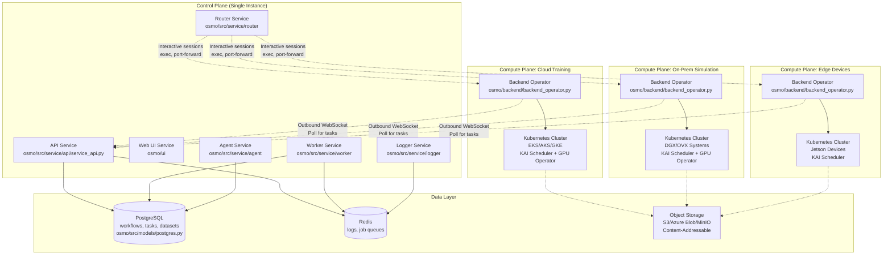
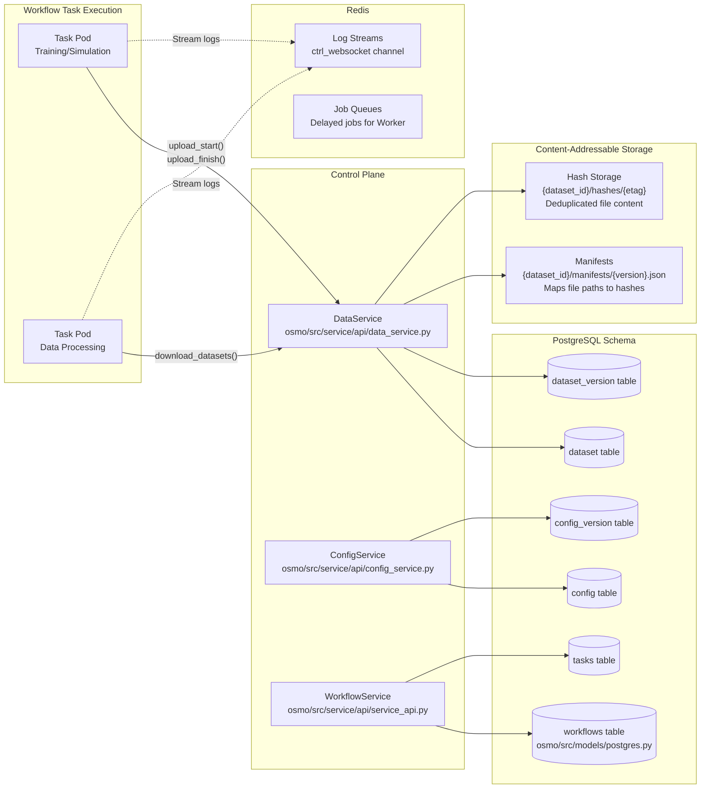
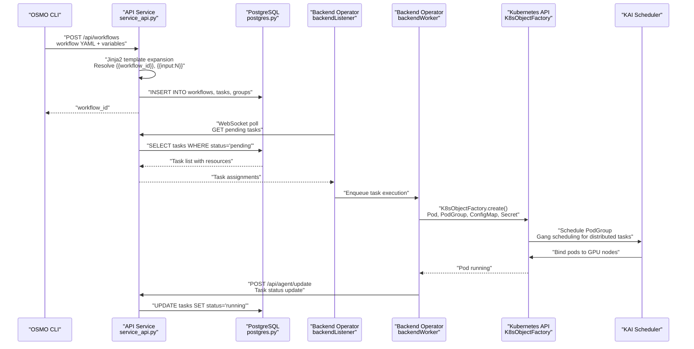

<!-- source: DeepWiki mcp.deepwiki.com · repo NVIDIA/OSMO · page 1 Overview · fetched 2026-10-26 -->

# Overview

<details>
<summary>Relevant source files</summary>

The following files were used as context for generating this wiki page:

- [.github/PULL_REQUEST_TEMPLATE.md](.github/PULL_REQUEST_TEMPLATE.md)
- [CONTRIBUTING.md](CONTRIBUTING.md)
- [README.md](README.md)
- [deployments/brev/README.md](deployments/brev/README.md)
- [deployments/brev/setup.sh](deployments/brev/setup.sh)
- [docs/deployment_guide/getting_started/create_storage/s3/index.rst](docs/deployment_guide/getting_started/create_storage/s3/index.rst)
- [docs/deployment_guide/introduction/whats_next.rst](docs/deployment_guide/introduction/whats_next.rst)
- [docs/deployment_options.svg](docs/deployment_options.svg)
- [docs/front_cover.png](docs/front_cover.png)
- [docs/index.rst](docs/index.rst)

</details>


OSMO is a workflow orchestration platform purpose-built for Physical AI development. It enables developers to define complex workflows in YAML that orchestrate tasks across heterogeneous compute resources—from cloud-based GPU training clusters to on-premise simulation hardware to edge devices—without requiring infrastructure expertise or custom scripting.

This page introduces OSMO's core architecture and the fundamental problem it solves. For detailed information on specific subsystems, see:
- Architecture details: [Architecture](#1.1)
- Core concepts and terminology: [Key Concepts](#1.2)
- Deployment procedures: [Getting Started](#2)

**Sources**: [README.md:1-189]()

## The Three Computer Problem

Physical AI development uniquely requires coordinating three distinct types of compute infrastructure, each with specialized hardware and deployment constraints:

| Compute Type | Hardware Examples | Primary Workloads | Typical Location |
|--------------|-------------------|-------------------|------------------|
| **Training** | GB200, H100, H200 | Deep learning, reinforcement learning | Cloud (EKS, AKS, GKE) |
| **Simulation** | L40, RTX Pro 6000 | Physics engines, sensor rendering (Isaac Sim) | Cloud or on-premise |
| **Edge** | Jetson AGX Thor, AGX Orin | Hardware-in-the-loop testing, robot validation | On-premise, lab environments |

Traditional approaches require developers to maintain separate infrastructure code, custom scripts, and deployment pipelines for each environment. OSMO solves this by providing a unified orchestration layer where a single workflow YAML can specify tasks that run on any combination of these compute backends.

**Example workflow spanning three compute types**:
```yaml
workflow:
  tasks:
  - name: simulation
    image: nvcr.io/nvidia/isaac-sim
    platform: rtx-pro-6000          # Simulation backend

  - name: train-policy
    image: nvcr.io/nvidia/pytorch
    platform: gb200                 # Training backend
    resources:
      gpu: 8
    inputs:
    - task: simulation

  - name: evaluate-thor
    image: my-ros-app
    platform: jetson-agx-thor       # Edge backend
    inputs:
    - task: train-policy
```

**Sources**: [README.md:89-111]()

## High-Level Architecture

OSMO uses a **Control Plane / Compute Plane** architecture that decouples the orchestration logic from compute execution. This design enables backend operators to initiate outbound connections to the control plane, allowing compute resources to exist behind firewalls and across geographic boundaries.



### Control Plane Components

The control plane is a centralized service layer deployed as a single instance that manages workflow orchestration, authentication, and data persistence.

| Component | Implementation | Purpose |
|-----------|----------------|---------|
| **API Service** | `osmo/src/service/api/service_api.py` | Handles workflow submission, configuration management, dataset operations via REST API |
| **Web UI Service** | `osmo/ui` (Next.js application) | Provides browser-based interface for workflow monitoring and management |
| **Router Service** | `osmo/src/service/router` | Proxies interactive connections (`exec`, `port-forward`, webserver) to backend tasks |
| **Worker Service** | `osmo/src/service/worker` | Processes background jobs from Redis queues (dataset operations, cleanup tasks) |
| **Logger Service** | `osmo/src/service/logger` | Streams logs from backend tasks via WebSocket to clients |
| **Agent Service** | `osmo/src/service/agent` | Receives status updates from backend operators and updates database state |

**Sources**: [README.md:1-189](), High-level architecture diagram from prompt

### Compute Plane Components

Each compute plane consists of a Kubernetes cluster with a backend operator that polls the control plane for work assignments.

| Component | Implementation | Purpose |
|-----------|----------------|---------|
| **Backend Operator** | `osmo/backend/backend_operator.py` | Two-component system: `backendListener` polls for tasks, `backendWorker` creates Kubernetes resources |
| **KAI Scheduler** | External Helm chart (`oci://ghcr.io/nvidia/kai-scheduler`) | Gang scheduling for distributed training, GPU-aware pod placement |
| **GPU Operator** | External Helm chart (`gpu-operator`) | Device plugin for GPU allocation, node feature discovery |

Backend operators initiate **outbound-only connections** to the control plane, eliminating the need for firewall rules or VPN tunnels. This architecture enables compute resources to exist anywhere—cloud, on-premise data centers, or edge locations—while being managed from a single control plane.

**Sources**: [README.md:1-189](), [deployments/brev/setup.sh:301-346](), High-level architecture diagram from prompt

## Data Flow Architecture

OSMO implements a three-tier data storage system optimized for Physical AI workloads:



### Storage Tiers

**Metadata Storage (PostgreSQL)**: The `postgres.py` model defines the complete schema for workflows, tasks, datasets, and configurations. All state transitions and metadata operations are transactional.

**Log Streaming (Redis)**: The Logger service uses Redis pub/sub channels to stream task logs in real-time to clients via WebSocket connections. Redis also manages job queues for the Worker service.

**Content-Addressable Object Storage**: Datasets use a two-level storage structure:
- **Manifests** (`{dataset_id}/manifests/{version}.json`): Map logical file paths to content hashes
- **Hashes** (`{dataset_id}/hashes/{etag}`): Store actual file content keyed by hash

This architecture achieves 10-100x storage savings through automatic deduplication. Multiple dataset versions that share files reference the same hash objects.

**Sources**: [README.md:76](), Data flow diagram from prompt, [docs/deployment_guide/getting_started/create_storage/s3/index.rst:1-130]()

## Workflow Execution Model

OSMO workflows are defined in YAML with Jinja2 templating support. The execution flow involves multiple services coordinating to transform YAML specifications into running Kubernetes pods:



### Special Token Resolution

OSMO provides runtime token substitution for inter-task dependencies:

| Token | Purpose | Example |
|-------|---------|---------|
| `{{workflow_id}}` | Current workflow identifier | `my-workflow-20250115-123456` |
| `{{input:N}}` | Path to input dataset from task N | `/osmo/inputs/0` |
| `{{output}}` | Path to output dataset directory | `/osmo/outputs` |
| `{{host:task_name}}` | DNS hostname for another task | `simulation-task.namespace.svc.cluster.local` |

The `{{host:task_name}}` token is critical for distributed training frameworks (TorchRun, DeepSpeed, ROS 2) that require inter-process communication. It resolves to the Kubernetes service DNS name for the specified task.

**Sources**: [README.md:47-71](), Workflow execution diagram from prompt

## Deployment Options

OSMO supports three deployment profiles, each optimized for different use cases:

| Deployment | Setup Time | Authentication | Best For | Limitations |
|------------|------------|----------------|----------|-------------|
| **Local** | ~10 minutes | Dev mode (no auth) | Evaluation, learning | Single-node, no distributed training |
| **Minimal** | ~30 minutes | Dev mode (no auth) | Testing, development | Single namespace, limited scalability |
| **Production** | 2-4 hours | Keycloak SSO (OAuth2/OIDC) | Multi-user production | Requires external dependencies |

The local deployment uses KIND (Kubernetes in Docker) and is documented in [deployments/brev/setup.sh:1-436](). It installs:
1. KIND cluster with GPU support via `nvkind`
2. GPU Operator (v25.10.0)
3. KAI Scheduler (v0.8.1)
4. OSMO quick-start Helm chart (v1.0.0)

Production deployments require external PostgreSQL, Redis, Keycloak, and object storage (S3/Azure Blob). These are configured via Helm chart values.

**Sources**: [README.md:134-142](), [deployments/brev/setup.sh:1-436](), [docs/deployment_options.svg:1-217](), [docs/deployment_guide/introduction/whats_next.rst:1-35]()

## Production Readiness

OSMO is production-grade software originally developed at NVIDIA to orchestrate Physical AI workloads for internal projects including Project GR00T, Isaac Lab, Isaac Dexterity, Isaac Sim, and Isaac ROS. It processes thousands of GPU-hours daily across heterogeneous compute spanning cloud training clusters to edge devices.

The codebase is now open-source under Apache 2.0 license and follows structured contribution processes:
- **Bug reports and documentation issues**: File GitHub issues [CONTRIBUTING.md:6-9]()
- **Small fixes**: Submit pull requests directly [CONTRIBUTING.md:10-13]()
- **Significant changes**: Use the formal projects process with design proposals [CONTRIBUTING.md:14-22]()

All pull requests require two approvals from OSMO engineers and passing CI/CD checks before merge.

**Sources**: [README.md:128-133](), [CONTRIBUTING.md:1-139]()

## Next Steps

To begin using OSMO:
1. **Try it locally**: Follow [Getting Started](#2) for local deployment instructions
2. **Understand core concepts**: Read [Key Concepts](#1.2) for terminology and workflow structure
3. **Explore the architecture**: See [Architecture](#1.1) for detailed component interactions
4. **Deploy to production**: See [Deployment Options Comparison](#2.2) for production setup

For developers contributing to OSMO, see [Development and Contributing](#9) for build instructions, CI/CD pipeline details, and the projects process.

**Sources**: [README.md:145-156](), [docs/index.rst:1-39]()

---

