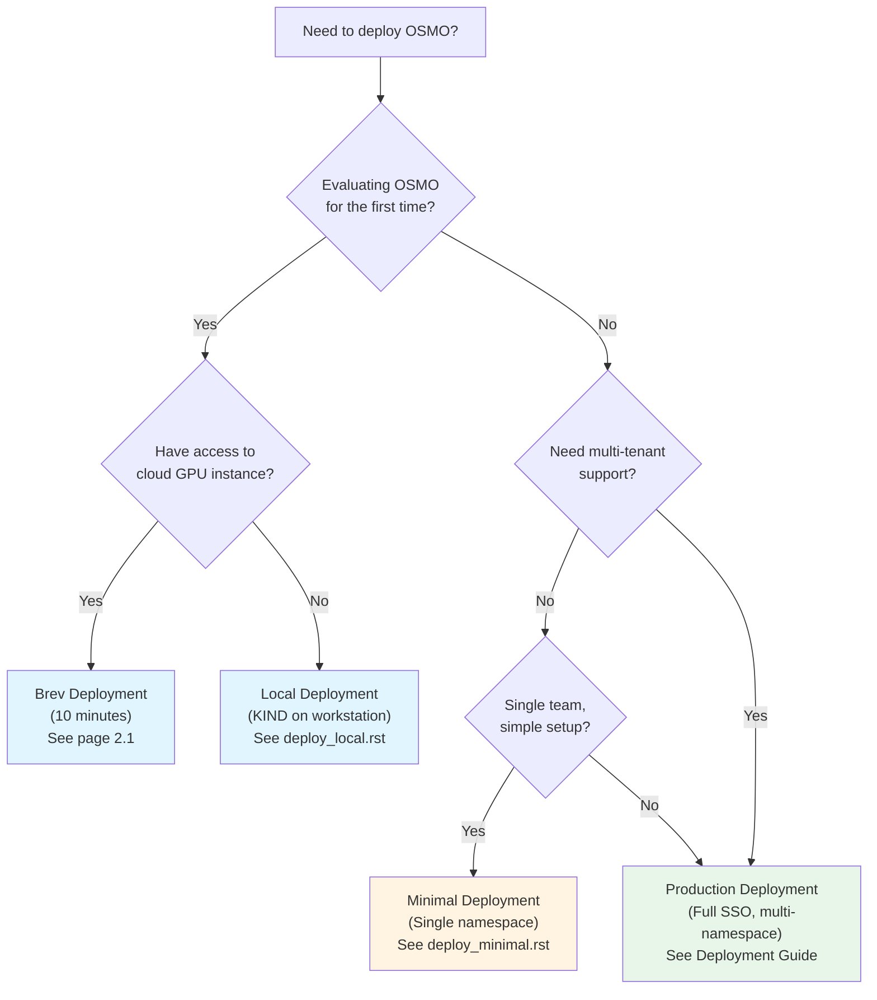
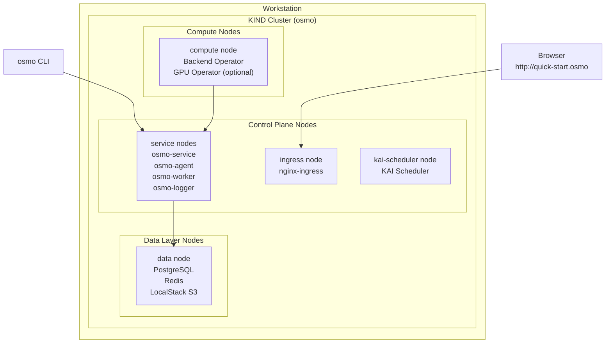
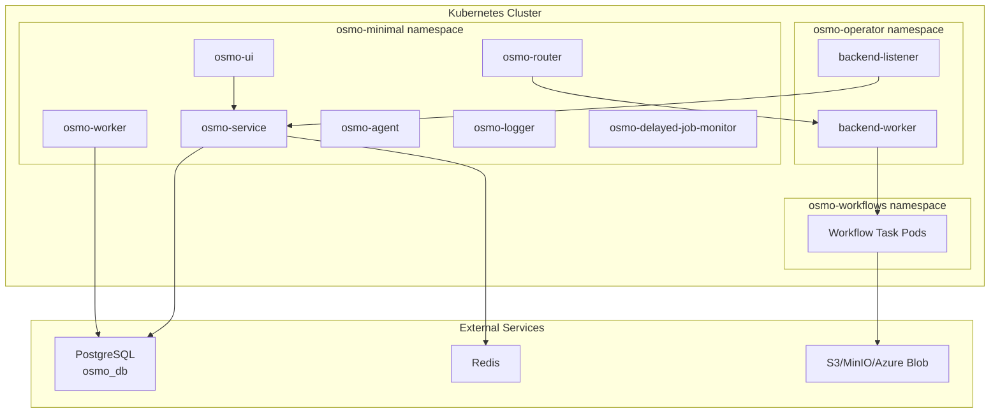
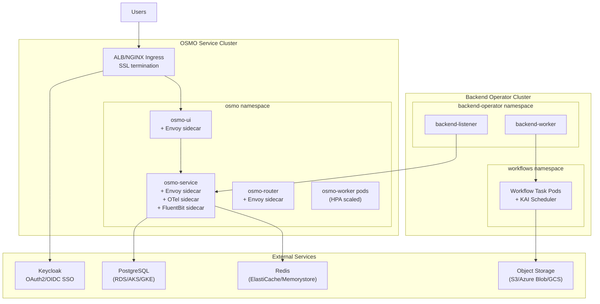

<!-- source: DeepWiki mcp.deepwiki.com · repo NVIDIA/OSMO · page 2 Getting Started · fetched 2026-10-26 -->

# Getting Started

<details>
<summary>Relevant source files</summary>

The following files were used as context for generating this wiki page:

- [.github/PULL_REQUEST_TEMPLATE.md](.github/PULL_REQUEST_TEMPLATE.md)
- [CONTRIBUTING.md](CONTRIBUTING.md)
- [README.md](README.md)
- [deployments/brev/README.md](deployments/brev/README.md)
- [deployments/brev/setup.sh](deployments/brev/setup.sh)
- [docs/deployment_guide/appendix/deploy_local.rst](docs/deployment_guide/appendix/deploy_local.rst)
- [docs/deployment_guide/appendix/deploy_minimal.rst](docs/deployment_guide/appendix/deploy_minimal.rst)
- [docs/deployment_guide/getting_started/create_storage/s3/index.rst](docs/deployment_guide/getting_started/create_storage/s3/index.rst)
- [docs/deployment_guide/index.rst](docs/deployment_guide/index.rst)
- [docs/spelling_wordlist.txt](docs/spelling_wordlist.txt)
- [docs/user_guide/index.rst](docs/user_guide/index.rst)
- [docs/user_guide/overview.svg](docs/user_guide/overview.svg)

</details>


This page guides you through choosing and initiating your first OSMO deployment. It covers the three primary deployment options—Local, Minimal, and Production—and helps you select the appropriate approach based on your use case.

For detailed installation instructions specific to each deployment type, see:
- Local deployment on your workstation: [Quick Start with Brev](#2.1)
- Comparison of all deployment architectures: [Deployment Options Comparison](#2.2)
- Full production deployment guide: The Deployment Guide (external documentation)

## Deployment Options Overview

OSMO provides three deployment configurations, each designed for different stages of adoption and operational requirements:

| Deployment Type | Target Use Case | Setup Time | Authentication | Multi-Tenancy |
|----------------|-----------------|------------|----------------|---------------|
| **Local** | Evaluation, Development | ~10 minutes | Dev mode only | No |
| **Minimal** | Testing, Single-team POC | ~30 minutes | Optional | No |
| **Production** | Multi-team Production Use | ~2 hours | Full SSO/OAuth2 | Yes |

**Sources:** [README.md:134-143](), [docs/deployment_guide/appendix/deploy_local.rst:20-53](), [docs/deployment_guide/appendix/deploy_minimal.rst:20-43]()

## Choosing Your Deployment



**Sources:** [docs/deployment_guide/index.rst:74-98](), [README.md:136-143]()

## Deployment Architectures

### Local Deployment (KIND)

The Local deployment runs OSMO entirely on your workstation using KIND (Kubernetes in Docker). It deploys all components into a single Kubernetes cluster with separate node groups for different workload types.



**Key Characteristics:**
- Single Kubernetes cluster with labeled node groups
- LocalStack provides S3-compatible object storage
- Dev-mode authentication (no Keycloak)
- GPU support via nvkind (optional)

**Helm Charts Deployed:**
- `quick-start` umbrella chart
- Includes: `service`, `web-ui`, `router`, `backend-operator`

**Sources:** [docs/deployment_guide/appendix/deploy_local.rst:70-267](), [deployments/brev/setup.sh:236-295]()

### Minimal Deployment

The Minimal deployment uses a single Kubernetes cluster with external PostgreSQL and Redis. It's designed for testing with minimal infrastructure overhead.



**Key Characteristics:**
- Single namespace for control plane services
- Separate namespace for backend operator
- External PostgreSQL and Redis required
- Optional ingress for external access
- No authentication (dev mode)

**Helm Charts Deployed:**
- `osmo/service` chart
- `osmo/web-ui` chart
- `osmo/router` chart
- `osmo/backend-operator` chart

**Sources:** [docs/deployment_guide/appendix/deploy_minimal.rst:29-48](), [docs/deployment_guide/appendix/deploy_minimal.rst:214-461]()

### Production Deployment

Production deployment provides full multi-tenant support with authentication, separate namespaces, and production-grade configurations. This architecture matches **Diagram 3** from the high-level overview.



**Key Characteristics:**
- Multi-namespace architecture for security isolation
- Keycloak SSO integration with OAuth2/OIDC
- Envoy sidecars for authentication validation
- Horizontal Pod Autoscaling (HPA) for workers
- Production-grade databases (RDS, Cloud SQL, etc.)
- Full observability stack (FluentBit, OpenTelemetry, Prometheus)

**Helm Charts Deployed:**
- Same charts as Minimal, with production values
- Additional sidecars enabled
- HPA and resource limits configured

**Sources:** [docs/deployment_guide/index.rst:74-98](), [charts/webui cluster reference from overview](), [charts/backend-operator cluster reference from overview]()

## Prerequisites

### All Deployments

All deployment options require:

- **kubectl** >= 1.32.2
- **helm** >= 3.16.2
- **osmo CLI** (installed via `install.sh`)

**Sources:** [CONTRIBUTING.md:32-43]()

### Local Deployment Specific

- **Docker** >= 28.3.2
- **KIND** >= 0.29.0
- **System Configuration:**
  - Increased inotify limits (see KIND known issues)
  - Docker group permissions for current user

**Optional for GPU support:**
- **nvkind** (requires Go >= 1.23.4)
- **nvidia-container-toolkit** >= 1.18.0
- **NVIDIA drivers** >= 575

**Sources:** [docs/deployment_guide/appendix/deploy_local.rst:54-70](), [deployments/brev/setup.sh:46-106]()

### Minimal/Production Deployment Specific

- **Kubernetes Cluster** (EKS, AKS, GKE, or on-premise)
- **PostgreSQL** database (external or in-cluster)
- **Redis** cache (external or in-cluster)
- **Object Storage** (S3, Azure Blob, or MinIO)
- **Ingress Controller** (for external access)

**Optional for production:**
- **Keycloak** or compatible OIDC provider
- **Certificate Manager** for SSL/TLS

**Sources:** [docs/deployment_guide/index.rst:115-121](), [docs/deployment_guide/appendix/deploy_minimal.rst:49-56]()

## Quick Start Commands

### Local Deployment (KIND)

```bash
# Create KIND cluster
kind create cluster --config kind-osmo-cluster-config.yaml

# Install KAI Scheduler
helm upgrade --install kai-scheduler \
  oci://ghcr.io/nvidia/kai-scheduler/kai-scheduler \
  --version v0.8.1 \
  --create-namespace -n kai-scheduler

# Install OSMO
helm fetch https://helm.ngc.nvidia.com/nvidia/osmo/charts/quick-start-1.0.0.tgz
helm upgrade --install osmo quick-start-1.0.0.tgz \
  --namespace osmo \
  --create-namespace \
  --wait

# Install OSMO CLI
curl -fsSL https://raw.githubusercontent.com/NVIDIA/OSMO/main/install.sh | bash

# Login
osmo login http://quick-start.osmo --method=dev --username=testuser
```

**Sources:** [docs/deployment_guide/appendix/deploy_local.rst:269-332]()

### Brev Deployment

The Brev deployment automates the entire local setup process:

```bash
# One-time setup (runs automatically on Brev instance)
# See deployments/brev/setup.sh for full automation

# Access via Brev console or port forwarding
sudo ssh -i ~/.brev/brev.pem -p 22 -L 80:localhost:8000 shadeform@<instance-ip>

# Login
osmo login http://localhost:8000 --method=dev --username=testuser
```

**Sources:** [deployments/brev/README.md:30-111](), [deployments/brev/setup.sh:1-436]()

### Minimal Deployment

```bash
# Create namespaces
kubectl create namespace osmo-minimal
kubectl create namespace osmo-operator

# Create secrets
kubectl create secret generic db-secret \
  --from-literal=db-password=<password> \
  --namespace osmo-minimal

# Generate MEK (Master Encryption Key)
RANDOM_KEY=$(openssl rand -base64 32 | tr -d '\n')
JWK_JSON="{\"k\":\"$RANDOM_KEY\",\"kid\":\"key1\",\"kty\":\"oct\"}"
ENCODED_JWK=$(echo -n "$JWK_JSON" | base64 | tr -d '\n')

# Create MEK ConfigMap
kubectl apply -f - <<EOF
apiVersion: v1
kind: ConfigMap
metadata:
  name: mek-config
  namespace: osmo-minimal
data:
  mek.yaml: |
    currentMek: key1
    meks:
      key1: $ENCODED_JWK
EOF

# Deploy services
helm upgrade --install osmo-minimal osmo/service -f osmo_values.yaml --namespace osmo-minimal
helm upgrade --install ui-minimal osmo/web-ui -f ui_values.yaml --namespace osmo-minimal
helm upgrade --install router-minimal osmo/router -f router_values.yaml --namespace osmo-minimal
helm upgrade --install osmo-operator osmo/backend-operator -f backend_operator_values.yaml --namespace osmo-operator
```

**Sources:** [docs/deployment_guide/appendix/deploy_minimal.rst:57-603]()

## Component Overview

The following table maps OSMO components to their deployment configurations:

| Component | Purpose | Local | Minimal | Production |
|-----------|---------|-------|---------|------------|
| `osmo-service` | API server, workflow orchestration | ✓ | ✓ | ✓ (+ HPA) |
| `osmo-ui` | Next.js web interface | ✓ | ✓ | ✓ |
| `osmo-router` | Port forwarding, exec proxy | ✓ | ✓ | ✓ |
| `osmo-worker` | Background job processing | ✓ | ✓ | ✓ (+ HPA) |
| `osmo-agent` | Workflow status updates | ✓ | ✓ | ✓ |
| `osmo-logger` | Log streaming via WebSocket | ✓ | ✓ | ✓ |
| `osmo-delayed-job-monitor` | Job queue monitoring | ✓ | ✓ | ✓ |
| `backend-listener` | Poll tasks, monitor cluster | ✓ | ✓ | ✓ |
| `backend-worker` | Execute jobs, create K8s resources | ✓ | ✓ | ✓ |
| PostgreSQL | Metadata storage | LocalStack | External | Managed DB |
| Redis | Log cache, job queue | Local | External | Managed |
| Object Storage | Datasets, artifacts | LocalStack | S3/Azure | S3/Azure/GCS |
| Keycloak | SSO authentication | ✗ | ✗ | ✓ |
| Envoy Sidecars | Auth validation | ✗ | ✗ | ✓ |
| Ingress | External access | nginx | Optional | ALB/nginx |

**Sources:** [docs/deployment_guide/appendix/deploy_local.rst:250-267](), [docs/deployment_guide/appendix/deploy_minimal.rst:470-484]()

## Post-Deployment Configuration

After deploying OSMO, you must configure data storage before running workflows:

1. **Create Storage Buckets** - Set up S3, Azure Blob, or MinIO buckets
2. **Configure Dataset Storage** - Register buckets with OSMO using `osmo config`
3. **Install KAI Scheduler** - Required for gang scheduling (if not already installed)
4. **Configure Pools** - Define compute pools and resource platforms

For detailed configuration steps, see the Deployment Guide's "Getting Started" section.

**Sources:** [docs/deployment_guide/appendix/deploy_minimal.rst:661-669]()

## Next Steps

After completing deployment, proceed to:

1. **[Quick Start with Brev](#2.1)** - If evaluating with a cloud GPU instance
2. **[Deployment Options Comparison](#2.2)** - For detailed architecture comparison
3. **User Guide** - For tutorials on submitting your first workflow
4. **Deployment Guide** - For production deployment and advanced configuration

To verify your deployment, you can:
- Access the Web UI at your configured hostname
- Run `osmo workflow list` to verify CLI connectivity
- Submit a test workflow from the User Guide tutorials

**Sources:** [docs/deployment_guide/appendix/deploy_local.rst:338-353](), [README.md:145-156]()

---

