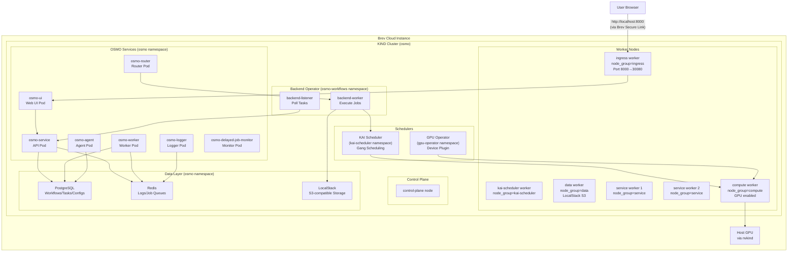
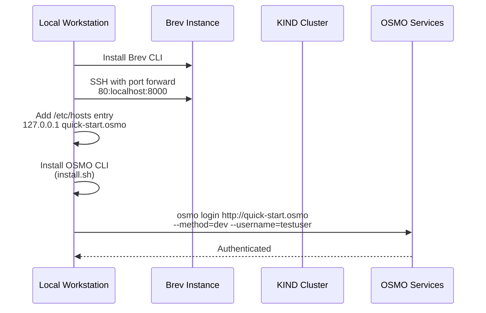
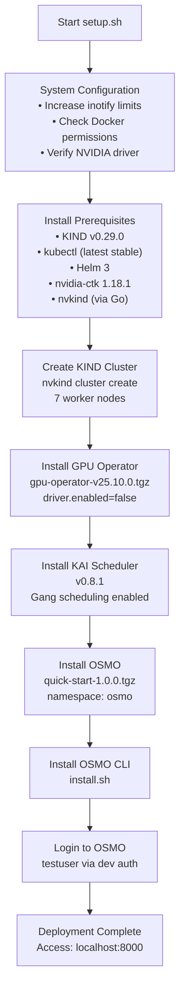

<!-- source: DeepWiki mcp.deepwiki.com · repo NVIDIA/OSMO · page 2.1 Quick Start with Brev · fetched 2026-10-26 -->

# Quick Start with Brev

<details>
<summary>Relevant source files</summary>

The following files were used as context for generating this wiki page:

- [.github/PULL_REQUEST_TEMPLATE.md](.github/PULL_REQUEST_TEMPLATE.md)
- [CONTRIBUTING.md](CONTRIBUTING.md)
- [README.md](README.md)
- [deployments/brev/README.md](deployments/brev/README.md)
- [deployments/brev/setup.sh](deployments/brev/setup.sh)
- [docs/deployment_guide/appendix/deploy_local.rst](docs/deployment_guide/appendix/deploy_local.rst)
- [docs/deployment_guide/appendix/deploy_minimal.rst](docs/deployment_guide/appendix/deploy_minimal.rst)
- [docs/deployment_guide/getting_started/create_storage/s3/index.rst](docs/deployment_guide/getting_started/create_storage/s3/index.rst)
- [docs/deployment_guide/index.rst](docs/deployment_guide/index.rst)
- [docs/spelling_wordlist.txt](docs/spelling_wordlist.txt)
- [docs/user_guide/index.rst](docs/user_guide/index.rst)
- [docs/user_guide/overview.svg](docs/user_guide/overview.svg)

</details>


## Purpose and Scope

This page describes how to deploy OSMO in approximately 10 minutes using Brev for evaluation purposes. The Brev deployment provides a pre-configured OSMO instance running on a Brev.dev cloud instance with GPU support, allowing you to quickly try OSMO without setting up local infrastructure.

**Note**: This deployment is intended for evaluation only. It lacks authentication mechanisms and has limited resources. For production deployments, see [Deployment Options Comparison](#2.2).

For information about local deployment on your own workstation, see the local deployment documentation in [docs/deployment_guide/appendix/deploy_local.rst:1-406]().

**Sources**: [deployments/brev/README.md:19-32](), [README.md:151]()

## Deployment Architecture

The Brev deployment uses the OSMO local deployment pattern with a KIND (Kubernetes in Docker) cluster. The automated setup script [deployments/brev/setup.sh:1-436]() creates the following architecture:



**Key Components**:

| Component | Purpose | Namespace |
|-----------|---------|-----------|
| `osmo-service` | API server for workflow operations | `osmo` |
| `osmo-ui` | Next.js web interface | `osmo` |
| `osmo-router` | Port forwarding and exec sessions | `osmo` |
| `osmo-worker` | Background job processing | `osmo` |
| `osmo-logger` | Log streaming | `osmo` |
| `osmo-agent` | Status updates | `osmo` |
| `backend-listener` | Polls for workflow tasks | `osmo-workflows` |
| `backend-worker` | Executes workflow tasks | `osmo-workflows` |
| `kai-scheduler` | Gang scheduling for GPUs | `kai-scheduler` |
| `gpu-operator` | GPU device management | `gpu-operator` |

**Sources**: [deployments/brev/setup.sh:230-295](), [deployments/brev/setup.sh:300-345](), [docs/deployment_guide/appendix/deploy_local.rst:249-266]()

## System Requirements

The Brev instance must have:

- **NVIDIA Driver**: Version 575 or higher
- **NVIDIA Container Toolkit**: Version 1.18.1 or higher

These requirements are validated during the automated setup process at [deployments/brev/setup.sh:82-105]().

**Sources**: [deployments/brev/README.md:34-37](), [deployments/brev/setup.sh:49-59]()

## Accessing the Brev Deployment

### Web UI Access via Secure Link

The simplest way to access OSMO is through the Brev secure link:

1. Deploy OSMO via the Brev link: [https://brev.nvidia.com/launchable/deploy?launchableID=env-36a6a7qnkOMOP2vgiBRaw2e3jpW](https://brev.nvidia.com/launchable/deploy?launchableID=env-36a6a7qnkOMOP2vgiBRaw2e3jpW)

2. Log in to your Brev console at https://console.brev.dev

3. Navigate to your OSMO instance

4. Select **Access**

5. Click on the **Secure Link** for port `8000`

This provides browser access to the OSMO Web UI without requiring local setup.

**Sources**: [deployments/brev/README.md:39-48](), [README.md:28]()

## Optional: Local CLI Setup

For advanced users who want to use the OSMO CLI from their local workstation, the following optional setup enables port forwarding and CLI access.

### Installation Flow



### Step 1: Install Brev CLI

Follow the installation instructions at the Brev CLI documentation. After installation, authenticate:

```bash
brev login
```

**Sources**: [deployments/brev/README.md:54-56]()

### Step 2: Set Up Port Forwarding

Forward port 8000 from the Brev instance to local port 80. Find your instance IP address at the top of the deployment page in the Brev console:

```bash
# Find your instance name
brev ls

# Set up port forwarding (requires sudo for port 80)
sudo ssh -i ~/.brev/brev.pem -p 22 -L 80:localhost:8000 shadeform@[your-instance-ip]
```

If you encounter `Permission denied (publickey)` errors:
1. Verify you ran `brev login`
2. Check the username in Brev Console → Instance → Logs → Script Logs for `Current user: [username]`
3. Replace `shadeform` with the correct username

**Sources**: [deployments/brev/README.md:58-81]()

### Step 3: Configure Local Networking

Add a host entry to access OSMO from your browser:

```bash
echo "127.0.0.1 quick-start.osmo" | sudo tee -a /etc/hosts
```

This allows accessing OSMO at `http://quick-start.osmo` in your web browser.

**Sources**: [deployments/brev/README.md:83-91]()

### Step 4: Install OSMO CLI

Download and install the OSMO command-line interface:

```bash
curl -fsSL https://raw.githubusercontent.com/NVIDIA/OSMO/refs/heads/main/install.sh | bash
```

The installation script is also executed during Brev setup at [deployments/brev/setup.sh:373-384]().

**Sources**: [deployments/brev/README.md:93-99]()

### Step 5: Authenticate with OSMO

Log in to the OSMO instance using the development authentication method:

```bash
osmo login http://quick-start.osmo --method=dev --username=testuser
```

The `--method=dev` flag uses a development authentication mode that bypasses OAuth2/Keycloak SSO, which is disabled in the Brev deployment. The username `testuser` is used for all operations.

**Sources**: [deployments/brev/README.md:101-107](), [deployments/brev/setup.sh:388-390]()

## Automated Deployment Process

The Brev deployment executes [deployments/brev/setup.sh:1-436]() automatically, which performs the following operations:



**Key Installation Steps**:

1. **System Configuration** [deployments/brev/setup.sh:62-105](): Configures inotify limits, verifies Docker permissions, and checks NVIDIA driver version (minimum 575)

2. **Prerequisites Installation** [deployments/brev/setup.sh:107-228](): Installs KIND, kubectl, Helm, nvidia-container-toolkit (1.18.1), and nvkind

3. **KIND Cluster Creation** [deployments/brev/setup.sh:300-312](): Creates a 7-worker-node KIND cluster using the configuration at [deployments/brev/setup.sh:237-295]()

4. **GPU Operator** [deployments/brev/setup.sh:315-328](): Installs GPU operator v25.10.0 with driver and toolkit disabled (using host versions)

5. **KAI Scheduler** [deployments/brev/setup.sh:333-344](): Installs KAI scheduler v0.8.1 for gang scheduling support

6. **OSMO Services** [deployments/brev/setup.sh:349-369](): Deploys the `quick-start-1.0.0` Helm chart to the `osmo` namespace

7. **CLI and Authentication** [deployments/brev/setup.sh:373-390](): Installs OSMO CLI and authenticates with development mode

**Sources**: [deployments/brev/setup.sh:19-436]()

## Verification

After successful deployment, verify that all pods are running:

```bash
kubectl get pods --namespace osmo
```

Expected output includes pods for:
- `osmo-service-*`
- `osmo-ui-*`
- `osmo-router-*`
- `osmo-worker-*`
- `osmo-logger-*`
- `osmo-agent-*`
- `osmo-delayed-job-monitor-*`

The deployment status is automatically checked at [deployments/brev/setup.sh:368-369]().

**Sources**: [deployments/brev/setup.sh:368-369](), [docs/deployment_guide/appendix/deploy_local.rst:400-404]()

## Limitations

The Brev deployment has the following limitations:

| Limitation | Description |
|------------|-------------|
| **No Authentication** | Uses `--method=dev` authentication; no OAuth2/OIDC/Keycloak |
| **Single User** | All operations under `testuser` |
| **Resource Constraints** | Limited by Brev instance specifications |
| **Ephemeral Storage** | LocalStack S3 storage is not persistent across restarts |
| **Development Mode** | Not suitable for production workloads |

For production deployments with authentication, multi-tenancy, and persistent storage, see [Deployment Options Comparison](#2.2).

**Sources**: [deployments/brev/README.md:32](), [README.md:32]()

## Cleanup

To remove the Brev deployment:

1. **Close port-forward session** (if using CLI):
   ```bash
   kill -9 $(lsof -ti:8000)
   ```

2. **Delete Brev instance** via console or CLI:
   ```bash
   brev delete [instance-name]
   ```

This removes the entire environment including the KIND cluster and all OSMO services.

**Sources**: [deployments/brev/README.md:120-132]()

## Next Steps

After successfully deploying OSMO on Brev:

1. **Run Your First Workflow**: Follow the getting started tutorials to submit your first workflow. See the user guide documentation for workflow examples.

2. **Explore the Web UI**: Access the OSMO dashboard to monitor workflows, view logs, and manage datasets.

3. **Test with Sample Workflows**: The OSMO repository includes example workflows in the `workflows/` directory demonstrating simulation, training, and distributed patterns.

4. **Evaluate for Your Use Case**: Test your own Docker images and datasets to assess OSMO's fit for your Physical AI development needs.

5. **Plan Production Deployment**: If OSMO meets your requirements, review production deployment options including authentication, multi-backend setup, and persistent storage configuration.

**Sources**: [deployments/brev/README.md:109-118](), [README.md:154-156]()

---

