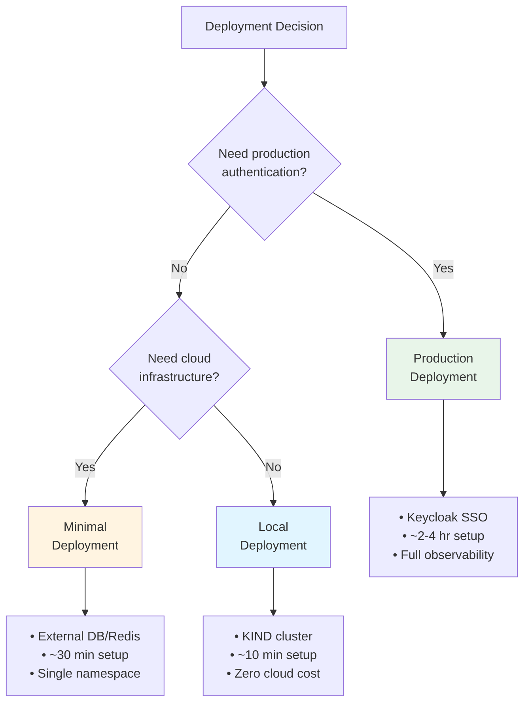
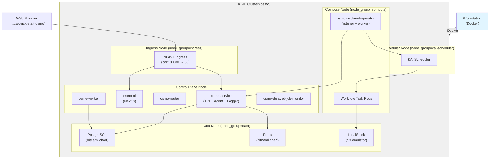
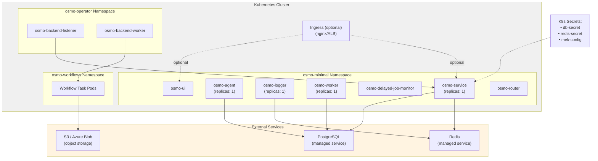
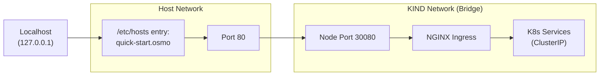
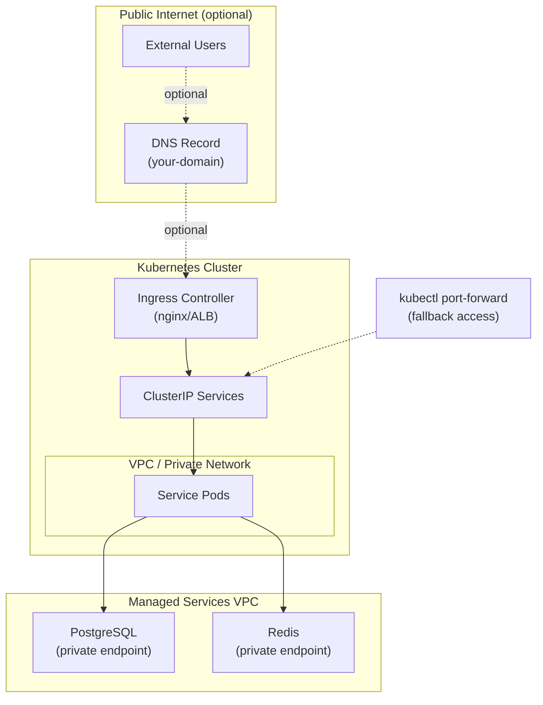
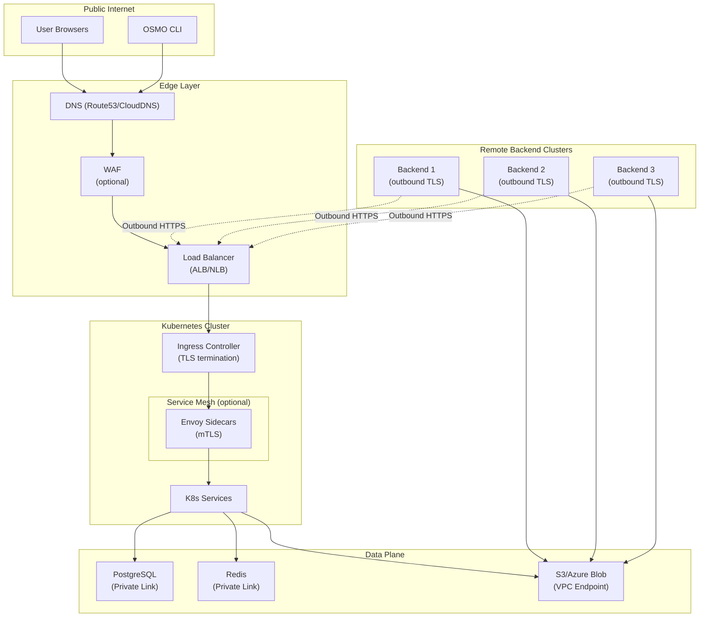

<!-- source: DeepWiki mcp.deepwiki.com · repo NVIDIA/OSMO · page 2.2 Deployment Options Comparison · fetched 2026-10-26 -->

# Deployment Options Comparison

<details>
<summary>Relevant source files</summary>

The following files were used as context for generating this wiki page:

- [docs/deployment_guide/appendix/deploy_local.rst](docs/deployment_guide/appendix/deploy_local.rst)
- [docs/deployment_guide/appendix/deploy_minimal.rst](docs/deployment_guide/appendix/deploy_minimal.rst)
- [docs/deployment_guide/index.rst](docs/deployment_guide/index.rst)
- [docs/deployment_guide/introduction/whats_next.rst](docs/deployment_guide/introduction/whats_next.rst)
- [docs/deployment_options.svg](docs/deployment_options.svg)
- [docs/front_cover.png](docs/front_cover.png)
- [docs/index.rst](docs/index.rst)
- [docs/spelling_wordlist.txt](docs/spelling_wordlist.txt)
- [docs/user_guide/index.rst](docs/user_guide/index.rst)
- [docs/user_guide/overview.svg](docs/user_guide/overview.svg)

</details>


## Purpose and Scope

This page compares the three primary deployment options for OSMO: Local, Minimal, and Production. It provides technical comparisons of architecture, components, features, and trade-offs to help you select the appropriate deployment strategy for your use case. For step-by-step deployment instructions, see the Quick Start with Brev guide ([2.1](#2.1)) or the specific deployment guides linked below.

## Overview

OSMO offers three deployment configurations that balance ease of setup against production readiness:

| Deployment Type | Setup Time | Target Use Case | Authentication | Multi-Backend | Infrastructure |
|-----------------|------------|-----------------|----------------|---------------|----------------|
| **Local** | ~10 minutes | Evaluation, learning | None (dev mode) | No | KIND cluster on workstation |
| **Minimal** | ~30 minutes | Testing, development | None (dev mode) | Single cluster | Cloud Kubernetes with external dependencies |
| **Production** | 2-4 hours | Production, multi-user | Keycloak SSO | Yes | Cloud Kubernetes with full observability stack |



**Sources:** [docs/deployment_options.svg:1-217](), [docs/deployment_guide/index.rst:74-102]()

## Architecture Comparison

### Local Deployment Architecture

The Local deployment uses KIND (Kubernetes in Docker) to create a complete OSMO environment on a single workstation. All components run within Docker containers orchestrated by a local Kubernetes cluster.



**Key Characteristics:**
- **Single Cluster:** All components (control plane, compute, data) in one KIND cluster
- **Embedded Dependencies:** PostgreSQL, Redis, and LocalStack deployed via Helm within cluster
- **Node Groups:** Uses Kubernetes node labels for component placement ([docs/deployment_guide/appendix/deploy_local.rst:250-266]())
- **No Sidecars:** Envoy, FluentBit, and OpenTelemetry sidecars disabled
- **Authentication:** Dev mode login with `--method=dev --username=testuser` ([docs/deployment_guide/appendix/deploy_local.rst:331]())

**Configuration Files:**
- `kind-osmo-cluster-config.yaml`: Defines 7-node cluster with specific node groups ([docs/deployment_guide/appendix/deploy_local.rst:87-150]())
- `quick-start-1.0.0.tgz`: Umbrella Helm chart deploying all components ([docs/deployment_guide/appendix/deploy_local.rst:291-295]())

**Sources:** [docs/deployment_guide/appendix/deploy_local.rst:72-405](), [docs/deployment_guide/index.rst:81-102]()

### Minimal Deployment Architecture

The Minimal deployment separates data dependencies (PostgreSQL, Redis) from the Kubernetes cluster while maintaining a simplified single-namespace architecture.



**Key Characteristics:**
- **Three Namespaces:** `osmo-minimal` (services), `osmo-operator` (backend), `osmo-workflows` (workloads)
- **External Dependencies:** PostgreSQL and Redis must be provisioned separately ([docs/deployment_guide/appendix/deploy_minimal.rst:32-42]())
- **Minimal Replicas:** All services run with `minReplicas: 1`, `maxReplicas: 1` ([docs/deployment_guide/appendix/deploy_minimal.rst:250-295]())
- **No Sidecars:** Envoy, logAgent, otel, and rateLimit sidecars all disabled ([docs/deployment_guide/appendix/deploy_minimal.rst:297-311]())
- **Optional Ingress:** Can be accessed via `kubectl port-forward` or configured ingress ([docs/deployment_guide/appendix/deploy_minimal.rst:624-659]())

**Helm Values Files:**
- `osmo_values.yaml`: Configures service chart with external DB/Redis ([docs/deployment_guide/appendix/deploy_minimal.rst:214-280]())
- `ui_values.yaml`: Configures web-ui chart ([docs/deployment_guide/appendix/deploy_minimal.rst:313-356]())
- `router_values.yaml`: Configures router chart ([docs/deployment_guide/appendix/deploy_minimal.rst:362-424]())
- `backend_operator_values.yaml`: Configures backend operator ([docs/deployment_guide/appendix/deploy_minimal.rst:524-564]())

**Sources:** [docs/deployment_guide/appendix/deploy_minimal.rst:20-731](), [docs/deployment_guide/index.rst:74-102]()

### Production Deployment Architecture

The Production deployment implements a full multi-tenant architecture with authentication, observability, and support for multiple geographically distributed compute backends.

```mermaid
graph TB
    subgraph K8sCluster["Primary Kubernetes Cluster"]
        subgraph ServiceNamespace["osmo-service Namespace"]
            subgraph APIPod["API Pod"]
                APIContainer["osmo-service"]
                EnvoyAPI["Envoy Sidecar<br/>(OAuth2 filter)"]
                OTelAPI["OTel Sidecar"]
                FluentAPI["FluentBit Sidecar"]
            end
            
            subgraph UIPod["UI Pod"]
                UIContainer["osmo-ui<br/>(port 8000)"]
                EnvoyUI["Envoy Sidecar<br/>(port 8080)"]
                FluentUI["FluentBit Sidecar"]
            end
            
            subgraph WorkerPods["Worker Pods (HPA)"]
                WorkerReplicas["osmo-worker<br/>(min: 2, max: 10)"]
            end
            
            AgentPod["osmo-agent<br/>(HPA)"]
            LoggerPod["osmo-logger<br/>(HPA)"]
            MonitorPod["osmo-delayed-job-monitor"]
        end
        
        Ingress["Ingress<br/>(ALB / nginx)<br/>TLS termination"]
    end
    
    subgraph BackendCluster1["Backend Cluster 1 (Cloud EKS)"]
        Backend1["osmo-backend-operator"]
        Workflows1["Workflow Pods"]
    end
    
    subgraph BackendCluster2["Backend Cluster 2 (On-Prem DGX)"]
        Backend2["osmo-backend-operator"]
        Workflows2["Workflow Pods"]
    end
    
    subgraph BackendCluster3["Backend Cluster 3 (Edge Jetson)"]
        Backend3["osmo-backend-operator"]
        Workflows3["Workflow Pods"]
    end
    
    subgraph ExternalServices["External Services"]
        PostgreSQL["PostgreSQL<br/>(HA cluster)"]
        Redis["Redis<br/>(HA cluster)"]
        Keycloak["Keycloak<br/>(SSO/OAuth2)"]
        ObjectStorage["Object Storage<br/>(S3 / Azure)"]
        Prometheus["Prometheus"]
        Grafana["Grafana"]
    end
    
    Users["Users<br/>(Browser / CLI)"]
    
    Users --> Ingress
    Ingress --> EnvoyUI
    Ingress --> EnvoyAPI
    
    EnvoyUI -.->|JWT validation| Keycloak
    EnvoyAPI -.->|JWT validation| Keycloak
    
    EnvoyUI --> UIContainer
    EnvoyAPI --> APIContainer
    
    APIContainer --> PostgreSQL
    APIContainer --> Redis
    WorkerReplicas --> PostgreSQL
    AgentPod --> PostgreSQL
    LoggerPod --> Redis
    
    Backend1 -.->|outbound TLS| APIContainer
    Backend2 -.->|outbound TLS| APIContainer
    Backend3 -.->|outbound TLS| APIContainer
    
    Workflows1 --> ObjectStorage
    Workflows2 --> ObjectStorage
    Workflows3 --> ObjectStorage
    
    OTelAPI -.-> Prometheus
    FluentAPI -.-> Grafana
    
    style K8sCluster fill:#f0f0f0
    style BackendCluster1 fill:#e8f5e9
    style BackendCluster2 fill:#e8f5e9
    style BackendCluster3 fill:#e8f5e9
    style ExternalServices fill:#ffe1e1
```



**Key Characteristics:**
- **Multi-Namespace:** Separate namespaces for services, each backend operator, and workflow execution
- **Sidecar Architecture:** Every service pod includes Envoy (authentication), FluentBit (logging), and OpenTelemetry (metrics)
- **Horizontal Scaling:** HorizontalPodAutoscaler configured for API, Agent, Worker, Logger services
- **Multi-Backend Support:** Multiple backend operators connecting from different clusters/networks ([docs/deployment_guide/index.rst:91-98]())
- **Authentication:** Full Keycloak SSO with OAuth2/OIDC flows ([docs/deployment_guide/index.rst:91-102]())
- **Observability:** Integrated metrics (Prometheus), logs (FluentBit), and traces (OpenTelemetry)

**Production-Only Features:**
- Service-to-service JWT authentication
- Encrypted credentials with Master Encryption Key (MEK)
- Rate limiting via Envoy sidecars
- TLS for all inter-service communication
- Automated log rotation and aggregation
- Distributed tracing

**Sources:** [docs/deployment_guide/index.rst:74-102](), [docs/deployment_options.svg:184-215](), Diagram 3 from high-level architecture

## Component Comparison

### Control Plane Services

| Component | Local | Minimal | Production |
|-----------|-------|---------|-----------|
| **osmo-service** | Single replica, no sidecars | Single replica, no sidecars | HPA (2-10), Envoy + OTel + FluentBit sidecars |
| **osmo-agent** | Single replica | Single replica | HPA, sidecars enabled |
| **osmo-worker** | Single replica | Single replica | HPA, progress check liveness probe |
| **osmo-logger** | Single replica | Single replica | HPA, WebSocket streaming |
| **osmo-ui** | Single replica | Single replica | Envoy sidecar for auth, Next.js runtime config |
| **osmo-router** | Not accessible via port-forward | Limited functionality | Full exec/port-forward support via ingress |
| **osmo-delayed-job-monitor** | Included | Included | Included with monitoring alerts |

**Configuration Differences:**

For **Local** deployment ([docs/deployment_guide/appendix/deploy_local.rst:291-295]()):
```bash
helm upgrade --install osmo quick-start-1.0.0.tgz \
  --namespace osmo \
  --create-namespace
```

For **Minimal** deployment ([docs/deployment_guide/appendix/deploy_minimal.rst:439-461]()):
```bash
# Separate helm installs for each component
helm upgrade --install osmo-minimal osmo/service -f osmo_values.yaml
helm upgrade --install ui-minimal osmo/web-ui -f ui_values.yaml  
helm upgrade --install router-minimal osmo/router -f router_values.yaml
```

For **Production** deployment, services require:
- Keycloak realm and client configuration
- TLS certificates for ingress
- Storage class for persistent volumes
- Service mesh configuration

**Sources:** [docs/deployment_guide/appendix/deploy_local.rst:284-405](), [docs/deployment_guide/appendix/deploy_minimal.rst:434-731](), [charts/webui cluster and service cluster references from high-level architecture]()

### Data Layer

| Component | Local | Minimal | Production |
|-----------|-------|---------|-----------|
| **PostgreSQL** | In-cluster (Bitnami chart) | External managed service | External HA cluster with replicas |
| **Redis** | In-cluster (Bitnami chart) | External managed service | External HA cluster with Sentinel |
| **Object Storage** | LocalStack S3 emulator | S3 / Azure Blob | S3 / Azure Blob with versioning |
| **Database** | `osmo_db` auto-created | Manual `osmo_db` creation required | Multiple databases for isolation |
| **Credentials** | No encryption | MEK encryption via ConfigMap | MEK encryption via vault/secrets |

**Local Storage Mount** ([docs/deployment_guide/appendix/deploy_local.rst:218-220]()):
```yaml
extraMounts:
  - hostPath: /tmp/localstack-s3
    containerPath: /var/lib/localstack
```

**Minimal External Database Setup** ([docs/deployment_guide/appendix/deploy_minimal.rst:174-207]()):
```bash
# Manual database creation required
kubectl apply -f - <<EOF
apiVersion: v1
kind: Pod
metadata:
  name: osmo-db-ops
spec:
  containers:
    - name: osmo-db-ops
      image: alpine/psql:17.5
      command: ["/bin/sh", "-c"]
      args:
        - "PGPASSWORD=$OSMO_PGPASSWORD psql -U postgres -h $OSMO_DB_HOST -p 5432 -d postgres -c 'CREATE DATABASE osmo_db;'"
  restartPolicy: Never
EOF
```

**Production** requires separate provisioning of:
- Multi-AZ PostgreSQL with automated backups
- Redis cluster with persistence enabled
- S3 buckets with lifecycle policies
- VPC peering for private connectivity

**Sources:** [docs/deployment_guide/appendix/deploy_local.rst:250-266](), [docs/deployment_guide/appendix/deploy_minimal.rst:174-248](), [docs/deployment_guide/index.rst:85-90]()

### Authentication & Security

| Feature | Local | Minimal | Production |
|---------|-------|---------|-----------|
| **User Authentication** | Dev mode (`--method=dev`) | Dev mode (`--method=dev`) | Keycloak OAuth2/OIDC |
| **Service Authentication** | None | Backend tokens | Service tokens + mutual TLS |
| **Session Management** | None | None | HMAC-signed cookies via Envoy |
| **JWT Validation** | Skipped | Skipped | Envoy OAuth2 filter per service |
| **Credential Encryption** | None | MEK via ConfigMap | MEK via secure vault |
| **Network Security** | Host network | Internal K8s networking | Service mesh with mTLS |
| **RBAC** | Disabled | Disabled | Full RBAC with Keycloak roles |

**Dev Mode Login** ([docs/deployment_guide/appendix/deploy_local.rst:327-331]()):
```bash
osmo login http://quick-start.osmo --method=dev --username=testuser
```

**Backend Token Authentication** (Minimal) ([docs/deployment_guide/appendix/deploy_minimal.rst:586-593]()):
```bash
export BACKEND_TOKEN=$(osmo token set backend-token \
  --expires-at <date> \
  --description "Backend Operator Token" \
  --service --roles osmo-backend -t json | jq -r '.token')

kubectl create secret generic osmo-operator-token \
  --from-literal=token=$BACKEND_TOKEN \
  --namespace osmo-operator
```

**Production** implements:
- Browser flow: OAuth2 authorization code with PKCE
- CLI flow: Device authorization flow
- Backend flow: Long-lived service tokens with role-based access
- API security: JWT validation at ingress + rate limiting

**Sources:** [docs/deployment_guide/appendix/deploy_local.rst:324-336](), [docs/deployment_guide/appendix/deploy_minimal.rst:566-593](), [docs/deployment_guide/appendix/authentication/index references from deployment guide]()

## Feature Matrix

| Feature | Local | Minimal | Production | Notes |
|---------|:-----:|:-------:|:----------:|-------|
| **Workflow Submission** | ✅ | ✅ | ✅ | |
| **Web UI** | ✅ | ✅ | ✅ | Local: `localhost:80`, others via ingress |
| **CLI Access** | ✅ | ✅ | ✅ | |
| **Multi-User** | ❌ | ❌ | ✅ | Requires SSO |
| **Interactive Workflows** | ⚠️ | ⚠️ | ✅ | `exec`/`port-forward` require ingress |
| **Distributed Training** | ⚠️ | ✅ | ✅ | Local limited by single node |
| **Multi-Backend** | ❌ | ❌ | ✅ | |
| **Dataset Management** | ✅ | ✅ | ✅ | |
| **Content-Addressable Storage** | ✅ | ✅ | ✅ | |
| **Workflow Versioning** | ✅ | ✅ | ✅ | |
| **Configuration Management** | ✅ | ✅ | ✅ | |
| **GPU Support** | ⚠️ | ✅ | ✅ | Local requires nvkind for GPUs |
| **Gang Scheduling** | ✅ | ✅ | ✅ | KAI scheduler required in all |
| **Log Streaming** | ✅ | ✅ | ✅ | |
| **Log Aggregation** | ❌ | ❌ | ✅ | FluentBit → centralized logging |
| **Metrics Collection** | ❌ | ❌ | ✅ | OpenTelemetry → Prometheus |
| **Distributed Tracing** | ❌ | ❌ | ✅ | |
| **Auto-Scaling** | ❌ | ❌ | ✅ | HPA configured |
| **High Availability** | ❌ | ❌ | ✅ | Multiple replicas + external HA DB |
| **Disaster Recovery** | ❌ | ⚠️ | ✅ | Minimal: manual, Production: automated |
| **Air-Gapped** | ✅ | ⚠️ | ✅ | Minimal requires external services |
| **TLS Encryption** | ❌ | ⚠️ | ✅ | Minimal: optional, Production: required |

Legend:
- ✅ Fully Supported
- ⚠️ Partially Supported / Requires Additional Configuration
- ❌ Not Supported

**Sources:** [docs/deployment_guide/appendix/deploy_local.rst:34-48](), [docs/deployment_guide/appendix/deploy_minimal.rst:29-42](), [docs/deployment_options.svg:130-213]()

## Resource Requirements

### Local Deployment

**Minimum System Requirements:**
- CPU: 4 cores
- RAM: 8 GB
- Disk: 20 GB free space
- Docker: >=28.3.2
- KIND: >=0.29.0

**KIND Cluster Resources** ([docs/deployment_guide/appendix/deploy_local.rst:250-266]()):
- 1 control-plane node
- 6 worker nodes (compute, service×2, data, ingress, kai-scheduler)
- Node groups via labels: `node_group=compute`, `node_group=service`, etc.

**GPU Support** ([docs/deployment_guide/appendix/deploy_local.rst:76-173]()):
- Requires nvkind for GPU passthrough
- GPU Operator v25.10.0 with driver disabled
- Node label: `nvidia.com/gpu.deploy.operands=false`

**Sources:** [docs/deployment_guide/appendix/deploy_local.rst:54-70]()

### Minimal Deployment

**Kubernetes Cluster:**
- Nodes: 3-5 worker nodes recommended
- CPU: 8+ cores total
- RAM: 16+ GB total
- Storage: 100+ GB

**External Services:**
- PostgreSQL: 2+ vCPUs, 4+ GB RAM, 50+ GB storage
- Redis: 1+ vCPUs, 2+ GB RAM
- Object Storage: S3-compatible or Azure Blob

**Per-Service Resources** ([docs/deployment_guide/appendix/deploy_minimal.rst:543-559]()):
```yaml
backendListener:
  resources:
    requests:
      cpu: "125m"
      memory: "128Mi"
    limits:
      cpu: "250m"
      memory: "256Mi"
```

**Sources:** [docs/deployment_guide/appendix/deploy_minimal.rst:48-56]()

### Production Deployment

**Kubernetes Cluster:**
- Nodes: 10+ worker nodes for control plane
- CPU: 32+ cores total across nodes
- RAM: 64+ GB total
- Storage: 500+ GB with high IOPS

**High Availability Requirements:**
- PostgreSQL: Primary + 2 replicas, automated failover
- Redis: 3-node cluster with Sentinel
- Load Balancer: Multi-AZ with health checks
- Object Storage: Versioning + replication enabled

**Service Scaling Configurations:**
- API: min 2, max 10 replicas
- Worker: min 2, max 10 replicas
- Agent: min 2, max 5 replicas
- Logger: min 2, max 5 replicas

**Additional Infrastructure:**
- Keycloak: 2+ replicas for HA
- Prometheus: Persistent storage for metrics
- Grafana: HA deployment with shared database
- Ingress Controller: Multi-replica with autoscaling

**Sources:** [charts/service scaling configurations from high-level architecture](), [docs/deployment_guide/index.rst:85-102]()

## Network Architecture

### Local Deployment



**Configuration:**
- Port mapping: Host port 80 → Container port 30080 ([docs/deployment_guide/appendix/deploy_local.rst:105-107]())
- DNS: Manual `/etc/hosts` entry for `quick-start.osmo` ([docs/deployment_guide/appendix/deploy_local.rst:307-313]())
- Network mode: Bridge (default Docker network)
- No external ingress required

**Sources:** [docs/deployment_guide/appendix/deploy_local.rst:304-313]()

### Minimal Deployment



**Configuration Options:**

With Ingress ([docs/deployment_guide/appendix/deploy_minimal.rst:256-280]()):
```yaml
ingress:
  enabled: true
  ingressClass: alb  # or nginx
  sslEnabled: true
  albAnnotations:
    enabled: true
    sslCertArn: <cert-arn>
```

Without Ingress ([docs/deployment_guide/appendix/deploy_minimal.rst:624-659]()):
```bash
# API access
kubectl port-forward service/osmo-service 9000:80 -n osmo-minimal

# UI access  
kubectl port-forward service/osmo-ui 3000:80 -n osmo-minimal
```

**Important Limitation:** Router functionality (`exec`, `port-forward` for workflows) requires ingress configuration ([docs/deployment_guide/appendix/deploy_minimal.rst:655-659]()).

**Sources:** [docs/deployment_guide/appendix/deploy_minimal.rst:491-659]()

### Production Deployment



**Network Layers:**
1. **Edge:** DNS, WAF, Load Balancer with TLS termination
2. **Ingress:** Kubernetes ingress controller (ALB or NGINX) with SSL certificates
3. **Service Mesh:** Envoy sidecars for service-to-service mTLS (optional)
4. **Backend Connectivity:** Outbound connections from remote clusters through corporate firewalls
5. **Data Plane:** Private endpoints for databases, VPC endpoints for object storage

**Security Features:**
- TLS 1.2+ for all external communication
- Mutual TLS (mTLS) for internal service communication
- Network policies for pod-to-pod restrictions
- VPC peering for cross-region backend clusters
- No inbound firewall rules needed for backend operators ([docs/deployment_guide/index.rst:94-98]())

**Sources:** [docs/deployment_guide/index.rst:81-102](), Diagram 1 from high-level architecture

## Cost Comparison

### Local Deployment

**Costs:**
- Infrastructure: $0 (uses local workstation)
- Compute: $0
- Storage: $0
- Networking: $0
- **Total: $0/month**

**Trade-offs:**
- Limited to workstation resources
- Single node limits scale testing
- No production-grade features

**Sources:** [docs/deployment_guide/appendix/deploy_local.rst:34-48]()

### Minimal Deployment

**Estimated Monthly Costs (AWS example):**
- Kubernetes cluster (EKS): ~$75 (cluster management fee)
- Worker nodes (3× t3.large): ~$150
- PostgreSQL RDS (db.t3.medium): ~$50
- Redis ElastiCache (cache.t3.micro): ~$15
- S3 storage (100 GB): ~$2
- Data transfer: ~$10
- **Total: ~$302/month**

**Cost Optimization:**
- Use spot instances for non-critical workloads
- Rightsize PostgreSQL/Redis instances
- Enable S3 lifecycle policies
- Use reserved instances for stable workloads

**Sources:** [docs/deployment_guide/appendix/deploy_minimal.rst:48-56]()

### Production Deployment

**Estimated Monthly Costs (AWS example):**
- Kubernetes cluster (EKS): ~$75
- Worker nodes (10× m5.2xlarge): ~$2,500
- PostgreSQL RDS Multi-AZ (db.r5.xlarge): ~$400
- Redis ElastiCache cluster (3× cache.r5.large): ~$300
- Keycloak infrastructure (2× t3.medium): ~$60
- Application Load Balancer: ~$25
- S3 storage (1 TB): ~$23
- CloudWatch/monitoring: ~$100
- Data transfer: ~$200
- **Total: ~$3,683/month**

**Additional Costs:**
- Multiple backend clusters (per cluster)
- Enhanced monitoring/observability stack
- Backup storage
- Disaster recovery infrastructure

**Cost Optimization:**
- Use Savings Plans for compute
- Implement auto-scaling to reduce idle capacity
- Use S3 Intelligent-Tiering
- Optimize data transfer with VPC endpoints

**Sources:** General cloud provider pricing

## Use Case Recommendations

### When to Use Local Deployment

**Ideal For:**
- **Initial Evaluation:** Testing OSMO features before cloud commitment
- **Learning:** Understanding OSMO concepts and workflow patterns
- **Development:** Developing workflow definitions locally
- **Demos:** Quick demonstrations of OSMO capabilities

**Not Suitable For:**
- Production workloads
- Multi-user environments
- Large-scale distributed training
- Long-running workflows requiring HA

**Example Workflow:** Developer testing a single-task workflow with CPU-only inference.

**Sources:** [docs/deployment_guide/appendix/deploy_local.rst:24-53]()

### When to Use Minimal Deployment

**Ideal For:**
- **Development Teams:** Shared development environment for multiple developers
- **Integration Testing:** Testing OSMO integration with other systems
- **Proof of Concept:** Demonstrating OSMO to stakeholders with cloud resources
- **Small-Scale Training:** Running small training jobs with limited compute

**Not Suitable For:**
- Production workloads requiring HA
- Multi-tenant environments requiring isolation
- Scenarios requiring authentication/authorization
- Mission-critical workloads

**Example Workflow:** Development team running nightly integration tests with synthetic data generation and small model training.

**Sources:** [docs/deployment_guide/appendix/deploy_minimal.rst:20-28]()

### When to Use Production Deployment

**Ideal For:**
- **Production Workloads:** Mission-critical robotics pipelines
- **Multi-User Environments:** Teams requiring SSO and role-based access
- **Multi-Region Deployments:** Workloads spanning multiple geographic regions
- **Compliance Requirements:** Environments requiring audit logs, encryption
- **Large-Scale Training:** Distributed training across hundreds of GPUs
- **Interactive Workflows:** Data scientists requiring exec/port-forward access

**Required When:**
- Authentication is mandatory (corporate SSO)
- High availability is critical
- Multiple backend clusters are needed
- Observability and monitoring are required
- Sensitive data requires encryption at rest/in transit

**Example Workflow:** Production robotics pipeline with Isaac Sim synthetic data generation on RTX GPUs, distributed training on GB200 cluster, and hardware-in-the-loop testing on Jetson devices, all orchestrated through a single workflow with SSO authentication.

**Sources:** [docs/deployment_options.svg:184-215](), [docs/deployment_guide/index.rst:74-102]()

## Migration Paths

### Local → Minimal

**Process:**
1. Export workflow definitions from local deployment
2. Provision external PostgreSQL and Redis
3. Deploy minimal OSMO to cloud Kubernetes
4. Reconfigure storage to use S3/Azure instead of LocalStack
5. Import workflow definitions and datasets

**Data Migration:**
```bash
# Export workflows
osmo workflow list --format json > workflows.json

# Export datasets (requires storage migration)
osmo dataset list --format json > datasets.json

# After minimal deployment
osmo workflow submit <workflow.yaml>
```

**Compatibility:** 100% - Same OSMO version, same workflow YAML format

**Sources:** [docs/deployment_guide/appendix/deploy_local.rst:338-353]()

### Minimal → Production

**Process:**
1. Deploy Keycloak and configure realms/clients
2. Enable Envoy sidecars in Helm values
3. Configure ingress with TLS certificates
4. Enable HPA for all services
5. Deploy FluentBit and OpenTelemetry collectors
6. Configure external monitoring (Prometheus/Grafana)
7. Migrate PostgreSQL/Redis to HA configurations
8. Update user authentication from dev mode to SSO

**Configuration Changes:**
```yaml
# Before (Minimal)
sidecars:
  envoy:
    enabled: false

# After (Production)
sidecars:
  envoy:
    enabled: true
    oauth2:
      enabled: true
      keycloakUrl: https://keycloak.example.com
```

**Downtime:** ~2-4 hours for full cutover (can be done gradually)

**Compatibility:** 100% - Workflow definitions unchanged, data migrates transparently

**Sources:** [docs/deployment_guide/appendix/deploy_minimal.rst:692-700]()

### Direct to Production

For organizations with existing Kubernetes expertise, deploying directly to production is recommended over iterative migration. This avoids:
- Multiple configuration iterations
- Repeated data migrations
- Rework of CI/CD pipelines
- Team retraining on different authentication methods

**Prerequisites:**
- Kubernetes cluster with ingress controller
- Keycloak instance (or other OIDC provider)
- High-availability PostgreSQL
- High-availability Redis
- S3-compatible object storage
- Monitoring infrastructure (Prometheus/Grafana)

**Sources:** [docs/deployment_guide/introduction/whats_next.rst:20-35]()

## Configuration Examples

### Helm Values Comparison

**Local (automatic via quick-start chart):**
```yaml
# No custom values needed - uses defaults
# All components included in single umbrella chart
```

**Minimal (osmo_values.yaml):**
```yaml
global:
  osmoImageLocation: <registry>
  osmoImageTag: <version>

services:
  postgres:
    enabled: false
    serviceName: <external-postgres-host>
    db: osmo_db
  
  redis:
    enabled: false
    serviceName: <external-redis-host>
    port: 6379
    tlsEnabled: true
  
  service:
    scaling:
      minReplicas: 1
      maxReplicas: 1
    ingress:
      enabled: false

sidecars:
  envoy:
    enabled: false
  logAgent:
    enabled: false
  otel:
    enabled: false
```

**Production (service values):**
```yaml
global:
  osmoImageLocation: <registry>
  osmoImageTag: <version>

services:
  postgres:
    enabled: false
    serviceName: <ha-postgres-endpoint>
    db: osmo_db
  
  redis:
    enabled: false
    serviceName: <ha-redis-endpoint>
    port: 6379
    tlsEnabled: true
  
  service:
    scaling:
      minReplicas: 2
      maxReplicas: 10
    ingress:
      enabled: true
      ingressClass: alb
      sslEnabled: true
      hostname: osmo.example.com

sidecars:
  envoy:
    enabled: true
    oauth2:
      enabled: true
      keycloakUrl: https://keycloak.example.com
      clientId: osmo-api
  
  logAgent:
    enabled: true
    outputs:
      - type: elasticsearch
        endpoint: https://elastic.example.com
  
  otel:
    enabled: true
    exporters:
      - type: prometheus
        endpoint: http://prometheus:9090
  
  rateLimit:
    enabled: true
    requestsPerSecond: 100
```

**Sources:** [docs/deployment_guide/appendix/deploy_local.rst:291-295](), [docs/deployment_guide/appendix/deploy_minimal.rst:214-424]()

## Validation and Testing

### Local Validation

```bash
# Verify pods
kubectl get pods --namespace osmo

# Expected output:
# osmo-service-xxx        1/1     Running
# osmo-worker-xxx         1/1     Running
# osmo-agent-xxx          1/1     Running
# osmo-logger-xxx         1/1     Running
# osmo-ui-xxx             1/1     Running
# osmo-router-xxx         1/1     Running
# postgresql-xxx          1/1     Running
# redis-xxx               1/1     Running
# localstack-xxx          1/1     Running

# Test workflow submission
osmo workflow submit examples/hello-world.yaml
```

**Sources:** [docs/deployment_guide/appendix/deploy_local.rst:338-348]()

### Minimal Validation

```bash
# Verify pods
kubectl get pods -n osmo-minimal

# Expected pods (no sidecars):
# osmo-agent-xxx                1/1     Running
# osmo-service-xxx              1/1     Running
# osmo-worker-xxx               1/1     Running
# osmo-logger-xxx               1/1     Running
# osmo-ui-xxx                   1/1     Running
# osmo-router-xxx               1/1     Running

# Verify backend operator
kubectl get pods -n osmo-operator

# Test resource availability
osmo resource list -p default
```

**Sources:** [docs/deployment_guide/appendix/deploy_minimal.rst:464-653]()

### Production Validation

```bash
# Verify all pods (including sidecars)
kubectl get pods -n osmo-service

# Expected: Each service pod should have 3-4 containers
# osmo-service-xxx        4/4     Running  (service + envoy + otel + fluentbit)
# osmo-ui-xxx             3/3     Running  (ui + envoy + fluentbit)

# Verify HPA status
kubectl get hpa -n osmo-service

# Verify ingress
kubectl get ingress -n osmo-service

# Test authenticated access
osmo login https://osmo.example.com  # Redirects to Keycloak

# Verify multi-backend support
osmo resource pools
# Expected: Multiple pools from different backend clusters
```

**Testing Checklist:**
- [ ] User authentication via SSO
- [ ] Workflow submission from CLI
- [ ] Web UI access and functionality
- [ ] Interactive workflow exec/port-forward
- [ ] Multi-backend workflow execution
- [ ] Log aggregation in centralized system
- [ ] Metrics visible in Prometheus
- [ ] Auto-scaling triggers under load

**Sources:** [docs/deployment_guide/install_backend/validate_osmo references from deployment guide]()

## Summary Decision Matrix

| Criterion | Local | Minimal | Production |
|-----------|:-----:|:-------:|:----------:|
| **Setup Time** | 🟢 ~10 min | 🟡 ~30 min | 🔴 2-4 hrs |
| **Infrastructure Cost** | 🟢 $0 | 🟡 ~$300/mo | 🔴 ~$3,700/mo |
| **Operational Complexity** | 🟢 Very Low | 🟡 Low | 🔴 High |
| **Production Ready** | 🔴 No | 🟡 Limited | 🟢 Yes |
| **Multi-User Support** | 🔴 No | 🔴 No | 🟢 Yes |
| **High Availability** | 🔴 No | 🔴 No | 🟢 Yes |
| **Scalability** | 🔴 Single Node | 🟡 Vertical | 🟢 Horizontal |
| **Security** | 🔴 None | 🟡 Basic | 🟢 Enterprise |
| **Observability** | 🔴 Minimal | 🔴 Minimal | 🟢 Full Stack |
| **Multi-Backend** | 🔴 No | 🔴 No | 🟢 Yes |

**Quick Recommendations:**
- **Evaluating OSMO?** → Start with Local
- **Team Development?** → Use Minimal
- **Production Robotics?** → Deploy Production
- **Need SSO?** → Production Only
- **Multi-Region?** → Production Only

**Sources:** [docs/deployment_options.svg:1-217](), [docs/deployment_guide/introduction/whats_next.rst:20-35]()

---

For detailed deployment instructions:
- Local deployment: See [deploy_local.rst](docs/deployment_guide/appendix/deploy_local.rst)
- Minimal deployment: See [deploy_minimal.rst](docs/deployment_guide/appendix/deploy_minimal.rst)
- Production deployment: See [Prerequisites](docs/deployment_guide/requirements/prereqs.rst) and [Deploy Service](docs/deployment_guide/getting_started/deploy_service.rst)

For architecture details and component interactions, see Architecture ([1.1](#1.1)).

---

