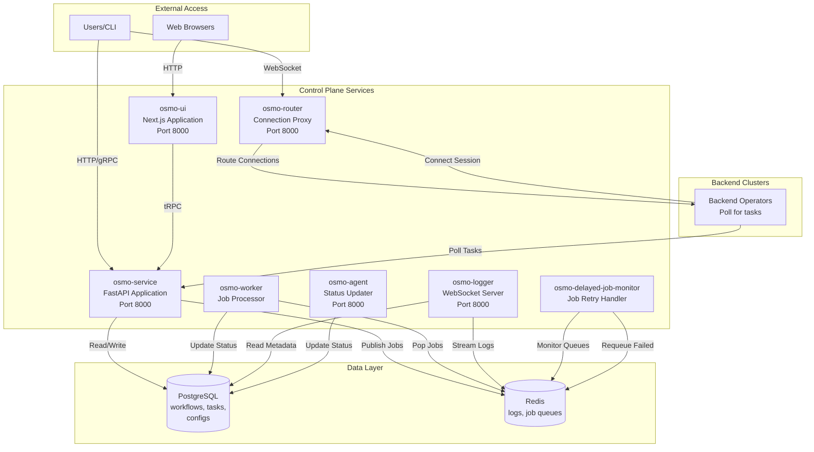
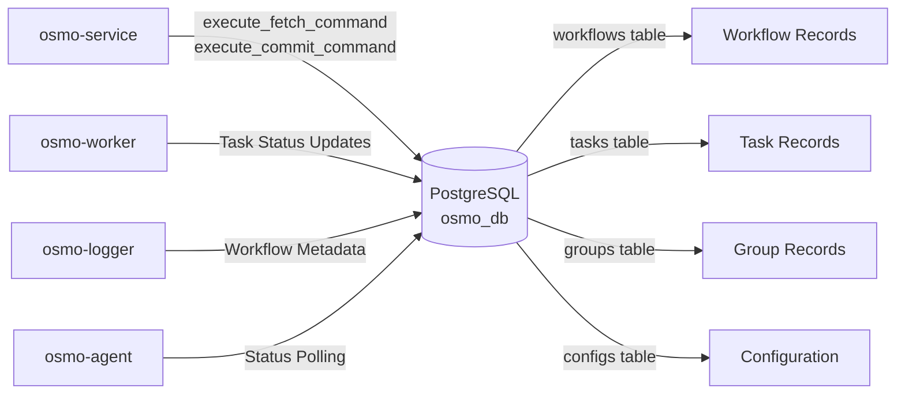
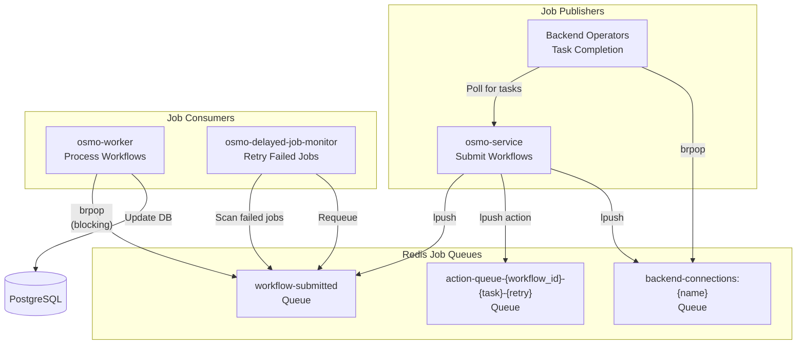
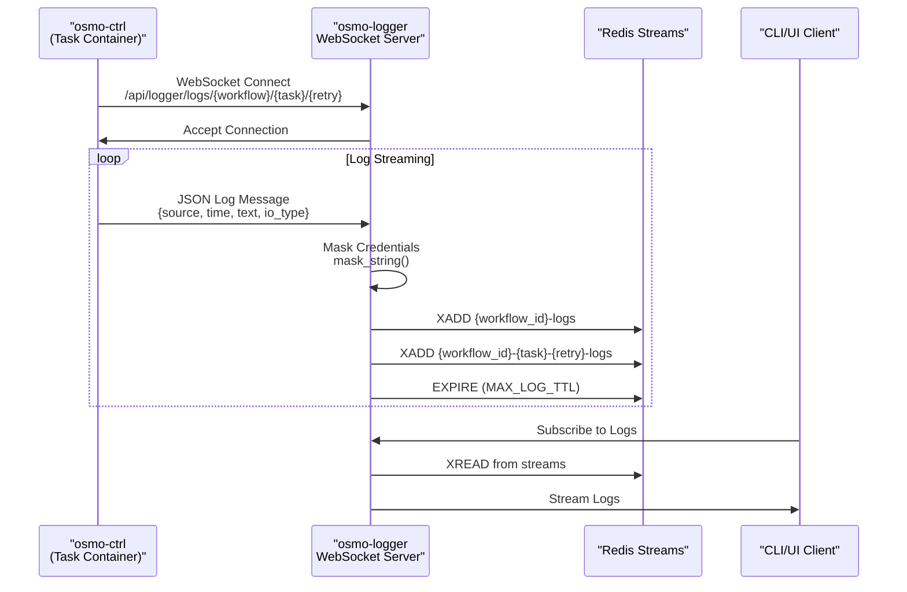
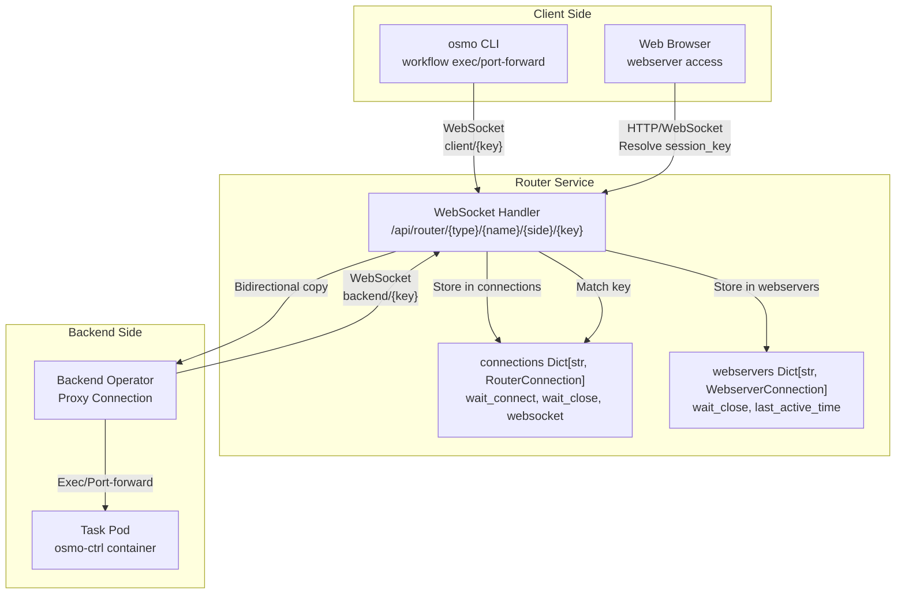
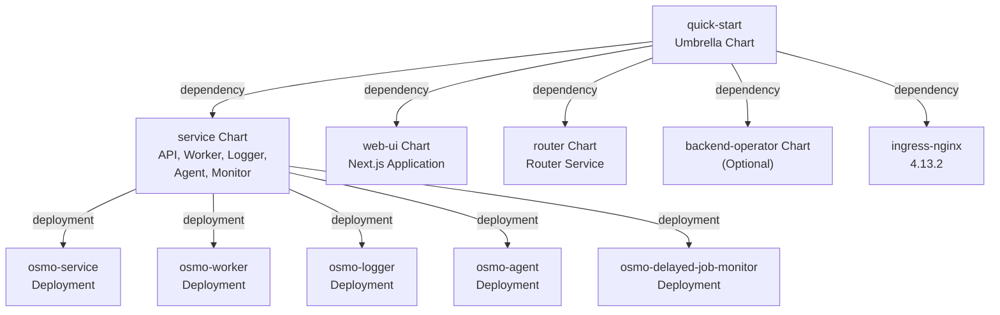
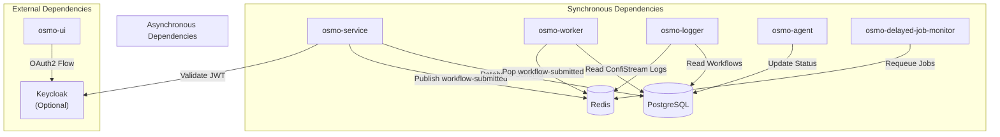

<!-- source: DeepWiki mcp.deepwiki.com · repo NVIDIA/OSMO · page 3 Control Plane Services · fetched 2026-10-26 -->

# Control Plane Services

<details>
<summary>Relevant source files</summary>

The following files were used as context for generating this wiki page:

- [deployments/charts/quick-start/Chart.yaml](deployments/charts/quick-start/Chart.yaml)
- [deployments/charts/router/Chart.yaml](deployments/charts/router/Chart.yaml)
- [deployments/charts/router/templates/router-service.yaml](deployments/charts/router/templates/router-service.yaml)
- [deployments/charts/service/templates/agent-service.yaml](deployments/charts/service/templates/agent-service.yaml)
- [deployments/charts/service/templates/api-service.yaml](deployments/charts/service/templates/api-service.yaml)
- [deployments/charts/service/templates/delayed-job-monitor.yaml](deployments/charts/service/templates/delayed-job-monitor.yaml)
- [deployments/charts/service/templates/logger-service.yaml](deployments/charts/service/templates/logger-service.yaml)
- [deployments/charts/service/templates/worker.yaml](deployments/charts/service/templates/worker.yaml)
- [deployments/charts/web-ui/templates/ui.yaml](deployments/charts/web-ui/templates/ui.yaml)
- [src/lib/utils/common.py](src/lib/utils/common.py)
- [src/lib/utils/port_forward.py](src/lib/utils/port_forward.py)
- [src/lib/utils/tests/test_common.py](src/lib/utils/tests/test_common.py)
- [src/service/core/config/helpers.py](src/service/core/config/helpers.py)
- [src/service/core/data/data_service.py](src/service/core/data/data_service.py)
- [src/service/logger/ctrl_websocket.py](src/service/logger/ctrl_websocket.py)
- [src/service/router/router.py](src/service/router/router.py)
- [src/utils/connectors/postgres.py](src/utils/connectors/postgres.py)
- [src/utils/job/kb_objects.py](src/utils/job/kb_objects.py)
- [src/utils/job/task.py](src/utils/job/task.py)

</details>


The OSMO Control Plane comprises a set of microservices that orchestrate workflow execution across distributed compute backends. These services handle workflow submission, task scheduling, log streaming, interactive access, and status monitoring. This page provides an overview of all control plane services and their interactions.

For details on specific services, see:
- API Service implementation: [API Service](#3.1)
- Web UI implementation: [Web UI Service](#3.2)
- Interactive session routing: [Router Service](#3.3)
- Background job processing: [Worker and Background Jobs](#3.4)

For information on backend execution infrastructure, see [Backend Operators](#5).

---

## Service Architecture Overview

The control plane consists of seven core services deployed as Kubernetes pods. Each service has a specialized role in the workflow orchestration pipeline.



**Sources:**
- [deployments/charts/service/templates/api-service.yaml:1-368]()
- [deployments/charts/web-ui/templates/ui.yaml:1-408]()
- [deployments/charts/router/templates/router-service.yaml:1-336]()
- [deployments/charts/service/templates/worker.yaml:1-237]()
- [deployments/charts/service/templates/logger-service.yaml:1-314]()
- [deployments/charts/service/templates/agent-service.yaml:1-318]()
- [deployments/charts/service/templates/delayed-job-monitor.yaml:1-204]()

---

## Service Inventory

| Service Name | Command | Container Port | Primary Function | Ingress Endpoint |
|-------------|---------|----------------|------------------|------------------|
| `osmo-service` | `service` | 8000 | Workflow submission, configuration management, API operations | `/api/*`, `/client/*` |
| `osmo-ui` | N/A (Next.js) | 8000 | Web-based user interface, workflow visualization | `/` |
| `osmo-router` | `router` | 8000 | Proxy for exec, port-forward, and webserver connections | `/api/router/*` |
| `osmo-worker` | `worker` | N/A | Background job processing from Redis queues | N/A (internal) |
| `osmo-logger` | `logger` | 8000 | WebSocket log streaming from Redis to clients | `/api/logger/*` |
| `osmo-agent` | `agent_service` | 8000 | Periodic status updates for workflows and tasks | `/api/agent/*` |
| `osmo-delayed-job-monitor` | `delayed_job_monitor` | N/A | Monitor and retry failed background jobs | N/A (internal) |

**Sources:**
- [deployments/charts/service/templates/api-service.yaml:76-77]()
- [deployments/charts/web-ui/templates/ui.yaml:73-74]()
- [deployments/charts/router/templates/router-service.yaml:78-79]()
- [deployments/charts/service/templates/worker.yaml:69-70]()
- [deployments/charts/service/templates/logger-service.yaml:83-84]()
- [deployments/charts/service/templates/agent-service.yaml:77-78]()
- [deployments/charts/service/templates/delayed-job-monitor.yaml:64-65]()

---

## Communication Patterns

### PostgreSQL Database Access

All services except `osmo-router` and `osmo-delayed-job-monitor` connect to PostgreSQL for persistent state. The connection configuration is managed through `PostgresConfig` and includes retry logic for transient failures.



Key database operations are implemented in `PostgresConnector`:
- **`execute_fetch_command`**: Query operations with automatic retries ([src/utils/connectors/postgres.py:282-331]())
- **`execute_commit_command`**: Write operations with transaction management ([src/utils/connectors/postgres.py:333-363]())
- **`@retry` decorator**: Automatic reconnection on interface errors ([src/utils/connectors/postgres.py:187-212]())

**Sources:**
- [src/utils/connectors/postgres.py:215-276]()
- [deployments/charts/service/templates/api-service.yaml:93-106]()
- [deployments/charts/service/templates/worker.yaml:93-108]()

### Redis Queue-Based Job Processing

The Worker service and Delayed Job Monitor use Redis for asynchronous job processing. Jobs are pushed to Redis lists and consumed by workers using blocking pop operations.



Redis connection configuration is provided via command-line arguments:
- `--redis_host`: Redis hostname ([deployments/charts/service/templates/worker.yaml:83-84]())
- `--redis_port`: Redis port ([deployments/charts/service/templates/worker.yaml:85-86]())
- `--redis_db_number`: Database number ([deployments/charts/service/templates/worker.yaml:87-88]())
- `--redis_tls_enable`: Enable TLS ([deployments/charts/service/templates/worker.yaml:89-92]())

**Sources:**
- [deployments/charts/service/templates/worker.yaml:83-92]()
- [deployments/charts/service/templates/delayed-job-monitor.yaml:72-81]()
- [src/utils/connectors/postgres.py:51-52]()

### WebSocket Log Streaming

The Logger service implements a WebSocket server at `/api/logger/logs/{workflow_id}/{task_name}/{retry_id}` that receives logs from task containers and streams them to Redis. Clients can subscribe to these logs via separate WebSocket connections.



The `ctrl_websocket` module implements the server-side WebSocket handler:
- **`run_websocket`**: Main WebSocket loop ([src/service/logger/ctrl_websocket.py:118-248]())
- **`update_metrics`**: Process task metrics from WebSocket messages ([src/service/logger/ctrl_websocket.py:54-91]())
- **`update_barrier`**: Synchronize distributed tasks using Redis sets ([src/service/logger/ctrl_websocket.py:93-116]())

**Sources:**
- [src/service/logger/ctrl_websocket.py:118-248]()
- [deployments/charts/service/templates/logger-service.yaml:1-314]()

### Router Connection Proxying

The Router service proxies interactive connections (exec, port-forward, webserver) between clients and backend task containers. It maintains two-way WebSocket connections and routes traffic based on session keys.



Key data structures in the Router service:
- **`connections`**: Maps session keys to `RouterConnection` objects ([src/service/router/router.py:95]())
- **`webservers`**: Maps session keys to `WebserverConnection` objects ([src/service/router/router.py:96]())
- **`RouterConnection`**: Contains `wait_connect`, `wait_close` events and WebSocket ([src/service/router/router.py:66-73]())
- **`WebserverConnection`**: Contains `wait_close`, `last_active_time`, and WebSocket ([src/service/router/router.py:76-83]())

**Sources:**
- [src/service/router/router.py:66-96]()
- [deployments/charts/router/templates/router-service.yaml:1-336]()

---

## Deployment Configuration

All control plane services are deployed via Helm charts in the `deployments/charts/` directory. The umbrella chart `quick-start` includes all service dependencies.

### Helm Chart Structure



**Sources:**
- [deployments/charts/quick-start/Chart.yaml:24-40]()

### Sidecar Containers

Each service pod includes optional sidecar containers for observability and authentication:

| Sidecar | Purpose | Configuration Key |
|---------|---------|------------------|
| **Envoy** | OAuth2 authentication, JWT validation, rate limiting | `sidecars.envoy.enabled` |
| **FluentBit** | Log collection and forwarding | `global.logs.enabled` |
| **OpenTelemetry** | Metrics collection and tracing | `sidecars.otel.enabled` |
| **Rate Limiter** | API rate limiting (API service only) | `sidecars.rateLimit.enabled` |

The Envoy sidecar is configured per-service using the `osmo.envoy-config` Helm template helper, which generates an Envoy configuration ConfigMap mounted at `/etc/envoy/config.yaml`.

**Sources:**
- [deployments/charts/service/templates/api-service.yaml:218-240]()
- [deployments/charts/web-ui/templates/ui.yaml:243-244]()
- [deployments/charts/router/templates/router-service.yaml:188-189]()

### Health Checks and Probes

Services implement liveness, readiness, and startup probes to ensure Kubernetes can properly manage pod lifecycle:

**API Service:**
- Liveness: HTTP GET `/api/version` ([deployments/charts/service/templates/api-service.yaml:192-193]())
- Startup: HTTP GET `/api/version`, 6 retries × 5s ([deployments/charts/service/templates/api-service.yaml:197-204]())
- Readiness: HTTP GET `/api/workflow?limit=0&all_pools=true` ([deployments/charts/service/templates/api-service.yaml:207-216]())

**Worker/Agent/Logger Services:**
- Liveness: `progress_check` command with 300s interval ([deployments/charts/service/templates/worker.yaml:157-165]())
- Startup: `progress_check` command with 60s timeout ([deployments/charts/service/templates/worker.yaml:168-177]())

The `progress_check` binary verifies that a service has made progress within a specified interval by checking a progress file at `/var/run/osmo/last_progress`.

**Sources:**
- [deployments/charts/service/templates/api-service.yaml:192-216]()
- [deployments/charts/service/templates/worker.yaml:156-177]()
- [deployments/charts/service/templates/agent-service.yaml:166-199]()

---

## Horizontal Pod Autoscaling

Most control plane services support horizontal scaling via `HorizontalPodAutoscaler` resources. Scaling is based on CPU and memory utilization metrics.

| Service | Min Replicas | Max Replicas | Target Metric | Configuration |
|---------|-------------|-------------|---------------|---------------|
| **API** | `services.service.scaling.minReplicas` | `services.service.scaling.maxReplicas` | Memory + CPU | [api-service.yaml:339-367]() |
| **Web UI** | `services.ui.scaling.minReplicas` | `services.ui.scaling.maxReplicas` | Memory | [ui.yaml:383-407]() |
| **Router** | `services.service.scaling.minReplicas` | `services.service.scaling.maxReplicas` | Memory | [router-service.yaml:314-335]() |
| **Worker** | `services.worker.scaling.minReplicas` | `services.worker.scaling.maxReplicas` | Memory + CPU | [worker.yaml:208-236]() |
| **Logger** | `services.logger.scaling.minReplicas` | `services.logger.scaling.maxReplicas` | Memory + CPU | [logger-service.yaml:285-313]() |
| **Agent** | `services.agent.scaling.minReplicas` | `services.agent.scaling.maxReplicas` | Memory + CPU | [agent-service.yaml:289-317]() |

The Delayed Job Monitor does not auto-scale and runs as a single replica to avoid job duplication.

**Sources:**
- [deployments/charts/service/templates/api-service.yaml:339-367]()
- [deployments/charts/web-ui/templates/ui.yaml:383-407]()
- [deployments/charts/service/templates/worker.yaml:208-236]()

---

## Service-Specific Configuration

### API Service Command-Line Arguments

The API service accepts extensive configuration via command-line arguments passed in the deployment manifest:

```yaml
args:
  - --metrics_otel_collector_component
  - osmo-service
  - --redis_host
  - {{ .Values.services.redis.serviceName }}
  - --postgres_host
  - {{ .Values.services.postgres.serviceName }}
  - --device_endpoint
  - {{ .Values.services.service.auth.device_endpoint }}
  - --service_hostname
  - {{ .Values.services.service.hostname }}
  - --osmo_image_location
  - {{ .Values.global.osmoImageLocation }}
```

These arguments configure database connections, OAuth2 endpoints, image registry locations, and observability settings.

**Sources:**
- [deployments/charts/service/templates/api-service.yaml:78-148]()

### Web UI Runtime Configuration

The Web UI service uses environment variables to configure the Next.js application at runtime:

| Environment Variable | Purpose | Helm Value |
|---------------------|---------|-----------|
| `PORT` | Container port | `services.ui.containerPort` |
| `NODE_OPTIONS` | Max HTTP header size | `services.ui.maxHttpHeaderSizeKb` |
| `NEXT_PUBLIC_OSMO_API_HOSTNAME` | API hostname for browser | `services.ui.apiHostname` |
| `NEXT_PUBLIC_OSMO_PORT_FORWARD_ENABLED` | Enable port-forward feature | `services.ui.portForwardEnabled` |
| `NEXT_PUBLIC_OSMO_SSL_ENABLED` | HTTPS mode | `services.ui.nextjsSslEnabled` |
| `DOCS_BASE_URL` | Documentation base URL | `services.ui.docsBaseUrl` |

**Sources:**
- [deployments/charts/web-ui/templates/ui.yaml:83-98]()

### Router Service Timeouts

The Router service implements configurable timeouts for different connection types:

- **`timeout`**: Default timeout (60s) for exec/port-forward control connections ([src/service/router/router.py:48-51]())
- **`webserver_initial_timeout`**: Initial webserver connection timeout (1 hour) ([src/service/router/router.py:52-55]())
- **`webserver_nonactive_timeout`**: Inactive webserver timeout (30 minutes) ([src/service/router/router.py:56-59]())

These values are configurable via command-line arguments in the deployment.

**Sources:**
- [src/service/router/router.py:37-64]()
- [deployments/charts/router/templates/router-service.yaml:80-109]()

---

## Security Context

All control plane services run with restricted security contexts to minimize attack surface:

```yaml
securityContext:
  allowPrivilegeEscalation: false
  capabilities:
    drop: ["ALL"]
  runAsNonRoot: true
  runAsUser: 1001
```

This configuration:
- Prevents privilege escalation
- Drops all Linux capabilities
- Enforces non-root execution
- Uses UID 1001 for process isolation

**Sources:**
- [deployments/charts/service/templates/api-service.yaml:169-174]()
- [deployments/charts/service/templates/worker.yaml:71-76]()
- [deployments/charts/web-ui/templates/ui.yaml:114-119]()

---

## Inter-Service Dependencies



The API service must initialize database tables before other services can function properly. The `_init_tables` method creates all required schemas:

- `workflows`, `tasks`, `groups` tables ([src/utils/connectors/postgres.py:632-714]())
- `dataset`, `dataset_version`, `dataset_tag` tables ([src/utils/connectors/postgres.py:879-930]())
- `configs`, `backends`, `pools` tables ([src/utils/connectors/postgres.py:538-629]())
- `credential`, `access_token`, `profile` tables ([src/utils/connectors/postgres.py:961-1001]())

**Sources:**
- [src/utils/connectors/postgres.py:531-1001]()
- [deployments/charts/service/templates/api-service.yaml:93-106]()
- [deployments/charts/service/templates/worker.yaml:83-92]()

---

