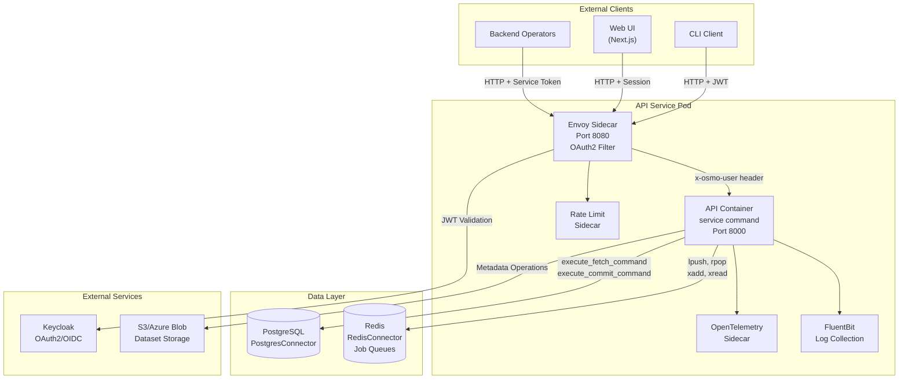
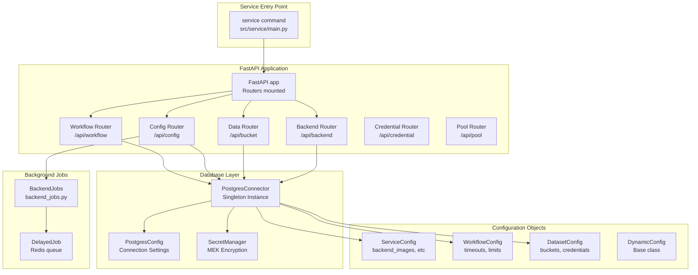
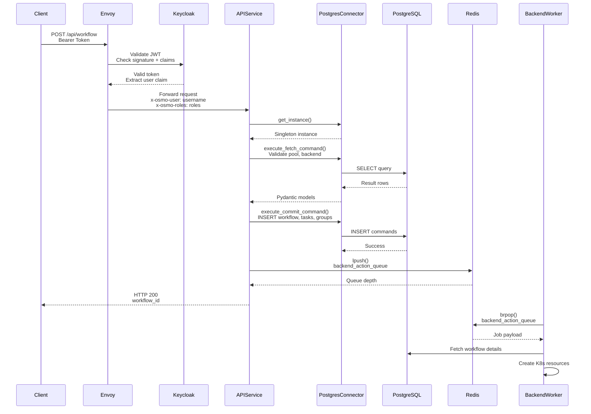
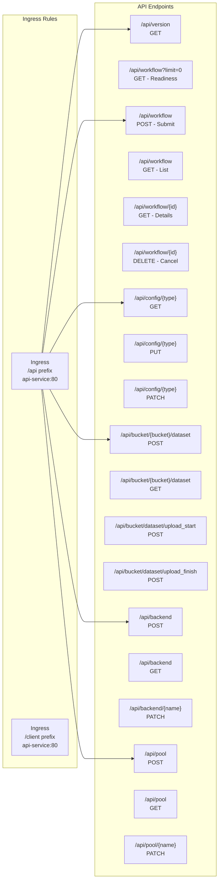
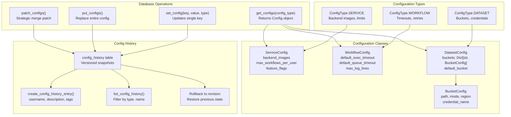
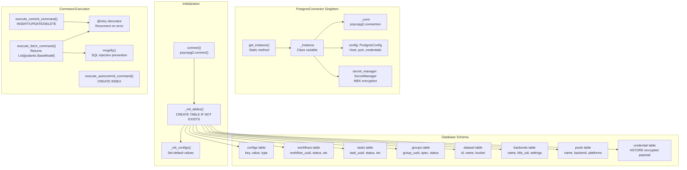
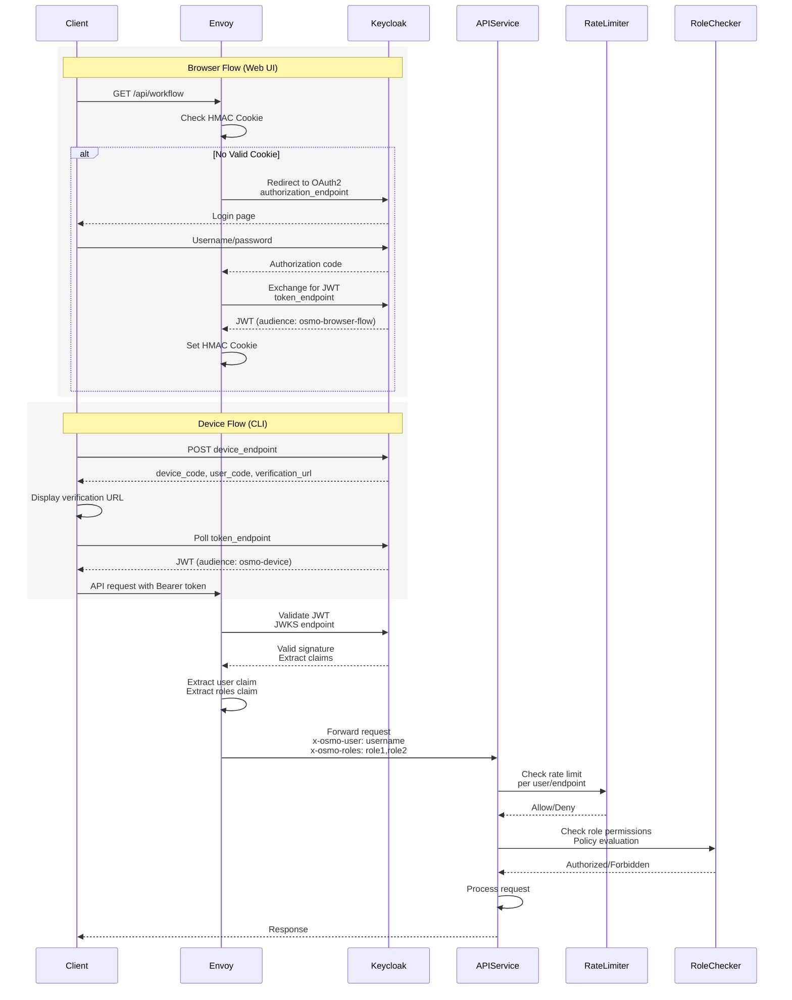

<!-- source: DeepWiki mcp.deepwiki.com · repo NVIDIA/OSMO · page 3.1 API Service · fetched 2026-10-26 -->

# API Service

<details>
<summary>Relevant source files</summary>

The following files were used as context for generating this wiki page:

- [deployments/charts/quick-start/Chart.yaml](deployments/charts/quick-start/Chart.yaml)
- [deployments/charts/router/Chart.yaml](deployments/charts/router/Chart.yaml)
- [deployments/charts/router/templates/router-service.yaml](deployments/charts/router/templates/router-service.yaml)
- [deployments/charts/service/templates/agent-service.yaml](deployments/charts/service/templates/agent-service.yaml)
- [deployments/charts/service/templates/api-service.yaml](deployments/charts/service/templates/api-service.yaml)
- [deployments/charts/service/templates/delayed-job-monitor.yaml](deployments/charts/service/templates/delayed-job-monitor.yaml)
- [deployments/charts/service/templates/logger-service.yaml](deployments/charts/service/templates/logger-service.yaml)
- [deployments/charts/service/templates/worker.yaml](deployments/charts/service/templates/worker.yaml)
- [deployments/charts/web-ui/templates/ui.yaml](deployments/charts/web-ui/templates/ui.yaml)
- [src/lib/utils/common.py](src/lib/utils/common.py)
- [src/lib/utils/port_forward.py](src/lib/utils/port_forward.py)
- [src/lib/utils/tests/test_common.py](src/lib/utils/tests/test_common.py)
- [src/service/core/config/helpers.py](src/service/core/config/helpers.py)
- [src/service/core/data/data_service.py](src/service/core/data/data_service.py)
- [src/service/logger/ctrl_websocket.py](src/service/logger/ctrl_websocket.py)
- [src/service/router/router.py](src/service/router/router.py)
- [src/utils/connectors/postgres.py](src/utils/connectors/postgres.py)
- [src/utils/job/kb_objects.py](src/utils/job/kb_objects.py)
- [src/utils/job/task.py](src/utils/job/task.py)

</details>


## Purpose and Scope

The API Service is the primary REST API server in OSMO's control plane. It serves as the central coordination point for workflow submission, configuration management, dataset operations, and backend orchestration. The service exposes HTTP/REST endpoints consumed by the CLI client, Web UI, and backend operators.

For log streaming and task metrics, see [Logger Service](#3.4). For interactive workflow access (exec, port-forward), see [Router Service](#3.3). For background task processing, see [Worker and Background Jobs](#3.4).

**Sources:** [deployments/charts/service/templates/api-service.yaml:1-368](), [README context from high-level diagrams]()

---

## Architecture Overview



**Architecture Key Points:**

1. **Envoy Sidecar**: All requests flow through Envoy for authentication, extracting user identity into the `x-osmo-user` header
2. **API Container**: Runs the `service` command, which starts the FastAPI application
3. **Database Layer**: `PostgresConnector` singleton manages all database operations
4. **Job Queues**: Redis used for background job distribution to worker services
5. **Observability**: OpenTelemetry for metrics, FluentBit for logs

**Sources:** [deployments/charts/service/templates/api-service.yaml:73-227](), [src/utils/connectors/postgres.py:215-276]()

---

## Core Components and Class Structure



**Key Classes:**

| Class | File | Purpose |
|-------|------|---------|
| `PostgresConnector` | [src/utils/connectors/postgres.py:215-276]() | Singleton managing all database connections and operations |
| `PostgresConfig` | [src/utils/connectors/postgres.py:125-185]() | Database connection configuration (host, port, credentials) |
| `SecretManager` | [src/utils/secret_manager.py]() | Encrypts/decrypts credentials using Master Encryption Key (MEK) |
| `ServiceConfig` | [src/utils/connectors/postgres.py:440-446]() | Service-level configuration (images, limits, features) |
| `WorkflowConfig` | [src/utils/connectors/postgres.py:446-450]() | Workflow execution configuration (timeouts, retries) |
| `DatasetConfig` | [src/utils/connectors/postgres.py:448-461]() | Dataset storage configuration (buckets, credentials) |

**Sources:** [src/utils/connectors/postgres.py:125-276](), [src/utils/connectors/postgres.py:430-471](), [deployments/charts/service/templates/api-service.yaml:76-78]()

---

## Request Processing Flow



**Request Flow Steps:**

1. **Authentication**: Envoy validates JWT with Keycloak, extracts `x-osmo-user` and `x-osmo-roles` headers
2. **Routing**: FastAPI routes request to appropriate handler based on URL path
3. **Database Singleton**: `PostgresConnector.get_instance()` returns the singleton instance
4. **Query Execution**: Handler calls `execute_fetch_command()` or `execute_commit_command()`
5. **Job Enqueueing**: Background jobs pushed to Redis queues for worker processing
6. **Response**: HTTP response returned to client with workflow ID or operation result

**Sources:** [deployments/charts/service/templates/api-service.yaml:218-227](), [src/utils/connectors/postgres.py:281-363](), [src/service/core/config/helpers.py:194-204]()

---

## REST API Endpoints

The API service exposes multiple endpoint groups, each handled by separate FastAPI routers:



**Endpoint Categories:**

| Path Prefix | Purpose | Key Operations |
|-------------|---------|----------------|
| `/api/version` | Service version | GET version string |
| `/api/workflow` | Workflow management | Submit, list, cancel, get details |
| `/api/config/{type}` | Configuration CRUD | GET/PUT/PATCH for SERVICE, WORKFLOW, DATASET configs |
| `/api/bucket/{bucket}/dataset` | Dataset operations | Create, upload, download, list, tag |
| `/api/backend` | Backend registration | Register, list, update backends |
| `/api/pool` | Pool management | Create, list, update resource pools |
| `/api/credential` | Credential storage | Store encrypted credentials for registries, data backends |
| `/api/agent` | Backend agent status | Receive status updates from backend operators |
| `/api/logger` | Log streaming | WebSocket for task log streams |
| `/client` | CLI client downloads | Binary downloads for different platforms |

**Sources:** [deployments/charts/service/templates/api-service.yaml:314-328](), [src/service/core/data/data_service.py:36-40]()

---

## Configuration Management System

The API service manages five types of configurations stored in the `configs` table:



**Configuration Workflow:**

1. **Read Configuration**: `PostgresConnector.get_configs(ConfigType.SERVICE)` fetches all keys for that type from the `configs` table and deserializes into a Pydantic model
2. **Update Configuration**: `set_config(key, value, config_type)` updates individual keys, or `put_configs()` replaces entire configuration
3. **Patch Configuration**: `patch_configs()` uses strategic merge patch to update nested dictionaries
4. **History Tracking**: Every configuration change creates an entry in `config_history` table with username, timestamp, description, and tags
5. **Rollback**: Previous configurations can be restored from history

**Configuration Examples:**

```python
# ServiceConfig keys
backend_images: BackendImages  # init, ctrl, sidecars
max_workflows_per_user: int
enable_workflow_priority: bool

# WorkflowConfig keys
default_exec_timeout: int
default_queue_timeout: int
max_log_lines: int
websocket_timeout: int

# DatasetConfig keys
buckets: Dict[str, BucketConfig]
default_bucket: str
```

**Sources:** [src/utils/connectors/postgres.py:430-471](), [src/utils/connectors/postgres.py:509-530](), [src/service/core/config/helpers.py:72-114]()

---

## Database Integration via PostgresConnector



**PostgresConnector Key Methods:**

| Method | Signature | Purpose |
|--------|-----------|---------|
| `get_instance()` | `() -> PostgresConnector` | Returns singleton instance |
| `execute_fetch_command()` | `(command: str, args: Tuple) -> List[Any]` | Executes SELECT queries, returns Pydantic models |
| `execute_commit_command()` | `(command: str, args: Tuple)` | Executes INSERT/UPDATE/DELETE |
| `execute_autocommit_command()` | `(command: str, args: Tuple)` | For CREATE INDEX in autocommit mode |
| `mogrify()` | `(entries: List[Tuple]) -> str` | SQL-injection-safe batch insert |
| `get_configs()` | `(config_type: ConfigType) -> DynamicConfig` | Fetches and deserializes configuration |
| `set_config()` | `(key: str, value: str, config_type: ConfigType)` | Updates single config key |
| `encrypt_dict()` | `(input_dict: Dict, user: str) -> Dict` | Encrypts credential dictionary |
| `decrypt_credential()` | `(db_row) -> Dict` | Decrypts HSTORE payload |

**Connection Management:**

- **Retry Logic**: The `@retry` decorator automatically reconnects on `psycopg2.InterfaceError` or `psycopg2.DatabaseError`
- **Connection Pooling**: Single connection per service instance; FastAPI handles concurrency
- **Transaction Management**: Explicit `commit()` or `rollback()` after each operation

**Sources:** [src/utils/connectors/postgres.py:215-428](), [src/utils/connectors/postgres.py:187-213](), [src/utils/connectors/postgres.py:531-1023]()

---

## Authentication and Authorization



**Authentication Components:**

1. **Envoy OAuth2 Filter**: Configured in [deployments/charts/service/templates/api-service.yaml:251-254]()
   - Validates JWT signatures using Keycloak's JWKS endpoint
   - Checks `issuer`, `audience`, and `exp` claims
   - Extracts `user` claim into `x-osmo-user` header
   - Extracts `roles` claim into `x-osmo-roles` header

2. **Keycloak Integration**: Configuration in [deployments/charts/service/templates/api-service.yaml:110-122]()
   - `device_endpoint`: For CLI device flow
   - `browser_endpoint`: For Web UI authorization code flow
   - `token_endpoint`: For token exchange
   - `logout_endpoint`: For session termination

3. **Service Token Authentication**: Backend operators use service tokens with `role: osmo-backend`

4. **Rate Limiting**: Optional rate-limit sidecar at [deployments/charts/service/templates/api-service.yaml:223-225]()

**Authorization Flow:**

- **Header Extraction**: `x-osmo-user` and `x-osmo-roles` headers injected by Envoy
- **Role-Based Access Control (RBAC)**: Policies defined in `roles` table, evaluated per endpoint
- **Resource Ownership**: Users can only access their own workflows unless they have admin role

**Sources:** [deployments/charts/service/templates/api-service.yaml:110-122](), [deployments/charts/service/templates/api-service.yaml:218-227]()

---

## Kubernetes Deployment Configuration

```mermaid
graph TB
    subgraph "Deployment Spec"
        Deployment["Deployment<br/>api-service"]
        Replicas["Replicas: Dynamic<br/>HPA controlled"]
        PodTemplate["Pod Template<br/>Labels, annotations"]
    end
    
    subgraph "Container: api-service"
        Image["Image<br/>{osmoImageLocation}/{imageName}:{osmoImageTag}"]
        Command["Command: service"]
        Args["Args<br/>--postgres_host<br/>--redis_host<br/>--mek_file<br/>--device_endpoint<br/>--browser_endpoint"]
        Env["Environment<br/>OSMO_POSTGRES_PASSWORD<br/>OSMO_REDIS_PASSWORD<br/>OSMO_DISABLE_TASK_METRICS"]
        Ports["Ports<br/>8000 (HTTP)"]
    end
    
    subgraph "Probes"
        Liveness["Liveness Probe<br/>httpGet: /api/version<br/>Interval: per config"]
        Startup["Startup Probe<br/>httpGet: /api/version<br/>30s max startup"]
        Readiness["Readiness Probe<br/>httpGet: /api/workflow?limit=0<br/>Database check"]
    end
    
    subgraph "Volumes"
        MEKVolume["MEK Volume<br/>ConfigMap: mek-config<br/>Path: /home/osmo/vault-agent/secrets"]
        LogsVolume["Logs Volume<br/>emptyDir<br/>Shared with FluentBit"]
    end
    
    subgraph "Sidecars"
        EnvoySidecar["Envoy<br/>Port 8080<br/>OAuth2 filter"]
        OTelSidecar["OpenTelemetry<br/>Metrics collection"]
        FluentBitSidecar["FluentBit<br/>Log shipping"]
        RateLimitSidecar["Rate Limit<br/>Optional"]
    end
    
    subgraph "Service"
        K8sService["Service: api-service<br/>Port 80 → targetPort"]
        InternalService["Service: api-service-internal<br/>For in-cluster calls"]
    end
    
    subgraph "Ingress"
        IngressRule["Ingress<br/>Host: {hostname}<br/>Path: /api<br/>Path: /client"]
        ALBAnnotations["ALB Annotations<br/>Group: osmo<br/>Order: 100"]
        TLS["TLS: {sslSecret}"]
    end
    
    subgraph "HPA"
        HPASpec["HorizontalPodAutoscaler<br/>minReplicas: {minReplicas}<br/>maxReplicas: {maxReplicas}"]
        MemoryTarget["Memory Target<br/>{hpaMemoryTarget}%"]
        CPUTarget["CPU Target<br/>{hpaCpuTarget}%"]
    end
    
    Deployment --> PodTemplate
    PodTemplate --> Image
    PodTemplate --> Command
    PodTemplate --> Args
    PodTemplate --> Env
    
    PodTemplate --> Liveness
    PodTemplate --> Startup
    PodTemplate --> Readiness
    
    PodTemplate --> MEKVolume
    PodTemplate --> LogsVolume
    
    PodTemplate --> EnvoySidecar
    PodTemplate --> OTelSidecar
    PodTemplate --> FluentBitSidecar
    PodTemplate --> RateLimitSidecar
    
    Deployment --> K8sService
    Deployment --> InternalService
    K8sService --> IngressRule
    IngressRule --> ALBAnnotations
    IngressRule --> TLS
    
    Deployment --> HPASpec
    HPASpec --> MemoryTarget
    HPASpec --> CPUTarget
```



**Deployment Configuration:**

| Component | Configuration | Purpose |
|-----------|---------------|---------|
| **Container Image** | `{osmoImageLocation}/{imageName}:{osmoImageTag}` | Service container image from Helm values |
| **Command** | `service` | Entrypoint that starts FastAPI application |
| **Security Context** | `runAsNonRoot: true`, `runAsUser: 1001` | Non-privileged execution |
| **Resource Requests** | Per `resources` values | CPU/memory reservations |
| **Resource Limits** | Per `resources` values | CPU/memory caps |

**Probes Configuration:**

- **Liveness Probe**: `GET /api/version` - Service health check
- **Startup Probe**: `GET /api/version` - 30 seconds (6 × 5s) for initialization
- **Readiness Probe**: `GET /api/workflow?limit=0&all_pools=true` - Database connectivity check with admin role header

**Sidecar Injection:**

1. **Envoy**: Configured via ConfigMap at [deployments/charts/service/templates/api-service.yaml:251-254]()
2. **OpenTelemetry**: Metrics collection when `sidecars.otel.enabled=true`
3. **FluentBit**: Log forwarding when `global.logs.enabled=true`
4. **Rate Limiter**: Optional when `sidecars.rateLimit.enabled=true`

**Sources:** [deployments/charts/service/templates/api-service.yaml:19-368](), [deployments/charts/service/templates/api-service.yaml:73-217]()

---

## Scaling and High Availability

The API service uses Kubernetes HorizontalPodAutoscaler (HPA) for automatic scaling:

```mermaid
graph LR
    subgraph "Autoscaling"
        HPA["HorizontalPodAutoscaler"]
        MinReplicas["minReplicas<br/>From values"]
        MaxReplicas["maxReplicas<br/>From values"]
        MemoryMetric["Memory Utilization<br/>{hpaMemoryTarget}%"]
        CPUMetric["CPU Utilization<br/>{hpaCpuTarget}%"]
    end
    
    subgraph "Deployment"
        Deployment["api-service Deployment"]
        Pod1["Pod 1"]
        Pod2["Pod 2"]
        PodN["Pod N"]
    end
    
    subgraph "Load Distribution"
        K8sService["Service: api-service"]
        Ingress["Ingress"]
        EnvoyLB["Envoy Load Balancing"]
    end
    
    HPA --> MinReplicas
    HPA --> MaxReplicas
    HPA --> MemoryMetric
    HPA --> CPUMetric
    
    HPA --> Deployment
    Deployment --> Pod1
    Deployment --> Pod2
    Deployment --> PodN
    
    Ingress --> K8sService
    K8sService --> EnvoyLB
    EnvoyLB --> Pod1
    EnvoyLB --> Pod2
    EnvoyLB --> PodN
```

**Scaling Configuration:**

| Parameter | Configuration Path | Purpose |
|-----------|-------------------|---------|
| `minReplicas` | `.Values.services.service.scaling.minReplicas` | Minimum pod count |
| `maxReplicas` | `.Values.services.service.scaling.maxReplicas` | Maximum pod count |
| `hpaMemoryTarget` | `.Values.services.service.scaling.hpaMemoryTarget` | Memory utilization threshold (%) |
| `hpaCpuTarget` | `.Values.services.service.scaling.hpaCpuTarget` | CPU utilization threshold (%) |

**High Availability Considerations:**

1. **Stateless Design**: API service is stateless; all state in PostgreSQL/Redis
2. **Connection Pooling**: Each pod maintains its own PostgreSQL connection
3. **Database Singleton**: `PostgresConnector._instance` is per-process singleton
4. **Session Affinity**: Not required; Envoy HMAC cookies are validated independently
5. **Pod Topology Spread**: Configured via `topologySpreadConstraints` to distribute across zones

**Resource Management:**

- **CPU Limits**: Prevents noisy neighbor issues
- **Memory Limits**: OOM protection with restart policy
- **Rate Limiting**: Per-user rate limiting via optional sidecar prevents abuse

**Database Connection Management:**

Each API service pod maintains a single `psycopg2.connection` object. The `@retry` decorator handles transient connection failures:

```python
@retry(reconnect=True)
def execute_fetch_command(self, command: str, args: Tuple) -> List[Any]:
    # Reconnects automatically on InterfaceError or DatabaseError
```

**Sources:** [deployments/charts/service/templates/api-service.yaml:339-368](), [src/utils/connectors/postgres.py:187-213]()

---

## Integration with Other Services

The API service coordinates with multiple other OSMO components:

| Service | Integration Method | Purpose |
|---------|-------------------|---------|
| **Worker Service** | Redis job queues | Background workflow processing |
| **Logger Service** | Redis streams | Log aggregation and WebSocket streaming |
| **Agent Service** | Database + Redis | Backend status updates |
| **Router Service** | Database queries | Interactive session routing |
| **Backend Operators** | HTTP REST API | Receive workflow jobs, send status |
| **Web UI** | HTTP REST API | User interface API consumption |
| **CLI** | HTTP REST API | Command-line interface |

**Job Queue Pattern:**

```python
# API Service enqueues jobs
redis_client.lpush('backend-connections:{backend_name}', json.dumps(job_data))

# Worker Service dequeues jobs
job = redis_client.brpop('backend-connections:{backend_name}', timeout)
```

**Log Streaming Pattern:**

```python
# Logger Service writes to Redis stream
redis_client.xadd(f'{workflow_id}-logs', log_entry, maxlen=max_log_lines)

# API Service reads from stream
logs = redis_client.xread({f'{workflow_id}-logs': last_id}, count=100)
```

**Sources:** [src/service/core/config/helpers.py:194-204](), [src/service/logger/ctrl_websocket.py:199-215]()

---

