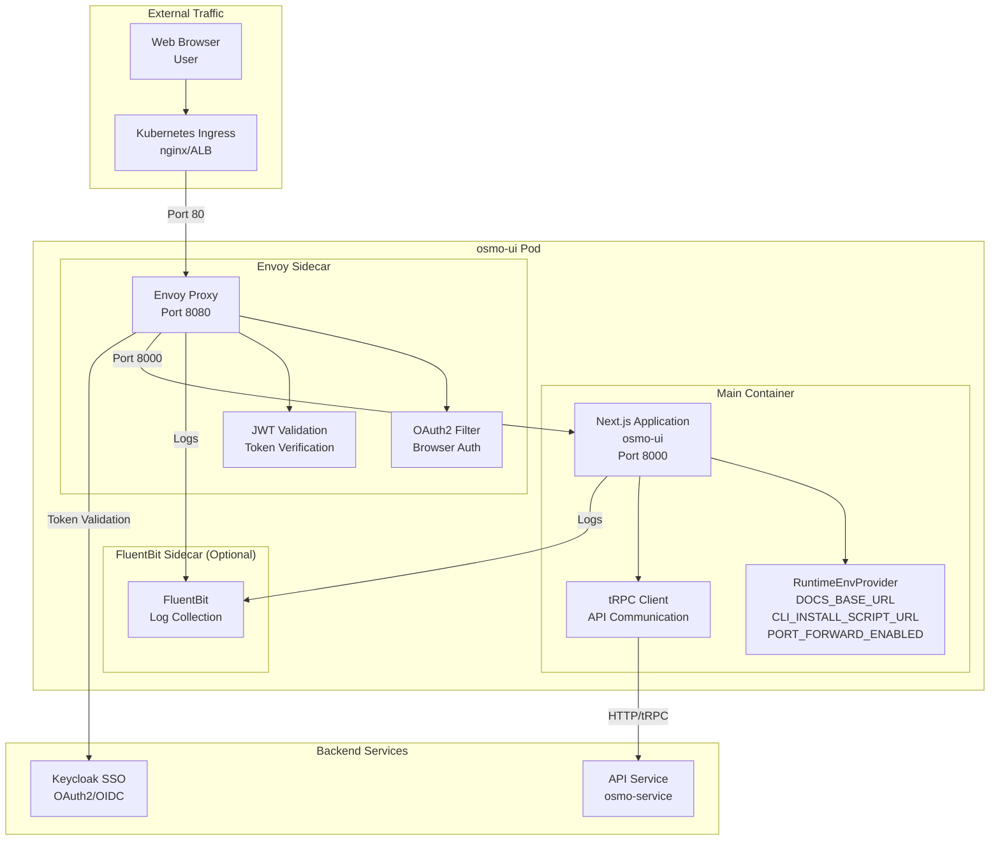
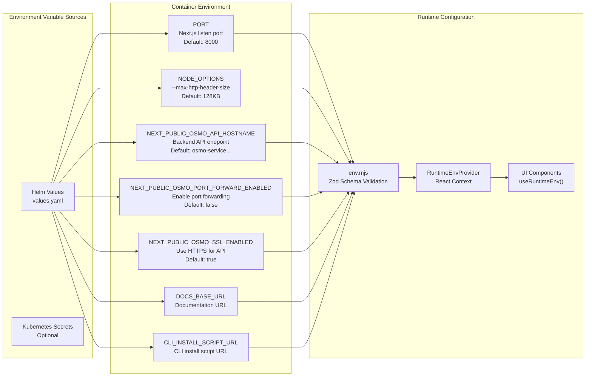
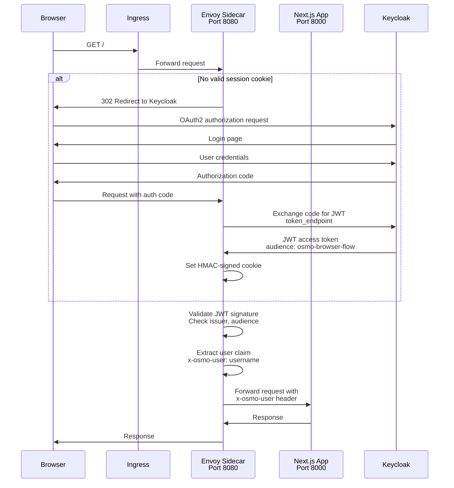
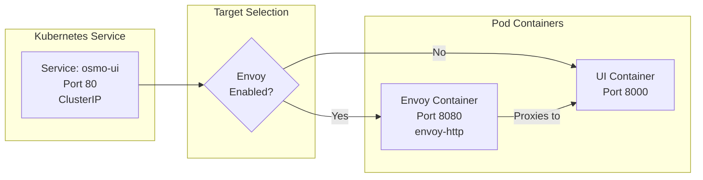
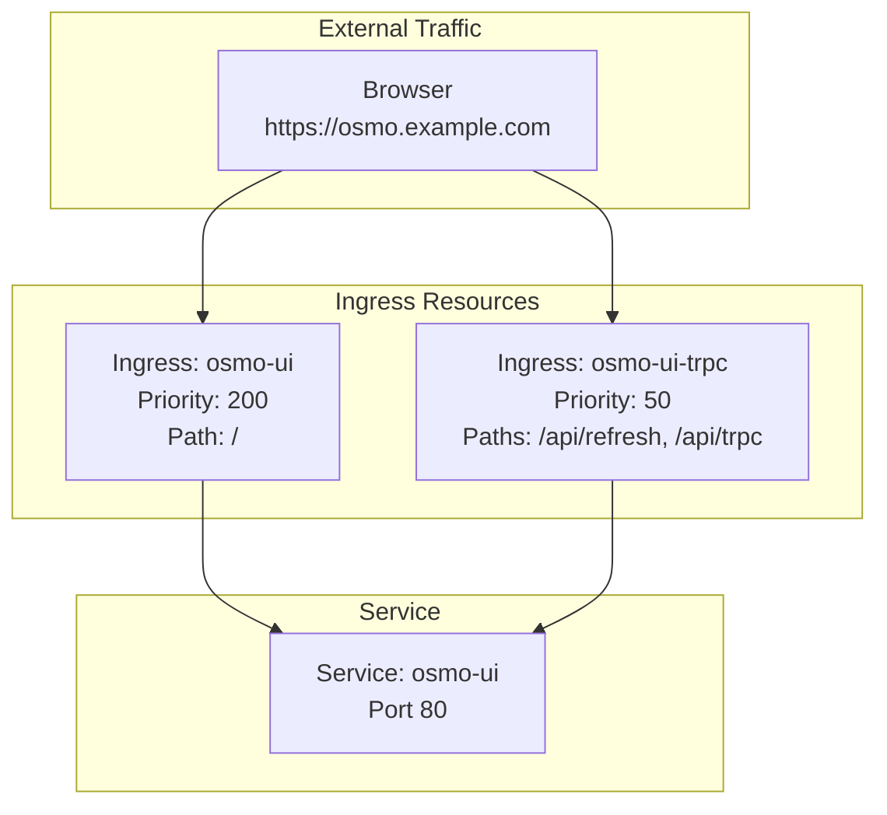
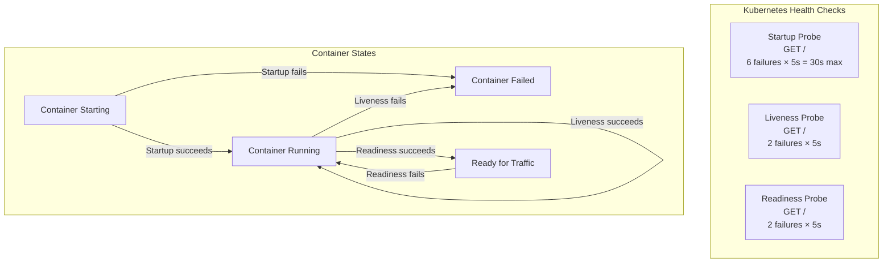
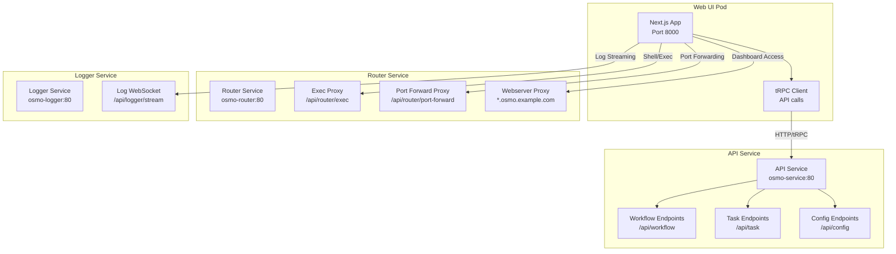

<!-- source: DeepWiki mcp.deepwiki.com · repo NVIDIA/OSMO · page 3.2 Web UI Service · fetched 2026-10-26 -->

# Web UI Service

<details>
<summary>Relevant source files</summary>

The following files were used as context for generating this wiki page:

- [deployments/charts/quick-start/Chart.yaml](deployments/charts/quick-start/Chart.yaml)
- [deployments/charts/router/Chart.yaml](deployments/charts/router/Chart.yaml)
- [deployments/charts/router/templates/router-service.yaml](deployments/charts/router/templates/router-service.yaml)
- [deployments/charts/service/templates/agent-service.yaml](deployments/charts/service/templates/agent-service.yaml)
- [deployments/charts/service/templates/api-service.yaml](deployments/charts/service/templates/api-service.yaml)
- [deployments/charts/service/templates/delayed-job-monitor.yaml](deployments/charts/service/templates/delayed-job-monitor.yaml)
- [deployments/charts/service/templates/logger-service.yaml](deployments/charts/service/templates/logger-service.yaml)
- [deployments/charts/service/templates/worker.yaml](deployments/charts/service/templates/worker.yaml)
- [deployments/charts/web-ui/README.md](deployments/charts/web-ui/README.md)
- [deployments/charts/web-ui/templates/ui.yaml](deployments/charts/web-ui/templates/ui.yaml)
- [deployments/charts/web-ui/values.yaml](deployments/charts/web-ui/values.yaml)
- [ui/src/app/layout.tsx](ui/src/app/layout.tsx)
- [ui/src/app/workflows/components/TaskActions.tsx](ui/src/app/workflows/components/TaskActions.tsx)
- [ui/src/app/workflows/components/WorkflowActions.tsx](ui/src/app/workflows/components/WorkflowActions.tsx)
- [ui/src/env.mjs](ui/src/env.mjs)
- [ui/src/runtime-env.tsx](ui/src/runtime-env.tsx)

</details>


## Purpose and Scope

The Web UI Service provides the Next.js-based web interface for OSMO, enabling users to visualize workflows, submit jobs, monitor task execution, and interact with the platform through a browser. This service runs as a containerized application with Envoy sidecar authentication and communicates with the API service via tRPC.

For information about the API service that the UI communicates with, see [API Service](#3.1). For authentication mechanisms, see [Envoy Authentication Proxy](#8.2).

**Sources:** [deployments/charts/web-ui/README.md:1-182](), [deployments/charts/web-ui/values.yaml:53-76]()

---

## Architecture Overview

The Web UI Service runs as a Kubernetes Deployment with multiple containers in each pod: the main Next.js application container, an Envoy sidecar for authentication, and optionally FluentBit for log collection.

### Pod Structure



**Sources:** [deployments/charts/web-ui/templates/ui.yaml:17-247](), [ui/src/app/layout.tsx:35-64]()

---

## Main UI Container Configuration

The main container runs the Next.js application built from the `web-ui` Docker image. It listens on port 8000 (configurable via `PORT` environment variable) and serves the OSMO web interface.

### Container Specification

| Property | Configuration | Description |
|----------|---------------|-------------|
| **Image** | `${osmoImageLocation}/web-ui:${osmoImageTag}` | Docker image for the UI service |
| **Container Port** | `8000` (default) | Port where Next.js listens |
| **Service Account** | `osmo` | Kubernetes service account |
| **Security Context** | Non-root (UID 1000) | Runs as unprivileged user |
| **Image Pull Policy** | `Always` | Always pull latest image |

**Sources:** [deployments/charts/web-ui/templates/ui.yaml:73-119](), [deployments/charts/web-ui/values.yaml:56-99]()

### Environment Variables

The UI container receives runtime configuration through environment variables that control its behavior and integration points:



**Sources:** [deployments/charts/web-ui/templates/ui.yaml:83-112](), [ui/src/env.mjs:39-109]()

#### Key Environment Variables

| Variable | Purpose | Default Value | Configuration Path |
|----------|---------|---------------|-------------------|
| `PORT` | Next.js server port | `8000` | `services.ui.containerPort` |
| `NODE_OPTIONS` | Node.js max header size | `--max-http-header-size=131072` | `services.ui.maxHttpHeaderSizeKb` |
| `NEXT_PUBLIC_OSMO_API_HOSTNAME` | API service endpoint | `osmo-service.osmo.svc.cluster.local:80` | `services.ui.apiHostname` |
| `NEXT_PUBLIC_OSMO_PORT_FORWARD_ENABLED` | Enable port forwarding UI | `false` | `services.ui.portForwardEnabled` |
| `NEXT_PUBLIC_OSMO_SSL_ENABLED` | Use HTTPS for API calls | `true` | `services.ui.nextjsSslEnabled` |
| `DOCS_BASE_URL` | Documentation base URL | `https://nvidia.github.io/OSMO/...` | `services.ui.docsBaseUrl` |
| `CLI_INSTALL_SCRIPT_URL` | CLI installation script | `https://raw.githubusercontent.com/...` | `services.ui.cliInstallScriptUrl` |

**Sources:** [deployments/charts/web-ui/values.yaml:74-132](), [ui/src/env.mjs:44-73]()

### Runtime Environment Provider Pattern

The UI implements a two-stage environment configuration system to handle server-side and client-side rendering:

1. **Server-side validation** via `env.mjs` using Zod schemas [ui/src/env.mjs:39-109]()
2. **Client-side access** via `RuntimeEnvProvider` React context [ui/src/runtime-env.tsx:19-39]()

```typescript
// Server-side: env.mjs validates at build time
export const env = createEnv({
  server: {
    CLI_INSTALL_SCRIPT_URL: z.string().default("..."),
    DOCS_BASE_URL: z.string().default("..."),
  },
  client: {
    NEXT_PUBLIC_OSMO_PORT_FORWARD_ENABLED: z.boolean().default(false),
  },
  // ...
});

// Client-side: RuntimeEnvProvider makes values available to components
export function useRuntimeEnv() {
  const ctx = useContext(RuntimeEnvContext);
  return ctx; // { DOCS_BASE_URL, CLI_INSTALL_SCRIPT_URL, PORT_FORWARD_ENABLED }
}
```

This pattern ensures that environment variables are validated at build time while remaining accessible to client components at runtime.

**Sources:** [ui/src/env.mjs:1-109](), [ui/src/runtime-env.tsx:1-40](), [ui/src/app/layout.tsx:35-64]()

---

## Envoy Sidecar Container

The Envoy sidecar provides authentication and authorization for all incoming requests to the UI. It listens on port 8080 and proxies authenticated requests to the Next.js container on port 8000.

### Envoy Authentication Flow



**Sources:** [deployments/charts/web-ui/values.yaml:376-600](), [deployments/charts/web-ui/README.md:89-131]()

### Envoy Configuration

The Envoy sidecar is configured through the `sidecars.envoy` section of the Helm chart values:

| Configuration | Purpose | Default |
|---------------|---------|---------|
| `enabled` | Enable Envoy sidecar | `true` |
| `listenerPort` | Port Envoy listens on | `8080` |
| `service.port` | Backend service port (Next.js) | `8000` |
| `service.address` | Backend service address | `127.0.0.1` |
| `maxHeadersSizeKb` | Max HTTP header size | `128` KB |
| `oauth2Filter.enabled` | Enable OAuth2 authentication | `true` |
| `oauth2Filter.tokenEndpoint` | Keycloak token endpoint | (required) |
| `oauth2Filter.authEndpoint` | Keycloak auth endpoint | (required) |
| `oauth2Filter.clientId` | OAuth2 client ID | (required) |
| `jwt.user_header` | Header for authenticated user | `x-osmo-user` |

**Sources:** [deployments/charts/web-ui/values.yaml:378-600](), [deployments/charts/web-ui/templates/ui.yaml:243]()

### OAuth2 and JWT Configuration

The Envoy sidecar supports two authentication providers via JWT validation:

```yaml
jwt:
  providers:
    - issuer: ""              # Keycloak issuer URL
      audience: ""            # osmo-browser-flow
      jwks_uri: ""           # Keycloak JWKS endpoint
      user_claim: unique_name
      cluster: oauth
    - issuer: ""              # Secondary provider
      audience: ""
      jwks_uri: ""
      user_claim: preferred_username
      cluster: oauth
```

The OAuth2 filter handles the browser-based login flow, while JWT validation handles token verification for API requests.

**Sources:** [deployments/charts/web-ui/values.yaml:578-600](), [deployments/charts/web-ui/README.md:106-131]()

---

## Kubernetes Deployment Resources

The Web UI Service is deployed using several Kubernetes resources defined in [deployments/charts/web-ui/templates/ui.yaml]().

### Deployment Resource

```yaml
apiVersion: apps/v1
kind: Deployment
metadata:
  name: osmo-ui
spec:
  replicas: 1  # Or controlled by HPA
  template:
    spec:
      containers:
      - name: osmo-ui
        image: nvcr.io/nvidia/osmo/web-ui:latest
        ports:
        - containerPort: 8000
        securityContext:
          runAsNonRoot: true
          runAsUser: 1000
          allowPrivilegeEscalation: false
          capabilities:
            drop: ["ALL"]
```

The deployment includes topology spread constraints to distribute pods across availability zones and nodes:

```yaml
topologySpreadConstraints:
- topologyKey: kubernetes.io/hostname
  maxSkew: 1
  whenUnsatisfiable: ScheduleAnyway
- topologyKey: topology.kubernetes.io/zone
  maxSkew: 1
  whenUnsatisfiable: ScheduleAnyway
```

**Sources:** [deployments/charts/web-ui/templates/ui.yaml:17-257](), [deployments/charts/web-ui/values.yaml:247-257]()

### Service Resource

The Kubernetes Service exposes the UI pods and routes traffic to the appropriate port based on whether Envoy is enabled:



**Sources:** [deployments/charts/web-ui/templates/ui.yaml:261-300]()

The service definition dynamically selects the target port:

| Condition | Target Port | Container |
|-----------|-------------|-----------|
| `sidecars.envoy.enabled: true` | `envoy-http` (8080) | Envoy sidecar |
| `sidecars.envoy.enabled: false` | `8000` | UI container directly |

**Sources:** [deployments/charts/web-ui/templates/ui.yaml:278-286]()

### Ingress Resources

The Web UI Service creates **two separate Ingress resources** to handle different routing priorities:



**Sources:** [deployments/charts/web-ui/templates/ui.yaml:302-381]()

#### Main UI Ingress (Priority 200)

Handles all general web traffic:

```yaml
metadata:
  name: osmo-ui
  annotations:
    alb.ingress.kubernetes.io/group.order: "200"
spec:
  rules:
  - host: osmo.example.com
    http:
      paths:
      - path: /
        pathType: Prefix
        backend:
          service:
            name: osmo-ui
            port:
              number: 80
```

**Sources:** [deployments/charts/web-ui/templates/ui.yaml:302-337]()

#### tRPC API Ingress (Priority 50)

Handles tRPC API calls with higher priority (lower order number):

```yaml
metadata:
  name: osmo-ui-trpc
  annotations:
    alb.ingress.kubernetes.io/group.order: "50"
spec:
  rules:
  - host: osmo.example.com
    http:
      paths:
      - path: /api/refresh
        pathType: Prefix
      - path: /api/trpc
        pathType: Prefix
```

This separation ensures that API traffic is routed with higher priority than static content, preventing routing conflicts when multiple services share the same hostname.

**Sources:** [deployments/charts/web-ui/templates/ui.yaml:339-381]()

---

## Horizontal Pod Autoscaler

The UI service supports automatic scaling based on memory utilization when `services.ui.scaling.enabled: true`.

### HPA Configuration

```yaml
apiVersion: autoscaling/v2
kind: HorizontalPodAutoscaler
metadata:
  name: osmo-ui
spec:
  scaleTargetRef:
    apiVersion: apps/v1
    kind: Deployment
    name: osmo-ui
  minReplicas: 1
  maxReplicas: 3
  metrics:
  - type: ContainerResource
    containerResource:
      container: osmo-ui
      name: memory
      target:
        type: Utilization
        averageUtilization: 85
```

| Configuration | Default | Description |
|---------------|---------|-------------|
| `scaling.enabled` | `false` | Enable HPA |
| `scaling.minReplicas` | `1` | Minimum pod count |
| `scaling.maxReplicas` | `3` | Maximum pod count |
| `scaling.hpaTarget` | `85` | Target memory utilization % |

When scaling is disabled, the deployment uses a fixed replica count specified by `services.ui.replicas`.

**Sources:** [deployments/charts/web-ui/templates/ui.yaml:383-407](), [deployments/charts/web-ui/values.yaml:136-151]()

---

## Health Probes

The UI container implements three types of health probes to ensure proper startup and operation:

### Probe Configuration



**Sources:** [deployments/charts/web-ui/templates/ui.yaml:129-241]()

| Probe Type | Path | Port | Failure Threshold | Period | Timeout | Initial Delay |
|------------|------|------|------------------|--------|---------|---------------|
| Startup | `/` | `8000` | 6 | 5s | 3s | 5s |
| Liveness | `/` | `8000` | 2 | 5s | 3s | - |
| Readiness | `/` | `8000` | 2 | 5s | 3s | - |

All probes use HTTP GET requests to the root path `/` on port 8000 (the Next.js container port, not the Envoy port).

**Sources:** [deployments/charts/web-ui/templates/ui.yaml:336-373](), [deployments/charts/web-ui/values.yaml:336-373]()

---

## Integration with OSMO Services

The Web UI communicates with the OSMO control plane through multiple channels:

### Service Communication Diagram



**Sources:** [ui/src/app/layout.tsx:49](), [ui/src/app/workflows/components/TaskActions.tsx:28-122](), [ui/src/app/workflows/components/WorkflowActions.tsx:26-188]()

### API Communication via tRPC

The UI uses tRPC for type-safe communication with the API service. The API hostname is configured via the `NEXT_PUBLIC_OSMO_API_HOSTNAME` environment variable, which defaults to the in-cluster service name `osmo-service.osmo.svc.cluster.local:80`.

**Sources:** [ui/src/env.mjs:67-92](), [deployments/charts/web-ui/values.yaml:78-83]()

### Feature Toggles

Certain UI features are conditionally enabled based on runtime configuration:

```typescript
// Port forwarding UI (TaskActions.tsx, WorkflowActions.tsx)
{runtimeEnv.PORT_FORWARD_ENABLED && (
  <button onClick={() => updateUrl({ tool: ToolType.PortForwarding })}>
    Port Forwarding
  </button>
)}
```

This feature is controlled by the `NEXT_PUBLIC_OSMO_PORT_FORWARD_ENABLED` environment variable, which maps to `services.ui.portForwardEnabled` in the Helm chart.

**Sources:** [ui/src/app/workflows/components/TaskActions.tsx:107-116](), [ui/src/app/workflows/components/WorkflowActions.tsx:173-182]()

---

## Sidecar Containers

### FluentBit Log Agent (Optional)

When `sidecars.logAgent.enabled: true`, a FluentBit sidecar collects logs from the UI and Envoy containers.

| Configuration | Purpose | Default |
|---------------|---------|---------|
| `logAgent.enabled` | Enable log collection | `false` |
| `logAgent.image.repository` | FluentBit image | `fluent/fluent-bit:4.0.8-debug` |
| `logAgent.fluentBitPrometheusPort` | Metrics port | `2020` |
| `logAgent.aws.region` | CloudWatch region | `us-west-2` |
| `logAgent.aws.clusterName` | EKS cluster name | (required if using CloudWatch) |

The log agent can optionally rotate logs based on size and age:

```yaml
logrotate:
  enabled: false
  frequency: hourly
  maxSize: 10M
  rotateCount: 5
  sleepSeconds: 60
```

**Sources:** [deployments/charts/web-ui/values.yaml:606-670](), [deployments/charts/web-ui/templates/ui.yaml:244]()

---

## Deployment via Helm

The Web UI chart is typically deployed as part of the `quick-start` umbrella chart:

```yaml
# quick-start/Chart.yaml
dependencies:
- name: web-ui
  version: 1.0.1
  repository: file://../web-ui
```

**Sources:** [deployments/charts/quick-start/Chart.yaml:31-33]()

### Minimal Values Example

```yaml
global:
  osmoImageLocation: nvcr.io/nvidia/osmo
  osmoImageTag: latest
  imagePullSecret: null

services:
  ui:
    hostname: osmo.example.com
    apiHostname: osmo-service.osmo.svc.cluster.local:80
    portForwardEnabled: false
    nextjsSslEnabled: true
    docsBaseUrl: https://nvidia.github.io/OSMO/main/user_guide/
    
    ingress:
      enabled: true
      ingressClass: nginx
      sslEnabled: true
      sslSecret: osmo-tls

sidecars:
  envoy:
    enabled: true
    oauth2Filter:
      enabled: true
      tokenEndpoint: https://keycloak.example.com/realms/osmo/protocol/openid-connect/token
      authEndpoint: https://keycloak.example.com/realms/osmo/protocol/openid-connect/auth
      clientId: osmo-browser-flow
    jwt:
      providers:
      - issuer: https://keycloak.example.com/realms/osmo
        audience: osmo-browser-flow
        jwks_uri: https://keycloak.example.com/realms/osmo/protocol/openid-connect/certs
        user_claim: preferred_username
```

**Sources:** [deployments/charts/web-ui/values.yaml:18-600]()

---

