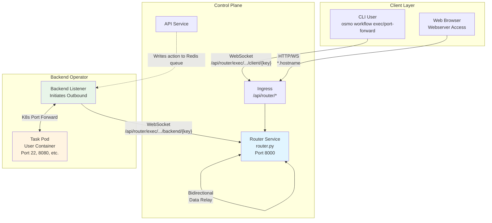
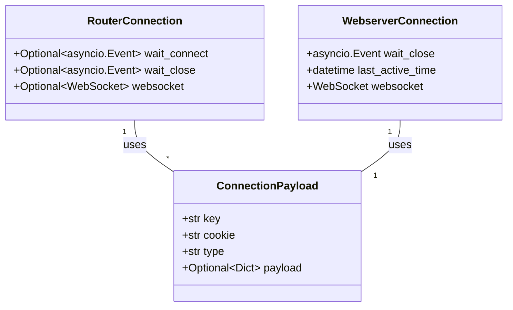
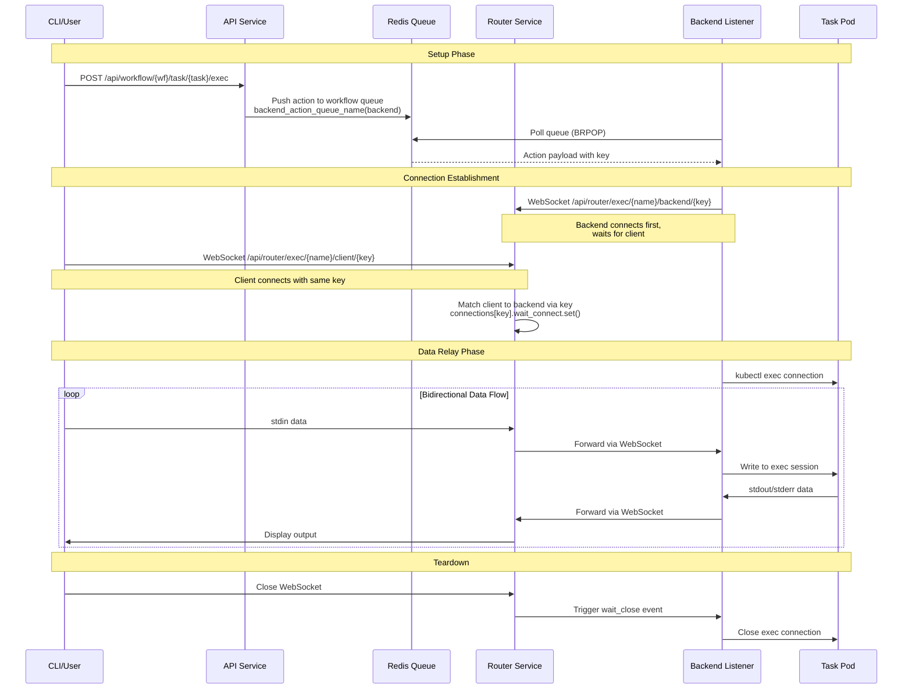
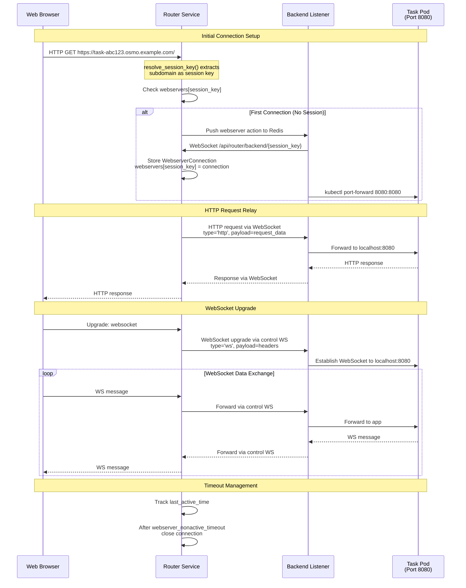
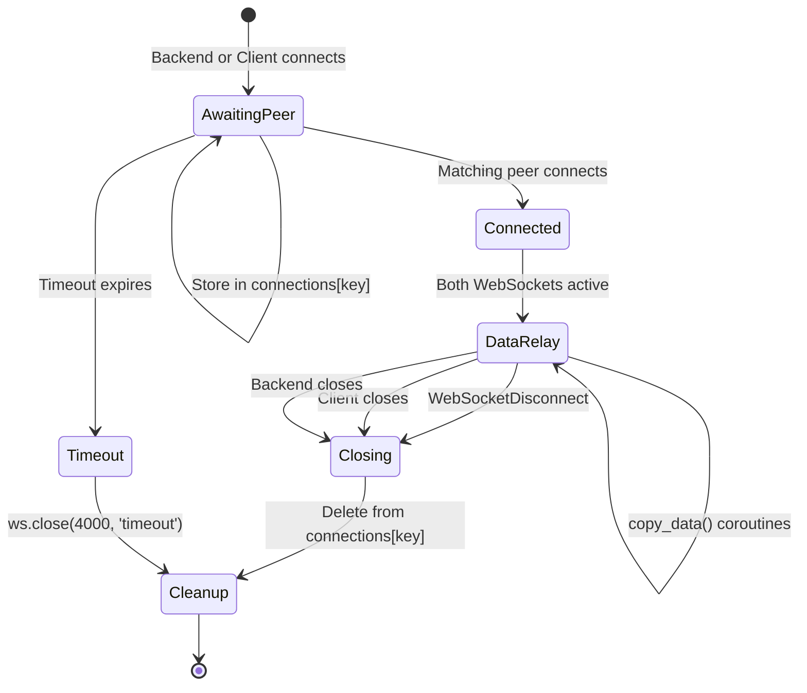
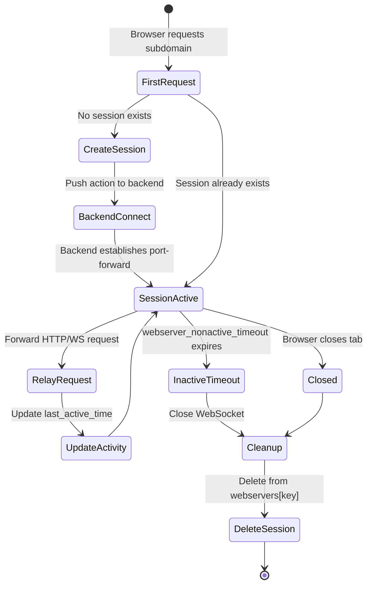
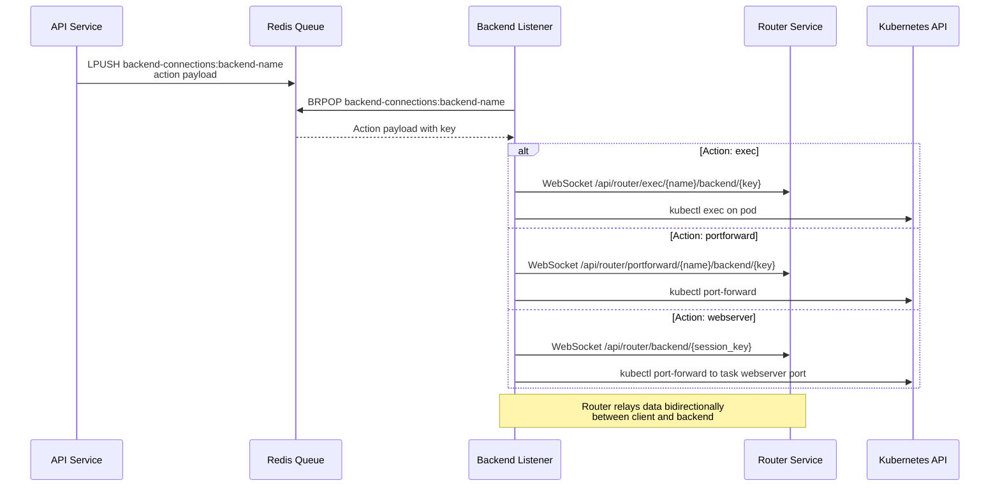

<!-- source: DeepWiki mcp.deepwiki.com · repo NVIDIA/OSMO · page 3.3 Router Service · fetched 2026-10-26 -->

# Router Service

<details>
<summary>Relevant source files</summary>

The following files were used as context for generating this wiki page:

- [deployments/charts/quick-start/Chart.yaml](deployments/charts/quick-start/Chart.yaml)
- [deployments/charts/router/Chart.yaml](deployments/charts/router/Chart.yaml)
- [deployments/charts/router/templates/router-service.yaml](deployments/charts/router/templates/router-service.yaml)
- [deployments/charts/service/templates/agent-service.yaml](deployments/charts/service/templates/agent-service.yaml)
- [deployments/charts/service/templates/api-service.yaml](deployments/charts/service/templates/api-service.yaml)
- [deployments/charts/service/templates/delayed-job-monitor.yaml](deployments/charts/service/templates/delayed-job-monitor.yaml)
- [deployments/charts/service/templates/logger-service.yaml](deployments/charts/service/templates/logger-service.yaml)
- [deployments/charts/service/templates/worker.yaml](deployments/charts/service/templates/worker.yaml)
- [deployments/charts/web-ui/templates/ui.yaml](deployments/charts/web-ui/templates/ui.yaml)
- [src/lib/utils/common.py](src/lib/utils/common.py)
- [src/lib/utils/port_forward.py](src/lib/utils/port_forward.py)
- [src/lib/utils/tests/test_common.py](src/lib/utils/tests/test_common.py)
- [src/service/core/config/helpers.py](src/service/core/config/helpers.py)
- [src/service/core/data/data_service.py](src/service/core/data/data_service.py)
- [src/service/logger/ctrl_websocket.py](src/service/logger/ctrl_websocket.py)
- [src/service/router/router.py](src/service/router/router.py)
- [src/utils/connectors/postgres.py](src/utils/connectors/postgres.py)
- [src/utils/job/kb_objects.py](src/utils/job/kb_objects.py)
- [src/utils/job/task.py](src/utils/job/task.py)

</details>


## Purpose and Scope

The Router Service is a specialized proxy component within OSMO's control plane that enables interactive access to running workflow tasks. It routes bidirectional connections (exec, port-forward, rsync, webserver) between clients and backend task pods through persistent WebSocket tunnels, solving network connectivity challenges when backends are behind firewalls or NAT.

For information about workflow execution and task management, see [Workflow Lifecycle and Execution](#6.4). For backend operator architecture, see [Backend Operator Architecture](#5.1).

**Sources:** [src/service/router/router.py:1-40](), [deployments/charts/router/templates/router-service.yaml:1-20]()

---

## Architecture Overview

The router sits between the OSMO control plane and backend operators, acting as a rendezvous point for client-backend connections:



**Key Characteristics:**

- **Stateful Proxy**: Maintains in-memory connection mappings (`connections`, `webservers` dictionaries)
- **Zero Backend Firewall Changes**: Backends initiate outbound WebSocket connections
- **Protocol Agnostic**: Routes raw TCP, UDP, and WebSocket data without inspection
- **Session-Based Routing**: Uses unique keys and cookies to route requests to correct connections

**Sources:** [src/service/router/router.py:93-96](), [deployments/charts/router/templates/router-service.yaml:257-311]()

---

## Core Components

### RouterConnection Model

The `RouterConnection` class tracks active backend connections awaiting client attachment:



**Connection Dictionaries:**

| Dictionary | Type | Purpose |
|------------|------|---------|
| `connections` | `Dict[str, RouterConnection]` | Maps connection keys to exec/port-forward sessions |
| `webservers` | `Dict[str, WebserverConnection]` | Maps session keys to persistent webserver connections |

**Sources:** [src/service/router/router.py:66-84](), [src/service/router/router.py:95-96]()

### RouterServiceConfig

Configuration parameters defined in `RouterServiceConfig`:

| Parameter | Default | Description |
|-----------|---------|-------------|
| `host` | `http://0.0.0.0:8000` | Bind address for router service |
| `hostname` | `localhost` | Public DNS hostname for routing |
| `timeout` | 60 | Connection timeout for exec/port-forward (seconds) |
| `webserver_initial_timeout` | 3600 | Initial webserver connection timeout (1 hour) |
| `webserver_nonactive_timeout` | 1800 | Timeout for inactive webserver connections (30 min) |
| `sticky_cookies` | `['AWSALB', 'AWSALBCORS']` | Cookies to forward for load balancer affinity |

**Sources:** [src/service/router/router.py:37-64]()

---

## Connection Flow Diagrams

### Exec and Port-Forward Flow



**Key Flow Points:**

1. **Rendezvous Pattern**: Either backend or client can connect first; the router waits for both before starting data relay
2. **Connection Timeout**: If matching connection doesn't arrive within `timeout` seconds, connection is closed with code 4000
3. **Unique Keys**: Action keys are generated as `'EXEC-' + generate_unique_id()` or `'PORTFORWARD-' + generate_unique_id()`
4. **Cookie Isolation**: Session cookies prevent connection hijacking

**Sources:** [src/service/router/router.py:137-170](), [src/service/router/router.py:172-213](), [src/service/core/config/helpers.py:194-203]()

### Webserver Connection Flow

For persistent HTTP/WebSocket access to task-hosted webservers (e.g., TensorBoard, Jupyter):



**Webserver-Specific Features:**

- **Subdomain Routing**: Session key extracted from subdomain (e.g., `task-abc123.osmo.example.com` → `task-abc123`)
- **Sticky Cookie Forwarding**: ALB cookies preserved for load balancer affinity
- **Automatic Cleanup**: Inactive connections closed after `webserver_nonactive_timeout`
- **Protocol Tunneling**: HTTP and WebSocket protocols tunneled through single control WebSocket

**Sources:** [src/service/router/router.py:99-122](), [src/service/router/helper.py:1-100]()

---

## API Endpoints

The router exposes several WebSocket and HTTP endpoints:

### Backend Connection Endpoints

| Endpoint | Method | Purpose |
|----------|--------|---------|
| `/api/router/exec/{name}/backend/{key}` | WebSocket | Backend connects for exec session |
| `/api/router/portforward/{name}/backend/{key}` | WebSocket | Backend connects for port-forward session |
| `/api/router/rsync/{name}/backend/{key}` | WebSocket | Backend connects for rsync session |

**Handler:** `run_connect_backend(ws, name, key)`

**Sources:** [src/service/router/router.py:137-170]()

### Client Connection Endpoints

| Endpoint | Method | Purpose |
|----------|--------|---------|
| `/api/router/exec/{name}/client/{key}` | WebSocket | Client connects for exec session |
| `/api/router/portforward/{name}/client/{key}` | WebSocket | Client connects for port-forward session |
| `/api/router/rsync/{name}/client/{key}` | WebSocket | Client connects for rsync session |

**Handler:** `run_connect_client(client_ws, name, key, timeout)`

**Data Relay:** Implemented by `copy_data()` coroutines running concurrently to forward bytes bidirectionally.

**Sources:** [src/service/router/router.py:172-213]()

### Webserver Endpoints

| Endpoint | Method | Purpose |
|----------|--------|---------|
| `/api/router/webserver/{key}` | GET | Check if webserver session is alive |
| `*.hostname/*` (via middleware) | HTTP/WebSocket | Route to task webserver via subdomain |

**Middleware:** `RouterWebSocketMiddleware` intercepts all requests, checks for session key in headers/subdomain, and routes to webserver handlers if applicable.

**Sources:** [src/service/router/router.py:99-124](), [src/service/router/router.py:132-134]()

### Utility Endpoints

| Endpoint | Method | Purpose |
|----------|--------|---------|
| `/api/router/version` | GET | Return router service version |
| `/api/router/docs` | GET | OpenAPI documentation |

**Sources:** [src/service/router/router.py:127-129]()

---

## Connection Lifecycle Management

### Exec/Port-Forward Lifecycle



**Connection Establishment:**

1. First peer (backend or client) connects → creates `RouterConnection` with `wait_connect` event
2. Second peer connects → sets `wait_connect.set()` to unblock first peer
3. Both peers proceed to data relay phase

**Cleanup Triggers:**

- Either WebSocket disconnects
- Connection timeout expires
- `wait_close` event is triggered
- Key is immediately deleted from `connections` dictionary

**Sources:** [src/service/router/router.py:137-170](), [src/service/router/router.py:172-213]()

### Webserver Connection Lifecycle



**Activity Tracking:**

- `last_active_time` updated on each HTTP request
- `check_inactivity()` coroutine periodically scans for stale connections
- Inactive connections older than `webserver_nonactive_timeout` are closed

**Sources:** [src/service/router/router.py:76-83](), [src/service/router/helper.py:50-120]()

---

## Deployment Configuration

### Helm Chart Structure

The router is deployed via the `router` Helm chart:

**Key Resources Created:**

| Resource | Purpose |
|----------|---------|
| Deployment | Runs router pods with HPA |
| Service | ClusterIP service on port 80 |
| Ingress | Routes `/api/router` and wildcard subdomain traffic |
| HorizontalPodAutoscaler | Scales based on memory utilization |

**Sources:** [deployments/charts/router/Chart.yaml:1-41](), [deployments/charts/router/templates/router-service.yaml:1-336]()

### Container Configuration

```yaml
# Deployment spec
containers:
  - name: router-service
    image: ${osmoImageLocation}/osmo:${osmoImageTag}
    command: [router]
    args:
      - --hostname
      - ${hostname}
      - --postgres_host
      - ${postgres.serviceName}
      - --postgres_port
      - ${postgres.port}
      # ... additional database and logging args
```

**Command-Line Arguments:**

- `--hostname`: Public DNS name for session key resolution
- Database connection parameters (inherited from `PostgresConfig`)
- Logging configuration (inherited from `LoggingConfig`)

**Sources:** [deployments/charts/router/templates/router-service.yaml:75-114]()

### Sidecar Containers

| Sidecar | Purpose |
|---------|---------|
| **Envoy** | OAuth2 authentication proxy, JWT validation |
| **FluentBit** | Log collection and forwarding |

**Envoy Configuration:** Router uses Envoy for authentication when `sidecars.envoy.enabled` is true. The Envoy sidecar validates JWTs and injects `x-osmo-user` headers.

**Sources:** [deployments/charts/router/templates/router-service.yaml:188-195]()

### Ingress Rules

The router ingress handles two types of traffic:

**1. API Traffic:**
```yaml
paths:
  - path: /api/router
    pathType: Prefix
    backend:
      service:
        name: router-service
        port: 80
```

**2. Webserver Wildcard Traffic (if `webserverEnabled`):**
```yaml
rules:
  - host: "*.${hostname}"
    http:
      paths:
        - path: /
          pathType: Prefix
          backend:
            service:
              name: router-service
```

**ALB Annotations:**
- `alb.ingress.kubernetes.io/hostnames: '["*.hostname", "hostname"]'` enables wildcard routing
- SSL termination configured via `sslCertArn`

**Sources:** [deployments/charts/router/templates/router-service.yaml:257-311]()

### Scaling Configuration

```yaml
HorizontalPodAutoscaler:
  minReplicas: 1
  maxReplicas: 10
  metrics:
    - type: ContainerResource
      containerResource:
        name: memory
        target:
          type: Utilization
          averageUtilization: 80
```

**Scaling Behavior:** Router scales based on memory utilization because connection state is stored in-memory. High connection counts increase memory usage.

**Probes:**

- **Liveness:** HTTP GET on configured endpoint
- **Readiness:** HTTP GET on configured endpoint
- **Startup:** Initial delay to allow service startup

**Sources:** [deployments/charts/router/templates/router-service.yaml:314-336]()

---

## Integration with Other Services

### API Service Integration

The API service triggers router connections by writing actions to Redis queues:

```python
# From src/service/core/config/helpers.py
def backend_action_request_helper(payload: Dict[str, Any], name: str):
    redis_client = connectors.RedisConnector.get_instance().client
    action_attributes: Dict[str, Any] = {**payload}
    redis_queue_name = connectors.backend_action_queue_name(name)
    redis_client.lpush(redis_queue_name, json.dumps(action_attributes))
```

**Action Payload Structure:**

```json
{
  "action": "exec" | "portforward" | "webserver",
  "key": "EXEC-abc123def456",
  "workflow_id": "my-workflow-123",
  "task_name": "train-task",
  "retry_id": 0,
  "command": ["/bin/bash"],  // exec only
  "port": 8080,              // port-forward only
  "protocol": "tcp"          // port-forward only
}
```

**Sources:** [src/service/core/config/helpers.py:194-203](), [src/utils/connectors/postgres.py:51-52]()

### Backend Operator Integration

Backend operators poll Redis queues and initiate router connections:



**Queue Naming:** Backend queues follow the pattern `backend-connections:{backend_name}` (defined by `backend_action_queue_name()` function).

**Sources:** [src/utils/connectors/postgres.py:51-52](), [src/service/core/config/helpers.py:194-203]()

### CLI Integration

The CLI uses helper functions from `port_forward.py` to establish router connections:

**TCP Port Forwarding:**
```python
# From src/lib/utils/port_forward.py
async def run_tcp(
    service_client: client.ServiceClient,
    app_host: str,
    app_port: int,
    message: str,
    endpoint: str,
    timeout: int,
    router_address: str,
    key: str,
    ctrl_cookie: str,
    ...
)
```

**Connection Steps:**

1. Obtain session cookie from router: `_get_session_cookie(router_address, timeout)`
2. Create control WebSocket: `service_client.create_websocket(router_address, endpoint)`
3. Listen on local socket: `asyncio.start_server(handle_connection, sock=sock)`
4. For each client connection:
   - Generate unique connection key
   - Send `ConnectionPayload` to control WebSocket
   - Create data WebSocket with same key
   - Relay data bidirectionally

**UDP Port Forwarding:** Uses datagram encoding with `_encode_addr()` and `_decode_addr()` to multiplex UDP packets over WebSocket.

**Sources:** [src/lib/utils/port_forward.py:110-228](), [src/lib/utils/port_forward.py:230-308]()

---

## Security Considerations

### Authentication

- **Envoy Sidecar:** Validates OAuth2/OIDC tokens before routing to router
- **User Identity:** Extracted from JWT and injected as `x-osmo-user` header
- **Session Cookies:** HMAC-signed cookies prevent session hijacking

**Sources:** [deployments/charts/router/templates/router-service.yaml:188]()

### Connection Isolation

- **Unique Keys:** Each connection uses a cryptographically random key via `common.generate_unique_id()`
- **Cookie Validation:** Webserver sessions validated via subdomain + cookie matching
- **Timeout Enforcement:** Connections automatically closed after inactivity

**Sources:** [src/service/router/router.py:66-84]()

### Rate Limiting

The CLI implements optional WebSocket write rate limiting:

```python
# From port_forward.py
ws_write_rate_limiter: common.TokenBucket | None = None
# If enabled:
await ws_write_rate_limiter.wait_for_tokens(len(data))
```

This prevents overwhelming backend connections with high-throughput port forwards.

**Sources:** [src/lib/utils/port_forward.py:76-90]()

---

## Troubleshooting

### Common Issues

**1. Connection Timeout (4000 error)**

**Symptom:** `Router connection timeout` error after 60 seconds

**Causes:**
- Backend operator not running or not polling Redis queue
- Backend operator unable to connect to router (firewall/DNS issues)
- Task pod not running or not ready

**Resolution:**
- Check backend operator logs for connection attempts
- Verify `router_address` in backend configuration
- Ensure ingress is routing `/api/router` to router service

**2. Webserver Not Accessible**

**Symptom:** 404 or connection refused when accessing `https://task-{id}.osmo.example.com`

**Causes:**
- Wildcard DNS not configured
- Wildcard ingress not enabled (`webserverEnabled: false`)
- Session key mismatch between subdomain and stored session

**Resolution:**
- Verify wildcard DNS resolves to ingress controller
- Enable `webserverEnabled` in Helm values
- Check `webservers` dictionary for active sessions via `/api/router/webserver/{key}`

**3. High Memory Usage**

**Symptom:** Router pods consuming excessive memory

**Causes:**
- Large number of active connections stored in `connections` and `webservers` dictionaries
- Memory leak from unclosed connections

**Resolution:**
- Scale router horizontally (increase `maxReplicas`)
- Reduce `webserver_nonactive_timeout` to close inactive sessions faster
- Review connection cleanup logic for proper `del connections[key]` calls

**Sources:** [src/service/router/router.py:137-170](), [src/service/router/router.py:95-96]()

---

## Performance Characteristics

### Scalability

- **Stateful Service:** Connection state stored in-memory, no shared state between pods
- **Load Balancing:** Session affinity required for webserver connections (sticky cookies)
- **Vertical Scaling:** Memory-bound by number of active connections

**Memory Footprint per Connection:**
- RouterConnection: ~1-2 KB (WebSocket overhead + Python object)
- Active data buffering: Depends on transfer rate and socket buffer sizes

### Latency

- **Overhead:** Minimal (<5ms) for data relay due to simple forwarding logic
- **WebSocket Framing:** Additional ~2-14 bytes per frame
- **Network Hops:** Client → Ingress → Router → Backend → K8s API → Pod

**Sources:** [src/service/router/router.py:214-245]()

---

**Complete Sources:** [src/service/router/router.py](), [deployments/charts/router/templates/router-service.yaml](), [src/lib/utils/port_forward.py](), [src/service/router/helper.py](), [src/service/core/config/helpers.py:194-203](), [src/utils/connectors/postgres.py:51-52]()

---

