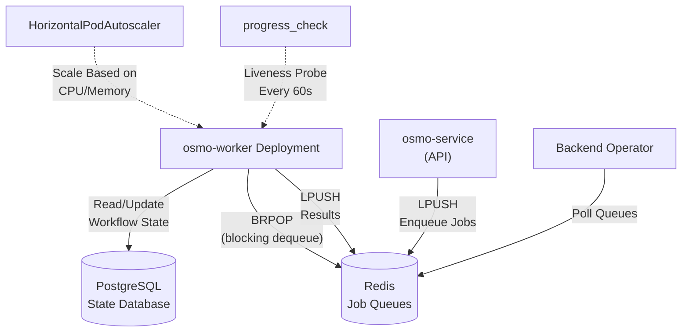
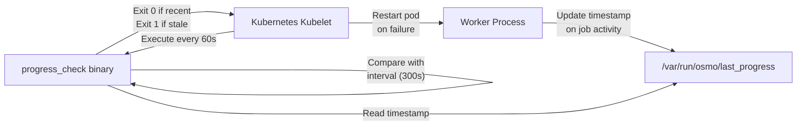
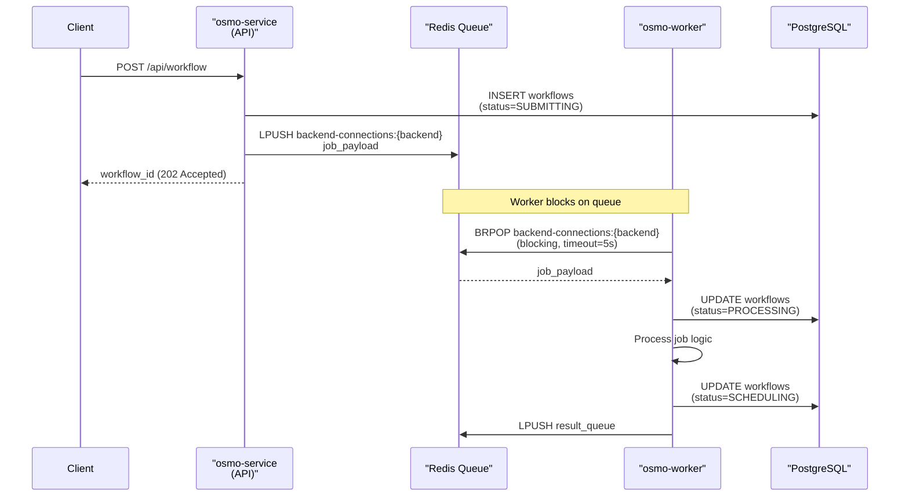
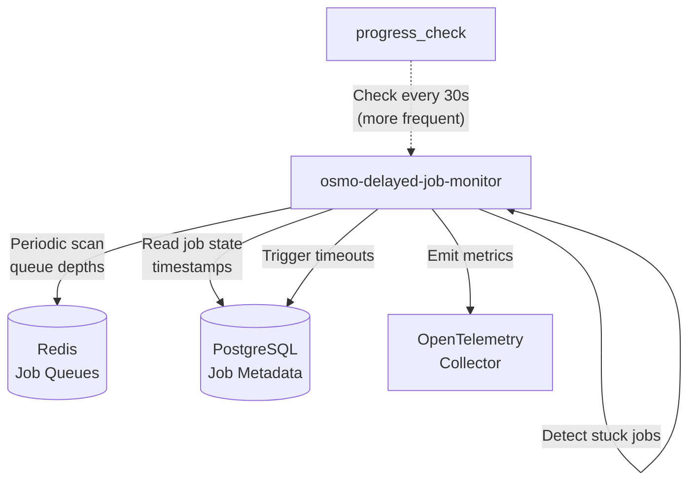
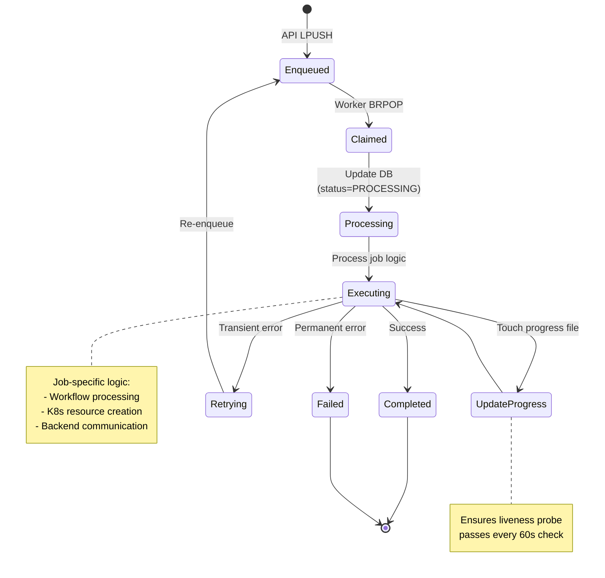
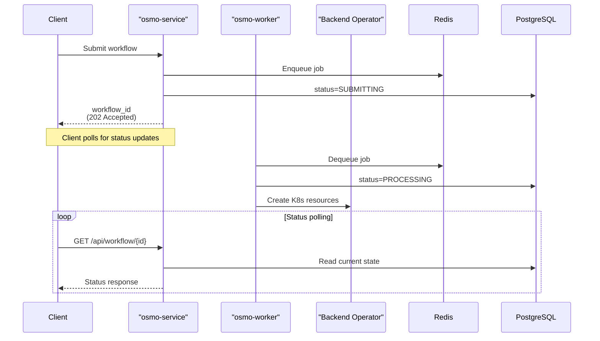
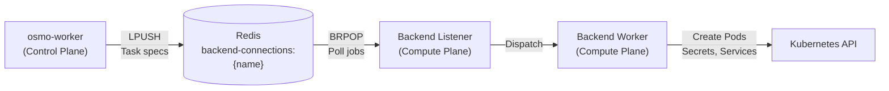

<!-- source: DeepWiki mcp.deepwiki.com · repo NVIDIA/OSMO · page 3.4 Worker and Background Jobs · fetched 2026-10-26 -->

# Worker and Background Jobs

<details>
<summary>Relevant source files</summary>

The following files were used as context for generating this wiki page:

- [deployments/charts/quick-start/Chart.yaml](deployments/charts/quick-start/Chart.yaml)
- [deployments/charts/router/Chart.yaml](deployments/charts/router/Chart.yaml)
- [deployments/charts/router/templates/router-service.yaml](deployments/charts/router/templates/router-service.yaml)
- [deployments/charts/service/templates/agent-service.yaml](deployments/charts/service/templates/agent-service.yaml)
- [deployments/charts/service/templates/api-service.yaml](deployments/charts/service/templates/api-service.yaml)
- [deployments/charts/service/templates/delayed-job-monitor.yaml](deployments/charts/service/templates/delayed-job-monitor.yaml)
- [deployments/charts/service/templates/logger-service.yaml](deployments/charts/service/templates/logger-service.yaml)
- [deployments/charts/service/templates/worker.yaml](deployments/charts/service/templates/worker.yaml)
- [deployments/charts/web-ui/templates/ui.yaml](deployments/charts/web-ui/templates/ui.yaml)
- [src/lib/utils/common.py](src/lib/utils/common.py)
- [src/lib/utils/port_forward.py](src/lib/utils/port_forward.py)
- [src/lib/utils/tests/test_common.py](src/lib/utils/tests/test_common.py)
- [src/service/core/config/helpers.py](src/service/core/config/helpers.py)
- [src/service/core/data/data_service.py](src/service/core/data/data_service.py)
- [src/service/logger/ctrl_websocket.py](src/service/logger/ctrl_websocket.py)
- [src/service/router/router.py](src/service/router/router.py)
- [src/utils/connectors/postgres.py](src/utils/connectors/postgres.py)
- [src/utils/job/kb_objects.py](src/utils/job/kb_objects.py)
- [src/utils/job/task.py](src/utils/job/task.py)

</details>


## Purpose and Scope

The Worker service processes background jobs related to workflow orchestration, task scheduling, and system maintenance operations. This page covers:
- Worker service deployment architecture and scaling
- Background job types and Redis queue system
- The Delayed Job Monitor component
- Job processing lifecycle and progress tracking mechanisms

For information about workflow submission and lifecycle management, see [Workflow Lifecycle and Execution](#6.4). For backend task execution details, see [Backend Operator Architecture](#5.1).

---

## Worker Service Architecture

The Worker service is a stateless, horizontally scalable component that processes background jobs from Redis queues. It operates independently of user-facing API requests and handles asynchronous operations that would be too slow or resource-intensive for synchronous processing.

### Component Overview



**Sources:**
- [deployments/charts/service/templates/worker.yaml:1-237]()
- [src/utils/connectors/postgres.py:51-52]()

### Deployment Configuration

The Worker service is deployed as a Kubernetes Deployment with the following characteristics:

| Configuration | Value | Purpose |
|--------------|-------|---------|
| **Command** | `worker` | Primary worker process |
| **Image Pull Policy** | `Always` | Ensures latest image |
| **Security Context** | Non-root (UID 1001) | Minimal privileges |
| **Capabilities** | All dropped | Enhanced security |
| **Redis Connection** | `--redis_host`, `--redis_port` | Job queue access |
| **PostgreSQL Connection** | `--postgres_host`, `--postgres_port` | State persistence |
| **Scaling** | HorizontalPodAutoscaler | Automatic scaling 1-10+ replicas |

**Sources:**
- [deployments/charts/service/templates/worker.yaml:66-77]()
- [deployments/charts/service/templates/worker.yaml:208-237]()

---

## Progress Checking and Health Probes

The Worker service uses a unique health check mechanism based on progress tracking rather than simple HTTP endpoint checks. This ensures workers are actively processing jobs and not stuck in deadlock states.

### Progress Check Mechanism



**Sources:**
- [deployments/charts/service/templates/worker.yaml:156-177]()

### Probe Definitions

**Liveness Probe** - Restarts worker if stuck for 5 minutes:

```yaml
livenessProbe:
  exec:
    command:
    - progress_check
    - --progress_interval
    - "300"
  failureThreshold: 1
  periodSeconds: 60
  timeoutSeconds: 15
```

The `progress_interval` of 300 seconds means the worker must update its progress file at least once every 5 minutes. If this check fails even once (`failureThreshold: 1`), Kubernetes immediately restarts the pod.

**Startup Probe** - Allows 60 seconds for initialization:

```yaml
startupProbe:
  exec:
    command:
    - progress_check
    - --progress_interval
    - "300"
  failureThreshold: 12
  periodSeconds: 5
  timeoutSeconds: 15
  initialDelaySeconds: 10
```

This gives the worker up to 70 seconds total (10s initial + 12 × 5s) to begin processing before being considered unhealthy.

**Sources:**
- [deployments/charts/service/templates/worker.yaml:157-177]()

---

## Background Job System

OSMO uses Redis as a lightweight, high-performance job queue. Jobs are enqueued using Redis list operations (`LPUSH`) and dequeued by workers using blocking operations (`BRPOP`).

### Job Queue Naming Patterns

Different operation types use distinct queue naming conventions:

| Queue Type | Pattern | Example | Purpose |
|-----------|---------|---------|---------|
| **Backend Actions** | `backend-connections:{backend_name}` | `backend-connections:dgx-prod` | Backend operator job polling |
| **Workflow Actions** | `workflow-action:{workflow_id}:{task_name}:{retry_id}` | `workflow-action:train-123:worker-0:0` | Task actions (exec, port-forward) |
| **Barrier Synchronization** | `barrier:{workflow_id}:{group_name}:{barrier_name}` | `barrier:train-123:workers:osmo-group-ready` | Multi-task sync points |

The `backend_action_queue_name` function constructs backend-specific queue names:

```python
def backend_action_queue_name(backend_name: str) -> str:
    return f'backend-connections:{backend_name}'
```

**Sources:**
- [src/utils/connectors/postgres.py:51-52]()
- [src/service/logger/ctrl_websocket.py:221-227]()

### Job Enqueueing and Dequeueing Flow



The `BRPOP` operation blocks until a job is available or the timeout expires, preventing busy-waiting and reducing CPU usage.

**Sources:**
- [src/service/core/config/helpers.py:194-203]()
- [src/utils/connectors/postgres.py:51-52]()

---

## Background Job Types

The Worker service processes several categories of background jobs:

### 1. Workflow State Transitions

When workflows are submitted, they progress through states. The Worker handles transitions from **WAITING** → **PROCESSING** → **SCHEDULING**:

- **Jinja Template Expansion**: Resolves `{{ workflow_id }}`, `{{ input:N }}`, `{{ host:task }}` tokens
- **Resource Validation**: Checks platform compatibility, resource availability
- **K8s Resource Generation**: Creates Pod specs, Secrets, ConfigMaps
- **Backend Job Distribution**: Enqueues tasks to backend-specific queues

### 2. Backend Action Requests

Interactive actions (`exec`, `port-forward`, `rsync`) are enqueued to backend-specific queues:

```python
def backend_action_request_helper(payload: Dict[str, Any], name: str):
    redis_client = connectors.RedisConnector.get_instance().client
    action_attributes: Dict[str, Any] = {**payload}
    redis_queue_name = connectors.backend_action_queue_name(name)
    redis_client.lpush(redis_queue_name, json.dumps(action_attributes))
```

Backend operators poll these queues and execute actions on their Kubernetes clusters.

**Sources:**
- [src/service/core/config/helpers.py:194-203]()

### 3. Task Synchronization Barriers

For distributed training workflows, tasks synchronize using Redis-based barriers. The Logger service coordinates barrier operations:

```python
key = job_common.barrier_key(workflow_id, group_name, barrier_name)
await redis_client.sadd(key, task_name)
barrier_set = await redis_client.smembers(key)

if len(barrier_set) >= count:
    # Notify all waiting tasks
    for name in barrier_set:
        queue_name = workflow.action_queue_name(workflow_id, task_obj.name, task_obj.retry_id)
        await redis_client.lpush(queue_name, key)
```

This implements a rendezvous pattern where all tasks in a group must reach the barrier before any proceed.

**Sources:**
- [src/service/logger/ctrl_websocket.py:93-116]()

### 4. Metrics and I/O Tracking

Tasks report performance metrics (download times, upload sizes) via WebSocket to the Logger service, which updates the database asynchronously:

- **Task I/O Metrics**: Download/upload start/end times, sizes, file counts
- **Task Group Metrics**: Scheduling, initialization, execution timings
- **Dataset Operations**: Track data transfer performance

**Sources:**
- [src/service/logger/ctrl_websocket.py:54-90]()

---

## Delayed Job Monitor

The Delayed Job Monitor is a separate single-replica deployment that tracks job queue health and enforces timeout policies.

### Monitor Architecture



**Sources:**
- [deployments/charts/service/templates/delayed-job-monitor.yaml:1-204]()

### Configuration Differences from Worker

The Delayed Job Monitor has more aggressive health checks:

| Setting | Worker | Monitor | Rationale |
|---------|--------|---------|-----------|
| **Liveness Period** | 60s | 30s | Faster detection of monitor issues |
| **Startup Delay** | 10s | 10s | Same initialization time |
| **Failure Threshold** | 1 | 1 | Both restart immediately on failure |
| **Progress Interval** | 300s | 300s | Same staleness threshold |

The 30-second liveness period ensures the monitor itself is responsive, critical for detecting and responding to system-wide issues quickly.

**Sources:**
- [deployments/charts/service/templates/delayed-job-monitor.yaml:152-173]()
- [deployments/charts/service/templates/worker.yaml:157-177]()

### Monitoring Responsibilities

1. **Queue Depth Tracking**: Monitors pending job counts in all Redis queues
2. **Stuck Job Detection**: Identifies workflows/tasks in non-terminal states beyond timeout thresholds
3. **Timeout Enforcement**: Updates database state to trigger workflow/task failures
4. **Metrics Emission**: Reports queue statistics to OpenTelemetry for alerting

**Sources:**
- [deployments/charts/service/templates/delayed-job-monitor.yaml:64-111]()

---

## Job Processing Lifecycle

The complete lifecycle of a background job from submission to completion:



**Sources:**
- [deployments/charts/service/templates/worker.yaml:78-122]()

### Worker Loop Pattern

While the actual worker implementation is not visible in the provided files, the configuration and related services imply this processing pattern:

```python
# Conceptual worker loop based on deployment configuration
while True:
    job = redis.brpop(queue_name, timeout=5)
    if job:
        update_progress_file()  # Touch timestamp for liveness probe
        try:
            result = process_job(job)
            update_database(result)
            update_progress_file()
        except TransientError as e:
            requeue_job(job, retry_count + 1)
        except PermanentError as e:
            mark_job_failed(job, error=e)
    else:
        update_progress_file()  # Still alive, no work available
```

**Sources:**
- [deployments/charts/service/templates/worker.yaml:157-177]() (progress check configuration)

---

## Integration with Other Services

### Worker and API Service

The API service enqueues jobs but returns immediately without waiting for completion, enabling asynchronous processing:



This design decouples request handling from job processing, allowing the API to remain responsive under high load.

**Sources:**
- [src/service/core/config/helpers.py:194-203]()

### Worker and Backend Operator

The Worker creates jobs in backend-specific queues. Backend operators on compute planes poll these queues:



This reverse-connection pattern allows backends to operate behind firewalls without requiring inbound connections.

**Sources:**
- [src/utils/connectors/postgres.py:51-52]()
- [src/service/core/config/helpers.py:194-203]()

### Worker and Logger Service

The Logger service handles real-time log streaming and may trigger additional jobs when tasks complete or barriers are met:

**Sources:**
- [src/service/logger/ctrl_websocket.py:93-227]()

---

## Scaling and Performance

### Horizontal Pod Autoscaling

The Worker deployment uses HorizontalPodAutoscaler to scale based on resource utilization:

```yaml
minReplicas: 1
maxReplicas: 10
metrics:
- type: ContainerResource
  containerResource:
    name: memory
    container: osmo-worker
    target:
      type: Utilization
      averageUtilization: 70
- type: ContainerResource
  containerResource:
    name: cpu
    container: osmo-worker
    target:
      type: Utilization
      averageUtilization: 70
```

When average CPU or memory exceeds 70% across all Worker pods, Kubernetes automatically scales up. During low load, it scales down to the minimum.

**Sources:**
- [deployments/charts/service/templates/worker.yaml:208-237]()

### Job Queue Design Considerations

Redis list operations provide specific guarantees:

| Property | Implementation | Impact |
|----------|---------------|--------|
| **Atomicity** | `BRPOP` is atomic | No duplicate job processing |
| **Multiple Consumers** | Multiple workers can poll same queue | Horizontal scaling works |
| **Delivery Guarantee** | At-most-once (job removed immediately) | Lost if worker crashes before completion |
| **Ordering** | FIFO within each queue | Predictable processing order |
| **Priority** | No native priority support | Separate queues needed for priority |
| **Visibility Timeout** | Not implemented | Jobs lost on worker crash |

For critical operations, the system relies on database state tracking to detect and retry lost jobs. The Delayed Job Monitor helps identify stuck workflows.

**Sources:**
- [src/service/core/config/helpers.py:194-203]() (LPUSH usage)
- [src/service/logger/ctrl_websocket.py:221-227]() (BRPOP usage)

---

## Observability

### Metrics Collection

Both Worker and Monitor integrate with OpenTelemetry sidecars:

```yaml
args:
- --metrics_otel_collector_component
- osmo-worker
- --metrics_otel_enable
- "true"
```

This enables collection of:
- Job processing rate (jobs/second)
- Queue depth per backend
- Processing latency (time from enqueue to completion)
- Error rates and types

**Sources:**
- [deployments/charts/service/templates/worker.yaml:79-82]()
- [deployments/charts/service/templates/delayed-job-monitor.yaml:68-71]()

### Logging

When enabled, FluentBit sidecars collect Worker logs and forward them to centralized storage:

```yaml
volumeMounts:
- name: logs
  mountPath: /logs
```

Logs include:
- Job dequeue events with workflow/task IDs
- Processing start/completion with timing
- Error traces with stack traces
- Progress file updates

**Sources:**
- [deployments/charts/service/templates/worker.yaml:148-151]()
- [deployments/charts/service/templates/worker.yaml:179-193]()

---

## Configuration Reference

### Command-Line Arguments

| Argument | Type | Default | Description |
|----------|------|---------|-------------|
| `--redis_host` | string | (required) | Redis server hostname |
| `--redis_port` | int | 6379 | Redis server port |
| `--redis_db_number` | int | 0 | Redis database index |
| `--redis_tls_enable` | bool | false | Use TLS for Redis connection |
| `--postgres_host` | string | (required) | PostgreSQL hostname |
| `--postgres_port` | int | 5432 | PostgreSQL port |
| `--postgres_database_name` | string | `osmo_db` | Database name |
| `--postgres_user` | string | `postgres` | Database user |
| `--mek_file` | string | `/home/osmo/vault-agent/secrets/vault-secrets.yaml` | Master encryption key file path |
| `--log_level` | string | `INFO` | Logging verbosity |
| `--log_dir` | string | `/logs` | Log file directory |
| `--log_name` | string | `worker` | Log file name prefix |
| `--metrics_otel_enable` | bool | false | Enable OpenTelemetry metrics |

**Sources:**
- [deployments/charts/service/templates/worker.yaml:78-122]()

### Environment Variables

Sensitive credentials are passed via Kubernetes secrets:

```yaml
env:
- name: OSMO_POSTGRES_PASSWORD
  valueFrom:
    secretKeyRef:
      name: db-secret
      key: db-password
- name: OSMO_REDIS_PASSWORD
  valueFrom:
    secretKeyRef:
      name: redis-secret
      key: redis-password
```

**Sources:**
- [deployments/charts/service/templates/worker.yaml:123-139]()

---

## Summary

The Worker service and Delayed Job Monitor form the asynchronous job processing backbone of OSMO:

- **Worker Service**: Stateless, horizontally scalable processor handling workflow orchestration, K8s resource creation, and backend coordination
- **Delayed Job Monitor**: Single-replica watchdog tracking queue health and enforcing timeout policies
- **Redis Queues**: Lightweight, high-performance job distribution using atomic list operations
- **Progress Checking**: Unique health mechanism ensuring workers make forward progress, preventing deadlocks without manual intervention

This architecture enables OSMO to handle high-throughput workflow submission while maintaining responsive API services and reliable job execution across geographically distributed compute backends.

**Sources:**
- [deployments/charts/service/templates/worker.yaml:1-237]()
- [deployments/charts/service/templates/delayed-job-monitor.yaml:1-204]()
- [src/utils/connectors/postgres.py:51-52]()
- [src/service/core/config/helpers.py:194-203]()
- [src/service/logger/ctrl_websocket.py:93-227]()

---

