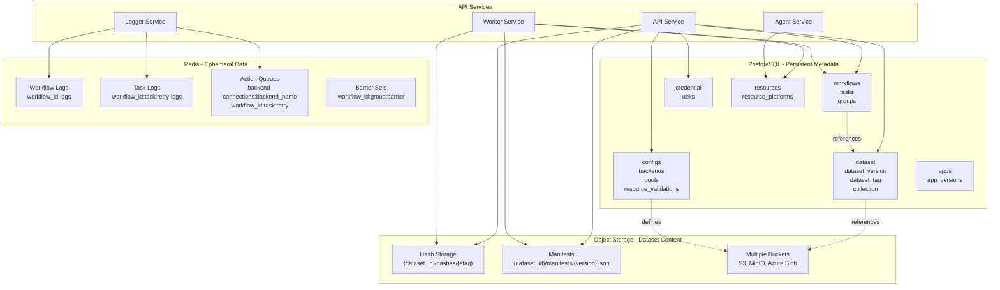
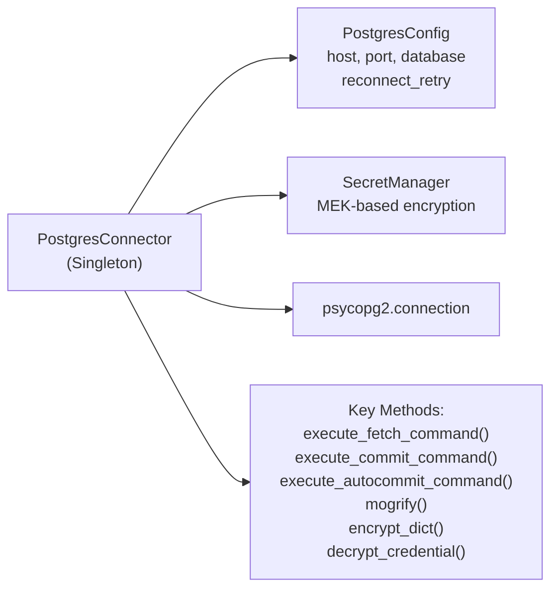
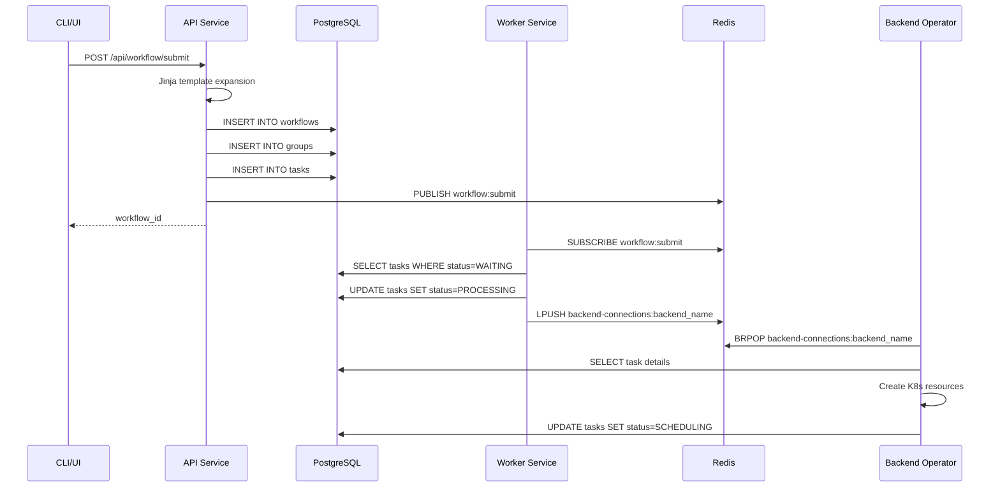
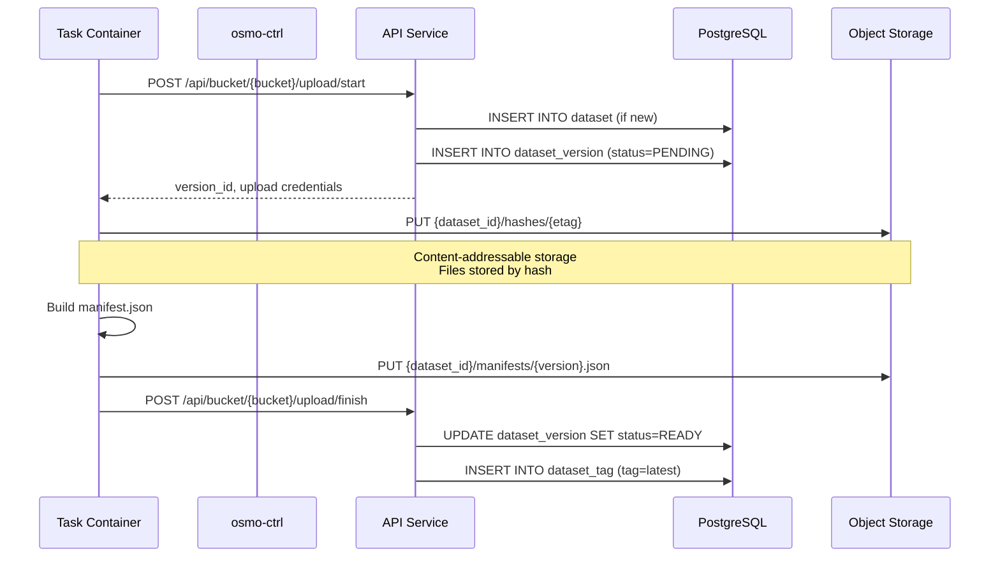
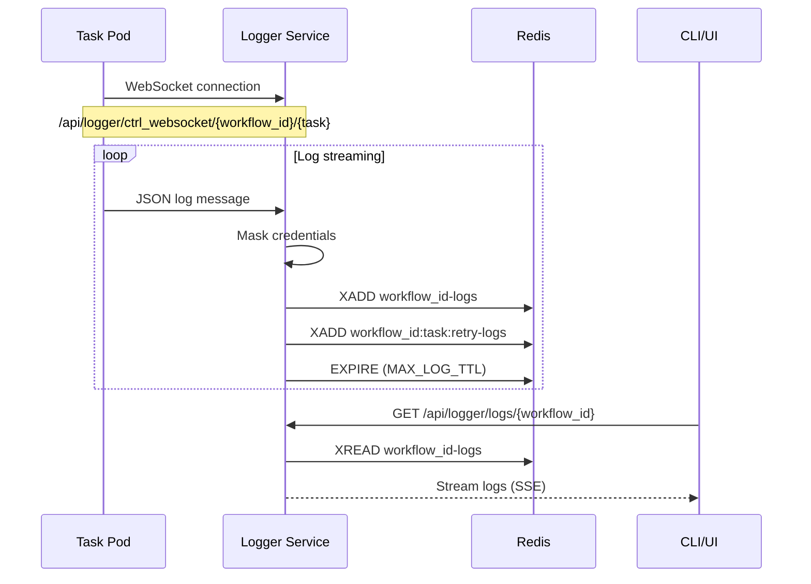
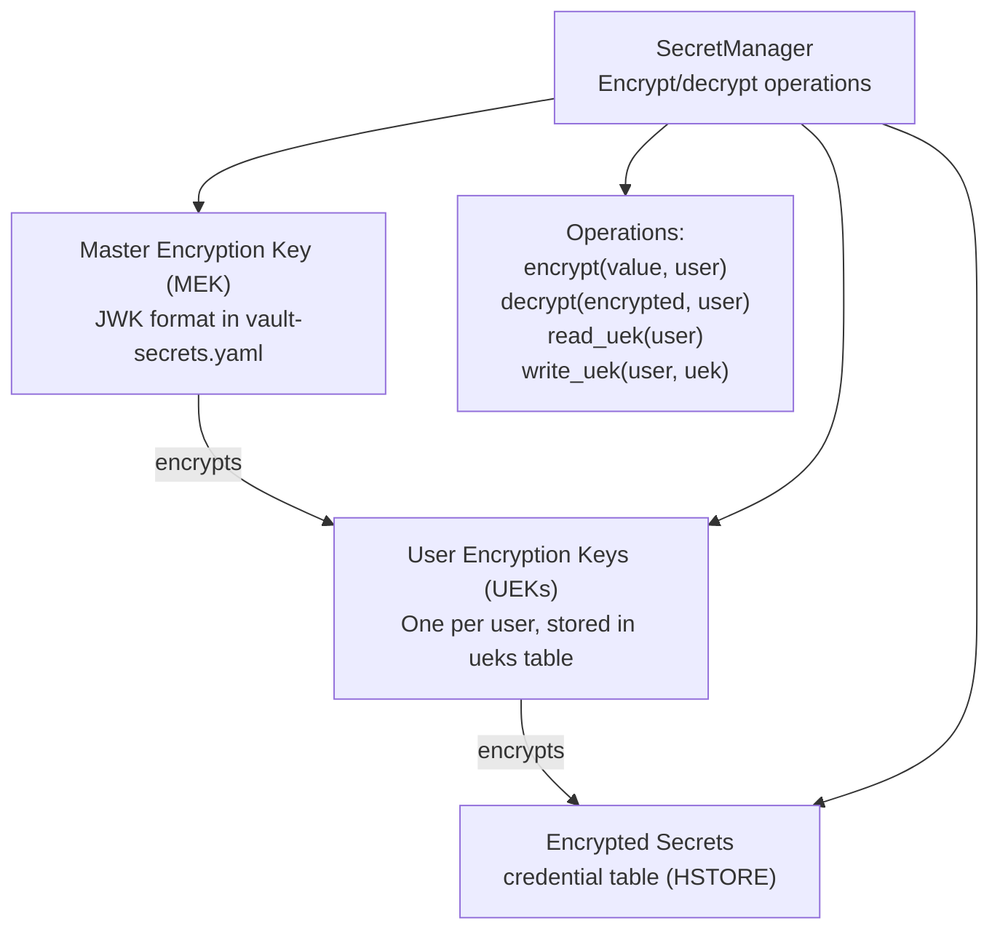
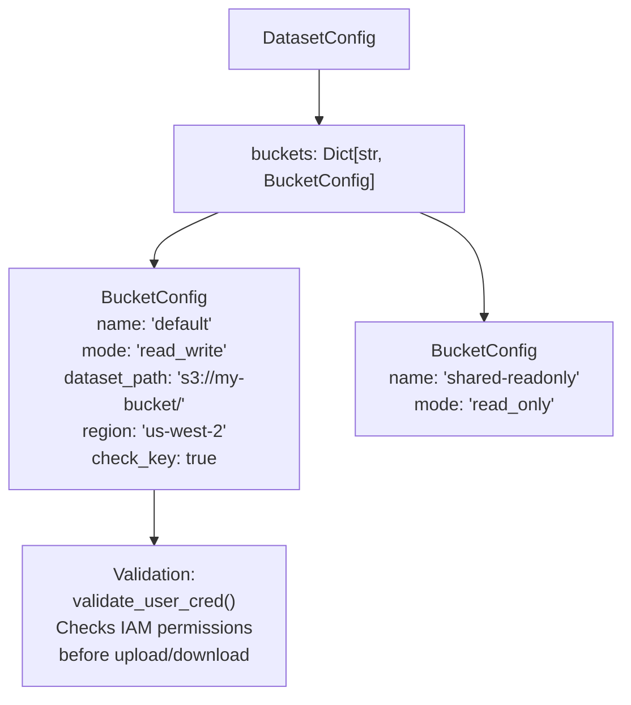
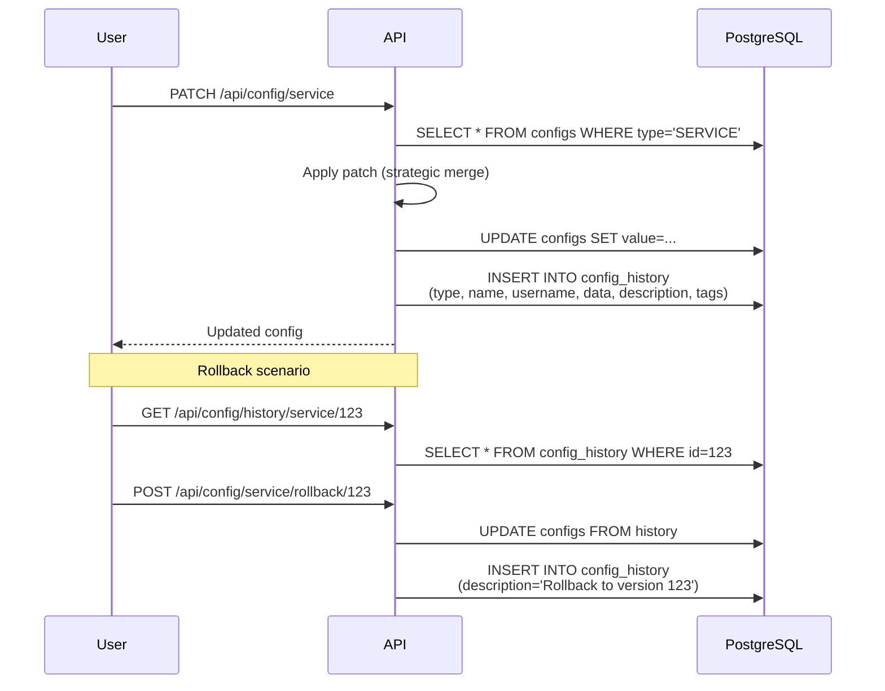

<!-- source: DeepWiki mcp.deepwiki.com · repo NVIDIA/OSMO · page 4 Data Layer · fetched 2026-10-26 -->

# Data Layer

<details>
<summary>Relevant source files</summary>

The following files were used as context for generating this wiki page:

- [.github/PULL_REQUEST_TEMPLATE.md](.github/PULL_REQUEST_TEMPLATE.md)
- [CONTRIBUTING.md](CONTRIBUTING.md)
- [README.md](README.md)
- [deployments/brev/README.md](deployments/brev/README.md)
- [deployments/brev/setup.sh](deployments/brev/setup.sh)
- [docs/deployment_guide/getting_started/create_storage/s3/index.rst](docs/deployment_guide/getting_started/create_storage/s3/index.rst)
- [src/lib/utils/common.py](src/lib/utils/common.py)
- [src/lib/utils/port_forward.py](src/lib/utils/port_forward.py)
- [src/lib/utils/tests/test_common.py](src/lib/utils/tests/test_common.py)
- [src/service/core/config/helpers.py](src/service/core/config/helpers.py)
- [src/service/core/data/data_service.py](src/service/core/data/data_service.py)
- [src/service/logger/ctrl_websocket.py](src/service/logger/ctrl_websocket.py)
- [src/service/router/router.py](src/service/router/router.py)
- [src/utils/connectors/postgres.py](src/utils/connectors/postgres.py)
- [src/utils/job/kb_objects.py](src/utils/job/kb_objects.py)
- [src/utils/job/task.py](src/utils/job/task.py)

</details>


The Data Layer encompasses all persistent storage mechanisms in OSMO, consisting of three primary components: PostgreSQL for relational metadata, Redis for ephemeral logs and job queues, and object storage (S3/Azure Blob/MinIO) for dataset content. This page explains the architecture, design patterns, and integration of these storage systems.

For detailed information about specific aspects:
- Database schema details: see [PostgreSQL Database Schema](#4.1)
- Dataset operations and content-addressable storage: see [Dataset Management](#4.2)
- Configuration versioning and history: see [Configuration Management](#4.3)

## Storage Architecture

OSMO uses a multi-tier storage architecture where each storage system serves a distinct purpose optimized for its use case.

### Storage System Overview



**Sources:** [src/utils/connectors/postgres.py:531-959](), [src/service/logger/ctrl_websocket.py:93-248](), Diagram 5 from high-level architecture

### PostgreSQL Connector

The `PostgresConnector` class manages all database interactions and provides retry logic for connection failures.



**Key implementation details:**

- **Singleton pattern**: Only one instance exists per process ([src/utils/connectors/postgres.py:217-225]())
- **Automatic reconnection**: The `@retry` decorator handles transient connection failures ([src/utils/connectors/postgres.py:187-212]())
- **Dynamic model creation**: Query results are converted to Pydantic models automatically ([src/utils/connectors/postgres.py:305-316]())
- **HSTORE support**: Native encoding/decoding for key-value storage ([src/utils/connectors/postgres.py:515-524]())

**Sources:** [src/utils/connectors/postgres.py:215-428]()

## Data Flow Patterns

### Workflow Submission to Execution



**Sources:** [src/utils/job/workflow.py](), [src/service/core/workflow/workflow_service.py]()

### Dataset Upload Flow



**Sources:** [src/service/core/data/data_service.py:229-344](), Diagram 5 from high-level architecture

### Log Streaming via WebSocket



The `ctrl_websocket` endpoint handles bidirectional communication:
- **Incoming**: Logs, metrics, barrier notifications from tasks
- **Outgoing**: Action requests (exec, port-forward) to tasks

**Sources:** [src/service/logger/ctrl_websocket.py:118-248](), [src/utils/connectors/postgres.py]()

## Credential Encryption

OSMO uses a layered encryption approach for sensitive data stored in PostgreSQL.

### Encryption Architecture



**Encryption flow:**

1. **System initialization**: MEK loaded from `mek_file` ([src/utils/connectors/postgres.py:254-261]())
2. **User key generation**: Each user gets a unique UEK encrypted with MEK
3. **Credential storage**: User credentials encrypted with their UEK
4. **Key rotation**: UEKs can be re-encrypted with new MEK without touching credentials

**HSTORE format example:**
```
"aws_access_key_id"=>"<encrypted_value>","aws_secret_access_key"=>"<encrypted_value>"
```

**Sources:** [src/utils/connectors/postgres.py:475-507](), [src/utils/secret_manager/]()

## Content-Addressable Storage

Datasets use content-addressable storage to achieve 10-100x storage savings through automatic deduplication.

### Deduplication Mechanism

```mermaid
graph LR
    subgraph "Dataset Upload"
        File1["file1.txt<br/>(ETag: abc123)"]
        File2["file2.txt<br/>(ETag: abc123)"]
        File3["file3.txt<br/>(ETag: def456)"]
    end
    
    subgraph "Hash Storage"
        Hash1["hashes/abc123<br/>(stored once)"]
        Hash2["hashes/def456"]
    end
    
    subgraph "Manifest"
        Manifest["manifests/v1.json<br/>{<br/>  'file1.txt': 'abc123',<br/>  'file2.txt': 'abc123',<br/>  'file3.txt': 'def456'<br/>}"]
    end
    
    File1 -.->|same hash| Hash1
    File2 -.->|same hash| Hash1
    File3 -.-> Hash2
    
    Hash1 --> Manifest
    Hash2 --> Manifest
```

**Storage structure:**
```
s3://bucket/
├── {dataset_id}/
│   ├── hashes/
│   │   ├── {etag1}          # Actual file content
│   │   ├── {etag2}
│   │   └── {etag3}
│   └── manifests/
│       ├── v1.json          # Maps paths to ETags
│       └── v2.json
```

**Manifest JSON structure:**
```json
{
  "files": {
    "path/to/file1.txt": "etag_abc123",
    "path/to/file2.txt": "etag_abc123",
    "dir/file3.bin": "etag_def456"
  },
  "version": "v1",
  "created": "2025-01-15T10:30:00Z"
}
```

**Sources:** [src/lib/data/storage/](), [README.md:76](), Diagram 5 from high-level architecture

## Database Tables Overview

### Core Workflow Tables

| Table | Primary Key | Purpose |
|-------|-------------|---------|
| `workflows` | `workflow_uuid` | Workflow metadata, status, timeouts |
| `workflow_tags` | `(workflow_uuid, tag)` | User-defined workflow tags |
| `groups` | `group_uuid` | Task group specifications and status |
| `tasks` | `task_db_key` | Individual task execution records |
| `task_io` | `uuid` | Task input/output transfer metrics |

**Key relationships:**
- `workflows.workflow_id` is referenced by `groups.workflow_id` and `tasks.workflow_id`
- `tasks.group_name` references `groups.name` within the same workflow
- All tables use `TEXT` for IDs to support UUID strings

**Sources:** [src/utils/connectors/postgres.py:631-786]()

### Dataset Tables

| Table | Primary Key | Purpose |
|-------|-------------|---------|
| `dataset` | `id` | Dataset metadata, bucket, hash location |
| `dataset_version` | `(dataset_id, version_id)` | Version-specific data (location, status, size) |
| `dataset_tag` | `(dataset_id, tag)` | Tag-to-version mapping (e.g., "latest") |
| `collection` | `(id, dataset_id)` | Collection membership (groups datasets) |

**Version lifecycle:**
1. `upload_start`: Creates version with `status=PENDING`
2. Upload content to object storage
3. `upload_finish`: Updates to `status=READY`, creates `latest` tag

**Sources:** [src/utils/connectors/postgres.py:878-945](), [src/service/core/data/data_service.py:229-404]()

### Configuration Tables

| Table | Primary Key | Purpose |
|-------|-------------|---------|
| `configs` | `(key, type)` | Dynamic configuration key-value pairs |
| `backends` | `name` | Backend cluster registration and heartbeat |
| `pools` | `name` | Resource pool definitions per backend |
| `resource_validations` | `name` | Platform-specific resource constraints |
| `pod_templates` | `name` | Kubernetes pod template overrides |

**Configuration types** (enum `ConfigType`):
- `SERVICE`: System-wide settings (image locations, timeouts)
- `WORKFLOW`: Workflow execution defaults (max retries, log settings)
- `DATASET`: Storage bucket configurations

**Sources:** [src/utils/connectors/postgres.py:537-629]()

### Security Tables

| Table | Primary Key | Purpose |
|-------|-------------|---------|
| `credential` | `(user_name, cred_name)` | Encrypted credentials (HSTORE payload) |
| `ueks` | `uid` | User encryption keys (HSTORE of kid→key) |
| `roles` | `name` | RBAC role definitions with policies |

**Credential types:**
- `GENERIC`: Custom key-value credentials
- `REGISTRY`: Docker registry authentication
- `DATA`: Cloud storage access keys (S3, Azure)

**Sources:** [src/utils/connectors/postgres.py:960-1095]()

## Redis Key Patterns

OSMO uses Redis for ephemeral data with specific key naming conventions:

### Log Keys

```python
# Workflow-level logs (all tasks)
f"{workflow_id}-logs"

# Task-specific logs
f"{workflow_id}:{task_name}:{retry_id}-logs"
```

Logs are stored as Redis Streams (`XADD`) with automatic expiration (`MAX_LOG_TTL` = 7 days).

**Sources:** [src/service/logger/ctrl_websocket.py:199-215](), [src/lib/utils/common.py]()

### Queue Keys

```python
# Backend action queue (for backend worker to poll)
f"backend-connections:{backend_name}"

# Task action queue (for exec/port-forward)
f"workflow:{workflow_id}:task:{task_name}:retry:{retry_id}"
```

Queues use `LPUSH` (producer) and `BRPOP` (consumer) for job distribution.

**Sources:** [src/utils/connectors/postgres.py:51-52](), [src/utils/job/workflow.py]()

### Barrier Keys

```python
# Barrier synchronization sets
f"workflow:{workflow_id}:group:{group_name}:barrier:{barrier_name}"
```

Barriers use Redis Sets (`SADD`, `SMEMBERS`) to coordinate task group synchronization for distributed training.

**Sources:** [src/service/logger/ctrl_websocket.py:93-116]()

## Object Storage Integration

### Bucket Configuration

The `DatasetConfig` defines storage buckets with per-bucket settings:



**Bucket modes:**
- `read_write`: Full access (default)
- `read_only`: Download-only access
- `write_only`: Upload-only access

**Sources:** [src/utils/connectors/postgres.py:2734-2857](), [src/service/core/data/data_service.py:48-60]()

### Storage Backend Support

OSMO supports multiple storage backends through a unified interface:

| Backend | URI Pattern | Implementation |
|---------|-------------|----------------|
| AWS S3 | `s3://bucket/path` | `S3StorageBackend` |
| Azure Blob | `wasbs://container@account/path` | `AzureBlobStorageBackend` |
| MinIO | `s3://endpoint/bucket/path` | `S3StorageBackend` (compatible) |
| LocalStack | `http://localhost:4566/bucket` | Development/testing only |

Each backend implements:
- `data_auth()`: Credential validation
- `upload_file()`: Content-addressable upload
- `download_file()`: Manifest-based download
- `parse_uri_to_link()`: Web console link generation

**Sources:** [src/lib/data/storage/](), [docs/deployment_guide/getting_started/create_storage/s3/index.rst]()

## Configuration History

All configuration changes are tracked in the `config_history` table for audit and rollback purposes:



**History metadata:**
- `config_type`: What configuration was changed (SERVICE, BACKEND, POOL, etc.)
- `name`: Specific entity name (empty for global configs)
- `data`: Complete configuration snapshot (JSONB)
- `tags`: User-defined labels for grouping changes
- `description`: Change description for audit trail

**Sources:** [src/utils/connectors/postgres.py:3406-3477](), [src/service/core/config/helpers.py:72-193]()

## Transaction and Concurrency Patterns

### Optimistic Locking

Workflow task status updates use version-based optimistic locking:

```sql
UPDATE tasks 
SET status = 'RUNNING', retry_id = retry_id + 1
WHERE workflow_id = %s AND name = %s AND status = 'SCHEDULING'
RETURNING *;
```

If no rows are returned, another worker already updated the task.

**Sources:** [src/utils/job/task.py]()

### Connection Pooling

The `PostgresConnector` maintains a single connection per process with retry logic:
- Automatic reconnection on `InterfaceError` or `DatabaseError`
- Configurable retry attempts via `postgres_reconnect_retry`
- Exponential backoff (implicit in retry decorator)

**Sources:** [src/utils/connectors/postgres.py:187-213]()

### Redis Pipeline Operations

Log streaming uses Redis pipelines to batch operations:

```python
await redis_client.xadd(f'{workflow_id}-logs', log_data, maxlen=max_lines)
await redis_client.expire(f'{workflow_id}-logs', MAX_LOG_TTL, nx=True)
```

The `nx=True` flag ensures expiration is only set once (first log message).

**Sources:** [src/service/logger/ctrl_websocket.py:199-215]()

## Data Retention and Cleanup

### Log Expiration

- **Workflow logs**: `MAX_LOG_TTL` = 7 days (Redis TTL)
- **Task logs**: Individually tracked, same 7-day TTL
- **Archived logs**: Moved to object storage after workflow completion

**Sources:** [src/utils/connectors/postgres.py](), [src/service/logger/ctrl_websocket.py:210-215]()

### Dataset Retention Policies

The `dataset_version` table includes a `retention_policy` column (PostgreSQL `INTERVAL`):

```sql
-- Example: Delete versions older than 30 days
DELETE FROM dataset_version 
WHERE last_used < NOW() - retention_policy 
AND status = 'READY';
```

**Note:** Retention policies are defined but not automatically enforced; cleanup must be implemented separately.

**Sources:** [src/utils/connectors/postgres.py:897-915]()

### Resource Cleanup

Backend resources are cleaned up via `BackendCleanupSpec`:

```python
cleanup_specs = [
    BackendCleanupSpec(resource_type='Pod', labels=workflow_labels),
    BackendCleanupSpec(resource_type='PodGroup', labels=workflow_labels)
]
```

This maps to Kubernetes API calls to delete resources by label selector.

**Sources:** [src/utils/job/kb_objects.py:100-107]()

---

