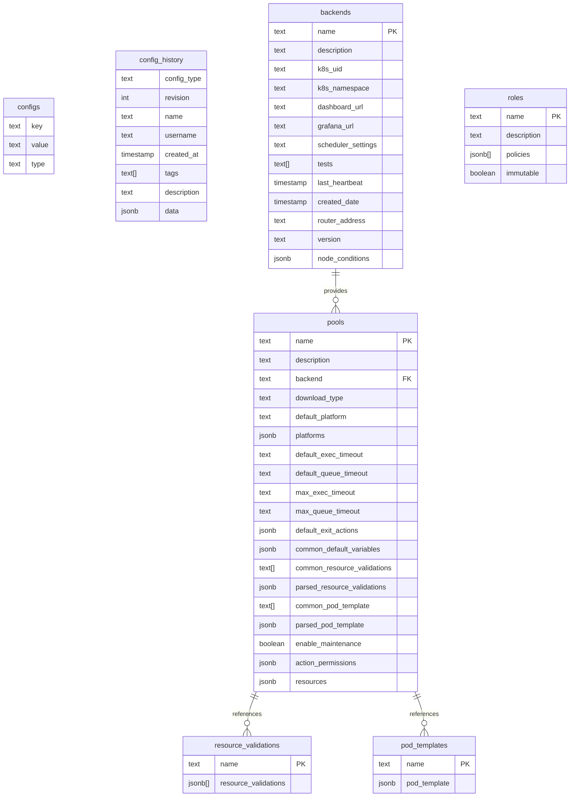
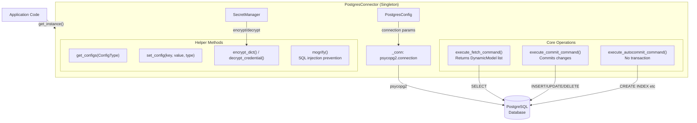

<!-- source: DeepWiki mcp.deepwiki.com · repo NVIDIA/OSMO · page 4.1 PostgreSQL Database Schema · fetched 2026-10-26 -->

# PostgreSQL Database Schema

<details>
<summary>Relevant source files</summary>

The following files were used as context for generating this wiki page:

- [src/lib/utils/common.py](src/lib/utils/common.py)
- [src/lib/utils/port_forward.py](src/lib/utils/port_forward.py)
- [src/lib/utils/tests/test_common.py](src/lib/utils/tests/test_common.py)
- [src/service/core/config/helpers.py](src/service/core/config/helpers.py)
- [src/service/core/data/data_service.py](src/service/core/data/data_service.py)
- [src/service/logger/ctrl_websocket.py](src/service/logger/ctrl_websocket.py)
- [src/service/router/router.py](src/service/router/router.py)
- [src/utils/connectors/postgres.py](src/utils/connectors/postgres.py)
- [src/utils/job/kb_objects.py](src/utils/job/kb_objects.py)
- [src/utils/job/task.py](src/utils/job/task.py)

</details>


This document describes the complete PostgreSQL database schema used by OSMO for storing workflow execution state, configuration, datasets, credentials, and system metadata. The schema is defined and initialized in [src/utils/connectors/postgres.py:531-1015]().

For information about dataset management operations and versioning, see [Dataset Management](#4.2). For configuration types and their usage, see [Configuration Management](#4.3).

---

## Overview

The PostgreSQL database serves as the primary persistent storage layer for OSMO's control plane. It stores:

- **Workflow execution state**: Workflows, groups, tasks, and their execution metrics
- **Configuration data**: Service configs, backend definitions, pools, and resource templates
- **Dataset metadata**: Dataset versions, tags, collections, and storage locations
- **Security data**: User credentials, access tokens, encryption keys, and roles
- **Application metadata**: App definitions and versions
- **Resource tracking**: Backend cluster resources and their availability

The database is accessed through the `PostgresConnector` singleton class, which provides connection management, transaction handling, and automatic retry logic. All tables are created and initialized in the `_init_tables` method on first startup.

**Sources:** [src/utils/connectors/postgres.py:215-276](), [src/utils/connectors/postgres.py:531-1015]()

---

## Core Workflow Execution Tables

These tables track the lifecycle and execution state of workflows, from submission through completion.

### Entity Relationship Diagram

```mermaid
erDiagram
    workflows ||--o{ workflow_tags : "has"
    workflows ||--o{ groups : "contains"
    groups ||--o{ tasks : "contains"
    tasks ||--o{ task_io : "performs"
    workflows ||--o{ apps : "executes"
    apps ||--o{ app_versions : "has"
    
    workflows {
        text workflow_uuid PK
        text workflow_name
        int job_id
        text workflow_id UK
        text submitted_by
        text cancelled_by
        text logs
        text events
        timestamp submit_time
        timestamp start_time
        timestamp end_time
        int exec_timeout
        int queue_timeout
        text backend
        text pool
        int version
        text outputs
        text status
        text failure_message
        text parent_name
        text parent_job_id
        text app_uuid
        int app_version
        jsonb plugins
        text priority
    }
    
    workflow_tags {
        text workflow_uuid FK
        text tag
    }
    
    groups {
        text group_uuid PK
        text workflow_id FK
        text name
        jsonb spec
        text status
        text failure_message
        timestamp processing_start_time
        timestamp scheduling_start_time
        timestamp initializing_start_time
        timestamp start_time
        timestamp end_time
        hstore remaining_upstream_groups
        hstore downstream_groups
        text outputs
        boolean cleaned_up
        text scheduler_settings
    }
    
    tasks {
        text task_db_key PK
        text workflow_id FK
        text name
        int retry_id
        text task_uuid
        text group_name
        text status
        text failure_message
        int exit_code
        timestamp scheduling_start_time
        timestamp initializing_start_time
        timestamp start_time
        timestamp end_time
        timestamp input_download_start_time
        timestamp input_download_end_time
        timestamp output_upload_start_time
        timestamp output_upload_end_time
        timestamp last_heartbeat
        text node_name
        float gpu_count
        float cpu_count
        float disk_count
        float memory_count
        jsonb exit_actions
        boolean lead
        bytea refresh_token
        text pod_name
        text pod_ip
    }
    
    task_io {
        text uuid PK
        text workflow_id
        text group_name
        text task_name
        int retry_id
        text url
        text type
        text storage_bucket
        timestamp start_time
        timestamp end_time
        float size
        text operation_type
        text download_type
        int number_of_files
    }
```



**Sources:** [src/utils/connectors/postgres.py:632-786]()

### workflows Table

The `workflows` table stores the top-level metadata and state for each submitted workflow.

**Key Fields:**
- `workflow_uuid` (PK): Unique identifier for the workflow instance
- `workflow_id` (UK): Human-readable ID in format `{name}-{job_id}`
- `workflow_name`, `job_id` (UK): Composite unique constraint ensuring job numbering per workflow name
- `status`: Current execution status (see `TaskGroupStatus` enum)
- `backend`, `pool`: Target execution environment
- `logs`, `events`: Redis stream keys for runtime logs and events
- `app_uuid`, `app_version`: Optional link to app definition
- `priority`: Workflow scheduling priority (NORMAL, HIGH, LOW)

**Indexes:**
- `workflow_list_index`: Optimizes listing by `(submitted_by, pool, status, submit_time)`
- `workflow_list_index_pool_status`: Optimizes queries by `(pool, status, submit_time)`

**Sources:** [src/utils/connectors/postgres.py:632-680]()

### groups Table

The `groups` table represents task groups within a workflow. Groups enable gang scheduling and coordinated execution of related tasks.

**Key Fields:**
- `group_uuid` (PK): Unique identifier for the group
- `workflow_id`, `name` (UK): Composite unique constraint per workflow
- `spec`: JSONB containing the complete group specification
- `remaining_upstream_groups`, `downstream_groups`: HSTORE tracking dependency graph
- `scheduler_settings`: Scheduler-specific configuration (e.g., KAI PodGroup settings)

Groups transition through statuses defined in `TaskGroupStatus`: SUBMITTING → WAITING → PROCESSING → SCHEDULING → INITIALIZING → RUNNING → COMPLETED/FAILED.

**Sources:** [src/utils/connectors/postgres.py:693-715]()

### tasks Table

The `tasks` table stores individual task execution records within groups. Tasks may be retried, creating multiple rows per task name with different `retry_id` values.

**Key Fields:**
- `task_db_key` (PK): Unique identifier for this task retry instance
- `task_uuid`, `retry_id` (UK): Composite unique constraint
- `workflow_id`, `retry_id`, `name` (UK): Composite unique constraint per workflow
- `group_name`: Foreign key reference to parent group
- `lead`: Boolean indicating if this is the lead task in a distributed group
- `pod_name`, `pod_ip`: Kubernetes pod information
- `*_start_time`, `*_end_time`: Detailed timing for each execution phase
- `*_count`: Resource allocation tracking (gpu, cpu, memory, disk)
- `last_heartbeat`: Timestamp of last task activity
- `refresh_token`: Encrypted token for task authentication

**Indexes:**
- `tasks_status_id_name`: Unique index on `(status, workflow_id, retry_id, name)`

**Sources:** [src/utils/connectors/postgres.py:718-764]()

### task_io Table

The `task_io` table records input/output operations performed by tasks, including downloads, uploads, and data transfers.

**Key Fields:**
- `uuid` (PK): Unique identifier for the I/O operation
- `type`: INPUT or OUTPUT
- `operation_type`: DOWNLOAD or UPLOAD
- `download_type`: Method used (download, mount, etc.)
- `url`, `storage_bucket`: Source/destination storage location
- `size`: Size in GiB
- `number_of_files`: Count of files transferred

This table is populated by the logger service when tasks report I/O metrics via websocket.

**Sources:** [src/utils/connectors/postgres.py:767-786](), [src/service/logger/ctrl_websocket.py:72-90]()

---

## Configuration Management Tables

These tables store system configuration, backend definitions, resource pools, and configuration history for audit and rollback.

### Configuration Tables Overview



**Sources:** [src/utils/connectors/postgres.py:538-629](), [src/utils/connectors/postgres.py:1004-1015]()

### configs Table

The `configs` table stores dynamic configuration key-value pairs for three configuration types: SERVICE, WORKFLOW, and DATASET.

**Structure:**
- `key`, `type` (PK): Composite primary key
- `value`: String representation of config value (may be JSON for complex types)

Configuration types are defined in the `ConfigType` enum and correspond to Pydantic model classes:
- `ServiceConfig`: API service settings, image locations, timeouts
- `WorkflowConfig`: Default workflow parameters, resource limits
- `DatasetConfig`: Bucket configurations, storage backends

The `get_configs()` method deserializes string values back to their typed Pydantic models based on type hints.

**Sources:** [src/utils/connectors/postgres.py:69-86](), [src/utils/connectors/postgres.py:430-471](), [src/utils/connectors/postgres.py:538-546]()

### config_history Table

The `config_history` table provides audit trail and rollback capability for all configuration changes.

**Key Fields:**
- `config_type`, `revision` (PK): Composite primary key
- `name`: Specific config name (e.g., backend name, pool name) or empty for global configs
- `username`: User who made the change
- `tags`: User-defined tags for categorization
- `data`: JSONB snapshot of complete configuration at that revision

Supported configuration history types (from `ConfigHistoryType` enum): SERVICE, WORKFLOW, DATASET, BACKEND, POOL, POD_TEMPLATE, RESOURCE_VALIDATION, BACKEND_TEST, ROLE.

**Sources:** [src/utils/connectors/postgres.py:76-86](), [src/utils/connectors/postgres.py:1004-1015](), [src/service/core/config/helpers.py:106-114]()

### backends Table

The `backends` table defines compute backends (Kubernetes clusters) where workflows execute.

**Key Fields:**
- `name` (PK): Unique backend identifier
- `k8s_uid`, `k8s_namespace`: Kubernetes cluster and namespace identification
- `dashboard_url`, `grafana_url`: Monitoring endpoints
- `scheduler_settings`: JSON string containing scheduler type and configuration
- `tests`: Array of backend test names to run
- `last_heartbeat`: Timestamp of last backend operator heartbeat
- `node_conditions`: JSONB defining node readiness rules with prefix

The `scheduler_settings` field is parsed into a `BackendSchedulerSettings` object determining the scheduler type (e.g., KAI) and creating the appropriate `K8sObjectFactory`.

**Sources:** [src/utils/connectors/postgres.py:562-582](), [src/utils/job/kb_objects.py:481-488]()

### pools Table

The `pools` table defines resource pools within backends, grouping resources with common configuration.

**Key Fields:**
- `name` (PK): Unique pool identifier
- `backend`: Foreign key to backends table
- `platforms`: JSONB map of platform definitions (CPU/GPU types, allowed mounts, etc.)
- `default_platform`: Default platform if not specified in task
- `download_type`: Default data download method (download, mount)
- `*_timeout`: Default and maximum execution/queue timeouts
- `default_exit_actions`: JSONB defining exit code to action mappings
- `common_resource_validations`, `parsed_resource_validations`: Resource requirement validators
- `common_pod_template`, `parsed_pod_template`: Kubernetes pod template overlays
- `resources`: JSONB defining pool resource guarantees and limits

Pools are the target for workflow submission and determine available resources, platforms, and scheduling policies.

**Sources:** [src/utils/connectors/postgres.py:605-629]()

### resource_validations and pod_templates Tables

These tables store reusable configuration fragments that pools reference:

- `resource_validations`: Array of JSONB validation rules for task resource requests
- `pod_templates`: JSONB Kubernetes pod template overlays for customizing task pods

Pools reference these by name in their `common_resource_validations` and `common_pod_template` arrays, which are parsed and merged into `parsed_*` fields at pool fetch time.

**Sources:** [src/utils/connectors/postgres.py:585-602]()

### roles Table

The `roles` table defines RBAC roles with associated policies.

**Key Fields:**
- `name` (PK): Role name
- `description`: Human-readable description
- `policies`: Array of JSONB policy objects defining permissions
- `immutable`: Boolean indicating system-defined roles that cannot be modified

**Sources:** [src/utils/connectors/postgres.py:548-558]()

---

## Dataset and Storage Tables

These tables manage dataset metadata, versioning, tagging, and collections. Actual dataset content is stored in object storage; the database tracks only metadata and locations.

### Dataset Schema Diagram

```mermaid
erDiagram
    dataset ||--o{ dataset_version : "has"
    dataset_version ||--o{ dataset_tag : "tagged_with"
    dataset ||--o{ collection : "contains"
    collection }o--|| dataset_version : "references"
    
    dataset {
        text id PK
        text name UK_with_bucket
        text bucket UK_with_name
        text created_by
        timestamp created_date
        boolean is_collection
        jsonb labels
        text hash_location
        bigint hash_location_size
        int last_version
    }
    
    dataset_version {
        text dataset_id FK_PK
        text version_id PK
        text location
        text status
        text created_by
        timestamp created_date
        timestamp last_used
        timestamp last_updated
        bigint size
        text checksum
        jsonb metadata
        interval retention_policy
    }
    
    dataset_tag {
        text dataset_id FK_PK
        text tag PK
        text version_id FK
    }
    
    collection {
        text id FK_PK
        text dataset_id FK_PK
        text version_id FK
    }
```

**Sources:** [src/utils/connectors/postgres.py:879-945]()

### dataset Table

The `dataset` table stores top-level dataset metadata. A dataset can be either a regular dataset or a collection of other datasets.

**Key Fields:**
- `id` (PK): Unique UUID for the dataset
- `name`, `bucket` (UK): Dataset name within a bucket (unique constraint)
- `is_collection`: Boolean distinguishing collections from regular datasets
- `labels`: JSONB for user-defined metadata labels
- `hash_location`: S3/Azure path to content-addressable hash storage directory
- `hash_location_size`: Total size of all hashes in bytes
- `last_version`: Auto-incrementing version counter

The `hash_location` field points to the directory where deduplicated file chunks are stored by their ETag hash. This enables significant storage savings when files are shared across dataset versions.

**Sources:** [src/utils/connectors/postgres.py:879-895](), [src/service/core/data/data_service.py:63-76]()

### dataset_version Table

The `dataset_version` table tracks individual versions of datasets.

**Key Fields:**
- `dataset_id`, `version_id` (PK): Composite primary key
- `location`: S3/Azure path to manifest file (JSON mapping logical paths to hashes)
- `status`: PENDING, READY, or FAILED
- `size`: Total size in bytes
- `checksum`: Manifest checksum for integrity verification
- `metadata`: JSONB for version-specific metadata (description, etc.)
- `retention_policy`: PostgreSQL INTERVAL for automatic cleanup (default P3M = 3 months)
- `last_used`: Timestamp of last download/use

Versions are created with status PENDING during upload, then transitioned to READY when `upload_finish` is called. The manifest file at `location` contains the mapping of logical file paths to their content-addressable storage hashes.

**Sources:** [src/utils/connectors/postgres.py:898-915](), [src/service/core/data/data_service.py:229-358]()

### dataset_tag Table

The `dataset_tag` table provides named references to dataset versions. Tags enable symbolic references like "latest" or "v1.0" instead of numeric version IDs.

**Key Fields:**
- `dataset_id`, `tag` (PK): One tag per dataset
- `version_id`: Target version (ON UPDATE CASCADE, ON DELETE CASCADE)

The "latest" tag is automatically updated on each successful upload. Users can create additional custom tags. Tags can be moved between versions with ON CONFLICT DO UPDATE.

**Sources:** [src/utils/connectors/postgres.py:918-930](), [src/service/core/data/data_service.py:402-418]()

### collection Table

The `collection` table implements collections by referencing multiple dataset versions.

**Key Fields:**
- `id` (PK, FK to dataset): The collection's dataset ID
- `dataset_id`, `version_id` (FK to dataset_version): Referenced dataset version

A collection is a dataset where `is_collection=true` that references other datasets. Collections cannot contain other collections (enforced in application logic). Each dataset can appear only once in a collection (by dataset_id).

**Sources:** [src/utils/connectors/postgres.py:933-945](), [src/service/core/data/data_service.py:421-482]()

---

## Authentication and Security Tables

These tables manage user credentials, access tokens, encryption keys, and user profiles.

### Security Tables Overview

```mermaid
erDiagram
    credential {
        text user_name PK
        text cred_name PK
        text cred_type
        text profile UK_with_user
        hstore payload
    }
    
    access_token {
        text user_name PK
        text token_name PK
        text access_type PK
        bytea access_token UK
        timestamp expires_at
        text description
        text[] roles
    }
    
    profile {
        text user_name PK
        boolean slack_notification
        boolean email_notification
        text bucket
        text pool
    }
    
    ueks {
        text uid PK
        hstore keys
    }
    
    credential ||--o{ profile : "for_user"
    access_token ||--o{ profile : "for_user"
```

**Sources:** [src/utils/connectors/postgres.py:853-1001]()

### credential Table

The `credential` table stores encrypted user credentials for registries and storage backends.

**Key Fields:**
- `user_name`, `cred_name` (PK): Composite primary key
- `cred_type`: GENERIC, REGISTRY, or DATA (enum `CredentialType`)
- `profile`: Profile name (unique per user for automatic lookup)
- `payload`: HSTORE containing encrypted credential fields

The `payload` field uses PostgreSQL's HSTORE type to store arbitrary key-value pairs. Values are encrypted using JWE with the user's User Encryption Key (UEK). The `decrypt_credential` method in [src/utils/connectors/postgres.py:475-500]() handles decryption and automatic re-encryption when keys are rotated.

**Sources:** [src/utils/connectors/postgres.py:62-67](), [src/utils/connectors/postgres.py:961-972](), [src/utils/connectors/postgres.py:475-500]()

### access_token Table

The `access_token` table stores API access tokens for programmatic access.

**Key Fields:**
- `user_name`, `token_name`, `access_type` (PK): Composite primary key
- `access_token` (UK): Encrypted token bytes (unique)
- `expires_at`: Expiration timestamp
- `roles`: Array of role names assigned to this token
- `description`: User-provided description

Access tokens are generated via the API and used for CLI authentication. The `access_type` field distinguishes between different token types (e.g., personal vs service tokens).

**Sources:** [src/utils/connectors/postgres.py:975-988]()

### profile Table

The `profile` table stores user preferences and default settings.

**Key Fields:**
- `user_name` (PK): User identifier
- `slack_notification`, `email_notification`: Notification preferences
- `bucket`: Default dataset bucket
- `pool`: Default execution pool

Profiles are automatically created on first user activity and referenced when applying user-specific defaults.

**Sources:** [src/utils/connectors/postgres.py:991-1001]()

### ueks Table

The `ueks` table stores User Encryption Keys in HSTORE format, where keys are key IDs and values are encrypted UEKs.

**Structure:**
- `uid` (PK): User identifier
- `keys`: HSTORE of `{kid: encrypted_uek}`

UEKs are used to encrypt user credentials and are themselves encrypted with the Master Encryption Key (MEK). The SecretManager class handles UEK rotation and credential re-encryption.

**Sources:** [src/utils/connectors/postgres.py:853-860](), [src/utils/secret_manager.py]()

---

## Application Management Tables

These tables support the app publishing and execution feature, allowing users to package and version workflow templates.

### Application Tables

```mermaid
erDiagram
    apps ||--o{ app_versions : "has"
    apps ||--o{ workflows : "executes"
    
    apps {
        text uuid PK
        text name UK
        text owner
        timestamp created_date
        text description
    }
    
    app_versions {
        text uuid FK_PK
        int version PK
        text created_by
        timestamp created_date
        text status
        text uri
    }
```

**Sources:** [src/utils/connectors/postgres.py:789-817]()

### apps Table

The `apps` table stores application definitions.

**Key Fields:**
- `uuid` (PK): Unique application identifier
- `name` (UK): Human-readable unique name
- `owner`: User who owns the application
- `description`: Application description

Applications are created through the API and can be versioned. Each workflow can optionally reference an app for tracking and discovery.

**Sources:** [src/utils/connectors/postgres.py:789-800]()

### app_versions Table

The `app_versions` table tracks versions of published applications.

**Key Fields:**
- `uuid`, `version` (PK): Composite primary key
- `uri`: Storage location of workflow template YAML
- `status`: Publishing status (DRAFT, PUBLISHED, ARCHIVED)
- Foreign key to apps with ON DELETE CASCADE

App versions are created when users publish workflow templates. The `uri` field points to the stored workflow YAML in object storage.

**Sources:** [src/utils/connectors/postgres.py:803-817]()

---

## Resource Management Tables

These tables track backend cluster resources and their allocation to pools and platforms.

### Resource Tables Diagram

```mermaid
erDiagram
    backends ||--o{ resources : "provides"
    resources ||--o{ resource_platforms : "categorized_by"
    pools ||--o{ resource_platforms : "maps_to"
    
    resources {
        text name PK
        text backend PK_FK
        boolean available
        hstore allocatable_fields
        hstore label_fields
        jsonb[] taints
        hstore usage_fields
        hstore non_workflow_usage_fields
        text[] conditions
    }
    
    resource_platforms {
        text resource_name FK_PK
        text backend FK_PK
        text pool FK_PK
        text platform PK
    }
```

**Sources:** [src/utils/connectors/postgres.py:820-850]()

### resources Table

The `resources` table stores information about individual nodes in backend clusters.

**Key Fields:**
- `name`, `backend` (PK): Composite primary key (node name within backend)
- `available`: Boolean indicating if node is available for scheduling
- `allocatable_fields`: HSTORE of allocatable resources (cpu, memory, gpu, storage)
- `label_fields`: HSTORE of Kubernetes node labels
- `taints`: Array of JSONB taints affecting scheduling
- `usage_fields`, `non_workflow_usage_fields`: HSTORE tracking resource usage
- `conditions`: Array of node condition strings

This table is populated and updated by the backend operator's agent service as it monitors the Kubernetes cluster. Resources are checked for updates every heartbeat interval.

**Sources:** [src/utils/connectors/postgres.py:820-834]()

### resource_platforms Table

The `resource_platforms` table maps individual resources (nodes) to pools and platforms.

**Key Fields:**
- `resource_name`, `backend`, `pool`, `platform` (PK): Composite primary key
- Foreign keys to resources(name, backend) with ON UPDATE CASCADE, ON DELETE CASCADE

This table determines which resources are available for which platform within each pool. When a workflow specifies a platform, only resources in this mapping are considered for scheduling.

**Sources:** [src/utils/connectors/postgres.py:837-850]()

---

## Database Connection and Operations

### PostgresConnector Class

The `PostgresConnector` class provides a singleton interface to the PostgreSQL database with automatic connection management and retry logic.



**Sources:** [src/utils/connectors/postgres.py:215-276](), [src/utils/connectors/postgres.py:281-364]()

### Retry Decorator

The `@retry` decorator automatically retries database operations on transient failures:

```python
@retry(func=None, *, reconnect: bool = True)
```

The decorator catches `psycopg2.InterfaceError` and `psycopg2.DatabaseError`, automatically reconnects (if `reconnect=True`), and retries up to `postgres_reconnect_retry` times (default 5). All core database methods use this decorator.

**Sources:** [src/utils/connectors/postgres.py:187-213]()

### Transaction Patterns

**Read Operations:**
- Use `execute_fetch_command()` with RealDictCursor
- Returns list of Pydantic DynamicModel objects (or raw dicts if `return_raw=True`)
- Automatically commits after fetch
- Example: [src/utils/connectors/postgres.py:281-331]()

**Write Operations:**
- Use `execute_commit_command()` for INSERT/UPDATE/DELETE
- Automatically commits on success, rolls back on error
- Example: [src/utils/connectors/postgres.py:333-363]()

**DDL Operations:**
- Use `execute_autocommit_command()` for CREATE INDEX CONCURRENTLY, etc.
- Requires autocommit mode (no explicit BEGIN/COMMIT)
- Example: [src/utils/connectors/postgres.py:365-404]()

**Bulk Inserts:**
- Use `mogrify()` to safely construct multi-row INSERT statements
- Prevents SQL injection while avoiding N+1 query problems
- Example: [src/utils/connectors/postgres.py:406-428]()

**Sources:** [src/utils/connectors/postgres.py:281-428]()

---

## Key Database Operations by Service

### API Service Operations

The API service performs the majority of database interactions:

**Workflow Submission:**
1. Create workflow row with SUBMITTING status
2. Insert groups with WAITING status and dependency tracking (remaining_upstream_groups, downstream_groups)
3. Insert tasks with WAITING status
4. Create secrets, config maps, and file mounts for groups

**Workflow Queries:**
- List workflows with filters on user, pool, status (uses workflow_list_index)
- Fetch workflow details with related groups and tasks
- Update workflow status and timestamps

**Configuration Management:**
- Get/set configs by type (SERVICE, WORKFLOW, DATASET)
- Update backend, pool, resource_validation, pod_template tables
- Record changes in config_history for audit and rollback

**Sources:** [src/service/core/workflow](), [src/service/core/config/helpers.py]()

### Worker Service Operations

The worker service processes background jobs and updates workflow state:

**Task State Transitions:**
1. Poll for groups in WAITING status
2. Update to PROCESSING status
3. Send to backend operator queue
4. Backend updates to SCHEDULING → INITIALIZING → RUNNING
5. Worker updates to COMPLETED/FAILED based on task results

**Group Dependency Resolution:**
- Update remaining_upstream_groups as upstream groups complete
- Transition groups to PROCESSING when all dependencies satisfied

**Cleanup:**
- Mark groups as cleaned_up after pod deletion
- Clean up old logs from Redis
- Archive completed workflow data

**Sources:** [src/service/worker]()

### Agent Service Operations

The agent service updates backend resource information:

**Resource Updates:**
1. Fetch node information from Kubernetes API
2. Upsert rows in resources table (name, backend, allocatable_fields, label_fields, etc.)
3. Update resource_platforms mapping based on node labels and pool platform definitions
4. Update backend last_heartbeat timestamp

The agent runs continuously on each backend operator, pushing updates to the control plane database.

**Sources:** [src/service/agent]()

### Logger Service Operations

The logger service receives logs and metrics from tasks via websocket:

**Log Streaming:**
- Receive log messages from osmo-ctrl sidecar
- Mask credentials using credential values from database
- Write to Redis streams (workflow-level and task-level)
- Update task last_heartbeat timestamp

**Metrics Recording:**
- Receive task group metrics (timing for different phases)
- Insert rows into task_io table for I/O operations
- Update task resource usage counters

**Barrier Synchronization:**
- Add task to Redis set for barrier name
- Notify waiting tasks when barrier count reached
- Uses workflow total_timeout for expiration

**Sources:** [src/service/logger/ctrl_websocket.py:54-234]()

---

## Schema Initialization and Migrations

The database schema is initialized in `_init_tables()` method called from the PostgresConnector constructor:

1. **Extension Installation:** Enable `hstore` extension for key-value storage
2. **Table Creation:** Execute CREATE TABLE IF NOT EXISTS for all tables in dependency order
3. **Index Creation:** Create indexes using CONCURRENTLY to avoid locking
4. **Function Creation:** Create helper functions like `jsonb_recursive_merge`
5. **Config Initialization:** Call `_init_configs()` to populate default configs

**Index Creation Strategy:**
Indexes are created with `CREATE INDEX CONCURRENTLY IF NOT EXISTS` in autocommit mode to avoid blocking table access during index creation. The IF NOT EXISTS clause ensures idempotency.

**Schema Migration:**
Currently, schema changes require manual migration scripts. The `config_history` table provides a mechanism for configuration rollback but not schema rollback. Table additions are handled by IF NOT EXISTS, but column additions or type changes require ALTER TABLE statements.

**Sources:** [src/utils/connectors/postgres.py:531-1015](), [src/utils/connectors/postgres.py:263-269]()

---

## HSTORE Usage Patterns

PostgreSQL's HSTORE extension is used extensively for flexible key-value storage:

**Use Cases:**
1. **Credential Payloads:** Store arbitrary encrypted credential fields
2. **Resource Fields:** Store allocatable/usage resources with varying fields per backend
3. **Group Dependencies:** Track upstream/downstream group relationships
4. **User Encryption Keys:** Store multiple UEKs indexed by key ID

**Encoding/Decoding:**
- `encode_hstore(Dict) -> str`: Format dict as HSTORE string
- `decode_hstore(str) -> Dict`: Parse HSTORE string to dict

Both methods in [src/utils/connectors/postgres.py:514-524]() use regex to safely handle special characters in keys and values.

**Query Pattern:**
```sql
SELECT * FROM credential WHERE payload @> '"key"=>"value"'
UPDATE credential SET payload = payload || '"new_key"=>"new_value"'
```

**Sources:** [src/utils/connectors/postgres.py:514-524]()

---

## Summary Table: Tables by Functional Area

| Functional Area | Tables | Primary Purpose |
|----------------|--------|-----------------|
| **Workflow Execution** | workflows, workflow_tags, groups, tasks, task_io | Track workflow lifecycle from submission through execution |
| **Configuration** | configs, config_history, backends, pools, resource_validations, pod_templates, roles | Store system configuration with versioning and audit trail |
| **Datasets** | dataset, dataset_version, dataset_tag, collection | Manage dataset metadata, versioning, and collections |
| **Security** | credential, access_token, profile, ueks | Store encrypted credentials, tokens, and encryption keys |
| **Applications** | apps, app_versions | Manage published workflow templates |
| **Resources** | resources, resource_platforms | Track backend cluster resources and availability |

**Sources:** [src/utils/connectors/postgres.py:531-1015]()

---

