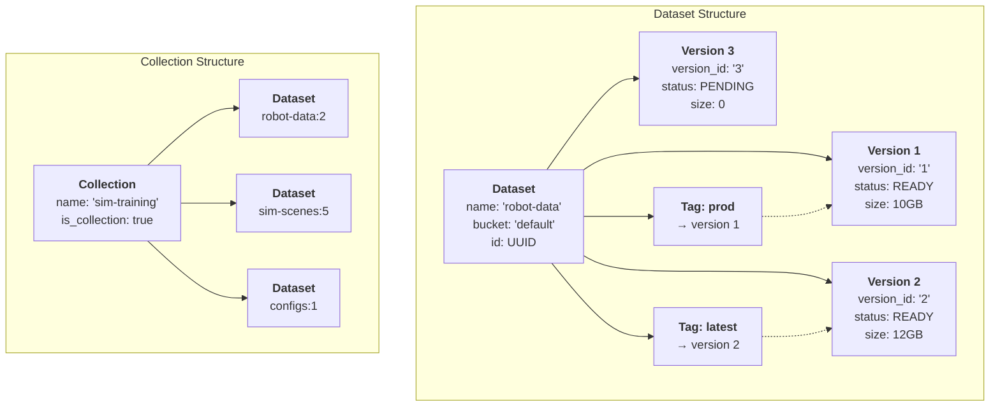
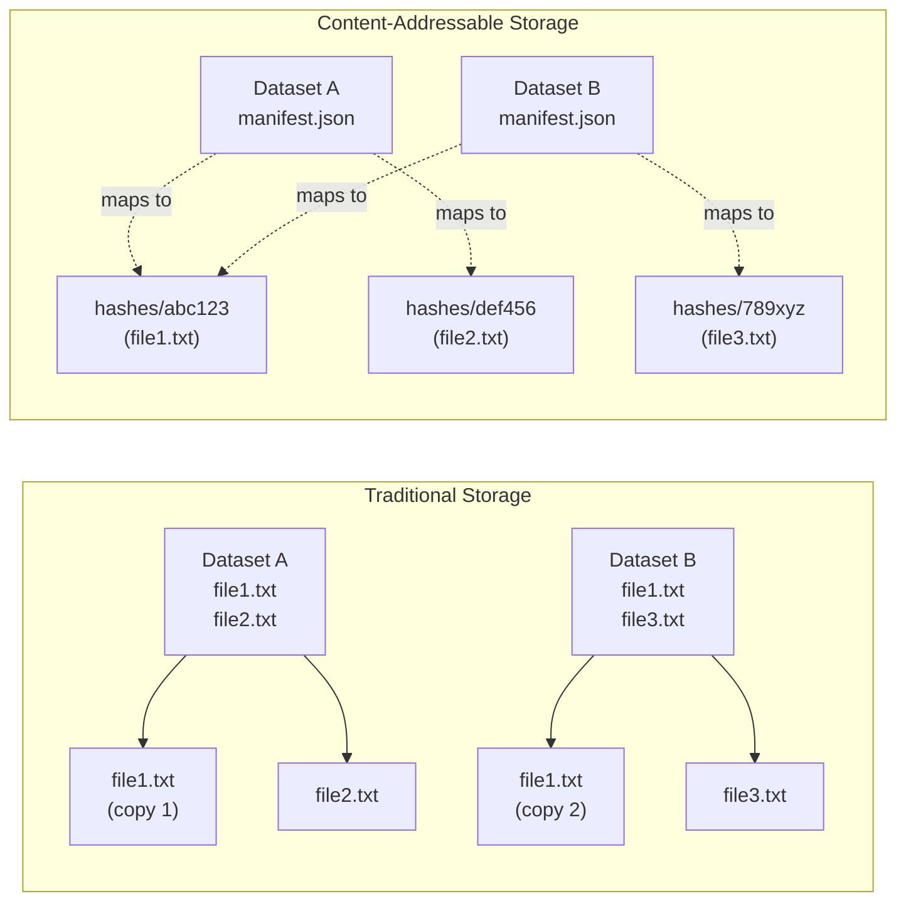
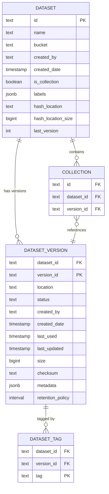
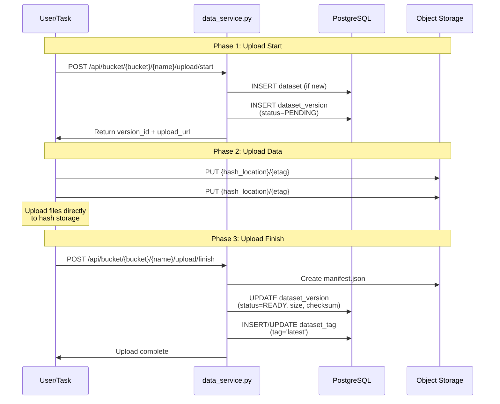
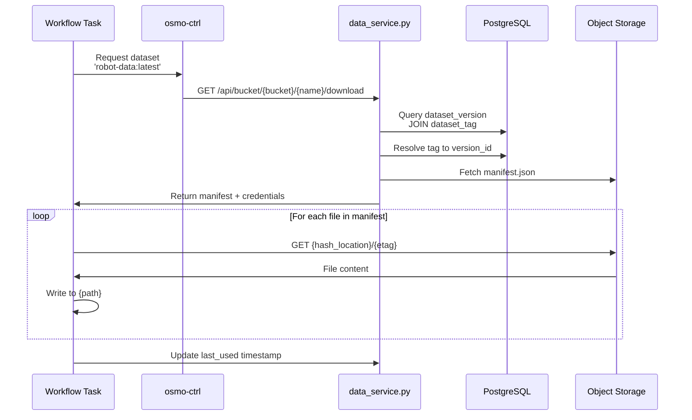
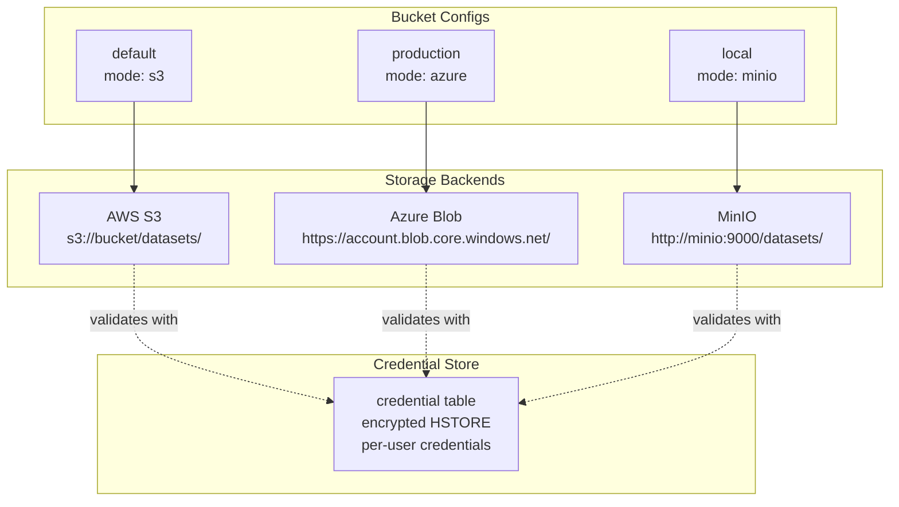
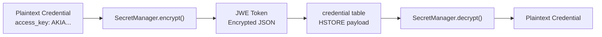
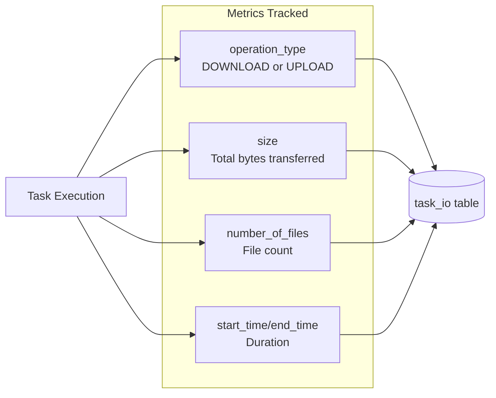

<!-- source: DeepWiki mcp.deepwiki.com · repo NVIDIA/OSMO · page 4.2 Dataset Management · fetched 2026-10-26 -->

# Dataset Management

<details>
<summary>Relevant source files</summary>

The following files were used as context for generating this wiki page:

- [.github/PULL_REQUEST_TEMPLATE.md](.github/PULL_REQUEST_TEMPLATE.md)
- [CONTRIBUTING.md](CONTRIBUTING.md)
- [README.md](README.md)
- [deployments/brev/README.md](deployments/brev/README.md)
- [deployments/brev/setup.sh](deployments/brev/setup.sh)
- [docs/deployment_guide/getting_started/create_storage/s3/index.rst](docs/deployment_guide/getting_started/create_storage/s3/index.rst)
- [src/lib/utils/common.py](src/lib/utils/common.py)
- [src/lib/utils/port_forward.py](src/lib/utils/port_forward.py)
- [src/lib/utils/tests/test_common.py](src/lib/utils/tests/test_common.py)
- [src/service/core/config/helpers.py](src/service/core/config/helpers.py)
- [src/service/core/data/data_service.py](src/service/core/data/data_service.py)
- [src/service/logger/ctrl_websocket.py](src/service/logger/ctrl_websocket.py)
- [src/service/router/router.py](src/service/router/router.py)
- [src/utils/connectors/postgres.py](src/utils/connectors/postgres.py)
- [src/utils/job/kb_objects.py](src/utils/job/kb_objects.py)
- [src/utils/job/task.py](src/utils/job/task.py)

</details>


This document explains OSMO's dataset management system, including content-addressable storage, versioning, deduplication, and the upload/download workflows. For information about configuring storage backends and credentials, see [Configuration Management](#4.3). For details on how datasets are used in workflows, see [Workflow Specification](#6.1).

## Overview

OSMO implements a content-addressable storage system that achieves **10-100x storage savings** through automatic deduplication. Datasets are versioned automatically, support tags for easy reference, and can be grouped into collections. The system supports multiple storage backends (AWS S3, MinIO, Azure Blob) with encrypted credential management.

**Key Features:**
- **Content-addressable storage**: Files are stored by their hash (ETag), enabling automatic deduplication across all datasets
- **Automatic versioning**: Each dataset upload creates a new version with an auto-incrementing `version_id`
- **Tags**: Friendly names (e.g., `latest`, `prod`, `v1.0`) that reference specific versions
- **Collections**: Logical groupings of multiple dataset versions
- **Multi-backend support**: S3, MinIO, Azure Blob, and LocalStack

**Sources:** [README.md:76](), [src/utils/connectors/postgres.py:878-945]()

---

## Core Concepts

### Datasets vs Collections



**Sources:** [src/utils/connectors/postgres.py:879-945](), [src/service/core/data/data_service.py:112-152]()

### Dataset Naming Convention

Datasets follow the pattern: `[bucket/]name[:tag]`

| Component | Required | Description | Example |
|-----------|----------|-------------|---------|
| `bucket` | No | Bucket configuration name | `default`, `production` |
| `name` | Yes | Dataset identifier | `robot-data`, `training-set` |
| `tag` | No | Version reference (defaults to `latest`) | `latest`, `v1.0`, `prod` |

**Name Validation Regex:**
- Standard: `[a-zA-Z0-9_-]+` ([src/lib/utils/common.py:71-73]())
- In workflow spec: `[a-zA-Z0-9_{}-]+` (allows Jinja template placeholders) ([src/lib/utils/common.py:80-86]())

**Full Pattern:**
```regex
^(?P<bucket>[a-zA-Z0-9_-]+/)?(?P<name>[a-zA-Z0-9_-]+)(:(?P<tag>[a-zA-Z0-9_-]*))?$
```

**Sources:** [src/lib/utils/common.py:70-86](), [src/lib/utils/common.py:176-213]()

---

## Content-Addressable Storage

### Deduplication Mechanism

OSMO stores files by their **ETag (hash)** rather than by their logical path. When multiple datasets contain the same file, only one copy is stored physically.



**Storage Structure:**
```
s3://bucket/
├── dataset-id/
│   ├── hashes/
│   │   ├── abc123...  # File content stored by ETag
│   │   ├── def456...
│   │   └── 789xyz...
│   └── manifests/
│       ├── 1.json     # Version 1 manifest
│       └── 2.json     # Version 2 manifest
```

**Sources:** [README.md:76](), [src/utils/connectors/postgres.py:879-895]()

### Manifest Files

Each dataset version has a **manifest file** that maps logical file paths to their storage hashes.

**Manifest Structure:**
```json
{
  "files": [
    {
      "path": "data/file1.txt",
      "etag": "abc123def456...",
      "size": 1024,
      "modified": "2025-01-15T10:30:00Z"
    },
    {
      "path": "data/file2.txt",
      "etag": "789xyz...",
      "size": 2048,
      "modified": "2025-01-15T10:31:00Z"
    }
  ],
  "metadata": {
    "created_by": "user@example.com",
    "description": "Training data batch 1"
  }
}
```

The manifest is stored at: `{dataset_id}/manifests/{version_id}.json`

**Sources:** [src/service/core/data/data_service.py:228-426](), [src/lib/data/storage/constants.py]()

---

## Database Schema

### Core Tables



**Key Fields:**

| Table | Field | Description |
|-------|-------|-------------|
| `dataset` | `id` | UUID for the dataset |
| `dataset` | `name` | Dataset name (unique per bucket) |
| `dataset` | `bucket` | Bucket configuration name |
| `dataset` | `hash_location` | S3 path to hash storage directory |
| `dataset` | `is_collection` | Boolean flag distinguishing collections |
| `dataset_version` | `version_id` | Auto-incrementing integer (as string) |
| `dataset_version` | `location` | S3 path to manifest file |
| `dataset_version` | `status` | `PENDING` or `READY` |
| `dataset_tag` | `tag` | Tag name (e.g., `latest`, `v1.0`) |

**Sources:** [src/utils/connectors/postgres.py:878-945]()

### Dataset Status States

| Status | Description |
|--------|-------------|
| `PENDING` | Upload initiated but not finalized |
| `READY` | Upload complete, dataset available for use |

Only `READY` datasets are returned by default in queries.

**Sources:** [src/service/core/data/objects.py](), [src/service/core/data/data_service.py:162-227]()

---

## Upload Flow

### Upload Lifecycle



### Upload Start Implementation

The `upload_start` function creates the database entries and returns upload credentials:

```python
# Key function: upload_start()
# Location: src/service/core/data/data_service.py:229-341

# Creates or fetches dataset record
# Generates new version_id (auto-increment)
# Sets status to PENDING
# Returns upload URL and credentials
```

**Parameters:**
- `bucket`: Bucket configuration name
- `name`: Dataset name
- `tag`: Optional tag (required for resume)
- `metadata`: Optional metadata JSON
- `resume`: Boolean flag to resume incomplete upload

**Response:**
```json
{
  "version": "3",
  "upload_url": "s3://bucket/dataset-id/hashes/",
  "credentials": {
    "access_key_id": "...",
    "secret_access_key": "..."
  }
}
```

**Sources:** [src/service/core/data/data_service.py:229-341]()

### Upload Finish Implementation

The `upload_finish` function validates the upload and marks the version as `READY`:

```python
# Key function: upload_finish()
# Location: src/service/core/data/data_service.py:343-426

# Validates all files are present
# Creates manifest file
# Updates dataset_version status to READY
# Updates 'latest' tag to point to new version
# Records total size and checksum
```

**Parameters:**
- `bucket`: Bucket configuration name
- `name`: Dataset name
- `version`: Version ID to finalize
- `tag`: Tag to assign (defaults to `latest`)
- `description`: Optional description

**Sources:** [src/service/core/data/data_service.py:343-426]()

---

## Download Flow

### Download Lifecycle



### Download Implementation

```python
# Key function: download_datasets()
# Location: src/service/core/data/data_service.py:428-586

# Resolves dataset name/tag to version
# Fetches manifest from storage
# Returns list of files with download URLs
# Updates last_used timestamp
```

**Query Parameters:**
- `bucket`: Bucket name
- `name`: Dataset name
- `tag`: Tag or version_id (defaults to `latest`)
- `regex`: Optional file path filter

**Response:**
```json
{
  "datasets": [
    {
      "name": "robot-data",
      "version": "2",
      "files": [
        {
          "path": "data/file1.txt",
          "url": "s3://bucket/dataset-id/hashes/abc123",
          "size": 1024,
          "etag": "abc123..."
        }
      ]
    }
  ]
}
```

**Sources:** [src/service/core/data/data_service.py:428-586]()

### Collection Download

When downloading a collection, OSMO returns manifests for all referenced datasets:

```python
# Key function: get_collection_info()
# Location: src/service/core/data/data_service.py:135-152

# Queries collection table for referenced datasets
# Returns array of dataset entries
# Each entry includes name, version, and location
```

**Sources:** [src/service/core/data/data_service.py:135-152]()

---

## Storage Backends

### Bucket Configuration

Buckets are configured via the `DatasetConfig` and define storage backend settings:

```yaml
buckets:
  default:
    mode: "s3"
    region: "us-west-2"
    dataset_path: "s3://my-bucket/datasets/"
    check_key: true
  
  production:
    mode: "azure"
    region: "eastus"
    dataset_path: "https://account.blob.core.windows.net/container/"
    check_key: true
```

**Configuration Fields:**

| Field | Type | Description |
|-------|------|-------------|
| `mode` | string | Storage type: `s3`, `azure`, or `minio` |
| `region` | string | Storage region |
| `dataset_path` | string | Base URI for dataset storage |
| `check_key` | boolean | Validate user credentials before upload/download |

**Sources:** [src/utils/connectors/postgres.py](), [docs/deployment_guide/getting_started/create_storage/s3/index.rst]()

### Storage Backend Mapping



**Sources:** [src/utils/connectors/postgres.py:948-1024](), [src/service/core/data/data_service.py:48-61]()

---

## Credentials and Security

### Credential Validation

When `check_key: true` in bucket configuration, OSMO validates user credentials before granting access:

```python
# Key function: validate_user_cred()
# Location: src/service/core/data/data_service.py:48-61

# Fetches user credentials from credential table
# Validates READ or WRITE permissions via storage backend
# Raises OSMOCredentialError if validation fails
```

**Access Types:**
- `AccessType.READ`: Download permissions
- `AccessType.WRITE`: Upload permissions

**Sources:** [src/service/core/data/data_service.py:48-61]()

### Encryption

Dataset credentials are encrypted using the Master Encryption Key (MEK):



**Encryption Process:**
1. User credentials stored in `credential` table with type `DATA`
2. Each credential value encrypted with user-specific User Encryption Key (UEK)
3. UEK encrypted with Master Encryption Key (MEK)
4. Encrypted values stored in HSTORE format

**Sources:** [src/utils/connectors/postgres.py:475-507](), [src/utils/secret_manager.py]()

---

## Dataset Operations in Workflows

### Workflow Input/Output Syntax

Datasets can be used as task inputs and outputs in workflow YAML:

```yaml
tasks:
  - name: generate-data
    image: my-image
    command: ["python", "generate.py"]
    outputs:
      - dataset:
          name: robot-data           # Dataset name
          path: /output/data         # Path in container
          labels: ["training"]       # Optional labels
          metadata: ["config.yaml"]  # Optional metadata files

  - name: train-model
    image: pytorch
    command: ["python", "train.py"]
    inputs:
      - dataset:
          name: robot-data:latest    # Dataset with tag
          localpath: /data/training  # Where to mount in container
          regex: "*.tfrecord"        # Optional file filter
```

**Dataset Input/Output Classes:**
- `DatasetInputOutput`: Defines dataset reference in workflow spec ([src/utils/job/task.py:309-404]())
- `UpdateDatasetOutput`: Appends to existing dataset ([src/utils/job/task.py:406-482]())

**Sources:** [src/utils/job/task.py:309-482](), [src/utils/job/task.py:594-609]()

### Task I/O Metrics

OSMO tracks dataset download/upload metrics for each task:



**Database Table:** `task_io` ([src/utils/connectors/postgres.py:766-786]())

**Metrics Collection:** [src/service/logger/ctrl_websocket.py:54-91]()

**Sources:** [src/utils/connectors/postgres.py:766-786](), [src/service/logger/ctrl_websocket.py:54-91]()

---

## API Endpoints

### Dataset Management Routes

| Method | Endpoint | Description |
|--------|----------|-------------|
| POST | `/api/bucket/{bucket}/{name}/upload/start` | Initiate dataset upload |
| POST | `/api/bucket/{bucket}/{name}/upload/finish` | Finalize dataset upload |
| GET | `/api/bucket/{bucket}/{name}/download` | Download dataset manifest |
| GET | `/api/bucket/{bucket}/{name}` | Get dataset information |
| GET | `/api/bucket/{bucket}` | List all datasets in bucket |
| DELETE | `/api/bucket/{bucket}/{name}` | Delete dataset version |
| POST | `/api/bucket/{bucket}/{name}/tag` | Add/update tag |
| DELETE | `/api/bucket/{bucket}/{name}/tag/{tag}` | Remove tag |

**Router Definition:** [src/service/core/data/data_service.py:36-39]()

**Sources:** [src/service/core/data/data_service.py:36-1058]()

### Query Functions

Helper functions for common queries:

| Function | Purpose | Location |
|----------|---------|----------|
| `get_dataset()` | Fetch dataset by name | [src/service/core/data/data_service.py:63-76]() |
| `get_dataset_version()` | Fetch specific version | [src/service/core/data/data_service.py:79-109]() |
| `get_dataset_info()` | Get version details | [src/service/core/data/data_service.py:155-227]() |
| `get_collection_datasets()` | Get collection members | [src/service/core/data/data_service.py:116-133]() |
| `is_collection()` | Check if name is collection | [src/service/core/data/data_service.py:112-114]() |

**Sources:** [src/service/core/data/data_service.py:63-227]()

---

## Summary

OSMO's dataset management system provides:

1. **Efficient Storage**: Content-addressable deduplication reduces storage by 10-100x
2. **Version Control**: Automatic versioning with friendly tags
3. **Flexibility**: Collections group related datasets
4. **Security**: Encrypted credentials with per-user access validation
5. **Integration**: Native workflow support for seamless data flow between tasks

For configuration details, see [Configuration Management](#4.3). For workflow integration, see [Workflow Specification](#6.1).

**Sources:** [README.md:73-77](), [src/service/core/data/data_service.py](), [src/utils/connectors/postgres.py:878-945]()

---

