<!-- source: DeepWiki mcp.deepwiki.com · repo NVIDIA/OSMO · page 4.3 Configuration Management · fetched 2026-10-26 -->

# Configuration Management

<details>
<summary>Relevant source files</summary>

The following files were used as context for generating this wiki page:

- [docs/deployment_guide/getting_started/deploy_service.rst](docs/deployment_guide/getting_started/deploy_service.rst)
- [docs/deployment_guide/install_backend/dependencies/dependencies.rst](docs/deployment_guide/install_backend/dependencies/dependencies.rst)
- [docs/deployment_guide/install_backend/deploy_backend.rst](docs/deployment_guide/install_backend/deploy_backend.rst)
- [docs/deployment_guide/install_backend/validate_osmo.rst](docs/deployment_guide/install_backend/validate_osmo.rst)
- [docs/deployment_guide/references/configs_definitions/index.rst](docs/deployment_guide/references/configs_definitions/index.rst)
- [docs/user_guide/tutorials/combination_workflows/index.rst](docs/user_guide/tutorials/combination_workflows/index.rst)
- [src/lib/utils/common.py](src/lib/utils/common.py)
- [src/lib/utils/port_forward.py](src/lib/utils/port_forward.py)
- [src/lib/utils/tests/test_common.py](src/lib/utils/tests/test_common.py)
- [src/service/core/config/helpers.py](src/service/core/config/helpers.py)
- [src/service/core/data/data_service.py](src/service/core/data/data_service.py)
- [src/service/logger/ctrl_websocket.py](src/service/logger/ctrl_websocket.py)
- [src/service/router/router.py](src/service/router/router.py)
- [src/utils/connectors/postgres.py](src/utils/connectors/postgres.py)
- [src/utils/job/kb_objects.py](src/utils/job/kb_objects.py)
- [src/utils/job/task.py](src/utils/job/task.py)

</details>


OSMO's configuration management system provides centralized storage, versioning, and access control for all system, workflow, backend, and dataset configurations. Configurations are stored in PostgreSQL with full history tracking, enabling rollback, auditing, and validation of configuration changes.

For information about workflow specification and templates, see [Workflow Specification](#6.1). For authentication and credential management, see [Credential Management and Encryption](#8.3).

## Overview

Configuration management in OSMO handles multiple configuration domains:

| Configuration Type | Purpose | Modifiable By |
|-------------------|---------|---------------|
| **SERVICE** | System-wide service settings (rate limits, timeouts, image locations) | Administrators |
| **WORKFLOW** | Default workflow execution parameters (timeouts, retry policies, resources) | Administrators |
| **DATASET** | Dataset storage backends and bucket configurations | Administrators |
| **BACKEND** | Compute backend definitions and scheduler settings | Administrators |
| **POOL** | Resource pool configurations for workload distribution | Administrators |
| **POD_TEMPLATE** | Kubernetes pod template customizations | Administrators |
| **RESOURCE_VALIDATION** | Resource request validation rules | Administrators |
| **ROLE** | User role and permission definitions | Administrators |

The system maintains a complete audit trail of all configuration changes with support for rollback to previous versions.

**Sources:** [src/utils/connectors/postgres.py:69-87](), [docs/deployment_guide/references/configs_definitions/index.rst:1-67]()

## Configuration Type Hierarchy

```mermaid
graph TB
    subgraph "Configuration Types"
        ConfigType["ConfigType enum<br/>(Active Configs)"]
        ConfigHistoryType["ConfigHistoryType enum<br/>(History Tracking)"]
    end
    
    subgraph "ConfigType Values"
        SERVICE_C["SERVICE<br/>System Settings"]
        WORKFLOW_C["WORKFLOW<br/>Execution Defaults"]
        DATASET_C["DATASET<br/>Storage Backends"]
    end
    
    subgraph "ConfigHistoryType Values"
        SERVICE_H["SERVICE"]
        WORKFLOW_H["WORKFLOW"]
        DATASET_H["DATASET"]
        BACKEND_H["BACKEND<br/>Compute Backends"]
        POOL_H["POOL<br/>Resource Pools"]
        POD_TEMPLATE_H["POD_TEMPLATE<br/>K8s Templates"]
        RESOURCE_VALIDATION_H["RESOURCE_VALIDATION<br/>Validation Rules"]
        BACKEND_TEST_H["BACKEND_TEST<br/>Test Definitions"]
        ROLE_H["ROLE<br/>User Permissions"]
    end
    
    ConfigType --> SERVICE_C
    ConfigType --> WORKFLOW_C
    ConfigType --> DATASET_C
    
    ConfigHistoryType --> SERVICE_H
    ConfigHistoryType --> WORKFLOW_H
    ConfigHistoryType --> DATASET_H
    ConfigHistoryType --> BACKEND_H
    ConfigHistoryType --> POOL_H
    ConfigHistoryType --> POD_TEMPLATE_H
    ConfigHistoryType --> RESOURCE_VALIDATION_H
    ConfigHistoryType --> BACKEND_TEST_H
    ConfigHistoryType --> ROLE_H
```

The `ConfigType` enum defines configurations that are stored in the `configs` table as key-value pairs, while `ConfigHistoryType` includes all configuration types that maintain version history in the `config_history` table.

**Sources:** [src/utils/connectors/postgres.py:69-87]()

## Database Schema

### Configs Table

The `configs` table stores current configuration values as key-value pairs:

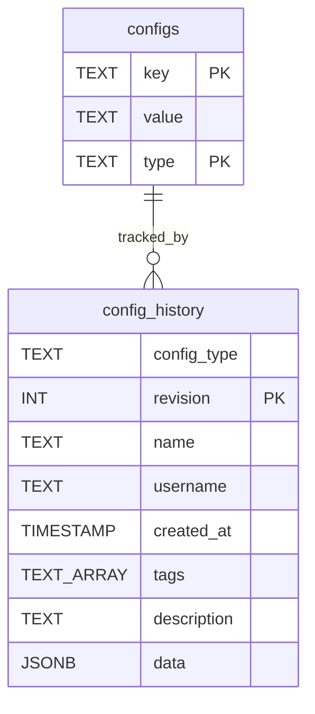

| Column | Type | Description |
|--------|------|-------------|
| `key` | TEXT | Configuration parameter name (e.g., `max_log_lines`, `default_pool`) |
| `value` | TEXT | Configuration value (strings, numbers, or JSON-encoded complex types) |
| `type` | TEXT | Configuration type from `ConfigType` enum |

The primary key is `(key, type)`, allowing multiple configuration types to have the same key names.

**Sources:** [src/utils/connectors/postgres.py:538-546]()

### Config History Table

The `config_history` table maintains a complete audit trail:

| Column | Type | Description |
|--------|------|-------------|
| `config_type` | TEXT | Type from `ConfigHistoryType` enum |
| `revision` | INT | Auto-incrementing version number per `(config_type, name)` |
| `name` | TEXT | Configuration name (empty for global configs) |
| `username` | TEXT | User who made the change |
| `created_at` | TIMESTAMP | When the change was made |
| `tags` | TEXT[] | Optional tags for categorizing changes |
| `description` | TEXT | Human-readable description of the change |
| `data` | JSONB | Complete snapshot of the configuration |

The primary key is `(config_type, name, revision)`, ensuring each configuration change is uniquely identified.

**Sources:** [src/utils/connectors/postgres.py:1004-1016]()

## Configuration Classes

### DynamicConfig Base Class

All configuration classes inherit from `DynamicConfig`:

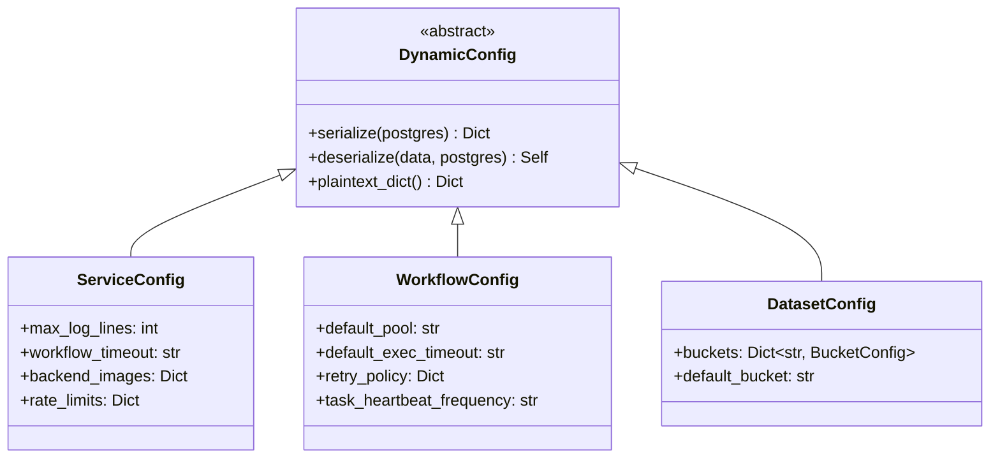

Key methods:

- **`serialize(postgres)`**: Converts configuration to database-storable format, encrypting sensitive values
- **`deserialize(data, postgres)`**: Reconstructs configuration from database, decrypting sensitive values
- **`plaintext_dict()`**: Returns configuration as plain dictionary for API responses

**Sources:** [src/utils/connectors/postgres.py:1162-1240]()

## Configuration Operations

### Reading Configurations

The `PostgresConnector.get_configs()` method retrieves configurations:

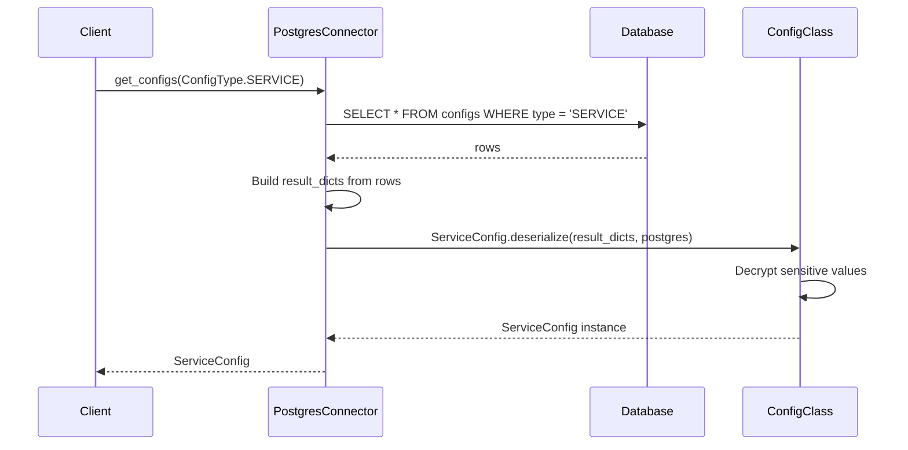

**Implementation Details:**

1. Query all key-value pairs for the specified configuration type
2. Parse values based on field type hints (primitives vs. JSON objects)
3. Deserialize using the appropriate configuration class
4. Decrypt any encrypted values using `SecretManager`

**Sources:** [src/utils/connectors/postgres.py:430-471]()

### Updating Configurations (PUT)

The `put_configs()` helper performs complete configuration replacement:

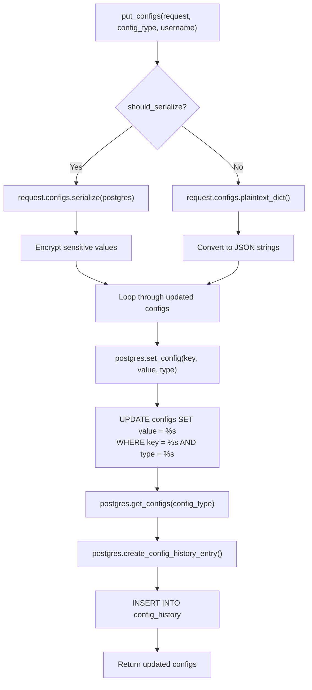

**Key Operations:**

1. **Serialize**: Encrypt credentials and convert complex types to JSON
2. **Update**: Execute SQL UPDATE for each changed key
3. **Snapshot**: Create history entry with complete configuration state
4. **Return**: Fetch and return updated configuration

**Sources:** [src/service/core/config/helpers.py:72-114](), [src/utils/connectors/postgres.py:509-512]()

### Patching Configurations (PATCH)

The `patch_configs()` helper performs partial updates using strategic merge:

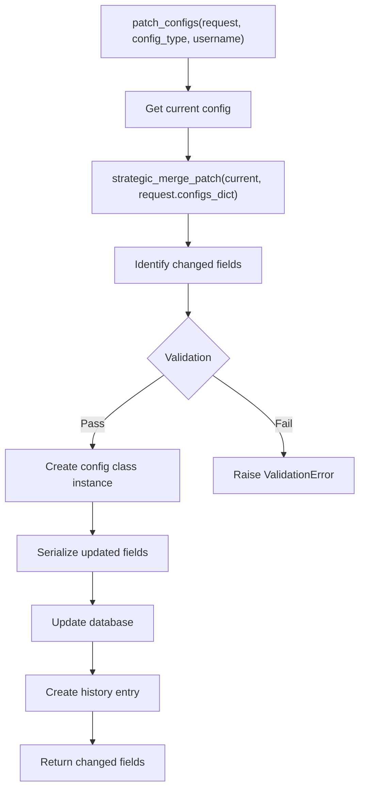

**Strategic Merge Behavior:**

- **Dictionaries**: Recursively merged, preserving unchanged keys
- **Lists**: Can be merged using custom merge functions
- **Primitives**: Replaced with new values

**Sources:** [src/service/core/config/helpers.py:117-193]()

## Configuration Versioning and Rollback

### History Entry Creation

Every configuration change creates a history entry:

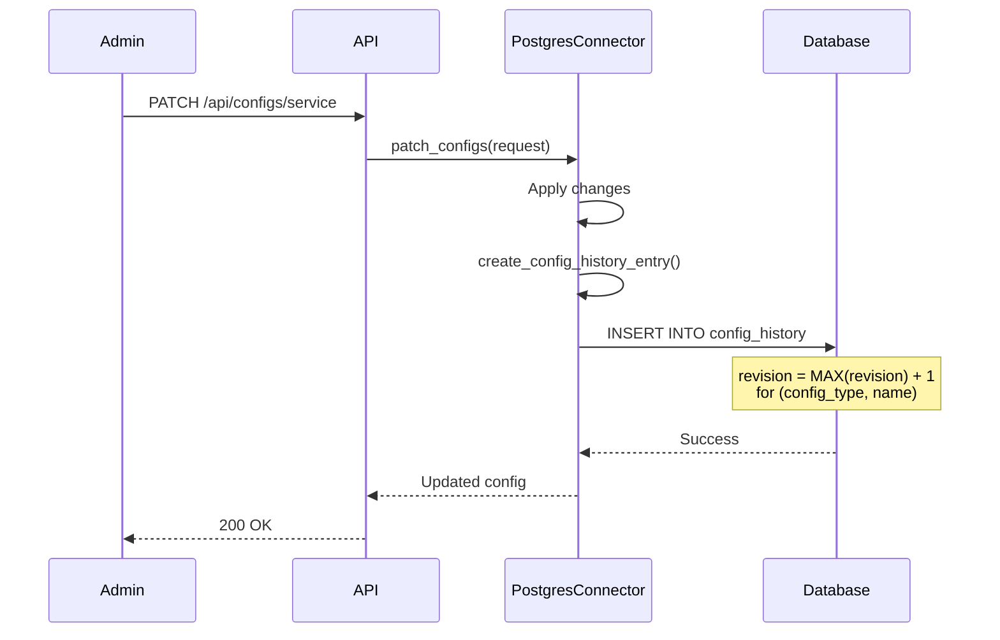

**History Entry Fields:**

- `revision`: Auto-incremented version number
- `username`: User who made the change (from `x-osmo-user` header)
- `created_at`: UTC timestamp
- `description`: User-provided or auto-generated description
- `tags`: Optional tags for filtering (e.g., `["production", "emergency-fix"]`)
- `data`: Complete configuration snapshot as JSONB

**Sources:** [src/utils/connectors/postgres.py:1264-1316]()

### Rollback Mechanism

To rollback, the system retrieves a previous revision and applies it as a new change:

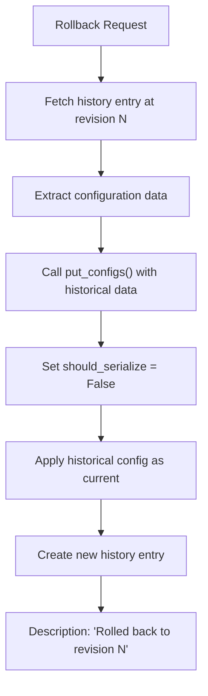

This approach ensures:
- Complete audit trail (rollback is a new history entry)
- No data loss (original history preserved)
- Idempotent operations (can rollback to same revision multiple times)

**Sources:** [src/service/core/config/helpers.py:72-114]()

## API Endpoints

### Configuration API Routes

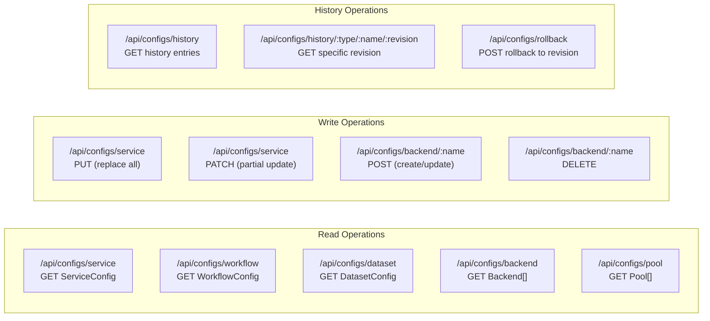

**Common Parameters:**

| Parameter | Type | Description |
|-----------|------|-------------|
| `description` | string | Human-readable change description |
| `tags` | string[] | Optional tags for categorization |
| `config_type` | enum | Configuration type from `ConfigHistoryType` |
| `name` | string | Configuration name (empty for global configs) |
| `revision` | integer | Version number for history queries |

**Sources:** [docs/deployment_guide/references/configs_definitions/index.rst:1-67]()

## Backend and Pool Configuration

Backend and pool configurations have special handling due to their complex relationships:

### Backend Configuration Flow

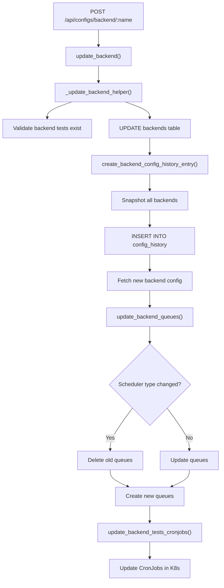

**Key Operations:**

1. **Validation**: Verify referenced tests exist in `backend_tests` table
2. **History**: Snapshot all backends together (not individual backends)
3. **Queue Sync**: Update Kubernetes queues (KAI scheduler) when backend changes
4. **Test CronJobs**: Update backend validation tests when test list changes

**Sources:** [src/service/core/config/helpers.py:277-320](), [src/service/core/config/helpers.py:35-70]()

### Pool Configuration Updates

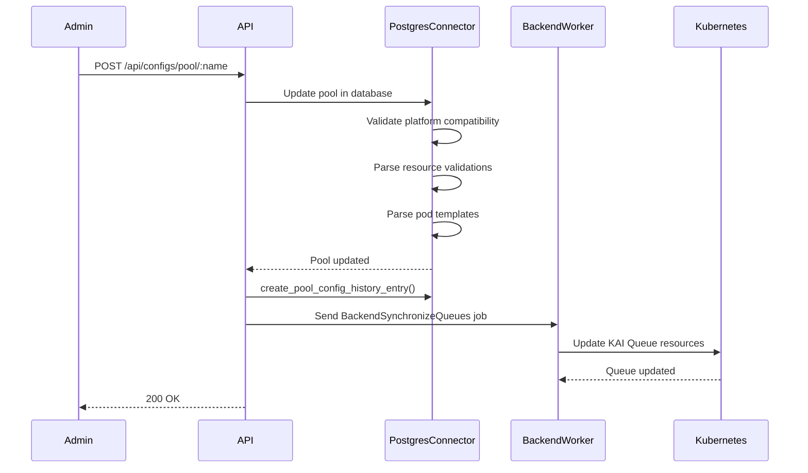

Pool updates trigger:
- Resource validation parsing and merging
- Pod template parsing and merging
- KAI Queue resource quota updates
- Platform and backend compatibility validation

**Sources:** [src/service/core/config/helpers.py:401-421](), [src/service/core/config/helpers.py:35-70]()

## Validation and Serialization

### Configuration Validation

Configurations are validated using Pydantic models:

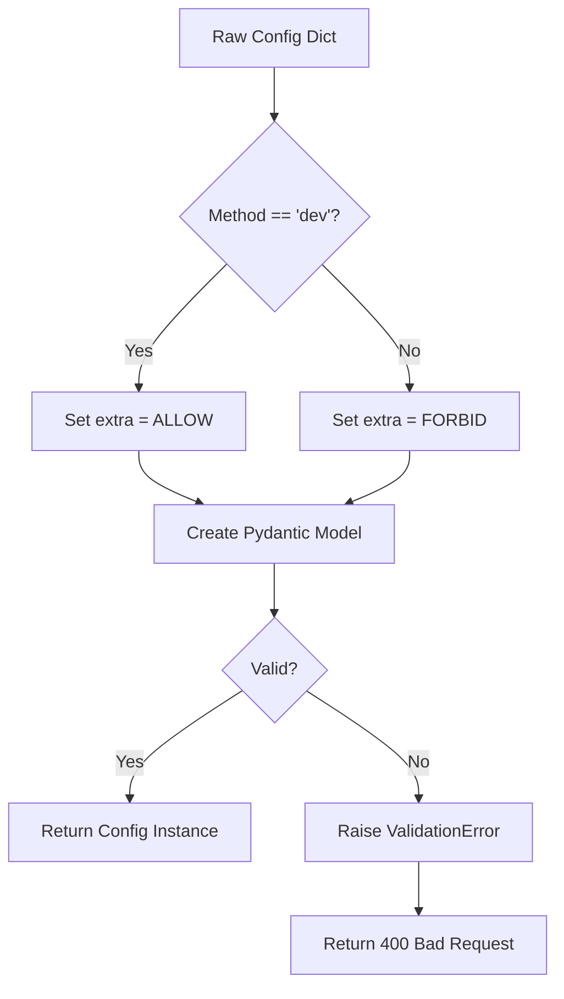

**Validation Rules:**

- **Field Types**: All fields must match type hints (str, int, timedelta, etc.)
- **Required Fields**: Fields without defaults must be provided
- **Extra Fields**: Rejected in production (`method != 'dev'`)
- **Custom Validators**: Pydantic `@validator` methods for complex rules

**Sources:** [src/service/core/config/helpers.py:149-173]()

### Encryption in Serialization

Sensitive configuration values are encrypted during serialization:

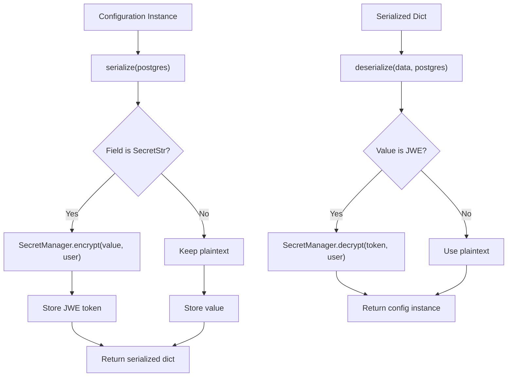

**Encryption Details:**

- Uses Master Encryption Key (MEK) from `mek.yaml`
- User-specific encryption keys (UEKs) for credential isolation
- JWE tokens stored in `configs.value` column
- Automatic key rotation support

**Sources:** [src/utils/connectors/postgres.py:1162-1240](), [src/utils/secret_manager.py]()

## Configuration Initialization

### Default Configuration Setup

On first startup, OSMO initializes default configurations:

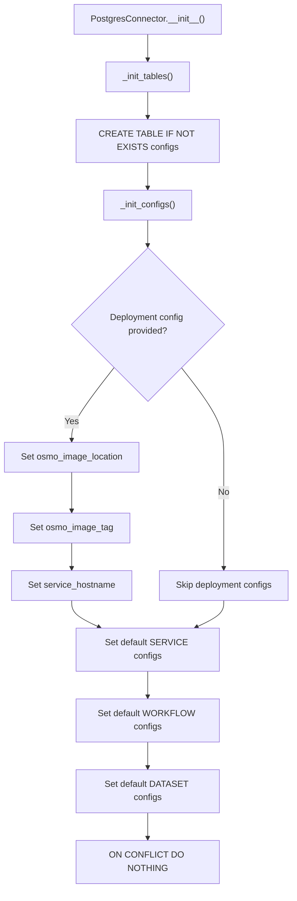

Default configurations are set using `INSERT ... ON CONFLICT DO NOTHING`, ensuring existing values are never overwritten during restarts.

**Deployment Configurations:**

When provided via command-line arguments or environment variables:
- `osmo_image_location`: Registry location for OSMO images
- `osmo_image_tag`: Image tag for version consistency
- `service_hostname`: Public hostname for URL generation

**Sources:** [src/utils/connectors/postgres.py:241-269](), [src/utils/connectors/postgres.py:531-546]()

## Usage Examples

### Retrieving Current Configuration

```python
from src.utils import connectors

postgres = connectors.PostgresConnector.get_instance()

# Get service configuration
service_config = postgres.get_service_configs()
print(f"Max log lines: {service_config.max_log_lines}")

# Get workflow configuration
workflow_config = postgres.get_workflow_configs()
print(f"Default pool: {workflow_config.default_pool}")

# Get dataset configuration
dataset_config = postgres.get_dataset_configs()
for bucket_name, bucket_config in dataset_config.buckets.items():
    print(f"Bucket {bucket_name}: {bucket_config.dataset_path}")
```

**Sources:** [src/utils/connectors/postgres.py:463-470]()

### Updating Configuration via API

```bash
# Patch service configuration (partial update)
curl -X PATCH https://osmo.example.com/api/configs/service \
  -H "Content-Type: application/json" \
  -d '{
    "max_log_lines": 5000,
    "description": "Increase log retention",
    "tags": ["performance", "logging"]
  }'

# Replace entire workflow configuration
curl -X PUT https://osmo.example.com/api/configs/workflow \
  -H "Content-Type: application/json" \
  -d '{
    "configs": {
      "default_pool": "high-priority",
      "default_exec_timeout": "2h"
    },
    "description": "Update default pool",
    "tags": ["pool-migration"]
  }'
```

**Sources:** [src/service/core/config/helpers.py:72-193]()

### Querying Configuration History

```bash
# List all configuration changes for SERVICE type
curl https://osmo.example.com/api/configs/history?config_type=SERVICE

# Get specific revision
curl https://osmo.example.com/api/configs/history/SERVICE//5

# Rollback to previous revision
curl -X POST https://osmo.example.com/api/configs/rollback \
  -H "Content-Type: application/json" \
  -d '{
    "config_type": "SERVICE",
    "name": "",
    "revision": 5,
    "description": "Emergency rollback due to rate limit issue"
  }'
```

**Sources:** [src/utils/connectors/postgres.py:1264-1316]()

## Best Practices

### Configuration Change Management

1. **Always provide descriptions**: Clear descriptions enable quick audit trail review
2. **Use tags consistently**: Establish tagging conventions (`production`, `testing`, `emergency`, etc.)
3. **Test in non-production**: Validate configuration changes in staging environments
4. **Review history before rollback**: Ensure rollback target matches expectations
5. **Document breaking changes**: Note any changes requiring workflow modifications

### Security Considerations

1. **Credential encryption**: All sensitive values use `SecretStr` type for automatic encryption
2. **Access control**: Configuration API endpoints require administrator role
3. **Audit logging**: All changes tracked with username and timestamp
4. **MEK rotation**: Plan for periodic Master Encryption Key rotation
5. **Backup history**: Regularly backup `config_history` table for disaster recovery

**Sources:** [src/utils/connectors/postgres.py:1162-1240](), [src/service/core/config/helpers.py:72-193]()

---

