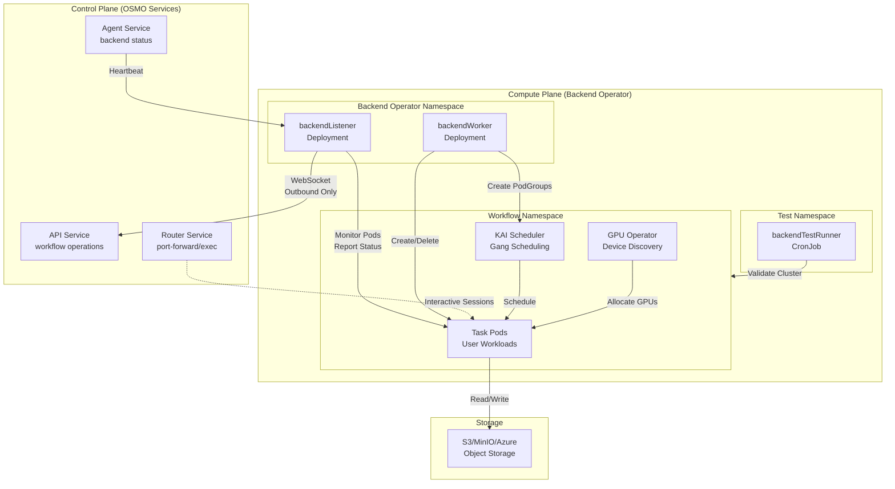
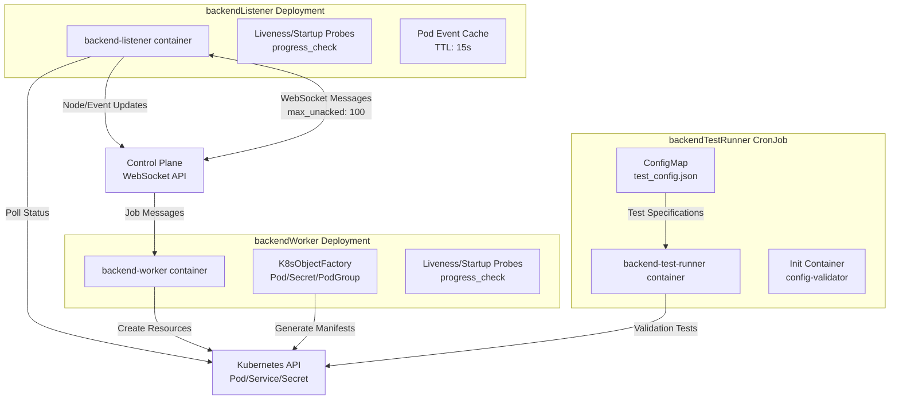
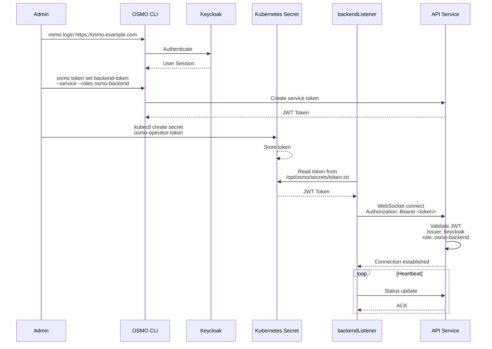
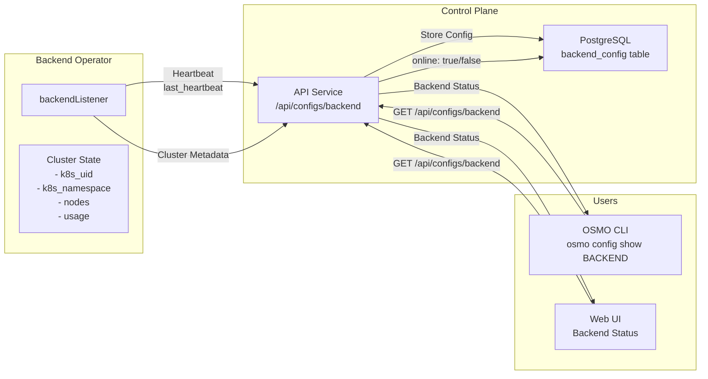
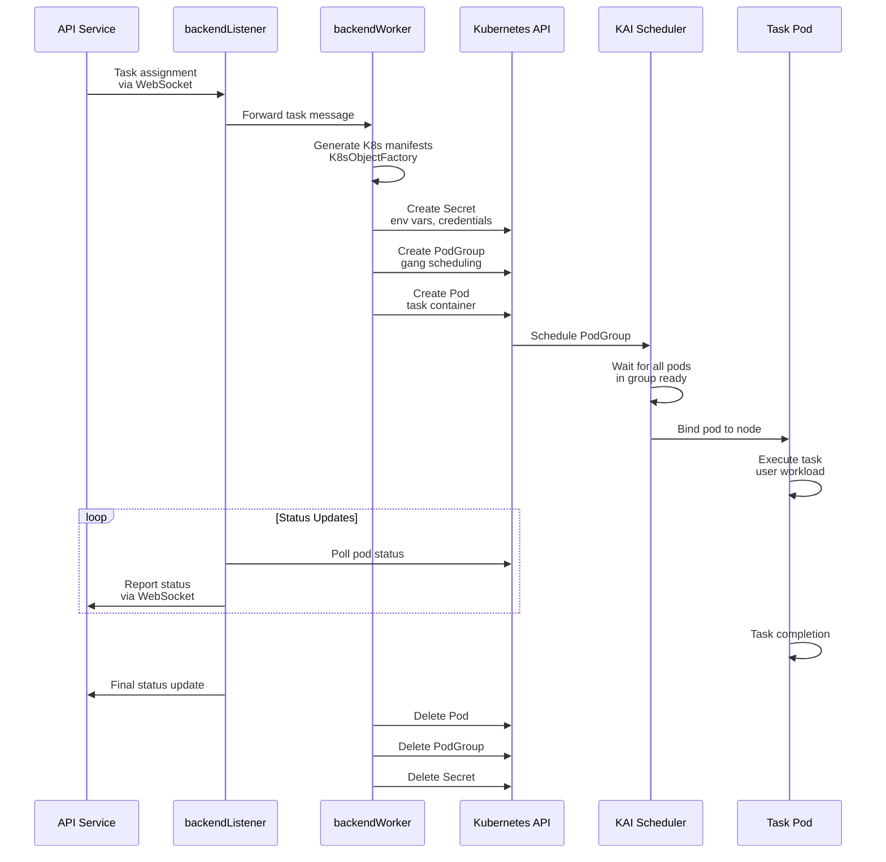
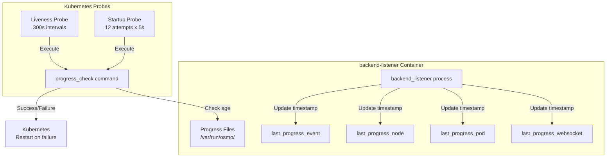
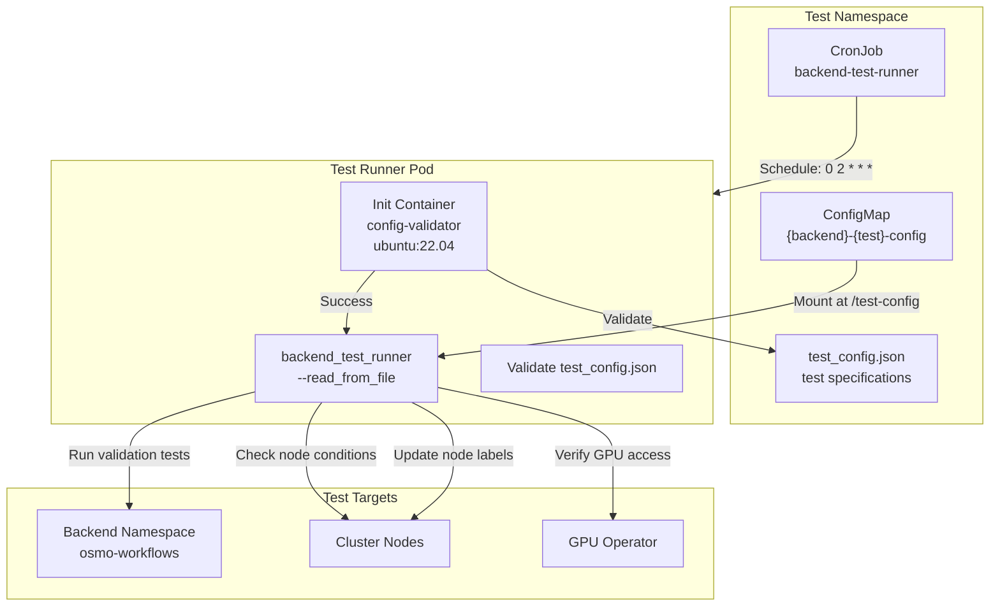
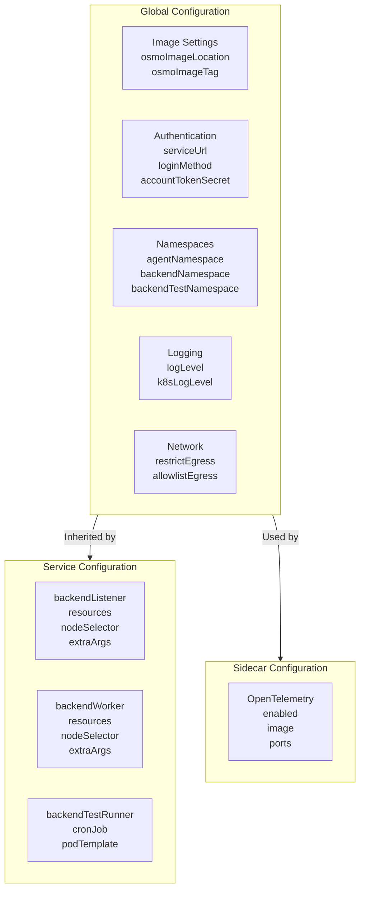

<!-- source: DeepWiki mcp.deepwiki.com · repo NVIDIA/OSMO · page 5 Backend Operators · fetched 2026-10-26 -->

# Backend Operators

<details>
<summary>Relevant source files</summary>

The following files were used as context for generating this wiki page:

- [deployments/charts/backend-operator/README.md](deployments/charts/backend-operator/README.md)
- [deployments/charts/backend-operator/templates/backend-listener.yaml](deployments/charts/backend-operator/templates/backend-listener.yaml)
- [deployments/charts/backend-operator/templates/backend-test-runner-config.yaml](deployments/charts/backend-operator/templates/backend-test-runner-config.yaml)
- [deployments/charts/backend-operator/templates/backend-test-runner-rbac.yaml](deployments/charts/backend-operator/templates/backend-test-runner-rbac.yaml)
- [deployments/charts/backend-operator/templates/backend-worker-rbac.yaml](deployments/charts/backend-operator/templates/backend-worker-rbac.yaml)
- [deployments/charts/backend-operator/values.yaml](deployments/charts/backend-operator/values.yaml)
- [docs/deployment_guide/getting_started/deploy_service.rst](docs/deployment_guide/getting_started/deploy_service.rst)
- [docs/deployment_guide/install_backend/dependencies/dependencies.rst](docs/deployment_guide/install_backend/dependencies/dependencies.rst)
- [docs/deployment_guide/install_backend/deploy_backend.rst](docs/deployment_guide/install_backend/deploy_backend.rst)
- [docs/deployment_guide/install_backend/validate_osmo.rst](docs/deployment_guide/install_backend/validate_osmo.rst)
- [docs/deployment_guide/references/configs_definitions/index.rst](docs/deployment_guide/references/configs_definitions/index.rst)
- [docs/user_guide/tutorials/combination_workflows/index.rst](docs/user_guide/tutorials/combination_workflows/index.rst)

</details>


Backend Operators are the compute plane components that connect Kubernetes clusters to the OSMO control plane, enabling workflow execution across diverse hardware environments. They handle resource registration, task execution, and cluster monitoring while maintaining outbound-only connections to overcome firewall restrictions.

**Scope**: This page provides an overview of Backend Operators, their architecture, and role in OSMO. For detailed information on specific topics, see:
- **Component architecture and implementation**: [Backend Operator Architecture](#5.1)
- **Deployment procedures and configuration**: [Deploying a Backend](#5.2)  
- **Scheduler integration and GPU management**: [KAI Scheduler and GPU Support](#5.3)

---

## Role in Control Plane / Compute Plane Architecture

Backend Operators implement the compute plane in OSMO's distributed architecture, solving the "Three Computer Problem" by orchestrating workloads across training GPUs (cloud), simulation hardware (on-prem), and edge devices (Jetson) from a single control plane.

### Backend Operator System Architecture



**Key Characteristics:**

| Aspect | Implementation |
|--------|---------------|
| **Connection Direction** | Outbound-only from backend to control plane |
| **Authentication** | Service tokens with role `osmo-backend` |
| **Communication Protocol** | WebSocket for bidirectional messaging |
| **Namespace Isolation** | Operator, workflow, and test namespaces separated |
| **Scalability** | Multiple backends can connect to single control plane |

**Sources:** [deployments/charts/backend-operator/values.yaml:17-170](), [docs/deployment_guide/install_backend/deploy_backend.rst:20-24]()

---

## Component Overview

Backend Operators consist of three primary components that work together to manage workflow execution on Kubernetes clusters.

### Backend Operator Components



### Component Responsibilities

| Component | Primary Responsibilities | Configuration Key |
|-----------|-------------------------|-------------------|
| **backendListener** | Poll cluster state<br/>Report pod/node events<br/>Monitor namespace usage<br/>Update node labels | `services.backendListener` |
| **backendWorker** | Execute workflow jobs<br/>Create Kubernetes resources<br/>Generate Pod/PodGroup manifests<br/>Manage secrets | `services.backendWorker` |
| **backendTestRunner** | Validate cluster configuration<br/>Test node conditions<br/>Run scheduled health checks | `backendTestRunner` |

**Sources:** [deployments/charts/backend-operator/values.yaml:224-437](), [deployments/charts/backend-operator/README.md:96-147](), [deployments/charts/backend-operator/templates/backend-test-runner-config.yaml:54-262]()

---

## Connection and Authentication Flow

Backend Operators establish secure, authenticated connections to the OSMO control plane using service tokens with the `osmo-backend` role.

### Backend Authentication Flow



### Authentication Configuration

The backend operator supports two authentication methods configured via `global.loginMethod`:

| Method | Configuration | Use Case |
|--------|--------------|----------|
| **token** | `accountTokenSecret`: Secret name<br/>`accountTokenSecretKey`: Key in secret | Production deployments (recommended) |
| **password** | `accountUsername`: Username<br/>`accountPasswordSecret`: Password secret | Legacy support only |

**Token-based authentication** (recommended):
- Token file mounted at `/opt/osmo/secrets/token.txt`
- Secret referenced: `global.accountTokenSecret` (default: `agent-token`)
- Key within secret: `global.accountTokenSecretKey` (default: `token`)

**Sources:** [docs/deployment_guide/install_backend/deploy_backend.rst:34-48](), [deployments/charts/backend-operator/templates/backend-listener.yaml:84-98](), [deployments/charts/backend-operator/values.yaml:139-150]()

---

## Resource Registration and Backend Configuration

When a backend operator connects, it registers its compute resources with the control plane, making them available for workflow scheduling through the backend configuration API.

### Backend Registration Data Flow



### Backend Configuration Schema

The backend configuration stored in the control plane includes:

| Field | Type | Description | Source |
|-------|------|-------------|--------|
| `name` | string | Backend identifier | `global.backendName` |
| `k8s_uid` | string | Cluster UUID | Kubernetes cluster UID |
| `k8s_namespace` | string | Workflow namespace | `global.backendNamespace` |
| `scheduler_settings` | object | Scheduler configuration | Detected or configured |
| `node_conditions` | object | Node label rules | `global.nodeConditionPrefix` |
| `last_heartbeat` | timestamp | Last status update | Updated by listener |
| `online` | boolean | Backend availability | Computed from heartbeat |

**Example backend configuration response:**

```json
{
  "name": "default",
  "version": "6.0.0",
  "k8s_uid": "6bae3562-6d32-4ff1-9317-09dd973c17a2",
  "k8s_namespace": "osmo-workflows",
  "scheduler_settings": {
    "scheduler_type": "kai",
    "scheduler_name": "kai-scheduler",
    "scheduler_timeout": 30
  },
  "node_conditions": {
    "rules": null,
    "prefix": "osmo.example.com/"
  },
  "last_heartbeat": "2025-11-15T02:35:17.957569",
  "online": true
}
```

**Sources:** [docs/deployment_guide/install_backend/deploy_backend.rst:119-169](), [docs/deployment_guide/references/configs_definitions/index.rst:38-39](), [deployments/charts/backend-operator/values.yaml:151-170]()

---

## Workflow Execution Flow

Backend Operators orchestrate the complete workflow execution lifecycle, from task assignment to resource cleanup.

### Task Execution Through Backend Operator



### Worker Configuration

The `backendWorker` component is responsible for creating Kubernetes resources required for workflow execution:

| Configuration | Default | Description |
|--------------|---------|-------------|
| `imageName` | `backend-worker` | Container image name |
| `serviceAccount` | `backend-worker` | K8s service account |
| `progressIterFrequency` | `15s` | Progress file update interval |
| `resources.requests.cpu` | `1` | CPU allocation |
| `resources.requests.memory` | `1Gi` | Memory allocation |

**Key command-line arguments** passed to worker (from template):
- `--backend`: Backend name from `global.backendName`
- `--namespace`: Workflow namespace from `global.backendNamespace`
- `--log_level`: Logging level from `global.logs.logLevel`

**Sources:** [deployments/charts/backend-operator/values.yaml:339-436](), [deployments/charts/backend-operator/templates/backend-worker-rbac.yaml:56-85]()

---

## Listener Monitoring and Health Checks

The `backendListener` component continuously monitors the cluster state and reports it to the control plane, with built-in health checks to ensure reliability.

### Listener Health Check Mechanism



### Listener Configuration

Critical configuration parameters for the backend listener:

| Parameter | Default | Purpose |
|-----------|---------|---------|
| `max_unacked_messages` | 100 | Maximum unacknowledged WebSocket messages |
| `podCacheTtl` | 15 | Pod event cache TTL in seconds |
| `enableNodeLabelUpdate` | false | Automatically update node labels |
| `includeNamespaceUsage` | `'osmo-staging,osmo-prod'` | Namespaces for usage monitoring |
| `apiQps` | 20 | Kubernetes API queries per second |
| `apiBurst` | 30 | Kubernetes API burst limit |

**Liveness probe configuration** (from template):
```yaml
livenessProbe:
  exec:
    command:
    - progress_check
    - --progress_interval
    - "300:300:300:300"  # WebSocket:Pod:Node:Event intervals
    - --progress_file
    - /var/run/osmo/last_progress_websocket:...
  failureThreshold: 1
  periodSeconds: 30
```

**Sources:** [deployments/charts/backend-operator/values.yaml:228-338](), [deployments/charts/backend-operator/templates/backend-listener.yaml:148-171]()

---

## Backend Test Runner

The `backendTestRunner` is a CronJob that performs periodic validation of the backend cluster, ensuring nodes are properly configured and resources are accessible.

### Test Runner Architecture



### Test Runner Configuration

The test runner is configured through Helm values and executed on a schedule:

| Configuration | Default | Description |
|--------------|---------|-------------|
| `enabled` | `true` | Enable test runner CronJob |
| `cronJob.schedule` | `"0 2 * * *"` | Daily at 2 AM UTC |
| `cronJob.concurrencyPolicy` | `Forbid` | Prevent concurrent executions |
| `jobTemplate.backoffLimit` | 2 | Retry attempts on failure |
| `jobTemplate.activeDeadlineSeconds` | 3600 | Maximum execution time (1 hour) |
| `jobTemplate.ttlSecondsAfterFinished` | 86400 | Keep completed jobs for 24 hours |

**Container arguments**:
```yaml
args:
  - '--read_from_osmo'
  - 'false'
  - '--read_from_file'
  - '/test-config/test_config.json'
  - '--prefix'
  - 'osmo'
```

**RBAC permissions** for test runner include:
- Nodes: `patch`, `get`, `list` (cluster-scoped)
- Pods: `list`, `delete`, `create`, `get`, `watch` (namespace-scoped)
- DaemonSets: `get`, `list`, `watch`, `create`, `update`, `patch`, `delete`

**Sources:** [deployments/charts/backend-operator/values.yaml:438-729](), [deployments/charts/backend-operator/templates/backend-test-runner-config.yaml:58-262](), [deployments/charts/backend-operator/templates/backend-test-runner-rbac.yaml:30-89]()

---

## Network Configuration and Security

Backend Operators support network egress control to restrict external access from workflow pods, with optional allowlist configuration.

### Network Configuration Options

| Feature | Configuration | Purpose |
|---------|--------------|---------|
| **Egress Restriction** | `global.network.restrictEgress` | Block all external traffic |
| **Allowlist Egress** | `global.network.allowlistEgress.enabled` | Squid proxy with allowlist |
| **Allowed Domains** | `global.network.allowlistEgress.additionalAllowedDomains` | Permitted external domains |
| **Allowed Source IPs** | `global.network.allowlistEgress.additionalAllowedSourceIps` | Permitted source IP ranges |

**Allowlist proxy configuration**:
- Deployed in namespace: `osmo-squid-proxy` (default)
- Squid proxy with Envoy bridge sidecar
- Resources: 2 CPU, 4Gi memory (configurable)
- Bridge proxy on port 443 for HTTPS passthrough

**Sources:** [deployments/charts/backend-operator/values.yaml:44-119](), [deployments/charts/backend-operator/README.md:51-65]()

---

## Priority Classes for Workload Management

Backend Operators can create priority classes for fine-grained scheduling control when using the KAI scheduler.

### Priority Class Configuration

Priority classes enable preemption and scheduling priority for workflow tasks:

| Priority Class | Value | Description | Preemptible |
|----------------|-------|-------------|-------------|
| `osmo-high` | 125 | Schedule ASAP | No |
| `osmo-normal` | 100 | Standard priority | No |
| `osmo-low` | 50 | Schedule last | Yes |

**Configuration**:
```yaml
global:
  priorityClasses:
    enabled: true  # Only used if KAI scheduler enabled
    classes:
      - name: osmo-high
        value: 125
        description: "Schedule as soon as possible. Non-preemptible."
```

Priority classes are referenced in workflow specifications through the pool configuration and affect how the KAI scheduler prioritizes tasks when resources are constrained.

**Sources:** [deployments/charts/backend-operator/values.yaml:202-221](), [deployments/charts/backend-operator/README.md:80-90]()

---

## Configuration Management

Backend Operator configuration is managed through Helm values with global settings shared across components.

### Key Configuration Sections



### Essential Global Settings

| Setting | Location | Required | Purpose |
|---------|----------|----------|---------|
| `osmoImageTag` | `global.osmoImageTag` | Yes | OSMO version to deploy |
| `serviceUrl` | `global.serviceUrl` | Yes | Control plane URL |
| `backendName` | `global.backendName` | Yes | Backend identifier |
| `backendNamespace` | `global.backendNamespace` | Yes | Workflow pod namespace |
| `accountTokenSecret` | `global.accountTokenSecret` | Yes | K8s secret with auth token |

**Minimal values.yaml example**:
```yaml
global:
  osmoImageTag: "latest"
  serviceUrl: "https://osmo.example.com"
  backendName: "default"
  backendNamespace: "osmo-workflows"
  accountTokenSecret: "osmo-operator-token"
  loginMethod: "token"
```

**Sources:** [deployments/charts/backend-operator/values.yaml:17-221](), [docs/deployment_guide/install_backend/deploy_backend.rst:72-105]()

---

## Next Steps

For detailed information on implementing and operating Backend Operators:

- **[Backend Operator Architecture](#5.1)** - Deep dive into component implementation, RBAC configuration, and internal communication patterns
- **[Deploying a Backend](#5.2)** - Step-by-step deployment procedures, token creation, and validation
- **[KAI Scheduler and GPU Support](#5.3)** - Gang scheduling configuration, GPU operator integration, and resource allocation strategies

For related configuration topics:
- **[Configuration Management](#4.3)** - Backend, pool, and pod template configurations
- **[Workflows](#6)** - How workflows are submitted and executed on backends
- **[Kubernetes Deployment](#7)** - Helm chart architecture and deployment patterns

---

