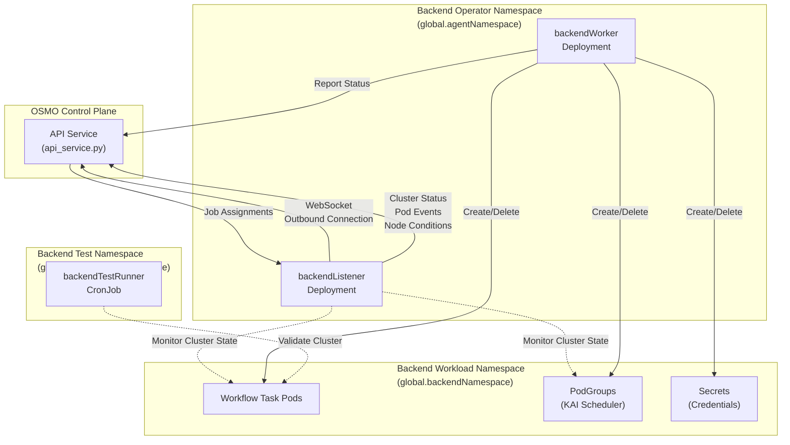
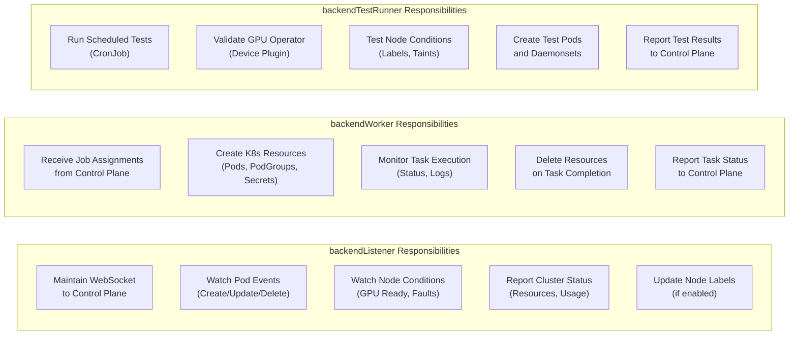
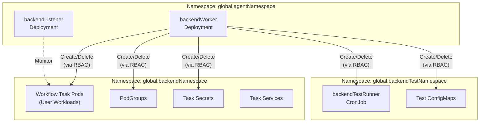
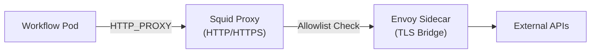

<!-- source: DeepWiki mcp.deepwiki.com · repo NVIDIA/OSMO · page 5.1 Backend Operator Architecture · fetched 2026-10-26 -->

# Backend Operator Architecture

<details>
<summary>Relevant source files</summary>

The following files were used as context for generating this wiki page:

- [deployments/charts/backend-operator/README.md](deployments/charts/backend-operator/README.md)
- [deployments/charts/backend-operator/templates/backend-listener.yaml](deployments/charts/backend-operator/templates/backend-listener.yaml)
- [deployments/charts/backend-operator/templates/backend-test-runner-config.yaml](deployments/charts/backend-operator/templates/backend-test-runner-config.yaml)
- [deployments/charts/backend-operator/templates/backend-test-runner-rbac.yaml](deployments/charts/backend-operator/templates/backend-test-runner-rbac.yaml)
- [deployments/charts/backend-operator/templates/backend-worker-rbac.yaml](deployments/charts/backend-operator/templates/backend-worker-rbac.yaml)
- [deployments/charts/backend-operator/values.yaml](deployments/charts/backend-operator/values.yaml)

</details>


## Purpose and Scope

This document describes the internal architecture of OSMO backend operators, which are responsible for connecting compute clusters to the OSMO control plane and executing workflows on those clusters. It covers the three core components (`backendListener`, `backendWorker`, `backendTestRunner`), their responsibilities, communication patterns, and RBAC requirements.

For information about deploying a backend operator, see [Deploying a Backend](#5.2). For details on the KAI scheduler and GPU resource management, see [KAI Scheduler and GPU Support](#5.3).

---

## Architecture Overview

Backend operators follow a **listener-worker pattern** where the listener maintains a persistent connection to the control plane while workers execute tasks locally on the Kubernetes cluster. This architecture enables the "inside-out" connectivity model where backends behind firewalls can initiate outbound connections to the control plane.



**Sources:** 
- [deployments/charts/backend-operator/values.yaml:17-223]()
- [deployments/charts/backend-operator/README.md:198-201]()

---

## Component Architecture

### backendListener

The `backendListener` is a long-running deployment that maintains a persistent WebSocket connection to the OSMO control plane. It serves as the primary interface between the backend cluster and the control plane.

**Key Configuration:**

| Parameter | Purpose | Default |
|-----------|---------|---------|
| `serviceName` | Kubernetes service name | `osmo-backend-listener` |
| `imageName` | Docker image | `backend-listener` |
| `serviceAccount` | RBAC service account | `backend-listener` |
| `max_unacked_messages` | WebSocket flow control | `100` |
| `podCacheTtl` | Pod event cache TTL | `15` seconds |
| `enableNodeLabelUpdate` | Update node labels based on conditions | `false` |

**Command-Line Arguments:**

The listener is invoked with the following key arguments:

```
backend_listener
  --host <serviceUrl>
  --backend <backendName>
  --namespace <backendNamespace>
  --login_method <password|token>
  --max_unacked_messages <count>
  --pod_event_cache_ttl <seconds>
  --include_namespace_usage <comma-separated-namespaces>
```

**Sources:**
- [deployments/charts/backend-operator/values.yaml:225-337]()
- [deployments/charts/backend-operator/templates/backend-listener.yaml:79-123]()

---

### backendWorker

The `backendWorker` is a deployment that processes job requests from the control plane by creating and managing Kubernetes resources (Pods, PodGroups, Secrets, Services) in the backend namespace.

**Key Configuration:**

| Parameter | Purpose | Default |
|-----------|---------|---------|
| `serviceName` | Kubernetes service name | `osmo-backend-worker` |
| `imageName` | Docker image | `backend-worker` |
| `serviceAccount` | RBAC service account | `backend-worker` |
| `progressIterFrequency` | Progress update interval | `15s` |

**Resource Creation:**

The worker creates the following Kubernetes resources for workflow tasks:

- **Pods**: Container execution environments for workflow tasks
- **PodGroups**: Gang scheduling resources for distributed training (see [KAI Scheduler and GPU Support](#5.3))
- **Secrets**: Credentials and configuration data
- **Services**: Network endpoints for inter-task communication

**Sources:**
- [deployments/charts/backend-operator/values.yaml:339-436]()
- [deployments/charts/backend-operator/templates/backend-worker-rbac.yaml:56-85]()

---

### backendTestRunner

The `backendTestRunner` is a CronJob that periodically validates the backend cluster's configuration and health. It runs automated tests to ensure GPU operator functionality, node conditions, and cluster readiness.

**Key Configuration:**

| Parameter | Purpose | Default |
|-----------|---------|---------|
| `enabled` | Enable test runner creation | `true` |
| `schedule` | Cron schedule | `"0 2 * * *"` (2 AM daily) |
| `timezone` | Schedule timezone | `"UTC"` |
| `startingDeadlineSeconds` | Late execution deadline | `300` |
| `concurrencyPolicy` | Concurrent execution policy | `"Forbid"` |

**Test Configuration:**

Tests are defined in ConfigMaps and executed by the test runner:

```yaml
apiVersion: batch/v1
kind: CronJob
metadata:
  name: "{{backend_name}}-{{test_name}}-runner"
spec:
  schedule: "{{cron_schedule}}"
  jobTemplate:
    spec:
      template:
        spec:
          containers:
          - name: backend-test-runner
            command: ["backend_test_runner"]
            args:
            - '--read_from_file'
            - '/test-config/test_config.json'
```

**Sources:**
- [deployments/charts/backend-operator/values.yaml:438-729]()
- [deployments/charts/backend-operator/templates/backend-test-runner-config.yaml:34-263]()

---

## Component Responsibilities



**Sources:**
- [deployments/charts/backend-operator/README.md:198-206]()
- [deployments/charts/backend-operator/templates/backend-listener.yaml:79-123]()

---

## Authentication and Communication

### Authentication Methods

Backend operators support two authentication methods to connect to the control plane:

#### Password Authentication

Uses username and password stored in a Kubernetes Secret:

```yaml
global:
  loginMethod: password
  accountUsername: "osmo-backend"
  accountPasswordSecret: svc-osmo-admin
  accountPasswordSecretKey: password
```

The password is mounted as a file at `/opt/osmo/secrets/password.txt`.

#### Token Authentication

Uses a service token stored in a Kubernetes Secret:

```yaml
global:
  loginMethod: token
  accountTokenSecret: agent-token
  accountTokenSecretKey: token
```

The token is mounted as a file at `/opt/osmo/secrets/token.txt`.

**Sources:**
- [deployments/charts/backend-operator/values.yaml:126-149]()
- [deployments/charts/backend-operator/templates/backend-listener.yaml:84-92]()
- [deployments/charts/backend-operator/templates/backend-listener.yaml:184-198]()

---

### WebSocket Communication

The `backendListener` maintains a persistent WebSocket connection to the control plane API service. This enables real-time bidirectional communication:

**Outbound (Backend → Control Plane):**
- Pod status updates (Created, Running, Completed, Failed)
- Node condition changes (GPU Ready, Driver Installed)
- Resource usage metrics (CPU, Memory, GPU utilization)
- Cluster events (Node joins, Network issues)

**Inbound (Control Plane → Backend):**
- Job assignments (Task IDs to execute)
- Configuration updates (Pool changes)
- Control commands (Cancel tasks, Update priorities)

**Flow Control:**

The `max_unacked_messages` parameter limits the number of messages sent before waiting for acknowledgment:

```yaml
services:
  backendListener:
    max_unacked_messages: 100
```

**Sources:**
- [deployments/charts/backend-operator/values.yaml:253-255]()
- [deployments/charts/backend-operator/templates/backend-listener.yaml:111-113]()

---

## Namespace Organization

Backend operators use a three-namespace architecture for security isolation:



**Namespace Configuration:**

| Namespace Variable | Purpose | Default |
|-------------------|---------|---------|
| `global.agentNamespace` | Backend operator deployments | `osmo` |
| `global.backendNamespace` | User workflow tasks | `osmo-namespace` |
| `global.backendTestNamespace` | Validation tests | `null` (disabled) |

**Sources:**
- [deployments/charts/backend-operator/values.yaml:151-165]()
- [deployments/charts/backend-operator/templates/backend-worker-rbac.yaml:87-118]()

---

## RBAC Architecture

### backendListener Permissions

The `backendListener` requires **ClusterRole** permissions to monitor cluster-wide resources:

**ClusterRole Permissions:**

```yaml
rules:
- apiGroups: [""]
  resources: ["nodes", "nodes/status"]
  verbs: ["get", "list", "watch", "patch", "update"]
- apiGroups: [""]
  resources: ["pods", "events"]
  verbs: ["get", "list", "watch"]
- apiGroups: ["scheduling.run.ai"]
  resources: ["podgroups"]
  verbs: ["get", "list", "watch"]
```

**Purpose:**
- Watch all pods across namespaces to report status
- Monitor node conditions and update labels
- Track PodGroup scheduling events

**Sources:**
- [deployments/charts/backend-operator/templates/backend-listener-rbac.yaml]()

---

### backendWorker Permissions

The `backendWorker` requires both **ClusterRole** and **Role** permissions:

**ClusterRole Permissions (Cluster-scoped):**

```yaml
rules:
- apiGroups: [""]
  resources: ["namespaces"]
  verbs: ["get"]
- apiGroups: ["scheduling.run.ai"]
  resources: ["queues"]
  verbs: ["list", "delete", "create", "update", "get"]
```

**Role Permissions (Backend Namespace):**

```yaml
rules:
- apiGroups: [""]
  resources: ["secrets", "pods", "services"]
  verbs: ["list", "delete", "create", "patch"]
- apiGroups: [""]
  resources: ["pods/log"]
  verbs: ["get"]
- apiGroups: ["scheduling.run.ai"]
  resources: ["podgroups"]
  verbs: ["list", "delete", "create"]
```

**Role Permissions (Test Namespace):**

```yaml
rules:
- apiGroups: [""]
  resources: ["configmaps"]
  verbs: ["list", "delete", "create", "patch"]
- apiGroups: ["batch"]
  resources: ["cronjobs"]
  verbs: ["list", "delete", "create", "patch"]
```

**Sources:**
- [deployments/charts/backend-operator/templates/backend-worker-rbac.yaml:27-119]()

---

### backendTestRunner Permissions

The `backendTestRunner` requires permissions to validate cluster configuration:

**Role Permissions (Test Namespace):**

```yaml
rules:
- apiGroups: [""]
  resources: ["pods"]
  verbs: ["list", "delete", "create", "get", "watch"]
- apiGroups: [""]
  resources: ["pods/exec"]
  verbs: ["get", "list", "watch", "create"]
- apiGroups: ["apps"]
  resources: ["daemonsets"]
  verbs: ["get", "list", "watch", "create", "update", "patch", "delete"]
```

**ClusterRole Permissions:**

```yaml
rules:
- apiGroups: [""]
  resources: ["nodes", "nodes/status"]
  verbs: ["patch", "get", "list", "update"]
```

**Sources:**
- [deployments/charts/backend-operator/templates/backend-test-runner-rbac.yaml:30-88]()

---

## Health Monitoring and Progress Checks

### Progress File System

Backend operators use a **progress file** system to track activity and enable health checks. Progress timestamps are written to files in `/var/run/osmo/`:

**backendListener Progress Files:**

| File Path | Purpose | Update Interval |
|-----------|---------|-----------------|
| `/var/run/osmo/last_progress_websocket` | WebSocket message activity | On each message |
| `/var/run/osmo/last_progress_pod` | Pod event processing | On each pod event |
| `/var/run/osmo/last_progress_node` | Node condition updates | On each node update |
| `/var/run/osmo/last_progress_event` | General event processing | On each event |

**backendWorker Progress Files:**

| File Path | Purpose | Update Interval |
|-----------|---------|-----------------|
| `/var/run/osmo/last_progress_task` | Task processing activity | Every 15 seconds |

**Sources:**
- [deployments/charts/backend-operator/values.yaml:315-320]()
- [deployments/charts/backend-operator/values.yaml:421-426]()
- [deployments/charts/backend-operator/values.yaml:363-365]()

---

### Liveness and Startup Probes

Both `backendListener` and `backendWorker` use `progress_check` probes:

**backendListener Probes:**

```yaml
livenessProbe:
  exec:
    command:
    - progress_check
    - --progress_interval
    - "300:300:300:300"
    - --progress_file
    - /var/run/osmo/last_progress_websocket:/var/run/osmo/last_progress_pod:/var/run/osmo/last_progress_node:/var/run/osmo/last_progress_event
  failureThreshold: 1
  periodSeconds: 30
  timeoutSeconds: 15

startupProbe:
  exec:
    command: [same as livenessProbe]
  failureThreshold: 12
  periodSeconds: 5
  timeoutSeconds: 15
  initialDelaySeconds: 10
```

**Probe Behavior:**

The `progress_check` command verifies that each progress file has been updated within its specified interval (300 seconds). If any file is stale, the probe fails and Kubernetes restarts the pod.

**Sources:**
- [deployments/charts/backend-operator/templates/backend-listener.yaml:148-171]()

---

## Sidecar Containers

### OpenTelemetry Sidecar

Backend operators can optionally include an OpenTelemetry collector sidecar for metrics and tracing:

**Configuration:**

```yaml
sidecars:
  OTEL:
    enabled: false
    image: otel/opentelemetry-collector-contrib:0.68.0
    configName: otel-config
    ports:
    - containerPort: 4000
      name: metrics
```

**Integration:**

When enabled, the listener and worker send metrics to `localhost:4000`:

```yaml
args:
- --metrics_otel_collector_component
- osmo-backend-listener
- --metrics_otel_enable
- "true"
```

**Sources:**
- [deployments/charts/backend-operator/values.yaml:788-817]()
- [deployments/charts/backend-operator/templates/backend-listener.yaml:40-42]()
- [deployments/charts/backend-operator/templates/backend-listener.yaml:103-106]()

---

## Network Configuration

### Egress Control

Backend operators support restricting outbound network traffic from workflow pods:

**Egress Restriction:**

```yaml
global:
  network:
    restrictEgress: false
```

**Allowlist Egress with Squid Proxy:**

```yaml
global:
  network:
    allowlistEgress:
      enabled: false
      proxyNamespace: osmo-squid-proxy
      additionalAllowedDomains:
      - "example.com"
      - "api.nvidia.com"
      additionalAllowedSourceIps:
      - "10.0.0.0/8"
```

**Proxy Architecture:**

When enabled, a Squid proxy with Envoy bridge is deployed:



**Sources:**
- [deployments/charts/backend-operator/values.yaml:44-115]()
- [deployments/charts/backend-operator/README.md:51-64]()

---

## Priority Classes

Backend operators can create priority classes for workflow scheduling:

**Configuration:**

```yaml
global:
  priorityClasses:
    enabled: true
    classes:
    - name: osmo-high
      value: 125
      description: "Schedule as soon as possible. Non-preemptible."
    - name: osmo-normal
      value: 100
      description: "Standard priority. Non-preemptible."
    - name: osmo-low
      value: 50
      description: "Schedule last. Preemptible."
```

**Usage:**

These priority classes are used by the KAI scheduler (see [KAI Scheduler and GPU Support](#5.3)) to determine pod scheduling order and preemption behavior.

**Sources:**
- [deployments/charts/backend-operator/values.yaml:202-220]()
- [deployments/charts/backend-operator/README.md:80-90]()

---

## Node Condition Management

### Node Condition Prefix

The `global.nodeConditionPrefix` parameter allows adding a prefix to all node labels and conditions managed by the backend operator:

```yaml
global:
  nodeConditionPrefix: "osmo.nvidia.com/"
```

**Purpose:**
- Avoid conflicts with other cluster operators
- Enable multiple backend operators in the same cluster
- Provide clear ownership of node labels

**Example Labels:**

Without prefix:
```yaml
labels:
  component: backend-test
  backend: default
```

With prefix:
```yaml
labels:
  osmo.nvidia.com/component: backend-test
  osmo.nvidia.com/backend: default
```

**Sources:**
- [deployments/charts/backend-operator/values.yaml:167-169]()
- [deployments/charts/backend-operator/templates/backend-listener.yaml:109-110]()
- [deployments/charts/backend-operator/templates/backend-test-runner-config.yaml:64-66]()

---

## Resource Limits

### backendListener Resources

**Default Configuration:**

```yaml
resources:
  requests:
    cpu: "1"
    memory: "2Gi"
  limits:
    memory: "2Gi"
```

**Rationale:**
- CPU unbounded for burst processing of pod events
- Memory limited to prevent runaway memory leaks
- Typically processes 100-1000 pod events per second

### backendWorker Resources

**Default Configuration:**

```yaml
resources:
  requests:
    cpu: "1"
    memory: "1Gi"
  limits:
    memory: "1Gi"
```

**Rationale:**
- Lighter than listener (no WebSocket management)
- Creates Kubernetes resources via API (I/O bound)
- Memory limited for predictable resource usage

**Sources:**
- [deployments/charts/backend-operator/values.yaml:322-329]()
- [deployments/charts/backend-operator/values.yaml:428-435]()

---

## API Rate Limiting

The `backendListener` includes Kubernetes API client rate limiting to prevent overwhelming the API server:

**Configuration:**

```yaml
services:
  backendListener:
    apiQps: 20      # Queries per second
    apiBurst: 30    # Burst capacity
```

**Arguments:**

```yaml
args:
- --api_qps
- "20"
- --api_burst
- "30"
```

**Purpose:**
- Prevent control plane overload during cluster scaling events
- Balance responsiveness with API server stability
- Default limits are conservative; increase for large clusters (>1000 nodes)

**Sources:**
- [deployments/charts/backend-operator/values.yaml:331-337]()
- [deployments/charts/backend-operator/templates/backend-listener.yaml:117-120]()
- [deployments/charts/backend-operator/README.md:122-123]()

---

