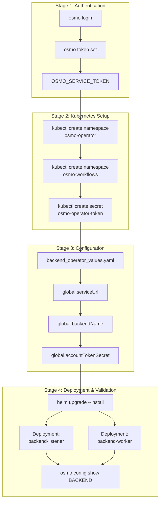
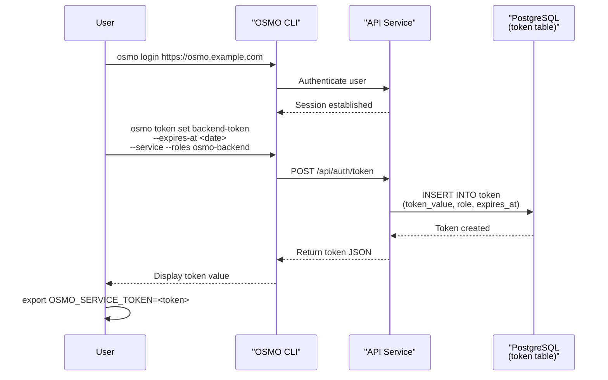
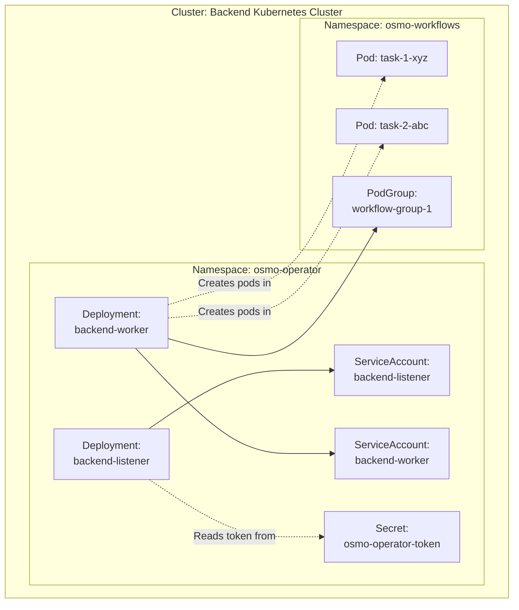
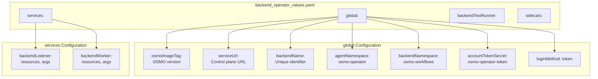
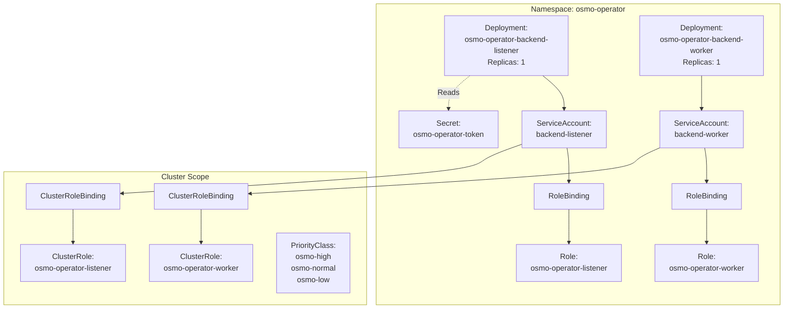
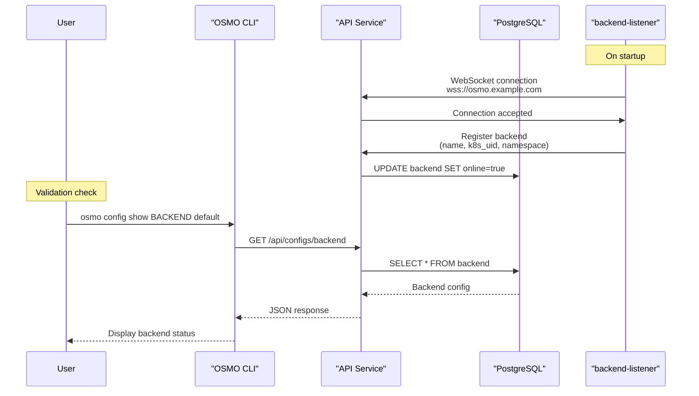

<!-- source: DeepWiki mcp.deepwiki.com · repo NVIDIA/OSMO · page 5.2 Deploying a Backend · fetched 2026-10-26 -->

# Deploying a Backend

<details>
<summary>Relevant source files</summary>

The following files were used as context for generating this wiki page:

- [deployments/charts/backend-operator/README.md](deployments/charts/backend-operator/README.md)
- [deployments/charts/backend-operator/templates/backend-listener.yaml](deployments/charts/backend-operator/templates/backend-listener.yaml)
- [deployments/charts/backend-operator/templates/backend-test-runner-config.yaml](deployments/charts/backend-operator/templates/backend-test-runner-config.yaml)
- [deployments/charts/backend-operator/templates/backend-test-runner-rbac.yaml](deployments/charts/backend-operator/templates/backend-test-runner-rbac.yaml)
- [deployments/charts/backend-operator/templates/backend-worker-rbac.yaml](deployments/charts/backend-operator/templates/backend-worker-rbac.yaml)
- [deployments/charts/backend-operator/values.yaml](deployments/charts/backend-operator/values.yaml)
- [docs/deployment_guide/getting_started/deploy_service.rst](docs/deployment_guide/getting_started/deploy_service.rst)
- [docs/deployment_guide/install_backend/dependencies/dependencies.rst](docs/deployment_guide/install_backend/dependencies/dependencies.rst)
- [docs/deployment_guide/install_backend/deploy_backend.rst](docs/deployment_guide/install_backend/deploy_backend.rst)
- [docs/deployment_guide/install_backend/validate_osmo.rst](docs/deployment_guide/install_backend/validate_osmo.rst)
- [docs/deployment_guide/references/configs_definitions/index.rst](docs/deployment_guide/references/configs_definitions/index.rst)
- [docs/user_guide/tutorials/combination_workflows/index.rst](docs/user_guide/tutorials/combination_workflows/index.rst)

</details>


## Purpose and Scope

This page provides a step-by-step guide for deploying a backend operator to connect a Kubernetes cluster to OSMO. The backend operator registers compute resources with the OSMO control plane and executes workflows on the cluster. This page covers authentication token creation, namespace setup, Helm chart configuration, deployment, and validation.

For architectural details about backend components (`backendListener`, `backendWorker`, `backendTestRunner`), see [Backend Operator Architecture](#5.1). For information about the KAI scheduler and GPU resource management, see [KAI Scheduler and GPU Support](#5.3).

---

## Prerequisites

Before deploying a backend operator, ensure the following requirements are met:

| Requirement | Description | Reference |
|------------|-------------|-----------|
| **OSMO Control Plane** | A running OSMO service instance | [Deploy Service](#2) |
| **OSMO CLI** | CLI installed and configured | [Getting Started](#2) |
| **Kubernetes Cluster** | Operational cluster with appropriate node types | [Creating Backends](#5) |
| **Helm CLI** | Helm 3.x installed | External documentation |
| **KAI Scheduler** | Installed on the backend cluster | [Install Dependencies](docs/deployment_guide/install_backend/dependencies/dependencies.rst:32-68) |
| **GPU Operator** | Required for GPU workloads | [Install Dependencies](docs/deployment_guide/install_backend/dependencies/dependencies.rst:70-84) |

---

## Deployment Overview

The backend deployment process consists of four main stages:



**Deployment Flow Diagram**

Sources: [docs/deployment_guide/install_backend/deploy_backend.rst:24-169]()

---

## Stage 1: Create OSMO Service Token

Backend operators authenticate with the OSMO control plane using service tokens. These tokens have the `osmo-backend` role and should be created with an appropriate expiration date.

### Token Creation Process



**Token Creation Sequence**

### Commands

```bash
# Authenticate with OSMO
$ osmo login https://osmo.example.com

# Create service token with expiration date
$ export OSMO_SERVICE_TOKEN=$(osmo token set backend-token \
    --expires-at 2026-12-31 \
    --description "Backend Operator Token" \
    --service \
    --roles osmo-backend \
    -t json | jq -r '.token')
```

**Important:** Save the token securely. It will not be displayed again and is required for backend authentication.

Sources: [docs/deployment_guide/install_backend/deploy_backend.rst:32-48]()

---

## Stage 2: Create Kubernetes Namespaces and Secrets

The backend operator requires two namespaces and a secret for authentication:

### Namespace Architecture



**Namespace and Resource Organization**

### Setup Commands

```bash
# Create namespace for backend operator components
$ kubectl create namespace osmo-operator

# Create namespace for workflow execution
$ kubectl create namespace osmo-workflows

# Create authentication secret from token
$ kubectl create secret generic osmo-operator-token \
    -n osmo-operator \
    --from-literal=token=$OSMO_SERVICE_TOKEN
```

| Namespace | Purpose | Components |
|-----------|---------|------------|
| `osmo-operator` | Backend operator deployment | `backend-listener`, `backend-worker`, service tokens |
| `osmo-workflows` | Workflow task execution | User workflow pods, PodGroups, Secrets |

Sources: [docs/deployment_guide/install_backend/deploy_backend.rst:50-65]()

---

## Stage 3: Configure Helm Chart Values

The backend operator Helm chart (`backend-operator`) is configured through a values file. This section details the key configuration parameters.

### Configuration Structure



**Helm Values Configuration Structure**

### Minimal Configuration Example

Create a file named `backend_operator_values.yaml`:

```yaml
global:
  # Required: OSMO image version
  osmoImageTag: "1.2.3"
  
  # Required: Control plane URL
  serviceUrl: https://osmo.example.com
  
  # Required: Unique backend identifier
  backendName: default
  
  # Namespaces
  agentNamespace: osmo-operator
  backendNamespace: osmo-workflows
  
  # Authentication
  accountTokenSecret: osmo-operator-token
  loginMethod: token

services:
  backendListener:
    resources:
      requests:
        cpu: "1"
        memory: "1Gi"
      limits:
        memory: "1Gi"
        
  backendWorker:
    resources:
      requests:
        cpu: "1"
        memory: "1Gi"
      limits:
        memory: "1Gi"
```

### Key Configuration Parameters

| Parameter | Type | Description | Default | Required |
|-----------|------|-------------|---------|----------|
| `global.osmoImageTag` | string | OSMO Docker image tag | `latest` | ✅ Yes |
| `global.serviceUrl` | string | OSMO control plane URL | `""` | ✅ Yes |
| `global.backendName` | string | Unique backend identifier | `default` | ✅ Yes |
| `global.agentNamespace` | string | Operator namespace | `osmo` | ✅ Yes |
| `global.backendNamespace` | string | Workflow namespace | `osmo-namespace` | ✅ Yes |
| `global.accountTokenSecret` | string | K8s secret name for token | `agent-token` | ✅ Yes |
| `global.accountTokenSecretKey` | string | Secret key containing token | `token` | No |
| `global.loginMethod` | string | Authentication method | `password` | ✅ Yes |
| `global.enableClusterRoles` | boolean | Enable cluster-wide RBAC | `true` | No |
| `global.enableNonClusterRoles` | boolean | Enable namespace RBAC | `true` | No |

### Authentication Configuration

The backend operator supports two authentication methods configured via `global.loginMethod`:

#### Token Authentication (Recommended)

```yaml
global:
  loginMethod: token
  accountTokenSecret: osmo-operator-token
  accountTokenSecretKey: token
```

The `backendListener` reads the token from the secret at [deployments/charts/backend-operator/templates/backend-listener.yaml:89-92]():

```yaml
- --token_file
- /opt/osmo/secrets/token.txt
```

#### Password Authentication (Alternative)

```yaml
global:
  loginMethod: password
  accountUsername: "admin"
  accountPasswordSecret: svc-osmo-admin
  accountPasswordSecretKey: password
```

The `backendListener` reads credentials at [deployments/charts/backend-operator/templates/backend-listener.yaml:84-88]():

```yaml
- --username
- {{ .Values.global.accountUsername }}
- --password_file
- /opt/osmo/secrets/password.txt
```

### Resource Configuration

The backend listener and worker require appropriate resource allocations:

```yaml
services:
  backendListener:
    resources:
      requests:
        cpu: "1"        # Minimum 1 CPU core
        memory: "2Gi"   # Minimum 2GB RAM
      limits:
        memory: "2Gi"
    
    # API client rate limits
    apiQps: 20          # Queries per second to K8s API
    apiBurst: 30        # Burst limit for K8s API calls
    
    # WebSocket configuration
    max_unacked_messages: 100
    podCacheTtl: 15     # Pod cache TTL in seconds
    
  backendWorker:
    resources:
      requests:
        cpu: "1"
        memory: "1Gi"
      limits:
        memory: "1Gi"
    
    # Progress monitoring
    progressIterFrequency: "15s"
```

Sources: [deployments/charts/backend-operator/values.yaml:17-436](), [docs/deployment_guide/install_backend/deploy_backend.rst:72-105]()

---

## Stage 4: Deploy Backend Operator

Deploy the backend operator using Helm:

### Deployment Commands

```bash
# Add OSMO Helm repository
$ helm repo add osmo https://helm.ngc.nvidia.com/nvidia/osmo

# Update Helm repositories
$ helm repo update

# Deploy backend operator
$ helm upgrade --install osmo-operator osmo/backend-operator \
    -f ./backend_operator_values.yaml \
    --version 1.2.3 \
    --namespace osmo-operator
```

### Deployed Resources

The Helm chart creates the following Kubernetes resources:



**Deployed Kubernetes Resources**

### RBAC Permissions

The backend operator requires specific RBAC permissions across different scopes:

#### Backend Listener Permissions

**Cluster Scope** [deployments/charts/backend-operator/templates/backend-listener-rbac.yaml:32-80]():
- `nodes`: `get`, `list`, `patch`
- `nodes/status`: `patch`, `update`
- `namespaces`: `get`, `list`

**Namespace Scope** (in `osmo-operator`):
- `pods`: `list`, `get`, `watch`
- `pods/log`: `get`
- `services`: `list`, `get`
- `events`: `list`, `watch`

#### Backend Worker Permissions

**Cluster Scope** [deployments/charts/backend-operator/templates/backend-worker-rbac.yaml:27-52]():
- `namespaces`: `get`
- `queues` (scheduling.run.ai): `list`, `delete`, `create`, `update`, `get`

**Namespace Scope** (in `osmo-workflows`) [deployments/charts/backend-operator/templates/backend-worker-rbac.yaml:55-85]():
- `secrets`, `pods`, `services`: `list`, `delete`, `create`, `patch`
- `pods/log`: `get`
- `podgroups` (scheduling.run.ai): `list`, `delete`, `create`

Sources: [docs/deployment_guide/install_backend/deploy_backend.rst:106-118]()

---

## Validation

After deployment, validate that the backend is correctly registered and operational.

### Validation Flow



**Backend Registration and Validation Flow**

### Validation Commands

```bash
# Set backend name environment variable
$ export BACKEND_NAME=default

# Check backend configuration
$ osmo config show BACKEND $BACKEND_NAME

# Alternative: Check via API endpoint
$ curl https://osmo.example.com/api/configs/backend
```

### Expected Output

The backend configuration should show `"online": true`:

```json
{
  "backends": [
    {
      "name": "default",
      "description": "Default backend",
      "version": "6.0.0",
      "k8s_uid": "6bae3562-6d32-4ff1-9317-09dd973c17a2",
      "k8s_namespace": "osmo-workflows",
      "dashboard_url": "",
      "grafana_url": "",
      "tests": [],
      "scheduler_settings": {
        "scheduler_type": "kai",
        "scheduler_name": "kai-scheduler",
        "scheduler_timeout": 30
      },
      "node_conditions": {
        "rules": null,
        "prefix": "osmo.example.com/"
      },
      "last_heartbeat": "2025-11-15T02:35:17.957569",
      "created_date": "2025-09-03T19:48:21.969688",
      "router_address": "wss://osmo.example.com",
      "online": true
    }
  ]
}
```

### Validation Checklist

| Check | Expected Result | How to Verify |
|-------|----------------|---------------|
| Backend registered | Backend appears in config list | `osmo config show BACKEND` |
| Status is online | `"online": true` | Check JSON output |
| Recent heartbeat | `last_heartbeat` within last 60 seconds | Check timestamp |
| Correct namespace | `k8s_namespace` matches `backendNamespace` | Compare configuration |
| K8s UID present | `k8s_uid` is not null | Check JSON output |
| Pods running | Listener and worker pods are `Running` | `kubectl get pods -n osmo-operator` |

### Verify Pod Status

```bash
# Check backend operator pods
$ kubectl get pods -n osmo-operator

# Expected output:
# NAME                                          READY   STATUS    RESTARTS   AGE
# osmo-operator-backend-listener-xxxxx          1/1     Running   0          5m
# osmo-operator-backend-worker-xxxxx            1/1     Running   0          5m

# Check pod logs
$ kubectl logs -n osmo-operator deployment/osmo-operator-backend-listener
$ kubectl logs -n osmo-operator deployment/osmo-operator-backend-worker
```

Sources: [docs/deployment_guide/install_backend/deploy_backend.rst:119-169]()

---

## Troubleshooting

### Common Issues and Solutions

#### Issue: Token Expired

**Symptom:**
```
Connection failed with error: {OSMOUserError: Token is expired, but no refresh token is present}
```

**Solution:**
```bash
# List service tokens to check expiration
$ osmo token list --service

# Create new token if expired
$ export OSMO_SERVICE_TOKEN=$(osmo token set backend-token-new \
    --expires-at 2026-12-31 \
    --description "Backend Operator Token" \
    --service \
    --roles osmo-backend \
    -t json | jq -r '.token')

# Update Kubernetes secret
$ kubectl create secret generic osmo-operator-token \
    -n osmo-operator \
    --from-literal=token=$OSMO_SERVICE_TOKEN \
    --dry-run=client -o yaml | kubectl apply -f -

# Restart backend operator
$ kubectl rollout restart deployment -n osmo-operator
```

Sources: [docs/deployment_guide/install_backend/deploy_backend.rst:171-183]()

#### Issue: Backend Shows Offline

**Symptom:** Backend appears in configuration but `"online": false`

**Diagnosis:**
```bash
# Check listener pod logs
$ kubectl logs -n osmo-operator deployment/osmo-operator-backend-listener

# Check for connection errors
$ kubectl logs -n osmo-operator deployment/osmo-operator-backend-listener | grep -i error
```

**Common Causes:**

| Cause | Log Pattern | Solution |
|-------|-------------|----------|
| Invalid token | `401 Unauthorized` | Recreate token with correct roles |
| Network connectivity | `Connection refused` | Check firewall rules, verify `serviceUrl` |
| Invalid serviceUrl | `Could not resolve host` | Verify DNS, check `global.serviceUrl` in values |
| Missing secret | `Secret not found` | Verify secret exists: `kubectl get secret -n osmo-operator` |

#### Issue: Pods Not Creating in Workflow Namespace

**Symptom:** Workflows submitted but no pods appear in `osmo-workflows` namespace

**Diagnosis:**
```bash
# Check backend worker logs
$ kubectl logs -n osmo-operator deployment/osmo-operator-backend-worker

# Check RBAC permissions
$ kubectl auth can-i create pods \
    --namespace osmo-workflows \
    --as system:serviceaccount:osmo-operator:backend-worker
```

**Solution:** Verify RBAC is correctly configured. The worker needs permissions in `osmo-workflows`:

```bash
# Check Role exists
$ kubectl get role -n osmo-workflows osmo-operator-worker

# Check RoleBinding exists
$ kubectl get rolebinding -n osmo-workflows osmo-operator-worker

# If missing, ensure global.enableNonClusterRoles: true in values
```

#### Issue: KAI Scheduler Not Found

**Symptom:** 
```
Scheduler kai-scheduler not found
```

**Solution:**
```bash
# Verify KAI scheduler is installed
$ kubectl get deployment -n kai-scheduler

# If not installed, install KAI scheduler first
$ helm fetch oci://ghcr.io/nvidia/kai-scheduler/kai-scheduler --version 1.2.3
$ helm upgrade --install kai-scheduler kai-scheduler-*.tgz \
    --create-namespace -n kai-scheduler
```

#### Issue: Image Pull Errors

**Symptom:**
```
ImagePullBackOff or ErrImagePull
```

**Solution:**
```bash
# Create image pull secret if accessing private registry
$ kubectl create secret docker-registry nvcr-secret \
    --docker-server=nvcr.io \
    --docker-username='$oauthtoken' \
    --docker-password=<NGC_API_KEY> \
    --namespace osmo-operator

# Update values to reference secret
global:
  imagePullSecret: nvcr-secret
```

### Logs and Monitoring

The backend operator writes logs to stdout/stderr. Configure log levels via values:

```yaml
global:
  logs:
    logLevel: DEBUG      # Application log level
    k8sLogLevel: WARNING # Kubernetes client log level
```

Available log levels: `DEBUG`, `INFO`, `WARNING`, `ERROR`, `CRITICAL`

**Progress Monitoring:** The listener and worker use progress file monitoring for liveness probes at [deployments/charts/backend-operator/templates/backend-listener.yaml:148-171]():

```yaml
livenessProbe:
  exec:
    command:
    - progress_check
    - --progress_interval
    - "300:300:300:300"
    - --progress_file
    - /var/run/osmo/last_progress_websocket:/var/run/osmo/last_progress_pod:/var/run/osmo/last_progress_node:/var/run/osmo/last_progress_event
```

Sources: [deployments/charts/backend-operator/values.yaml:172-181]()

---

## Advanced Configuration

### Network Egress Control

The backend operator supports restricting egress traffic from workflow pods using a Squid proxy:

```yaml
global:
  network:
    restrictEgress: true
    allowlistEgress:
      enabled: true
      proxyNamespace: osmo-squid-proxy
      additionalAllowedDomains:
        - "example.com"
        - "api.nvidia.com"
      resources:
        requests:
          cpu: "2"
          memory: "4Gi"
        limits:
          memory: "4Gi"
```

Sources: [deployments/charts/backend-operator/values.yaml:44-86]()

### Priority Classes

The backend operator creates priority classes for workflow scheduling when using KAI scheduler:

```yaml
global:
  priorityClasses:
    enabled: true
    classes:
      - name: osmo-high
        value: 125
        description: "Schedule as soon as possible. Non-preemptible."
      - name: osmo-normal
        value: 100
        description: "Standard priority. Non-preemptible."
      - name: osmo-low
        value: 50
        description: "Schedule last. Preemptible."
```

Sources: [deployments/charts/backend-operator/values.yaml:202-221]()

### Backend Test Runner

The backend operator can deploy automated cluster validation tests via CronJob:

```yaml
backendTestRunner:
  enabled: true
  cronJob:
    schedule: "0 2 * * *"  # Daily at 2 AM
    timezone: "UTC"
  podTemplate:
    image:
      repository: "nvcr.io/nvidia/osmo/backend-test-runner"
      tag: "latest"
```

Test configuration is managed via the control plane and synchronized to the backend. See [Backend Test Runner](deployments/charts/backend-operator/templates/backend-test-runner-config.yaml:17-263) for template details.

Sources: [deployments/charts/backend-operator/values.yaml:438-729]()

---

## Next Steps

After deploying a backend operator:

1. **Configure Resource Pools:** Define compute pools to organize backend resources. See [Configuration Management](#4.3).
2. **Submit Test Workflows:** Validate the deployment with sample workflows. See [Run Workflows](docs/deployment_guide/install_backend/validate_osmo.rst).
3. **Monitor Backend Health:** Track backend status via the Web UI or CLI.
4. **Deploy Additional Backends:** Repeat this process to add more compute backends (cloud, on-prem, edge).

**Related Documentation:**
- [Backend Operator Architecture](#5.1) - Component details and responsibilities
- [KAI Scheduler and GPU Support](#5.3) - Scheduler configuration and GPU management
- [Workflow Execution](#6.4) - How workflows are scheduled and executed on backends

---

