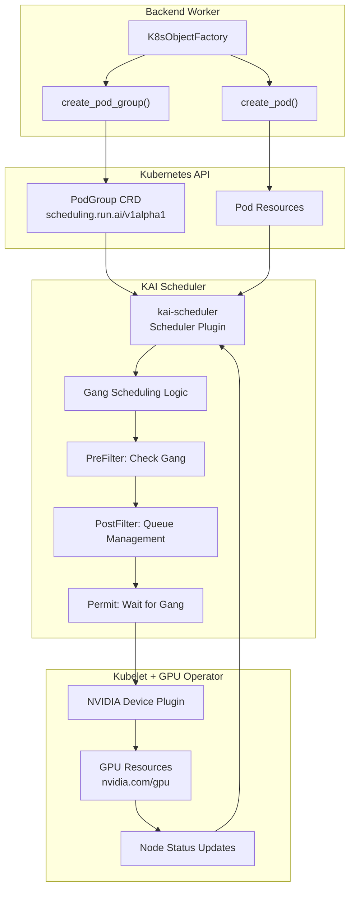
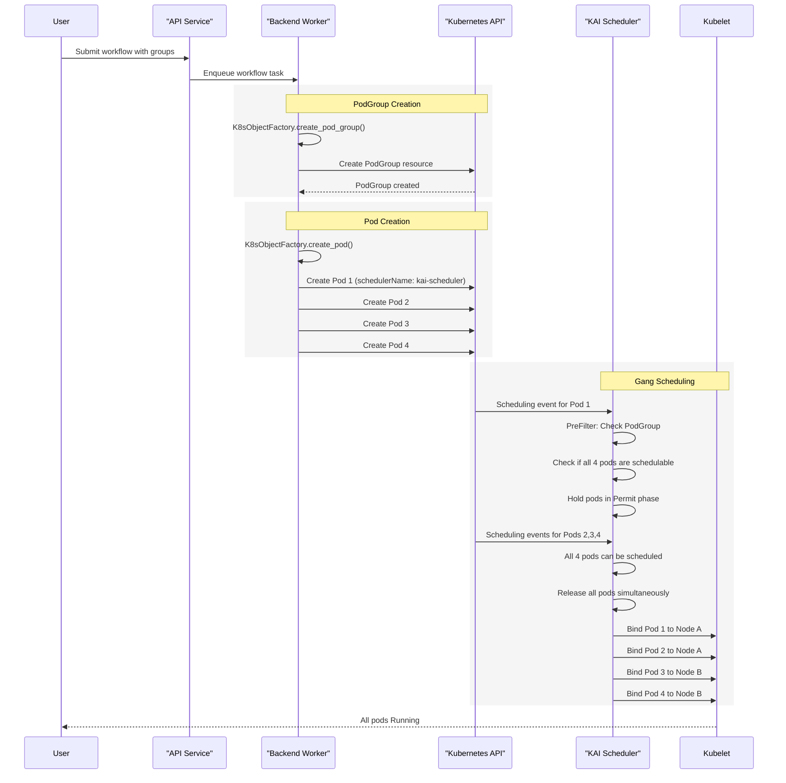
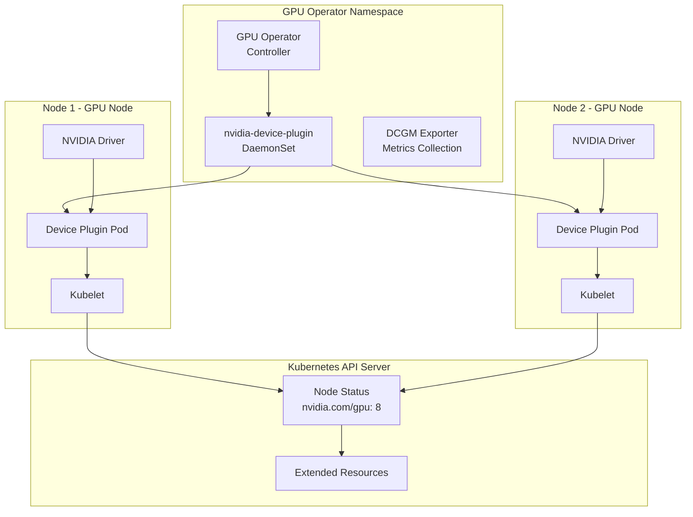
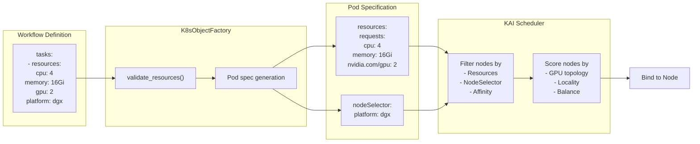

<!-- source: DeepWiki mcp.deepwiki.com · repo NVIDIA/OSMO · page 5.3 KAI Scheduler and GPU Support · fetched 2026-10-26 -->

# KAI Scheduler and GPU Support

<details>
<summary>Relevant source files</summary>

The following files were used as context for generating this wiki page:

- [deployments/charts/backend-operator/README.md](deployments/charts/backend-operator/README.md)
- [deployments/charts/backend-operator/templates/backend-listener.yaml](deployments/charts/backend-operator/templates/backend-listener.yaml)
- [deployments/charts/backend-operator/templates/backend-test-runner-config.yaml](deployments/charts/backend-operator/templates/backend-test-runner-config.yaml)
- [deployments/charts/backend-operator/templates/backend-test-runner-rbac.yaml](deployments/charts/backend-operator/templates/backend-test-runner-rbac.yaml)
- [deployments/charts/backend-operator/templates/backend-worker-rbac.yaml](deployments/charts/backend-operator/templates/backend-worker-rbac.yaml)
- [deployments/charts/backend-operator/values.yaml](deployments/charts/backend-operator/values.yaml)
- [docs/deployment_guide/getting_started/deploy_service.rst](docs/deployment_guide/getting_started/deploy_service.rst)
- [docs/deployment_guide/install_backend/dependencies/dependencies.rst](docs/deployment_guide/install_backend/dependencies/dependencies.rst)
- [docs/deployment_guide/install_backend/deploy_backend.rst](docs/deployment_guide/install_backend/deploy_backend.rst)
- [docs/deployment_guide/install_backend/validate_osmo.rst](docs/deployment_guide/install_backend/validate_osmo.rst)
- [docs/deployment_guide/references/configs_definitions/index.rst](docs/deployment_guide/references/configs_definitions/index.rst)
- [docs/user_guide/tutorials/combination_workflows/index.rst](docs/user_guide/tutorials/combination_workflows/index.rst)

</details>


This page documents how OSMO integrates with the KAI scheduler for gang scheduling and the NVIDIA GPU Operator for GPU resource management. It covers scheduler configuration, priority classes, resource allocation strategies, and the relationship between workflow groups and Kubernetes scheduling primitives.

For information about deploying backend operators, see [Deploying a Backend](#5.2). For workflow group specifications, see [Distributed Workflows with Groups](#6.3).

## Purpose and Scope

OSMO uses the [KAI scheduler](https://github.com/NVIDIA/kai-scheduler) to enable **gang scheduling** of distributed training jobs and multi-task workflows. Gang scheduling ensures that all pods in a group are scheduled simultaneously or not at all, preventing partial scheduling that would leave tasks waiting indefinitely for their peers.

This page explains:
- How KAI scheduler provides gang scheduling through PodGroups
- GPU Operator integration for device discovery and allocation
- Priority classes for workload scheduling
- Scheduler configuration in backend configs
- Required RBAC permissions for scheduling operations

## KAI Scheduler Overview

### What is KAI Scheduler

KAI (Kubernetes AI) scheduler is a Kubernetes scheduler plugin developed by NVIDIA that extends the default Kubernetes scheduler with features critical for AI/ML workloads:

- **Gang scheduling** via PodGroups for distributed training
- **GPU-aware scheduling** with topology considerations
- **Priority and preemption** for workload prioritization
- **Elastic scheduling** for dynamic resource allocation

### Why OSMO Uses KAI

OSMO workflows often require multiple tasks to start simultaneously (e.g., distributed PyTorch training with 8 GPU nodes). Without gang scheduling:

1. Partial scheduling occurs when some pods start but others remain pending
2. Running pods consume resources while waiting for peers
3. Deadlock can occur when multiple workflows partially schedule
4. GPU resources are wasted on incomplete job groups

KAI scheduler solves this by treating workflow groups as atomic scheduling units.

**Sources:** [docs/deployment_guide/install_backend/dependencies/dependencies.rst:32-68]()

---

### KAI Scheduler Architecture



**Sources:** [docs/deployment_guide/install_backend/dependencies/dependencies.rst:32-68](), [deployments/charts/backend-operator/templates/backend-worker-rbac.yaml:56-70]()

---

## Gang Scheduling with PodGroups

### Workflow Groups to PodGroups

OSMO workflow groups map directly to Kubernetes PodGroup custom resources. When a workflow with groups is submitted:

1. **Backend worker** creates a PodGroup resource for each workflow group
2. **Backend worker** creates Pod resources with `schedulerName: kai-scheduler` and PodGroup annotation
3. **KAI scheduler** holds pods in `Permit` phase until all group members are schedulable
4. **All pods** start simultaneously when resources are available

**Mapping:**

| OSMO Workflow Concept | Kubernetes Resource | Purpose |
|----------------------|---------------------|---------|
| `groups` (in YAML) | `PodGroup` (CRD) | Defines gang scheduling boundary |
| `lead: true` task | Leader pod annotation | First pod to complete terminates group |
| Group size | `PodGroup.spec.minMember` | Minimum pods required |
| Tasks in group | Pods with `podGroupName` label | Member pods |

### PodGroup Specification

```yaml
apiVersion: scheduling.run.ai/v1alpha1
kind: PodGroup
metadata:
  name: "workflow-{workflow_id}-group-{group_name}"
  namespace: osmo-workflows
spec:
  minMember: 4  # Number of tasks in group
  scheduleTimeoutSeconds: 300  # From scheduler_timeout config
  priorityClassName: osmo-normal
```

**Sources:** [docs/deployment_guide/install_backend/deploy_backend.rst:148-153](), [deployments/charts/backend-operator/templates/backend-worker-rbac.yaml:68-70]()

---

### Gang Scheduling Flow



**Sources:** [docs/deployment_guide/install_backend/dependencies/dependencies.rst:32-68](), [docs/user_guide/tutorials/combination_workflows/index.rst:120-128]()

---

## GPU Operator Integration

### NVIDIA GPU Operator Components

The GPU Operator installs and manages GPU drivers and device plugins on Kubernetes nodes:



**Sources:** [docs/deployment_guide/install_backend/dependencies/dependencies.rst:70-83]()

---

### GPU Resource Discovery

The GPU Operator automatically:

1. **Discovers GPUs** on each node via PCIe enumeration
2. **Advertises capacity** as extended resources (`nvidia.com/gpu: N`)
3. **Tracks allocations** to prevent oversubscription
4. **Injects GPU access** into containers via device mounts

**Node Resource Advertisement:**

```yaml
status:
  capacity:
    nvidia.com/gpu: "8"
  allocatable:
    nvidia.com/gpu: "8"
```

**Pod GPU Request:**

```yaml
spec:
  containers:
  - name: training
    resources:
      limits:
        nvidia.com/gpu: "2"
```

**Sources:** [docs/deployment_guide/install_backend/dependencies/dependencies.rst:70-83](), [docs/deployment_guide/install_backend/validate_osmo.rst:44-50]()

---

### GPU Operator Installation

Install the GPU Operator using Helm:

```bash
helm repo add nvidia https://nvidia.github.io/gpu-operator
helm repo update
helm install gpu-operator nvidia/gpu-operator \
  --namespace gpu-operator \
  --create-namespace
```

The GPU Operator automatically:
- Installs NVIDIA drivers on GPU nodes
- Deploys device plugin DaemonSet
- Configures container runtime for GPU access
- Enables GPU monitoring via DCGM

**Sources:** [docs/deployment_guide/install_backend/dependencies/dependencies.rst:70-83]()

---

## Resource Allocation Strategies

### Scheduler Configuration

Backend configurations specify scheduler settings via the `scheduler_settings` object:

```json
{
  "scheduler_settings": {
    "scheduler_type": "kai",
    "scheduler_name": "kai-scheduler",
    "scheduler_timeout": 30
  }
}
```

| Field | Description | Default |
|-------|-------------|---------|
| `scheduler_type` | Scheduler implementation type | `"kai"` |
| `scheduler_name` | Kubernetes scheduler name | `"kai-scheduler"` |
| `scheduler_timeout` | Seconds to wait before gang scheduling fails | `30` |

**Sources:** [docs/deployment_guide/install_backend/deploy_backend.rst:148-153]()

---

### Resource Request Flow



**Sources:** [docs/deployment_guide/install_backend/deploy_backend.rst:148-153]()

---

## Priority Classes

### Priority Class Configuration

OSMO creates three priority classes for workload scheduling when `global.priorityClasses.enabled: true`:

```yaml
priorityClasses:
  enabled: true
  classes:
    - name: osmo-high
      value: 125
      description: "Schedule as soon as possible. Non-preemptible."
    - name: osmo-normal
      value: 100
      description: "Standard priority. Non-preemptible."
    - name: osmo-low
      value: 50
      description: "Schedule last. Preemptible."
```

**Sources:** [deployments/charts/backend-operator/values.yaml:202-221]()

---

### Priority Class Usage

Priority classes affect scheduling order and preemption behavior:

| Priority Class | Value | Preemptible | Use Case |
|----------------|-------|-------------|----------|
| `osmo-high` | 125 | No | Critical production workloads |
| `osmo-normal` | 100 | No | Standard user workflows |
| `osmo-low` | 50 | Yes | Batch jobs, experimentation |

**Scheduler Behavior:**

1. **Scheduling order:** Higher priority pods are scheduled first when resources are available
2. **Preemption:** Low-priority pods can be evicted to make room for high-priority pods
3. **Fairness:** Within same priority, FIFO order is maintained

KAI scheduler respects priority classes when:
- Multiple PodGroups are waiting for resources
- Determining which gang to schedule first
- Deciding whether to preempt lower-priority workloads

**Sources:** [deployments/charts/backend-operator/values.yaml:202-221](), [deployments/charts/backend-operator/README.md:80-91]()

---

### Priority Class Assignment

Priority classes are assigned to workflow pods based on configuration:

```yaml
# In workflow YAML (if supported via future enhancement)
priority: high

# In backend configuration (default for all workflows)
default_priority_class: osmo-normal
```

The priority class is set in the PodGroup and all member pods:

```yaml
apiVersion: scheduling.run.ai/v1alpha1
kind: PodGroup
metadata:
  name: workflow-12345-group-training
spec:
  priorityClassName: osmo-normal  # From backend config
```

**Sources:** [deployments/charts/backend-operator/values.yaml:202-221]()

---

## KAI Scheduler Installation

### Installation Steps

1. **Create configuration file** (`kai-selectors.yaml`):

```yaml
global:
  nodeSelector: {}
  tolerations: []

scheduler:
  additionalArgs:
  - --default-staleness-grace-period=-1s  # Disable gang eviction
  - --update-pod-eviction-condition=true  # Enable preemption status
```

2. **Install KAI scheduler via Helm:**

```bash
helm fetch oci://ghcr.io/nvidia/kai-scheduler/kai-scheduler \
  --version <chart-version>
helm upgrade --install kai-scheduler kai-scheduler-<chart-version>.tgz \
  --create-namespace -n kai-scheduler \
  --values kai-selectors.yaml
```

**Important Configuration:**
- `--default-staleness-grace-period=-1s`: Disables automatic eviction of gangs that exceed timeout
- `--update-pod-eviction-condition=true`: Allows OSMO to read preemption conditions from pod status

**Sources:** [docs/deployment_guide/install_backend/dependencies/dependencies.rst:32-68]()

---

### Verification

Verify KAI scheduler installation:

```bash
# Check scheduler pod
kubectl get pods -n kai-scheduler

# Check PodGroup CRD
kubectl get crd podgroups.scheduling.run.ai

# Check scheduler logs
kubectl logs -n kai-scheduler deployment/kai-scheduler
```

Expected output:
```
NAME                             READY   STATUS    RESTARTS   AGE
kai-scheduler-6f9d7c8b5d-x7k2m   1/1     Running   0          2m
```

**Sources:** [docs/deployment_guide/install_backend/dependencies/dependencies.rst:32-68]()

---

## RBAC Permissions

### Backend Worker Permissions

The backend worker requires specific RBAC permissions to create and manage scheduling resources:

**ClusterRole permissions:**
```yaml
- apiGroups: ["scheduling.run.ai"]
  resources: ["queues"]
  verbs: ["list", "delete", "create", "update", "get"]
```

**Role permissions (in backend namespace):**
```yaml
- apiGroups: ["scheduling.run.ai"]
  resources: ["podgroups"]
  verbs: ["list", "delete", "create"]
```

These permissions allow the backend worker to:
- Create PodGroup resources for workflow groups
- Delete PodGroups when workflows complete
- List PodGroups for status monitoring
- Manage Run:AI queues (if Run:AI scheduler is used)

**Sources:** [deployments/charts/backend-operator/templates/backend-worker-rbac.yaml:27-70]()

---

### Backend Test Runner Permissions

The backend test runner validates cluster configuration including scheduler functionality:

**ClusterRole permissions:**
```yaml
- apiGroups: [""]
  resources: ["nodes"]
  verbs: ["patch", "get", "list"]
- apiGroups: [""]
  resources: ["nodes/status"]
  verbs: ["patch", "update"]
```

**Role permissions (in test namespace):**
```yaml
- apiGroups: [""]
  resources: ["pods"]
  verbs: ["list", "delete", "create", "get", "watch"]
- apiGroups: ["apps"]
  resources: ["daemonsets"]
  verbs: ["get", "list", "watch", "create", "update", "patch", "delete"]
```

These permissions allow test runners to:
- Validate node GPU configuration
- Create test pods with GPU requests
- Verify gang scheduling behavior
- Update node conditions with test results

**Sources:** [deployments/charts/backend-operator/templates/backend-test-runner-rbac.yaml:30-74]()

---

## Backend Configuration

### Scheduler Settings in Backend Config

Backend configurations are stored in PostgreSQL and retrieved via the API:

```bash
# View backend configuration
osmo config show BACKEND default
```

**Relevant fields:**

```json
{
  "name": "default",
  "k8s_namespace": "osmo-workflows",
  "scheduler_settings": {
    "scheduler_type": "kai",
    "scheduler_name": "kai-scheduler",
    "scheduler_timeout": 30
  }
}
```

The `scheduler_timeout` determines how long KAI scheduler waits for a complete gang before giving up. If resources are not available within this timeout, the PodGroup enters a failed state.

**Sources:** [docs/deployment_guide/install_backend/deploy_backend.rst:130-165]()

---

### Node Conditions and GPU Discovery

The backend listener monitors node conditions to track GPU availability:

```yaml
env:
- name: NODE_CONDITION_PREFIX
  value: "osmo.example.com/"
```

Node conditions are used to:
- Track GPU health (`osmo.example.com/gpu-healthy`)
- Mark nodes with specific hardware (`osmo.example.com/platform-dgx`)
- Enable/disable scheduling to nodes (`osmo.example.com/schedulable`)

The backend listener can update these conditions based on cluster state if `enableNodeLabelUpdate: true`.

**Sources:** [deployments/charts/backend-operator/values.yaml:166-169](), [deployments/charts/backend-operator/templates/backend-listener.yaml:109-110]()

---

## Workflow Integration

### Groups Configuration Example

Workflow groups automatically use KAI scheduler when deployed to a backend with `scheduler_type: "kai"`:

```yaml
groups:
  - name: distributed-training
    lead: train-0
    tasks:
      - train-0
      - train-1
      - train-2
      - train-3

tasks:
  - name: train-0
    image: nvcr.io/nvidia/pytorch:24.01-py3
    resources:
      gpu: 8
      cpu: 32
      memory: 256Gi
    command: ["torchrun", "--nnodes=4", "--nproc_per_node=8", "train.py"]
  - name: train-1
    resources:
      gpu: 8
    command: ["torchrun", "--nnodes=4", "--nproc_per_node=8", "train.py"]
  # ... train-2, train-3
```

This creates:
- 1 PodGroup with `minMember: 4`
- 4 Pods with `schedulerName: kai-scheduler`
- All pods request 8 GPUs via `nvidia.com/gpu: "8"`
- Gang scheduling ensures all 4 nodes start simultaneously

**Sources:** [docs/user_guide/tutorials/combination_workflows/index.rst:40-47](), [docs/deployment_guide/install_backend/validate_osmo.rst:44-50]()

---

## Summary

The KAI scheduler integration provides OSMO with robust gang scheduling capabilities essential for distributed AI workloads:

**Key Components:**
- **KAI scheduler** implements gang scheduling via PodGroup CRD
- **GPU Operator** manages GPU drivers and device plugins
- **Priority classes** enable workload prioritization
- **Backend worker** creates PodGroups and Pods with correct annotations
- **RBAC permissions** grant access to scheduling resources

**Gang Scheduling Flow:**
1. Workflow groups map to PodGroup resources
2. Tasks in groups become Pods with `schedulerName: kai-scheduler`
3. KAI scheduler holds all pods until resources are available
4. All pods start simultaneously with GPU allocations
5. Lead task completion terminates the group

This architecture ensures efficient GPU utilization and prevents deadlock in multi-workflow environments.

**Sources:** [docs/deployment_guide/install_backend/dependencies/dependencies.rst:32-83](), [deployments/charts/backend-operator/values.yaml:202-221](), [deployments/charts/backend-operator/README.md:186-207]()

---

