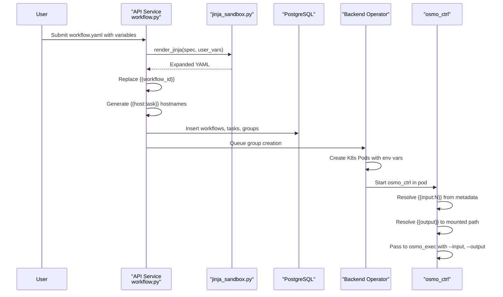
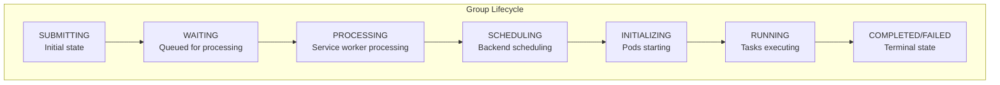
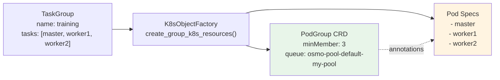
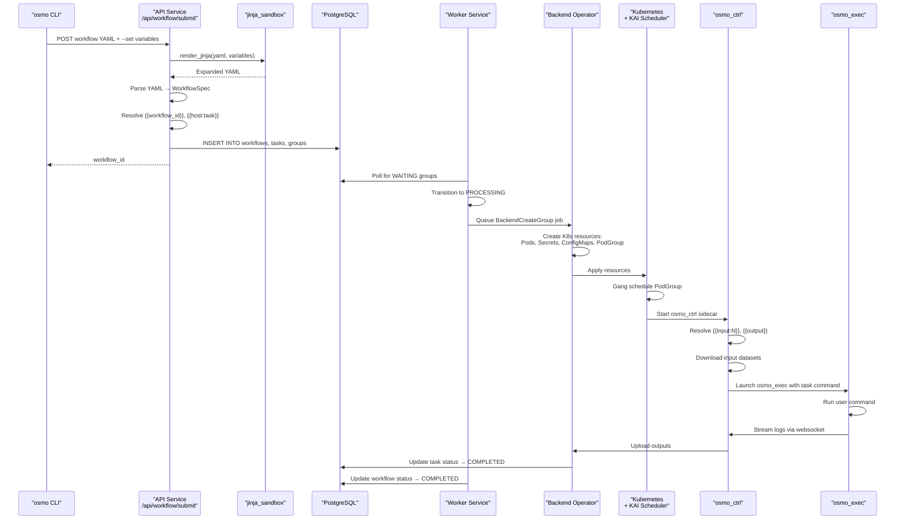
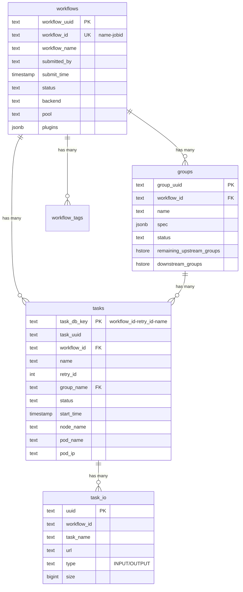
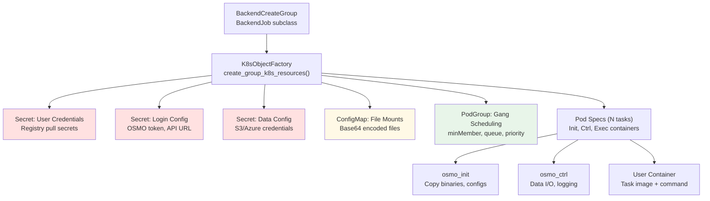
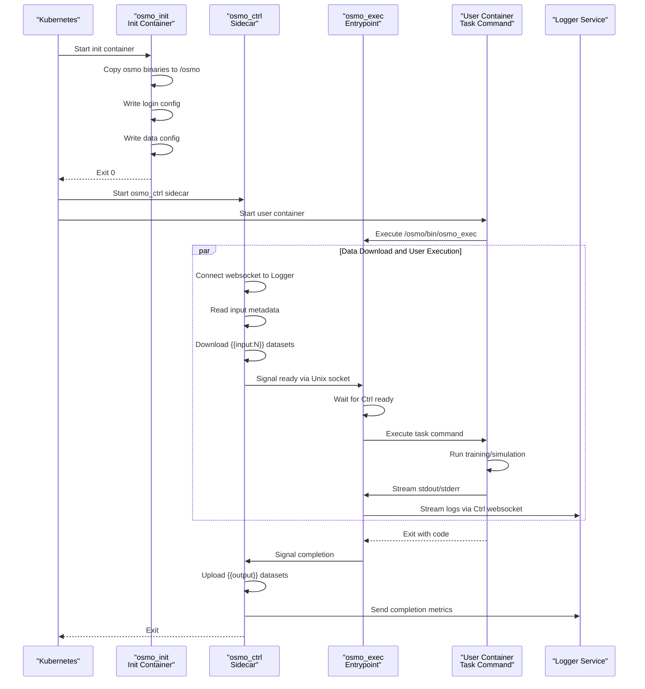

<!-- source: DeepWiki mcp.deepwiki.com · repo NVIDIA/OSMO · page 6 Workflows · fetched 2026-10-26 -->

# Workflows

<details>
<summary>Relevant source files</summary>

The following files were used as context for generating this wiki page:

- [docs/user_guide/how_to/hil.rst](docs/user_guide/how_to/hil.rst)
- [docs/user_guide/how_to/isaac_groot_notebook.rst](docs/user_guide/how_to/isaac_groot_notebook.rst)
- [docs/user_guide/how_to/isaac_sim_sdg.rst](docs/user_guide/how_to/isaac_sim_sdg.rst)
- [docs/user_guide/how_to/reinforcement_learning.rst](docs/user_guide/how_to/reinforcement_learning.rst)
- [docs/user_guide/how_to/ros2_comm.rst](docs/user_guide/how_to/ros2_comm.rst)
- [docs/user_guide/how_to/training/multi_node.rst](docs/user_guide/how_to/training/multi_node.rst)
- [docs/user_guide/how_to/training/single_node.rst](docs/user_guide/how_to/training/single_node.rst)
- [docs/user_guide/workflows/specification/templates_and_tokens.rst](docs/user_guide/workflows/specification/templates_and_tokens.rst)
- [src/lib/utils/common.py](src/lib/utils/common.py)
- [src/lib/utils/port_forward.py](src/lib/utils/port_forward.py)
- [src/lib/utils/tests/test_common.py](src/lib/utils/tests/test_common.py)
- [src/service/core/config/helpers.py](src/service/core/config/helpers.py)
- [src/service/core/data/data_service.py](src/service/core/data/data_service.py)
- [src/service/logger/ctrl_websocket.py](src/service/logger/ctrl_websocket.py)
- [src/service/router/router.py](src/service/router/router.py)
- [src/utils/connectors/postgres.py](src/utils/connectors/postgres.py)
- [src/utils/job/kb_objects.py](src/utils/job/kb_objects.py)
- [src/utils/job/task.py](src/utils/job/task.py)
- [workflows/hil/setup_discovery_server.sh](workflows/hil/setup_discovery_server.sh)
- [workflows/ros/comm/ros2_comm.yaml](workflows/ros/comm/ros2_comm.yaml)
- [workflows/synthetic_data_generation/isaac_sim/isaac_sim_sdg.yaml](workflows/synthetic_data_generation/isaac_sim/isaac_sim_sdg.yaml)

</details>


Workflows are the fundamental execution unit in OSMO. A workflow defines one or more tasks that execute containerized workloads on compute backends, with support for data inputs/outputs, resource allocation, and inter-task communication. This page describes the workflow specification format, execution lifecycle, and how workflows are represented in code and the database.

For information about submitting and managing workflows via the API, see [Control Plane Services](#3). For backend execution details, see [Backend Operators](#5).

---

## Workflow Specification Format

Workflows are defined in YAML files with Jinja2 templating support. The specification defines tasks, resource requirements, data inputs/outputs, and execution parameters.

### YAML Structure

```yaml
workflow:
  name: workflow-name
  tasks:
    - name: task-name
      image: container-image
      command: ["/bin/bash"]
      args: ["-c", "echo hello"]
      inputs: []
      outputs: []
      files: []
      resources: default
  groups:
    - name: group-name
      tasks: []
  resources:
    default:
      cpu: 4
      gpu: 1
      memory: 10Gi
      storage: 20Gi
  timeout:
    exec_timeout: 1h
    queue_timeout: 30m
```

The workflow specification is parsed and validated using Pydantic models defined in [src/utils/job/task.py:589-863]().

**Sources:** [src/utils/job/task.py:589-863](), [docs/user_guide/workflows/specification/templates_and_tokens.rst:1-229]()

---

## Task Specification

Each task defines a containerized workload with its execution parameters, resource requirements, and data dependencies.

### TaskSpec Components

```mermaid
graph TB
    TaskSpec["TaskSpec"]
    TaskSpec --> name["name: str<br/>Task identifier"]
    TaskSpec --> image["image: str<br/>Container image"]
    TaskSpec --> command["command: List[str]<br/>Entry command"]
    TaskSpec --> args["args: List[str]<br/>Command arguments"]
    TaskSpec --> inputs["inputs: List[InputType]<br/>Data sources"]
    TaskSpec --> outputs["outputs: List[OutputType]<br/>Data destinations"]
    TaskSpec --> files["files: List[File]<br/>Mounted files"]
    TaskSpec --> environment["environment: Dict[str,str]<br/>Environment variables"]
    TaskSpec --> resources["resources: ResourceSpec<br/>CPU/GPU/Memory/Storage"]
    TaskSpec --> lead["lead: bool<br/>Group leader flag"]
    TaskSpec --> privileged["privileged: bool<br/>Privileged execution"]
    TaskSpec --> volumeMounts["volumeMounts: List[str]<br/>Host volume mounts"]
    TaskSpec --> exitActions["exitActions: Dict[str,str]<br/>Exit code handling"]
```



**Key Classes:**
- **`TaskSpec`** [src/utils/job/task.py:589-863](): Defines task execution parameters
- **`File`** [src/utils/job/task.py:558-587](): Represents files mounted into containers
- **`InputType`** [src/utils/job/task.py:512](): Union of TaskInputOutput, DatasetInputOutput, URLInputOutput
- **`OutputType`** [src/utils/job/task.py:514](): Union of DatasetInputOutput, URLInputOutput, UpdateDatasetOutput
- **`ResourceSpec`** [src/utils/connectors/postgres.py:118-123](): CPU, GPU, memory, storage allocation

**Sources:** [src/utils/job/task.py:589-863](), [src/utils/job/task.py:512-514]()

### Input and Output Types

Tasks can consume and produce data from multiple sources:

| Input Type | Description | Example |
|------------|-------------|---------|
| **TaskInputOutput** | Output from another task | `task: workflow-id:task-name` |
| **DatasetInputOutput** | OSMO dataset | `dataset: {name: my-dataset, path: subdir}` |
| **URLInputOutput** | External URL | `url: s3://bucket/path` |

| Output Type | Description | Example |
|-------------|-------------|---------|
| **DatasetInputOutput** | Write to new dataset | `dataset: {name: output-dataset}` |
| **UpdateDatasetOutput** | Append to existing dataset | `update_dataset: {name: existing-dataset}` |
| **URLInputOutput** | Write to external location | `url: s3://bucket/output` |

**Sources:** [src/utils/job/task.py:259-514]()

### File Mounts

Files can be embedded in the workflow spec or referenced from local paths:

```yaml
files:
  - path: /tmp/script.sh
    contents: |
      #!/bin/bash
      echo "Inline script"
  - path: /tmp/local-file.txt
    localpath: local-file.txt  # Relative to workflow spec
  - path: /tmp/binary.dat
    base64: true
    contents: "YmluYXJ5IGRhdGE="  # Base64 encoded
```

Files are converted to Kubernetes ConfigMaps by `FileMount.config_map()` [src/utils/job/kb_objects.py:242-265]().

**Sources:** [src/utils/job/task.py:558-587](), [src/utils/job/kb_objects.py:242-265]()

---

## Jinja Templates and Special Tokens

Workflows support Jinja2 templating for dynamic generation and special tokens that are resolved at runtime by the OSMO service.

### Jinja Variables

Variables are defined in the `default-values` section and can be overridden at submission time:

```yaml
workflow:
  name: "{{ workflow_name }}"
  tasks:
    
    - name: "task-{{ i }}"
      image: "{{ container_image }}"
      args: ["{{ script_arg }}"]
    

default-values:
  workflow_name: my-workflow
  num_tasks: 3
  container_image: ubuntu:22.04
  script_arg: hello
```

Variables are expanded using `jinja_sandbox.render_jinja()` [src/lib/utils/jinja_sandbox.py]() before workflow submission.

**Submission with overrides:**
```bash
osmo workflow submit workflow.yaml --set num_tasks=5 container_image=alpine:latest
```

**Sources:** [docs/user_guide/workflows/specification/templates_and_tokens.rst:24-116](), [src/lib/utils/jinja_sandbox.py]()

### Special Tokens

Special tokens are reserved identifiers that OSMO resolves during workflow execution:

| Token | Description | Resolved By | Example Value |
|-------|-------------|-------------|---------------|
| `{{workflow_id}}` | Workflow identifier | Service | `my-workflow-123` |
| `{{input:N}}` | Nth input mount path | osmo_ctrl | `/osmo/data/input/dataset-name` |
| `{{output}}` | Output mount path | osmo_ctrl | `/osmo/data/output` |
| `{{host:task}}` | Hostname of task in group | Service | `osmo-abc123-def456.osmo-abc123.svc.cluster.local` |

**Token Resolution Flow:**



**Key Functions:**
- **`resolve_workflow_id()`** [src/utils/job/workflow.py](): Replaces `{{workflow_id}}` tokens
- **`resolve_host_token()`** [src/utils/job/task.py](): Generates subdomain names for `{{host:task}}`
- **`TaskGroup.to_backend_job()`** [src/utils/job/task.py](): Embeds resolved tokens in pod specs

**Sources:** [docs/user_guide/workflows/specification/templates_and_tokens.rst:117-229](), [src/utils/job/task.py:589-863]()

### {{host:task}} Token for Inter-Task Communication

The `{{host:task}}` token resolves to the DNS hostname of a task within a group, enabling direct network communication:

```yaml
groups:
  - name: training
    tasks:
      - name: master
        lead: true
        files:
          - path: /tmp/run.sh
            contents: |
              torchrun --master_addr {{host:master}} --master_port 29400 train.py
      - name: worker
        files:
          - path: /tmp/run.sh
            contents: |
              torchrun --master_addr {{host:master}} --master_port 29400 train.py
```

The token resolves to a subdomain in the format:
```
<task-name>.<group-subdomain>.<namespace>.svc.cluster.local
```

Generated by `get_group_subdomain_name()` [src/lib/utils/common.py:699-706]() which creates a headless Kubernetes Service for the group.

**Sources:** [docs/user_guide/how_to/training/multi_node.rst:44-110](), [src/lib/utils/common.py:699-706]()

---

## Groups and Distributed Workflows

Groups enable multiple tasks to launch simultaneously with private networking, essential for distributed training and multi-node communication.

### Group Structure



**Key Properties:**
- **Simultaneous Launch:** All tasks in a group are gang-scheduled and start together
- **Private Network:** Tasks can communicate via `{{host:task}}` hostnames
- **Lead Task:** One task marked with `lead: true` can coordinate the group
- **Barrier Synchronization:** Tasks can wait for each other using barriers

**Sources:** [src/utils/job/task.py:151-257]()

### Gang Scheduling

Groups are converted to Kubernetes PodGroups for gang scheduling by the KAI scheduler:



**Key Classes:**
- **`TaskGroup`** [src/utils/job/task.py:866-1551](): Represents a group of tasks
- **`KaiK8sObjectFactory`** [src/utils/job/kb_objects.py:324-476](): Creates PodGroup resources
- **`create_group_k8s_resources()`** [src/utils/job/kb_objects.py:332-378](): Generates K8s resources for gang scheduling

**Sources:** [src/utils/job/task.py:866-1551](), [src/utils/job/kb_objects.py:324-476]()

### Barrier Synchronization

Tasks can synchronize execution using barriers stored in Redis:

```python
# In task entry script
python3 /tmp/osmo_barrier.py --num_nodes 4 --connect {{host:master}} --rank 0
```

Barriers are managed by:
- **`update_barrier()`** [src/service/logger/ctrl_websocket.py:93-116](): Adds task to barrier set
- **`barrier_key()`** [src/utils/job/common.py](): Generates Redis key for barrier
- Redis SET operations to track participating tasks

When all tasks join, waiting tasks are notified via Redis pub/sub.

**Sources:** [src/service/logger/ctrl_websocket.py:93-116](), [docs/user_guide/how_to/training/multi_node.rst:180-216]()

---

## Workflow Execution Lifecycle

The workflow execution lifecycle spans from submission through Jinja expansion, database persistence, Kubernetes resource creation, task execution, and completion.



**Sources:** [src/service/core/workflow/workflow_service.py](), [src/service/worker/worker.py](), [src/backend/backend_worker.py]()

### Submission and Jinja Expansion

1. **User submits workflow:**
   ```bash
   osmo workflow submit workflow.yaml --set variable1=value1 variable2=value2
   ```

2. **API parses and expands Jinja:**
   - Loads `workflow.yaml` [src/lib/utils/client.py]()
   - Merges `--set` variables with `default-values`
   - Calls `jinja_sandbox.render_jinja()` [src/lib/utils/jinja_sandbox.py]()
   - Parses expanded YAML into `WorkflowSpec` [src/utils/job/workflow.py]()

3. **Special token resolution:**
   - `{{workflow_id}}` replaced with generated ID
   - `{{host:task}}` replaced with subdomain names
   - `{{input:N}}` and `{{output}}` left for osmo_ctrl

**Sources:** [src/lib/utils/client.py](), [src/lib/utils/jinja_sandbox.py](), [src/utils/job/workflow.py]()

### Database Persistence

Workflow data is stored across multiple tables:



**Key Operations:**
- **`Workflow.insert_to_db()`** [src/utils/job/workflow.py](): Inserts workflow record
- **`TaskGroup.insert_to_db()`** [src/utils/job/task.py](): Inserts group and tasks
- **`Task.fetch_from_db()`** [src/utils/job/task.py](): Retrieves task by workflow_id and name

**Table Definitions:** [src/utils/connectors/postgres.py:631-786]()

**Sources:** [src/utils/connectors/postgres.py:631-786](), [src/utils/job/workflow.py](), [src/utils/job/task.py]()

### Kubernetes Resource Creation

The Backend Operator converts tasks into Kubernetes resources:



**Key Components:**

1. **Secrets:**
   - **User credentials:** Registry pull secrets created by `create_image_secret()` [src/utils/job/kb_objects.py:283-300]()
   - **Login config:** OSMO API credentials for osmo_ctrl
   - **Data config:** S3/Azure credentials for dataset access

2. **ConfigMaps:**
   - File mounts from `TaskSpec.files` converted by `FileMount.config_map()` [src/utils/job/kb_objects.py:242-265]()

3. **PodGroup:**
   - Gang scheduling metadata created by `KaiK8sObjectFactory.create_group_k8s_resources()` [src/utils/job/kb_objects.py:332-378]()

4. **Pod Spec:**
   - **Init Container:** `create_init_container()` [src/utils/job/kb_objects.py:111-152]()
   - **Control Container:** `create_control_container()` [src/utils/job/kb_objects.py:154-240]()
   - **Exec Container:** `TaskSpec.to_pod_container()` [src/utils/job/task.py:775-863]()

**Sources:** [src/utils/job/kb_objects.py:43-323](), [src/utils/job/task.py:775-863]()

### Task Execution

Tasks execute in three-container pods:



**Key Binaries:**
- **`osmo_init`**: Initializes pod environment [src/backend/init/init.go]()
- **`osmo_ctrl`**: Manages data I/O and logging [src/backend/ctrl/ctrl.go]()
- **`osmo_exec`**: Wraps user command, streams logs [src/backend/exec/exec.go]()

**Communication:**
- Unix socket at `/osmo/data/socket/data.sock` for Ctrl ↔ Exec
- WebSocket to Logger service for log streaming [src/service/logger/ctrl_websocket.py:118-248]()
- Redis for barrier synchronization

**Sources:** [src/backend/init/init.go](), [src/backend/ctrl/ctrl.go](), [src/backend/exec/exec.go](), [src/service/logger/ctrl_websocket.py:118-248]()

---

## Workflow Status Transitions

Tasks and groups progress through defined states during execution:

### Task Status Values

| Status | Description | Terminal |
|--------|-------------|----------|
| **SUBMITTING** | Initial state after submission | No |
| **WAITING** | Queued, waiting for service worker | No |
| **PROCESSING** | Service worker processing | No |
| **SCHEDULING** | Backend scheduling K8s resources | No |
| **INITIALIZING** | Pod starting, init containers running | No |
| **RUNNING** | Task command executing | No |
| **COMPLETED** | Successfully finished | Yes |
| **RESCHEDULED** | Ended and restarted (task only) | Yes |
| **FAILED** | Generic failure | Yes |
| **FAILED_CANCELED** | User cancelled | Yes |
| **FAILED_SERVER_ERROR** | Service error | Yes |
| **FAILED_BACKEND_ERROR** | Backend/K8s error | Yes |
| **FAILED_EXEC_TIMEOUT** | Execution timeout exceeded | Yes |
| **FAILED_QUEUE_TIMEOUT** | Queue timeout exceeded | Yes |
| **FAILED_IMAGE_PULL** | Container image pull failed | Yes |
| **FAILED_UPSTREAM** | Dependency task failed | Yes |
| **FAILED_EVICTED** | Pod evicted by K8s | Yes |
| **FAILED_START_ERROR** | Pod failed to start | Yes |
| **FAILED_START_TIMEOUT** | Pod start timeout | Yes |
| **FAILED_PREEMPTED** | Preempted by higher priority | Yes |

**Status Methods:**
- **`finished()`**: Returns true for terminal states [src/utils/job/task.py:214-216]()
- **`failed()`**: Returns true for FAILED_* states [src/utils/job/task.py:225-227]()
- **`in_queue()`**: Returns true for pre-scheduling states [src/utils/job/task.py:233-235]()

**Sources:** [src/utils/job/task.py:151-257]()

### Exit Actions

Tasks can define custom actions based on exit codes:

```yaml
tasks:
  - name: train
    exitActions:
      COMPLETE: "0"           # Exit code 0 → COMPLETED
      FAIL: "1-10,20-30"      # Exit codes 1-10, 20-30 → FAILED
      RESCHEDULE: "42"        # Exit code 42 → RESCHEDULED
```

Exit actions are validated by regex `CODE_REGEX` [src/utils/job/task.py:65]() and evaluated by the Backend Operator when tasks complete.

**Sources:** [src/utils/job/task.py:127-135](), [src/utils/job/task.py:696-709]()

---

## Example Workflows

### Single-Node Training

```yaml
workflow:
  name: train-model
  tasks:
    - name: train
      image: nvcr.io/nvidia/pytorch:24.03-py3
      command: ["python3"]
      args: ["/tmp/train.py", "--epochs", "10"]
      inputs:
        - dataset:
            name: training-data
      outputs:
        - dataset:
            name: trained-model
            path: checkpoints
      files:
        - path: /tmp/train.py
          localpath: train.py
      resources: gpu-node
  resources:
    gpu-node:
      cpu: 8
      gpu: 1
      memory: 32Gi
      storage: 50Gi
```

**Sources:** [docs/user_guide/how_to/training/single_node.rst:32-67](), [workflows/dnn_training/single_node]()

### Multi-Node Distributed Training

```yaml
workflow:
  name: train-multi-node
  groups:
    - name: training
      tasks:
        - name: master
          lead: true
          image: nvcr.io/nvidia/pytorch:24.03-py3
          files:
            - path: /tmp/run.sh
              contents: |
                torchrun --nnodes 2 --nproc_per_node 8 \
                  --master_addr {{host:master}} --master_port 29400 \
                  train.py --epochs 10
        - name: worker
          image: nvcr.io/nvidia/pytorch:24.03-py3
          files:
            - path: /tmp/run.sh
              contents: |
                torchrun --nnodes 2 --nproc_per_node 8 --node_rank 1 \
                  --master_addr {{host:master}} --master_port 29400 \
                  train.py --epochs 10
  resources:
    default:
      cpu: 16
      gpu: 8
      memory: 120Gi
      storage: 100Gi
```

**Sources:** [docs/user_guide/how_to/training/multi_node.rst:40-102](), [workflows/dnn_training/torchrun_multinode]()

### ROS 2 Multi-Node Communication

```yaml
workflow:
  name: ros-comms
  groups:
    - name: nodes
      tasks:
        - name: discovery-server
          image: osrf/ros:humble-desktop-full
          command: ["/bin/bash", "/tmp/run.sh"]
          files:
            - path: /tmp/run.sh
              contents: |
                source /opt/ros/humble/setup.bash
                fastdds discovery --server-id 0 -p 11811
        - name: publisher
          lead: true
          image: osrf/ros:humble-desktop-full
          files:
            - path: /tmp/run.sh
              contents: |
                DISCOVERY_SERVER_IP=$(nslookup {{host:discovery-server}} | grep Address | tail -1 | awk '{print $2}')
                export ROS_DISCOVERY_SERVER=$DISCOVERY_SERVER_IP:11811
                source /opt/ros/humble/setup.bash
                ros2 run demo_nodes_cpp talker
        - name: subscriber
          image: osrf/ros:humble-desktop-full
          files:
            - path: /tmp/run.sh
              contents: |
                DISCOVERY_SERVER_IP=$(nslookup {{host:discovery-server}} | grep Address | tail -1 | awk '{print $2}')
                export ROS_DISCOVERY_SERVER=$DISCOVERY_SERVER_IP:11811
                source /opt/ros/humble/setup.bash
                ros2 run demo_nodes_cpp listener
```

**Sources:** [docs/user_guide/how_to/ros2_comm.rst:65-114](), [workflows/ros/comm/ros2_comm.yaml:20-87]()

---

## Key Code References

| Component | Primary File | Key Classes/Functions |
|-----------|-------------|----------------------|
| **Workflow Spec Parsing** | [src/utils/job/task.py:589-863]() | `TaskSpec`, `WorkflowSpec` |
| **Workflow Lifecycle** | [src/utils/job/workflow.py]() | `Workflow`, `WorkflowManager` |
| **Task Groups** | [src/utils/job/task.py:866-1551]() | `TaskGroup`, `TaskGroupStatus` |
| **Jinja Templating** | [src/lib/utils/jinja_sandbox.py]() | `render_jinja()` |
| **Special Token Resolution** | [src/utils/job/task.py](), [src/utils/job/workflow.py]() | `resolve_workflow_id()`, `resolve_host_token()` |
| **K8s Resource Generation** | [src/utils/job/kb_objects.py:43-323]() | `K8sObjectFactory`, `KaiK8sObjectFactory` |
| **Database Schema** | [src/utils/connectors/postgres.py:631-786]() | Table creation in `_init_tables()` |
| **Backend Job Processing** | [src/backend/backend_worker.py]() | `BackendWorker`, `BackendCreateGroup` |
| **Task Execution** | [src/backend/ctrl/ctrl.go](), [src/backend/exec/exec.go]() | osmo_ctrl, osmo_exec binaries |
| **Log Streaming** | [src/service/logger/ctrl_websocket.py:118-248]() | `run_websocket()` |

**Sources:** All files listed in table above

---

