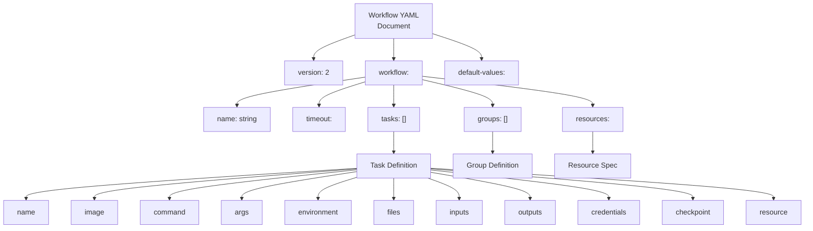
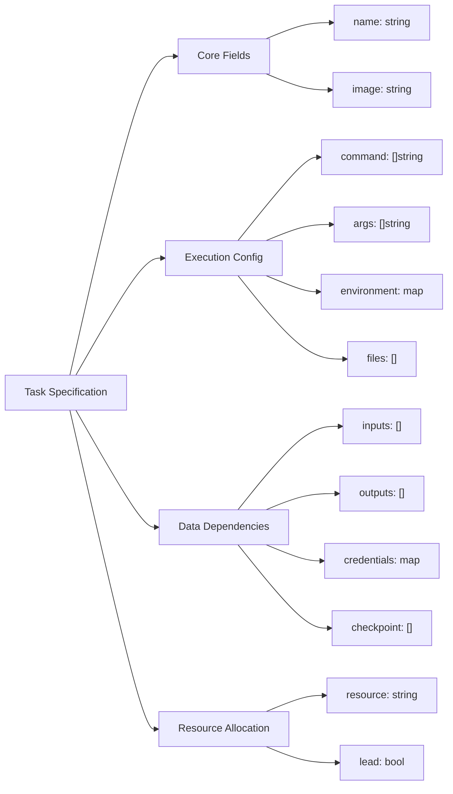
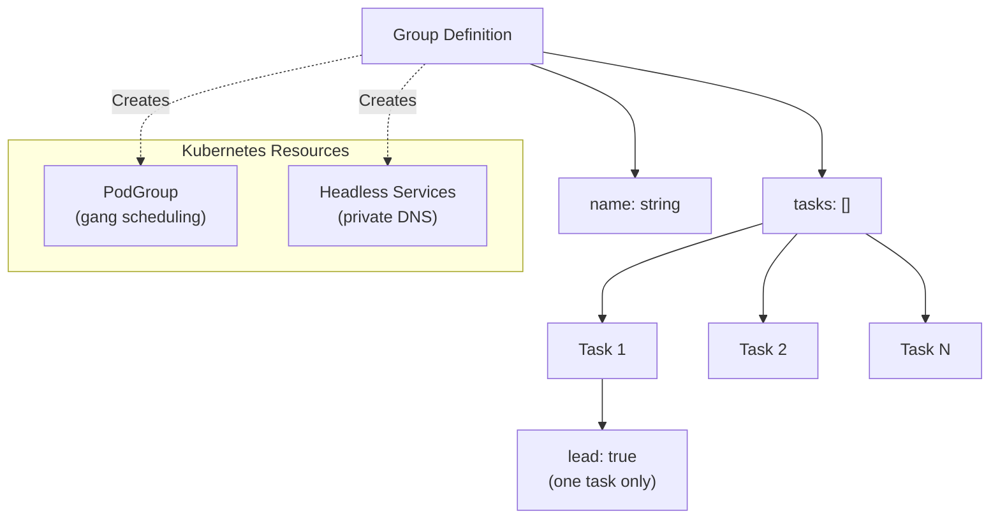
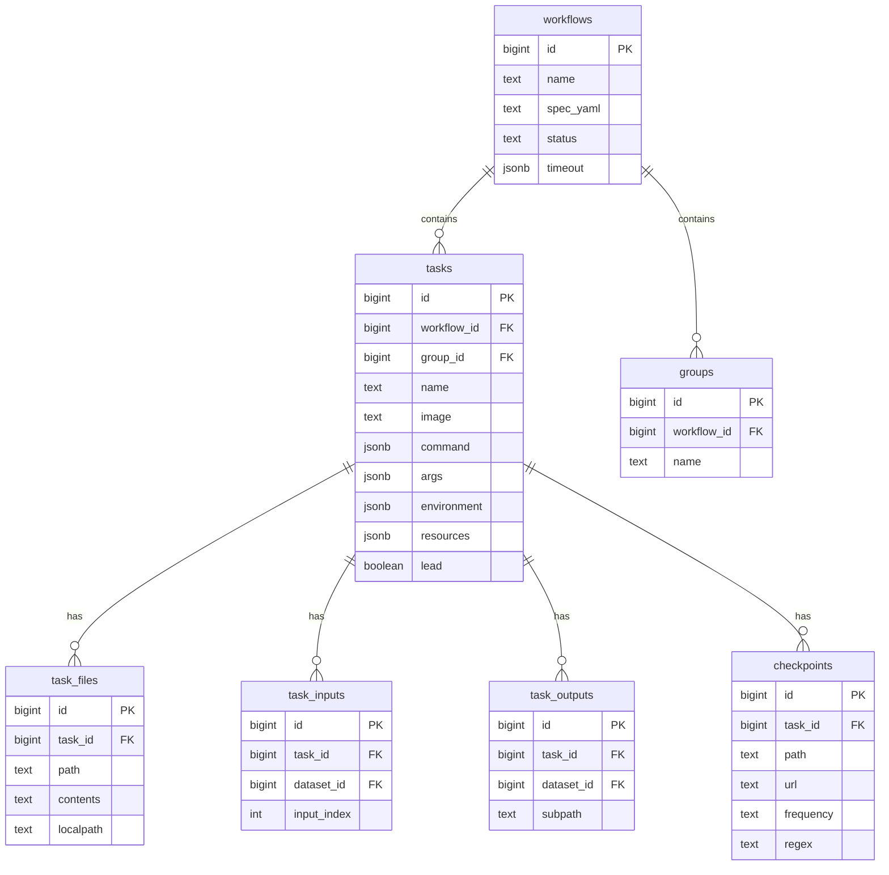

<!-- source: DeepWiki mcp.deepwiki.com · repo NVIDIA/OSMO · page 6.1 Workflow Specification · fetched 2026-10-26 -->

# Workflow Specification

<details>
<summary>Relevant source files</summary>

The following files were used as context for generating this wiki page:

- [docs/user_guide/how_to/hil.rst](docs/user_guide/how_to/hil.rst)
- [docs/user_guide/how_to/isaac_groot_notebook.rst](docs/user_guide/how_to/isaac_groot_notebook.rst)
- [docs/user_guide/how_to/isaac_sim_sdg.rst](docs/user_guide/how_to/isaac_sim_sdg.rst)
- [docs/user_guide/how_to/reinforcement_learning.rst](docs/user_guide/how_to/reinforcement_learning.rst)
- [docs/user_guide/how_to/ros2_comm.rst](docs/user_guide/how_to/ros2_comm.rst)
- [docs/user_guide/how_to/training/multi_node.rst](docs/user_guide/how_to/training/multi_node.rst)
- [docs/user_guide/how_to/training/single_node.rst](docs/user_guide/how_to/training/single_node.rst)
- [docs/user_guide/workflows/specification/templates_and_tokens.rst](docs/user_guide/workflows/specification/templates_and_tokens.rst)
- [workflows/hil/setup_discovery_server.sh](workflows/hil/setup_discovery_server.sh)
- [workflows/ros/comm/ros2_comm.yaml](workflows/ros/comm/ros2_comm.yaml)
- [workflows/synthetic_data_generation/isaac_sim/isaac_sim_sdg.yaml](workflows/synthetic_data_generation/isaac_sim/isaac_sim_sdg.yaml)

</details>


This document describes the YAML structure used to define OSMO workflows. It covers the schema, field definitions, and their relationships without discussing template resolution or execution semantics.

For information about Jinja templating and special token substitution, see [Jinja Templates and Special Tokens](#6.2). For details on multi-task coordination using groups, see [Distributed Workflows with Groups](#6.3). For workflow execution lifecycle, see [Workflow Lifecycle and Execution](#6.4).

## Purpose and Scope

Workflow specifications are YAML files that declaratively define computational workloads in OSMO. This document provides a complete reference for all fields available in the workflow specification format, including:

- Top-level structure and version numbering
- Workflow-level configuration (resources, timeouts)
- Task definitions (containers, commands, data dependencies)
- Group definitions (multi-task coordination)
- Resource allocation specifications
- File mounting and content injection
- Input/output dataset connections

---

## YAML Structure Overview



**Sources:** [docs/user_guide/workflows/specification/templates_and_tokens.rst:40-76](), [docs/user_guide/how_to/training/multi_node.rst:46-96]()

---

## Top-Level Fields

### Version Field

The `version` field specifies the workflow specification schema version. Currently, version 2 is the active format.

```yaml
version: 2
```

### Workflow Section

The `workflow` section contains all workflow-level configuration and task definitions.

```yaml
workflow:
  name: my-workflow
  # ... other fields
```

### Default Values Section

The `default-values` section defines default values for Jinja template variables. See [Jinja Templates and Special Tokens](#6.2) for details on template variable usage.

```yaml
default-values:
  workflow_name: my_workflow
  dataset_name: my_dataset
```

**Sources:** [docs/user_guide/workflows/specification/templates_and_tokens.rst:66-70](), [docs/user_guide/how_to/training/multi_node.rst:158-164]()

---

## Workflow Properties

### Name

The `name` field specifies a human-readable identifier for the workflow. This name is stored in the database and displayed in the UI.

```yaml
workflow:
  name: train-multi-gpu
```

### Timeout

The `timeout` section defines time limits for workflow execution. The `exec_timeout` field specifies the maximum duration a workflow can run before automatic termination.

```yaml
workflow:
  timeout:
    exec_timeout: 2h  # Supports: s (seconds), m (minutes), h (hours), d (days)
```

**Example timeout values:**
- `30s` - 30 seconds
- `15m` - 15 minutes  
- `2h` - 2 hours
- `1d` - 1 day

**Sources:** [docs/user_guide/how_to/isaac_groot_notebook.rst:54-66](), [workflows/ros/comm/ros2_comm.yaml:85-86]()

### Resources

The `resources` section defines resource allocation profiles that tasks can reference. Each profile specifies CPU, GPU, memory, storage, and platform requirements.

```yaml
workflow:
  resources:
    default:
      cpu: 4
      gpu: 1
      memory: 32Gi
      storage: 10Gi
      platform: agx-orin
    high-performance:
      cpu: 16
      gpu: 8
      memory: 100Gi
      storage: 50Gi
      platform: ovx-a40
```

#### Resource Field Definitions

| Field | Type | Description | Example |
|-------|------|-------------|---------|
| `cpu` | integer | Number of CPU cores | `8` |
| `gpu` | integer | Number of GPUs (optional) | `2` |
| `memory` | string | Memory allocation in Kubernetes format | `32Gi`, `16384Mi` |
| `storage` | string | Ephemeral storage in Kubernetes format | `10Gi`, `5000Mi` |
| `platform` | string | Hardware platform selector (optional) | `agx-orin`, `gb200`, `ovx-a40` |

Platform values match annotations configured in resource pools. See [Backend Operators](#5) for platform configuration details.

**Sources:** [docs/user_guide/how_to/hil.rst:171-202](), [workflows/synthetic_data_generation/isaac_sim/isaac_sim_sdg.yaml:46-51]()

---

## Task Definitions

Tasks are the fundamental unit of work in OSMO workflows. Each task runs as a Kubernetes pod with specified container configuration, resource allocation, and data dependencies.



**Sources:** [docs/user_guide/workflows/specification/templates_and_tokens.rst:46-64](), [docs/user_guide/how_to/training/single_node.rst:40-64]()

### Core Task Fields

#### Name

The `name` field uniquely identifies a task within a workflow. This name is used for inter-task communication tokens and log identification.

```yaml
tasks:
- name: train
```

**Constraints:**
- Must be unique within the workflow
- Used in `{{host:task_name}}` special tokens
- Stored in the `tasks` table with foreign key to `workflows`

#### Image

The `image` field specifies the Docker container image to execute. Supports any registry accessible to the backend operator.

```yaml
tasks:
- name: simulation
  image: nvcr.io/nvidia/isaac-sim:5.1.0
```

**Common registries:**
- NVIDIA NGC: `nvcr.io/nvidia/*`
- Docker Hub: `ubuntu`, `python:3.10`
- Custom registries: `my-registry.example.com/my-image:tag`

**Sources:** [workflows/synthetic_data_generation/isaac_sim/isaac_sim_sdg.yaml:23-24](), [docs/user_guide/how_to/reinforcement_learning.rst:59-61]()

### Execution Configuration

#### Command

The `command` field overrides the container's entrypoint. Specified as an array of strings.

```yaml
tasks:
- name: train
  command: ["/bin/bash"]
  args: ["/tmp/entry.sh"]
```

#### Args

The `args` field provides arguments to the command. Combined with `command` to form the complete execution vector.

```yaml
tasks:
- name: processor
  image: ubuntu
  command: ["python3"]
  args: ["/tmp/script.py", "--verbose"]
```

#### Environment

The `environment` field defines environment variables available to the task container. Specified as key-value pairs.

```yaml
tasks:
- name: isaac-sim
  environment:
    ACCEPT_EULA: Y
    NO_NUCLEUS: Y
    ISAAC_ROS_OVERRIDE_DATASET_ROOT: "/data"
```

**Sources:** [workflows/synthetic_data_generation/isaac_sim/isaac_sim_sdg.yaml:27-29](), [docs/user_guide/workflows/specification/templates_and_tokens.rst:49-51]()

#### Files

The `files` field mounts files into the task container. Each file can be specified inline with `contents` or loaded from the local filesystem with `localpath`.

```yaml
tasks:
- name: train
  files:
  - path: /tmp/entry.sh
    contents: |
      #!/bin/bash
      echo "Starting training..."
      python3 /tmp/train.py
  - path: /tmp/train.py
    localpath: train.py
  - path: /tmp/config.json
    contents: |
      {
        "learning_rate": 0.001,
        "batch_size": 32
      }
```

**File Field Structure:**

| Field | Type | Required | Description |
|-------|------|----------|-------------|
| `path` | string | Yes | Absolute path where file is mounted in container |
| `contents` | string | Conditional | Inline file contents (mutually exclusive with `localpath`) |
| `localpath` | string | Conditional | Path to file on submission machine (mutually exclusive with `contents`) |

**Sources:** [docs/user_guide/how_to/training/single_node.rst:45-64](), [docs/user_guide/workflows/specification/templates_and_tokens.rst:153-159]()

### Data Dependencies

#### Inputs

The `inputs` field specifies dataset dependencies required by the task. Datasets are mounted as read-only volumes.

```yaml
tasks:
- name: train
  inputs:
  - dataset:
      name: training-dataset
  - dataset:
      name: validation-dataset
```

**Input Resolution:**
- Input index starts at 0
- Referenced via `{{input:0}}`, `{{input:1}}`, etc.
- Mounted at `/mnt/osmo/inputs/<index>/<dataset-name>/`
- See [Dataset Management](#4.2) for dataset versioning

#### Outputs

The `outputs` field specifies datasets to create from task results. Data written to the output path is uploaded to object storage upon task completion.

```yaml
tasks:
- name: train
  outputs:
  - dataset:
      name: trained-model
      path: models  # Optional: upload only this subdirectory
```

**Output Resolution:**
- Referenced via `{{output}}` special token
- Mounted at `/mnt/osmo/outputs/0/`
- If `path` is specified, only that subdirectory is uploaded
- Supports automatic versioning and tagging

**Sources:** [docs/user_guide/workflows/specification/templates_and_tokens.rst:145-165](), [docs/user_guide/how_to/training/multi_node.rst:133-136]()

#### Credentials

The `credentials` field injects secrets from OSMO's credential store into the task environment. Credentials are mounted as environment variables.

```yaml
tasks:
- name: train
  credentials:
    wandb:
      WANDB_API_KEY: wandb_api_key
    custom:
      DB_PASSWORD: postgres_password
```

**Structure:**
- First-level key: credential name (stored via `osmo credential set`)
- Second-level key: environment variable name
- Value: field name from credential payload

See [Credential Management and Encryption](#8.3) for credential storage details.

**Sources:** [docs/user_guide/how_to/training/single_node.rst:158-174]()

#### Checkpoint

The `checkpoint` field enables periodic synchronization of task data to object storage during execution. Useful for long-running training jobs.

```yaml
tasks:
- name: train
  checkpoint:
  - path: experiments/checkpoints
    url: s3://my-bucket/checkpoints
    frequency: 10s
    regex: .*\.pth
```

**Checkpoint Field Structure:**

| Field | Type | Description |
|-------|------|-------------|
| `path` | string | Local directory to checkpoint |
| `url` | string | Object storage URL for uploads |
| `frequency` | string | Sync interval (e.g., `10s`, `5m`, `1h`) |
| `regex` | string | Pattern to filter files for checkpointing |

**Sources:** [docs/user_guide/how_to/training/single_node.rst:130-145]()

### Resource Allocation

#### Resource Reference

The `resource` field specifies which resource profile from the workflow-level `resources` section to use for this task. If omitted, the `default` profile is used.

```yaml
workflow:
  resources:
    default:
      cpu: 1
      memory: 2Gi
    simulation:
      cpu: 16
      gpu: 1
      memory: 20Gi
  tasks:
  - name: data-prep
    resource: default
  - name: isaac-lab
    resource: simulation
```

**Sources:** [docs/user_guide/how_to/hil.rst:171-253]()

#### Lead Task Marker

The `lead` field designates a task as the leader within a group. Only one task per group can be marked as lead. The lead task determines group lifecycle and is used for special token resolution.

```yaml
groups:
- name: training
  tasks:
  - name: master
    lead: true
  - name: worker-1
  - name: worker-2
```

See [Distributed Workflows with Groups](#6.3) for lead task semantics.

**Sources:** [docs/user_guide/how_to/training/multi_node.rst:61-63](), [docs/user_guide/workflows/specification/templates_and_tokens.rst:99-100]()

---

## Group Definitions

Groups enable multiple tasks to launch simultaneously with private networking for inter-task communication. Tasks within a group can resolve each other's hostnames using special tokens.

```yaml
workflow:
  groups:
  - name: distributed-training
    tasks:
    - name: master
      lead: true
      image: pytorch:latest
    - name: worker-1
      image: pytorch:latest
    - name: worker-2
      image: pytorch:latest
```

### Group Structure



**Key Group Properties:**
- All tasks launch simultaneously (gang scheduling via KAI)
- Private network namespace for task-to-task communication
- DNS-based hostname resolution via `{{host:task_name}}`
- Exactly one task must be marked as `lead: true`
- Group fails if any task fails

See [Distributed Workflows with Groups](#6.3) for execution semantics and [KAI Scheduler and GPU Support](#5.3) for scheduling details.

**Sources:** [docs/user_guide/how_to/training/multi_node.rst:58-96](), [docs/user_guide/workflows/specification/templates_and_tokens.rst:91-105]()

---

## Complete Workflow Example

The following example demonstrates a multi-node training workflow with all major specification features:

```yaml
version: 2

workflow:
  name: distributed-training
  
  timeout:
    exec_timeout: 4h
  
  resources:
    default:
      cpu: 1
      memory: 2Gi
      storage: 1Gi
    training:
      cpu: 16
      gpu: 8
      memory: 100Gi
      storage: 50Gi
  
  groups:
  - name: training-cluster
    tasks:
    - name: master
      lead: true
      image: nvcr.io/nvidia/pytorch:24.03-py3
      command: [bash]
      args: [/tmp/entry.sh]
      resource: training
      environment:
        NCCL_DEBUG: INFO
      files:
      - path: /tmp/entry.sh
        contents: |
          torchrun --nnodes 2 --nproc_per_node 8 \
            --master_addr {{host:master}} \
            /tmp/train.py
      - path: /tmp/train.py
        localpath: train.py
      inputs:
      - dataset:
          name: training-data
      outputs:
      - dataset:
          name: trained-model
          path: models
      checkpoint:
      - path: checkpoints
        url: s3://bucket/checkpoints
        frequency: 5m
        regex: .*\.pth
      credentials:
        wandb:
          WANDB_API_KEY: api_key
    
    - name: worker-1
      image: nvcr.io/nvidia/pytorch:24.03-py3
      command: [bash]
      args: [/tmp/entry.sh]
      resource: training
      files:
      - path: /tmp/entry.sh
        contents: |
          torchrun --nnodes 2 --nproc_per_node 8 --node_rank 1 \
            --master_addr {{host:master}} \
            /tmp/train.py
      - path: /tmp/train.py
        localpath: train.py

default-values:
  learning_rate: 0.001
```

**Sources:** [docs/user_guide/how_to/training/multi_node.rst:116-165]()

---

## Database Schema Mapping

The workflow specification maps to several PostgreSQL tables during submission:



**Key Mappings:**

| YAML Field | Database Table | Column/JSON Field |
|------------|----------------|-------------------|
| `workflow.name` | `workflows` | `name` |
| `workflow.timeout` | `workflows` | `timeout` (jsonb) |
| `workflow.resources` | `workflows` | `spec_yaml` (parsed) |
| `tasks[].name` | `tasks` | `name` |
| `tasks[].image` | `tasks` | `image` |
| `tasks[].command` | `tasks` | `command` (jsonb) |
| `tasks[].environment` | `tasks` | `environment` (jsonb) |
| `tasks[].files` | `task_files` | One row per file |
| `tasks[].inputs` | `task_inputs` | One row per input |
| `tasks[].outputs` | `task_outputs` | One row per output |
| `groups[].name` | `groups` | `name` |

See [PostgreSQL Database Schema](#4.1) for complete table definitions.

**Sources:** Reference to postgres.py implementation (not directly shown in provided files, but implied by architecture diagrams)

---

## Workflow Submission

Workflows are submitted via the CLI using the `osmo workflow submit` command:

```bash
# Basic submission
osmo workflow submit workflow.yaml

# With Jinja variable overrides
osmo workflow submit workflow.yaml --set n_nodes=4 gpu_per_node=8

# With specific pool targeting
osmo workflow submit workflow.yaml --pool production-cluster
```

The submission process:
1. Parses YAML and validates schema
2. Resolves Jinja templates with default values and `--set` overrides
3. Validates resource compatibility with available pools
4. Persists workflow and task records to PostgreSQL
5. Enqueues tasks for backend operator execution

See [Workflow Lifecycle and Execution](#6.4) for the complete submission and execution flow.

**Sources:** [docs/user_guide/how_to/training/multi_node.rst:177](), [docs/user_guide/workflows/specification/templates_and_tokens.rst:77-81]()

---

