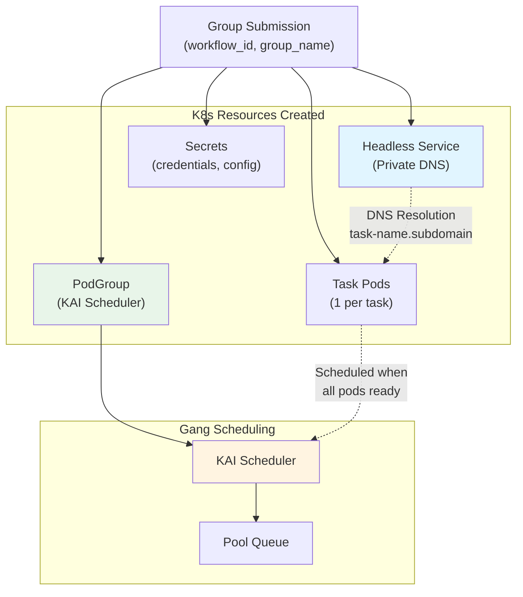
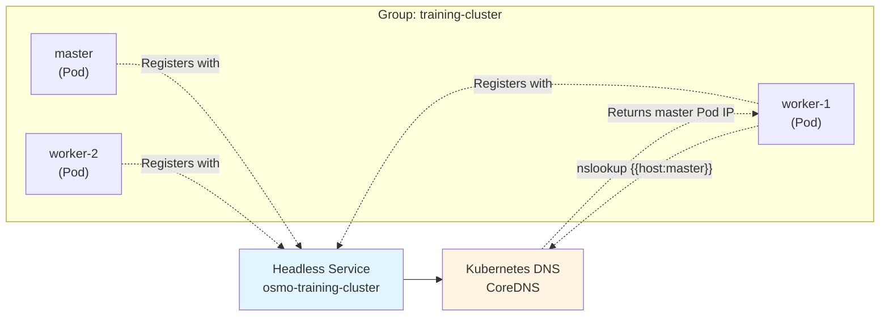
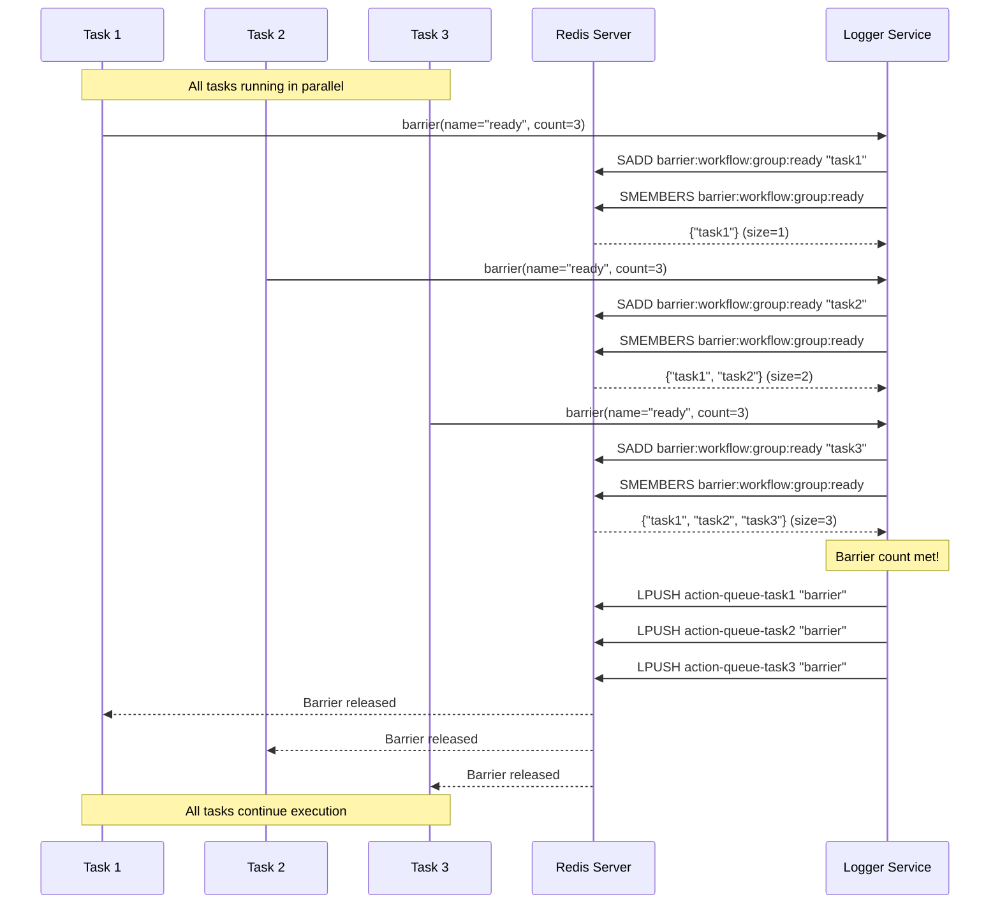
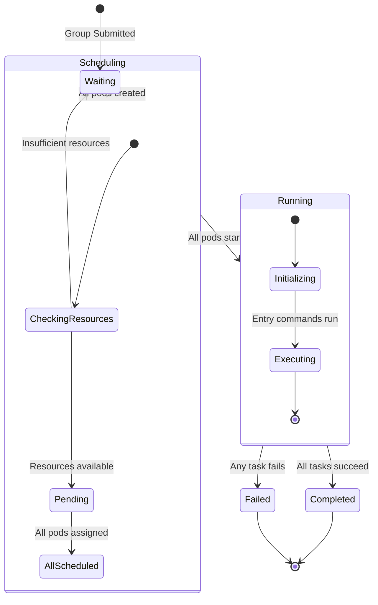
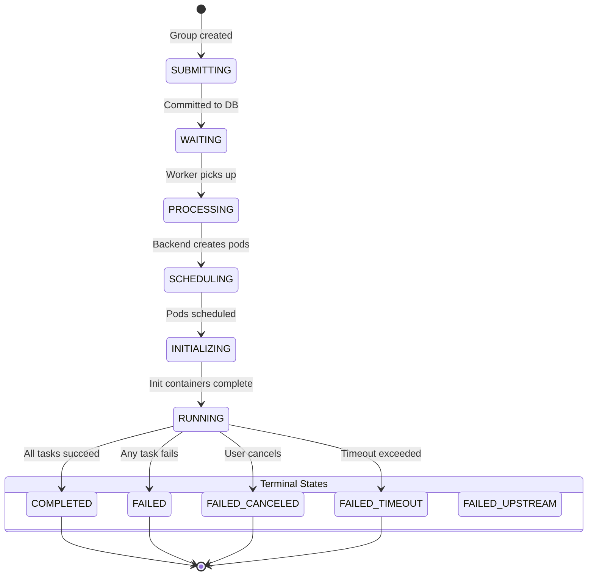

<!-- source: DeepWiki mcp.deepwiki.com · repo NVIDIA/OSMO · page 6.3 Distributed Workflows with Groups · fetched 2026-10-26 -->

# Distributed Workflows with Groups

<details>
<summary>Relevant source files</summary>

The following files were used as context for generating this wiki page:

- [docs/user_guide/how_to/hil.rst](docs/user_guide/how_to/hil.rst)
- [docs/user_guide/how_to/isaac_groot_notebook.rst](docs/user_guide/how_to/isaac_groot_notebook.rst)
- [docs/user_guide/how_to/isaac_sim_sdg.rst](docs/user_guide/how_to/isaac_sim_sdg.rst)
- [docs/user_guide/how_to/reinforcement_learning.rst](docs/user_guide/how_to/reinforcement_learning.rst)
- [docs/user_guide/how_to/ros2_comm.rst](docs/user_guide/how_to/ros2_comm.rst)
- [docs/user_guide/how_to/training/multi_node.rst](docs/user_guide/how_to/training/multi_node.rst)
- [docs/user_guide/how_to/training/single_node.rst](docs/user_guide/how_to/training/single_node.rst)
- [docs/user_guide/workflows/specification/templates_and_tokens.rst](docs/user_guide/workflows/specification/templates_and_tokens.rst)
- [src/lib/utils/common.py](src/lib/utils/common.py)
- [src/lib/utils/port_forward.py](src/lib/utils/port_forward.py)
- [src/lib/utils/tests/test_common.py](src/lib/utils/tests/test_common.py)
- [src/service/core/config/helpers.py](src/service/core/config/helpers.py)
- [src/service/core/data/data_service.py](src/service/core/data/data_service.py)
- [src/service/logger/ctrl_websocket.py](src/service/logger/ctrl_websocket.py)
- [src/service/router/router.py](src/service/router/router.py)
- [src/utils/connectors/postgres.py](src/utils/connectors/postgres.py)
- [src/utils/job/kb_objects.py](src/utils/job/kb_objects.py)
- [src/utils/job/task.py](src/utils/job/task.py)
- [workflows/hil/setup_discovery_server.sh](workflows/hil/setup_discovery_server.sh)
- [workflows/ros/comm/ros2_comm.yaml](workflows/ros/comm/ros2_comm.yaml)
- [workflows/synthetic_data_generation/isaac_sim/isaac_sim_sdg.yaml](workflows/synthetic_data_generation/isaac_sim/isaac_sim_sdg.yaml)

</details>


## Purpose and Scope

This document explains the **groups** construct in OSMO workflows, which enables distributed execution patterns where multiple tasks must run simultaneously with private network communication. Groups are essential for multi-node training, robotics applications with ROS 2 communication, and any workflow requiring coordinated parallel execution.

For general workflow specification syntax, see [Workflow Specification](#6.1). For special tokens used within groups like `{{host:task_name}}`, see [Jinja Templates and Special Tokens](#6.2). For the complete workflow lifecycle, see [Workflow Lifecycle and Execution](#6.4).

---

## What Are Groups?

Groups are collections of tasks within a workflow that are guaranteed to:

1. **Launch simultaneously** - All tasks in a group start at the same time (gang scheduling)
2. **Share a private network** - Tasks can communicate using internal DNS names
3. **Execute on the same backend** - All tasks run within the same Kubernetes cluster

Groups are defined in the workflow specification under the `groups` field:

```yaml
workflow:
  name: my-distributed-workflow
  groups:
  - name: training-cluster
    tasks:
    - name: master
      lead: true
      # ... task spec
    - name: worker-1
      # ... task spec
    - name: worker-2
      # ... task spec
```

**Sources:** [docs/user_guide/how_to/training/multi_node.rst:46-97](), [docs/user_guide/workflows/specification/templates_and_tokens.rst:172-223]()

---

## Group Architecture

### Database Schema

Groups are stored in the `groups` table with the following key fields:

| Field | Type | Purpose |
|-------|------|---------|
| `workflow_id` | TEXT | Parent workflow identifier |
| `name` | TEXT | Group name (unique within workflow) |
| `group_uuid` | TEXT | Unique identifier for the group |
| `spec` | JSONB | Original group specification |
| `status` | TEXT | Current execution status |
| `remaining_upstream_groups` | HSTORE | Dependency tracking |
| `downstream_groups` | HSTORE | Tasks that depend on this group |
| `scheduler_settings` | TEXT | Backend scheduler configuration |

**Sources:** [src/utils/connectors/postgres.py:692-715]()

### Kubernetes Resources

When a group is submitted, OSMO creates several Kubernetes resources:



**Sources:** [src/utils/job/kb_objects.py:74-103](), [src/utils/job/kb_objects.py:242-261](), [src/utils/job/kb_objects.py:324-378]()

---

## Task Communication via Private Networks

### Headless Service and DNS Resolution

Each group creates a Kubernetes headless service that provides internal DNS resolution. Tasks within the group can resolve each other's hostnames using the `{{host:task_name}}` token.

**Headless Service Creation:**



**Token Resolution Process:**

1. User writes `{{host:task_name}}` in workflow spec
2. Token is resolved to the subdomain name: `task-name.osmo-group-uuid`
3. Application performs DNS lookup to get Pod IP
4. Direct network communication established

**Example - Multi-Node TorchRun:**

```yaml
groups:
- name: training
  tasks:
  - name: master
    lead: true
    files:
    - path: /tmp/run.sh
      contents: |
        torchrun --nnodes 2 --nproc_per_node 8 --node_rank 0 \
          --master_addr {{host:master}} --master_port 29400 \
          /tmp/train.py
  
  - name: worker
    files:
    - path: /tmp/run.sh
      contents: |
        torchrun --nnodes 2 --nproc_per_node 8 --node_rank 1 \
          --master_addr {{host:master}} --master_port 29400 \
          /tmp/train.py
```

**Sources:** [src/utils/job/kb_objects.py:242-261](), [docs/user_guide/how_to/training/multi_node.rst:46-97](), [docs/user_guide/workflows/specification/templates_and_tokens.rst:167-223]()

### IP Address Resolution

In some scenarios, you may need the actual IP address instead of the hostname. Use DNS utilities to resolve:

```bash
# Resolve hostname to IP
TASK_IP=$(nslookup -type=A {{host:task_name}} | grep -oP \
  'Address: \K\d[0-9]{1,3}\.[0-9]{1,3}\.[0-9]{1,3}\.[0-9]{1,3}' | head -n1)
```

**Sources:** [docs/user_guide/how_to/training/multi_node.rst:103-109](), [workflows/hil/setup_discovery_server.sh:18-24]()

---

## Lead Tasks

The `lead` field designates one task in a group as the primary coordinator. Lead tasks have special properties:

1. **Output responsibility** - Only lead tasks save outputs to datasets by default
2. **Coordination point** - Lead tasks often serve as master/coordinator nodes
3. **Status propagation** - Group status typically reflects lead task status

### Lead Task Declaration

```yaml
groups:
- name: my-group
  tasks:
  - name: coordinator
    lead: true  # This task is the group leader
    outputs:
    - dataset:
        name: my-results  # Only lead saves outputs
    # ... rest of task spec
  
  - name: worker-1
    # ... task spec (no outputs needed)
  
  - name: worker-2
    # ... task spec (no outputs needed)
```

### When to Use Lead Tasks

| Pattern | Lead Task Role | Example |
|---------|---------------|---------|
| **Distributed Training** | Master node that coordinates workers | TorchRun master (rank 0) |
| **ROS 2 Communication** | Discovery server or primary node | FastDDS discovery server |
| **Data Processing** | Aggregator that collects results | MapReduce reducer |
| **HIL Simulation** | Simulation instance that provides environment | Isaac Lab instance |

**Sources:** [src/utils/job/task.py:598](), [docs/user_guide/how_to/training/multi_node.rst:62-63](), [docs/user_guide/how_to/training/multi_node.rst:131-135]()

---

## Barrier Synchronization

Barriers allow tasks within a group to synchronize execution at specific points. This is useful when tasks have varying initialization times but need to start computationally intensive work simultaneously.

### Barrier Implementation Architecture



### Barrier Usage in Workflows

Barriers are typically implemented using helper scripts. Example from multi-node training:

```yaml
groups:
- name: training
  tasks:
  
  - name: node-{{i}}
    files:
    - path: /tmp/run.sh
      contents: |
        # Time-varying installation/setup code
        apt-get update && apt-get install -y heavy-package
        
        # Synchronize before training starts
        python3 /tmp/osmo_barrier.py --num_nodes {{n_nodes}} \
          --connect {{host:node-0}} --rank {{i}}
        
        # Now all nodes start training simultaneously
        torchrun --nnodes {{n_nodes}} ...
    
    - path: /tmp/osmo_barrier.py
      localpath: osmo_barrier.py
  
```

### Barrier Key Structure

Redis keys for barriers follow this pattern:
```
barrier-key: barrier:{workflow_id}:{group_name}:{barrier_name}
action-queue: {workflow_id}-{task_name}-{retry_id}-actions
```

**Sources:** [src/service/logger/ctrl_websocket.py:93-116](), [docs/user_guide/how_to/training/multi_node.rst:179-215](), [src/utils/job/common.py] (implied by barrier_key function)

---

## Gang Scheduling with KAI Scheduler

Groups use gang scheduling to ensure all tasks start simultaneously. This prevents resource deadlock where some tasks are scheduled but others wait indefinitely for resources.

### PodGroup Resource

When using the KAI scheduler, OSMO creates a `PodGroup` custom resource:

```yaml
apiVersion: scheduling.run.ai/v2alpha2
kind: PodGroup
metadata:
  name: osmo-{group_uuid}
  labels:
    kai.scheduler/queue: osmo-pool-{namespace}-{pool_name}
spec:
  minMember: 3  # Number of tasks in group
  queue: osmo-pool-{namespace}-{pool_name}
  priorityClassName: osmo-normal
```

### Gang Scheduling Flow



### Scheduling Guarantees

| Scenario | Behavior |
|----------|----------|
| **Sufficient resources** | All tasks scheduled immediately |
| **Insufficient resources** | All tasks remain in queue until enough resources available |
| **Partial scheduling** | Prevented - either all tasks scheduled or none |
| **Task failure** | Entire group fails; resources freed for retry |

**Sources:** [src/utils/job/kb_objects.py:324-378](), [src/utils/job/kb_objects.py:74-103]()

---

## Common Distributed Workflow Patterns

### Pattern 1: Multi-Node Distributed Training

**Use Case:** Train neural networks across multiple GPUs/nodes using frameworks like PyTorch DDP or TorchRun.

**Key Components:**
- Lead task acts as rank 0 (master)
- Workers use `{{host:master}}` for coordination
- Barrier synchronization for consistent training start

```yaml
workflow:
  name: distributed-training
  groups:
  - name: training
    tasks:
    
    - name: masterworker-{{rank}}
      lead: true
      image: nvcr.io/nvidia/pytorch:24.03-py3
      command: [bash, /tmp/run.sh]
      files:
      - path: /tmp/run.sh
        contents: |
          torchrun --nnodes {{num_nodes}} --nproc_per_node 8 \
            --node_rank {{rank}} \
            --master_addr {{host:master}} --master_port 29400 \
            /tmp/train.py
    
  resources:
    default:
      gpu: 8
      cpu: 16
      memory: 30Gi
```

**Sources:** [docs/user_guide/how_to/training/multi_node.rst:46-177]()

### Pattern 2: ROS 2 Multi-Node Communication

**Use Case:** Coordinate multiple ROS 2 nodes across containers using a centralized Discovery Server.

**Key Components:**
- Discovery server task for node registration
- Publisher and subscriber tasks
- `{{host:discovery-server}}` token for server location

```yaml
workflow:
  name: ros2-communication
  groups:
  - name: nodes
    tasks:
    - name: discovery-server
      image: osrf/ros:humble-desktop-full
      command: [bash, /tmp/run.sh]
      files:
      - path: /tmp/run.sh
        contents: |
          source /opt/ros/humble/setup.bash
          fastdds discovery --server-id 0 -p 11811
    
    - name: publisher-node
      lead: true
      image: osrf/ros:humble-desktop-full
      files:
      - path: /tmp/run.sh
        contents: |
          DISCOVERY_IP=$(nslookup {{host:discovery-server}} | grep -oP 'Address: \K.*')
          export ROS_DISCOVERY_SERVER=$DISCOVERY_IP:11811
          source /opt/ros/humble/setup.bash
          ros2 run demo_nodes_cpp talker
    
    - name: subscriber-node
      image: osrf/ros:humble-desktop-full
      files:
      - path: /tmp/run.sh
        contents: |
          DISCOVERY_IP=$(nslookup {{host:discovery-server}} | grep -oP 'Address: \K.*')
          export ROS_DISCOVERY_SERVER=$DISCOVERY_IP:11811
          source /opt/ros/humble/setup.bash
          ros2 run demo_nodes_cpp listener
```

**Sources:** [docs/user_guide/how_to/ros2_comm.rst:70-110](), [workflows/ros/comm/ros2_comm.yaml]()

### Pattern 3: Hardware-in-the-Loop (HIL) Simulation

**Use Case:** Run robot policy on embedded hardware (Jetson) while simulating environment on GPU workstation.

**Key Components:**
- Discovery server for ROS 2 communication
- Simulation task on GPU platform
- Policy task on embedded platform
- Different resource specs per task

```yaml
workflow:
  name: hardware-in-loop
  resources:
    sim:
      platform: ovx-a40
      gpu: 1
      cpu: 16
      memory: 20Gi
    jetson:
      platform: agx-orin
      cpu: 8
      memory: 26Gi
    default:
      cpu: 1
      memory: 2Gi
  
  groups:
  - name: hil-system
    tasks:
    - name: discovery-server
      resource: default
      # ... discovery server setup
    
    - name: isaac-lab
      resource: sim
      lead: true
      # ... simulation setup with {{host:discovery-server}}
    
    - name: locomotion-policy
      resource: jetson
      # ... policy setup with {{host:discovery-server}}
```

**Sources:** [docs/user_guide/how_to/hil.rst:169-287]()

### Pattern 4: Parallel Data Processing

**Use Case:** Process large datasets in parallel with result aggregation.

**Key Components:**
- Lead task aggregates results
- Worker tasks process data partitions
- Shared input dataset split across tasks

```yaml
workflow:
  name: parallel-processing
  groups:
  - name: processors
    tasks:
    - name: aggregator
      lead: true
      outputs:
      - dataset:
          name: final-results
      # ... aggregation logic
    
    
    - name: worker-{{i}}
      inputs:
      - dataset:
          name: input-data
          path: partition-{{i}}
      # ... processing logic, send results to {{host:aggregator}}
    
```

**Sources:** General pattern inferred from group architecture

---

## Group Status and Lifecycle

### Status Transitions

Groups follow a specific status lifecycle from submission to completion:



### Group-Level vs Task-Level Status

| Aspect | Group Status | Task Status |
|--------|--------------|-------------|
| **Granularity** | Entire group | Individual task |
| **Scheduling** | All tasks together | N/A (handled at group level) |
| **Completion** | When all tasks finish | When single task finishes |
| **Failure** | If any task fails | Task-specific failures |
| **Retry** | Entire group retried | Individual task may retry |

**Sources:** [src/utils/job/task.py:151-257](), [src/utils/connectors/postgres.py:692-715]()

---

## Implementation Details

### Key Code Components

| Component | Location | Responsibility |
|-----------|----------|----------------|
| `TaskGroup` class | [src/utils/job/task.py]() | Group data model and database operations |
| `K8sObjectFactory` | [src/utils/job/kb_objects.py:43-323]() | Kubernetes resource creation |
| `KaiK8sObjectFactory` | [src/utils/job/kb_objects.py:324-478]() | KAI scheduler integration |
| `create_headless_service()` | [src/utils/job/kb_objects.py:242-261]() | Private network DNS |
| `create_group_k8s_resources()` | [src/utils/job/kb_objects.py:74-103]() | Gang scheduling setup |
| `update_barrier()` | [src/service/logger/ctrl_websocket.py:93-116]() | Barrier synchronization |

### Database Queries

**Fetch group information:**
```sql
SELECT * FROM groups 
WHERE workflow_id = %s AND name = %s;
```

**Get all tasks in a group:**
```sql
SELECT * FROM tasks 
WHERE workflow_id = %s AND group_name = %s;
```

**Check group completion:**
```sql
SELECT status FROM tasks 
WHERE workflow_id = %s AND group_name = %s 
  AND status NOT IN ('COMPLETED', 'FAILED%');
```

**Sources:** [src/utils/connectors/postgres.py:692-715]()

---

## Best Practices

### Resource Allocation

1. **Homogeneous resources** - Use consistent resource specs within a group for predictable scheduling
2. **Platform targeting** - Specify platforms when tasks need specific hardware (GPUs, embedded devices)
3. **Memory overhead** - Account for networking and coordination overhead in memory requests

### Network Communication

1. **Use host tokens** - Always use `{{host:task_name}}` rather than hardcoding IPs
2. **DNS resolution** - Allow time for DNS propagation before attempting connections
3. **Port selection** - Choose non-conflicting ports for services (avoid well-known ports)

### Synchronization

1. **Barrier placement** - Use barriers after variable-time setup, before critical work
2. **Timeout configuration** - Set appropriate timeouts for barrier waits
3. **Failure handling** - Implement retry logic around barrier operations

### Debugging

1. **Check pod status** - Use `osmo workflow describe` to see task statuses
2. **Network troubleshooting** - Use `osmo workflow exec` to run `nslookup` and `ping` tests
3. **Log inspection** - Review logs from all tasks in group, not just failed ones

**Sources:** [docs/user_guide/how_to/training/multi_node.rst:31-33](), [docs/user_guide/how_to/hil.rst:203-206]()

---

**Sources for this document:**
- [src/utils/connectors/postgres.py:692-715]()
- [src/utils/job/task.py:58](), [src/utils/job/task.py:151-257](), [src/utils/job/task.py:598]()
- [src/utils/job/kb_objects.py:43-323](), [src/utils/job/kb_objects.py:324-478]()
- [src/service/logger/ctrl_websocket.py:93-116]()
- [docs/user_guide/workflows/specification/templates_and_tokens.rst:167-223]()
- [docs/user_guide/how_to/training/multi_node.rst:46-215]()
- [docs/user_guide/how_to/ros2_comm.rst:70-110]()
- [docs/user_guide/how_to/hil.rst:169-287]()
- [workflows/ros/comm/ros2_comm.yaml]()
- [workflows/hil/setup_discovery_server.sh:18-24]()

---

