<!-- source: DeepWiki mcp.deepwiki.com · repo NVIDIA/OSMO · page 6.4 Workflow Lifecycle and Execution · fetched 2026-10-26 -->

# Workflow Lifecycle and Execution

<details>
<summary>Relevant source files</summary>

The following files were used as context for generating this wiki page:

- [docs/user_guide/how_to/hil.rst](docs/user_guide/how_to/hil.rst)
- [docs/user_guide/how_to/isaac_groot_notebook.rst](docs/user_guide/how_to/isaac_groot_notebook.rst)
- [docs/user_guide/how_to/isaac_sim_sdg.rst](docs/user_guide/how_to/isaac_sim_sdg.rst)
- [docs/user_guide/how_to/reinforcement_learning.rst](docs/user_guide/how_to/reinforcement_learning.rst)
- [docs/user_guide/how_to/ros2_comm.rst](docs/user_guide/how_to/ros2_comm.rst)
- [docs/user_guide/how_to/training/multi_node.rst](docs/user_guide/how_to/training/multi_node.rst)
- [docs/user_guide/how_to/training/single_node.rst](docs/user_guide/how_to/training/single_node.rst)
- [docs/user_guide/workflows/specification/templates_and_tokens.rst](docs/user_guide/workflows/specification/templates_and_tokens.rst)
- [src/lib/utils/common.py](src/lib/utils/common.py)
- [src/lib/utils/port_forward.py](src/lib/utils/port_forward.py)
- [src/lib/utils/tests/test_common.py](src/lib/utils/tests/test_common.py)
- [src/service/core/config/helpers.py](src/service/core/config/helpers.py)
- [src/service/core/data/data_service.py](src/service/core/data/data_service.py)
- [src/service/logger/ctrl_websocket.py](src/service/logger/ctrl_websocket.py)
- [src/service/router/router.py](src/service/router/router.py)
- [src/utils/connectors/postgres.py](src/utils/connectors/postgres.py)
- [src/utils/job/kb_objects.py](src/utils/job/kb_objects.py)
- [src/utils/job/task.py](src/utils/job/task.py)
- [workflows/hil/setup_discovery_server.sh](workflows/hil/setup_discovery_server.sh)
- [workflows/ros/comm/ros2_comm.yaml](workflows/ros/comm/ros2_comm.yaml)
- [workflows/synthetic_data_generation/isaac_sim/isaac_sim_sdg.yaml](workflows/synthetic_data_generation/isaac_sim/isaac_sim_sdg.yaml)

</details>


## Purpose and Scope

This page traces the complete lifecycle of a workflow from submission through execution to completion. It explains how OSMO processes workflow YAML files, creates Kubernetes resources, schedules tasks, streams logs, and handles cleanup. For information about writing workflow specifications, see [Workflow Specification](#6.1). For details on Jinja templating and special tokens, see [Jinja Templates and Special Tokens](#6.2). For distributed task coordination, see [Distributed Workflows with Groups](#6.3).

---

## Workflow Submission Overview

When a user submits a workflow using `osmo workflow submit`, the workflow passes through multiple phases before tasks begin executing.

### High-Level Submission Flow

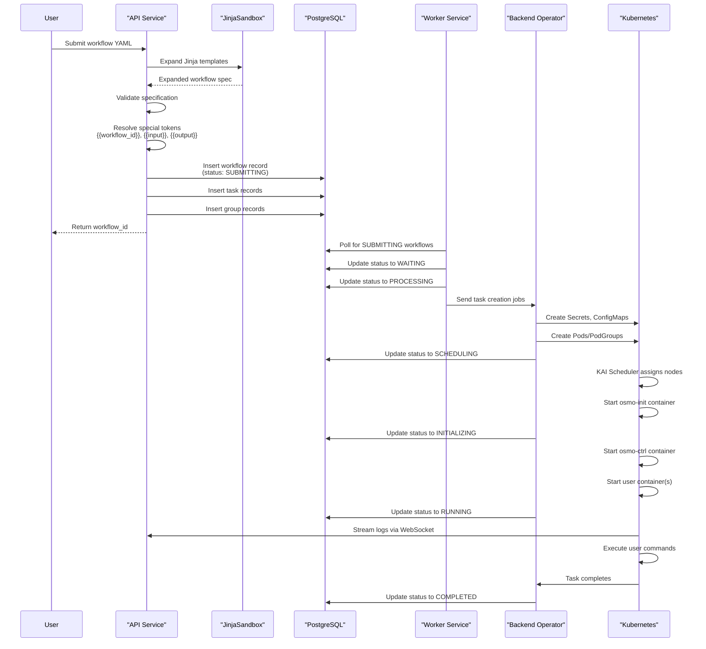

**Sources:** [src/utils/connectors/postgres.py:632-753](), [src/utils/job/task.py:151-257]()

---

## Workflow Status Transitions

Tasks and groups progress through well-defined status states during their lifecycle. The `TaskGroupStatus` enum defines these states.

### Status State Machine

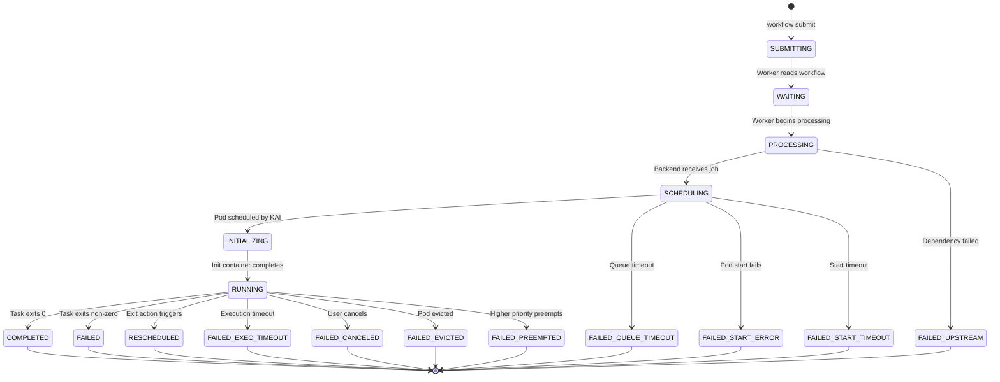

### Status Definitions

| Status | Description | Database Update Location |
|--------|-------------|-------------------------|
| `SUBMITTING` | Workflow submitted but not yet read by worker | Initial insert |
| `WAITING` | Worker has read workflow but not processed | Worker service |
| `PROCESSING` | Worker processing, creating K8s resources | Worker service |
| `SCHEDULING` | Kubernetes scheduler queue | Backend operator |
| `INITIALIZING` | Pod scheduled, init container running | Backend operator |
| `RUNNING` | User containers executing | Backend operator |
| `COMPLETED` | Task finished successfully | Backend operator |
| `FAILED` | Task failed (uncategorized) | Backend operator |
| `FAILED_UPSTREAM` | Dependency task failed | Worker service |
| `FAILED_CANCELED` | User canceled workflow | API service |
| `FAILED_EXEC_TIMEOUT` | Execution time exceeded | Backend operator |
| `FAILED_QUEUE_TIMEOUT` | Queue time exceeded | Backend operator |
| `RESCHEDULED` | Task restarted per exit action | Backend operator |

**Sources:** [src/utils/job/task.py:151-257](), [src/utils/connectors/postgres.py:718-753]()

---

## Template Expansion Phase

Before workflow submission, Jinja templates are expanded using the `JinjaSandbox` class. This happens server-side in the API service.

### Template Processing Components

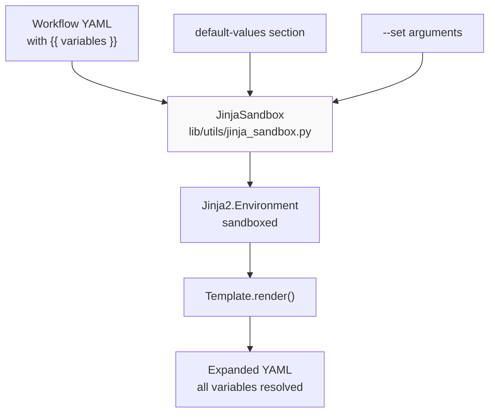

### Example: Multi-Node Template Expansion

Before expansion (workflow YAML):
```yaml
groups:
- name: training
  tasks:
  
  - name: worker_{{item}}
    command: ["torchrun"]
    args: ["--node_rank", "{{item}}"]
  

default-values:
  n_nodes: 2
```

After expansion (with `--set n_nodes=2`):
```yaml
groups:
- name: training
  tasks:
  - name: worker_0
    command: ["torchrun"]
    args: ["--node_rank", "0"]
  - name: worker_1
    command: ["torchrun"]
    args: ["--node_rank", "1"]
```

**Sources:** [src/lib/utils/jinja_sandbox.py](), [docs/user_guide/workflows/specification/templates_and_tokens.rst:24-116]()

---

## Special Token Resolution

After Jinja expansion, OSMO resolves special tokens that provide runtime values. These tokens follow the pattern `{{token_name}}` and cannot be overridden by users.

### Token Resolution Timing

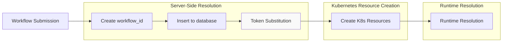

### Special Tokens and Resolution Points

| Token | Resolved When | Value Source | Used In |
|-------|---------------|--------------|---------|
| `{{workflow_id}}` | Workflow creation | Generated UUID | All resources |
| `{{input:N}}` | Task creation | Dataset mount path | File contents, environment |
| `{{output}}` | Task creation | Output mount path | File contents, environment |
| `{{host:task_name}}` | Pod creation | Kubernetes subdomain | File contents, environment |

### Host Token Resolution Example

The `{{host:task_name}}` token resolves to a Kubernetes headless service subdomain, enabling inter-task communication:

```yaml
groups:
- name: training
  tasks:
  - name: master
    lead: true
    files:
    - path: /tmp/run.sh
      contents: |
        torchrun --master_addr {{host:master}} --master_port 29400
```

Resolves to:
```bash
torchrun --master_addr master.osmo-<group_uuid>.default.svc.cluster.local --master_port 29400
```

The subdomain is constructed by `get_group_subdomain_name()` and used in the headless service created by `K8sObjectFactory.create_headless_service()`.

**Sources:** [src/lib/utils/common.py:150](), [src/utils/job/kb_objects.py:242-261](), [docs/user_guide/workflows/specification/templates_and_tokens.rst:117-229]()

---

## Database Persistence

Workflow, group, and task information is persisted to PostgreSQL immediately after validation.

### Database Schema for Workflow Execution

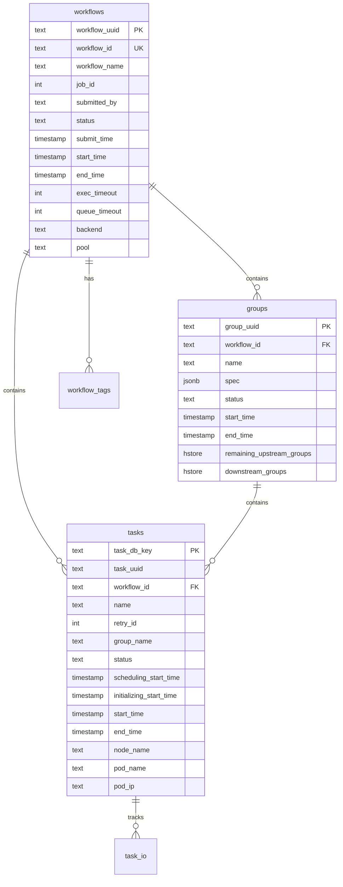

### Workflow Record Creation

The workflow is inserted into the `workflows` table with initial status `SUBMITTING`:

```python
# Simplified from actual code flow
workflow_uuid = generate_unique_id()
workflow_id = f"{workflow_name}-{job_id}"

INSERT INTO workflows (
    workflow_uuid, workflow_id, workflow_name, job_id,
    submitted_by, status, submit_time, backend, pool
) VALUES (%s, %s, %s, %s, %s, 'SUBMITTING', NOW(), %s, %s)
```

Tasks are inserted with their dependencies tracked via the `remaining_upstream_groups` field in the `groups` table.

**Sources:** [src/utils/connectors/postgres.py:632-787](), [src/utils/job/workflow.py]()

---

## Kubernetes Resource Creation

The Backend Operator creates Kubernetes resources based on task specifications. The `K8sObjectFactory` orchestrates this process.

### K8s Object Creation Flow

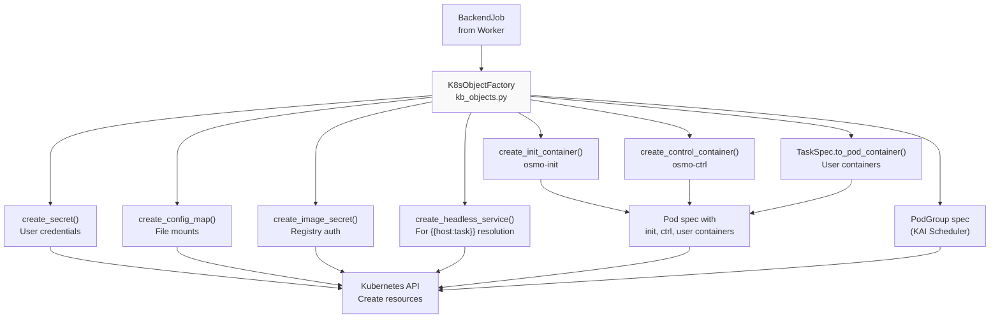

### Container Architecture per Pod

Each task pod contains three types of containers:

1. **osmo-init** (init container): Copies binaries and configuration files
2. **osmo-ctrl** (sidecar): Handles data download/upload, log streaming
3. **User containers**: Specified in task spec, runs actual workload

**Volume Mounts (shared across containers):**
- `/osmo/bin/` - OSMO executables (osmo_exec, osmo_ctrl)
- `/osmo/data/input/` - Input dataset mount point
- `/osmo/data/output/` - Output dataset mount point  
- `/osmo/data/socket/` - Unix socket for ctrl-user communication
- `/osmo/login/config/` - User authentication config

**Sources:** [src/utils/job/kb_objects.py:43-476](), [src/utils/job/task.py:748-863]()

---

## Gang Scheduling with KAI

For groups with multiple tasks, OSMO uses the KAI scheduler to ensure all tasks in a group are scheduled simultaneously (gang scheduling).

### KAI PodGroup Creation

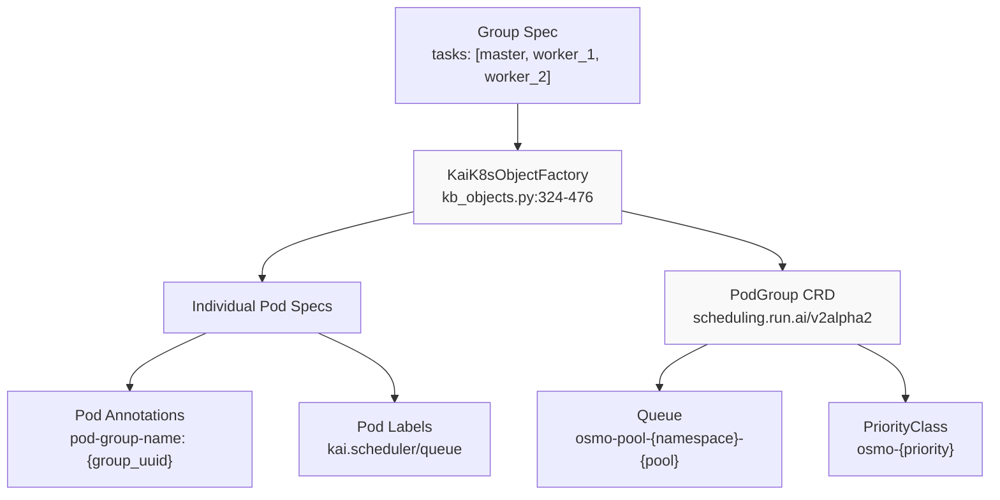

### PodGroup Specification

```yaml
apiVersion: scheduling.run.ai/v2alpha2
kind: PodGroup
metadata:
  name: osmo-{group_uuid}
  labels:
    kai.scheduler/queue: osmo-pool-{namespace}-{pool}
    workflow.osmo: {workflow_id}
spec:
  minMember: 3  # Number of tasks in group
  queue: osmo-pool-{namespace}-{pool}
  priorityClassName: osmo-normal
```

All pods in the group must be schedulable simultaneously, or none will be scheduled. This guarantees that distributed training tasks like multi-node TorchRun start together.

**Sources:** [src/utils/job/kb_objects.py:324-476](), [docs/user_guide/how_to/training/multi_node.rst:46-97]()

---

## Task Initialization Phase

Before user containers start, the `osmo-init` container prepares the pod environment.

### Init Container Responsibilities

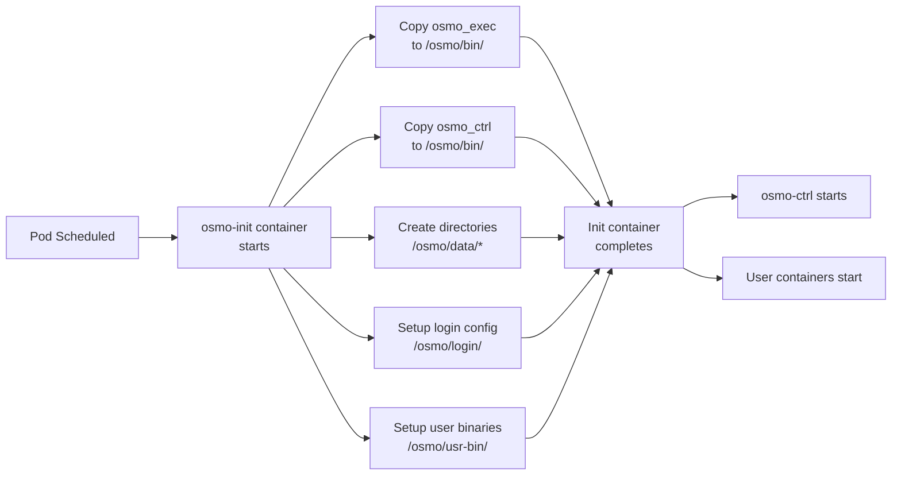

### Init Container Volume Setup

The init container has access to:
- `/osmo_binaries/` - Source for OSMO executables
- `/osmo/` - Target volume (shared with other containers)
- `/osmo/data/` - Data directories
- `/osmo/login/` - Login configuration
- `/osmo/usr-bin/` - User binaries location

**Sources:** [src/utils/job/kb_objects.py:111-152]()

---

## Task Execution Phase

Once initialization completes, two containers run in parallel: `osmo-ctrl` (control) and user containers.

### Execution Container Architecture

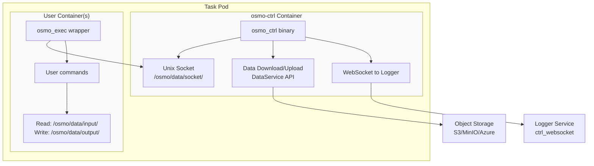

### osmo-ctrl Responsibilities

The control container (`osmo-ctrl`) handles:

1. **Data Download**: Downloads input datasets specified in `inputs:` field
2. **Data Upload**: Uploads output datasets specified in `outputs:` field
3. **Log Streaming**: Forwards logs to Logger service via WebSocket
4. **Metrics Collection**: Reports download/upload metrics to database
5. **Checkpoint Management**: Syncs checkpoints at specified intervals

### osmo_exec Wrapper

User containers don't execute commands directly. Instead, `osmo_exec` wraps the execution:

```bash
# User specified in workflow:
command: ["python3", "train.py"]

# Actual pod command:
command: ["/osmo/bin/osmo_exec"]
args: ["-commands", "python3", "-commands", "train.py"]
```

The wrapper:
- Sets up environment variables
- Communicates with osmo-ctrl via Unix socket
- Reports exit codes
- Handles exit actions (COMPLETE, FAIL, RESCHEDULE)

**Sources:** [src/utils/job/kb_objects.py:154-240](), [src/utils/job/task.py:775-863]()

---

## Log Streaming and Monitoring

Logs flow from user containers through osmo-ctrl to the Logger service, then stored in Redis for client access.

### Log Streaming Architecture

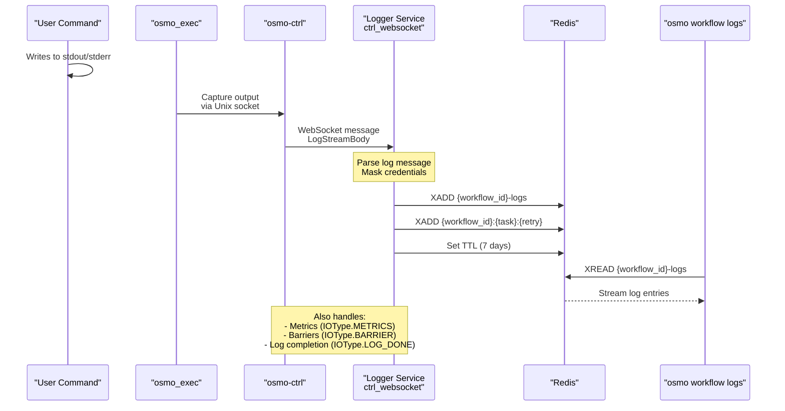

### Log Stream Message Format

```python
# LogStreamBody structure
{
    "source": "task_name",
    "retry_id": 0,
    "time": "2025-01-15T10:30:45.123Z",
    "text": "Training epoch 1/10 complete",
    "io_type": "STDOUT"  # or STDERR
}
```

### Barrier Synchronization

Groups can synchronize task execution using barriers. Tasks call a barrier, and osmo-ctrl coordinates via Redis:

```bash
# In user script
python3 /tmp/osmo_barrier.py --num_nodes 4 --connect {{host:master}} --rank 0
```

osmo-ctrl receives barrier requests and updates a Redis set. When all tasks reach the barrier, all are notified to continue.

**Sources:** [src/service/logger/ctrl_websocket.py:118-248](), [src/utils/connectors/postgres.py:89-92]()

---

## Completion and Cleanup

When tasks finish, the backend operator updates database status and triggers cleanup.

### Completion Flow

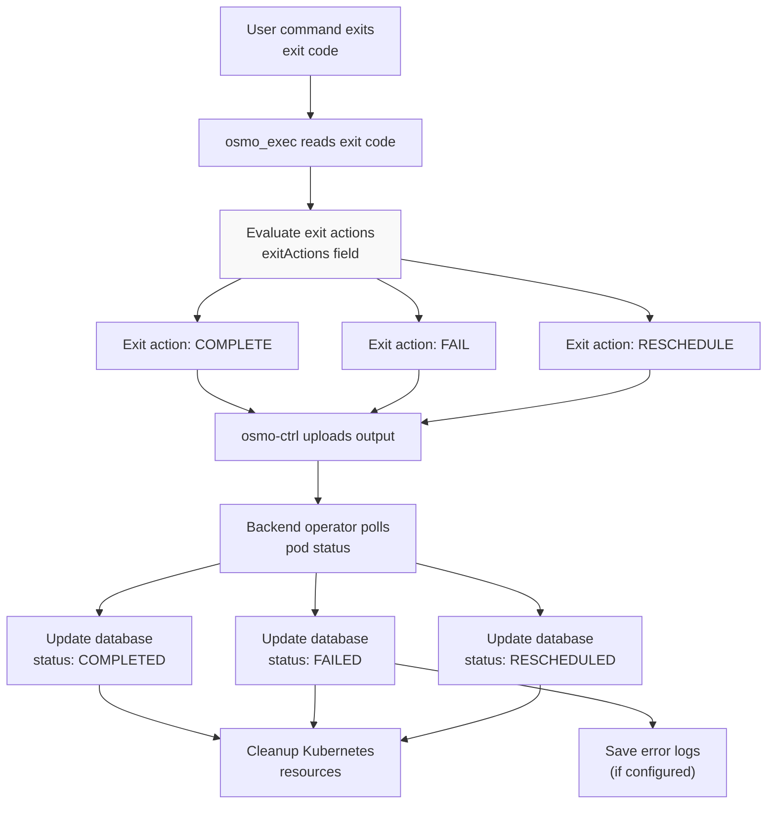

### Exit Actions

Tasks can define custom exit actions based on exit codes:

```yaml
tasks:
- name: train
  exitActions:
    COMPLETE: "0"           # Exit code 0 → COMPLETED
    FAIL: "1-10,20-30"      # Exit codes 1-10, 20-30 → FAILED
    RESCHEDULE: "11-19"     # Exit codes 11-19 → RESCHEDULED (retry)
```

The `RESCHEDULE` action creates a new task instance with incremented `retry_id`.

### Cleanup Process

The Backend Operator deletes Kubernetes resources:

1. **Pods** - User task pods
2. **PodGroups** - Gang scheduling groups (for KAI)
3. **Secrets** - User credentials and file mounts
4. **ConfigMaps** - Configuration data
5. **Services** - Headless services for {{host:task}}

Resources are identified by labels: `workflow.osmo: {workflow_id}`, `group.osmo: {group_name}`

**Sources:** [src/utils/job/task.py:127-149](), [src/utils/job/task.py:696-709](), [src/utils/job/kb_objects.py:100-107]()

---

## Complete Lifecycle Example

This example traces a simple workflow from submission to completion.

### Example Workflow

```yaml
workflow:
  name: example
  tasks:
  - name: preprocess
    image: ubuntu
    command: ["bash"]
    args: ["-c", "echo 'data' > {{output}}/data.txt"]
    outputs:
    - dataset:
        name: processed-data
  
  - name: train
    image: pytorch
    command: ["python3"]
    args: ["/tmp/train.py"]
    inputs:
    - dataset:
        name: processed-data
    outputs:
    - dataset:
        name: trained-model
```

### Lifecycle Trace

| Time | Component | Status | Action |
|------|-----------|--------|--------|
| T0 | User | - | `osmo workflow submit example.yaml` |
| T1 | API Service | SUBMITTING | Insert workflow: `example-1`, task: `preprocess`, `train` |
| T2 | Worker Service | WAITING | Poll database, find `example-1` |
| T3 | Worker Service | PROCESSING | Validate dependencies, create backend jobs |
| T4 | Backend Operator | SCHEDULING | Create Secrets, Pods for `preprocess` |
| T5 | KAI Scheduler | SCHEDULING | Assign `preprocess` pod to node |
| T6 | Kubernetes | INITIALIZING | Start osmo-init container |
| T7 | Kubernetes | RUNNING | Start osmo-ctrl, user container |
| T8 | osmo-ctrl | RUNNING | No inputs to download |
| T9 | User Container | RUNNING | Execute: `bash -c "echo 'data' > /osmo/data/output/data.txt"` |
| T10 | User Container | RUNNING | Exit code 0 |
| T11 | osmo-ctrl | RUNNING | Upload `/osmo/data/output/` to dataset `processed-data` |
| T12 | Backend Operator | COMPLETED | Update database: `preprocess` COMPLETED |
| T13 | Backend Operator | SCHEDULING | Create Secrets, Pods for `train` (dependency satisfied) |
| T14-T20 | (repeat) | - | Similar flow for `train` task |
| T21 | Worker Service | COMPLETED | All tasks complete, workflow COMPLETED |
| T22 | Backend Operator | - | Cleanup: delete Pods, Secrets, PodGroups |

**Sources:** [src/utils/job/workflow.py](), [src/utils/job/task.py](), [src/service/core/workflow/]()

---

## Key Code Entities

The following table maps high-level concepts to their primary code implementations:

| Concept | Primary Class/Function | File Path |
|---------|------------------------|-----------|
| Workflow Status | `TaskGroupStatus` enum | [src/utils/job/task.py:151-257]() |
| Template Expansion | `JinjaSandbox` class | [src/lib/utils/jinja_sandbox.py]() |
| Special Token Resolution | `resolve_special_tokens()` | [src/lib/utils/common.py]() |
| Database Schema | `workflows`, `groups`, `tasks` tables | [src/utils/connectors/postgres.py:632-787]() |
| K8s Object Creation | `K8sObjectFactory` class | [src/utils/job/kb_objects.py:43-323]() |
| Gang Scheduling | `KaiK8sObjectFactory` class | [src/utils/job/kb_objects.py:324-476]() |
| Init Container | `create_init_container()` | [src/utils/job/kb_objects.py:111-152]() |
| Control Container | `create_control_container()` | [src/utils/job/kb_objects.py:154-240]() |
| User Container | `TaskSpec.to_pod_container()` | [src/utils/job/task.py:775-863]() |
| Log Streaming | `run_websocket()` | [src/service/logger/ctrl_websocket.py:118-248]() |
| Barrier Sync | `update_barrier()` | [src/service/logger/ctrl_websocket.py:93-116]() |
| Exit Actions | `ExitAction` enum | [src/utils/job/task.py:127-149]() |
| Cleanup | `get_group_cleanup_specs()` | [src/utils/job/kb_objects.py:100-107]() |

**Sources:** Multiple files as cited above

---

