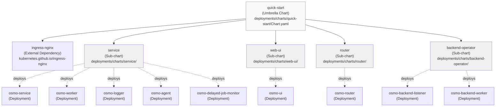
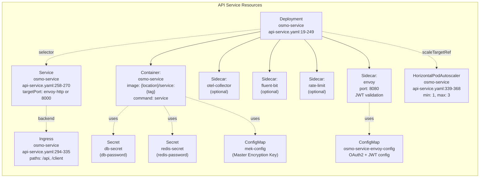
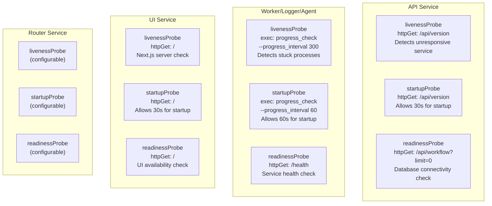

<!-- source: DeepWiki mcp.deepwiki.com · repo NVIDIA/OSMO · page 7 Kubernetes Deployment · fetched 2026-10-26 -->

# Kubernetes Deployment

<details>
<summary>Relevant source files</summary>

The following files were used as context for generating this wiki page:

- [deployments/charts/quick-start/Chart.yaml](deployments/charts/quick-start/Chart.yaml)
- [deployments/charts/router/Chart.yaml](deployments/charts/router/Chart.yaml)
- [deployments/charts/router/templates/router-service.yaml](deployments/charts/router/templates/router-service.yaml)
- [deployments/charts/service/templates/agent-service.yaml](deployments/charts/service/templates/agent-service.yaml)
- [deployments/charts/service/templates/api-service.yaml](deployments/charts/service/templates/api-service.yaml)
- [deployments/charts/service/templates/delayed-job-monitor.yaml](deployments/charts/service/templates/delayed-job-monitor.yaml)
- [deployments/charts/service/templates/logger-service.yaml](deployments/charts/service/templates/logger-service.yaml)
- [deployments/charts/service/templates/worker.yaml](deployments/charts/service/templates/worker.yaml)
- [deployments/charts/web-ui/templates/ui.yaml](deployments/charts/web-ui/templates/ui.yaml)
- [docs/deployment_guide/getting_started/deploy_service.rst](docs/deployment_guide/getting_started/deploy_service.rst)
- [docs/deployment_guide/install_backend/dependencies/dependencies.rst](docs/deployment_guide/install_backend/dependencies/dependencies.rst)
- [docs/deployment_guide/install_backend/deploy_backend.rst](docs/deployment_guide/install_backend/deploy_backend.rst)
- [docs/deployment_guide/install_backend/validate_osmo.rst](docs/deployment_guide/install_backend/validate_osmo.rst)
- [docs/deployment_guide/references/configs_definitions/index.rst](docs/deployment_guide/references/configs_definitions/index.rst)
- [docs/user_guide/tutorials/combination_workflows/index.rst](docs/user_guide/tutorials/combination_workflows/index.rst)

</details>


This page describes OSMO's Kubernetes deployment architecture and the Helm charts used to deploy the platform. It covers the overall structure, namespace organization, and the relationship between different deployment components.

For detailed information about specific aspects of the deployment:
- Helm chart structure and dependencies: see [Helm Chart Architecture](#7.1)
- Individual service configurations: see [Service Deployments](#7.2)
- Sidecar container patterns: see [Sidecar Containers](#7.3)
- Ingress and network configuration: see [Ingress and Networking](#7.4)
- Autoscaling and resource management: see [Scaling and Resource Management](#7.5)

For backend operator deployment on compute clusters: see [Deploying a Backend](#5.2)

## Deployment Architecture Overview

OSMO uses a **multi-namespace Kubernetes architecture** that separates the control plane from compute planes. The control plane runs OSMO services that manage workflows and state, while compute planes (backend operators) execute workflow tasks.

### Kubernetes Namespace Organization

```mermaid
graph TB
    subgraph "Control Plane Namespace: osmo"
        direction TB
        
        APIDeployment["Deployment: osmo-service<br/>(API Container + Envoy Sidecar)"]
        UIDeployment["Deployment: osmo-ui<br/>(UI Container + Envoy Sidecar)"]
        WorkerDeployment["Deployment: osmo-worker"]
        LoggerDeployment["Deployment: osmo-logger"]
        AgentDeployment["Deployment: osmo-agent"]
        MonitorDeployment["Deployment: osmo-delayed-job-monitor"]
        
        APISvc["Service: osmo-service"]
        UISvc["Service: osmo-ui"]
        
        APIIngress["Ingress: osmo-service<br/>path: /api, /client"]
        UIIngress["Ingress: osmo-ui<br/>path: /"]
        
        APIHPA["HorizontalPodAutoscaler:<br/>osmo-service"]
        WorkerHPA["HorizontalPodAutoscaler:<br/>osmo-worker"]
    end
    
    subgraph "Router Namespace: osmo-router"
        RouterDeployment["Deployment: osmo-router<br/>(Router Container + Envoy Sidecar)"]
        RouterSvc["Service: osmo-router"]
        RouterIngress["Ingress: osmo-router<br/>path: /api/router"]
        RouterHPA["HorizontalPodAutoscaler:<br/>osmo-router"]
    end
    
    subgraph "Backend Operator Namespace: osmo-operator"
        BackendListener["Deployment: osmo-backend-listener"]
        BackendWorker["Deployment: osmo-backend-worker"]
        BackendTest["CronJob: osmo-backend-test-runner"]
    end
    
    subgraph "Workflow Execution Namespace: osmo-workflows"
        WorkflowPods["Pods: user-workflow-tasks<br/>(created dynamically)"]
        PodGroups["PodGroups: task-groups<br/>(for gang scheduling)"]
    end
    
    subgraph "External Dependencies"
        PostgreSQL[("PostgreSQL<br/>(external or in-cluster)")]
        Redis[("Redis<br/>(external or in-cluster)")]
        Keycloak["Keycloak<br/>(namespace: keycloak)"]
        S3["Object Storage<br/>(S3/MinIO/Azure)"]
    end
    
    APIDeployment --> APISvc
    UIDeployment --> UISvc
    RouterDeployment --> RouterSvc
    
    APISvc --> APIIngress
    UISvc --> UIIngress
    RouterSvc --> RouterIngress
    
    APIDeployment -.-> PostgreSQL
    APIDeployment -.-> Redis
    WorkerDeployment -.-> PostgreSQL
    WorkerDeployment -.-> Redis
    
    UIDeployment -.-> Keycloak
    APIDeployment -.-> Keycloak
    RouterDeployment -.-> Keycloak
    
    BackendListener -.->|Polls for tasks| APISvc
    BackendWorker -.->|Creates pods| WorkflowPods
    
    WorkflowPods -.-> S3
```



**Sources:**
- [deployments/charts/service/templates/api-service.yaml:1-368]()
- [deployments/charts/web-ui/templates/ui.yaml:1-408]()
- [deployments/charts/router/templates/router-service.yaml:1-336]()
- [docs/deployment_guide/install_backend/deploy_backend.rst:1-183]()

### Control Plane vs Compute Plane Separation

The architecture uses **outbound-initiated connections** from backend operators to the control plane. Backend operators run in separate Kubernetes clusters (or namespaces) and poll the API service for work. This design enables:

- **Firewall-friendly deployment**: Backends can run behind corporate firewalls
- **Multi-cluster orchestration**: A single control plane manages multiple compute clusters
- **Security isolation**: Workflow execution is isolated from control plane services

The control plane consists of:
- `osmo` namespace: Core OSMO services (API, UI, Worker, Logger, Agent, Monitor)
- `osmo-router` namespace: Router service for interactive workflow access
- `keycloak` namespace: Authentication and SSO

The compute plane consists of:
- `osmo-operator` namespace: Backend operator components
- `osmo-workflows` namespace: User workflow task pods

## Helm Chart Structure

OSMO uses Helm charts to manage Kubernetes deployments. The chart structure follows a modular design with an umbrella chart that orchestrates multiple sub-charts.

### Chart Dependency Hierarchy



**Sources:**
- [deployments/charts/quick-start/Chart.yaml:1-42]()

### Chart Versions and Components

The `quick-start` chart defines dependencies in its `Chart.yaml`:

| Dependency | Version | Repository | Purpose |
|------------|---------|------------|---------|
| `ingress-nginx` | 4.13.2 | kubernetes.github.io/ingress-nginx | Ingress controller for external access |
| `service` | 1.0.1 | file://../service | Control plane services (API, Worker, Logger, Agent, Monitor) |
| `web-ui` | 1.0.1 | file://../web-ui | Next.js-based web interface |
| `router` | 1.0.1 | file://../router | Router service for port-forward and exec |
| `backend-operator` | 1.0.1 | file://../backend-operator | Backend operator for workflow execution |

The `service` chart is the largest and most complex, containing templates for five separate services. Each service is deployed as an independent Kubernetes Deployment with associated Services, Ingresses, and HorizontalPodAutoscalers.

**Sources:**
- [deployments/charts/quick-start/Chart.yaml:24-39]()

## Kubernetes Resources Created

### Per-Service Resource Pattern

Each OSMO service follows a consistent Kubernetes resource pattern. Using the API service as an example:



**Sources:**
- [deployments/charts/service/templates/api-service.yaml:1-368]()

### Resource Configuration Hierarchy

All services inherit configuration from a three-level hierarchy:

1. **Global values** (`global.*`): Shared across all charts
   - `osmoImageLocation`: Container registry location
   - `osmoImageTag`: OSMO version tag
   - `nodeSelector`: Node placement constraints
   - `imagePullSecret`: Registry authentication

2. **Service values** (`services.<service-name>.*`): Per-service configuration
   - `replicas` or `scaling.minReplicas/maxReplicas`: Replica counts
   - `resources.requests/limits`: CPU and memory allocation
   - `hostname`: Service hostname for ingress
   - `envoy.*`: Envoy sidecar configuration

3. **Sidecar values** (`sidecars.*`): Shared sidecar configuration
   - `envoy.enabled`: Enable Envoy authentication proxy
   - `otel.enabled`: Enable OpenTelemetry collector
   - `logAgent.enabled`: Enable log shipping to CloudWatch/other

**Sources:**
- [deployments/charts/service/templates/api-service.yaml:74-148]()
- [docs/deployment_guide/getting_started/deploy_service.rst:479-679]()

## Service Container Commands and Arguments

Each OSMO service runs with specific command-line arguments that configure its behavior:

| Service | Command | Key Arguments | Template File |
|---------|---------|---------------|---------------|
| `osmo-service` | `service` | `--redis_host`, `--postgres_host`, `--mek_file`, `--service_hostname` | [api-service.yaml:76-148]() |
| `osmo-worker` | `worker` | `--redis_host`, `--postgres_host`, `--mek_file` | [worker.yaml:69-122]() |
| `osmo-logger` | `logger` | `--redis_host`, `--postgres_host`, `--mek_file` | [logger-service.yaml:75-125]() |
| `osmo-agent` | `agent_service` | `--redis_host`, `--postgres_host`, `--mek_file`, `--service_hostname` | [agent-service.yaml:75-129]() |
| `osmo-delayed-job-monitor` | `delayed_job_monitor` | `--redis_host`, `--postgres_host`, `--mek_file`, `--enable_metrics` | [delayed-job-monitor.yaml:56-114]() |
| `osmo-router` | `router` | `--hostname`, `--postgres_host`, `--mek_file`, `--config` | [router-service.yaml:76-114]() |
| `osmo-ui` | (Next.js default) | Environment variables only | [ui.yaml:73-108]() |

All services (except UI) accept common flags:
- `--log_level`: Log verbosity (DEBUG, INFO, WARNING, ERROR)
- `--k8s_log_level`: Kubernetes client log level
- `--log_dir`: Directory for log files
- `--metrics_otel_enable`: Enable OpenTelemetry metrics

**Sources:**
- [deployments/charts/service/templates/api-service.yaml:76-148]()
- [deployments/charts/service/templates/worker.yaml:69-122]()
- [deployments/charts/service/templates/logger-service.yaml:75-125]()
- [deployments/charts/service/templates/agent-service.yaml:75-129]()
- [deployments/charts/service/templates/delayed-job-monitor.yaml:56-114]()
- [deployments/charts/router/templates/router-service.yaml:76-114]()
- [deployments/charts/web-ui/templates/ui.yaml:73-108]()

## Probes and Health Checks

OSMO services implement Kubernetes probes to ensure reliability:

### Probe Types by Service



### Progress Check Mechanism

Worker, Logger, and Agent services use a custom `progress_check` binary that monitors service activity:
- Writes timestamps to `/var/run/osmo/last_progress`
- Liveness probe fails if no progress for 300 seconds
- Prevents services from getting stuck in infinite loops or deadlocks

**Sources:**
- [deployments/charts/service/templates/api-service.yaml:191-217]()
- [deployments/charts/service/templates/worker.yaml:156-177]()
- [deployments/charts/service/templates/logger-service.yaml:161-194]()
- [deployments/charts/service/templates/agent-service.yaml:165-198]()
- [deployments/charts/web-ui/templates/ui.yaml:129-241]()
- [deployments/charts/router/templates/router-service.yaml:173-186]()

## Security Context Configuration

All OSMO service containers run with restricted security contexts:

```yaml
securityContext:
  allowPrivilegeEscalation: false
  capabilities:
    drop: ["ALL"]
  runAsNonRoot: true
  runAsUser: 1001  # or 1000 for UI
```

This configuration:
- Prevents privilege escalation attacks
- Drops all Linux capabilities
- Enforces non-root execution
- Uses dedicated UIDs (1000 for UI, 1001 for services)

**Sources:**
- [deployments/charts/service/templates/api-service.yaml:169-174]()
- [deployments/charts/web-ui/templates/ui.yaml:114-119]()

## Deployment Prerequisites

Before deploying OSMO on Kubernetes, the following infrastructure must be available:

### Required External Services

| Service | Purpose | Configuration Location |
|---------|---------|------------------------|
| **PostgreSQL** | Persistent storage for workflows, tasks, datasets, configurations | `services.postgres.serviceName`, `services.postgres.port` |
| **Redis** | Job queues, log streaming, barrier synchronization | `services.redis.serviceName`, `services.redis.port` |
| **Keycloak** | OAuth2/OIDC authentication and SSO | `services.service.auth.*`, `sidecars.envoy.oauth2Filter.*` |
| **Object Storage** | Content-addressable dataset storage (S3/MinIO/Azure) | Configured via dataset config API |

### Required Kubernetes Components

| Component | Purpose | Installation |
|-----------|---------|--------------|
| **Ingress Controller** | External traffic routing | AWS ALB Controller or NGINX Ingress |
| **KAI Scheduler** | Gang scheduling for distributed workflows | See [Installing KAI](#installing-kai-scheduler) |
| **GPU Operator** | GPU device plugin and driver management | See [Installing GPU Operator](#installing-gpu-operator) |

### Required Secrets and ConfigMaps

Before deploying the `quick-start` chart, create these resources:

```bash
# Create namespace
kubectl create namespace osmo

# Database password
kubectl create secret generic db-secret \
  --from-literal=db-password=<password> \
  --namespace osmo

# Redis password
kubectl create secret generic redis-secret \
  --from-literal=redis-password=<password> \
  --namespace osmo

# OAuth2 secrets for Envoy
kubectl create secret generic oidc-secrets \
  --from-literal=client_secret=<keycloak-client-secret> \
  --from-literal=hmac_secret=$(head -c32 /dev/urandom | base64) \
  --namespace osmo

# Master Encryption Key (MEK)
kubectl create configmap mek-config \
  --from-file=mek.yaml=<mek-file> \
  --namespace osmo
```

**Sources:**
- [docs/deployment_guide/getting_started/deploy_service.rst:353-467]()
- [docs/deployment_guide/install_backend/dependencies/dependencies.rst:1-85]()

### Installing KAI Scheduler

OSMO requires the KAI scheduler for gang scheduling of workflow groups:

```bash
# Fetch KAI scheduler chart
helm fetch oci://ghcr.io/nvidia/kai-scheduler/kai-scheduler \
  --version <chart-version>

# Install with OSMO-specific configuration
helm upgrade --install kai-scheduler kai-scheduler-<chart-version>.tgz \
  --create-namespace -n kai-scheduler \
  --set scheduler.additionalArgs[0]="--default-staleness-grace-period=-1s" \
  --set scheduler.additionalArgs[1]="--update-pod-eviction-condition=true"
```

Key configuration flags:
- `--default-staleness-grace-period=-1s`: Disables stale gang eviction
- `--update-pod-eviction-condition=true`: Allows OSMO to read preemption conditions

**Sources:**
- [docs/deployment_guide/install_backend/dependencies/dependencies.rst:32-69]()

### Installing GPU Operator

For GPU workloads, install the NVIDIA GPU Operator:

```bash
helm repo add nvidia https://nvidia.github.io/gpu-operator
helm repo update
helm install gpu-operator nvidia/gpu-operator \
  --namespace gpu-operator \
  --create-namespace
```

**Sources:**
- [docs/deployment_guide/install_backend/dependencies/dependencies.rst:71-84]()

## Basic Deployment Steps

### Step 1: Deploy Control Plane Services

Deploy the main OSMO services using the `service`, `web-ui`, and `router` charts:

```bash
# Add OSMO Helm repository
helm repo add osmo https://helm.ngc.nvidia.com/nvidia/osmo
helm repo update

# Deploy service chart (API, Worker, Logger, Agent, Monitor)
helm upgrade --install osmo osmo/service \
  -f osmo_values.yaml \
  --version <chart-version> \
  --namespace osmo

# Deploy web-ui chart
helm upgrade --install osmo-ui osmo/web-ui \
  -f ui_values.yaml \
  --version <chart-version> \
  --namespace osmo

# Deploy router chart
helm upgrade --install osmo-router osmo/router \
  -f router_values.yaml \
  --version <chart-version> \
  --namespace osmo-router
```

**Sources:**
- [docs/deployment_guide/getting_started/deploy_service.rst:470-679]()

### Step 2: Deploy Backend Operator

Deploy the backend operator on the compute cluster:

```bash
# Create namespaces
kubectl create namespace osmo-operator
kubectl create namespace osmo-workflows

# Create service token secret
kubectl create secret generic osmo-operator-token \
  -n osmo-operator \
  --from-literal=token=$OSMO_SERVICE_TOKEN

# Deploy backend operator
helm upgrade --install osmo-operator osmo/backend-operator \
  -f backend_operator_values.yaml \
  --version <chart-version> \
  --namespace osmo-operator
```

The backend operator consists of:
- `osmo-backend-listener`: Polls API service for tasks
- `osmo-backend-worker`: Creates Kubernetes pods for workflow tasks
- `osmo-backend-test-runner`: CronJob for validation tests

**Sources:**
- [docs/deployment_guide/install_backend/deploy_backend.rst:50-118]()

### Step 3: Verify Deployment

Check that all services are running:

```bash
# Check control plane services
kubectl get pods -n osmo
kubectl get pods -n osmo-router

# Check ingress configuration
kubectl get ingress -n osmo
kubectl get ingress -n osmo-router

# Check HPA status
kubectl get hpa -n osmo
kubectl get hpa -n osmo-router

# Check backend operator
kubectl get pods -n osmo-operator

# Verify backend is online
osmo config show BACKEND <backend-name>
```

Expected output shows `"online": true` for the backend.

**Sources:**
- [docs/deployment_guide/install_backend/deploy_backend.rst:119-165]()
- [docs/deployment_guide/install_backend/validate_osmo.rst:1-60]()

## Values File Structure

OSMO Helm charts use a hierarchical values structure. Here's the essential configuration skeleton:

```yaml
global:
  osmoImageLocation: nvcr.io/nvidia/osmo
  osmoImageTag: <version>
  serviceAccountName: osmo
  nodeSelector: {}
  logs:
    enabled: true
    logLevel: DEBUG

services:
  configFile:
    enabled: true
    path: /etc/osmo/mek.yaml
  
  postgres:
    serviceName: <postgres-host>
    port: 5432
    db: osmo
    user: postgres
  
  redis:
    serviceName: <redis-host>
    port: 6379
    tlsEnabled: true
  
  service:  # API service
    hostname: <domain>
    scaling:
      minReplicas: 1
      maxReplicas: 3
    resources:
      requests:
        cpu: "1"
        memory: "1Gi"
      limits:
        memory: "1Gi"
    auth:
      enabled: true
      device_endpoint: https://auth-<domain>/realms/osmo/protocol/openid-connect/device
      # ... other auth endpoints
    ingress:
      enabled: true
      ingressClass: alb  # or nginx
      albAnnotations:
        enabled: true
        sslCertArn: <arn>

  worker:
    scaling:
      minReplicas: 1
      maxReplicas: 3
    resources:
      requests:
        cpu: "500m"
        memory: "400Mi"

  # Similar structure for: logger, agent, delayedJobMonitor

sidecars:
  envoy:
    enabled: true
    useKubernetesSecrets: true
    skipAuthPaths:
      - /api/version
      - /api/auth/login
    service:
      hostname: <domain>
    oauth2Filter:
      enabled: true
      tokenEndpoint: https://auth-<domain>/realms/osmo/protocol/openid-connect/token
      # ... other OAuth2 config
    jwt:
      user_header: x-osmo-user
      providers:
        - issuer: https://auth-<domain>/realms/osmo
          audience: osmo-device
          jwks_uri: https://auth-<domain>/realms/osmo/protocol/openid-connect/certs
        # ... other JWT providers
  
  logAgent:
    enabled: false
  
  otel:
    enabled: false
  
  rateLimit:
    enabled: false
```

**Sources:**
- [docs/deployment_guide/getting_started/deploy_service.rst:479-679]()
- [docs/deployment_guide/getting_started/deploy_service.rst:689-828]()

## Troubleshooting Common Issues

| Issue | Symptom | Solution |
|-------|---------|----------|
| **Services not starting** | Pods in CrashLoopBackOff | Check logs: `kubectl logs <pod> -n osmo -c <container-name>`. Verify database connectivity and secrets. |
| **Authentication failures** | 401 Unauthorized responses | Verify Keycloak configuration, check OIDC secrets, ensure JWT providers match Keycloak realm. |
| **Ingress not accessible** | 404 or 503 errors | Verify ingress controller is running, check DNS records, validate annotations for your ingress class. |
| **Backend offline** | `"online": false` in config | Check `osmo-backend-listener` logs, verify service token hasn't expired, ensure network connectivity. |
| **Probes failing** | Pods repeatedly restarting | Increase `initialDelaySeconds` in probe configuration, check service startup time. |

**Sources:**
- [docs/deployment_guide/install_backend/deploy_backend.rst:171-183]()

---

