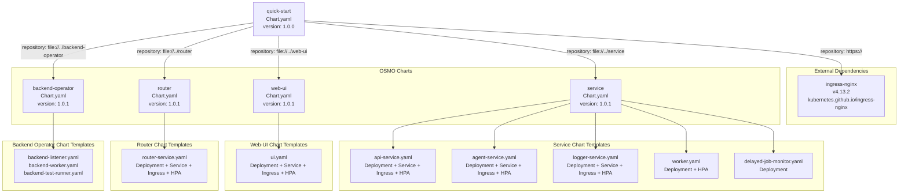
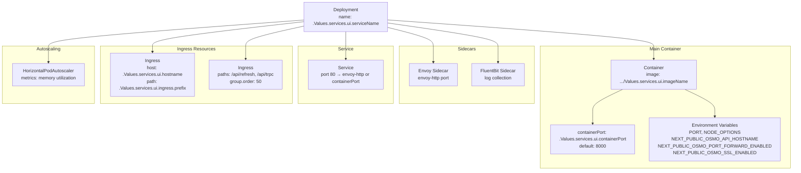
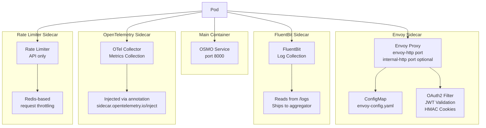

<!-- source: DeepWiki mcp.deepwiki.com · repo NVIDIA/OSMO · page 7.1 Helm Chart Architecture · fetched 2026-10-26 -->

# Helm Chart Architecture

<details>
<summary>Relevant source files</summary>

The following files were used as context for generating this wiki page:

- [deployments/charts/backend-operator/Chart.yaml](deployments/charts/backend-operator/Chart.yaml)
- [deployments/charts/quick-start/Chart.yaml](deployments/charts/quick-start/Chart.yaml)
- [deployments/charts/router/Chart.yaml](deployments/charts/router/Chart.yaml)
- [deployments/charts/router/templates/router-service.yaml](deployments/charts/router/templates/router-service.yaml)
- [deployments/charts/service/Chart.yaml](deployments/charts/service/Chart.yaml)
- [deployments/charts/service/templates/agent-service.yaml](deployments/charts/service/templates/agent-service.yaml)
- [deployments/charts/service/templates/api-service.yaml](deployments/charts/service/templates/api-service.yaml)
- [deployments/charts/service/templates/delayed-job-monitor.yaml](deployments/charts/service/templates/delayed-job-monitor.yaml)
- [deployments/charts/service/templates/logger-service.yaml](deployments/charts/service/templates/logger-service.yaml)
- [deployments/charts/service/templates/worker.yaml](deployments/charts/service/templates/worker.yaml)
- [deployments/charts/web-ui/Chart.yaml](deployments/charts/web-ui/Chart.yaml)
- [deployments/charts/web-ui/templates/ui.yaml](deployments/charts/web-ui/templates/ui.yaml)

</details>


This document describes the structure and organization of OSMO's Helm charts, which provide Kubernetes deployment configurations for all OSMO components. It covers the umbrella chart architecture, individual chart responsibilities, and common deployment patterns. For information about deploying these charts, see [Deployment Options Comparison](#2.2). For details about the services themselves, see [Control Plane Services](#3) and [Backend Operators](#5).

## Chart Hierarchy

OSMO uses a multi-chart architecture with `quick-start` serving as the umbrella chart that orchestrates all component deployments.



**Sources:** [deployments/charts/quick-start/Chart.yaml:24-39](), [deployments/charts/service/Chart.yaml:1-40](), [deployments/charts/web-ui/Chart.yaml:1-28](), [deployments/charts/router/Chart.yaml:1-41](), [deployments/charts/backend-operator/Chart.yaml:1-40]()

## Quick-Start Umbrella Chart

The `quick-start` chart is an umbrella chart that bundles all OSMO components for simplified deployment. It declares dependencies on four internal charts and one external chart.

| Dependency | Version | Repository | Purpose |
|------------|---------|------------|---------|
| `ingress-nginx` | 4.13.2 | https://kubernetes.github.io/ingress-nginx | Ingress controller for routing external traffic |
| `service` | 1.0.1 | file://../service | Control plane services (API, Worker, Logger, Agent, Monitor) |
| `web-ui` | 1.0.1 | file://../web-ui | Next.js web interface |
| `router` | 1.0.1 | file://../router | Router service for port-forward and exec |
| `backend-operator` | 1.0.1 | file://../backend-operator | Backend listener and worker |

The umbrella chart uses `file://` references to local sibling directories, enabling coordinated version updates across all components. Each dependency inherits configuration values from the parent chart while allowing per-chart overrides.

**Sources:** [deployments/charts/quick-start/Chart.yaml:24-39]()

## Service Chart

The `service` chart deploys the five core control plane services. Each service template creates a `Deployment`, `Service`, and `HorizontalPodAutoscaler`. Services exposed via ingress also include `Ingress` resources.

```mermaid
graph TB
    ServiceChart["service Chart"]
    
    subgraph "API Service"
        APIDeployment["Deployment<br/>name: .Values.services.service.serviceName"]
        APIService["Service<br/>port 80 → envoy-http or 8000"]
        APIIngress["Ingress<br/>path: /api, /client"]
        APIHPA["HorizontalPodAutoscaler<br/>minReplicas → maxReplicas"]
        APIContainer["Container: service<br/>command: service<br/>args: --redis_host, --postgres_host"]
    end
    
    subgraph "Agent Service"
        AgentDeployment["Deployment<br/>name: .Values.services.agent.serviceName"]
        AgentService["Service<br/>port 80"]
        AgentIngress["Ingress<br/>path: /api/agent"]
        AgentHPA["HorizontalPodAutoscaler<br/>memory + cpu targets"]
        AgentContainer["Container: agent_service<br/>command: agent_service"]
    end
    
    subgraph "Logger Service"
        LoggerDeployment["Deployment<br/>name: .Values.services.logger.serviceName"]
        LoggerService["Service<br/>port 80"]
        LoggerIngress["Ingress<br/>path: /api/logger"]
        LoggerHPA["HorizontalPodAutoscaler<br/>memory + cpu targets"]
        LoggerContainer["Container: logger<br/>command: logger"]
    end
    
    subgraph "Worker Service"
        WorkerDeployment["Deployment<br/>name: .Values.services.worker.serviceName"]
        WorkerHPA["HorizontalPodAutoscaler<br/>memory + cpu targets"]
        WorkerContainer["Container: worker<br/>command: worker<br/>livenessProbe: progress_check"]
    end
    
    subgraph "Delayed Job Monitor"
        MonitorDeployment["Deployment<br/>name: .Values.services.delayedJobMonitor.serviceName"]
        MonitorContainer["Container: delayed_job_monitor<br/>command: delayed_job_monitor<br/>livenessProbe: progress_check"]
    end
    
    ServiceChart --> APIDeployment
    ServiceChart --> AgentDeployment
    ServiceChart --> LoggerDeployment
    ServiceChart --> WorkerDeployment
    ServiceChart --> MonitorDeployment
    
    APIDeployment --> APIContainer
    APIDeployment --> APIService
    APIDeployment --> APIIngress
    APIDeployment --> APIHPA
    
    AgentDeployment --> AgentContainer
    AgentDeployment --> AgentService
    AgentDeployment --> AgentIngress
    AgentDeployment --> AgentHPA
    
    LoggerDeployment --> LoggerContainer
    LoggerDeployment --> LoggerService
    LoggerDeployment --> LoggerIngress
    LoggerDeployment --> LoggerHPA
    
    WorkerDeployment --> WorkerContainer
    WorkerDeployment --> WorkerHPA
    
    MonitorDeployment --> MonitorContainer
```



### API Service Template

The API service deployment is defined in [deployments/charts/service/templates/api-service.yaml:19-368](). Key characteristics:

- **Container**: Runs the `service` command with arguments for Redis, PostgreSQL, authentication endpoints, and OTEL metrics
- **Command Arguments**: [deployments/charts/service/templates/api-service.yaml:78-148]() includes `--redis_host`, `--postgres_host`, `--mek_file`, authentication configuration, and logging parameters
- **Environment Variables**: `OSMO_DISABLE_TASK_METRICS`, `OSMO_POSTGRES_PASSWORD`, `OSMO_REDIS_PASSWORD` [deployments/charts/service/templates/api-service.yaml:149-167]()
- **Probes**: 
  - Liveness: Configurable via `.Values.services.service.livenessProbe` [deployments/charts/service/templates/api-service.yaml:192-193]()
  - Startup: HTTP GET `/api/version` with 6 attempts [deployments/charts/service/templates/api-service.yaml:197-204]()
  - Readiness: HTTP GET `/api/workflow?limit=0&all_pools=true` with `x-osmo-roles: osmo-admin` header [deployments/charts/service/templates/api-service.yaml:207-216]()
- **Sidecars**: Envoy, OpenTelemetry (optional), FluentBit, rate limiter (optional) [deployments/charts/service/templates/api-service.yaml:218-226]()
- **Ingress**: Routes `/api` and `/client` paths with ALB annotations [deployments/charts/service/templates/api-service.yaml:294-335]()
- **HPA**: Scales on memory and CPU utilization [deployments/charts/service/templates/api-service.yaml:339-367]()

### Agent Service Template

The agent service deployment is defined in [deployments/charts/service/templates/agent-service.yaml:20-318](). Key characteristics:

- **Container**: Runs the `agent_service` command [deployments/charts/service/templates/agent-service.yaml:77-78]()
- **Command Arguments**: Similar pattern to API service, includes `--redis_host`, `--postgres_host`, `--service_hostname` [deployments/charts/service/templates/agent-service.yaml:86-129]()
- **Probes**:
  - Liveness: `progress_check --progress_interval 300` with 45s period [deployments/charts/service/templates/agent-service.yaml:166-176]()
  - Startup: `progress_check --progress_interval 60` with 12 attempts [deployments/charts/service/templates/agent-service.yaml:179-190]()
  - Readiness: HTTP GET `/health` on port 8000 [deployments/charts/service/templates/agent-service.yaml:192-198]()
- **Sidecars**: Envoy, OpenTelemetry (optional), FluentBit [deployments/charts/service/templates/agent-service.yaml:201-206]()
- **Ingress**: Routes `/api/agent` path [deployments/charts/service/templates/agent-service.yaml:272-278]()

### Logger Service Template

The logger service deployment is defined in [deployments/charts/service/templates/logger-service.yaml:20-314](). Key characteristics:

- **Container**: Runs the `logger` command [deployments/charts/service/templates/logger-service.yaml:84]()
- **Command Arguments**: Includes `--redis_host`, `--redis_port`, `--redis_tls_enable`, `--postgres_host` [deployments/charts/service/templates/logger-service.yaml:86-125]()
- **Probes**: Identical pattern to agent service using `progress_check` [deployments/charts/service/templates/logger-service.yaml:162-194]()
- **Ingress**: Routes `/api/logger` path [deployments/charts/service/templates/logger-service.yaml:268-274]()

### Worker Template

The worker deployment is defined in [deployments/charts/service/templates/worker.yaml:16-237](). Key characteristics:

- **Container**: Runs the `worker` command [deployments/charts/service/templates/worker.yaml:70]()
- **No Service**: Workers do not expose a network service [deployments/charts/service/templates/worker.yaml:1-237]()
- **Liveness Probe**: Restarts if no progress for 300 seconds using `progress_check` [deployments/charts/service/templates/worker.yaml:157-165]()
- **Startup Probe**: 60 second startup window with `progress_check` [deployments/charts/service/templates/worker.yaml:168-177]()
- **Sidecars**: FluentBit for logging, OpenTelemetry (optional) [deployments/charts/service/templates/worker.yaml:179-185]()

### Delayed Job Monitor Template

The delayed job monitor deployment is defined in [deployments/charts/service/templates/delayed-job-monitor.yaml:16-204](). Key characteristics:

- **Container**: Runs the `delayed_job_monitor` command [deployments/charts/service/templates/delayed-job-monitor.yaml:65]()
- **Replicas**: Configurable via `.Values.services.delayedJobMonitor.replicas` [deployments/charts/service/templates/delayed-job-monitor.yaml:23]()
- **No Service or Ingress**: Internal monitoring component without external exposure
- **Liveness Probe**: Restarts if no progress for 300 seconds [deployments/charts/service/templates/delayed-job-monitor.yaml:153-161]()
- **Metrics**: Optional OTEL metrics with `--enable_metrics` flag [deployments/charts/service/templates/delayed-job-monitor.yaml:109-111]()

**Sources:** [deployments/charts/service/templates/api-service.yaml:1-368](), [deployments/charts/service/templates/agent-service.yaml:1-318](), [deployments/charts/service/templates/logger-service.yaml:1-314](), [deployments/charts/service/templates/worker.yaml:1-237](), [deployments/charts/service/templates/delayed-job-monitor.yaml:1-204]()

## Web-UI Chart

The `web-ui` chart deploys the Next.js web interface with Envoy sidecar for authentication. The template is defined in [deployments/charts/web-ui/templates/ui.yaml:17-408]().



Key characteristics:

- **Container**: Next.js application serving on configurable port (default 8000) [deployments/charts/web-ui/templates/ui.yaml:73-127]()
- **Environment Variables**: 
  - `PORT`: Container port [deployments/charts/web-ui/templates/ui.yaml:84-85]()
  - `NODE_OPTIONS`: HTTP header size configuration [deployments/charts/web-ui/templates/ui.yaml:86-87]()
  - `NEXT_PUBLIC_OSMO_API_HOSTNAME`: Backend API hostname [deployments/charts/web-ui/templates/ui.yaml:88-89]()
  - `NEXT_PUBLIC_OSMO_PORT_FORWARD_ENABLED`: Enable port forwarding UI [deployments/charts/web-ui/templates/ui.yaml:90-91]()
  - `NEXT_PUBLIC_OSMO_SSL_ENABLED`: SSL configuration [deployments/charts/web-ui/templates/ui.yaml:92-93]()
  - `DOCS_BASE_URL`, `CLI_INSTALL_SCRIPT_URL`: Documentation links [deployments/charts/web-ui/templates/ui.yaml:94-97]()
- **Security Context**: Non-root user 1000, no privilege escalation, dropped capabilities [deployments/charts/web-ui/templates/ui.yaml:114-119]()
- **Probes**: Configurable liveness, startup, and readiness probes via values [deployments/charts/web-ui/templates/ui.yaml:129-241]()
- **Sidecars**: Envoy for authentication, FluentBit for logging [deployments/charts/web-ui/templates/ui.yaml:243-244]()
- **Service**: Routes to Envoy sidecar port if enabled, otherwise directly to container [deployments/charts/web-ui/templates/ui.yaml:279-284]()
- **Dual Ingress**: 
  - Main UI ingress with group order 200 [deployments/charts/web-ui/templates/ui.yaml:302-337]()
  - tRPC API ingress with group order 50 for `/api/refresh` and `/api/trpc` paths [deployments/charts/web-ui/templates/ui.yaml:339-381]()
- **HPA**: Scales on memory utilization [deployments/charts/web-ui/templates/ui.yaml:383-407]()
- **Topology Spread**: Configurable pod distribution across topology domains [deployments/charts/web-ui/templates/ui.yaml:42-53]()

**Sources:** [deployments/charts/web-ui/templates/ui.yaml:17-408](), [deployments/charts/web-ui/Chart.yaml:1-28]()

## Router Chart

The `router` chart deploys the router service that handles port-forward, exec, and webserver connections to backend tasks. The template is defined in [deployments/charts/router/templates/router-service.yaml:17-336]().

Key characteristics:

- **Container**: Runs the `router` command [deployments/charts/router/templates/router-service.yaml:78-79]()
- **Command Arguments**: 
  - `--hostname`: Service hostname [deployments/charts/router/templates/router-service.yaml:81-82]()
  - `--postgres_host`, `--postgres_port`, `--postgres_database_name`: Database connection [deployments/charts/router/templates/router-service.yaml:83-88]()
  - `--mek_file` or `--config`: Encryption key or config file path [deployments/charts/router/templates/router-service.yaml:93-99]()
  - Logging configuration [deployments/charts/router/templates/router-service.yaml:100-109]()
- **Environment Variables**: `OSMO_POSTGRES_PASSWORD` from secret or direct value [deployments/charts/router/templates/router-service.yaml:115-125]()
- **Security Context**: Non-root user 1001 [deployments/charts/router/templates/router-service.yaml:138-143]()
- **Service**: Routes to Envoy sidecar if enabled [deployments/charts/router/templates/router-service.yaml:246-252]()
- **Ingress**: 
  - Routes `/api/router` path [deployments/charts/router/templates/router-service.yaml:295-301]()
  - Wildcard host support for webserver feature: `*.{{ .Values.services.service.hostname }}` [deployments/charts/router/templates/router-service.yaml:280-290]()
  - ALB annotations with group order 50 [deployments/charts/router/templates/router-service.yaml:266-269]()
- **HPA**: Scales on memory utilization [deployments/charts/router/templates/router-service.yaml:314-336]()
- **Sidecars**: Envoy, FluentBit [deployments/charts/router/templates/router-service.yaml:188-189]()

**Sources:** [deployments/charts/router/templates/router-service.yaml:1-336](), [deployments/charts/router/Chart.yaml:1-41]()

## Backend-Operator Chart

The `backend-operator` chart deploys the backend listener and worker components that execute workflow tasks on compute resources. This chart is deployed in compute plane namespaces rather than the control plane namespace.

The chart contains three main templates:
- `backend-listener.yaml`: Polls for tasks and monitors cluster state
- `backend-worker.yaml`: Executes tasks and creates Kubernetes resources
- `backend-test-runner.yaml`: CronJob for validation

**Sources:** [deployments/charts/backend-operator/Chart.yaml:1-40]()

## Common Deployment Patterns

All OSMO Helm charts follow consistent patterns for configuration, security, and observability.

### Container Configuration

```mermaid
graph TB
    Container["Container Specification"]
    
    subgraph "Image Configuration"
        ImageLocation["image: .Values.global.osmoImageLocation/.Values.services.X.imageName"]
        ImageTag["tag: .Values.global.osmoImageTag"]
        PullPolicy["imagePullPolicy: .Values.services.X.imagePullPolicy"]
    end
    
    subgraph "Security Context"
        SecurityContext["securityContext"]
        AllowPriv["allowPrivilegeEscalation: false"]
        Capabilities["capabilities: drop ALL"]
        RunAsNonRoot["runAsNonRoot: true"]
        RunAsUser["runAsUser: 1000 or 1001"]
    end
    
    subgraph "Command and Args"
        Command["command: service | worker | logger | agent_service | router"]
        Args["args: --redis_host, --postgres_host<br/>--mek_file, --log_level<br/>--metrics_otel_enable"]
    end
    
    subgraph "Environment Variables"
        PostgresPassword["OSMO_POSTGRES_PASSWORD<br/>from secret or value"]
        RedisPassword["OSMO_REDIS_PASSWORD<br/>from secret"]
        CustomEnv["extraEnvs from values"]
    end
    
    subgraph "Volume Mounts"
        MEKVolume["mek-volume → /path/to/mek.yaml"]
        LogsVolume["logs → /logs"]
        ExtraVolumes["extraVolumeMounts from values"]
    end
    
    Container --> ImageLocation
    Container --> ImageTag
    Container --> PullPolicy
    Container --> SecurityContext
    Container --> Command
    Container --> Args
    Container --> PostgresPassword
    Container --> RedisPassword
    Container --> CustomEnv
    Container --> MEKVolume
    Container --> LogsVolume
    Container --> ExtraVolumes
    
    SecurityContext --> AllowPriv
    SecurityContext --> Capabilities
    SecurityContext --> RunAsNonRoot
    SecurityContext --> RunAsUser
```



All containers use:
- **Global Image Configuration**: `.Values.global.osmoImageLocation` and `.Values.global.osmoImageTag` for coordinated version management
- **Security Context**: Non-root users (1000 for UI, 1001 for services), dropped capabilities, no privilege escalation
- **Configuration File**: Master Encryption Key (MEK) mounted from ConfigMap when `.Values.services.configFile.enabled` is true
- **Secrets**: Database and Redis passwords sourced from Kubernetes secrets or direct values
- **Logging**: Optional log directory mounting when `.Values.global.logs.enabled` is true

**Sources:** [deployments/charts/service/templates/api-service.yaml:74-187](), [deployments/charts/web-ui/templates/ui.yaml:73-127](), [deployments/charts/router/templates/router-service.yaml:76-169]()

### Health Probes

OSMO services use three types of health probes:

| Probe Type | Purpose | Pattern |
|------------|---------|---------|
| `livenessProbe` | Restart unhealthy containers | HTTP GET `/api/version` or `progress_check --progress_interval 300` |
| `startupProbe` | Allow startup time before liveness checks | HTTP GET with 6-12 attempts or `progress_check --progress_interval 60` |
| `readinessProbe` | Control traffic routing | HTTP GET `/health` or database query endpoint |

**API Service Probes** [deployments/charts/service/templates/api-service.yaml:192-216]():
- Liveness: Configurable via values
- Startup: HTTP GET `/api/version`, 6 attempts × 5s
- Readiness: HTTP GET `/api/workflow?limit=0&all_pools=true` with admin header

**Worker/Agent/Logger Probes** use `progress_check` binary:
- Liveness: `progress_check --progress_interval 300` [deployments/charts/service/templates/agent-service.yaml:166-176]()
- Startup: `progress_check --progress_interval 60`, 12 attempts × 5s [deployments/charts/service/templates/agent-service.yaml:179-190]()
- Readiness: HTTP GET `/health` on port 8000 [deployments/charts/service/templates/agent-service.yaml:192-198]()

The `progress_check` binary monitors a file at `/var/run/osmo/last_progress` and fails if no updates occur within the specified interval.

**Sources:** [deployments/charts/service/templates/api-service.yaml:192-216](), [deployments/charts/service/templates/agent-service.yaml:166-198](), [deployments/charts/service/templates/worker.yaml:157-177]()

### Sidecar Containers

OSMO pods include multiple sidecar containers for authentication, observability, and logging:



**Envoy Sidecar** [deployments/charts/service/templates/api-service.yaml:218]():
- Enabled via `.Values.sidecars.envoy.enabled`
- Listens on `envoy-http` port (typically 8080)
- Optional `internal-http` port for in-cluster paths without authentication [deployments/charts/service/templates/api-service.yaml:274-289]()
- Configuration stored in ConfigMap: `{{ serviceName }}-envoy-config`
- Implements OAuth2 authentication, JWT validation, and session management

**FluentBit Sidecar** [deployments/charts/service/templates/api-service.yaml:222]():
- Enabled via `.Values.global.logs.enabled`
- Reads logs from shared `/logs` volume
- Uses template `osmo.log-agent-sidecar-container`

**OpenTelemetry Sidecar** [deployments/charts/service/templates/api-service.yaml:219-221]():
- Enabled via `.Values.sidecars.otel.enabled`
- Injected automatically via annotation: `sidecar.opentelemetry.io/inject: "true"` [deployments/charts/service/templates/api-service.yaml:35-37]()
- Collects metrics from services with `--metrics_otel_enable true` argument

**Rate Limiter Sidecar** [deployments/charts/service/templates/api-service.yaml:223-225]():
- Only on API service
- Enabled via `.Values.sidecars.rateLimit.enabled`
- Redis-based request throttling

**Sources:** [deployments/charts/service/templates/api-service.yaml:218-226](), [deployments/charts/web-ui/templates/ui.yaml:243-244](), [deployments/charts/router/templates/router-service.yaml:188-189]()

### Horizontal Pod Autoscaling

All OSMO services include `HorizontalPodAutoscaler` resources for automatic scaling based on resource utilization.

**API/Agent/Logger HPA Configuration** [deployments/charts/service/templates/api-service.yaml:339-367]():
```yaml
apiVersion: autoscaling/v2
kind: HorizontalPodAutoscaler
metadata:
  name: {{ .Values.services.service.serviceName }}
spec:
  scaleTargetRef:
    apiVersion: apps/v1
    kind: Deployment
    name: {{ .Values.services.service.serviceName }}
  minReplicas: {{ .Values.services.service.scaling.minReplicas }}
  maxReplicas: {{ .Values.services.service.scaling.maxReplicas }}
  metrics:
  - type: ContainerResource
    containerResource:
      name: memory
      container: {{ .Values.services.service.serviceName }}
      target:
        type: Utilization
        averageUtilization: {{ .Values.services.service.scaling.hpaMemoryTarget }}
  - type: ContainerResource
    containerResource:
      name: cpu
      container: {{ .Values.services.service.serviceName }}
      target:
        type: Utilization
        averageUtilization: {{ .Values.services.service.scaling.hpaCpuTarget }}
```

**Worker HPA Configuration** [deployments/charts/service/templates/worker.yaml:208-236]():
- Similar structure but targets `worker` container
- Scales based on memory and CPU utilization

**Web-UI HPA Configuration** [deployments/charts/web-ui/templates/ui.yaml:383-407]():
- Scales on memory utilization only
- `averageUtilization: {{ .Values.services.ui.scaling.hpaTarget }}`

**Router HPA Configuration** [deployments/charts/router/templates/router-service.yaml:314-336]():
- Scales on memory utilization
- Uses `.Values.services.service.scaling.memoryTarget`

The `minReplicas` configuration is shared between the `Deployment` spec and the HPA:
- If HPA is enabled: `replicas: {{ .Values.services.X.scaling.minReplicas }}` [deployments/charts/web-ui/templates/ui.yaml:24]()
- If HPA is disabled: `replicas: {{ .Values.services.X.replicas }}`

**Sources:** [deployments/charts/service/templates/api-service.yaml:339-367](), [deployments/charts/service/templates/worker.yaml:208-236](), [deployments/charts/web-ui/templates/ui.yaml:383-407](), [deployments/charts/router/templates/router-service.yaml:314-336]()

### Ingress Configuration

OSMO services use Kubernetes `Ingress` resources with optional AWS ALB annotations for routing external traffic.

**ALB Annotations** [deployments/charts/service/templates/api-service.yaml:300-308]():
```yaml
annotations:
  alb.ingress.kubernetes.io/target-type: ip
  alb.ingress.kubernetes.io/group.name: osmo
  alb.ingress.kubernetes.io/group.order: "100"
  alb.ingress.kubernetes.io/certificate-arn: {{ .Values.services.service.ingress.albAnnotations.sslCertArn }}
```

**Group Ordering**:
- API service: order `100` [deployments/charts/service/templates/api-service.yaml:303]()
- Agent/Logger: order `50` [deployments/charts/service/templates/agent-service.yaml:260]()
- Web UI main: order `200` [deployments/charts/web-ui/templates/ui.yaml:312]()
- Web UI tRPC: order `50` [deployments/charts/web-ui/templates/ui.yaml:349]()
- Router: order `50` [deployments/charts/router/templates/router-service.yaml:267]()

Lower order numbers are evaluated first, allowing precise routing control within the ALB.

**Path Routing**:
| Service | Path | Purpose |
|---------|------|---------|
| API | `/api`, `/client` | API endpoints and CLI client downloads |
| Agent | `/api/agent` | Agent service endpoints |
| Logger | `/api/logger` | Log streaming endpoints |
| Router | `/api/router` | Router control endpoints |
| Router | `*.{{ hostname }}` | Wildcard for webserver feature |
| Web UI | `/` | Main UI application |
| Web UI | `/api/refresh`, `/api/trpc` | Next.js API routes |

**TLS Configuration** [deployments/charts/service/templates/api-service.yaml:329-334]():
```yaml
tls:
- hosts:
  - {{ .Values.services.service.hostname }}
  secretName: {{.Values.services.service.ingress.sslSecret }}
```

**Sources:** [deployments/charts/service/templates/api-service.yaml:294-335](), [deployments/charts/service/templates/agent-service.yaml:253-285](), [deployments/charts/web-ui/templates/ui.yaml:302-381](), [deployments/charts/router/templates/router-service.yaml:257-311]()

### Topology Spread Constraints

OSMO services use `topologySpreadConstraints` to distribute pods across availability zones and nodes for high availability.

**Configuration Pattern** [deployments/charts/service/templates/api-service.yaml:43-54]():
```yaml
topologySpreadConstraints:
{{- range .Values.services.service.topologySpreadConstraints }}
- topologyKey: {{.topologyKey }}
  {{- range $key, $value := . }}
  {{- if ne $key "topologyKey" }}
  {{$key}}: {{$value}}
  {{- end }}
  {{- end }}
  labelSelector:
    matchLabels:
      app: {{ $.Values.services.service.serviceName }}
{{- end }}
```

The pattern allows configuring multiple topology spread constraints via values, each with:
- `topologyKey`: Kubernetes node label to spread across (e.g., `topology.kubernetes.io/zone`)
- Additional properties like `maxSkew`, `whenUnsatisfiable`
- Automatic label selector matching the service name

This ensures pods are distributed across failure domains for resilience.

**Sources:** [deployments/charts/service/templates/api-service.yaml:43-54](), [deployments/charts/web-ui/templates/ui.yaml:42-53](), [deployments/charts/router/templates/router-service.yaml:44-57]()

### Volume Configuration

All charts use a consistent pattern for volume management:

**MEK Configuration Volume** [deployments/charts/service/templates/api-service.yaml:241-249]():
```yaml
- configMap:
    defaultMode: 420
    items:
    - key: mek.yaml
      path: mek.yaml
    name: mek-config
  name: mek-volume
```

**Logs Volume** [deployments/charts/service/templates/api-service.yaml:233-236]():
```yaml
- name: logs
  emptyDir: {}
```

**Envoy Configuration Volume**:
- Generated via template: `osmo.envoy-volumes` [deployments/charts/service/templates/api-service.yaml:228]()
- Creates ConfigMap with Envoy configuration

**Extra Volumes**:
- Configurable via `.Values.services.X.extraVolumes` [deployments/charts/web-ui/templates/ui.yaml:255-257]()
- Allows custom volume definitions per deployment

**Sources:** [deployments/charts/service/templates/api-service.yaml:227-249](), [deployments/charts/web-ui/templates/ui.yaml:248-257](), [deployments/charts/router/templates/router-service.yaml:193-211]()

---

