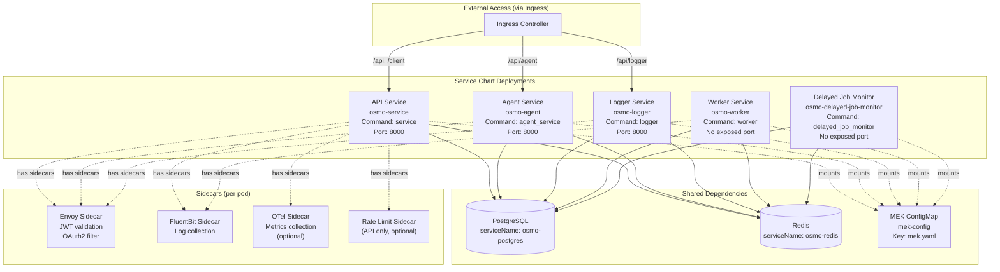
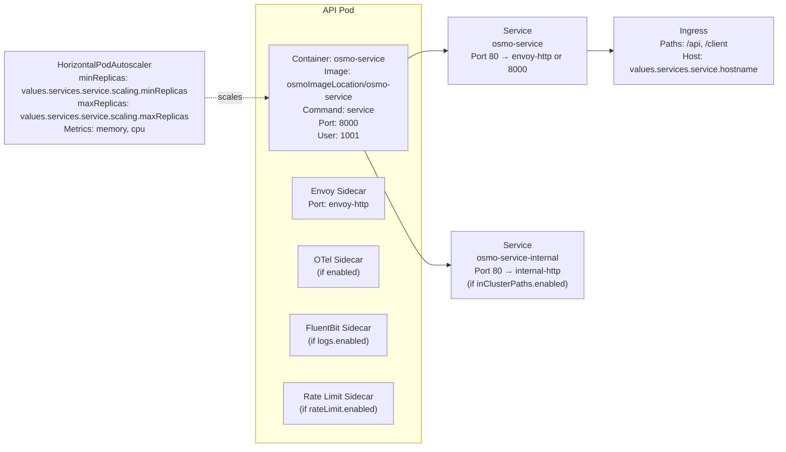
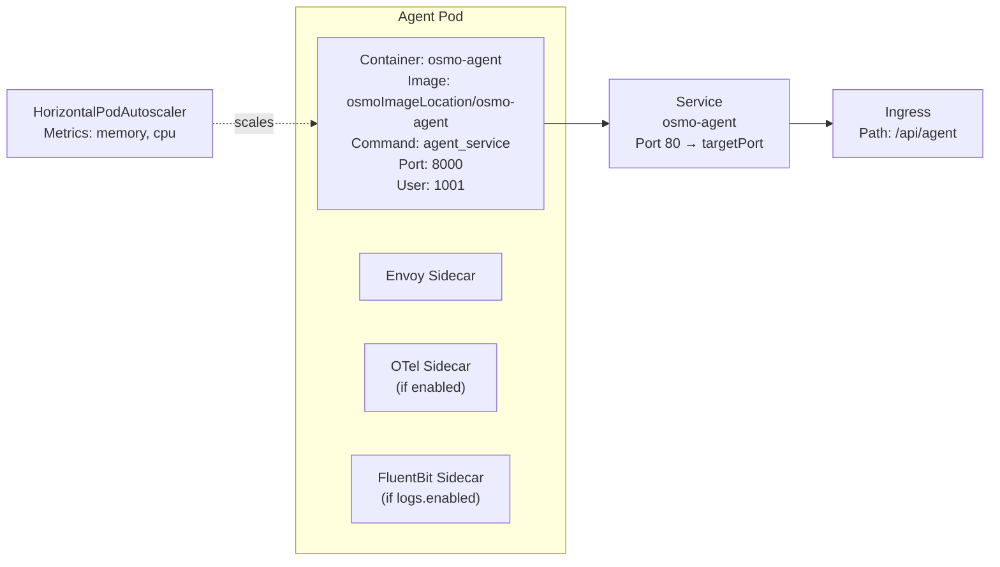
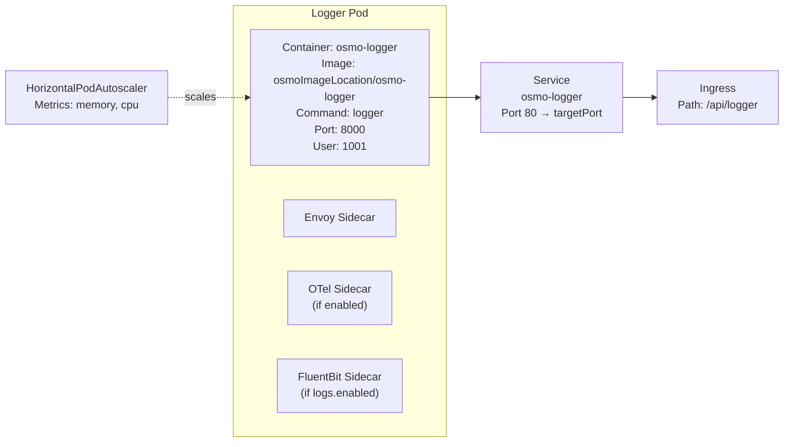
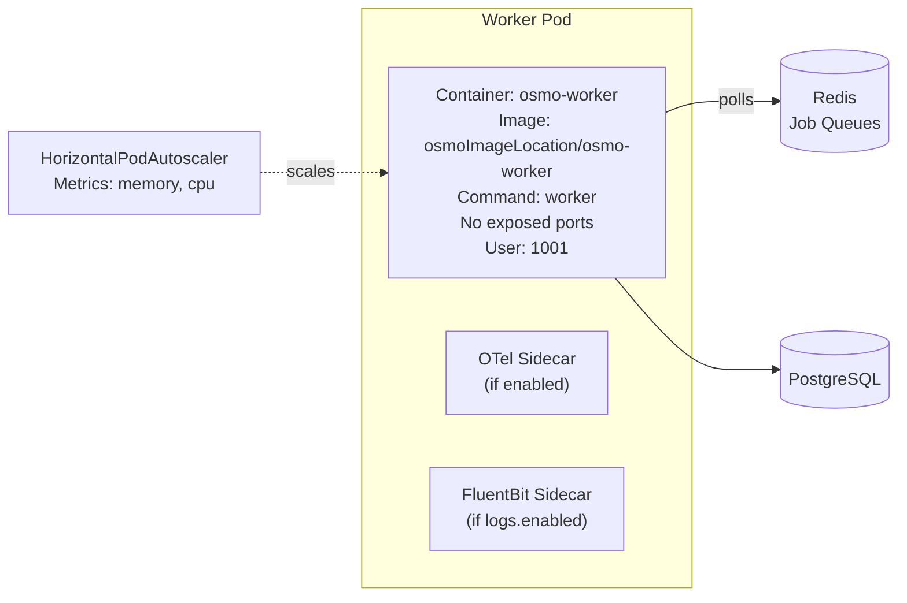
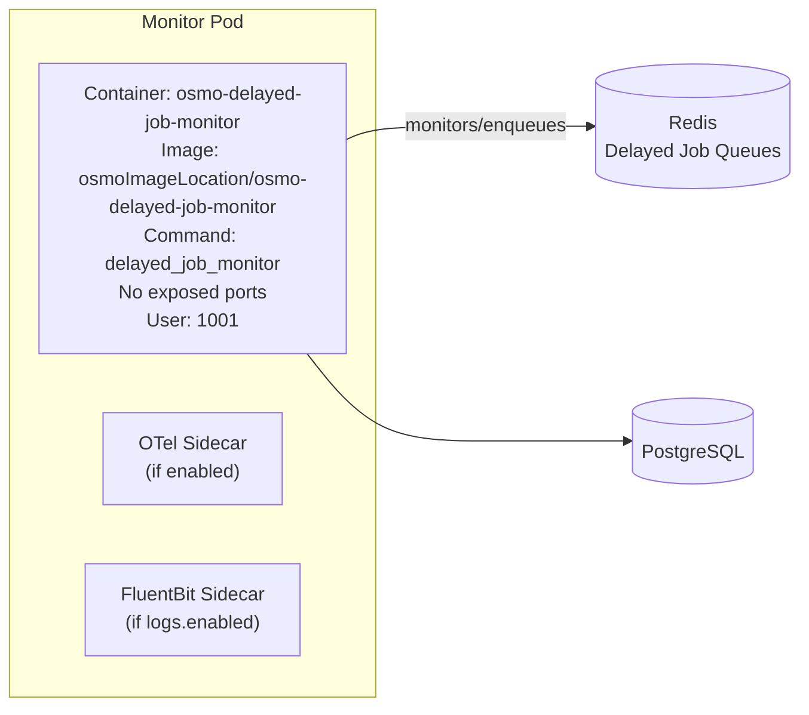
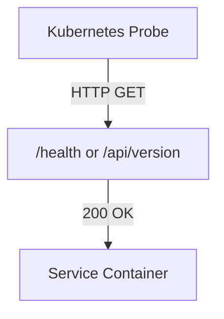
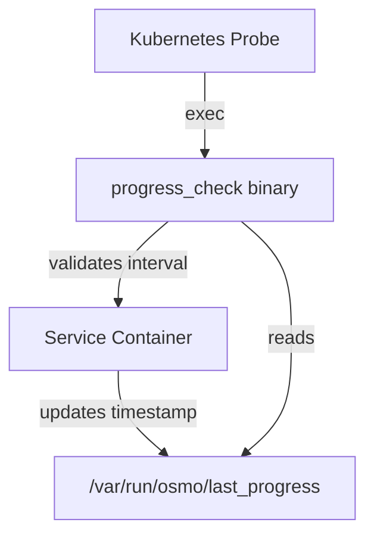
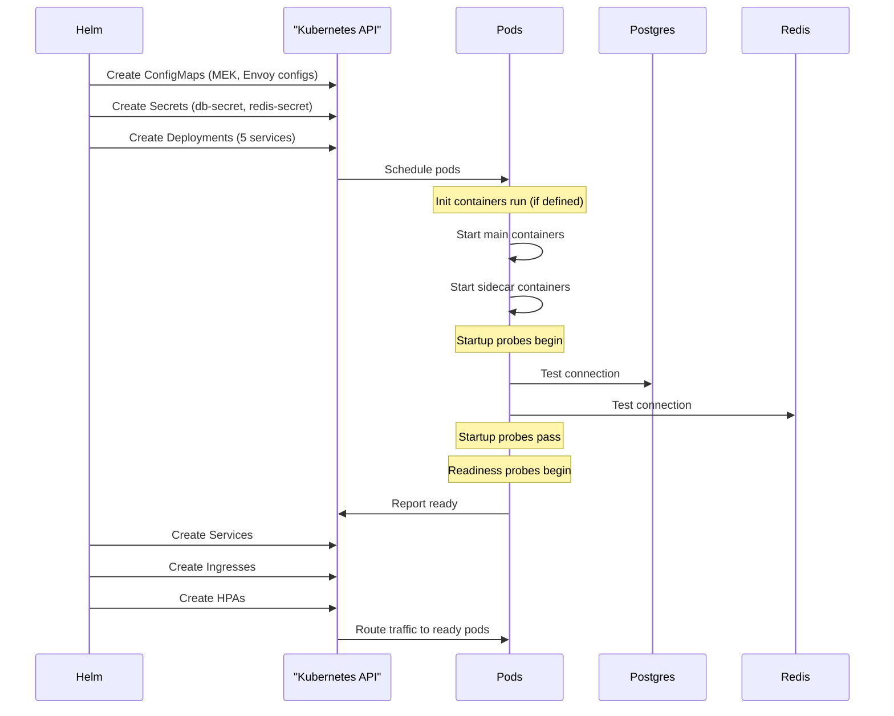

<!-- source: DeepWiki mcp.deepwiki.com · repo NVIDIA/OSMO · page 7.2 Service Deployments · fetched 2026-10-26 -->

# Service Deployments

<details>
<summary>Relevant source files</summary>

The following files were used as context for generating this wiki page:

- [deployments/charts/quick-start/Chart.yaml](deployments/charts/quick-start/Chart.yaml)
- [deployments/charts/router/Chart.yaml](deployments/charts/router/Chart.yaml)
- [deployments/charts/router/templates/router-service.yaml](deployments/charts/router/templates/router-service.yaml)
- [deployments/charts/service/templates/agent-service.yaml](deployments/charts/service/templates/agent-service.yaml)
- [deployments/charts/service/templates/api-service.yaml](deployments/charts/service/templates/api-service.yaml)
- [deployments/charts/service/templates/delayed-job-monitor.yaml](deployments/charts/service/templates/delayed-job-monitor.yaml)
- [deployments/charts/service/templates/logger-service.yaml](deployments/charts/service/templates/logger-service.yaml)
- [deployments/charts/service/templates/worker.yaml](deployments/charts/service/templates/worker.yaml)
- [deployments/charts/web-ui/templates/ui.yaml](deployments/charts/web-ui/templates/ui.yaml)

</details>


This page documents the core OSMO control plane services deployed via the `service` Helm chart. These services handle workflow submission, status monitoring, log streaming, and background job processing. 

For information about the overall Helm chart structure and dependencies, see [Helm Chart Architecture](#7.1). For details on sidecar containers (Envoy, FluentBit, OpenTelemetry), see [Sidecar Containers](#7.3). For backend operator deployments, see [Backend Operator Architecture](#5.1).

## Overview

The `service` chart deploys five core components that comprise the OSMO control plane:

| Service | Purpose | External Access | Scaling |
|---------|---------|----------------|---------|
| **API Service** (`osmo-service`) | REST API for workflow operations, configuration management, dataset operations | Yes (Ingress) | HPA (Memory + CPU) |
| **Agent Service** (`osmo-agent`) | Backend status updates, health monitoring | Yes (Ingress) | HPA (Memory + CPU) |
| **Logger Service** (`osmo-logger`) | WebSocket log streaming from workflow tasks | Yes (Ingress) | HPA (Memory + CPU) |
| **Worker Service** (`osmo-worker`) | Background job processing (workflow submission, cleanup) | No | HPA (Memory + CPU) |
| **Delayed Job Monitor** (`osmo-delayed-job-monitor`) | Monitors delayed job queues, enqueues ready jobs | No | Fixed replicas |

All services connect to shared PostgreSQL and Redis instances and mount the Master Encryption Key (MEK) for credential decryption.

**Sources:** [deployments/charts/service/templates/api-service.yaml:1-368](), [deployments/charts/service/templates/agent-service.yaml:1-318](), [deployments/charts/service/templates/logger-service.yaml:1-314](), [deployments/charts/service/templates/worker.yaml:1-237](), [deployments/charts/service/templates/delayed-job-monitor.yaml:1-204]()

## Service Architecture Diagram



**Sources:** [deployments/charts/service/templates/api-service.yaml:1-368](), [deployments/charts/service/templates/agent-service.yaml:1-318](), [deployments/charts/service/templates/logger-service.yaml:1-314](), [deployments/charts/service/templates/worker.yaml:1-237](), [deployments/charts/service/templates/delayed-job-monitor.yaml:1-204]()

## API Service

The API service (`osmo-service`) is the primary interface for workflow operations, configuration management, and dataset operations. It exposes REST endpoints for the CLI and Web UI.

### Deployment Configuration



**Sources:** [deployments/charts/service/templates/api-service.yaml:19-250]()

### Command-Line Arguments

The API service is invoked with the `service` command and receives the following arguments:

| Argument | Value Source | Purpose |
|----------|--------------|---------|
| `--metrics_otel_collector_component` | `.Values.services.service.serviceName` | Component name for OpenTelemetry |
| `--metrics_otel_enable` | `.Values.sidecars.otel.enabled` | Enable OTel metrics |
| `--redis_host` | `.Values.services.redis.serviceName` | Redis hostname |
| `--redis_port` | `.Values.services.redis.port` | Redis port |
| `--redis_db_number` | `.Values.services.redis.dbNumber` | Redis database number |
| `--redis_tls_enable` | `.Values.services.redis.tlsEnabled` | Enable Redis TLS |
| `--postgres_host` | `.Values.services.postgres.serviceName` | PostgreSQL hostname |
| `--postgres_port` | `.Values.services.postgres.port` | PostgreSQL port |
| `--postgres_database_name` | `.Values.services.postgres.db` | PostgreSQL database name |
| `--postgres_user` | `.Values.services.postgres.user` | PostgreSQL username |
| `--mek_file` | `.Values.services.configFile.path` | MEK file path for credential encryption |
| `--service_hostname` | `.Values.services.service.hostname` | Service public hostname |
| `--osmo_image_location` | `.Values.global.osmoImageLocation` | Container registry location |
| `--osmo_image_tag` | `.Values.global.osmoImageTag` | Container image tag |
| `--log_level` | `.Values.global.logs.logLevel` | Application log level |
| `--k8s_log_level` | `.Values.global.logs.k8sLogLevel` | Kubernetes client log level |
| `--log_dir` | `/logs` | Log directory path |
| `--log_name` | `api_service` | Log file name |

Authentication-related arguments (if `.Values.services.service.auth.enabled`):

| Argument | Value Source | Purpose |
|----------|--------------|---------|
| `--device_endpoint` | `.Values.services.service.auth.device_endpoint` | OAuth2 device authorization endpoint |
| `--device_client_id` | `.Values.services.service.auth.device_client_id` | Device flow client ID |
| `--browser_endpoint` | `.Values.services.service.auth.browser_endpoint` | Browser OAuth2 endpoint |
| `--browser_client_id` | `.Values.services.service.auth.browser_client_id` | Browser flow client ID |
| `--token_endpoint` | `.Values.services.service.auth.token_endpoint` | Token exchange endpoint |
| `--logout_endpoint` | `.Values.services.service.auth.logout_endpoint` | Logout endpoint |

**Sources:** [deployments/charts/service/templates/api-service.yaml:76-148]()

### Health Checks

The API service uses HTTP-based health checks:

```yaml
livenessProbe:
  # Defined in .Values.services.service.livenessProbe
  
startupProbe:
  httpGet:
    port: 8000
    path: /api/version
  failureThreshold: 6
  periodSeconds: 5
  timeoutSeconds: 3
  initialDelaySeconds: 5

readinessProbe:
  httpGet:
    port: 8000
    path: /api/workflow?limit=0&all_pools=true
    httpHeaders:
    - name: x-osmo-roles
      value: osmo-admin
  periodSeconds: 45
  failureThreshold: 3
  timeoutSeconds: 20
```

The readiness probe performs a database read operation to ensure the service can serve traffic.

**Sources:** [deployments/charts/service/templates/api-service.yaml:191-217]()

### Environment Variables

| Variable | Source | Purpose |
|----------|--------|---------|
| `OSMO_DISABLE_TASK_METRICS` | `.Values.services.service.disableTaskMetrics` | Disable per-task metrics collection |
| `OSMO_POSTGRES_PASSWORD` | Secret `db-secret` or `.Values.services.postgres.password` | Database authentication |
| `OSMO_REDIS_PASSWORD` | Secret `redis-secret` | Redis authentication |

**Sources:** [deployments/charts/service/templates/api-service.yaml:149-167]()

### Scaling Configuration

The API service uses HorizontalPodAutoscaler with dual metrics:

```yaml
minReplicas: .Values.services.service.scaling.minReplicas
maxReplicas: .Values.services.service.scaling.maxReplicas
metrics:
- type: ContainerResource
  containerResource:
    name: memory
    target:
      type: Utilization
      averageUtilization: .Values.services.service.scaling.hpaMemoryTarget
- type: ContainerResource
  containerResource:
    name: cpu
    target:
      type: Utilization
      averageUtilization: .Values.services.service.scaling.hpaCpuTarget
```

**Sources:** [deployments/charts/service/templates/api-service.yaml:339-368]()

## Agent Service

The Agent service (`osmo-agent`) handles backend status updates and health monitoring. Backend operators communicate with this service to report task status and cluster information.

### Deployment Configuration



**Sources:** [deployments/charts/service/templates/agent-service.yaml:20-227]()

### Command-Line Arguments

| Argument | Value Source | Purpose |
|----------|--------------|---------|
| `--redis_host` | `.Values.services.redis.serviceName` | Redis hostname |
| `--redis_port` | `.Values.services.redis.port` | Redis port |
| `--redis_tls_enable` | `.Values.services.redis.tlsEnabled` | Enable Redis TLS |
| `--redis_db_number` | `.Values.services.redis.dbNumber` | Redis database number |
| `--service_hostname` | `.Values.services.service.hostname` | Service public hostname |
| `--postgres_host` | `.Values.services.postgres.serviceName` | PostgreSQL hostname |
| `--postgres_port` | `.Values.services.postgres.port` | PostgreSQL port |
| `--postgres_database_name` | `.Values.services.postgres.db` | PostgreSQL database name |
| `--postgres_user` | `.Values.services.postgres.user` | PostgreSQL username |
| `--mek_file` | `.Values.services.configFile.path` | MEK file path |
| `--log_level` | `.Values.global.logs.logLevel` | Application log level |
| `--k8s_log_level` | `.Values.global.logs.k8sLogLevel` | Kubernetes client log level |
| `--log_dir` | `/logs` | Log directory path |
| `--log_name` | `agent_service` | Log file name |

**Sources:** [deployments/charts/service/templates/agent-service.yaml:77-129]()

### Health Checks

The Agent service uses a combination of `progress_check` and HTTP probes:

```yaml
livenessProbe:
  exec:
    command:
    - progress_check
    - --progress_interval
    - "300"
    - --progress_file
    - /var/run/osmo/last_progress
  timeoutSeconds: 20
  failureThreshold: 3
  periodSeconds: 45

startupProbe:
  exec:
    command:
    - progress_check
    - --progress_interval
    - "60"
    - --progress_file
    - /var/run/osmo/last_progress
  failureThreshold: 12
  periodSeconds: 5
  timeoutSeconds: 15
  initialDelaySeconds: 10

readinessProbe:
  httpGet:
    port: 8000
    path: /health
  periodSeconds: 45
  failureThreshold: 3
  timeoutSeconds: 20
```

The `progress_check` command verifies the service has made progress within the specified interval by checking a timestamp file at `/var/run/osmo/last_progress`.

**Sources:** [deployments/charts/service/templates/agent-service.yaml:165-199]()

### Scaling Configuration

```yaml
minReplicas: .Values.services.agent.scaling.minReplicas
maxReplicas: .Values.services.agent.scaling.maxReplicas
metrics:
- type: ContainerResource
  containerResource:
    name: memory
    target:
      averageUtilization: .Values.services.agent.scaling.hpaMemoryTarget
- type: ContainerResource
  containerResource:
    name: cpu
    target:
      averageUtilization: .Values.services.agent.scaling.hpaCpuTarget
```

**Sources:** [deployments/charts/service/templates/agent-service.yaml:289-318]()

## Logger Service

The Logger service (`osmo-logger`) provides WebSocket-based log streaming for workflow tasks. It reads logs from Redis streams and forwards them to connected clients.

### Deployment Configuration

The Logger service deployment structure is similar to the Agent service:



**Sources:** [deployments/charts/service/templates/logger-service.yaml:20-223]()

### Command-Line Arguments

| Argument | Value Source | Purpose |
|----------|--------------|---------|
| `--redis_host` | `.Values.services.redis.serviceName` | Redis hostname |
| `--redis_port` | `.Values.services.redis.port` | Redis port |
| `--redis_tls_enable` | `.Values.services.redis.tlsEnabled` | Enable Redis TLS |
| `--redis_db_number` | `.Values.services.redis.dbNumber` | Redis database number |
| `--postgres_host` | `.Values.services.postgres.serviceName` | PostgreSQL hostname |
| `--postgres_port` | `.Values.services.postgres.port` | PostgreSQL port |
| `--postgres_database_name` | `.Values.services.postgres.db` | PostgreSQL database name |
| `--postgres_user` | `.Values.services.postgres.user` | PostgreSQL username |
| `--mek_file` | `.Values.services.configFile.path` | MEK file path |
| `--log_level` | `.Values.global.logs.logLevel` | Application log level |
| `--k8s_log_level` | `.Values.global.logs.k8sLogLevel` | Kubernetes client log level |
| `--log_dir` | `/logs` | Log directory path |
| `--log_name` | `logger_service` | Log file name |

**Sources:** [deployments/charts/service/templates/logger-service.yaml:84-125]()

### Health Checks

Identical to Agent service - uses `progress_check` for liveness/startup and HTTP for readiness:

```yaml
livenessProbe:
  exec:
    command:
    - progress_check
    - --progress_interval
    - "300"
    - --progress_file
    - /var/run/osmo/last_progress
  timeoutSeconds: 20
  failureThreshold: 3
  periodSeconds: 45

readinessProbe:
  httpGet:
    port: 8000
    path: /health
  periodSeconds: 45
  failureThreshold: 3
  timeoutSeconds: 20
```

**Sources:** [deployments/charts/service/templates/logger-service.yaml:161-195]()

### Scaling Configuration

```yaml
minReplicas: .Values.services.logger.scaling.minReplicas
maxReplicas: .Values.services.logger.scaling.maxReplicas
metrics:
- type: ContainerResource
  containerResource:
    name: memory
    target:
      averageUtilization: .Values.services.logger.scaling.hpaMemoryTarget
- type: ContainerResource
  containerResource:
    name: cpu
    target:
      averageUtilization: .Values.services.logger.scaling.hpaCpuTarget
```

**Sources:** [deployments/charts/service/templates/logger-service.yaml:285-314]()

## Worker Service

The Worker service (`osmo-worker`) processes background jobs from Redis queues. These jobs include workflow submission tasks, cleanup operations, and other asynchronous processing.

### Deployment Configuration



Note: The Worker service has no Kubernetes Service or Ingress - it only communicates with Redis and PostgreSQL.

**Sources:** [deployments/charts/service/templates/worker.yaml:16-205]()

### Command-Line Arguments

| Argument | Value Source | Purpose |
|----------|--------------|---------|
| `--metrics_otel_collector_component` | `.Values.services.worker.serviceName` | Component name for OpenTelemetry |
| `--metrics_otel_enable` | `.Values.sidecars.otel.enabled` | Enable OTel metrics |
| `--redis_host` | `.Values.services.redis.serviceName` | Redis hostname |
| `--redis_port` | `.Values.services.redis.port` | Redis port |
| `--redis_db_number` | `.Values.services.redis.dbNumber` | Redis database number |
| `--redis_tls_enable` | `.Values.services.redis.tlsEnabled` | Enable Redis TLS |
| `--postgres_host` | `.Values.services.postgres.serviceName` | PostgreSQL hostname |
| `--postgres_port` | `.Values.services.postgres.port` | PostgreSQL port |
| `--postgres_database_name` | `.Values.services.postgres.db` | PostgreSQL database name |
| `--postgres_user` | `.Values.services.postgres.user` | PostgreSQL username |
| `--mek_file` | `.Values.services.configFile.path` | MEK file path |
| `--log_level` | `.Values.global.logs.logLevel` | Application log level |
| `--k8s_log_level` | `.Values.global.logs.k8sLogLevel` | Kubernetes client log level |
| `--log_dir` | `/logs` | Log directory path |
| `--log_name` | `worker` | Log file name |

**Sources:** [deployments/charts/service/templates/worker.yaml:69-122]()

### Health Checks

The Worker uses `progress_check` probes to ensure it's processing jobs and not stuck:

```yaml
livenessProbe:
  exec:
    command:
    - progress_check
    - --progress_interval
    - "300"
  failureThreshold: 1
  periodSeconds: 60
  timeoutSeconds: 15

startupProbe:
  exec:
    command:
    - progress_check
    - --progress_interval
    - "300"
  failureThreshold: 12
  periodSeconds: 5
  timeoutSeconds: 15
  initialDelaySeconds: 10
```

The liveness probe restarts the worker if it's been on the same job for more than 5 minutes (300 seconds).

**Sources:** [deployments/charts/service/templates/worker.yaml:156-178]()

### Scaling Configuration

```yaml
minReplicas: .Values.services.worker.scaling.minReplicas
maxReplicas: .Values.services.worker.scaling.maxReplicas
metrics:
- type: ContainerResource
  containerResource:
    name: memory
    target:
      averageUtilization: .Values.services.worker.scaling.hpaMemoryTarget
- type: ContainerResource
  containerResource:
    name: cpu
    target:
      averageUtilization: .Values.services.worker.scaling.hpaCpuTarget
```

**Sources:** [deployments/charts/service/templates/worker.yaml:208-237]()

## Delayed Job Monitor

The Delayed Job Monitor (`osmo-delayed-job-monitor`) monitors delayed job queues and enqueues jobs that are ready to run. Unlike the Worker, it runs as a fixed-replica deployment without HPA.

### Deployment Configuration



Fixed replicas: `.Values.services.delayedJobMonitor.replicas`

**Sources:** [deployments/charts/service/templates/delayed-job-monitor.yaml:16-204]()

### Command-Line Arguments

| Argument | Value Source | Purpose |
|----------|--------------|---------|
| `--metrics_otel_collector_component` | `.Values.services.delayedJobMonitor.serviceName` | Component name for OpenTelemetry |
| `--metrics_otel_enable` | `.Values.sidecars.otel.enabled` | Enable OTel metrics |
| `--redis_host` | `.Values.services.redis.serviceName` | Redis hostname |
| `--redis_port` | `.Values.services.redis.port` | Redis port |
| `--redis_db_number` | `.Values.services.redis.dbNumber` | Redis database number |
| `--redis_tls_enable` | `.Values.services.redis.tlsEnabled` | Enable Redis TLS |
| `--postgres_host` | `.Values.services.postgres.serviceName` | PostgreSQL hostname |
| `--postgres_port` | `.Values.services.postgres.port` | PostgreSQL port |
| `--postgres_database_name` | `.Values.services.postgres.db` | PostgreSQL database name |
| `--postgres_user` | `.Values.services.postgres.user` | PostgreSQL username |
| `--mek_file` | `.Values.services.configFile.path` | MEK file path |
| `--log_level` | `.Values.global.logs.logLevel` | Application log level |
| `--k8s_log_level` | `.Values.global.logs.k8sLogLevel` | Kubernetes client log level |
| `--log_dir` | `/logs` | Log directory path |
| `--log_name` | `delayed_job_monitor` | Log file name |
| `--enable_metrics` | Set if `.Values.sidecars.otel.enabled` | Enable metrics collection |

**Sources:** [deployments/charts/service/templates/delayed-job-monitor.yaml:64-114]()

### Health Checks

The Monitor uses `progress_check` with a shorter startup interval:

```yaml
livenessProbe:
  exec:
    command:
    - progress_check
    - --progress_interval
    - "300"
  failureThreshold: 1
  periodSeconds: 30
  timeoutSeconds: 15

startupProbe:
  exec:
    command:
    - progress_check
    - --progress_interval
    - "30"
  failureThreshold: 12
  periodSeconds: 5
  timeoutSeconds: 15
  initialDelaySeconds: 10
```

Note the startup probe uses a 30-second interval while liveness uses 300 seconds.

**Sources:** [deployments/charts/service/templates/delayed-job-monitor.yaml:152-174]()

## Health Check Patterns

OSMO services use two distinct health check patterns:

### Pattern 1: HTTP-Based Checks (API, Agent, Logger)



Used for services with HTTP endpoints. The API service uses `/api/version` for startup and a database query endpoint for readiness.

**Sources:** [deployments/charts/service/templates/api-service.yaml:191-217](), [deployments/charts/service/templates/agent-service.yaml:192-199]()

### Pattern 2: Progress Check (Worker, Monitor, Agent/Logger Liveness)



The `progress_check` command verifies the service has updated its progress file within the specified interval:

```bash
progress_check --progress_interval "300" --progress_file /var/run/osmo/last_progress
```

If the timestamp is older than the interval, the probe fails and Kubernetes restarts the container.

**Sources:** [deployments/charts/service/templates/worker.yaml:156-178](), [deployments/charts/service/templates/agent-service.yaml:165-190]()

## Common Configuration Patterns

### Security Context

All service containers use the same restrictive security context:

```yaml
securityContext:
  allowPrivilegeEscalation: false
  capabilities:
    drop: ["ALL"]
  runAsNonRoot: true
  runAsUser: 1001
```

**Sources:** [deployments/charts/service/templates/api-service.yaml:169-174](), [deployments/charts/service/templates/worker.yaml:71-76]()

### MEK Volume Mount

Services that need to decrypt credentials mount the MEK ConfigMap:

```yaml
volumeMounts:
- mountPath: /path/to/mek.yaml  # .Values.services.configFile.path
  name: mek-volume
  subPath: mek.yaml

volumes:
- configMap:
    defaultMode: 420
    items:
    - key: mek.yaml
      path: mek.yaml
    name: mek-config
  name: mek-volume
```

**Sources:** [deployments/charts/service/templates/api-service.yaml:178-249]()

### Log Volume Mount

When logging is enabled (`.Values.global.logs.enabled`):

```yaml
volumeMounts:
- name: logs
  mountPath: /logs

volumes:
- name: logs
  emptyDir: {}
```

FluentBit sidecars read from this shared volume.

**Sources:** [deployments/charts/service/templates/api-service.yaml:183-237]()

### Topology Spread Constraints

Services use topology spread constraints for high availability:

```yaml
topologySpreadConstraints:
- topologyKey: {{ .topologyKey }}
  # Additional fields from .Values.services.<service>.topologySpreadConstraints
  labelSelector:
    matchLabels:
      app: {{ $.Values.services.<service>.serviceName }}
```

**Sources:** [deployments/charts/service/templates/api-service.yaml:43-54](), [deployments/charts/service/templates/agent-service.yaml:44-55]()

## Service Comparison Table

| Feature | API | Agent | Logger | Worker | Monitor |
|---------|-----|-------|--------|--------|---------|
| **Command** | `service` | `agent_service` | `logger` | `worker` | `delayed_job_monitor` |
| **Port** | 8000 | 8000 | 8000 | None | None |
| **Ingress** | Yes (/api, /client) | Yes (/api/agent) | Yes (/api/logger) | No | No |
| **Envoy Sidecar** | Yes | Yes | Yes | No | No |
| **OTel Sidecar** | Optional | Optional | Optional | Optional | Optional |
| **FluentBit Sidecar** | Optional | Optional | Optional | Optional | Optional |
| **Rate Limit Sidecar** | Optional | No | No | No | No |
| **Liveness Probe** | Values-defined | progress_check (300s) | progress_check (300s) | progress_check (300s) | progress_check (300s) |
| **Readiness Probe** | HTTP + DB query | HTTP /health | HTTP /health | None | None |
| **HPA Enabled** | Yes | Yes | Yes | Yes | No |
| **HPA Metrics** | Memory + CPU | Memory + CPU | Memory + CPU | Memory + CPU | N/A |
| **Internal Service** | Optional | No | No | No | No |

**Sources:** [deployments/charts/service/templates/api-service.yaml:1-368](), [deployments/charts/service/templates/agent-service.yaml:1-318](), [deployments/charts/service/templates/logger-service.yaml:1-314](), [deployments/charts/service/templates/worker.yaml:1-237](), [deployments/charts/service/templates/delayed-job-monitor.yaml:1-204]()

## Helm Template Helpers

The service chart uses several template helpers defined in `_helpers.tpl` (referenced but not shown in provided files):

| Helper | Purpose | Example Usage |
|--------|---------|---------------|
| `osmo.service-account-name` | Resolves service account name | [deployments/charts/service/templates/api-service.yaml:68]() |
| `osmo.envoy-sidecar-container` | Generates Envoy sidecar | [deployments/charts/service/templates/api-service.yaml:218]() |
| `osmo.otel-sidecar-container` | Generates OTel sidecar | [deployments/charts/service/templates/api-service.yaml:220]() |
| `osmo.log-agent-sidecar-container` | Generates FluentBit sidecar | [deployments/charts/service/templates/api-service.yaml:222]() |
| `osmo.rate-limit-sidecar-container` | Generates rate limit sidecar | [deployments/charts/service/templates/api-service.yaml:224]() |
| `osmo.envoy-volumes` | Generates Envoy volumes | [deployments/charts/service/templates/api-service.yaml:228]() |
| `osmo.extra-annotations` | Adds custom annotations | [deployments/charts/service/templates/api-service.yaml:34]() |
| `osmo.extra-env` | Adds custom environment variables | [deployments/charts/service/templates/api-service.yaml:152]() |
| `osmo.extra-volume-mounts` | Adds custom volume mounts | [deployments/charts/service/templates/api-service.yaml:187]() |
| `osmo.extra-sidecars` | Adds custom sidecars | [deployments/charts/service/templates/api-service.yaml:226]() |
| `service.targetPort` | Determines target port (Envoy or direct) | [deployments/charts/service/templates/api-service.yaml:266]() |

**Sources:** [deployments/charts/service/templates/api-service.yaml:34-266](), [deployments/charts/service/templates/agent-service.yaml:35-209]()

## Deployment Workflow



**Sources:** [deployments/charts/service/templates/api-service.yaml:1-368](), [deployments/charts/quick-start/Chart.yaml:24-39]()

---

