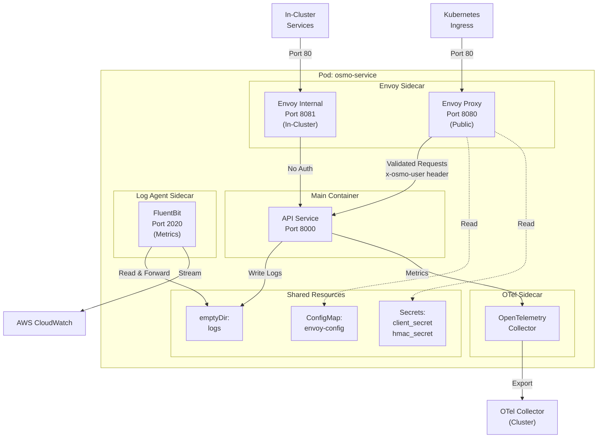
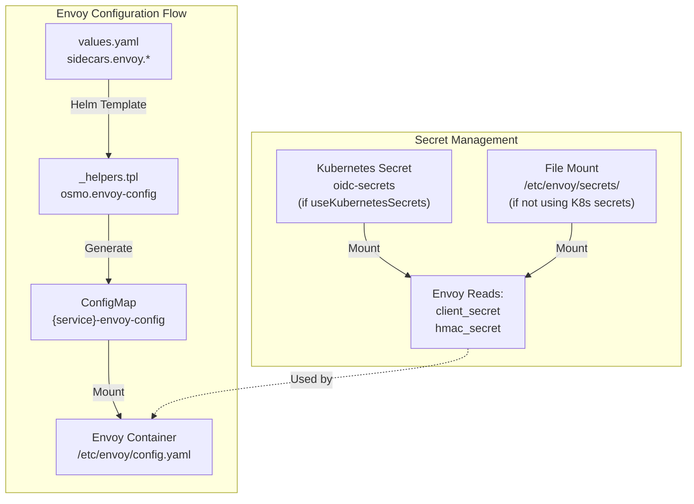
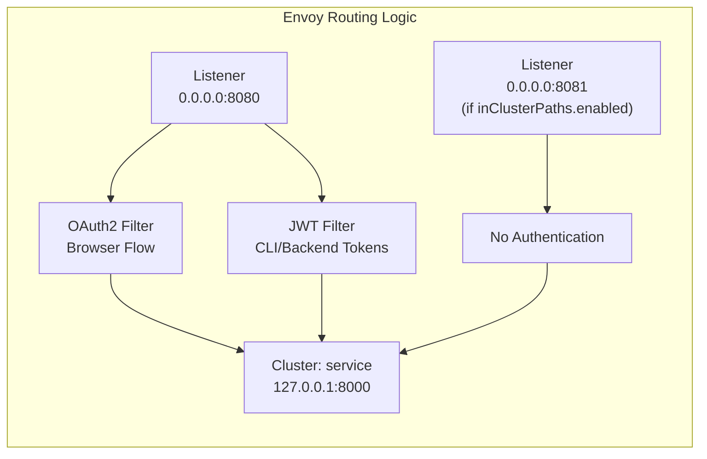
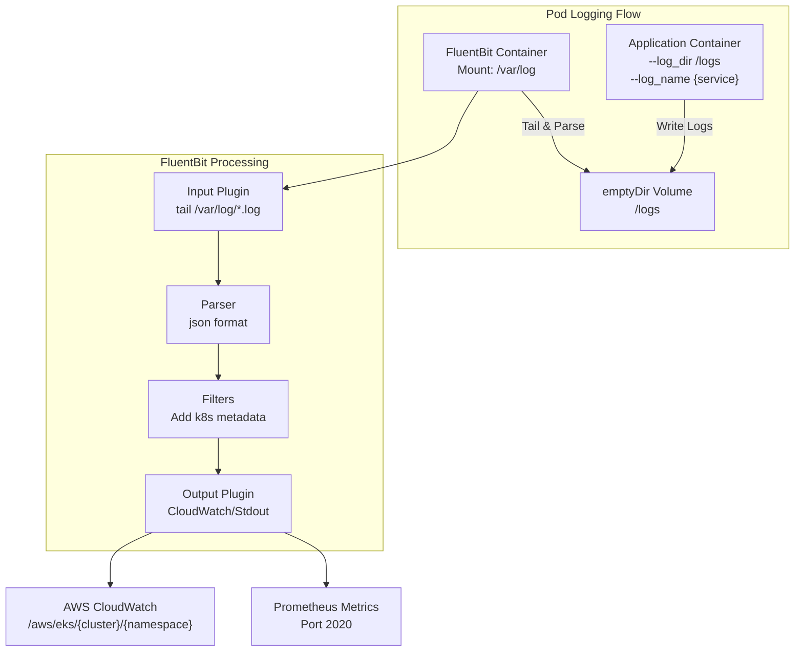
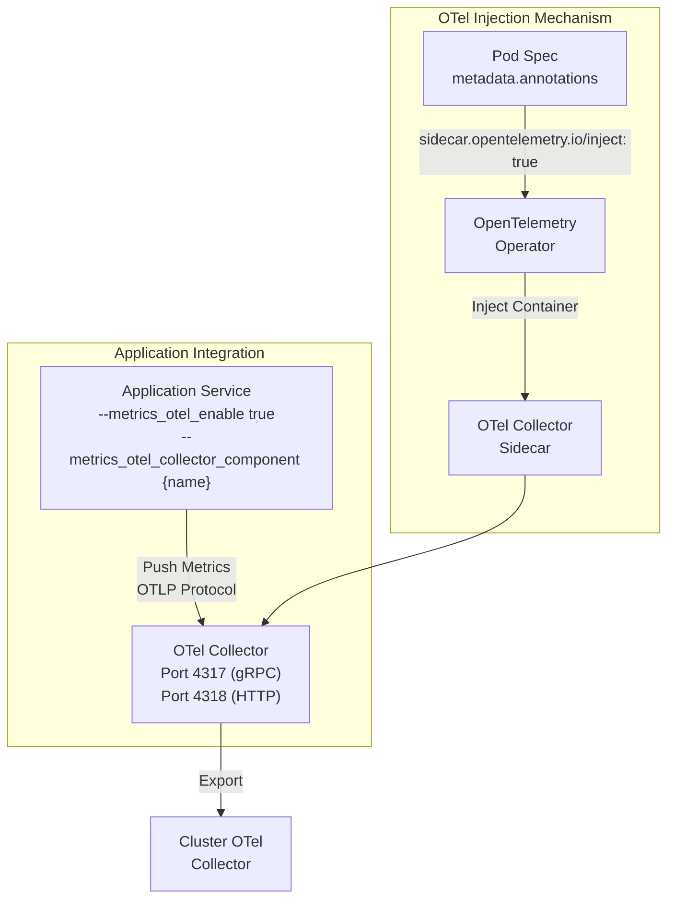
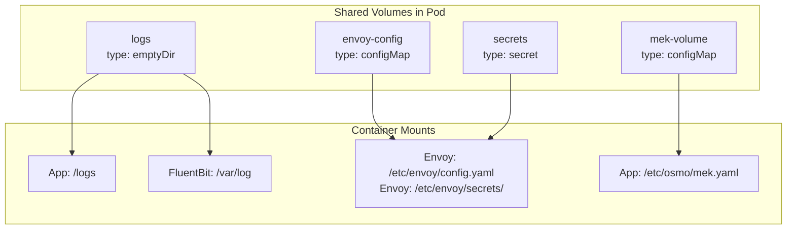

<!-- source: DeepWiki mcp.deepwiki.com · repo NVIDIA/OSMO · page 7.3 Sidecar Containers · fetched 2026-10-26 -->

# Sidecar Containers

<details>
<summary>Relevant source files</summary>

The following files were used as context for generating this wiki page:

- [deployments/charts/quick-start/Chart.yaml](deployments/charts/quick-start/Chart.yaml)
- [deployments/charts/router/Chart.yaml](deployments/charts/router/Chart.yaml)
- [deployments/charts/router/templates/router-service.yaml](deployments/charts/router/templates/router-service.yaml)
- [deployments/charts/service/templates/agent-service.yaml](deployments/charts/service/templates/agent-service.yaml)
- [deployments/charts/service/templates/api-service.yaml](deployments/charts/service/templates/api-service.yaml)
- [deployments/charts/service/templates/delayed-job-monitor.yaml](deployments/charts/service/templates/delayed-job-monitor.yaml)
- [deployments/charts/service/templates/logger-service.yaml](deployments/charts/service/templates/logger-service.yaml)
- [deployments/charts/service/templates/worker.yaml](deployments/charts/service/templates/worker.yaml)
- [deployments/charts/web-ui/README.md](deployments/charts/web-ui/README.md)
- [deployments/charts/web-ui/templates/ui.yaml](deployments/charts/web-ui/templates/ui.yaml)
- [deployments/charts/web-ui/values.yaml](deployments/charts/web-ui/values.yaml)
- [ui/src/app/layout.tsx](ui/src/app/layout.tsx)
- [ui/src/app/workflows/components/TaskActions.tsx](ui/src/app/workflows/components/TaskActions.tsx)
- [ui/src/app/workflows/components/WorkflowActions.tsx](ui/src/app/workflows/components/WorkflowActions.tsx)
- [ui/src/env.mjs](ui/src/env.mjs)
- [ui/src/runtime-env.tsx](ui/src/runtime-env.tsx)

</details>


This page documents OSMO's sidecar container architecture, which provides authentication, logging, observability, and rate limiting capabilities to control plane services. Sidecar containers run alongside the main application containers within the same pod, sharing network and storage resources while maintaining separation of concerns.

For information about the overall Kubernetes deployment architecture, see [Kubernetes Deployment](#7). For authentication mechanisms, see [Authentication and Security](#8).

## Overview

OSMO deploys four types of sidecar containers across its control plane services:

| Sidecar Type | Purpose | Services Using It | Optional |
|--------------|---------|-------------------|----------|
| **Envoy** | Authentication proxy with OAuth2/JWT validation | API, UI, Agent, Logger, Router | No (for production) |
| **FluentBit** | Log collection and forwarding to centralized storage | All services | Yes |
| **OpenTelemetry** | Metrics collection and observability | API, Worker, Agent, Logger, DelayedJobMonitor | Yes |
| **Rate Limiter** | API request rate limiting | API service only | Yes |

**Sources:** [deployments/charts/service/templates/api-service.yaml:218-225](), [deployments/charts/web-ui/templates/ui.yaml:243-244]()

## Sidecar Architecture Pattern



**Sources:** [deployments/charts/service/templates/api-service.yaml:218-250](), [deployments/charts/web-ui/templates/ui.yaml:72-257]()

## Envoy Authentication Proxy

The Envoy sidecar provides edge authentication and request validation for all control plane services. It intercepts incoming requests, validates OAuth2/JWT credentials, and forwards authenticated requests to the application container with user identity headers.

### Envoy Configuration



**Key Configuration Parameters:**

| Parameter | Purpose | Default |
|-----------|---------|---------|
| `sidecars.envoy.enabled` | Enable Envoy sidecar | `true` |
| `sidecars.envoy.listenerPort` | Envoy listening port | `8080` |
| `sidecars.envoy.service.port` | Backend service port | `8000` |
| `sidecars.envoy.maxHeadersSizeKb` | Max HTTP header size | `128` |
| `sidecars.envoy.jwtEnable` | Enable JWT validation | `true` |
| `sidecars.envoy.oauth2Enable` | Enable OAuth2 filter | `true` |
| `sidecars.envoy.skipAuthPaths` | Paths bypassing auth | `[]` |
| `sidecars.envoy.inClusterPaths.enabled` | Internal no-auth endpoint | `false` |

**Sources:** [deployments/charts/web-ui/values.yaml:377-601](), [deployments/charts/service/templates/api-service.yaml:251-253]()

### Envoy Listeners and Routes

Envoy creates two listeners:

1. **Public Listener** (port 8080): Requires OAuth2/JWT authentication
2. **Internal Listener** (port 8081, optional): Bypasses authentication for in-cluster traffic



**Sources:** [deployments/charts/web-ui/values.yaml:405-410](), [deployments/charts/service/templates/api-service.yaml:274-289]()

### Envoy JWT Validation

Envoy validates JWT tokens from multiple providers and extracts user identity:

**JWT Provider Configuration:**

```yaml
# From values.yaml
jwt:
  user_header: x-osmo-user
  providers:
  - issuer: "https://keycloak.example.com/realms/osmo"
    audience: "osmo-device"
    jwks_uri: "https://keycloak.example.com/realms/osmo/protocol/openid-connect/certs"
    user_claim: unique_name
    cluster: oauth
  - issuer: "https://keycloak.example.com/realms/osmo"
    audience: "osmo-browser-flow"
    jwks_uri: "https://keycloak.example.com/realms/osmo/protocol/openid-connect/certs"
    user_claim: preferred_username
    cluster: oauth
```

After successful validation, Envoy injects the `x-osmo-user` header with the authenticated username, which the application services consume.

**Sources:** [deployments/charts/web-ui/values.yaml:578-600]()

### Envoy OAuth2 Filter

The OAuth2 filter handles browser-based authentication flows:

| Parameter | Purpose | Example |
|-----------|---------|---------|
| `oauth2Filter.tokenEndpoint` | Token exchange URL | `https://keycloak.example.com/realms/osmo/protocol/openid-connect/token` |
| `oauth2Filter.authEndpoint` | Authorization URL | `https://keycloak.example.com/realms/osmo/protocol/openid-connect/auth` |
| `oauth2Filter.redirectPath` | OAuth callback path | `getAToken` |
| `oauth2Filter.logoutPath` | Logout path | `logout` |
| `oauth2Filter.clientId` | OAuth client ID | `osmo-ui-client` |

Envoy stores session state in HMAC-signed cookies, eliminating the need for session storage.

**Sources:** [deployments/charts/web-ui/values.yaml:516-556]()

### Envoy Container Specification

The Envoy sidecar is defined via Helm template includes:

```yaml
# From api-service.yaml
{{- include "osmo.envoy-sidecar-container" . | nindent 6}}

# Volumes
{{- include "osmo.envoy-volumes" (dict "serviceName" .Values.services.service.serviceName "serviceEnvoy" .Values.services.service.envoy "Values" .Values) | nindent 8 }}
```

**Container Resource Limits:**

```yaml
# From values.yaml
resources:
  requests:
    cpu: "100m"
    memory: "64Mi"
  limits:
    memory: "128Mi"
```

**Security Context:**

```yaml
securityContext:
  allowPrivilegeEscalation: false
  capabilities:
    drop: ["ALL"]
  runAsNonRoot: true
  runAsUser: 1001
```

**Sources:** [deployments/charts/web-ui/values.yaml:436-474](), [deployments/charts/service/templates/api-service.yaml:218-228]()

### Envoy Health Probes

Envoy exposes a `/ready` endpoint on port 9901 for health checks:

```yaml
livenessProbe:
  httpGet:
    path: /ready
    port: 9901
  initialDelaySeconds: 10
  periodSeconds: 10
  timeoutSeconds: 3

readinessProbe:
  httpGet:
    path: /ready
    port: 9901
  initialDelaySeconds: 5
  periodSeconds: 5
  timeoutSeconds: 3

startupProbe:
  httpGet:
    path: /ready
    port: 9901
  initialDelaySeconds: 15
  periodSeconds: 5
  timeoutSeconds: 3
```

**Sources:** [deployments/charts/web-ui/values.yaml:412-434]()

## FluentBit Log Agent

The FluentBit sidecar collects logs from the main container and forwards them to centralized logging backends like AWS CloudWatch. It reads logs from a shared `emptyDir` volume mounted at `/logs`.

### Log Agent Architecture



**Sources:** [deployments/charts/web-ui/templates/ui.yaml:120-125](), [deployments/charts/web-ui/values.yaml:606-670]()

### Log Agent Configuration

**Enable/Disable:**

```yaml
# From values.yaml
sidecars:
  logAgent:
    enabled: false  # Must be explicitly enabled
```

**Key Parameters:**

| Parameter | Purpose | Default |
|-----------|---------|---------|
| `sidecars.logAgent.enabled` | Enable log collection | `false` |
| `sidecars.logAgent.image.repository` | FluentBit image | `fluent/fluent-bit:4.0.8-debug` |
| `sidecars.logAgent.fluentBitPrometheusPort` | Metrics port | `2020` |
| `sidecars.logAgent.aws.region` | AWS region | `us-west-2` |
| `sidecars.logAgent.aws.clusterName` | EKS cluster name | `""` |

**Sources:** [deployments/charts/web-ui/values.yaml:606-649]()

### Log Rotation

FluentBit can be configured with automatic log rotation:

```yaml
logrotate:
  enabled: false
  frequency: hourly  # or: daily, weekly, monthly, yearly, "minutes <size>"
  maxSize: 10M
  rotateCount: 5
  sleepSeconds: 60
```

When enabled, logs are rotated based on the specified frequency or when they reach `maxSize`, keeping `rotateCount` historical files.

**Sources:** [deployments/charts/web-ui/values.yaml:611-633]()

### Log Agent Container Specification

```yaml
# Helm template include
{{- include "osmo.log-agent-sidecar-container" . | nindent 6}}

# Volume mount
volumeMounts:
- name: logs
  mountPath: /var/log

# Resources
resources:
  requests:
    cpu: "250m"
    memory: "400Mi"
  limits:
    memory: "400Mi"
```

**Sources:** [deployments/charts/web-ui/values.yaml:652-669](), [deployments/charts/service/templates/api-service.yaml:222-236]()

### Application Log Configuration

Services must be configured to write logs to the shared volume:

```yaml
# From api-service.yaml
args:
- --log_level
- {{ .Values.global.logs.logLevel }}
- --k8s_log_level
- {{ .Values.global.logs.k8sLogLevel }}
- --log_dir
- /logs
- --log_name
- api_service

volumeMounts:
- name: logs
  mountPath: /logs

volumes:
- name: logs
  emptyDir: {}
```

**Sources:** [deployments/charts/service/templates/api-service.yaml:136-236]()

## OpenTelemetry Collector

The OpenTelemetry sidecar collects metrics and traces from application services for observability. Unlike Envoy and FluentBit which are explicitly defined in pod specs, the OTel sidecar is injected via the OpenTelemetry Operator when the pod annotation is present.

### OTel Injection Pattern



**Sources:** [deployments/charts/service/templates/api-service.yaml:35-37](), [deployments/charts/service/templates/worker.yaml:32-34]()

### OTel Configuration

**Enable via Values:**

```yaml
# From service chart values
sidecars:
  otel:
    enabled: true  # Enables annotation injection
```

**Pod Annotation:**

```yaml
# From api-service.yaml
annotations:
  {{- if .Values.sidecars.otel.enabled }}
  sidecar.opentelemetry.io/inject: "true"
  {{- end}}
```

**Application Arguments:**

```yaml
# From api-service.yaml
args:
- --metrics_otel_collector_component
- {{ .Values.services.service.serviceName }}
- --metrics_otel_enable
- {{ .Values.sidecars.otel.enabled | quote }}
```

**Sources:** [deployments/charts/service/templates/api-service.yaml:79-82](), [deployments/charts/service/templates/worker.yaml:79-82]()

### Services Using OTel

The following services are configured for OpenTelemetry metrics collection:

- **API Service** (`osmo-service`)
- **Worker Service** (`osmo-worker`)
- **Agent Service** (`osmo-agent`)
- **Logger Service** (`osmo-logger`)
- **Delayed Job Monitor** (`osmo-delayed-job-monitor`)

**Sources:** [deployments/charts/service/templates/api-service.yaml:35-37](), [deployments/charts/service/templates/worker.yaml:32-34](), [deployments/charts/service/templates/agent-service.yaml:36-38]()

### OTel Volumes

When OTel is enabled, additional volumes may be required:

```yaml
# From api-service.yaml
volumes:
{{- if .Values.sidecars.otel.enabled }}
{{- include "osmo.otel-volumes" . | nindent 8 }}
{{- end }}
```

**Sources:** [deployments/charts/service/templates/api-service.yaml:230-232]()

## Rate Limiter Sidecar

The Rate Limiter sidecar is specific to the API service and provides request rate limiting capabilities.

### Rate Limiter Configuration

```yaml
# Enable in values.yaml
sidecars:
  rateLimit:
    enabled: false  # Must be explicitly enabled
```

**Deployment:**

```yaml
# From api-service.yaml
{{- if .Values.sidecars.rateLimit.enabled }}
{{- include "osmo.rate-limit-sidecar-container" . | nindent 6}}
{{- end }}

# Volumes
{{- if .Values.sidecars.rateLimit.enabled }}
{{- include "osmo.rate-limit-volumes" . | nindent 8 }}
{{- end }}
```

The Rate Limiter works in conjunction with Envoy to enforce API request quotas on a per-user or per-endpoint basis.

**Sources:** [deployments/charts/service/templates/api-service.yaml:223-240]()

## Sidecar Injection Patterns

OSMO uses three patterns for sidecar deployment:

### 1. Explicit Container Definitions

Most sidecars (Envoy, FluentBit) are explicitly defined in deployment templates:

```yaml
containers:
- name: {{ .Values.services.ui.serviceName }}
  # Main container spec
  ...

{{- include "ui.envoy-sidecar-container" . | nindent 6}}
{{- include "ui.log-agent-sidecar-container" . | nindent 6}}
```

**Sources:** [deployments/charts/web-ui/templates/ui.yaml:243-244]()

### 2. Operator-Based Injection

OpenTelemetry uses the OpenTelemetry Operator for automatic injection:

```yaml
metadata:
  annotations:
    sidecar.opentelemetry.io/inject: "true"
```

**Sources:** [deployments/charts/service/templates/api-service.yaml:35-37]()

### 3. Conditional Sidecars

All sidecars support conditional deployment based on values:

```yaml
{{- if .Values.sidecars.envoy.enabled }}
# Envoy sidecar definition
{{- end }}

{{- if .Values.sidecars.logAgent.enabled }}
# FluentBit sidecar definition
{{- end }}
```

**Sources:** [deployments/charts/web-ui/templates/ui.yaml:243-244]()

## Shared Resources Between Containers

Sidecars share resources with the main container through Kubernetes volumes and network namespaces:

### Volume Sharing



**Example Volume Definitions:**

```yaml
volumes:
- name: logs
  emptyDir: {}
- name: envoy-config
  configMap:
    name: {{ .Values.services.ui.serviceName }}-envoy-config
- name: envoy-secrets
  secret:
    secretName: oidc-secrets
```

**Sources:** [deployments/charts/web-ui/templates/ui.yaml:248-257](), [deployments/charts/service/templates/api-service.yaml:227-249]()

### Network Sharing

All containers in a pod share the same network namespace, enabling `localhost` communication:

- Envoy listens on `0.0.0.0:8080`
- Main application listens on `127.0.0.1:8000`
- Envoy forwards to `127.0.0.1:8000`

This eliminates the need for service discovery or DNS resolution between sidecars and the main container.

**Sources:** [deployments/charts/web-ui/values.yaml:499-512]()

## Service-Specific Sidecar Usage

### API Service

```yaml
# Sidecars: Envoy + OTel + FluentBit + RateLimit (optional)
containers:
- name: osmo-service
  # Main container

{{- include "osmo.envoy-sidecar-container" . | nindent 6}}
{{- if .Values.sidecars.otel.enabled }}
{{- include "osmo.otel-sidecar-container" . | nindent 6}}
{{- end }}
{{- include "osmo.log-agent-sidecar-container" . | nindent 6}}
{{- if .Values.sidecars.rateLimit.enabled }}
{{- include "osmo.rate-limit-sidecar-container" . | nindent 6}}
{{- end }}
```

**Sources:** [deployments/charts/service/templates/api-service.yaml:218-225]()

### Web UI Service

```yaml
# Sidecars: Envoy + FluentBit
containers:
- name: osmo-ui
  # Main container

{{- include "ui.envoy-sidecar-container" . | nindent 6}}
{{- include "ui.log-agent-sidecar-container" . | nindent 6}}
```

**Sources:** [deployments/charts/web-ui/templates/ui.yaml:243-244]()

### Worker Service

```yaml
# Sidecars: OTel + FluentBit
# No Envoy - workers don't receive external traffic
containers:
- name: osmo-worker
  # Main container

{{- if .Values.global.logs.enabled }}
{{- include "osmo.log-agent-sidecar-container" . | nindent 6}}
{{- end }}
{{- if .Values.sidecars.otel.enabled }}
{{- include "osmo.otel-sidecar-container" . | nindent 6}}
{{- end }}
```

**Sources:** [deployments/charts/service/templates/worker.yaml:179-184]()

### Router Service

```yaml
# Sidecars: Envoy + FluentBit
containers:
- name: osmo-router
  # Main container

{{- include "router.envoy-sidecar-container" . | nindent 6}}
{{- include "router.log-agent-sidecar-container" . | nindent 6}}
```

**Sources:** [deployments/charts/router/templates/router-service.yaml:188-189]()

## Web UI Runtime Configuration

The Web UI uses environment variables to expose sidecar-related functionality to the client:

```typescript
// From ui/src/env.mjs
shared: {
  NEXT_PUBLIC_OSMO_PORT_FORWARD_ENABLED: z.boolean().optional().default(false),
  NEXT_PUBLIC_OSMO_SSL_ENABLED: z.boolean().optional().default(true),
}
```

```typescript
// From ui/src/runtime-env.tsx
export interface RuntimeEnv {
  DOCS_BASE_URL: string;
  CLI_INSTALL_SCRIPT_URL: string;
  PORT_FORWARD_ENABLED: boolean;
}
```

These settings control UI features that depend on Envoy and Router sidecars:

- **Port Forwarding UI**: Enabled when Envoy allows proxying to task ports
- **SSL Mode**: Determines whether UI makes HTTPS or HTTP requests to API

**Sources:** [ui/src/env.mjs:68-71](), [ui/src/runtime-env.tsx:21-25](), [ui/src/app/layout.tsx:42-47]()

### UI Feature Gating

```typescript
// From ui/src/app/workflows/components/WorkflowActions.tsx
{workflow.status === "RUNNING" && (
  <>
    <button onClick={() => updateUrl({ tool: ToolType.ShellPicker })}>
      Shell
    </button>
    {runtimeEnv.PORT_FORWARD_ENABLED && (
      <button onClick={() => updateUrl({ tool: ToolType.PortForwarding })}>
        Port Forwarding
      </button>
    )}
  </>
)}
```

**Sources:** [ui/src/app/workflows/components/WorkflowActions.tsx:163-183](), [ui/src/app/workflows/components/TaskActions.tsx:107-116]()

## Sidecar Resource Management

### Resource Allocation Strategy

Sidecar resource limits are typically lower than main containers since they perform auxiliary functions:

| Sidecar | CPU Request | Memory Request | Memory Limit |
|---------|-------------|----------------|--------------|
| Envoy | 100m | 64Mi | 128Mi |
| FluentBit | 250m | 400Mi | 400Mi |
| OTel | Varies | Varies | Varies |

**Sources:** [deployments/charts/web-ui/values.yaml:469-474](), [deployments/charts/web-ui/values.yaml:652-659]()

### Pod-Level Resource Considerations

When sizing pod resource requests/limits, account for all containers:

```
Total Pod Resources = Main Container + Envoy + FluentBit + OTel + RateLimit
```

HorizontalPodAutoscaler metrics are calculated per-container, not per-pod, allowing independent scaling triggers:

```yaml
metrics:
- type: ContainerResource
  containerResource:
    name: memory
    container: {{ .Values.services.service.serviceName }}
    target:
      type: Utilization
      averageUtilization: {{ .Values.services.service.scaling.hpaMemoryTarget }}
```

This ensures that sidecars don't artificially trigger scaling events.

**Sources:** [deployments/charts/service/templates/api-service.yaml:353-367]()

## Troubleshooting Sidecars

### Checking Sidecar Status

```bash
# List all containers in a pod
kubectl get pod <pod-name> -n osmo -o jsonpath='{.spec.containers[*].name}'

# Check specific sidecar logs
kubectl logs <pod-name> -n osmo -c envoy
kubectl logs <pod-name> -n osmo -c fluent-bit
```

### Common Issues

**1. Envoy Not Starting**

- Verify `envoy-config` ConfigMap exists
- Check that secrets are properly mounted
- Review Envoy logs for configuration errors

**2. FluentBit Not Forwarding Logs**

- Ensure `global.logs.enabled: true`
- Verify AWS credentials (for CloudWatch)
- Check FluentBit metrics on port 2020

**3. OTel Sidecar Missing**

- Confirm OpenTelemetry Operator is installed
- Verify pod annotation is present
- Check operator logs for injection failures

**Sources:** [deployments/charts/service/templates/api-service.yaml:218-240]()

---

