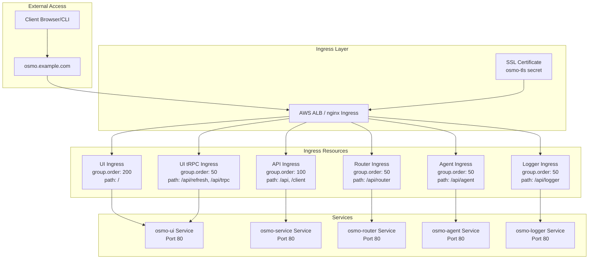
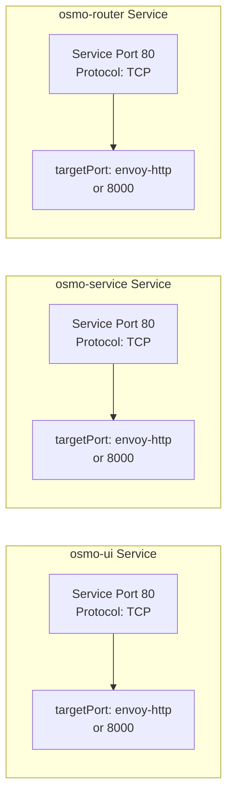
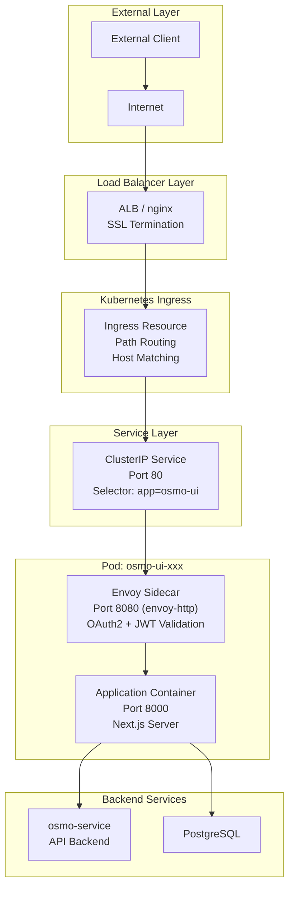
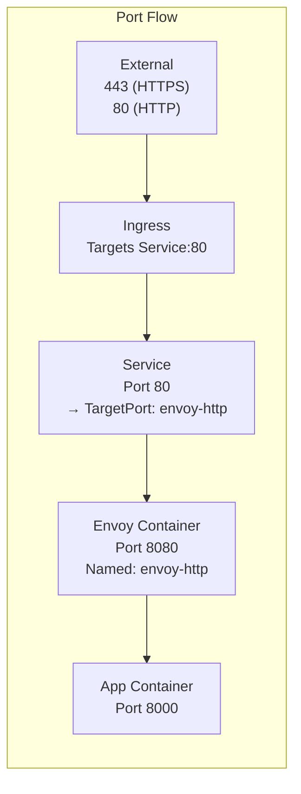

<!-- source: DeepWiki mcp.deepwiki.com · repo NVIDIA/OSMO · page 7.4 Ingress and Networking · fetched 2026-10-26 -->

# Ingress and Networking

<details>
<summary>Relevant source files</summary>

The following files were used as context for generating this wiki page:

- [deployments/charts/quick-start/Chart.yaml](deployments/charts/quick-start/Chart.yaml)
- [deployments/charts/router/Chart.yaml](deployments/charts/router/Chart.yaml)
- [deployments/charts/router/templates/router-service.yaml](deployments/charts/router/templates/router-service.yaml)
- [deployments/charts/service/templates/agent-service.yaml](deployments/charts/service/templates/agent-service.yaml)
- [deployments/charts/service/templates/api-service.yaml](deployments/charts/service/templates/api-service.yaml)
- [deployments/charts/service/templates/delayed-job-monitor.yaml](deployments/charts/service/templates/delayed-job-monitor.yaml)
- [deployments/charts/service/templates/logger-service.yaml](deployments/charts/service/templates/logger-service.yaml)
- [deployments/charts/service/templates/worker.yaml](deployments/charts/service/templates/worker.yaml)
- [deployments/charts/web-ui/README.md](deployments/charts/web-ui/README.md)
- [deployments/charts/web-ui/templates/ui.yaml](deployments/charts/web-ui/templates/ui.yaml)
- [deployments/charts/web-ui/values.yaml](deployments/charts/web-ui/values.yaml)
- [ui/src/app/layout.tsx](ui/src/app/layout.tsx)
- [ui/src/app/workflows/components/TaskActions.tsx](ui/src/app/workflows/components/TaskActions.tsx)
- [ui/src/app/workflows/components/WorkflowActions.tsx](ui/src/app/workflows/components/WorkflowActions.tsx)
- [ui/src/env.mjs](ui/src/env.mjs)
- [ui/src/runtime-env.tsx](ui/src/runtime-env.tsx)

</details>


This document describes OSMO's Kubernetes ingress and networking architecture, including how external traffic is routed to services, load balancer configuration, SSL/TLS termination, and service mesh integration with Envoy sidecars.

For information about the Envoy proxy sidecar authentication and filtering, see [Envoy Authentication Proxy](#8.2). For details on service deployments and container configurations, see [Service Deployments](#7.2).

---

## Overview

OSMO uses path-based routing through a unified Kubernetes Ingress controller to distribute traffic across multiple microservices. All external HTTP/HTTPS traffic is routed through ingress resources that terminate SSL, apply load balancing, and forward requests to ClusterIP services. Each service then routes traffic through an Envoy sidecar for authentication before reaching the application container.

**Key Characteristics:**

- **Unified ALB Group**: All ingress resources use the same ALB group name (`osmo`) with priority-based ordering
- **Path-Based Routing**: Different URL paths route to different services (`/api`, `/api/router`, `/api/logger`, etc.)
- **Wildcard Routing**: Router service supports wildcard domains for dynamic task webserver access
- **Envoy Integration**: All services proxy through Envoy sidecars on port 80/8080
- **SSL Termination**: TLS certificates are terminated at the ingress level

---

## Ingress Architecture

### Path-Based Routing Strategy

OSMO implements a path-based routing strategy where a single hostname serves multiple backend services based on URL path prefixes. This enables a unified user experience while maintaining service isolation.



**Sources:** [deployments/charts/web-ui/templates/ui.yaml:302-381](), [deployments/charts/service/templates/api-service.yaml:291-335](), [deployments/charts/router/templates/router-service.yaml:257-311]()

### Ingress Priority Ordering

The `alb.ingress.kubernetes.io/group.order` annotation controls routing precedence. Lower values are evaluated first, allowing more specific paths to take priority over broader patterns.

| Priority | Service | Path Pattern | Purpose |
|----------|---------|--------------|---------|
| 50 | UI tRPC | `/api/refresh`, `/api/trpc` | Next.js API routes |
| 50 | Router | `/api/router`, `*.hostname` | Router endpoints, wildcard webservers |
| 50 | Agent | `/api/agent` | Agent status updates |
| 50 | Logger | `/api/logger` | Log streaming |
| 100 | API | `/api`, `/client` | Main API and CLI client downloads |
| 200 | UI | `/` | Default catch-all for UI assets |

**Sources:** [deployments/charts/web-ui/templates/ui.yaml:309-313, 346-350](), [deployments/charts/service/templates/api-service.yaml:300-304](), [deployments/charts/router/templates/router-service.yaml:265-269]()

---

## Service Resources

### ClusterIP Service Definitions

Each OSMO service is exposed internally via a Kubernetes ClusterIP service. These services route traffic to the Envoy sidecar when enabled, or directly to the application container otherwise.



**Sources:** [deployments/charts/web-ui/templates/ui.yaml:261-301](), [deployments/charts/service/templates/api-service.yaml:257-270](), [deployments/charts/router/templates/router-service.yaml:238-255]()

### Service Port Configuration

The service target port is dynamically selected based on whether the Envoy sidecar is enabled:

**With Envoy Enabled:**
```yaml
ports:
  - port: 80
    targetPort: envoy-http  # Envoy listener port (8080)
    protocol: TCP
    name: http
```

**With Envoy Disabled:**
```yaml
ports:
  - port: 80
    targetPort: 8000  # Application container port
    protocol: TCP
    name: http
```

**Sources:** [deployments/charts/web-ui/templates/ui.yaml:278-286](), [deployments/charts/router/templates/router-service.yaml:246-252]()

---

## Routing Patterns

### Standard Path Routing

Most OSMO services use fixed path prefixes for routing:

```yaml
# API Service Ingress
- path: /api
  pathType: Prefix
  backend:
    service:
      name: osmo-service
      port:
        number: 80
        
# Agent Service Ingress
- path: /api/agent
  pathType: Prefix
  backend:
    service:
      name: osmo-agent
      port:
        number: 80
```

**Sources:** [deployments/charts/service/templates/api-service.yaml:315-321](), [deployments/charts/service/templates/agent-service.yaml:272-278]()

### Wildcard Routing for Webserver Access

The router service supports wildcard domain routing to enable dynamic webserver access for running workflow tasks. This allows users to access task webservers at URLs like `task-name.osmo.example.com`.

```yaml
rules:
- host: "*.{{ .Values.services.service.hostname }}"
  http:
    paths:
    - path: /
      pathType: Prefix
      backend:
        service:
          name: osmo-router
          port:
            number: 80
```

The wildcard routing is only enabled when `services.service.webserverEnabled` is true.

**Sources:** [deployments/charts/router/templates/router-service.yaml:270-272, 280-290]()

### UI tRPC Endpoint Routing

The Web UI creates a separate ingress resource with higher priority (order 50) for Next.js API routes to ensure they don't get caught by the catch-all UI ingress:

```yaml
paths:
- path: /api/refresh
  pathType: Prefix
  backend:
    service:
      name: osmo-ui
      port:
        number: 80
- path: /api/trpc
  pathType: Prefix
  backend:
    service:
      name: osmo-ui
      port:
        number: 80
```

**Sources:** [deployments/charts/web-ui/templates/ui.yaml:339-381]()

---

## ALB Configuration

### Ingress Annotations

OSMO provides extensive support for AWS Application Load Balancer (ALB) through the AWS Load Balancer Controller. ALB-specific annotations are conditionally applied when `ingress.albAnnotations.enabled` is true.

**Common ALB Annotations:**

| Annotation | Value | Purpose |
|------------|-------|---------|
| `alb.ingress.kubernetes.io/target-type` | `ip` | Direct pod IP routing (bypasses kube-proxy) |
| `alb.ingress.kubernetes.io/group.name` | `osmo` | Unified ALB group for all services |
| `alb.ingress.kubernetes.io/group.order` | `50`, `100`, `200` | Priority ordering for path matching |
| `alb.ingress.kubernetes.io/certificate-arn` | ARN string | SSL certificate for HTTPS termination |

**Router-Specific Wildcard Hostname:**
```yaml
alb.ingress.kubernetes.io/hostnames: '["*.{{ .Values.services.service.hostname }}", "{{ .Values.services.service.hostname }}"]'
```

**Sources:** [deployments/charts/web-ui/templates/ui.yaml:309-316](), [deployments/charts/service/templates/api-service.yaml:300-308](), [deployments/charts/router/templates/router-service.yaml:265-276]()

### Ingress Class Configuration

OSMO supports multiple ingress controllers through the `ingressClassName` field:

- **nginx**: Standard nginx ingress controller (default for quick-start)
- **alb**: AWS ALB Ingress Controller
- Custom ingress classes as needed

```yaml
spec:
  ingressClassName: {{ .Values.services.ui.ingress.ingressClass }}
```

**Sources:** [deployments/charts/web-ui/templates/ui.yaml:319](), [deployments/charts/quick-start/Chart.yaml:25-27]()

---

## SSL/TLS Configuration

### Certificate Management

SSL/TLS certificates can be configured in two ways:

**1. Kubernetes Secret (nginx ingress):**
```yaml
tls:
- hosts:
  - osmo.example.com
  secretName: osmo-tls
```

The `osmo-tls` secret must contain `tls.crt` and `tls.key` fields.

**2. AWS Certificate Manager (ALB ingress):**
```yaml
annotations:
  alb.ingress.kubernetes.io/certificate-arn: arn:aws:acm:us-west-2:XXXXXXXXX:certificate/YYYYYYYY
```

**Sources:** [deployments/charts/web-ui/templates/ui.yaml:331-336, 375-380]()

### SSL Configuration Values

SSL can be enabled/disabled per ingress:

```yaml
services:
  ui:
    ingress:
      sslEnabled: true
      sslSecret: osmo-tls
      albAnnotations:
        enabled: false
        sslCertArn: arn:aws:acm:us-west-2:XXXXXXXXX:certificate/YYYYYYYY
```

**Sources:** [deployments/charts/web-ui/values.yaml:224-230]()

---

## Hostname and DNS Configuration

### Service Hostname Configuration

Each service chart defines a hostname that is used across ingress rules, Envoy configuration, and in-cluster communication:

```yaml
services:
  ui:
    hostname: ""  # Must be configured, e.g., "osmo.example.com"
    apiHostname: "osmo-service.osmo.svc.cluster.local:80"
```

The UI `hostname` is used for external ingress access, while `apiHostname` specifies where the Next.js server should connect to the API service (can be in-cluster or external).

**Sources:** [deployments/charts/web-ui/values.yaml:76, 83](), [deployments/charts/web-ui/templates/ui.yaml:88-89]()

### Wildcard Domain Support

For the router service, wildcard domains are configured when webserver functionality is enabled:

```yaml
services:
  service:
    hostname: "osmo.example.com"
    webserverEnabled: true
```

This creates ingress rules for both:
- `osmo.example.com` (main domain)
- `*.osmo.example.com` (wildcard for task webservers)

**Sources:** [deployments/charts/router/templates/router-service.yaml:270-272, 280-291, 306-308]()

### DNS Resolution

The UI container uses the `NEXT_PUBLIC_OSMO_API_HOSTNAME` environment variable to determine API connectivity:

```yaml
env:
- name: NEXT_PUBLIC_OSMO_API_HOSTNAME
  value: {{ .Values.services.ui.apiHostname }}
```

This environment variable is consumed by the Next.js application to configure API calls.

**Sources:** [deployments/charts/web-ui/templates/ui.yaml:88-89](), [ui/src/env.mjs:67, 84]()

---

## Request Flow Architecture

### Complete Request Path

The following diagram illustrates the complete network path from external client to application container:



**Sources:** [deployments/charts/web-ui/templates/ui.yaml:17-257]()

### Port Mapping Details

Each layer in the request path uses specific port configurations:



**Container Port Definitions:**

| Container | Port Name | Port Number | Purpose |
|-----------|-----------|-------------|---------|
| UI Application | - | 8000 | Next.js HTTP server |
| Envoy Sidecar | `envoy-http` | 8080 | External listener with auth |
| Envoy Sidecar | `internal-http` | 8081 | In-cluster bypass (optional) |
| Envoy Admin | - | 9901 | Envoy admin interface |

**Sources:** [deployments/charts/web-ui/templates/ui.yaml:84-85, 279-286](), [deployments/charts/web-ui/values.yaml:95-96, 497, 409]()

---

## In-Cluster Communication

### Internal Service Paths

For certain endpoints that should be accessible from within the cluster without authentication (e.g., backend operator calls), OSMO supports an internal service configuration:

```yaml
sidecars:
  envoy:
    inClusterPaths:
      enabled: true
      port: 8081
      paths:
        - /api/internal/some-endpoint
```

When enabled, a separate service is created:

```yaml
apiVersion: v1
kind: Service
metadata:
  name: osmo-service-internal
spec:
  ports:
    - port: 80
      targetPort: internal-http  # Port 8081, bypasses OAuth2
```

**Sources:** [deployments/charts/service/templates/api-service.yaml:274-289](), [deployments/charts/web-ui/values.yaml:407-410]()

### Service Discovery

Services communicate using Kubernetes DNS:

- **Full DNS name**: `osmo-service.osmo.svc.cluster.local`
- **Short name (same namespace)**: `osmo-service`
- **With port**: `osmo-service.osmo.svc.cluster.local:80`

The UI Next.js server uses `apiHostname` configuration to determine whether to connect to the API via:
- In-cluster DNS (e.g., `osmo-service.osmo.svc.cluster.local:80`)
- External hostname (e.g., `osmo.example.com`)

**Sources:** [deployments/charts/web-ui/values.yaml:83](), [deployments/charts/web-ui/templates/ui.yaml:88-89]()

---

## Network Configuration Matrix

### Complete Service Network Map

| Service | Ingress Path | Service Port | Container Port | Envoy Port | Purpose |
|---------|--------------|--------------|----------------|------------|---------|
| `osmo-ui` | `/` | 80 | 8000 | 8080 | Web UI assets |
| `osmo-ui` | `/api/trpc` | 80 | 8000 | 8080 | Next.js API routes |
| `osmo-service` | `/api`, `/client` | 80 | 8000 | 8080 | Main API endpoints |
| `osmo-router` | `/api/router` | 80 | 8000 | 8080 | Router proxy |
| `osmo-router` | `*.hostname` | 80 | 8000 | 8080 | Wildcard webservers |
| `osmo-agent` | `/api/agent` | 80 | 8000 | 8080 | Agent status |
| `osmo-logger` | `/api/logger` | 80 | 8000 | 8080 | Log streaming |

**Sources:** [deployments/charts/web-ui/templates/ui.yaml](), [deployments/charts/service/templates/api-service.yaml](), [deployments/charts/router/templates/router-service.yaml](), [deployments/charts/service/templates/agent-service.yaml](), [deployments/charts/service/templates/logger-service.yaml]()

---

## Runtime Configuration

### Environment Variables for Networking

The UI service exposes several networking-related environment variables for runtime configuration:

```yaml
env:
- name: PORT
  value: '8000'
- name: NODE_OPTIONS
  value: '--max-http-header-size=131072'  # 128KB in bytes
- name: NEXT_PUBLIC_OSMO_API_HOSTNAME
  value: osmo-service.osmo.svc.cluster.local:80
- name: NEXT_PUBLIC_OSMO_SSL_ENABLED
  value: "true"
- name: NEXT_PUBLIC_OSMO_PORT_FORWARD_ENABLED
  value: "false"
```

The `NODE_OPTIONS` max header size should match the Envoy `maxHeadersSizeKb` configuration to prevent 431 errors.

**Sources:** [deployments/charts/web-ui/templates/ui.yaml:84-97](), [deployments/charts/web-ui/values.yaml:105]()

### Client-Side API Hostname Resolution

The Next.js application uses environment variables to determine API connectivity:

```javascript
// Determine environment based on hostname format
const computeEnvironment = (nodeEnv, apiHostname) => {
  if (nodeEnv === "development") {
    return apiHostname.includes(":") ? "local" : "local-against-production";
  }
  return "production";
};
```

When `apiHostname` contains a port (e.g., `:80`), it indicates in-cluster communication on the local environment.

**Sources:** [ui/src/env.mjs:31-37, 67-71, 84-92]()

---

## Service Mesh Integration

### Envoy as Edge Proxy

All external requests pass through Envoy sidecars before reaching application containers. The ingress routes to the service, which routes to Envoy's listener port:

```
Internet → ALB → Ingress → Service:80 → Envoy:8080 → App:8000
```

Envoy performs:
1. **OAuth2 flow** for browser-based authentication
2. **JWT validation** for API tokens
3. **Header injection** (e.g., `x-osmo-user`)
4. **Request routing** to upstream application

For detailed information about Envoy's authentication and filtering, see [Envoy Authentication Proxy](#8.2).

**Sources:** [deployments/charts/web-ui/templates/ui.yaml:243-244]()

### Service Account Configuration

Each service deployment specifies a Kubernetes service account for RBAC:

```yaml
serviceAccountName: {{ .Values.services.ui.serviceAccountName }}
```

This service account typically has permissions to:
- Create/read secrets (for OAuth2 credentials)
- Access ConfigMaps (for Envoy configuration)
- Communicate with the Kubernetes API (for health checks)

**Sources:** [deployments/charts/web-ui/templates/ui.yaml:71](), [deployments/charts/web-ui/values.yaml:99]()

---

## Troubleshooting Network Issues

### Common Configuration Issues

**Ingress not routing correctly:**
- Check `ingressClassName` matches installed controller
- Verify `hostname` is configured and DNS resolves correctly
- Ensure ALB `group.order` priorities don't conflict

**SSL certificate errors:**
- For nginx: Verify `sslSecret` exists with valid `tls.crt` and `tls.key`
- For ALB: Verify `certificate-arn` points to valid ACM certificate
- Check certificate matches ingress hostname

**Service connectivity issues:**
- Verify service selector matches pod labels: `app: osmo-ui`
- Check service `targetPort` matches container port name
- Ensure Envoy sidecar is healthy (check port 9901 admin interface)

**Wildcard routing not working:**
- Verify `webserverEnabled: true` in router chart values
- Ensure DNS has wildcard A record: `*.osmo.example.com`
- Check ALB `hostnames` annotation includes wildcard pattern

**Sources:** All Helm template files referenced throughout this document.

---

