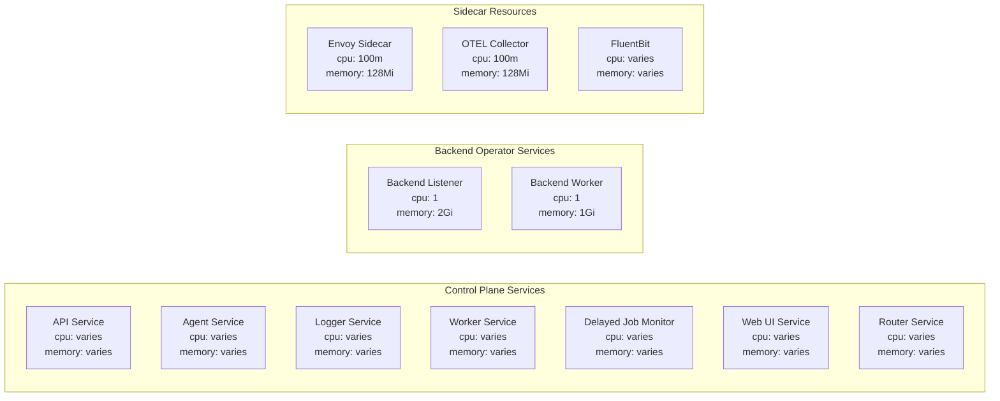
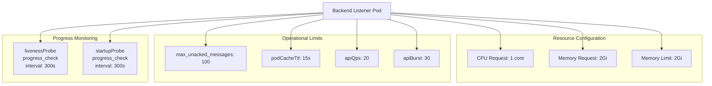
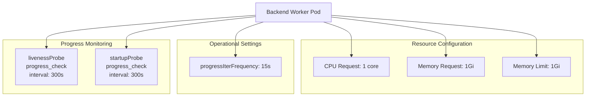
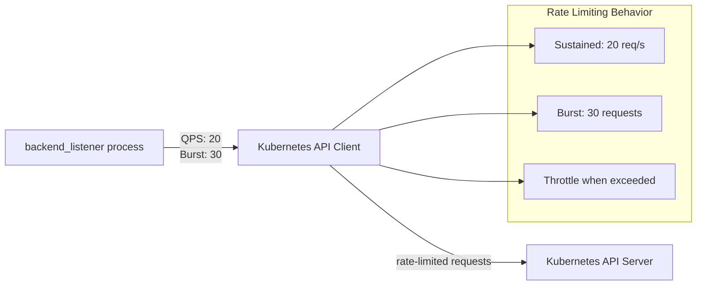
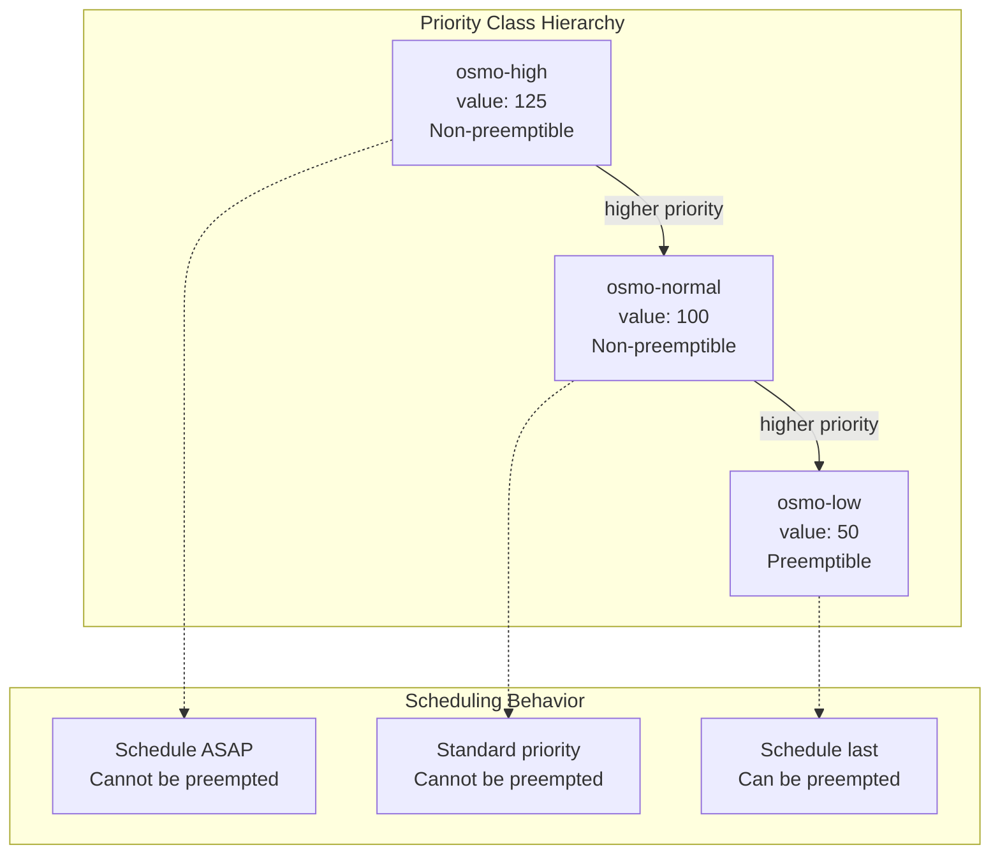
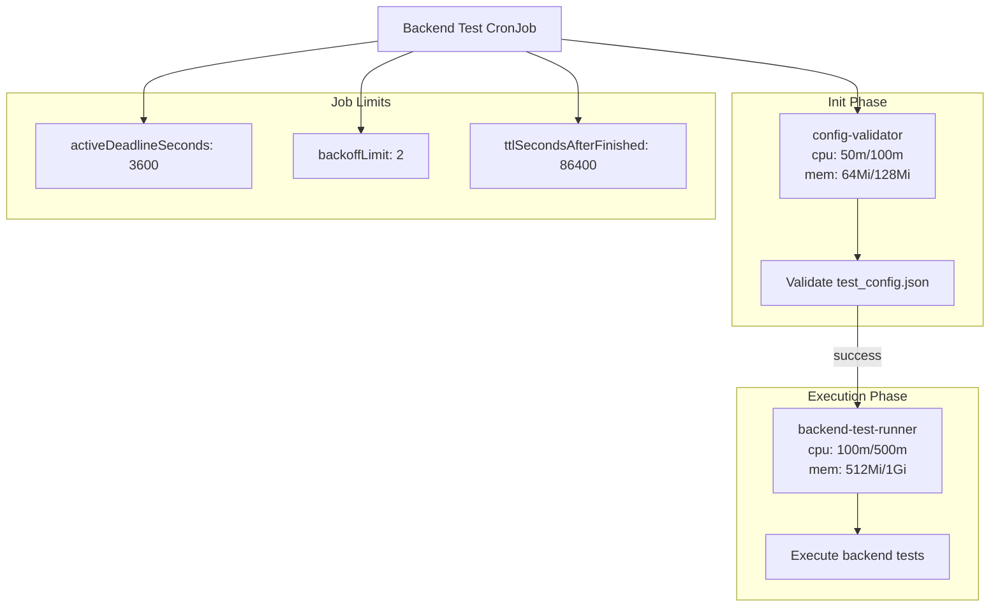

<!-- source: DeepWiki mcp.deepwiki.com · repo NVIDIA/OSMO · page 7.5 Scaling and Resource Management · fetched 2026-10-26 -->

# Scaling and Resource Management

<details>
<summary>Relevant source files</summary>

The following files were used as context for generating this wiki page:

- [deployments/charts/backend-operator/README.md](deployments/charts/backend-operator/README.md)
- [deployments/charts/backend-operator/templates/backend-listener.yaml](deployments/charts/backend-operator/templates/backend-listener.yaml)
- [deployments/charts/backend-operator/templates/backend-test-runner-config.yaml](deployments/charts/backend-operator/templates/backend-test-runner-config.yaml)
- [deployments/charts/backend-operator/templates/backend-test-runner-rbac.yaml](deployments/charts/backend-operator/templates/backend-test-runner-rbac.yaml)
- [deployments/charts/backend-operator/templates/backend-worker-rbac.yaml](deployments/charts/backend-operator/templates/backend-worker-rbac.yaml)
- [deployments/charts/backend-operator/values.yaml](deployments/charts/backend-operator/values.yaml)
- [deployments/charts/quick-start/Chart.yaml](deployments/charts/quick-start/Chart.yaml)
- [deployments/charts/router/Chart.yaml](deployments/charts/router/Chart.yaml)
- [deployments/charts/router/templates/router-service.yaml](deployments/charts/router/templates/router-service.yaml)
- [deployments/charts/service/templates/agent-service.yaml](deployments/charts/service/templates/agent-service.yaml)
- [deployments/charts/service/templates/api-service.yaml](deployments/charts/service/templates/api-service.yaml)
- [deployments/charts/service/templates/delayed-job-monitor.yaml](deployments/charts/service/templates/delayed-job-monitor.yaml)
- [deployments/charts/service/templates/logger-service.yaml](deployments/charts/service/templates/logger-service.yaml)
- [deployments/charts/service/templates/worker.yaml](deployments/charts/service/templates/worker.yaml)
- [deployments/charts/web-ui/templates/ui.yaml](deployments/charts/web-ui/templates/ui.yaml)

</details>


This page documents OSMO's horizontal pod autoscaling, resource allocation strategies, and API rate limiting mechanisms. It covers HorizontalPodAutoscaler (HPA) configurations for control plane services, resource request/limit patterns, backend operator resource management, and Kubernetes API client rate limiting.

For ingress and networking configuration, see [Ingress and Networking](#7.4). For service deployment specifications, see [Service Deployments](#7.2).

---

## HorizontalPodAutoscaler Configuration

OSMO services use Kubernetes HorizontalPodAutoscaler to scale pods based on resource utilization. Each service has distinct scaling characteristics based on its workload profile.

### Control Plane Service Scaling

```mermaid
graph TB
    subgraph "API Service HPA"
        APIDeployment["API Deployment<br/>osmo-service"]
        APIHPA["HorizontalPodAutoscaler<br/>autoscaling/v2"]
        APIMetrics["Metrics:<br/>- memory (hpaMemoryTarget)<br/>- cpu (hpaCpuTarget)"]
        
        APIHPA -->|"scaleTargetRef"| APIDeployment
        APIMetrics -->|"target utilization"| APIHPA
    end
    
    subgraph "Agent Service HPA"
        AgentDeployment["Agent Deployment<br/>osmo-agent"]
        AgentHPA["HorizontalPodAutoscaler<br/>autoscaling/v2"]
        AgentMetrics["Metrics:<br/>- memory (hpaMemoryTarget)<br/>- cpu (hpaCpuTarget)"]
        
        AgentHPA -->|"scaleTargetRef"| AgentDeployment
        AgentMetrics -->|"target utilization"| AgentHPA
    end
    
    subgraph "Logger Service HPA"
        LoggerDeployment["Logger Deployment<br/>osmo-logger"]
        LoggerHPA["HorizontalPodAutoscaler<br/>autoscaling/v2"]
        LoggerMetrics["Metrics:<br/>- memory (hpaMemoryTarget)<br/>- cpu (hpaCpuTarget)"]
        
        LoggerHPA -->|"scaleTargetRef"| LoggerDeployment
        LoggerMetrics -->|"target utilization"| LoggerHPA
    end
    
    subgraph "Worker Service HPA"
        WorkerDeployment["Worker Deployment<br/>osmo-worker"]
        WorkerHPA["HorizontalPodAutoscaler<br/>autoscaling/v2"]
        WorkerMetrics["Metrics:<br/>- memory (hpaMemoryTarget)<br/>- cpu (hpaCpuTarget)"]
        
        WorkerHPA -->|"scaleTargetRef"| WorkerDeployment
        WorkerMetrics -->|"target utilization"| WorkerHPA
    end
```



**Sources:** [deployments/charts/service/templates/api-service.yaml:339-368](), [deployments/charts/service/templates/agent-service.yaml:289-318](), [deployments/charts/service/templates/logger-service.yaml:285-314](), [deployments/charts/service/templates/worker.yaml:208-237]()

### HPA Metric Types

OSMO uses `ContainerResource` type metrics targeting specific containers within pods:

| Service | Container Name | Memory Target | CPU Target | Min Replicas | Max Replicas |
|---------|----------------|---------------|------------|--------------|--------------|
| API | `osmo-service` | `hpaMemoryTarget` | `hpaCpuTarget` | `scaling.minReplicas` | `scaling.maxReplicas` |
| Agent | `osmo-agent` | `hpaMemoryTarget` | `hpaCpuTarget` | `scaling.minReplicas` | `scaling.maxReplicas` |
| Logger | `osmo-logger` | `hpaMemoryTarget` | `hpaCpuTarget` | `scaling.minReplicas` | `scaling.maxReplicas` |
| Worker | `osmo-worker` | `hpaMemoryTarget` | `hpaCpuTarget` | `scaling.minReplicas` | `scaling.maxReplicas` |
| Router | `osmo-router` | `memoryTarget` | N/A | `scaling.minReplicas` | `scaling.maxReplicas` |
| Web UI | `osmo-web-ui` | `hpaTarget` | N/A | `scaling.minReplicas` | `scaling.maxReplicas` |

**Sources:** [deployments/charts/service/templates/api-service.yaml:339-368](), [deployments/charts/service/templates/agent-service.yaml:289-318](), [deployments/charts/service/templates/logger-service.yaml:285-314](), [deployments/charts/service/templates/worker.yaml:208-237](), [deployments/charts/router/templates/router-service.yaml:314-336](), [deployments/charts/web-ui/templates/ui.yaml:383-407]()

### HPA Resource Specification

The HPA resources are defined inline in each service's deployment template:

```yaml
apiVersion: autoscaling/v2
kind: HorizontalPodAutoscaler
metadata:
  name: {{ .Values.services.service.serviceName }}
spec:
  scaleTargetRef:
    apiVersion: apps/v1
    kind: Deployment
    name: {{ .Values.services.service.serviceName }}
  minReplicas: {{ .Values.services.service.scaling.minReplicas }}
  maxReplicas: {{ .Values.services.service.scaling.maxReplicas }}
  metrics:
  - type: ContainerResource
    containerResource:
      name: memory
      container: {{ .Values.services.service.serviceName }}
      target:
        type: Utilization
        averageUtilization: {{ .Values.services.service.scaling.hpaMemoryTarget }}
  - type: ContainerResource
    containerResource:
      name: cpu
      container: {{ .Values.services.service.serviceName }}
      target:
        type: Utilization
        averageUtilization: {{ .Values.services.service.scaling.hpaCpuTarget }}
```

**Sources:** [deployments/charts/service/templates/api-service.yaml:339-368](), [deployments/charts/service/templates/agent-service.yaml:289-318]()

### Web UI Scaling Strategy

The Web UI uses conditional replica configuration based on whether scaling is enabled:

```yaml
replicas: {{ if .Values.services.ui.scaling.enabled }}{{ .Values.services.ui.scaling.minReplicas }}{{ else }}{{ .Values.services.ui.replicas }}{{ end }}
```

When `services.ui.scaling.enabled` is `true`, the HPA controls replicas. Otherwise, a static replica count from `services.ui.replicas` is used.

**Sources:** [deployments/charts/web-ui/templates/ui.yaml:24](), [deployments/charts/web-ui/templates/ui.yaml:383-407]()

---

## Resource Allocation Patterns

OSMO services have distinct resource profiles based on their computational requirements and memory usage patterns.

### Service Resource Matrix



**Sources:** [deployments/charts/backend-operator/values.yaml:322-338](), [deployments/charts/backend-operator/values.yaml:428-435]()

### Resource Specification Pattern

All OSMO services follow this resource specification pattern:

```yaml
resources:
  requests:
    cpu: "value"
    memory: "value"
  limits:
    memory: "value"
```

Note that CPU limits are typically **not set**, allowing services to burst when needed while preventing memory-based OOMKills through memory limits.

**Sources:** [deployments/charts/backend-operator/values.yaml:322-338](), [deployments/charts/backend-operator/values.yaml:428-435]()

### Backend Operator Resource Configuration

Backend operators have fixed resource allocations defined in the values:

| Component | CPU Request | Memory Request | Memory Limit |
|-----------|-------------|----------------|--------------|
| Backend Listener | `1` | `2Gi` | `2Gi` |
| Backend Worker | `1` | `1Gi` | `1Gi` |
| Backend Test Runner (init) | `50m` | `64Mi` | `128Mi` (CPU: `100m`) |
| Backend Test Runner (main) | `100m` | `512Mi` | `1Gi` (CPU: `500m`) |
| Egress Proxy (squid) | `2` | `4Gi` | `4Gi` |

**Sources:** [deployments/charts/backend-operator/values.yaml:322-338](), [deployments/charts/backend-operator/values.yaml:428-435](), [deployments/charts/backend-operator/values.yaml:78-86](), [deployments/charts/backend-operator/templates/backend-test-runner-config.yaml:540-570]()

### Sidecar Container Resources

Sidecar containers have standardized resource allocations:

```yaml
# OTEL Sidecar
resources:
  requests:
    cpu: "100m"
    memory: "128Mi"
  limits:
    memory: "128Mi"
```

**Sources:** [deployments/charts/backend-operator/values.yaml:811-817]()

---

## Backend Operator Resource Management

Backend operators require specific resource management strategies due to their role in managing Kubernetes resources and maintaining cluster state.

### Backend Listener Resource Architecture



**Sources:** [deployments/charts/backend-operator/values.yaml:322-338](), [deployments/charts/backend-operator/templates/backend-listener.yaml:148-171]()

### Backend Worker Resource Architecture



**Sources:** [deployments/charts/backend-operator/values.yaml:428-435](), [deployments/charts/backend-operator/values.yaml:363-365]()

### Volume Mount for Progress Files

Both backend listener and worker use progress files for health checks:

```yaml
volumes:
  - name: progress-files
    emptyDir: {}
volumeMounts:
  - name: progress-files
    mountPath: /var/run/osmo
```

The `progress_check` command monitors these files to determine if the container is making progress.

**Sources:** [deployments/charts/backend-operator/values.yaml:315-320](), [deployments/charts/backend-operator/values.yaml:418-426]()

---

## API Rate Limiting

OSMO implements Kubernetes API client rate limiting to prevent overwhelming the API server when managing large numbers of resources.

### Kubernetes API Client Configuration

The backend listener configures API client QPS (queries per second) and burst limits:

| Parameter | Default | Description |
|-----------|---------|-------------|
| `apiQps` | `20` | Sustained queries per second to Kubernetes API |
| `apiBurst` | `30` | Burst capacity for Kubernetes API requests |

These are passed as command-line arguments:

```bash
backend_listener \
  --api_qps 20 \
  --api_burst 30
```

**Sources:** [deployments/charts/backend-operator/values.yaml:331-337](), [deployments/charts/backend-operator/templates/backend-listener.yaml:117-120]()

### Rate Limiting Strategy



**Sources:** [deployments/charts/backend-operator/values.yaml:331-337](), [deployments/charts/backend-operator/templates/backend-listener.yaml:117-120]()

### Cache TTL Configuration

The backend listener uses a pod event cache to reduce API load:

```yaml
podCacheTtl: 15
```

This 15-second TTL means pod event data is cached for 15 seconds before being refreshed from the API server, reducing query frequency for frequently-accessed pod information.

**Sources:** [deployments/charts/backend-operator/values.yaml:257-259](), [deployments/charts/backend-operator/templates/backend-listener.yaml:113-114]()

---

## Priority Classes

OSMO defines priority classes for workload scheduling when the KAI scheduler plugin is enabled. These classes control pod preemption and scheduling order.

### Priority Class Definitions



**Sources:** [deployments/charts/backend-operator/values.yaml:202-221]()

### Priority Class Configuration

Priority classes are defined in the backend-operator values:

```yaml
priorityClasses:
  enabled: true
  classes:
    - name: osmo-high
      value: 125
      description: "Schedule as soon as possible. Non-preemptible."
    - name: osmo-normal
      value: 100
      description: "Standard priority. Non-preemptible."
    - name: osmo-low
      value: 50
      description: "Schedule last. Preemptible."
```

These priority classes are only used when the KAI scheduler plugin is enabled on the cluster.

**Sources:** [deployments/charts/backend-operator/values.yaml:202-221]()

### Priority Class Usage

Priority classes are assigned to workflow task pods based on user configuration or system defaults. Higher priority pods will:
- Be scheduled before lower priority pods when resources are constrained
- Not be preempted by lower priority workloads
- (For `osmo-low` only) Can be preempted by higher priority workloads

**Sources:** [deployments/charts/backend-operator/values.yaml:202-221]()

---

## Backend Test Runner Resource Management

Backend test runner CronJobs have distinct resource allocation for initialization and execution phases.

### Backend Test Runner Resource Allocation

| Phase | Container | CPU Request | Memory Request | CPU Limit | Memory Limit |
|-------|-----------|-------------|----------------|-----------|--------------|
| Init | config-validator | `50m` | `64Mi` | `100m` | `128Mi` |
| Main | backend-test-runner | `100m` | `512Mi` | `500m` | `1Gi` |

**Sources:** [deployments/charts/backend-operator/templates/backend-test-runner-config.yaml:540-546](), [deployments/charts/backend-operator/templates/backend-test-runner-config.yaml:562-570]()

### Test Runner Resource Flow



**Sources:** [deployments/charts/backend-operator/templates/backend-test-runner-config.yaml:158-186](), [deployments/charts/backend-operator/templates/backend-test-runner-config.yaml:189-241](), [deployments/charts/backend-operator/values.yaml:489-499]()

### CronJob Scheduling Configuration

Backend test runners have comprehensive scheduling controls:

| Parameter | Default | Description |
|-----------|---------|-------------|
| `schedule` | `0 2 * * *` | Run daily at 2 AM UTC |
| `timezone` | `UTC` | Timezone for schedule interpretation |
| `startingDeadlineSeconds` | `300` | Latest start time if missed |
| `concurrencyPolicy` | `Forbid` | Don't allow concurrent runs |
| `activeDeadlineSeconds` | `3600` | Maximum execution time (1 hour) |
| `ttlSecondsAfterFinished` | `86400` | Keep completed jobs for 24 hours |

**Sources:** [deployments/charts/backend-operator/values.yaml:449-499](), [deployments/charts/backend-operator/templates/backend-test-runner-config.yaml:78-106]()

---

## Network Egress Resource Management

When egress allowlisting is enabled, a squid proxy is deployed with its own resource allocation.

### Egress Proxy Resources

```yaml
resources:
  requests:
    cpu: "2"
    memory: "4Gi"
  limits:
    memory: "4Gi"
```

The proxy includes an Envoy bridge sidecar for HTTPS interception but no explicit resource limits are defined for it.

**Sources:** [deployments/charts/backend-operator/values.yaml:78-86](), [deployments/charts/backend-operator/values.yaml:88-105]()

---

## Topology Spread Constraints

Services can configure topology spread constraints to distribute pods across failure domains:

```yaml
topologySpreadConstraints:
- topologyKey: topology.kubernetes.io/zone
  maxSkew: 1
  whenUnsatisfiable: DoNotSchedule
  labelSelector:
    matchLabels:
      app: {{ .Values.services.ui.serviceName }}
```

This ensures pods are spread across availability zones or other topology domains for high availability.

**Sources:** [deployments/charts/web-ui/templates/ui.yaml:42-53](), [deployments/charts/service/templates/agent-service.yaml:44-55](), [deployments/charts/service/templates/api-service.yaml:43-54]()

---

