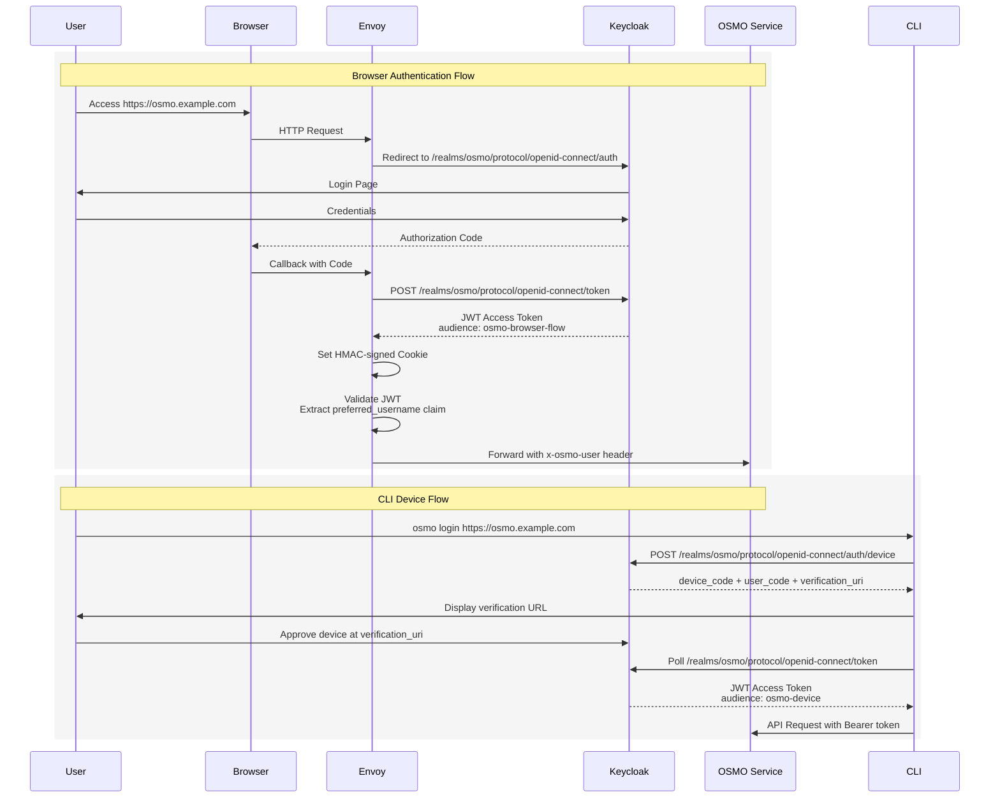
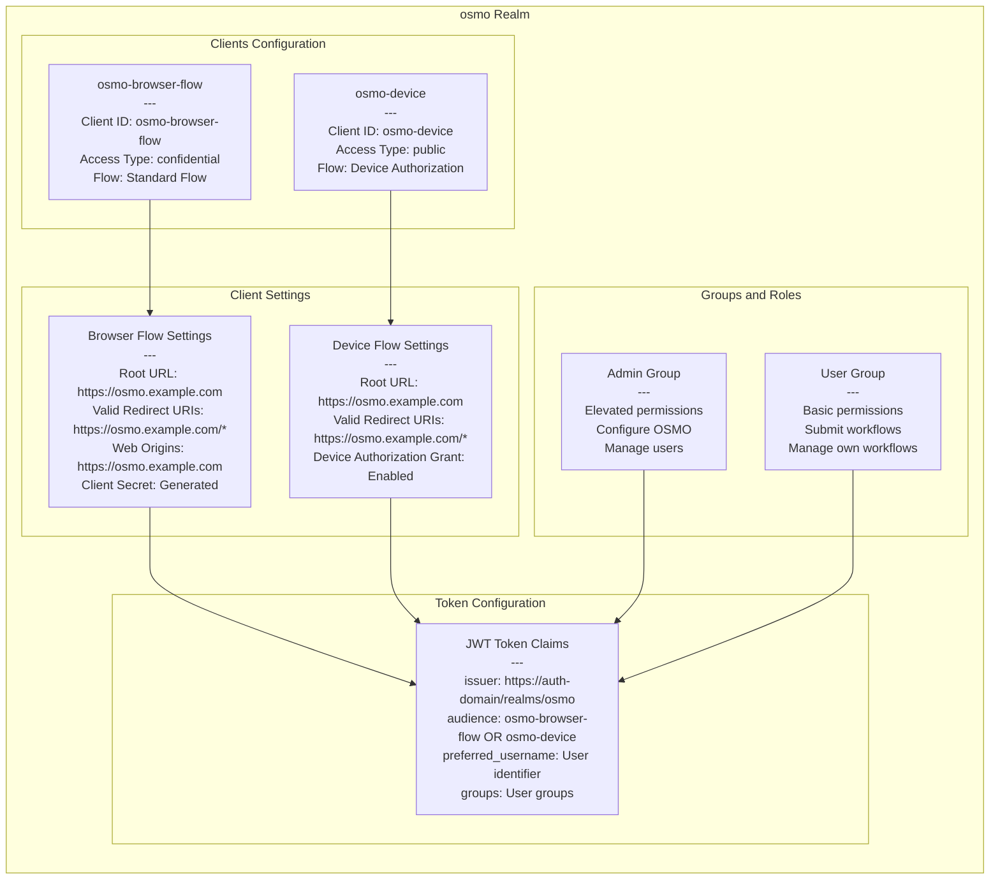
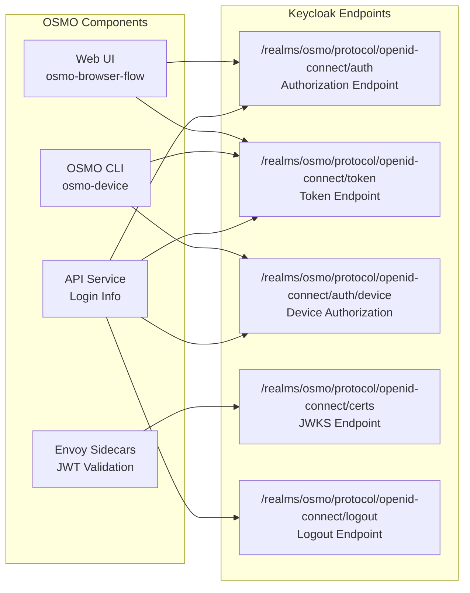
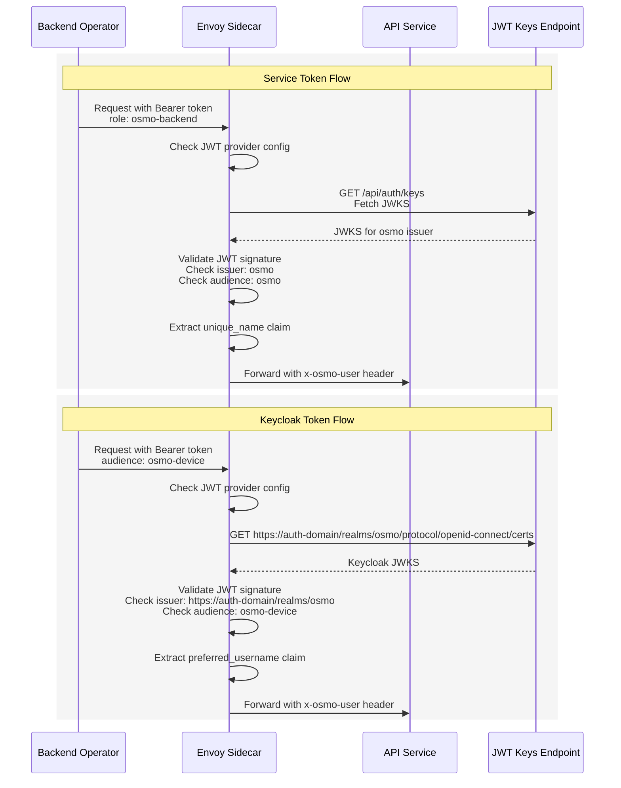

<!-- source: DeepWiki mcp.deepwiki.com · repo NVIDIA/OSMO · page 8.1 Keycloak SSO Integration · fetched 2026-10-26 -->

# Keycloak SSO Integration

<details>
<summary>Relevant source files</summary>

The following files were used as context for generating this wiki page:

- [docs/deployment_guide/getting_started/deploy_service.rst](docs/deployment_guide/getting_started/deploy_service.rst)
- [docs/deployment_guide/install_backend/dependencies/dependencies.rst](docs/deployment_guide/install_backend/dependencies/dependencies.rst)
- [docs/deployment_guide/install_backend/deploy_backend.rst](docs/deployment_guide/install_backend/deploy_backend.rst)
- [docs/deployment_guide/install_backend/validate_osmo.rst](docs/deployment_guide/install_backend/validate_osmo.rst)
- [docs/deployment_guide/references/configs_definitions/index.rst](docs/deployment_guide/references/configs_definitions/index.rst)
- [docs/user_guide/tutorials/combination_workflows/index.rst](docs/user_guide/tutorials/combination_workflows/index.rst)

</details>


This document describes how OSMO integrates with Keycloak for Single Sign-On (SSO) authentication using OAuth2/OIDC protocols. It covers Keycloak installation, realm configuration, client setup, and the various authentication flows used by OSMO components.

For information about how Envoy validates and processes JWT tokens from Keycloak, see [Envoy Authentication Proxy](#8.2). For credential encryption and storage mechanisms, see [Credential Management and Encryption](#8.3).

## Overview

OSMO uses Keycloak as its identity provider to support multiple authentication mechanisms:

- **Browser-based authentication** - Web UI users authenticate via OAuth2 authorization code flow
- **Device authentication** - CLI users authenticate via OAuth2 device authorization flow  
- **Service token authentication** - Backend operators and service-to-service communication use long-lived service tokens
- **Identity provider federation** - Keycloak can integrate with external identity providers (LDAP, SAML, social logins)

Keycloak manages user identities, groups, roles, and issues JWT access tokens that OSMO services validate through Envoy sidecars.

## Architecture

### Keycloak Component Diagram

```mermaid
graph TB
    subgraph "Keycloak Deployment"
        KC[Keycloak Service<br/>Bitnami Chart]
        KCDB[(Keycloak Database<br/>PostgreSQL)]
        KCIngress[Ingress<br/>auth-domain.com]
    end
    
    subgraph "OSMO Realm"
        Realm[osmo Realm]
        
        subgraph "Clients"
            BrowserClient["osmo-browser-flow<br/>Client ID<br/>Confidential"]
            DeviceClient["osmo-device<br/>Client ID<br/>Public"]
        end
        
        subgraph "Groups and Roles"
            AdminGroup[Admin Group]
            UserGroup[User Group]
        end
        
        subgraph "Users"
            Users[Keycloak Users<br/>Email/Password]
        end
    end
    
    subgraph "OSMO Services"
        WebUI[Web UI]
        CLI[OSMO CLI]
        API[API Service]
        Router[Router Service]
        BackendOp[Backend Operator]
    end
    
    subgraph "Authentication Flows"
        AuthCode[Authorization Code Flow<br/>Browser]
        DeviceFlow[Device Authorization Flow<br/>CLI]
        ServiceToken[Service Token<br/>Backend]
    end
    
    KC --> KCDB
    KCIngress --> KC
    KC --> Realm
    Realm --> BrowserClient
    Realm --> DeviceClient
    Realm --> AdminGroup
    Realm --> UserGroup
    Realm --> Users
    
    WebUI --> AuthCode
    CLI --> DeviceFlow
    BackendOp --> ServiceToken
    
    AuthCode --> BrowserClient
    DeviceFlow --> DeviceClient
    ServiceToken --> API
    
    BrowserClient --> KC
    DeviceClient --> KC
```

**Sources:** [docs/deployment_guide/getting_started/deploy_service.rst:116-349]()

### Authentication Flow Overview



**Sources:** [docs/deployment_guide/getting_started/deploy_service.rst:519-655]()

## Installation

### Prerequisites

- Kubernetes cluster with ingress controller (nginx, ALB, etc.)
- PostgreSQL database for Keycloak persistence
- SSL certificate for the auth subdomain
- Helm 3.x installed

**Sources:** [docs/deployment_guide/getting_started/deploy_service.rst:25-30]()

### Deployment Steps

#### Step 1: Create Keycloak Database

```bash
$ export OSMO_DB_HOST=<your-db-host>
$ export OSMO_PGPASSWORD=<your-postgres-password>
$ kubectl apply -f - <<EOF
apiVersion: v1
kind: Pod
metadata:
  name: osmo-db-ops
spec:
  containers:
    - name: osmo-db-ops
      image: alpine/psql:17.5
      command: ["/bin/sh", "-c"]
      args:
        - "PGPASSWORD=$OSMO_PGPASSWORD psql -U postgres -h $OSMO_DB_HOST -p 5432 -d postgres -c 'CREATE DATABASE keycloak;'"
  restartPolicy: Never
EOF
```

**Sources:** [docs/deployment_guide/getting_started/deploy_service.rst:87-114]()

#### Step 2: Create Database Secret

```bash
$ kubectl create namespace keycloak
$ kubectl create secret generic keycloak-db-secret \
  --namespace keycloak \
  --from-literal=postgres-password='<your-db-password>'
```

**Sources:** [docs/deployment_guide/getting_started/deploy_service.rst:232-244]()

#### Step 3: Configure Helm Values

Create `keycloak-values.yaml`:

| Configuration Section | Key Parameters | Purpose |
|----------------------|----------------|---------|
| **Hostname** | `hostname`, `proxy` | Set auth subdomain and edge proxy mode |
| **Authentication** | `auth.adminUser`, `auth.adminPassword` | Admin credentials for initial setup |
| **Ingress** | `ingress.enabled`, `ingress.hostname`, `ingress.annotations` | Expose Keycloak via load balancer |
| **Database** | `externalDatabase.host`, `externalDatabase.existingSecret` | Connect to PostgreSQL |
| **Scaling** | `autoscaling.minReplicas`, `autoscaling.maxReplicas` | Configure horizontal pod autoscaling |
| **TLS** | `tls.enabled`, `tls.autoGenerated` | Enable HTTPS with auto-generated certs |

**Sources:** [docs/deployment_guide/getting_started/deploy_service.rst:135-223]()

#### Step 4: Install Keycloak

```bash
$ helm repo add bitnami https://charts.bitnami.com/bitnami
$ helm repo update
$ helm install keycloak bitnami/keycloak \
  --version 24.4.9 \
  --namespace keycloak \
  -f keycloak-values.yaml
```

**Sources:** [docs/deployment_guide/getting_started/deploy_service.rst:246-253]()

#### Step 5: Verify Installation

```bash
$ kubectl get pods -n keycloak
$ kubectl get ingress -n keycloak
```

Access Keycloak at `https://auth-osmo.example.com` or via port-forward for testing:

```bash
$ kubectl port-forward service/keycloak 32080:80 -n keycloak
```

**Sources:** [docs/deployment_guide/getting_started/deploy_service.rst:255-270]()

## Realm Configuration

### OSMO Realm Structure



**Sources:** [docs/deployment_guide/getting_started/deploy_service.rst:272-349]()

### Creating the OSMO Realm

1. **Access Keycloak Admin Console**
   - Navigate to `https://auth-osmo.example.com`
   - Log in with admin credentials specified in Helm values

2. **Import Realm Configuration**
   - Download sample realm file: `sample_osmo_realm.json`
   - Click dropdown menu (top left) → "Create Realm"
   - Upload realm file in "Resource file" field
   - Click "Create"

**Sources:** [docs/deployment_guide/getting_started/deploy_service.rst:277-299]()

### Client Configuration

#### Browser Flow Client (`osmo-browser-flow`)

Navigate to Clients tab and configure:

| Setting | Value |
|---------|-------|
| Client ID | `osmo-browser-flow` |
| Client Protocol | openid-connect |
| Access Type | confidential |
| Standard Flow Enabled | ON |
| Root URL | `https://osmo.example.com` |
| Valid Redirect URIs | `https://osmo.example.com/*` |
| Web Origins | `https://osmo.example.com` |

Generate and save client secret from Credentials tab - required for Envoy configuration.

**Sources:** [docs/deployment_guide/getting_started/deploy_service.rst:301-318]()

#### Device Flow Client (`osmo-device`)

Configure for CLI authentication:

| Setting | Value |
|---------|-------|
| Client ID | `osmo-device` |
| Client Protocol | openid-connect |
| Access Type | public |
| OAuth 2.0 Device Authorization Grant Enabled | ON |
| Root URL | `https://osmo.example.com` |
| Valid Redirect URIs | `https://osmo.example.com/*` |

**Sources:** [docs/deployment_guide/getting_started/deploy_service.rst:301-312]()

## User and Group Management

### Creating Users

Users are created in the Keycloak admin console:

1. Navigate to Users tab
2. Click "Add User"
3. Fill in user details (email, username)
4. Assign to group: `Admin` or `User`
5. Save user

**Sources:** [docs/deployment_guide/getting_started/deploy_service.rst:320-335]()

### Setting User Credentials

1. Click user's ID to access settings
2. Navigate to Credentials tab
3. Enter password
4. Enable "Temporary" flag to force password reset on first login

**Sources:** [docs/deployment_guide/getting_started/deploy_service.rst:337-343]()

### Group Roles

| Group | Permissions | Use Cases |
|-------|-------------|-----------|
| **Admin** | Elevated permissions for configuring OSMO and managing users | System administrators, DevOps team |
| **User** | Basic permissions for submitting and managing own workflows | Data scientists, ML engineers, researchers |

**Sources:** [docs/deployment_guide/getting_started/deploy_service.rst:329-331]()

### Identity Provider Integration

Keycloak supports federation with external identity providers:

- LDAP/Active Directory
- SAML-based providers
- Social logins (Google, GitHub, etc.)
- Custom OAuth2/OIDC providers

Refer to official Keycloak documentation for identity provider configuration.

**Sources:** [docs/deployment_guide/getting_started/deploy_service.rst:345-348]()

## Integration with OSMO Services

### Service Configuration

Each OSMO service requires Keycloak endpoint configuration:

#### API Service Configuration

```yaml
services:
  service:
    auth:
      enabled: true
      device_endpoint: https://auth-<your-domain>/realms/osmo/protocol/openid-connect/device
      device_client_id: osmo-device
      browser_endpoint: https://auth-<your-domain>/realms/osmo/protocol/openid-connect/auth
      browser_client_id: osmo-browser-flow
      token_endpoint: https://auth-<your-domain>/realms/osmo/protocol/openid-connect/token
      logout_endpoint: https://auth-<your-domain>/realms/osmo/protocol/openid-connect/logout
```

**Sources:** [docs/deployment_guide/getting_started/deploy_service.rst:519-527]()

#### Envoy Sidecar Configuration

Create OIDC secrets:

```bash
$ kubectl create secret generic oidc-secrets \
  --from-literal=client_secret=<keycloak-client-secret> \
  --from-literal=hmac_secret=$(head -c32 /dev/urandom | base64) \
  --namespace osmo
```

**Sources:** [docs/deployment_guide/getting_started/deploy_service.rst:370-382]()

Configure Envoy OAuth2 filter:

```yaml
sidecars:
  envoy:
    oauth2Filter:
      enabled: true
      tokenEndpoint: https://auth-<your-domain>/realms/osmo/protocol/openid-connect/token
      authEndpoint: https://auth-<your-domain>/realms/osmo/protocol/openid-connect/auth
      clientId: osmo-browser-flow
      authProvider: auth-<your-domain>
      secretName: oidc-secrets
      clientSecretKey: client_secret
      hmacSecretKey: hmac_secret
```

**Sources:** [docs/deployment_guide/getting_started/deploy_service.rst:625-635]()

Configure JWT validation:

```yaml
sidecars:
  envoy:
    jwt:
      user_header: x-osmo-user
      providers:
      - issuer: https://auth-<your-domain>/realms/osmo
        audience: osmo-device
        jwks_uri: https://auth-<your-domain>/realms/osmo/protocol/openid-connect/certs
        user_claim: preferred_username
        cluster: oauth
      - issuer: https://auth-<your-domain>/realms/osmo
        audience: osmo-browser-flow
        jwks_uri: https://auth-<your-domain>/realms/osmo/protocol/openid-connect/certs
        user_claim: preferred_username
        cluster: oauth
```

**Sources:** [docs/deployment_guide/getting_started/deploy_service.rst:637-655]()

### Keycloak Endpoints Used by OSMO



**Sources:** [docs/deployment_guide/getting_started/deploy_service.rst:519-527](), [docs/deployment_guide/getting_started/deploy_service.rst:625-655]()

## Service Token Management

### Creating Service Tokens

Backend operators use long-lived service tokens for authentication:

```bash
$ osmo login https://osmo.example.com
$ export OSMO_SERVICE_TOKEN=$(osmo token set backend-token \
    --expires-at <insert-date> \
    --description "Backend Operator Token" \
    --service \
    --roles osmo-backend \
    -t json | jq -r '.token')
```

**Sources:** [docs/deployment_guide/install_backend/deploy_backend.rst:33-47]()

### Service Token Characteristics

| Attribute | Value |
|-----------|-------|
| Token Type | Service token (not issued by Keycloak) |
| Issuer | `osmo` (internal) |
| Audience | `osmo` |
| Role | `osmo-backend` |
| Expiration | User-defined (long-lived) |
| Purpose | Backend operator authentication, service-to-service calls |

Service tokens are validated by OSMO API service through internal JWT validation, not Keycloak.

**Sources:** [docs/deployment_guide/install_backend/deploy_backend.rst:33-47]()

### Storing Service Tokens

Backend operators store tokens as Kubernetes secrets:

```bash
$ kubectl create secret generic osmo-operator-token -n osmo-operator \
    --from-literal=token=$OSMO_SERVICE_TOKEN
```

**Sources:** [docs/deployment_guide/install_backend/deploy_backend.rst:63-64]()

### Token Validation Flow



**Sources:** [docs/deployment_guide/getting_started/deploy_service.rst:637-655]()

## Security Considerations

### Client Secret Management

- Client secrets are generated in Keycloak Credentials tab for `osmo-browser-flow`
- Stored in Kubernetes secrets (`oidc-secrets`)
- Never committed to version control
- Rotated periodically according to security policy

**Sources:** [docs/deployment_guide/getting_started/deploy_service.rst:317-318](), [docs/deployment_guide/getting_started/deploy_service.rst:370-382]()

### HMAC Secret for Cookie Signing

Envoy uses HMAC-signed cookies for session management:

```bash
$ head -c32 /dev/urandom | base64
```

This secret signs session cookies to prevent tampering. Store in `oidc-secrets` Kubernetes secret.

**Sources:** [docs/deployment_guide/getting_started/deploy_service.rst:375-378]()

### JWT Token Validation

Envoy sidecars validate JWT tokens by:

1. Fetching JWKS from Keycloak's `/protocol/openid-connect/certs` endpoint
2. Verifying token signature using public keys
3. Validating issuer matches `https://auth-<domain>/realms/osmo`
4. Checking audience is `osmo-device` or `osmo-browser-flow`
5. Extracting `preferred_username` claim for user identification

**Sources:** [docs/deployment_guide/getting_started/deploy_service.rst:637-655]()

### Token Expiration

| Token Type | Default Expiration | Renewal Mechanism |
|------------|-------------------|-------------------|
| Browser access token | Keycloak session timeout | OAuth2 refresh token |
| Device access token | Keycloak session timeout | Requires re-authentication |
| Service token | User-defined | Manual rotation via `osmo token` |

**Sources:** [docs/deployment_guide/install_backend/deploy_backend.rst:174-182]()

### TLS Configuration

Keycloak requires TLS for production deployments:

```yaml
production: true
tls:
  enabled: true
  autoGenerated: true
proxy: edge
```

TLS termination occurs at ingress level, with Keycloak configured for edge proxy mode.

**Sources:** [docs/deployment_guide/getting_started/deploy_service.rst:156-162]()

## Troubleshooting

### Token Expiration Error

Error message:
```
Connection failed with error: {OSMOUserError: Token is expired, but no refresh token is present}
```

**Resolution:**
1. Check token status: `osmo token list --service`
2. Create new token: Follow service token creation steps
3. Update Kubernetes secret with new token

**Sources:** [docs/deployment_guide/install_backend/deploy_backend.rst:174-182]()

### Authentication Configuration Issues

Common problems:

| Issue | Cause | Resolution |
|-------|-------|------------|
| Redirect loop | Incorrect redirect URIs | Verify client redirect URIs match OSMO domain |
| 401 Unauthorized | Wrong client secret | Check `oidc-secrets` matches Keycloak client secret |
| JWKS fetch failure | Network connectivity | Verify Envoy can reach Keycloak endpoints |
| Wrong user claim | Incorrect JWT provider config | Verify `user_claim` matches Keycloak token structure |

**Sources:** [docs/deployment_guide/getting_started/deploy_service.rst:301-318](), [docs/deployment_guide/getting_started/deploy_service.rst:1031-1037]()

### Ingress Routing Problems

For large OAuth2 response headers, configure nginx annotations:

```yaml
annotations:
  nginx.ingress.kubernetes.io/proxy-buffer-size: "16k"
  nginx.ingress.kubernetes.io/proxy-buffers: "8 16k"
  nginx.ingress.kubernetes.io/proxy-busy-buffers-size: "32k"
  nginx.ingress.kubernetes.io/large-client-header-buffers: "4 16k"
```

**Sources:** [docs/deployment_guide/getting_started/deploy_service.rst:536-541]()

### Database Connection Failures

Verify Keycloak can connect to PostgreSQL:

```bash
$ kubectl logs -n keycloak -l app.kubernetes.io/name=keycloak
```

Check for connection errors and verify:
- Database exists (`keycloak`)
- Database secret contains correct password
- PostgreSQL is accessible from Keycloak pods

**Sources:** [docs/deployment_guide/getting_started/deploy_service.rst:209-219]()

---

