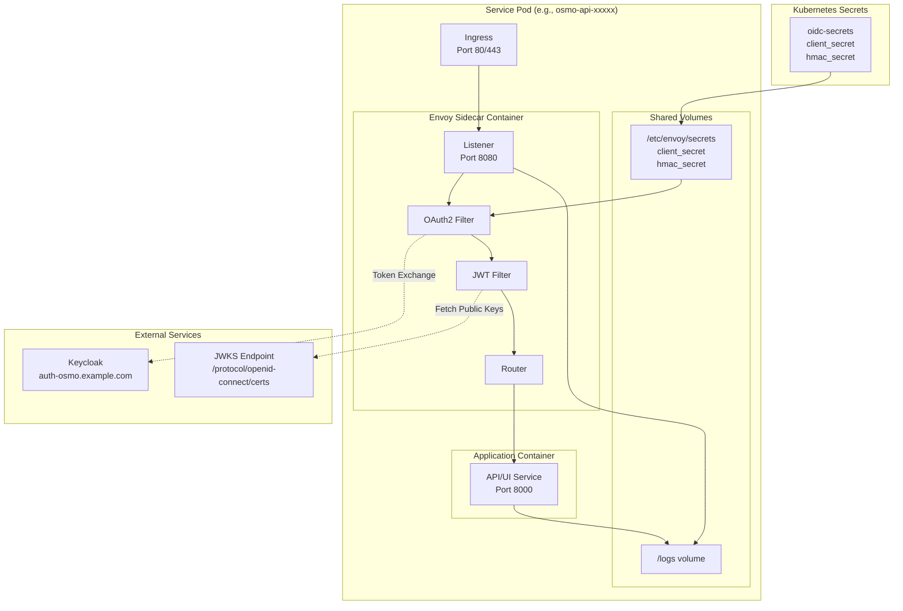
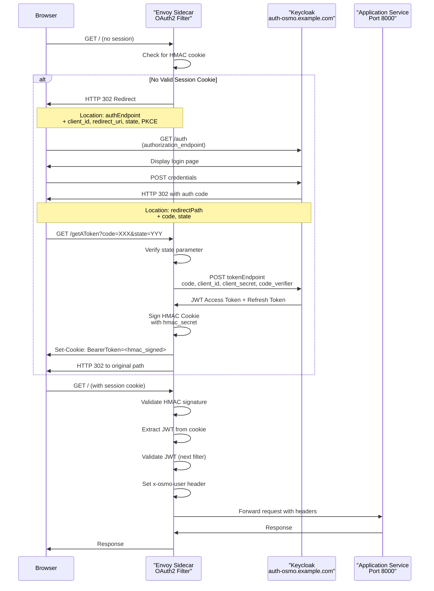
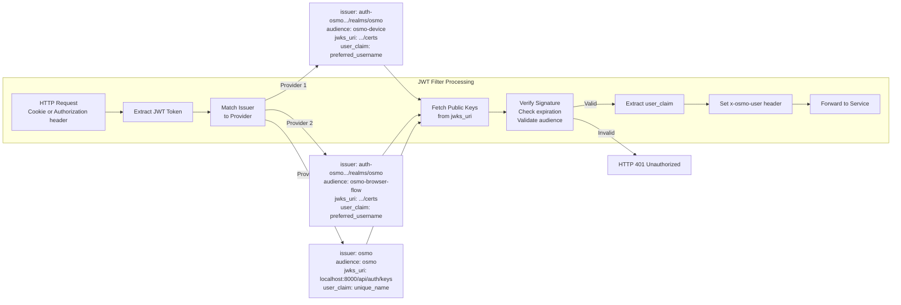
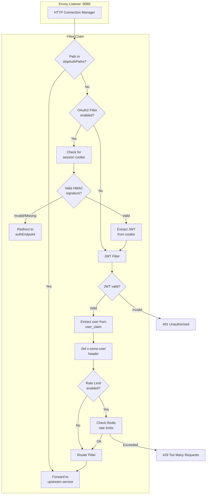
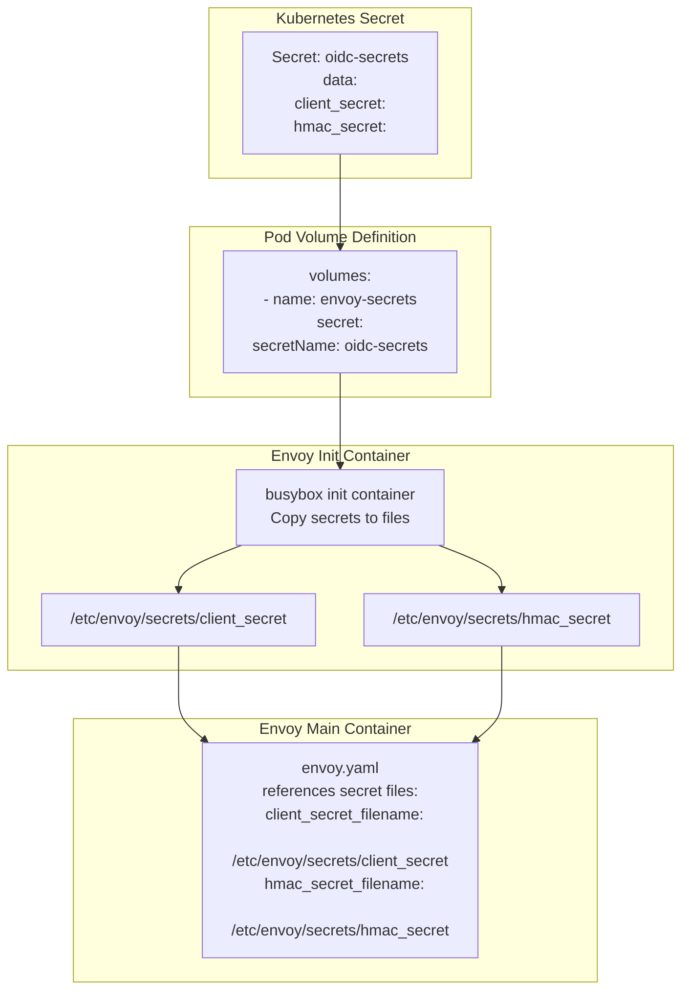
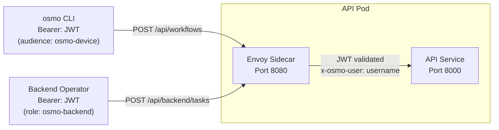
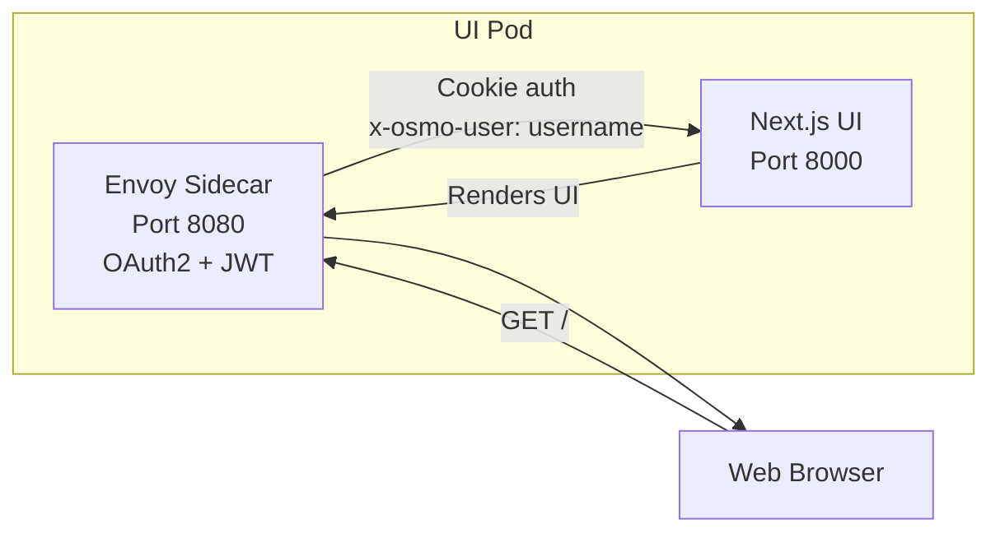
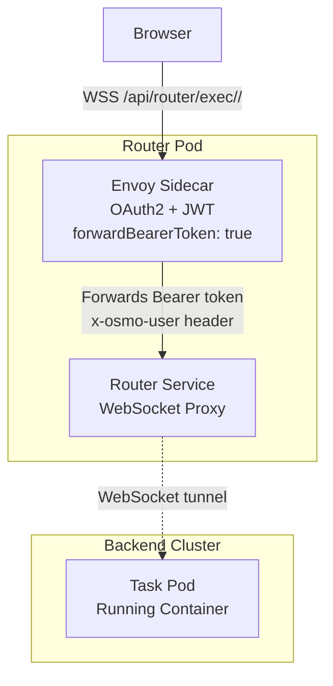
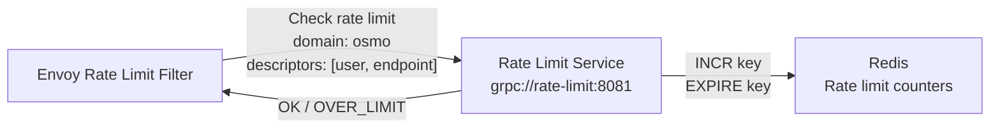

<!-- source: DeepWiki mcp.deepwiki.com · repo NVIDIA/OSMO · page 8.2 Envoy Authentication Proxy · fetched 2026-10-26 -->

# Envoy Authentication Proxy

<details>
<summary>Relevant source files</summary>

The following files were used as context for generating this wiki page:

- [deployments/charts/web-ui/README.md](deployments/charts/web-ui/README.md)
- [deployments/charts/web-ui/values.yaml](deployments/charts/web-ui/values.yaml)
- [docs/deployment_guide/getting_started/deploy_service.rst](docs/deployment_guide/getting_started/deploy_service.rst)
- [docs/deployment_guide/install_backend/dependencies/dependencies.rst](docs/deployment_guide/install_backend/dependencies/dependencies.rst)
- [docs/deployment_guide/install_backend/deploy_backend.rst](docs/deployment_guide/install_backend/deploy_backend.rst)
- [docs/deployment_guide/install_backend/validate_osmo.rst](docs/deployment_guide/install_backend/validate_osmo.rst)
- [docs/deployment_guide/references/configs_definitions/index.rst](docs/deployment_guide/references/configs_definitions/index.rst)
- [docs/user_guide/tutorials/combination_workflows/index.rst](docs/user_guide/tutorials/combination_workflows/index.rst)
- [ui/src/app/layout.tsx](ui/src/app/layout.tsx)
- [ui/src/app/workflows/components/TaskActions.tsx](ui/src/app/workflows/components/TaskActions.tsx)
- [ui/src/app/workflows/components/WorkflowActions.tsx](ui/src/app/workflows/components/WorkflowActions.tsx)
- [ui/src/env.mjs](ui/src/env.mjs)
- [ui/src/runtime-env.tsx](ui/src/runtime-env.tsx)

</details>


This document describes Envoy's role as an authentication proxy in OSMO, handling OAuth2 browser flows and JWT token validation for all control plane services. Envoy runs as a sidecar container alongside the API, Web UI, and Router services, intercepting HTTP requests to validate authentication before forwarding them to the backend service.

For information about Keycloak SSO configuration, see [Keycloak SSO Integration](#8.1). For credential encryption within the database, see [Credential Management and Encryption](#8.3).

## Architecture Overview

Envoy is deployed as a sidecar container in OSMO service pods, acting as the entry point for all HTTP traffic. It validates authentication credentials and enriches requests with user identity information before forwarding to the application container.

### Envoy Sidecar Deployment Pattern



**Sources**: [deployments/charts/web-ui/values.yaml:377-601](), [deployments/charts/web-ui/README.md:88-131]()

## Authentication Flow Components

### OAuth2 Browser Authentication Flow

The OAuth2 filter handles the browser-based authentication flow using the authorization code grant type with PKCE (Proof Key for Code Exchange).



**Sources**: [deployments/charts/web-ui/values.yaml:514-556](), [docs/deployment_guide/getting_started/deploy_service.rst:625-650]()

### JWT Token Validation

After OAuth2 authentication (or for direct API calls with Bearer tokens), the JWT filter validates tokens against configured providers.



**Sources**: [deployments/charts/web-ui/values.yaml:578-601](), [docs/deployment_guide/getting_started/deploy_service.rst:637-655]()

## Configuration Structure

### OAuth2 Filter Configuration

The OAuth2 filter is configured via Helm chart values and rendered into the Envoy configuration template.

| Parameter | Description | Example Value |
|-----------|-------------|---------------|
| `sidecars.envoy.oauth2Filter.enabled` | Enable OAuth2 filter | `true` |
| `sidecars.envoy.oauth2Filter.tokenEndpoint` | Token exchange endpoint | `https://auth-osmo.example.com/realms/osmo/protocol/openid-connect/token` |
| `sidecars.envoy.oauth2Filter.authEndpoint` | Authorization endpoint | `https://auth-osmo.example.com/realms/osmo/protocol/openid-connect/auth` |
| `sidecars.envoy.oauth2Filter.redirectPath` | OAuth callback path | `getAToken` |
| `sidecars.envoy.oauth2Filter.clientId` | OAuth2 client ID | `osmo-browser-flow` |
| `sidecars.envoy.oauth2Filter.authProvider` | Auth provider hostname | `auth-osmo.example.com` |
| `sidecars.envoy.oauth2Filter.logoutPath` | Logout endpoint path | `logout` |
| `sidecars.envoy.oauth2Filter.secretName` | K8s secret name | `oidc-secrets` |
| `sidecars.envoy.oauth2Filter.clientSecretKey` | Secret key for client_secret | `client_secret` |
| `sidecars.envoy.oauth2Filter.hmacSecretKey` | Secret key for HMAC secret | `hmac_secret` |

**Sources**: [deployments/charts/web-ui/values.yaml:514-556](), [deployments/charts/web-ui/README.md:117-131]()

### JWT Provider Configuration

Multiple JWT providers allow OSMO to accept tokens from different sources: CLI devices, browser sessions, and internal service tokens.

| Provider Field | Purpose | Configuration Location |
|----------------|---------|------------------------|
| `issuer` | Identifies token issuer | Must match JWT `iss` claim |
| `audience` | Expected token audience | Must match JWT `aud` claim |
| `jwks_uri` | Public key endpoint | Keycloak JWKS or internal endpoint |
| `user_claim` | Claim containing username | `preferred_username` or `unique_name` |
| `cluster` | Upstream cluster name | `oauth` or `service` |

**Example JWT Provider Configuration:**

```yaml
jwt:
  user_header: x-osmo-user
  providers:
  # CLI/Backend device tokens
  - issuer: https://auth-osmo.example.com/realms/osmo
    audience: osmo-device
    jwks_uri: https://auth-osmo.example.com/realms/osmo/protocol/openid-connect/certs
    user_claim: preferred_username
    cluster: oauth
  
  # Browser flow tokens
  - issuer: https://auth-osmo.example.com/realms/osmo
    audience: osmo-browser-flow
    jwks_uri: https://auth-osmo.example.com/realms/osmo/protocol/openid-connect/certs
    user_claim: preferred_username
    cluster: oauth
  
  # Internal OSMO service tokens
  - issuer: osmo
    audience: osmo
    jwks_uri: http://localhost:8000/api/auth/keys
    user_claim: unique_name
    cluster: service
```

**Sources**: [deployments/charts/web-ui/values.yaml:578-601](), [docs/deployment_guide/getting_started/deploy_service.rst:637-655]()

## Request Processing Pipeline

### HTTP Filter Chain



**Sources**: [deployments/charts/web-ui/values.yaml:377-601](), [docs/deployment_guide/getting_started/deploy_service.rst:608-636]()

## Secret Management

### Kubernetes Secret Integration

Envoy requires two secrets for OAuth2 authentication:

| Secret | Purpose | Generation Method |
|--------|---------|-------------------|
| `client_secret` | OAuth2 client authentication | Created in Keycloak client configuration |
| `hmac_secret` | Cookie signing/verification | Random 32-byte value, base64 encoded |

**Secret Creation Command:**

```bash
kubectl create secret generic oidc-secrets \
  --from-literal=client_secret=<keycloak-client-secret> \
  --from-literal=hmac_secret=$(head -c32 /dev/urandom | base64) \
  --namespace osmo
```

**Sources**: [docs/deployment_guide/getting_started/deploy_service.rst:370-382]()

### Secret Volume Mounting



**Sources**: [deployments/charts/web-ui/values.yaml:382-396](), [deployments/charts/web-ui/README.md:93-96]()

## Skip Authentication Paths

Certain endpoints bypass authentication to support health checks, version queries, and initial login flows.

### Common Skip Auth Paths

| Path | Purpose | Service |
|------|---------|---------|
| `/api/version` | Version information | API |
| `/api/auth/login` | Initial authentication | API |
| `/api/auth/keys` | Public JWKS endpoint | API |
| `/api/auth/refresh_token` | Token refresh | API |
| `/api/auth/jwt/refresh_token` | JWT refresh | API |
| `/api/auth/jwt/access_token` | Access token exchange | API |
| `/client/version` | Client version check | API |
| `/api/router/version` | Router version | Router |
| `/ready` | Envoy readiness probe | Envoy admin |

**Configuration:**

```yaml
sidecars:
  envoy:
    skipAuthPaths:
    - /api/version
    - /api/auth/login
    - /api/auth/keys
    - /api/auth/refresh_token
    - /api/auth/jwt/refresh_token
    - /api/auth/jwt/access_token
    - /client/version
```

**Sources**: [deployments/charts/web-ui/values.yaml:449-450](), [docs/deployment_guide/getting_started/deploy_service.rst:609-617]()

## Service-Specific Configurations

### API Service Envoy Configuration

The API service uses Envoy primarily for JWT validation of CLI and backend operator requests.



**Key Settings:**
- OAuth2 filter disabled (CLI doesn't use browser flow)
- JWT filter enabled with multiple providers
- Skip auth paths for public endpoints

**Sources**: [docs/deployment_guide/getting_started/deploy_service.rst:600-656]()

### Web UI Envoy Configuration

The Web UI uses full OAuth2 browser flow with session cookies.



**Key Settings:**
- OAuth2 filter enabled
- HMAC cookie signing
- JWT validation for API proxy requests

**Sources**: [deployments/charts/web-ui/values.yaml:880-918](), [docs/deployment_guide/getting_started/deploy_service.rst:830-918]()

### Router Service Envoy Configuration

The Router service requires both OAuth2 and JWT validation to handle WebSocket upgrades for interactive sessions.



**Unique Router Settings:**

```yaml
sidecars:
  envoy:
    oauth2Filter:
      forwardBearerToken: true  # Pass token to backend
      redirectPath: api/auth/getAToken
    routes:
    - match:
        prefix: "/"
      route:
        cluster: service
        timeout: 0s  # No timeout for long-lived connections
```

**Sources**: [docs/deployment_guide/getting_started/deploy_service.rst:750-819]()

## Advanced Features

### HTTP Header Size Limits

Large OAuth2 response headers (especially with group memberships) can exceed default HTTP header limits. Both Envoy and the application must be configured with matching limits.

| Configuration | Location | Default | Recommended |
|---------------|----------|---------|-------------|
| Envoy `max_request_headers_kb` | `sidecars.envoy.maxHeadersSizeKb` | 60 KB | 128 KB |
| Node.js `--max-http-header-size` | `services.ui.maxHttpHeaderSizeKb` | 8 KB | 128 KB |
| Nginx proxy buffer size | Ingress annotations | 4 KB | 16 KB |

**Ingress Annotations for Large Headers:**

```yaml
annotations:
  nginx.ingress.kubernetes.io/proxy-buffer-size: "16k"
  nginx.ingress.kubernetes.io/proxy-buffers: "8 16k"
  nginx.ingress.kubernetes.io/proxy-busy-buffers-size: "32k"
  nginx.ingress.kubernetes.io/large-client-header-buffers: "4 16k"
```

**Sources**: [deployments/charts/web-ui/values.yaml:101-105](), [deployments/charts/web-ui/README.md:59](), [docs/deployment_guide/getting_started/deploy_service.rst:536-540]()

### Rate Limiting Integration

When rate limiting is enabled, Envoy queries a Redis backend before forwarding requests.



**Configuration:**

```yaml
sidecars:
  rateLimit:
    enabled: true
    redis:
      serviceName: redis-rate-limit
      port: 6379
```

**Sources**: [docs/deployment_guide/getting_started/deploy_service.rst:671-678]()

### Liveness and Readiness Probes

Envoy exposes an admin interface on port 9901 for health checks.

| Probe Type | Path | Purpose |
|------------|------|---------|
| Liveness | `/ready` | Container is running |
| Readiness | `/ready` | Envoy is accepting traffic |
| Startup | `/ready` | Initial startup complete |

**Probe Configuration:**

```yaml
sidecars:
  envoy:
    livenessProbe:
      httpGet:
        path: /ready
        port: 9901
      initialDelaySeconds: 10
      periodSeconds: 10
      
    readinessProbe:
      httpGet:
        path: /ready
        port: 9901
      initialDelaySeconds: 5
      periodSeconds: 5
      
    startupProbe:
      httpGet:
        path: /ready
        port: 9901
      initialDelaySeconds: 15
      periodSeconds: 5
```

**Sources**: [deployments/charts/web-ui/values.yaml:412-434]()

## Security Considerations

### Secret Rotation

The `client_secret` and `hmac_secret` values are read from Kubernetes secrets at pod startup. To rotate secrets:

1. Update the Kubernetes secret
2. Restart the pods to load new secret values
3. Previous HMAC-signed cookies become invalid (users must re-authenticate)

**Sources**: [docs/deployment_guide/getting_started/deploy_service.rst:370-382]()

### TLS Configuration

Envoy can terminate TLS connections or delegate TLS termination to the ingress controller.

| Mode | Configuration | Use Case |
|------|---------------|----------|
| Ingress TLS | `ingress.sslEnabled: true` | Most common, ALB/NGINX handles TLS |
| Envoy TLS | `sidecars.envoy.ssl.enabled: true` | End-to-end encryption |
| No TLS | Both disabled | Development only |

**Envoy TLS Configuration:**

```yaml
sidecars:
  envoy:
    ssl:
      enabled: true
      cert:
        secretName: envoy-ssl-cert
        secretKey: cert
      privateKey:
        secretName: envoy-ssl-cert
        secretKey: privateKey
```

**Sources**: [deployments/charts/web-ui/values.yaml:558-567]()

### Security Context

Envoy runs with restricted security context to minimize attack surface.

```yaml
sidecars:
  envoy:
    securityContext:
      allowPrivilegeEscalation: false
      capabilities:
        drop: ["ALL"]
      runAsNonRoot: true
      runAsUser: 1001
```

**Sources**: [deployments/charts/web-ui/values.yaml:436-441]()

---

