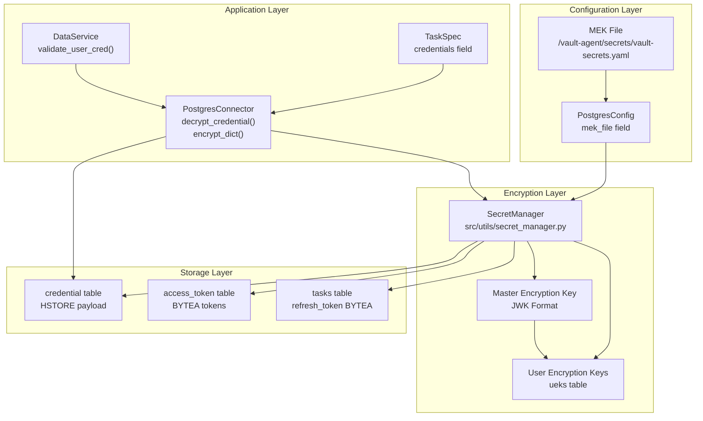
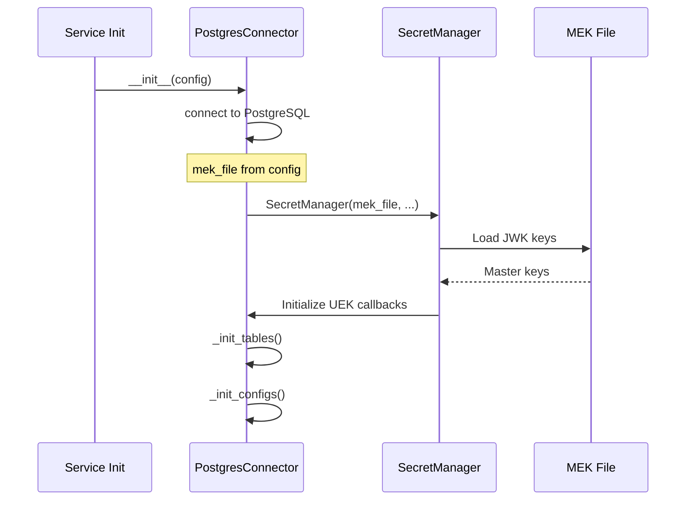
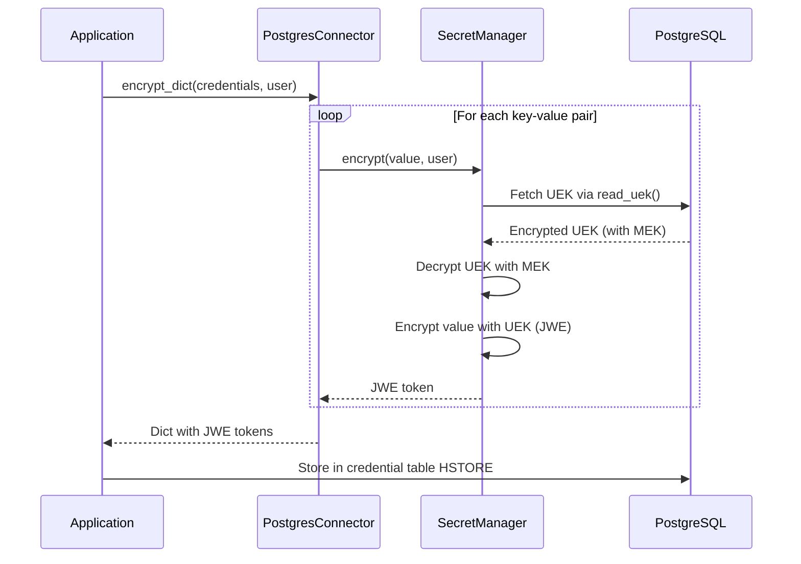
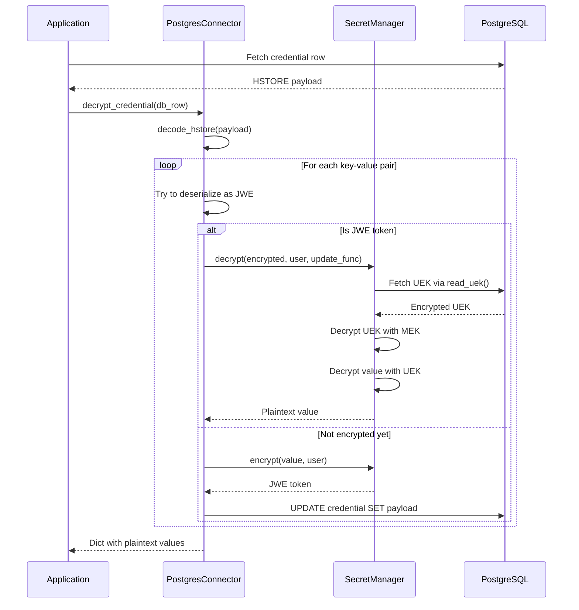

<!-- source: DeepWiki mcp.deepwiki.com · repo NVIDIA/OSMO · page 8.3 Credential Management and Encryption · fetched 2026-10-26 -->

# Credential Management and Encryption

<details>
<summary>Relevant source files</summary>

The following files were used as context for generating this wiki page:

- [docs/deployment_guide/getting_started/deploy_service.rst](docs/deployment_guide/getting_started/deploy_service.rst)
- [docs/deployment_guide/install_backend/dependencies/dependencies.rst](docs/deployment_guide/install_backend/dependencies/dependencies.rst)
- [docs/deployment_guide/install_backend/deploy_backend.rst](docs/deployment_guide/install_backend/deploy_backend.rst)
- [docs/deployment_guide/install_backend/validate_osmo.rst](docs/deployment_guide/install_backend/validate_osmo.rst)
- [docs/deployment_guide/references/configs_definitions/index.rst](docs/deployment_guide/references/configs_definitions/index.rst)
- [docs/user_guide/tutorials/combination_workflows/index.rst](docs/user_guide/tutorials/combination_workflows/index.rst)
- [src/lib/utils/common.py](src/lib/utils/common.py)
- [src/lib/utils/port_forward.py](src/lib/utils/port_forward.py)
- [src/lib/utils/tests/test_common.py](src/lib/utils/tests/test_common.py)
- [src/service/core/config/helpers.py](src/service/core/config/helpers.py)
- [src/service/core/data/data_service.py](src/service/core/data/data_service.py)
- [src/service/logger/ctrl_websocket.py](src/service/logger/ctrl_websocket.py)
- [src/service/router/router.py](src/service/router/router.py)
- [src/utils/connectors/postgres.py](src/utils/connectors/postgres.py)
- [src/utils/job/kb_objects.py](src/utils/job/kb_objects.py)
- [src/utils/job/task.py](src/utils/job/task.py)

</details>


This page documents OSMO's credential management and encryption system, which securely stores and manages sensitive data such as API keys, passwords, registry credentials, and dataset access tokens. The system uses a multi-tier encryption architecture with Master Encryption Keys (MEK) and User Encryption Keys (UEK) to protect credentials at rest in PostgreSQL.

For information about authentication flows and Keycloak integration, see [Keycloak SSO Integration](#8.1). For details about Envoy's OAuth2 validation, see [Envoy Authentication Proxy](#8.2).

## Architecture Overview

OSMO's credential encryption system consists of three layers:



**Sources:** [src/utils/connectors/postgres.py:125-186](), [src/utils/connectors/postgres.py:241-261](), [src/utils/connectors/postgres.py:475-507]()

## Master Encryption Key (MEK)

The Master Encryption Key is the root encryption key used to encrypt User Encryption Keys. It is stored in JWK (JSON Web Key) format and loaded during service initialization.

### Configuration

| Configuration Field | Environment Variable | Default Path | Description |
|-------------------|---------------------|--------------|-------------|
| `mek_file` | `OSMO_MEK_FILE` | `/home/osmo/vault-agent/secrets/vault-secrets.yaml` | Path to MEK file in JWK format |
| `method` | N/A | `None` | Set to `"dev"` for development mode |

The MEK file is configured in `PostgresConfig` and loaded during `PostgresConnector` initialization:



**Development Mode:** When `method='dev'`, OSMO uses a local MEK file at `src/utils/secret_manager/mek.yaml` and allows additional fields in configuration models.

**Sources:** [src/utils/connectors/postgres.py:156-161](), [src/utils/connectors/postgres.py:241-261](), [src/utils/connectors/postgres.py:252-261]()

## User Encryption Keys (UEK)

User Encryption Keys are per-user encryption keys stored in the `ueks` table. Each UEK is encrypted with the MEK and used to encrypt that user's credentials.

### Database Schema

```sql
CREATE TABLE IF NOT EXISTS ueks (
    uid TEXT,
    keys HSTORE,
    PRIMARY KEY (uid)
);
```

The `keys` HSTORE column stores multiple key versions (KIDs - Key IDs) for key rotation support. Each key is encrypted with the current MEK.

### UEK Operations

| Operation | Method | Description |
|-----------|--------|-------------|
| Read UEK | `read_uek` | Fetches encrypted UEK from database |
| Write UEK | `write_uek` | Stores encrypted UEK to database |
| Get Current KID | `read_current_kid` | Returns current key version ID |
| Add User | `add_user` | Creates new user entry if not exists |

**Sources:** [src/utils/connectors/postgres.py:852-860](), [src/utils/connectors/postgres.py:258-260]()

## Credential Storage

Credentials are stored in the `credential` table using PostgreSQL's HSTORE extension for flexible key-value storage.

### Credential Table Schema

```sql
CREATE TABLE IF NOT EXISTS credential (
    user_name TEXT NOT NULL,
    cred_name TEXT NOT NULL,
    cred_type credential_type,
    profile TEXT,
    payload HSTORE NOT NULL,
    PRIMARY KEY (user_name, cred_name),
    CONSTRAINT unique_cred UNIQUE (user_name, profile)
);

CREATE TYPE credential_type AS ENUM (
    'GENERIC', 'REGISTRY', 'DATA'
);
```

### HSTORE Format

The `payload` column stores encrypted key-value pairs. Each value is a JWE-encrypted string:

| Key | Encrypted Value |
|-----|----------------|
| `access_key_id` | `eyJhbGc...` (JWE token) |
| `secret_access_key` | `eyJhbGc...` (JWE token) |
| `username` | `eyJhbGc...` (JWE token) |
| `password` | `eyJhbGc...` (JWE token) |

### Encoding and Decoding

The `PostgresConnector` class provides helper methods for HSTORE operations:

```python
# Encode dictionary to HSTORE string
@classmethod
def encode_hstore(cls, key_val_data: Dict) -> str:
    return ','.join([f'"{key}"=>"{value}"' for key, value in key_val_data.items()])

# Decode HSTORE string to dictionary
@classmethod
def decode_hstore(cls, hstore_data: str) -> Dict:
    field_regex = r'[^()\'"]+'
    return {tp[0]: tp[1] for tp in re.findall(f'"({field_regex})"=>"({field_regex})"',
            hstore_data)}
```

**Sources:** [src/utils/connectors/postgres.py:960-972](), [src/utils/connectors/postgres.py:514-524](), [src/utils/connectors/postgres.py:62-67]()

## SecretManager Class

The `SecretManager` class handles all encryption and decryption operations using the JWCrypto library for JWE (JSON Web Encryption).

### Key Methods

| Method | Purpose | Returns |
|--------|---------|---------|
| `encrypt(value, user)` | Encrypts a value for a user | `Encrypted` object with JWE token |
| `decrypt(encrypted, user, update_func)` | Decrypts a JWE token | `Decrypted` object with plaintext |

### Integration with PostgresConnector

The `SecretManager` is initialized with callback functions from `PostgresConnector` for database operations:

```python
self.secret_manager = SecretManager(
    mek_file,
    self.read_uek,           # Callback to read UEK from database
    self.write_uek,          # Callback to write UEK to database
    self.read_current_kid,   # Callback to get current key ID
    self.add_user            # Callback to add new user
)
```

**Sources:** [src/utils/connectors/postgres.py:258-260](), [src/utils/connectors/postgres.py:48]()

## Encryption and Decryption Process

### Encryption Flow



### Decryption Flow



### Automatic Re-encryption

The `decrypt_credential` method automatically re-encrypts any unencrypted values it encounters:

```python
def decrypt_credential(self, db_row) -> Dict:
    result = {}
    payload = PostgresConnector.decode_hstore(db_row.payload)
    for key, value in payload.items():
        try:
            jwetoken = jwe.JWE()
            jwetoken.deserialize(value)
            encrypted = Encrypted(value)
            decrypted = self.secret_manager.decrypt(encrypted, db_row.user_name, update_func)
            result[key] = decrypted.value
        except (JWException, osmo_errors.OSMONotFoundError):
            # Not encrypted - encrypt it now
            result[key] = value
            encrypted = self.secret_manager.encrypt(value, db_row.user_name)
            cmd = f"UPDATE credential SET payload['{key}'] = %s ..."
            self.execute_commit_command(cmd, (encrypted.value,))
    return result
```

**Sources:** [src/utils/connectors/postgres.py:475-500](), [src/utils/connectors/postgres.py:502-507]()

## Credential Types

OSMO supports three types of credentials defined in the `CredentialType` enum:

| Type | Purpose | Typical Keys | Usage |
|------|---------|--------------|-------|
| `GENERIC` | General-purpose credentials | `username`, `password`, `api_key` | Custom integrations |
| `REGISTRY` | Container registry authentication | `username`, `password`, `auth` | Docker image pull |
| `DATA` | Dataset storage access | `access_key_id`, `secret_access_key`, `region` | S3, Azure Blob, MinIO |

### Data Credentials

Data credentials are used to access datasets stored in object storage. They are associated with a profile that identifies the storage backend:

```python
def validate_user_cred(postgres: connectors.PostgresConnector, user: str, location: str,
                       access_type: storage.AccessType):
    """
    Validates that the user has the specific access type to a backend location
    """
    backend_info = storage.construct_storage_backend(location)
    
    user_cred = postgres.get_data_cred(user, backend_info.profile)
    if not user_cred:
        raise osmo_errors.OSMOCredentialError(
            f'Could not find {backend_info.profile} credential for user {user}.')
    
    backend_info.data_auth(user_cred, access_type)
```

**Profile-Based Lookup:** The `profile` field in the `credential` table enables profile-specific credentials. For example, a user might have different credentials for `s3-prod` and `s3-dev` profiles.

**Sources:** [src/utils/connectors/postgres.py:62-67](), [src/service/core/data/data_service.py:48-60]()

### Service Tokens

Service tokens are used for backend operator authentication and are stored in the `access_token` table with encrypted values:

```sql
CREATE TABLE IF NOT EXISTS access_token (
    user_name TEXT,
    token_name TEXT,
    access_token BYTEA,
    expires_at TIMESTAMP,
    description TEXT,
    access_type TEXT,
    roles TEXT[],
    PRIMARY KEY (user_name, token_name, access_type),
    CONSTRAINT unique_access_token UNIQUE (access_token)
);
```

**Token Creation:** Service tokens are created via the OSMO CLI:

```bash
osmo token set backend-token \
    --expires-at 2025-12-31 \
    --description "Backend Operator Token" \
    --service \
    --roles osmo-backend
```

**Sources:** [src/utils/connectors/postgres.py:975-988](), [docs/deployment_guide/install_backend/deploy_backend.rst:34-47]()

## Usage in Workflows

### Task Credentials

Workflow tasks can specify credentials that are injected into containers:

```yaml
tasks:
  - name: training-task
    image: nvcr.io/nvidia/pytorch:23.10-py3
    credentials:
      registry:
        username: "{{REGISTRY_USER}}"
        password: "{{REGISTRY_PASSWORD}}"
      data: my-s3-profile
      custom_api:
        API_KEY: "{{MY_API_KEY}}"
```

The `credentials` field in `TaskSpec` maps credential names to environment variables or profiles:

**Sources:** [src/utils/job/task.py:604]()

### Credential Resolution

During workflow submission, credentials are resolved and encrypted:

1. **Template Expansion:** Jinja variables like `{{REGISTRY_USER}}` are resolved
2. **Credential Lookup:** Profile names are looked up in the user's credentials
3. **Secret Creation:** Credentials are stored in Kubernetes secrets
4. **Environment Injection:** Secrets are mounted as environment variables in pods

### Task Refresh Tokens

Tasks receive refresh tokens for API authentication, stored encrypted in the `tasks` table:

```sql
CREATE TABLE IF NOT EXISTS tasks (
    ...
    refresh_token BYTEA,
    ...
);
```

These tokens enable tasks to authenticate with OSMO APIs for logging, metrics, and data operations.

**Sources:** [src/utils/job/task.py:54-56](), [src/utils/connectors/postgres.py:717-753]()

## Security Features

### Credential Masking in Logs

All credentials are automatically masked in logs and events using the `mask_string` function:

```python
loaded_json['text'] = common.mask_string(loaded_json.get('text', ''), task_cred_values)
```

This prevents accidental credential leakage in workflow logs.

**Sources:** [src/service/logger/ctrl_websocket.py:189-190]()

### Encryption at Rest

All credentials are encrypted before being stored in PostgreSQL:

| Storage Location | Encryption Method | Key Used |
|-----------------|-------------------|----------|
| `credential` table payload | JWE with UEK | User's UEK, encrypted with MEK |
| `access_token` table | BYTEA encrypted | UEK |
| `tasks` table refresh_token | BYTEA encrypted | UEK |
| `ueks` table keys | JWE with MEK | MEK from vault |

### Key Rotation Support

The system supports key rotation through the KID (Key ID) mechanism:

1. New MEK is added to vault with new KID
2. Existing credentials remain encrypted with old key
3. Next decrypt operation re-encrypts with new key
4. Old MEK can be retired after all credentials are rotated

**Automatic Re-encryption:** The `decrypt_credential` method includes an `update_func` callback that triggers re-encryption when an old key is detected.

**Sources:** [src/utils/connectors/postgres.py:475-500]()

### Access Control

Credentials are user-scoped and can only be accessed by:

1. The credential owner
2. Tasks running on behalf of that user
3. Administrators with appropriate roles

The `validate_user_cred` function enforces access control before allowing data operations.

**Sources:** [src/service/core/data/data_service.py:48-60]()

## Configuration Table

The credential management system is configured through the `PostgresConfig` class:

| Field | Type | Default | Description |
|-------|------|---------|-------------|
| `mek_file` | `str` | `/home/osmo/vault-agent/secrets/vault-secrets.yaml` | Path to Master Encryption Key file |
| `method` | `Literal['dev'] \| None` | `None` | Development mode flag |
| `postgres_host` | `str` | `localhost` | PostgreSQL hostname |
| `postgres_port` | `int` | `5432` | PostgreSQL port |
| `postgres_database_name` | `str` | `osmo_db` | Database name |
| `postgres_user` | `str` | `postgres` | Database user |
| `postgres_password` | `str` | Required | Database password |

**Sources:** [src/utils/connectors/postgres.py:125-185]()

---

