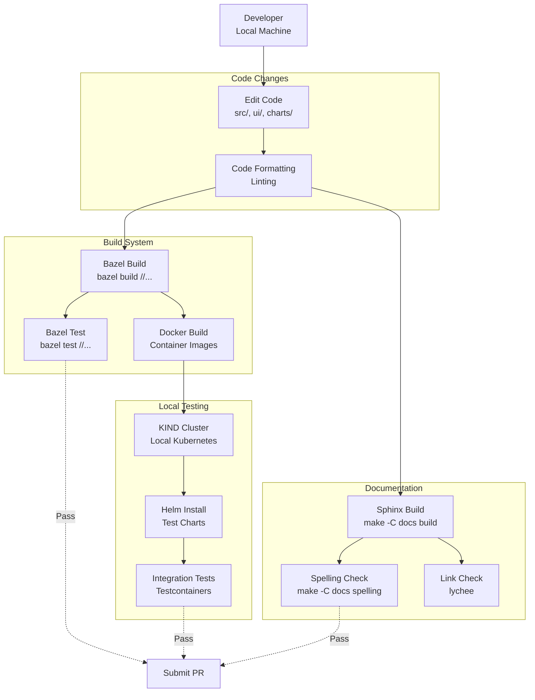
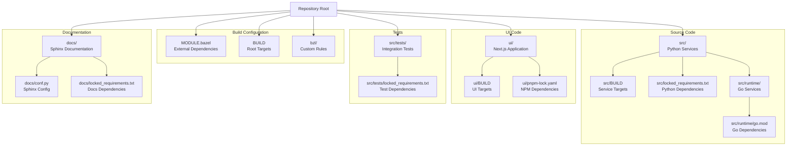
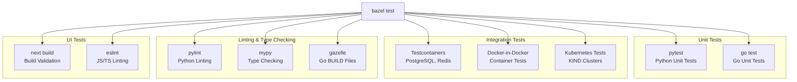
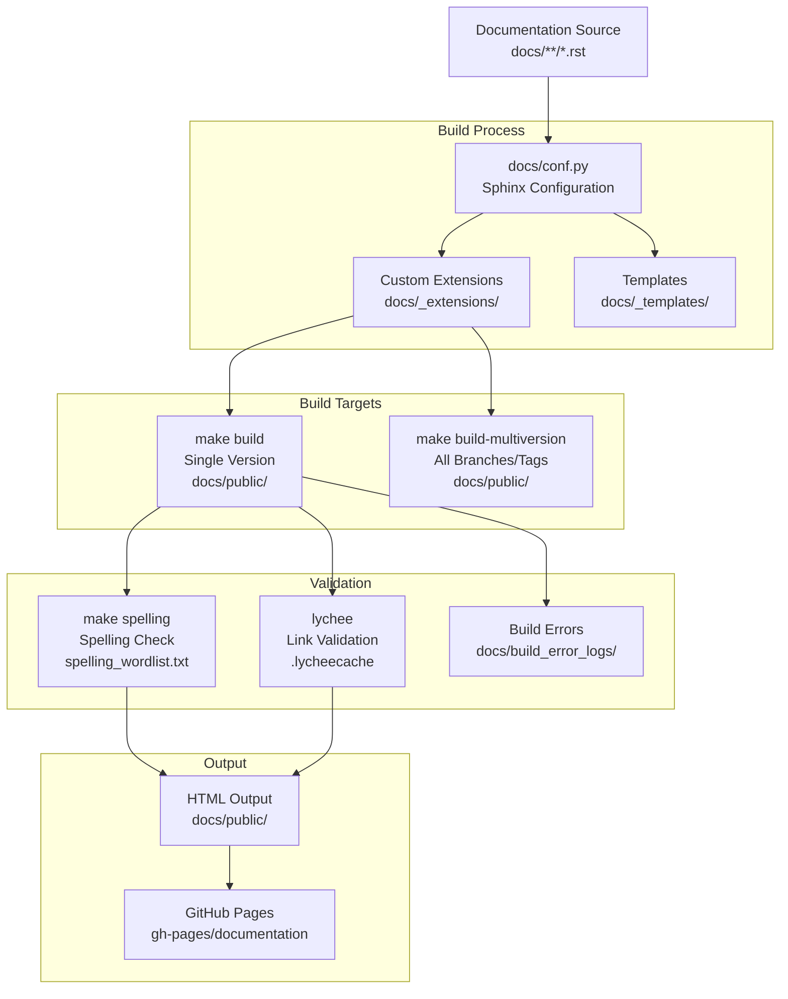
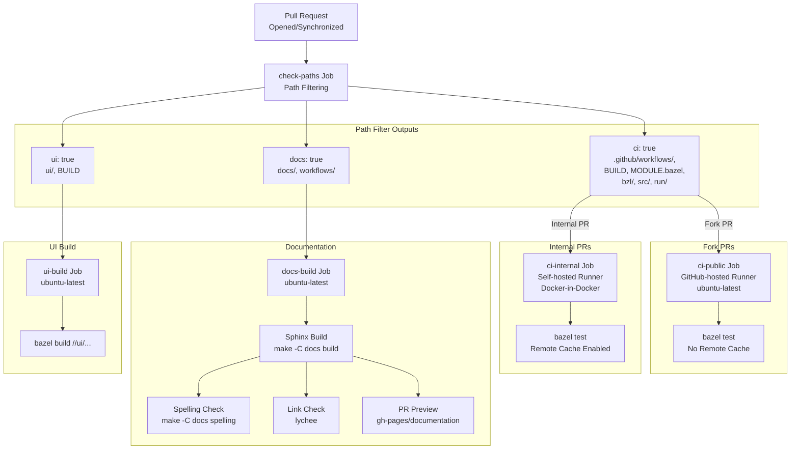

<!-- source: DeepWiki mcp.deepwiki.com · repo NVIDIA/OSMO · page 9.1 Development Setup · fetched 2026-10-26 -->

# Development Setup

<details>
<summary>Relevant source files</summary>

The following files were used as context for generating this wiki page:

- [.github/PULL_REQUEST_TEMPLATE.md](.github/PULL_REQUEST_TEMPLATE.md)
- [.github/workflows/docs-deploy.yaml](.github/workflows/docs-deploy.yaml)
- [.github/workflows/helm-chart-lint.yaml](.github/workflows/helm-chart-lint.yaml)
- [.github/workflows/pr-checks.yaml](.github/workflows/pr-checks.yaml)
- [.github/workflows/pr-description-check.yaml](.github/workflows/pr-description-check.yaml)
- [.github/workflows/sync-feature-branches.yaml](.github/workflows/sync-feature-branches.yaml)
- [CONTRIBUTING.md](CONTRIBUTING.md)
- [README.md](README.md)
- [deployments/brev/README.md](deployments/brev/README.md)
- [deployments/brev/setup.sh](deployments/brev/setup.sh)
- [docs/conf.py](docs/conf.py)
- [docs/deployment_guide/getting_started/create_storage/s3/index.rst](docs/deployment_guide/getting_started/create_storage/s3/index.rst)

</details>


This page provides instructions for setting up a local development environment for contributing to OSMO. It covers system requirements, prerequisites installation, repository setup, building from source, and running tests.

For information about the CI/CD pipeline and automated testing, see [CI/CD Pipeline](#9.2). For guidelines on submitting pull requests, see [Pull Request Guidelines](#9.4).

---

## System Requirements

OSMO development is supported on the following platforms:

| Platform | Version | Architecture |
|----------|---------|--------------|
| **Ubuntu** | 22.04+ | x86_64 |
| **MacOS** | Latest | arm64 |

**Sources:** [CONTRIBUTING.md:27-29]()

---

## Prerequisites

The following tools must be installed before you can develop OSMO:

### Required Tools

| Tool | Minimum Version | Purpose |
|------|----------------|---------|
| **Git LFS** | 3.7.1 | Source control for large files (test fixtures, models) |
| **Bazel** | 8.1.1 | Build tool for compiling services and running tests |
| **Docker** | 28.3.2 | Container runtime for building images and running tests |
| **Helm** | 3.17.1 | Package manager for Kubernetes charts |
| **KIND** | 0.29.0 | Kubernetes in Docker for local cluster testing |
| **kubectl** | 1.32.2 | Kubernetes command-line tool |
| **aws-cli** | 2.24.7 | AWS command-line tool for S3 operations |
| **npm** | 11.6.2 | Package manager for Node.js (UI development) |

### Installation

Follow the official installation guides for each tool:

- **Git LFS:** https://git-lfs.com/
- **Bazel:** https://bazel.build/install/bazelisk (use Bazelisk for version management)
- **Docker:** https://docs.docker.com/get-started/get-docker/
- **Helm:** https://helm.sh/docs/intro/install/
- **KIND:** https://kind.sigs.k8s.io/docs/user/quick-start/#installation
- **kubectl:** https://kubernetes.io/docs/tasks/tools/
- **aws-cli:** https://docs.aws.amazon.com/cli/latest/userguide/getting-started-install.html
- **npm:** https://docs.npmjs.com/downloading-and-installing-node-js-and-npm

**Sources:** [CONTRIBUTING.md:31-43]()

---

## Repository Setup

### Fork and Clone

1. Fork the [NVIDIA/OSMO repository](https://github.com/NVIDIA/OSMO) on GitHub
2. Clone your fork locally:

```bash
git clone https://github.com/YOUR_USERNAME/YOUR_FORK.git osmo
cd osmo
```

3. Initialize Git LFS to download large files:

```bash
git lfs install
git lfs pull
```

Git LFS is used to store test fixtures, example datasets, and documentation assets that would otherwise bloat the repository.

**Sources:** [CONTRIBUTING.md:45-53]()

---

## Development Workflow Overview



**Development Workflow Flow**

This diagram shows the typical development workflow from making code changes through testing to submitting a pull request.

**Sources:** [CONTRIBUTING.md:55-65](), [.github/workflows/pr-checks.yaml:1-312]()

---

## Build System Architecture

OSMO uses **Bazel** as its primary build system. Bazel provides hermetic builds, reproducibility, and efficient caching across the monorepo.

### Bazel Workspace Structure



**Bazel Workspace Structure**

This diagram maps the repository structure to Bazel build targets and dependency management files.

**Sources:** [.github/workflows/pr-checks.yaml:54-68](), [.github/workflows/pr-checks.yaml:114-125]()

### Building Components

To build all OSMO components:

```bash
# Build everything
bazel build //...

# Build only Python services (excludes UI)
bazel build //... -//ui/...

# Build only the UI
bazel build //ui/...

# Build a specific service
bazel build //src/api:api_image
```

The `//...` pattern recursively builds all targets in the workspace. The `-//ui/...` exclusion is commonly used to skip the UI build when working on backend services.

**Sources:** [.github/workflows/pr-checks.yaml:126-128]()

---

## Running Tests

### Test Execution Architecture



**Test Execution Architecture**

This diagram shows the different types of tests executed by the Bazel test runner.

**Sources:** [.github/workflows/pr-checks.yaml:126-182]()

### Running Tests Locally

```bash
# Run all tests
bazel test --test_output=errors -- //... -//ui/...

# Run tests with detailed output
bazel test --test_output=all -- //... -//ui/...

# Run a specific test file
bazel test //src/tests:test_workflows

# Run tests matching a pattern
bazel test //src/tests/...

# Run UI tests
bazel build //ui/...
```

The `--test_output=errors` flag only shows output for failing tests, making it easier to identify issues.

**Sources:** [.github/workflows/pr-checks.yaml:126-128](), [.github/workflows/pr-checks.yaml:174-182]()

### Integration Tests with Docker

Integration tests use **Testcontainers** to spin up PostgreSQL and Redis instances automatically. When running tests that require Docker:

```bash
# Standard test execution (uses Docker on localhost)
bazel test //src/tests:integration_tests

# In CI with Docker-in-Docker
bazel test \
  --test_env=DOCKER_HOST=tcp://docker:2375 \
  --test_env=TESTCONTAINERS_HOST_OVERRIDE=docker \
  //src/tests:integration_tests
```

The `DOCKER_HOST` and `TESTCONTAINERS_HOST_OVERRIDE` environment variables configure Testcontainers to use a Docker-in-Docker service, which is necessary in containerized CI environments.

**Sources:** [.github/workflows/pr-checks.yaml:174-182]()

---

## Bazel Remote Cache

For faster builds, internal contributors can use remote caching:

```bash
# Build with remote cache
bazel build \
  --remote_cache=https://bazel-cache.internal.nvidia.com \
  //...

# Test with remote cache
bazel test \
  --remote_cache=https://bazel-cache.internal.nvidia.com \
  --test_output=errors \
  -- //... -//ui/...
```

Remote caching stores build artifacts and test results in a shared cache, dramatically reducing build times for repeated builds. The cache is keyed by input hashes, ensuring correctness.

**Sources:** [.github/workflows/pr-checks.yaml:176-182]()

---

## Building Documentation

OSMO documentation is built using **Sphinx** with custom extensions.

### Documentation Build Pipeline



**Documentation Build Pipeline**

This diagram shows how Sphinx documentation is built, validated, and deployed.

**Sources:** [docs/conf.py:1-268](), [.github/workflows/pr-checks.yaml:187-281](), [.github/workflows/docs-deploy.yaml:1-95]()

### Building Locally

```bash
# Install documentation dependencies
pip install -U -r docs/locked_requirements.txt
pip install -U -r src/locked_requirements.txt

# Build documentation (single version)
make -C docs build ERR_DIR=build_error_logs OUT_DIR=public

# Build documentation (multi-version)
make -C docs build-multiversion ERR_DIR=build_error_logs OUT_DIR=public

# Run spelling check
make -C docs spelling ERR_DIR=spelling_error_logs OUT_DIR=public

# Check for build errors
find docs/build_error_logs -name '*.log' -size +0c
```

The documentation dependencies include:
- **sphinx** - Core documentation engine
- **sphinx-multiversion** - Multi-version documentation support
- **sphinx_copybutton** - Copy button for code blocks
- **sphinx_design** - UI components for documentation
- **sphinxcontrib.mermaid** - Mermaid diagram support

**Sources:** [.github/workflows/pr-checks.yaml:203-217](), [.github/workflows/docs-deploy.yaml:53-70](), [docs/conf.py:38-67]()

### Sphinx Configuration

The Sphinx configuration at [docs/conf.py:1-268]() includes:

- **Project metadata** - [docs/conf.py:28-31]()
- **Extensions** - [docs/conf.py:38-67]()
- **Theme configuration** - [docs/conf.py:131-158]()
- **Spelling check** - [docs/conf.py:76-82]()
- **Link checking** - [docs/conf.py:84-98]()
- **Substitution constants** - [docs/conf.py:186-229]()

Key extensions used:
- `sphinx_multiversion` - Build docs for multiple branches/tags ([docs/conf.py:256-267]())
- `sphinxcontrib.mermaid` - Mermaid diagram rendering ([docs/conf.py:253-254]())
- `sphinx_copybutton` - Copy buttons on code blocks ([docs/conf.py:100-105]())
- Custom extensions in `docs/_extensions/` ([docs/conf.py:55-63]())

**Sources:** [docs/conf.py:1-268]()

---

## CI/CD Test Workflow

OSMO uses GitHub Actions for continuous integration. The workflow differs for fork PRs and internal PRs.

### CI Workflow Architecture



**CI Workflow Architecture**

This diagram shows how the `pr-checks.yaml` workflow uses path filtering to run only relevant tests based on changed files.

**Sources:** [.github/workflows/pr-checks.yaml:29-312]()

### Path-Based Test Execution

The CI system uses path filtering to optimize test execution:

| Path Pattern | Triggers | Jobs Run |
|--------------|----------|----------|
| `.github/workflows/pr-checks.yaml`, `BUILD`, `MODULE.bazel`, `bzl/**`, `src/**`, `run/**` | CI tests | `ci-public` or `ci-internal` |
| `docs/**`, `workflows/**` | Documentation build | `docs-build` |
| `ui/**`, `BUILD`, `MODULE.bazel`, `bzl/**` | UI build | `ui-build` |

The path filtering is implemented using the `dorny/paths-filter` action in [.github/workflows/pr-checks.yaml:45-68]().

**Sources:** [.github/workflows/pr-checks.yaml:33-68]()

### Fork PRs vs Internal PRs

- **Fork PRs** (`github.event.pull_request.head.repo.fork == true`):
  - Run on GitHub-hosted `ubuntu-latest` runners ([.github/workflows/pr-checks.yaml:73-129]())
  - No remote Bazel cache (slower builds)
  - Limited permissions for security

- **Internal PRs** (from `NVIDIA/OSMO` branches):
  - Run on self-hosted runners ([.github/workflows/pr-checks.yaml:130-183]())
  - Docker-in-Docker service enabled ([.github/workflows/pr-checks.yaml:143-156]())
  - Remote Bazel cache enabled ([.github/workflows/pr-checks.yaml:176]())
  - Full access to internal resources

**Sources:** [.github/workflows/pr-checks.yaml:73-183]()

---

## Docker Setup for Development

Many OSMO tests require Docker to run containers for databases, services, and integration testing.

### Docker Permissions

Ensure your user has Docker permissions:

```bash
# Add user to docker group
sudo usermod -aG docker $USER

# Log out and log back in for group changes to take effect
# Or use newgrp to activate the new group without logging out
newgrp docker

# Verify Docker access
docker ps
```

**Sources:** [deployments/brev/setup.sh:73-79]()

### Docker-in-Docker for CI

The CI environment uses Docker-in-Docker to run containerized tests:

```yaml
services:
  docker:
    image: docker:dind
    env:
      DOCKER_TLS_CERTDIR: ""
      DOCKER_DRIVER: overlay2
    options: --privileged
    ports:
      - 2375:2375
```

Tests connect to this service using `DOCKER_HOST=tcp://docker:2375`.

**Sources:** [.github/workflows/pr-checks.yaml:148-156]()

---

## Local Kubernetes Development

For testing OSMO deployments locally, use KIND (Kubernetes in Docker).

### KIND Cluster Setup

```bash
# Create a basic KIND cluster
kind create cluster --name osmo-dev

# Delete the cluster
kind delete cluster --name osmo-dev

# Load a Docker image into KIND
kind load docker-image osmo-api:dev --name osmo-dev
```

For GPU-enabled testing, use `nvkind`:

```bash
# Install nvkind
go install github.com/NVIDIA/nvkind/cmd/nvkind@latest

# Create GPU-enabled cluster
nvkind cluster create --config-template=kind-config.yaml
```

**Sources:** [deployments/brev/setup.sh:117-218](), [CONTRIBUTING.md:37-38]()

---

## Helm Chart Development

To test Helm chart changes locally:

```bash
# Lint a chart
helm lint deployments/charts/service

# Build chart dependencies
helm dependency build deployments/charts/quick-start

# Template a chart (dry-run)
helm template test-release deployments/charts/service

# Install a chart to KIND
helm upgrade --install osmo deployments/charts/quick-start \
  --namespace osmo \
  --create-namespace
```

Helm charts are linted automatically when files in `deployments/charts/**` change, as defined in [.github/workflows/helm-chart-lint.yaml:1-126]().

**Sources:** [.github/workflows/helm-chart-lint.yaml:100-125](), [CONTRIBUTING.md:36]()

---

## Dependency Management

### Python Dependencies

Python dependencies are managed using locked requirements files:

- **Service dependencies:** [src/locked_requirements.txt]()
- **Test dependencies:** [src/tests/locked_requirements.txt]()
- **Documentation dependencies:** [docs/locked_requirements.txt]()
- **Linting dependencies:** [bzl/linting/locked_requirements.txt]()
- **Type checking dependencies:** [bzl/mypy/locked_requirements.txt]()

These files are referenced in the Bazel cache configuration at [.github/workflows/pr-checks.yaml:116-120]().

**Sources:** [.github/workflows/pr-checks.yaml:114-125]()

### Go Dependencies

Go dependencies for the Router service are managed using:

- **go.mod:** [src/runtime/go.mod]()
- **go.sum:** [src/runtime/go.sum]()

These files are referenced in the Bazel cache configuration at [.github/workflows/pr-checks.yaml:123-124]().

**Sources:** [.github/workflows/pr-checks.yaml:114-125]()

### UI Dependencies

UI dependencies are managed using pnpm:

- **pnpm-lock.yaml:** [ui/pnpm-lock.yaml]()

This file is referenced in the Bazel cache configuration at [.github/workflows/pr-checks.yaml:307]().

**Sources:** [.github/workflows/pr-checks.yaml:305-308](), [CONTRIBUTING.md:42-43]()

---

## Bazel Cache Configuration

The CI workflow uses Bazel's external cache feature to cache dependencies based on their lock files:

```yaml
external-cache: |
  manifest:
    # Python dependencies
    osmo_python_deps: src/locked_requirements.txt
    osmo_tests_python_deps: src/tests/locked_requirements.txt
    osmo_mypy_deps: bzl/mypy/locked_requirements.txt
    pylint_python_deps: bzl/linting/locked_requirements.txt

    # Go dependencies
    io_bazel_rules_go: src/runtime/go.mod
    bazel_gazelle: src/runtime/go.sum
```

This configuration ensures that external dependencies are only re-fetched when their lock files change.

**Sources:** [.github/workflows/pr-checks.yaml:114-125]()

---

## Common Development Tasks

### Build a Service Container Image

```bash
# Build the API service image
bazel build //src/api:api_image

# Build all service images
bazel build //src/...:all_images
```

### Run Unit Tests

```bash
# Run all Python tests
bazel test //src/tests/...

# Run a specific test file
bazel test //src/tests:test_workflow_execution
```

### Run Linting

```bash
# Run Python linting
bazel test //src/...:pylint_test

# Run type checking
bazel test //src/...:mypy_test
```

### Clean Build Artifacts

```bash
# Clean all Bazel build outputs
bazel clean

# Clean and remove all cached artifacts
bazel clean --expunge
```

---

## Next Steps

Once your development environment is set up:

1. Read the [CI/CD Pipeline](#9.2) documentation to understand automated testing
2. Review the [Projects Process](#9.3) if you're planning significant changes
3. Follow the [Pull Request Guidelines](#9.4) when submitting contributions
4. Refer to the [Contributing Guide](CONTRIBUTING.md) for coding standards and workflow

For questions or issues with development setup, file an issue on the [OSMO GitHub repository](https://github.com/NVIDIA/OSMO/issues).

**Sources:** [CONTRIBUTING.md:1-139]()

---

