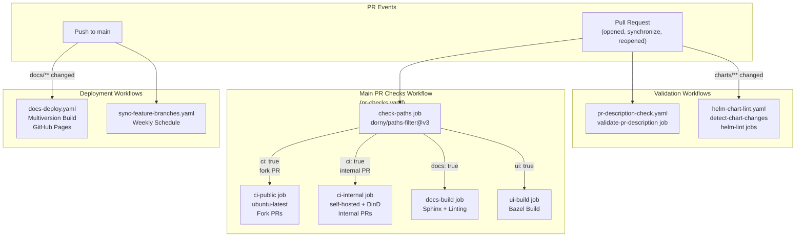
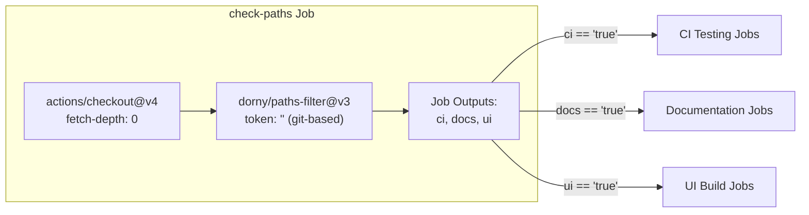
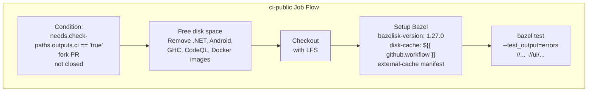
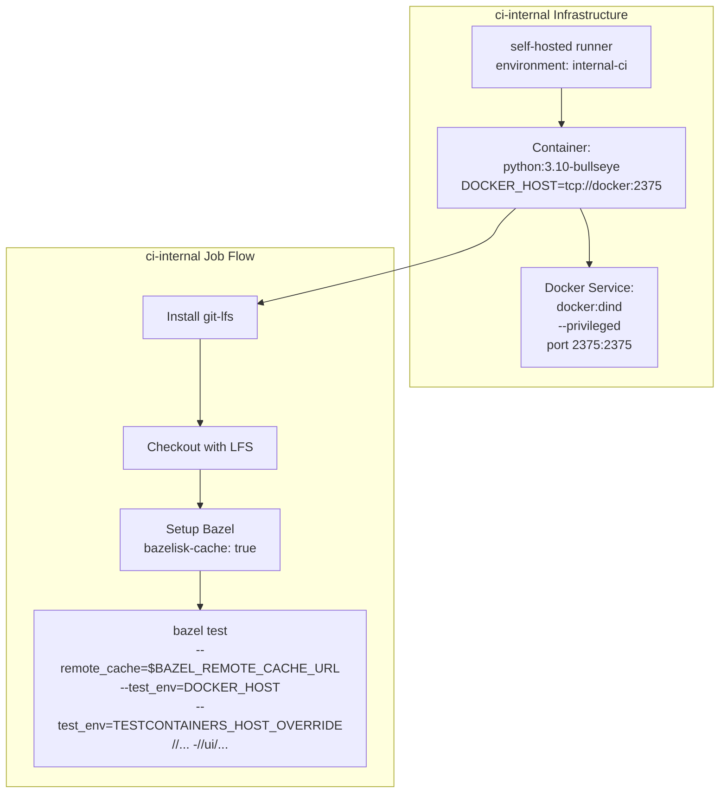
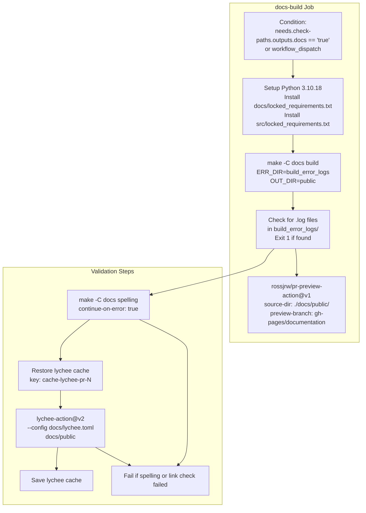
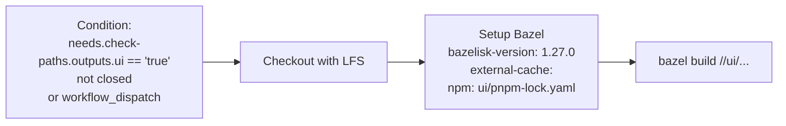
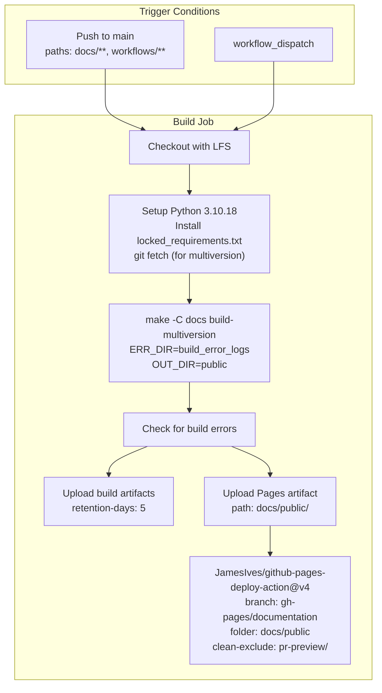
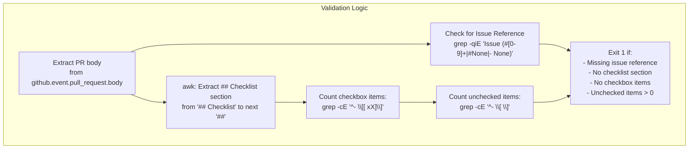
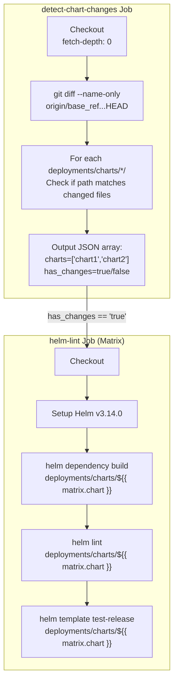
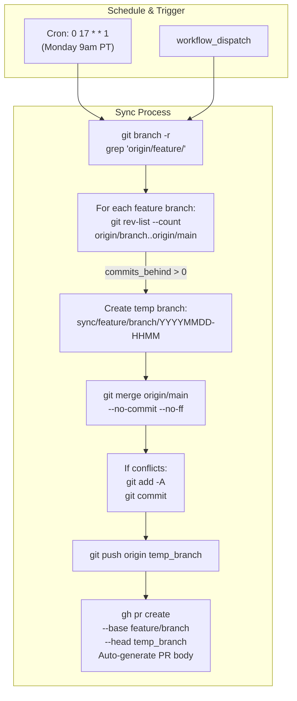

<!-- source: DeepWiki mcp.deepwiki.com · repo NVIDIA/OSMO · page 9.2 CI/CD Pipeline · fetched 2026-10-26 -->

# CI/CD Pipeline

<details>
<summary>Relevant source files</summary>

The following files were used as context for generating this wiki page:

- [.github/workflows/docs-deploy.yaml](.github/workflows/docs-deploy.yaml)
- [.github/workflows/helm-chart-lint.yaml](.github/workflows/helm-chart-lint.yaml)
- [.github/workflows/pr-checks.yaml](.github/workflows/pr-checks.yaml)
- [.github/workflows/pr-description-check.yaml](.github/workflows/pr-description-check.yaml)
- [.github/workflows/sync-feature-branches.yaml](.github/workflows/sync-feature-branches.yaml)
- [docs/conf.py](docs/conf.py)

</details>


This document explains OSMO's CI/CD infrastructure, including automated testing workflows, documentation deployment, validation checks, and the path-based execution optimization system. For information about the formal process for proposing and implementing changes, see [Projects Process](#9.3). For guidelines on preparing pull requests, see [Pull Request Guidelines](#9.4).

---

## Overview

OSMO's CI/CD system is implemented entirely through GitHub Actions workflows and uses **path-based execution** to optimize build times by running only relevant tests for changed files. The system distinguishes between fork PRs (using GitHub-hosted runners) and internal PRs (using self-hosted runners with remote Bazel caching).

### Workflow Architecture



**Sources**: [.github/workflows/pr-checks.yaml:1-312](), [.github/workflows/docs-deploy.yaml:1-95](), [.github/workflows/pr-description-check.yaml:1-135](), [.github/workflows/helm-chart-lint.yaml:1-126](), [.github/workflows/sync-feature-branches.yaml:1-151]()

---

## Path-Based Execution Optimization

The `check-paths` job uses the `dorny/paths-filter` action to determine which parts of the codebase changed, enabling conditional execution of downstream jobs. This significantly reduces CI time by skipping irrelevant tests.

### Path Filter Configuration

| Output | Triggered When | Downstream Jobs |
|--------|---------------|-----------------|
| `ci` | `.github/workflows/pr-checks.yaml`, `BUILD`, `MODULE.bazel`, `bzl/**`, `src/**`, `run/**` | `ci-public`, `ci-internal` |
| `docs` | `.github/workflows/pr-checks.yaml`, `docs/**`, `workflows/**` | `docs-build` |
| `ui` | `.github/workflows/pr-checks.yaml`, `BUILD`, `MODULE.bazel`, `bzl/**`, `ui/**` | `ui-build` |



The filter uses git-based detection (empty token) to ensure accurate diff analysis across the entire history [.github/workflows/pr-checks.yaml:49-50]().

**Sources**: [.github/workflows/pr-checks.yaml:33-68]()

---

## CI Testing Jobs

### Fork PRs: ci-public Job

The `ci-public` job runs on GitHub-hosted `ubuntu-latest` runners for pull requests originating from forked repositories. This job has limited access to secrets and uses public caching only.



**Disk Space Cleanup**: The job removes unnecessary software to free disk space before testing [.github/workflows/pr-checks.yaml:81-100]():
- .NET runtime
- Android SDK
- GHC/Haskell toolchain
- CodeQL database
- Docker images

**Bazel Caching**: Uses `bazel-contrib/setup-bazel` with external cache manifests for Python and Go dependencies [.github/workflows/pr-checks.yaml:107-124]():
```yaml
external-cache:
  manifest:
    osmo_python_deps: src/locked_requirements.txt
    osmo_tests_python_deps: src/tests/locked_requirements.txt
    osmo_mypy_deps: bzl/mypy/locked_requirements.txt
    pylint_python_deps: bzl/linting/locked_requirements.txt
    io_bazel_rules_go: src/runtime/go.mod
    bazel_gazelle: src/runtime/go.sum
```

**Test Execution**: Runs all Bazel tests except UI tests [.github/workflows/pr-checks.yaml:126-128]():
```bash
bazel test --test_output=errors -- //... -//ui/...
```

**Sources**: [.github/workflows/pr-checks.yaml:73-129]()

### Internal PRs: ci-internal Job

The `ci-internal` job runs on self-hosted runners with Docker-in-Docker (DinD) and has access to a remote Bazel cache for faster builds.



**Docker-in-Docker Setup**: The job runs tests inside a container that connects to a separate Docker daemon service [.github/workflows/pr-checks.yaml:143-156]():
- Main container runs Python 3.10
- Docker service runs in privileged mode
- Connection via TCP on port 2375 (no TLS)

**Remote Caching**: Uses a secret remote cache URL to share build artifacts [.github/workflows/pr-checks.yaml:176]():
```bash
--remote_cache=${{ secrets.BAZEL_REMOTE_CACHE_URL }}
```

**Testcontainers Configuration**: Environment variables enable Testcontainers to use the DinD service [.github/workflows/pr-checks.yaml:177-178]():
```bash
--test_env=DOCKER_HOST=tcp://docker:2375
--test_env=TESTCONTAINERS_HOST_OVERRIDE=docker
```

**Sources**: [.github/workflows/pr-checks.yaml:130-183]()

---

## Documentation Build and Validation

The `docs-build` job builds Sphinx documentation, runs spelling and link checks, and deploys a preview for PRs.

### Documentation Build Pipeline



**Build Error Handling**: The build checks for non-empty log files in `build_error_logs/` and fails if any are found [.github/workflows/pr-checks.yaml:213-217]().

**Preview Deployment**: Uses `pr-preview-action` to deploy documentation previews to the `gh-pages/documentation` branch with automatic cleanup when PRs close [.github/workflows/pr-checks.yaml:219-223]().

**Spelling Check**: Uses Sphinx's spelling extension with a custom wordlist [.github/workflows/pr-checks.yaml:225-235]():
- Configuration: `docs/conf.py` [docs/conf.py:76-82]()
- Wordlist: `docs/spelling_wordlist.txt`
- Continues on error but tracked for final validation

**Link Checking**: Uses `lychee` to validate all hyperlinks [.github/workflows/pr-checks.yaml:245-251]():
- Configuration file: `docs/lychee.toml`
- Caches results per PR to avoid re-checking unchanged links
- Output: `docs/link_check_error_logs/lychee-report.md`

**Artifact Upload**: Always uploads build artifacts on completion [.github/workflows/pr-checks.yaml:271-281]():
```yaml
path: |
  docs/public/
  docs/build_error_logs/
  docs/spelling_error_logs/
  docs/link_check_error_logs/
retention-days: 3
```

**Sources**: [.github/workflows/pr-checks.yaml:187-282](), [docs/conf.py:76-98]()

---

## UI Build Job

The `ui-build` job compiles the Next.js web UI using Bazel when UI-related files change.



**Caching Strategy**: Uses `pnpm-lock.yaml` as the cache manifest for npm dependencies [.github/workflows/pr-checks.yaml:305-307]().

**Build Target**: Builds all UI targets under the `//ui/` Bazel package [.github/workflows/pr-checks.yaml:310-311]().

**Sources**: [.github/workflows/pr-checks.yaml:286-312]()

---

## Documentation Deployment

The `docs-deploy` workflow builds and deploys production documentation to GitHub Pages when documentation files are pushed to the `main` branch.

### Multiversion Build Process



**Multiversion Configuration**: Uses `sphinx-multiversion` to build docs for multiple branches [docs/conf.py:256-267]():
```python
# Exclude all tags
smv_tag_whitelist = r'^$'

# Allow only main and release/* branches
smv_branch_whitelist = r'^main$|^release/.*$'
smv_remote_whitelist = r'^origin$'
smv_prefer_remote_refs = False

# Latest version
smv_latest_version = 'main'
```

**Concurrent Deployment Protection**: Uses concurrency group `"pages"` with `cancel-in-progress: false` to prevent race conditions while allowing queued deployments to complete [.github/workflows/docs-deploy.yaml:33-35]().

**Clean Exclude**: Preserves PR preview directories during deployment [.github/workflows/docs-deploy.yaml:91-93]():
```yaml
clean-exclude: |
  pr-preview/
  .nojekyll
```

**Sources**: [.github/workflows/docs-deploy.yaml:1-95](), [docs/conf.py:256-267]()

---

## Additional Validation Workflows

### PR Description Check

The `pr-description-check` workflow validates that pull request descriptions meet OSMO's requirements.



**Issue Reference Check**: Validates case-insensitive patterns [.github/workflows/pr-description-check.yaml:44]():
- `Issue #123`
- `Issue #None`
- `Issue - None`
- `issue #42` (case-insensitive)

**Checklist Extraction**: Uses `awk` to extract only the checklist section between `## Checklist` and the next `##` heading [.github/workflows/pr-description-check.yaml:68-72]().

**Checkbox Validation**: Ensures all checklist items are marked complete [.github/workflows/pr-description-check.yaml:85-111]():
- Items must be in format `- [x]` or `- [X]`
- Empty boxes `- [ ]` cause validation to fail
- Reports count of unchecked items

**Sources**: [.github/workflows/pr-description-check.yaml:1-135]()

### Helm Chart Lint

The `helm-chart-lint` workflow validates Helm charts when changes are detected in `deployments/charts/**`.



**Change Detection**: Builds a JSON array of changed chart names by checking if `deployments/charts/{chart_name}/` appears in the git diff [.github/workflows/helm-chart-lint.yaml:49-78]().

**Matrix Strategy**: Uses `fail-fast: false` to lint all changed charts independently, reporting failures for each [.github/workflows/helm-chart-lint.yaml:87-90]().

**Validation Steps**:
1. Build dependencies using `helm dependency build`
2. Run `helm lint` to check chart syntax
3. Run `helm template` to validate template rendering [.github/workflows/helm-chart-lint.yaml:100-124]()

**Sources**: [.github/workflows/helm-chart-lint.yaml:1-126]()

### Feature Branch Sync

The `sync-feature-branches` workflow automatically creates PRs to merge `main` into feature branches weekly.



**Branch Pattern**: Finds all branches matching `origin/feature/*` [.github/workflows/sync-feature-branches.yaml:51]().

**Commit Check**: Only creates PRs if the feature branch is behind `main` [.github/workflows/sync-feature-branches.yaml:71-76]().

**Issue Reference Extraction**: Attempts to extract issue numbers from branch names in format `feature/PROJ-NNN-short-slug` [.github/workflows/sync-feature-branches.yaml:82-87]():
```bash
issue_number=$(echo "$branch" | grep -oE 'PROJ-[0-9]+' || echo "")
```

**Conflict Handling**: If merge conflicts occur, commits them with conflict markers for manual resolution [.github/workflows/sync-feature-branches.yaml:97-103]().

**PR Template**: Auto-generates a PR description with checklist, commit count, and links to the Projects Process documentation [.github/workflows/sync-feature-branches.yaml:112-139]().

**Sources**: [.github/workflows/sync-feature-branches.yaml:1-151]()

---

## Runner Infrastructure Comparison

| Feature | ci-public (Fork PRs) | ci-internal (Internal PRs) |
|---------|---------------------|---------------------------|
| Runner Type | GitHub-hosted `ubuntu-latest` | Self-hosted with environment `internal-ci` |
| Container | None (runs on runner directly) | `python:3.10-bullseye` |
| Docker Access | Native Docker daemon | Docker-in-Docker service on port 2375 |
| Bazel Remote Cache | None | `${{ secrets.BAZEL_REMOTE_CACHE_URL }}` |
| Disk Space Management | Manual cleanup script | Not needed (fresh container) |
| Testcontainers Support | Default Docker socket | Custom `DOCKER_HOST` and `TESTCONTAINERS_HOST_OVERRIDE` |
| Trigger Condition | `github.event.pull_request.head.repo.fork == true` | `github.event.pull_request.head.repo.fork == false` |
| Secrets Access | Limited (public cache only) | Full access (remote cache, credentials) |

**Sources**: [.github/workflows/pr-checks.yaml:73-183]()

---

## Bazel Caching Strategy

### External Cache Manifests

Both `ci-public` and `ui-build` use external cache manifests to track dependency changes:

```yaml
external-cache:
  manifest:
    # Python dependencies
    osmo_python_deps: src/locked_requirements.txt
    osmo_tests_python_deps: src/tests/locked_requirements.txt
    osmo_mypy_deps: bzl/mypy/locked_requirements.txt
    pylint_python_deps: bzl/linting/locked_requirements.txt
    
    # Go dependencies
    io_bazel_rules_go: src/runtime/go.mod
    bazel_gazelle: src/runtime/go.sum
    
    # npm dependencies (UI only)
    npm: ui/pnpm-lock.yaml
```

The manifest system hashes these files to create cache keys. When a lock file changes, only that dependency set is re-downloaded.

### Cache Types

| Cache Type | Location | Used By | Purpose |
|------------|----------|---------|---------|
| `bazelisk-cache` | GitHub Actions cache | All jobs | Cache Bazelisk binary downloads |
| `disk-cache` | GitHub Actions cache | `ci-public`, `ui-build` | Cache Bazel build outputs keyed by workflow name |
| `repository-cache` | GitHub Actions cache | `ci-public`, `ui-build` | Cache external repository downloads (Maven, PyPI, Go modules) |
| `external-cache` | GitHub Actions cache | `ci-public`, `ui-build` | Manifest-based dependency tracking |
| Remote cache | External cache server | `ci-internal` | Shared cache across all internal builds (requires authentication) |

**Sources**: [.github/workflows/pr-checks.yaml:107-124](), [.github/workflows/pr-checks.yaml:298-307]()

---

## Workflow Concurrency Control

All PR-triggered workflows use the same concurrency configuration to prevent duplicate runs:

```yaml
concurrency:
  group: ${{ github.workflow }}-${{ github.event.pull_request.number }}
  cancel-in-progress: true
```

This ensures:
- Only one run per workflow per PR at a time
- New commits to a PR cancel in-progress runs
- Different workflows run independently

The `docs-deploy` workflow uses a different strategy for production deployments:

```yaml
concurrency:
  group: "pages"
  cancel-in-progress: false
```

This prevents race conditions during GitHub Pages deployment while allowing queued deployments to complete in order.

**Sources**: [.github/workflows/pr-checks.yaml:25-27](), [.github/workflows/docs-deploy.yaml:33-35]()

---

