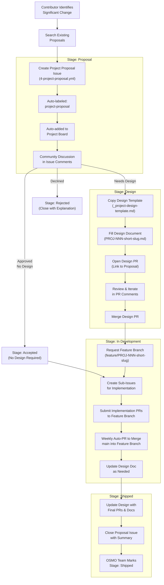
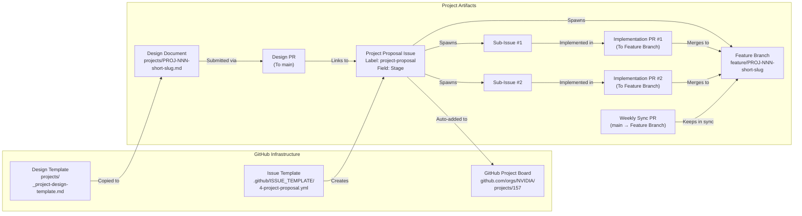
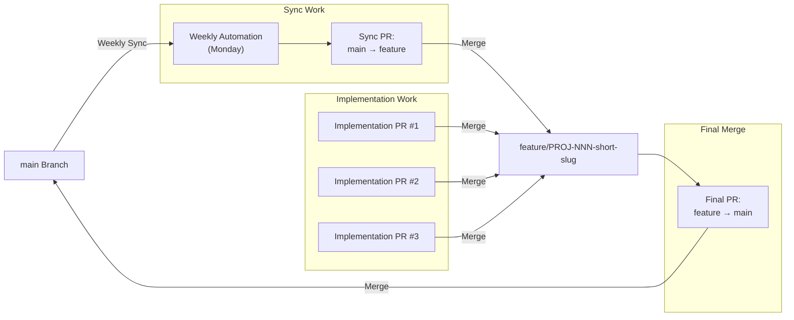
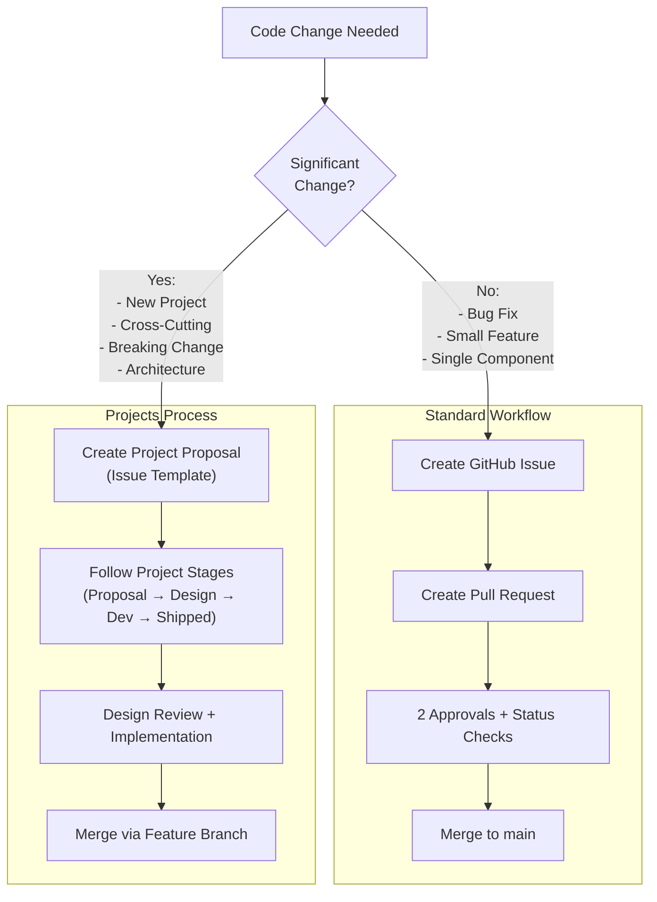

<!-- source: DeepWiki mcp.deepwiki.com · repo NVIDIA/OSMO · page 9.3 Projects Process · fetched 2026-10-26 -->

# Projects Process

<details>
<summary>Relevant source files</summary>

The following files were used as context for generating this wiki page:

- [.github/ISSUE_TEMPLATE/4-project-proposal.yml](.github/ISSUE_TEMPLATE/4-project-proposal.yml)
- [.github/PULL_REQUEST_TEMPLATE.md](.github/PULL_REQUEST_TEMPLATE.md)
- [CONTRIBUTING.md](CONTRIBUTING.md)
- [README.md](README.md)
- [deployments/brev/README.md](deployments/brev/README.md)
- [deployments/brev/setup.sh](deployments/brev/setup.sh)
- [docs/deployment_guide/getting_started/create_storage/s3/index.rst](docs/deployment_guide/getting_started/create_storage/s3/index.rst)
- [projects/README.md](projects/README.md)
- [projects/_project-design-template.md](projects/_project-design-template.md)

</details>


## Purpose and Scope

The Projects Process is a formal workflow for proposing, designing, and implementing significant changes to the OSMO codebase. It provides structured review and documentation for changes that have substantial impact across the system.

This process is **not required** for routine bug fixes or localized feature additions. For standard development workflows including pull request guidelines and code contributions, see [Pull Request Guidelines](#9.4) and the general contributing guide.

**Sources:** [projects/README.md:19-50]()

---

## When to Use a Project Proposal

The Projects Process should be used for:

| Category | Description | Examples |
|----------|-------------|----------|
| **New Projects or Major Features** | Significant additions affecting multiple areas | New workflow templating engine, distributed caching layer |
| **Cross-Cutting Changes** | Modifications spanning multiple components | Authentication system redesign, API versioning strategy |
| **Breaking Changes** | Changes impacting existing APIs, configurations, or workflows | Database schema migrations, configuration format changes |
| **Architectural Decisions** | System design, infrastructure, or technical direction changes | Multi-region deployment support, new scheduling algorithms |

For smaller, localized changes (single component bug fixes, minor enhancements), use standard GitHub issues and pull requests without a formal project proposal.

**Sources:** [projects/README.md:42-50](), [CONTRIBUTING.md:14-22]()

---

## Roles and Responsibilities

| Role | Responsibilities |
|------|------------------|
| **Project Proposal Author** | Opens the project proposal issue; describes the problem, goals, and high-level approach |
| **Person in Charge (PIC)** | Drives the proposal and design through all stages; may be the author or another contributor who takes ownership |
| **Maintainers / OSMO Team** | Review proposals; provide feedback; guide design discussions; approve or reject proposals; manage stage transitions on the project board |

> **Note:** Only OSMO team members can update the **Stage** field in the project board to ensure proper governance and tracking.

**Sources:** [projects/README.md:52-60]()

---

## Projects Process Flow



**Diagram: Complete Projects Process Workflow**

**Sources:** [projects/README.md:23-31](), [projects/README.md:59-158]()

---

## GitHub Artifact Relationships



**Diagram: GitHub Artifacts and Their Relationships**

**Sources:** [projects/README.md:35-39](), [projects/README.md:99-144]()

---

## Stage 1: Proposal (Issue)

### Objective

Propose a new project and gather initial feedback from the community and maintainers.

### Workflow

1. **Search for existing proposals** before creating a new one to avoid duplication. Search issues with the `project-proposal` label.

2. **Create a project proposal issue** using the template at [.github/ISSUE_TEMPLATE/4-project-proposal.yml:1-77](). The issue will automatically:
   - Be labeled with `project-proposal`
   - Be added to the [Project Board](https://github.com/orgs/NVIDIA/projects/157) with **Stage: Proposal**

3. **Discuss and refine** the proposal asynchronously in issue comments:
   - Clarify scope and goals
   - Identify risks and alternatives
   - Determine if a detailed design document is required

### Proposal Issue Fields

| Field | Required | Description |
|-------|----------|-------------|
| **Summary** | Yes | 2-3 sentence overview of the proposal |
| **Person in Charge (PIC)** | Optional | GitHub handle or "Seeking PIC" |
| **Motivation** | Yes | Why should this project be developed? |
| **Problem** | Yes | What problem does this solve? Current situation? |
| **References** | No | Links to related issues, external docs, or similar implementations |

### Stage Outcomes

| Outcome | Next Stage | Action |
|---------|------------|--------|
| **Requires Design** | Design | OSMO team approves proposal and determines design doc is needed; moves issue to **Stage: Design** |
| **Accepted Without Design** | In Development | OSMO team approves proposal for simple changes not requiring detailed design; moves to **Stage: Accepted** |
| **Rejected** | Rejected | OSMO team declines proposal; closes issue with explanation; moves to **Stage: Rejected** |

**Sources:** [projects/README.md:62-92](), [.github/ISSUE_TEMPLATE/4-project-proposal.yml:17-77]()

---

## Stage 2: Design (Markdown)

### Objective

Create a detailed technical design for accepted proposals that are significant or complex.

### Workflow

1. **Copy the design template**:
   ```bash
   cp projects/_project-design-template.md projects/PROJ-NNN-short-slug.md
   ```
   Use the proposal issue number (e.g., `PROJ-123`) and a short, descriptive slug.

2. **Fill out the design document** based on [projects/_project-design-template.md:1-132]():
   - **Overview**: Copy and refine content from the proposal issue
   - **Use Cases**: Document specific scenarios the project addresses
   - **Requirements**: List functional, KPI, and security requirements
   - **Architectural Details**: High-level technical approach with diagrams
   - **Detailed Design**: API designs, data models, component interactions, examples
   - **Alternatives Considered**: Document rejected approaches with pros/cons
   - **Impact Sections**: Backwards compatibility, performance, operations, security, documentation
   - **Testing**: Unit, integration, and end-to-end test strategy
   - **Implementation Plan**: Break project into phases if large

3. **Open a pull request** with the design document:
   - Link to the project proposal issue
   - Invite review from maintainers and community

4. **Review and iterate** on the design:
   - Discuss in PR comments
   - Revise document based on feedback
   - Summarize key decisions back in the proposal issue

5. **Merge the design PR** once approved by reviewers

6. **OSMO team updates stage** to **Stage: Accepted** on the project board

### Design Document Structure

| Section | Purpose |
|---------|---------|
| **Overview** | Mirrors proposal: motivation and problem statement |
| **Use Cases** | Concrete scenarios with descriptions |
| **Requirements** | Functional, KPI, security requirements |
| **Architectural Details** | High-level approach, components, block diagrams |
| **Detailed Design** | APIs, data models, workflows, examples |
| **Alternatives Considered** | Rejected approaches with rationale |
| **Backwards Compatibility** | Breaking change analysis |
| **Performance / Operations / Security** | Impact assessments |
| **Documentation / Testing** | What must be created or updated |
| **Implementation Plan** | Phased breakdown for large projects |
| **Open Questions** | Unresolved decisions |

**Sources:** [projects/README.md:93-120](), [projects/_project-design-template.md:1-132]()

---

## Stage 3: In Development

### Objective

Implement the project according to the approved design.

### Workflow

1. **Create sub-issues** to break the project into concrete implementation tasks
   - Use the implementation plan from the design document
   - Link sub-issues to the main proposal issue

2. **Request a feature branch** if the project requires multiple PRs:
   - Add a comment on the proposal issue asking an OSMO team member to create a feature branch
   - Branch naming: `feature/PROJ-NNN-short-slug` (matches design doc naming)
   - Note: Feature branch creation is restricted to OSMO team members
   - Small projects that fit in a single PR may not need a feature branch

3. **OSMO team updates stage** to **Stage: In Development** on the project board

4. **Submit implementation PRs** against the feature branch:
   - Reference sub-issues in PR descriptions for context
   - Follow standard [Pull Request Guidelines](#9.4)

5. **Keep feature branch synchronized with main**:
   - Automation opens weekly PRs (Mondays) to merge `main` into the feature branch
   - Resolve merge conflicts and merge these sync PRs promptly
   - Ensures feature branch stays compatible with ongoing mainline development

6. **Update the design document** as implementation progresses:
   - Submit PRs to update the design if decisions change or new details emerge
   - Keeps design document accurate and reflects actual implementation

### Feature Branch Workflow



**Diagram: Feature Branch Development and Synchronization**

**Sources:** [projects/README.md:122-144]()

---

## Stage 4: Shipped

### Objective

Mark the project as complete and communicate the outcome.

### Workflow

1. **Update the design document** with implementation results:
   - Add links to all final PRs
   - Link to documentation updates
   - Note any deviations from the original design

2. **Close the project proposal issue** with a summary comment:
   - What was delivered
   - Links to the design document, key PRs, and documentation
   - Any follow-up work or future considerations

3. **OSMO team updates stage** to **Stage: Shipped** on the project board

4. **Release inclusion**: The project will be included in the next OSMO release

### Shipped Summary Template

```markdown
This project has been completed and shipped.

**Delivered:**
- [Brief description of what was implemented]

**Links:**
- Design Document: projects/PROJ-NNN-short-slug.md
- Key PRs: #PR1, #PR2, #PR3
- Documentation: [link to docs]

**Follow-up:**
- [Any remaining work or future considerations]
```

**Sources:** [projects/README.md:146-161]()

---

## Project Board Stages

The [GitHub Project Board](https://github.com/orgs/NVIDIA/projects/157) tracks all project proposals through their lifecycle using the **Stage** field.

| Stage | Description | Who Can Set |
|-------|-------------|-------------|
| **Proposal** | Initial proposal under review; community discussion ongoing | Automatic on issue creation |
| **Design** | Proposal approved; design document being written and reviewed | OSMO team only |
| **Accepted** | Approved for implementation (with or without design doc) | OSMO team only |
| **In Development** | Active implementation in progress | OSMO team only |
| **Shipped** | Implementation complete; included in a release | OSMO team only |
| **Rejected** | Proposal declined; issue closed with explanation | OSMO team only |

> **Governance Note:** Only OSMO team members can modify the Stage field to ensure proper tracking and project governance.

**Sources:** [projects/README.md:59-61](), [projects/README.md:75-92]()

---

## Template Files Reference

### Project Proposal Issue Template

**Location:** [.github/ISSUE_TEMPLATE/4-project-proposal.yml:1-77]()

**Fields:**
- Title format: `Project: <short sentence describing proposal>`
- Labels: Automatically tagged with `project`
- Body sections: Summary, PIC, Motivation, Problem, References

### Project Design Template

**Location:** [projects/_project-design-template.md:1-132]()

**Sections:**
- Metadata: Author, PIC, Proposal Issue link
- Overview: Motivation and Problem (from proposal)
- Use Cases and Requirements tables
- Architectural Details and Detailed Design
- Alternatives, Backwards Compatibility, Performance
- Operations, Security, Documentation, Testing
- Implementation Plan and Open Questions

**Sources:** [.github/ISSUE_TEMPLATE/4-project-proposal.yml:1-77](), [projects/_project-design-template.md:1-132]()

---

## Integration with Standard Contribution Workflow



**Diagram: Decision Tree for Using Projects Process vs Standard Workflow**

The Projects Process is a superset of the standard contribution workflow documented in [Pull Request Guidelines](#9.4). All PRs—whether part of a project or not—require:
- Two OSMO engineer approvals
- Passing status checks
- Resolution of merge conflicts
- Adherence to coding guidelines and commit message format

**Sources:** [projects/README.md:42-50](), [CONTRIBUTING.md:87-109](), [.github/PULL_REQUEST_TEMPLATE.md:1-12]()

---

## Questions and Support

For questions about the Projects Process:
- Ask in the project proposal issue comments
- Reach out to an OSMO maintainer directly
- Reference the [Contributing Guide](https://github.com/NVIDIA/OSMO/blob/main/CONTRIBUTING.md)

**Inspiration:** This process was inspired by [nf-core](https://nf-co.re/docs/contributing/project_proposals) and [Astro](https://github.com/withastro/roadmap) project proposal workflows.

**Sources:** [projects/README.md:162-169](), [CONTRIBUTING.md:1-139]()

---

