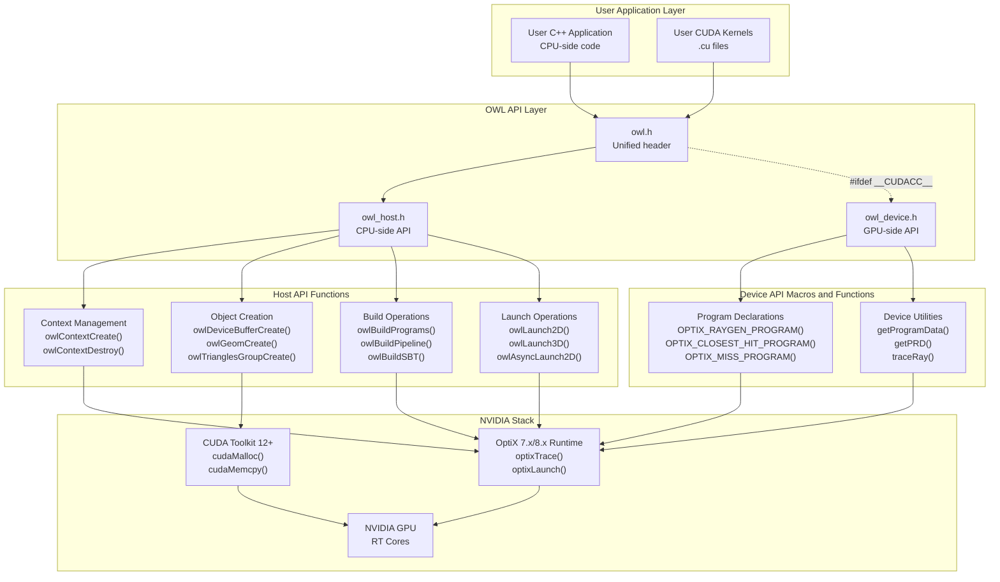
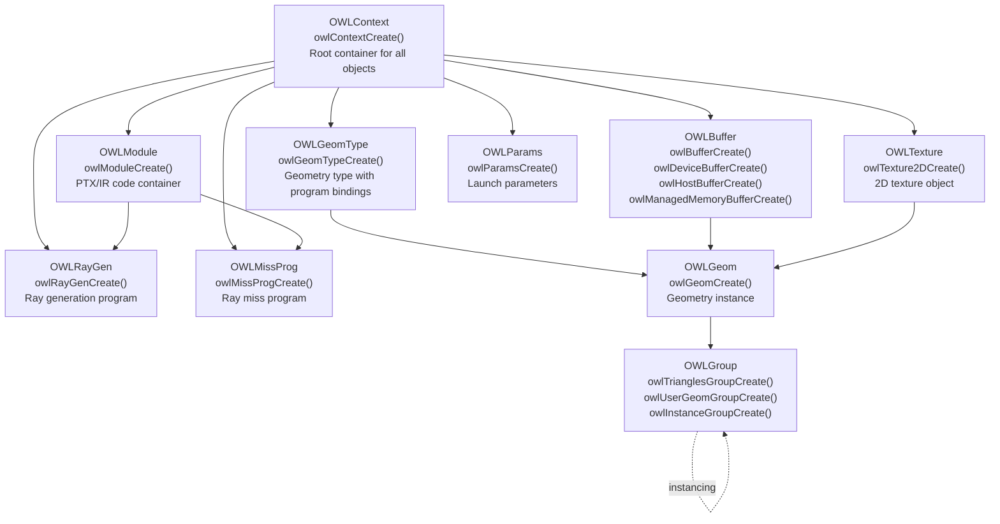
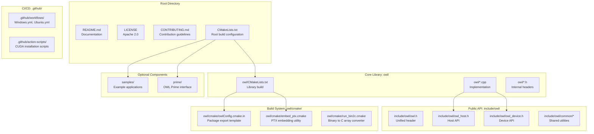

<!-- source: DeepWiki mcp.deepwiki.com · repo NVIDIA/OWL · page 1 Overview · fetched 2026-10-26 -->

# Overview

Relevant source files

The following files were used as context for generating this wiki page:

- [3rdParty.txt](3rdParty.txt)
- [README.md](README.md)
- [include/owl/owl.h](include/owl/owl.h)

This page introduces the OWL (OptiX Wrapper Library) repository, explaining its purpose as a productivity-oriented C++ library for NVIDIA OptiX ray tracing. This overview covers the library's design goals, target users, and high-level architecture. For detailed API reference, see [Host API Reference](#3) and [Device API Reference](#4). For build and integration instructions, see [Getting Started](#2).

## What is OWL

OWL is a convenience and productivity-oriented library built on top of NVIDIA OptiX 7.x and newer. It simplifies OptiX programming by abstracting complex, error-prone tasks that would otherwise require extensive boilerplate code. The library specifically targets two areas of complexity:

1. **Shader Binding Table (SBT) Construction**: OptiX requires manual construction and population of the SBT, a complex data structure that binds shader programs to geometric primitives. OWL automates this with `owlBuildSBT(context)`.

2. **Acceleration Structure Management**: Building, compacting, and refitting BVH acceleration structures involves multiple OptiX API calls and temporary buffer management. OWL provides high-level functions like `owlGroupBuildAccel()` that handle these operations automatically, including BVH compaction.

Beyond these core abstractions, OWL provides higher-level interfaces for buffer management, program compilation, multi-GPU coordination, and pipeline construction compared to raw OptiX and CUDA.

**Sources:** [README.md:8-24]()

## Target Users

OWL targets two primary user groups:

| User Profile | Characteristics | Use Case |
|-------------|-----------------|----------|
| **Entry-Level RTX Users** | Familiar with GPU concepts (device memory, ray tracing pipeline, shader programs, basic CUDA) but not expert in OptiX/Vulkan/DirectX internals | Want to use GPU ray tracing and RTX hardware acceleration without mastering SBT layout, BVH compaction mechanics, async launch details, or refitting specifics |
| **Advanced Users** | Understand low-level OptiX concepts but prefer productivity | Willing to trade minimal low-level control for faster development; prefer to focus on shader logic and application functionality rather than infrastructure code |

Both groups benefit from OWL's ability to mix with manual CUDA code. OWL provides functions to query CUDA device addresses of buffers, `OptixTraversableHandle`s from groups, and CUDA streams from launches, enabling hybrid OWL/CUDA applications (e.g., CUDA-based shading with OWL-based ray tracing).

**Sources:** [README.md:25-141]()

## API Architecture

OWL implements a three-layer architecture that separates host-side application logic from device-side GPU execution:

The header [include/owl/owl.h:1-20]() serves as the unified entry point. It unconditionally includes `owl_host.h` (since CUDA understands full C++), allowing device code to reference host-side types like `OWLContext`. The device API `owl_device.h` is conditionally included only when compiling with `nvcc` (detected via `__CUDACC__`), as it contains CUDA-specific types like `float4`.

**Sources:** [include/owl/owl.h:1-20](), [README.md:8-24]()

## Object Type Hierarchy

OWL uses opaque handle types to represent GPU objects. All handles follow the naming convention `OWL*` and are created through corresponding `owl*Create()` functions:

The object hierarchy flows from `OWLContext` (created via `owlContextCreate()`) to all other resources. Programs are loaded from `OWLModule` objects. Geometries are instantiated from `OWLGeomType` templates that define their associated programs (closest hit, any hit, intersection). `OWLGroup` objects represent acceleration structures: either bottom-level (BLAS, grouping geometries) or top-level (IAS, grouping instances with transforms).

**Sources:** [README.md:63-96]()

## Key Features

OWL supports advanced ray tracing features while maintaining a simplified API:

| Feature Category | Capabilities |
|-----------------|--------------|
| **Instancing** | Multi-level instancing with transforms; instance groups can reference other instance groups |
| **Acceleration Structures** | Automatic BVH compaction; acceleration structure refitting for dynamic scenes |
| **Programs** | Multiple ray generation programs; multiple ray types with distinct miss/hit programs |
| **Motion Blur** | Geometry motion blur; instance motion blur with time-based transforms |
| **Multi-GPU** | Automatic multi-GPU coordination; per-GPU handling of buffers, traversables, and textures |
| **Asynchronous Operations** | Async launches with CUDA stream management |
| **Memory Management** | Multiple buffer types: device, host-pinned, managed, user-provided, graphics interop; buffers of buffers; buffers of traversables; buffers of textures |
| **Textures** | 2D textures with configurable formats and filter modes |
| **Geometry Types** | Triangle meshes, user-defined geometry, curves (OptiX 7.2+), spheres |

**Sources:** [README.md:106-128]()

## Repository Structure

The repository follows a standard CMake project layout. The core library resides in `owl/` with public headers in `include/owl/`. The build system in `owl/cmake/` provides both library builds and utilities for downstream projects (notably `embed_ptx.cmake` for compiling CUDA to PTX). CI/CD workflows in `.github/` test across 10 configurations: 5 Windows (multiple CUDA versions) and 5 Ubuntu (multiple CUDA versions and build types).

**Sources:** [README.md:163-208](), [3rdParty.txt:1-51]()

## Development Status and Version

OWL was first publicly released in early 2019 and has maintained a stable API since then. The current version is **1.2.2**. The library is actively maintained and used in numerous research projects and production applications. Recent development (October 2025) moved the project to the official NVIDIA GitHub repository at `https://github.com/NVIDIA/OWL`.

The library requires:
- OptiX 7.x or 8.x (header shipped with OWL; driver must support OptiX)
- CUDA Toolkit version 12 or newer
- C++17 capable compiler (gcc-11+ on Ubuntu, Visual Studio 2017+ on Windows)

**Sources:** [README.md:143-161](), [README.md:165-172](), [README.md:474-477]()

## Integration Modes

OWL supports two primary integration approaches for downstream projects:

1. **Git Submodule Integration (Recommended)**: Add OWL as a git submodule and use `add_subdirectory()` in CMake with the `EXCLUDE_FROM_ALL` flag. Link against the `owl::owl` target to automatically bring in headers, libraries, and dependencies. See [Integration into Projects](#2.3) for details.

2. **Installed Package Integration**: Build and install OWL to a prefix, then use CMake's `find_package(owl)` to locate the installed package. This approach uses the generated `owlConfig.cmake` files. See [Package System](#5.2) for details.

Both modes provide access to the `embed_ptx.cmake` utility, allowing downstream projects to compile their own CUDA kernels to PTX and embed them as C++ byte arrays (see [PTX Embedding](#5.3)).

**Sources:** [README.md:210-240]()

---

