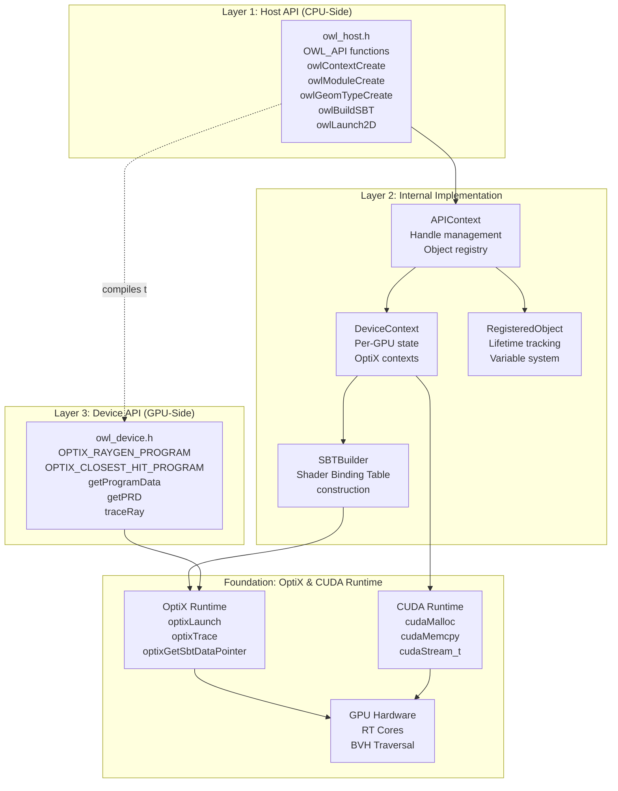
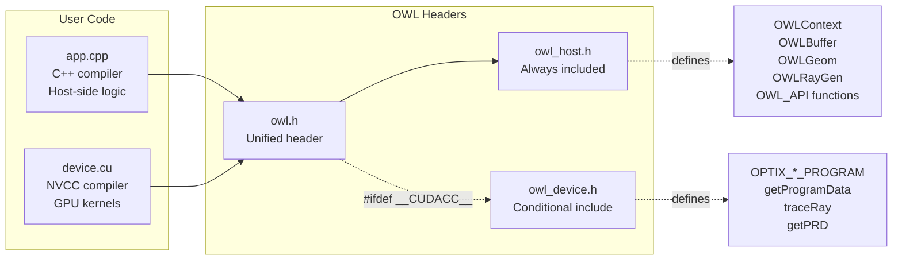
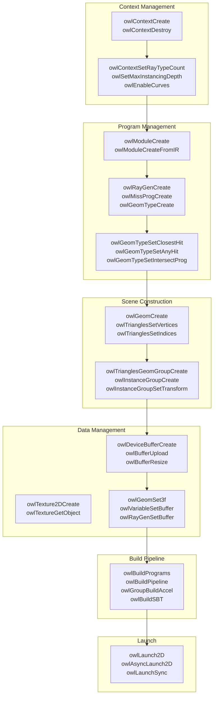
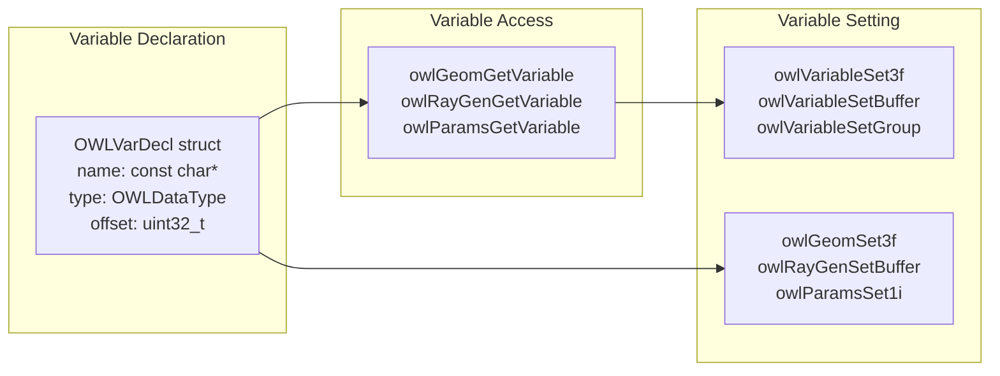
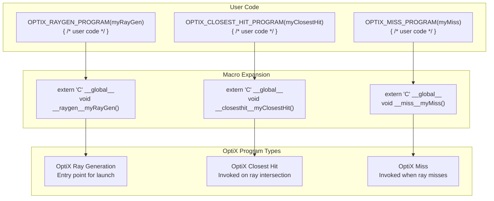
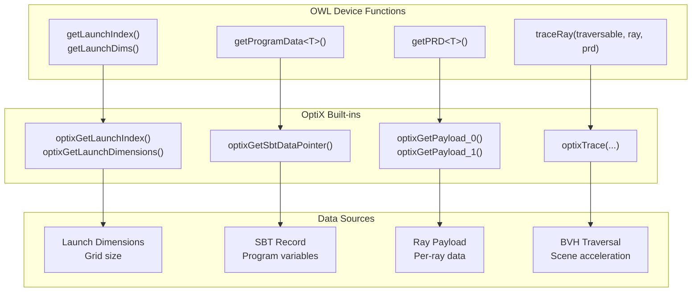
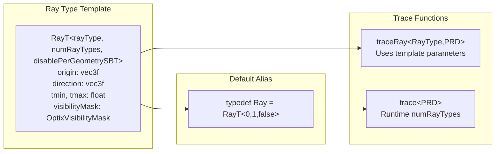
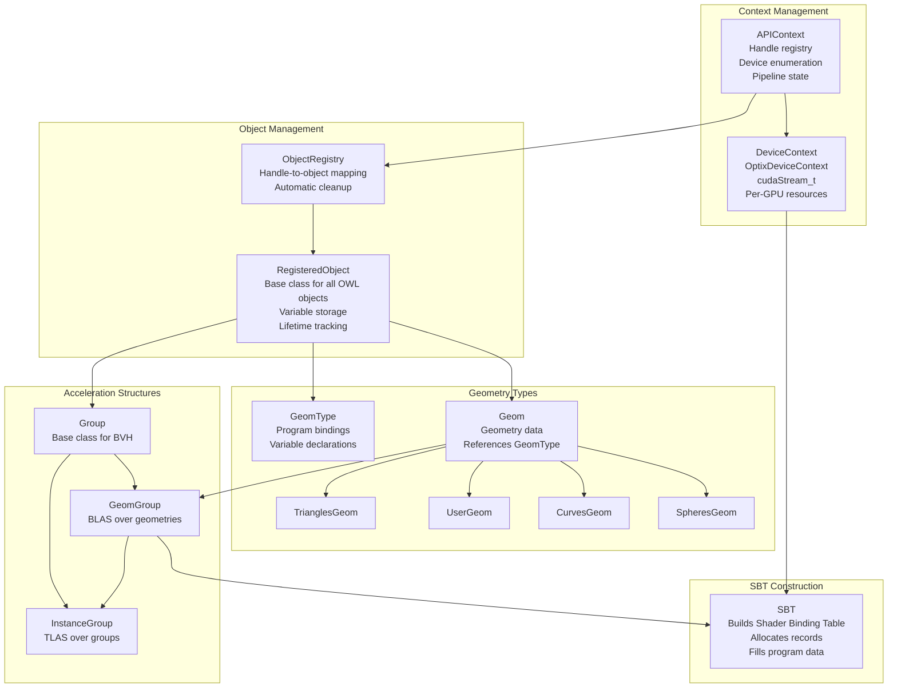
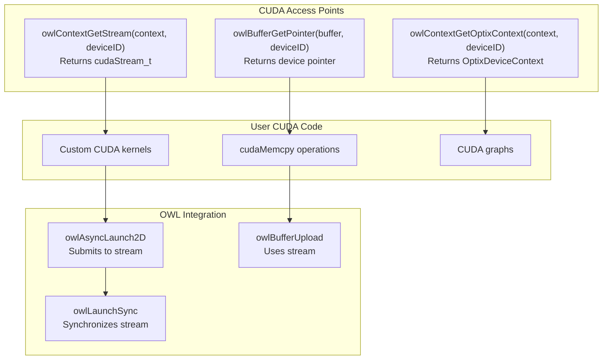

<!-- source: DeepWiki mcp.deepwiki.com · repo NVIDIA/OWL · page 1.1 Architecture Overview · fetched 2026-10-26 -->

# Architecture Overview

Relevant source files

The following files were used as context for generating this wiki page:

- [include/owl/owl.h](include/owl/owl.h)
- [include/owl/owl_device.h](include/owl/owl_device.h)
- [include/owl/owl_host.h](include/owl/owl_host.h)

This document explains OWL's layered architecture, focusing on the separation between CPU-side (Host API) and GPU-side (Device API) interfaces, the internal implementation layer, and how OWL abstracts the underlying OptiX and CUDA runtimes. For specific API functions and their usage, see the Host API Reference ([3](#3)) and Device API Reference ([4](#4)) sections. For build system integration details, see the Build System section ([5](#5)).

## Three-Layer Architecture

OWL follows a three-layer architecture that separates concerns between host code execution, device code execution, and the underlying ray tracing infrastructure:

**Sources:** [include/owl/owl_host.h:1-2500](), [include/owl/owl_device.h:1-374](), [include/owl/owl.h:1-20]()

## Header Organization and Compilation Model

OWL uses a split-header design that adapts to the compilation context:

The unified header [include/owl/owl.h:1-20]() conditionally includes device-side definitions only when compiled with NVCC:

| Compiler Context | Headers Included | Available Types |
|-----------------|------------------|-----------------|
| C++ (g++, MSVC) | `owl_host.h` only | Host API types and functions |
| NVCC | `owl_host.h` + `owl_device.h` | Both host and device APIs |

**Sources:** [include/owl/owl.h:1-20](), [include/owl/owl_host.h:1-55](), [include/owl/owl_device.h:1-23]()

## Host API Layer (CPU-Side)

The Host API provides C-style functions with opaque handle types for managing ray tracing resources on the CPU side.

### Core Handle Types

| Handle Type | Purpose | Creation Function | Release Function |
|------------|---------|------------------|------------------|
| `OWLContext` | Root container, multi-GPU coordinator | `owlContextCreate` | `owlContextDestroy` |
| `OWLModule` | PTX/IR code container | `owlModuleCreate` | `owlModuleRelease` |
| `OWLGeomType` | Geometry type with program bindings | `owlGeomTypeCreate` | N/A |
| `OWLGeom` | Geometry instance | `owlGeomCreate` | `owlGeomRelease` |
| `OWLGroup` | Acceleration structure (BLAS or IAS) | `owlTrianglesGeomGroupCreate`, `owlInstanceGroupCreate` | `owlGroupRelease` |
| `OWLBuffer` | GPU memory allocation | `owlDeviceBufferCreate`, `owlHostPinnedBufferCreate` | `owlBufferRelease` |
| `OWLTexture` | 2D texture | `owlTexture2DCreate` | `owlTexture2DDestroy` |
| `OWLRayGen` | Ray generation program | `owlRayGenCreate` | `owlRayGenRelease` |
| `OWLMissProg` | Miss program | `owlMissProgCreate` | N/A |
| `OWLParams` | Launch parameters | `owlParamsCreate` | N/A |

**Sources:** [include/owl/owl_host.h:310-329](), [include/owl/owl_host.h:331-466]()

### API Function Categories

The Host API [include/owl/owl_host.h:331-2500]() is organized into functional categories:

**Sources:** [include/owl/owl_host.h:331-904]()

### Variable System

OWL provides a flexible variable system for setting parameters on geometry, programs, and launch params:

The variable system supports these data types [include/owl/owl_host.h:94-206]():

| Type Category | OWLDataType Enums | Description |
|--------------|-------------------|-------------|
| Scalar | `OWL_FLOAT`, `OWL_INT`, `OWL_DOUBLE`, `OWL_BOOL` | Basic numeric types |
| Vector | `OWL_FLOAT2/3/4`, `OWL_INT2/3/4`, `OWL_DOUBLE2/3/4` | Vector types |
| Object References | `OWL_BUFFER`, `OWL_GROUP`, `OWL_TEXTURE` | Handles to other OWL objects |
| Special | `OWL_BUFFER_POINTER`, `OWL_RAW_POINTER`, `OWL_DEVICE` | Translated types |
| Matrix | `OWL_AFFINE3F` | 4x3 affine transform |

**Sources:** [include/owl/owl_host.h:258-268](), [include/owl/owl_host.h:1080-1210]()

## Device API Layer (GPU-Side)

The Device API provides macros and inline functions for writing GPU-side ray tracing programs in CUDA.

### Program Declaration Macros

OWL maps user program functions to OptiX entry points using preprocessor macros [include/owl/owl_device.h:244-295]():

| Macro | Expands To | OptiX Program Type | Purpose |
|-------|-----------|-------------------|---------|
| `OPTIX_RAYGEN_PROGRAM` | `__raygen__` prefix | Ray generation | Launch entry point |
| `OPTIX_CLOSEST_HIT_PROGRAM` | `__closesthit__` prefix | Closest hit | Intersection handling |
| `OPTIX_ANY_HIT_PROGRAM` | `__anyhit__` prefix | Any hit | Early intersection testing |
| `OPTIX_MISS_PROGRAM` | `__miss__` prefix | Miss | Ray miss handling |
| `OPTIX_INTERSECT_PROGRAM` | `__intersection__` prefix | Intersection | Custom primitive intersection |
| `OPTIX_BOUNDS_PROGRAM` | `__boundsFunc__` prefix | Bounds | Custom primitive AABB |

**Sources:** [include/owl/owl_device.h:244-295](), [include/owl/owl_device.h:266-295](), [include/owl/owl_device.h:338-373]()

### Device-Side Data Access

Device programs access data through inline functions that wrap OptiX built-ins:

**Key device-side functions:**

| Function | Purpose | Returns | OptiX Equivalent |
|----------|---------|---------|-----------------|
| `getLaunchIndex()` | Current thread coordinates | `vec2i` | `optixGetLaunchIndex()` |
| `getLaunchDims()` | Launch grid dimensions | `vec2i` | `optixGetLaunchDimensions()` |
| `getProgramData<T>()` | SBT record data | `const T&` | `optixGetSbtDataPointer()` |
| `getPRD<T>()` | Per-ray data payload | `T&` | `optixGetPayload_*()` |
| `traceRay(...)` | Trace a ray through scene | void | `optixTrace(...)` |

**Sources:** [include/owl/owl_device.h:28-130](), [include/owl/owl_device.h:156-235]()

### Ray Tracing Template Types

OWL provides a templated `RayT` type [include/owl/owl_device.h:131-153]() for type-safe ray tracing:

**Sources:** [include/owl/owl_device.h:131-235]()

## Internal Implementation Layer

While not directly visible to users, understanding the internal layer helps clarify OWL's abstraction strategy:

### Key Internal Classes

**Sources:** Architecture inferred from [include/owl/owl_host.h:310-329]() handle types and typical OptiX wrapper patterns

## Foundation Layer: OptiX and CUDA

OWL builds directly on the NVIDIA OptiX and CUDA runtimes:

### OptiX Abstraction Strategy

| OptiX Complexity | OWL Abstraction | Benefit |
|-----------------|-----------------|---------|
| Manual SBT record layout | Automatic SBT construction via `owlBuildSBT` | Eliminates error-prone manual offset calculations |
| Per-device OptixDeviceContext creation | Single `OWLContext` manages all devices | Simplified multi-GPU coordination |
| Explicit program group creation and linking | Automatic pipeline from `owlBuildPrograms` and `owlBuildPipeline` | Reduces boilerplate |
| Manual acceleration structure memory management | Automatic compaction in `owlGroupBuildAccel` | Optimized memory usage |
| Raw optixTrace calls | Type-safe `traceRay<RayType,PRD>` templates | Compile-time safety |

**Sources:** [include/owl/owl_host.h:331-334]() for build functions, [include/owl/owl_device.h:156-235]() for tracing

### CUDA Integration

OWL exposes CUDA primitives for interoperability:

**Sources:** [include/owl/owl_host.h:448-454]() for stream access, [include/owl/owl_host.h:809-810]() for pointer access

## Build and Launch Pipeline

The typical OWL workflow follows this pipeline:

```mermaid
graph TB
    subgraph "1. Initialization"
        CTX["owlContextCreate()<br/>Create multi-GPU context"]
        RAY_TYPES["owlContextSetRayTypeCount()<br/>Configure ray types"]
    end
    
    subgraph "2. Program Setup"
        MODULE["owlModuleCreate(ptxCode)<br/>Load device programs"]
        GEOM_TYPE["owlGeomTypeCreate()<br/>Define geometry types"]
        SET_PROGS["owlGeomTypeSetClosestHit()<br/>Bind hit programs"]
        RAYGEN["owlRayGenCreate()<br/>Create ray gen program"]
        MISS["owlMissProgCreate()<br/>Create miss program"]
    end
    
    subgraph "3. Scene Construction"
        BUFFERS["owlDeviceBufferCreate()<br/>Allocate vertex/index data"]
        GEOMS["owlGeomCreate()<br/>Create geometry instances"]
        SET_VERTS["owlTrianglesSetVertices()<br/>Configure geometry data"]
        GROUPS["owlTrianglesGeomGroupCreate()<br/>Create BLAS/TLAS"]
    end
    
    subgraph "4. Variable Setting"
        SET_GEOM_VARS["owlGeomSet3f()<br/>Set geometry variables"]
        SET_RAYGEN_VARS["owlRayGenSetBuffer()<br/>Set program variables"]
    end
    
    subgraph "5. Build Pipeline"
        BUILD_PROGS["owlBuildPrograms()<br/>Compile all modules"]
        BUILD_PIPE["owlBuildPipeline()<br/>Link pipeline"]
        BUILD_ACCEL["owlGroupBuildAccel()<br/>Build BVHs"]
        BUILD_SBT["owlBuildSBT()<br/>Generate SBT"]
    end
    
    subgraph "6. Launch"
        LAUNCH["owlLaunch2D(rayGen, w, h, params)<br/>Execute ray tracing"]
    end
    
    CTX --> RAY_TYPES
    RAY_TYPES --> MODULE
    MODULE --> GEOM_TYPE
    GEOM_TYPE --> SET_PROGS
    SET_PROGS --> RAYGEN
    RAYGEN --> MISS
    
    MISS --> BUFFERS
    BUFFERS --> GEOMS
    GEOMS --> SET_VERTS
    SET_VERTS --> GROUPS
    
    GROUPS --> SET_GEOM_VARS
    SET_GEOM_VARS --> SET_RAYGEN_VARS
    
    SET_RAYGEN_VARS --> BUILD_PROGS
    BUILD_PROGS --> BUILD_PIPE
    BUILD_PIPE --> BUILD_ACCEL
    BUILD_ACCEL --> BUILD_SBT
    
    BUILD_SBT --> LAUNCH
```

**Sources:** [include/owl/owl_host.h:331-904]() for all pipeline functions

## Multi-GPU Architecture

OWL automatically manages multiple GPUs through a unified context:

| Aspect | Single-GPU Behavior | Multi-GPU Behavior |
|--------|--------------------|--------------------|
| Context creation | `owlContextCreate(nullptr, 1)` | `owlContextCreate(nullptr, 0)` for all GPUs |
| Buffer allocation | Single device buffer | Replicated buffers across devices |
| Acceleration structures | Single BVH | Replicated BVHs per device |
| Launches | `owlLaunch2D` on device 0 | Automatic distribution or `owlAsyncLaunch2DOnDevice` |
| Streams | Single CUDA stream | Per-device streams via `owlContextGetStream` |

**Sources:** [include/owl/owl_host.h:340-361]() for context creation, [include/owl/owl_host.h:448-454]() for device-specific operations

---

