<!-- source: DeepWiki mcp.deepwiki.com · repo NVIDIA/OWL · page 1.2 Key Concepts · fetched 2026-10-26 -->

# Key Concepts

Relevant source files

The following files were used as context for generating this wiki page:

- [3rdParty.txt](3rdParty.txt)
- [README.md](README.md)
- [include/owl/owl_host.h](include/owl/owl_host.h)
- [owl/APIHandle.h](owl/APIHandle.h)

This page introduces the fundamental concepts required to understand and use OWL effectively. It covers the object model, lifecycle management, the host-device programming split, acceleration structure organization, and the data flow mechanisms that enable GPU ray tracing.

For details on the Host API functions themselves, see [Host API Reference](#3). For information on writing GPU-side device code, see [Device API Reference](#4). For the overall architecture, see [Architecture Overview](#1.1).

---

## Object Model and Lifecycle

OWL organizes ray tracing components into a hierarchy of typed handles that manage GPU resources and OptiX state. All objects are created through an `OWLContext` and follow a reference-counted lifecycle.

### Core Handle Types

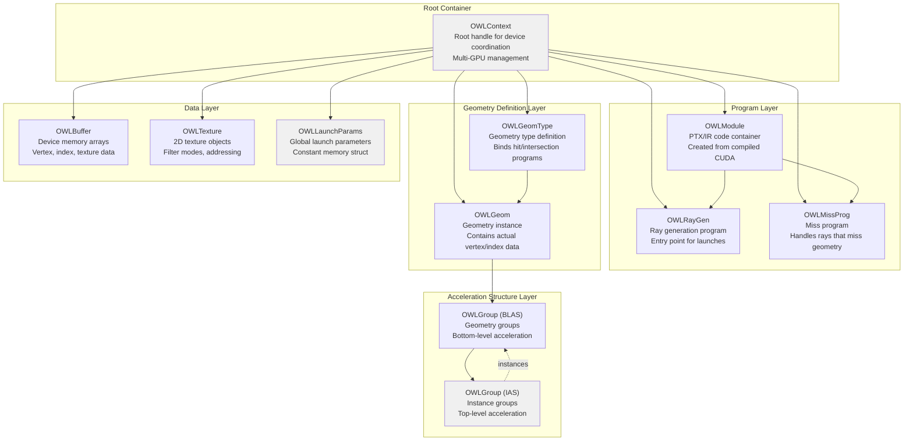

**Handle Types and Their Roles:**

| Handle Type | Definition | Purpose | Key Functions |
|------------|------------|---------|---------------|
| `OWLContext` | [include/owl/owl_host.h:310]() | Root container managing devices and object registry | `owlContextCreate`, `owlContextDestroy` |
| `OWLModule` | [include/owl/owl_host.h:316]() | Compiled PTX/IR code containing device programs | `owlModuleCreate`, `owlModuleCreateFromIR` |
| `OWLRayGen` | [include/owl/owl_host.h:318]() | Ray generation program entry point | `owlRayGenCreate`, `owlLaunch2D` |
| `OWLMissProg` | [include/owl/owl_host.h:319]() | Ray miss handler program | `owlMissProgCreate`, `owlMissProgSet` |
| `OWLGeomType` | [include/owl/owl_host.h:314]() | Geometry type with program bindings | `owlGeomTypeCreate`, `owlGeomTypeSetClosestHit` |
| `OWLGeom` | [include/owl/owl_host.h:313]() | Geometry instance with data | `owlGeomCreate`, `owlTrianglesSetVertices` |
| `OWLGroup` | [include/owl/owl_host.h:317]() | Acceleration structure (BLAS or IAS) | `owlTrianglesGeomGroupCreate`, `owlInstanceGroupCreate` |
| `OWLBuffer` | [include/owl/owl_host.h:311]() | Device memory buffer | `owlDeviceBufferCreate`, `owlBufferUpload` |
| `OWLTexture` | [include/owl/owl_host.h:312]() | 2D texture object | `owlTexture2DCreate`, `owlTextureGetObject` |
| `OWLLaunchParams` | [include/owl/owl_host.h:329]() | Global parameters accessible to all programs | `owlParamsCreate`, `owlParamsSet3f` |

Sources: [include/owl/owl_host.h:310-329](), [README.md:43-104]()

### Object Lifecycle and Reference Counting

All OWL objects are internally reference-counted and managed through shared pointers. The API layer wraps these with opaque handles for C compatibility.

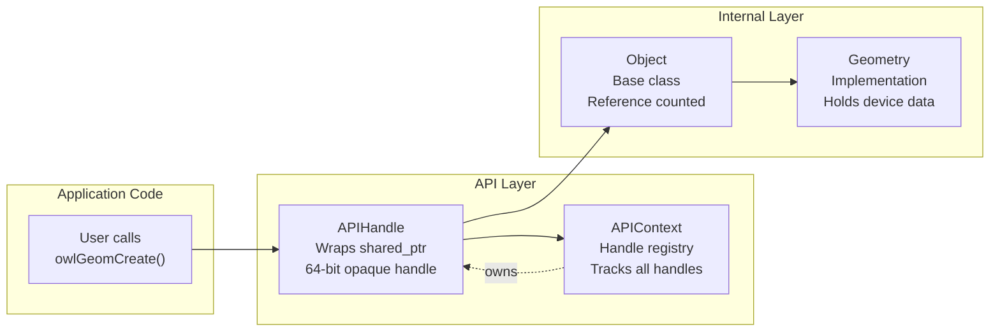

**Key Lifecycle Functions:**

- **Creation:** Objects created via `owl*Create()` functions return handles with initial refcount
- **Release:** Explicit `owlGeomRelease()` decrements app-side refcount
- **Destroy:** `owlBufferDestroy()` forces immediate deallocation (use with caution)
- **Context Destruction:** `owlContextDestroy()` releases all handles in the registry

Sources: [owl/APIHandle.h:12-40](), [include/owl/owl_host.h:468-473]()

---

## Host-Device Programming Model

OWL enforces a strict separation between CPU-side (host) and GPU-side (device) code, mirroring CUDA's programming model but adapted for ray tracing.

### API Split

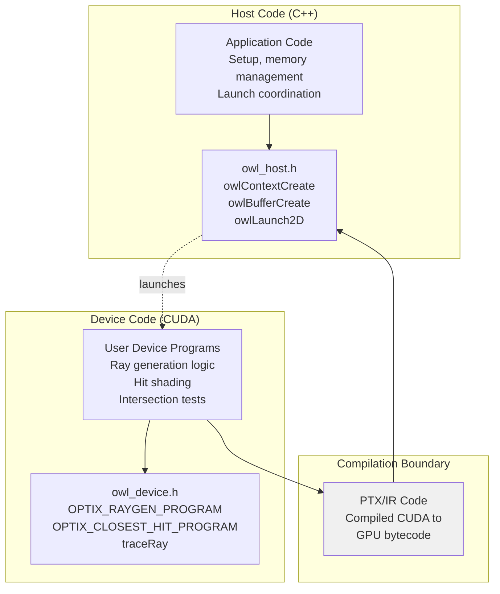

**Host API ([include/owl/owl_host.h:1-1893]()):**
- Context and device management
- Memory allocation (`owlDeviceBufferCreate`, `owlHostPinnedBufferCreate`)
- Object creation (geometries, groups, programs)
- Acceleration structure building (`owlGroupBuildAccel`)
- Variable setting (`owlGeomSet3f`, `owlVariableSetBuffer`)
- Launch operations (`owlLaunch2D`, `owlAsyncLaunch2D`)

**Device API ([include/owl/owl_device.h]()):**
- Program declaration macros (`OPTIX_RAYGEN_PROGRAM`, `OPTIX_CLOSEST_HIT_PROGRAM`)
- Ray tracing functions (`traceRay`, `optixTrace`)
- Data access utilities (`getProgramData`, `getPRD`)
- Launch index queries (`getLaunchIndex`, `getLaunchDims`)

**Compilation Flow:**
1. Device code (`.cu` files) compiled to PTX using `nvcc`
2. PTX loaded into `OWLModule` via `owlModuleCreate(context, ptxCode)`
3. Programs extracted from module by name
4. Programs linked into OptiX pipeline during `owlBuildPipeline()`

Sources: [include/owl/owl_host.h:1-60](), [README.md:10-24]()

---

## Geometry Types and Instances

OWL distinguishes between geometry *types* (which define program bindings) and geometry *instances* (which hold actual data). This separation enables efficient sharing of hit programs across many geometries.

### Geometry Type System

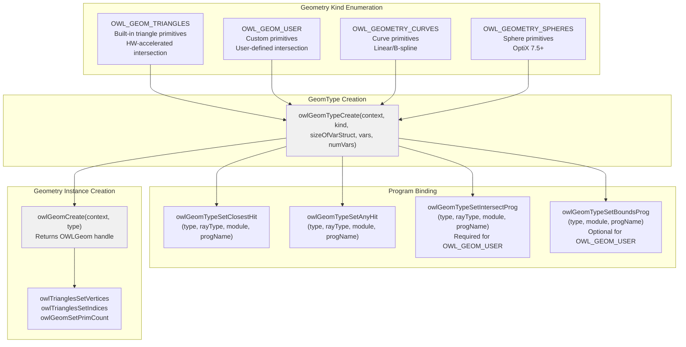

**Geometry Kind Definitions:**

| Kind | Constant | Intersection | Use Cases | Required Functions |
|------|----------|--------------|-----------|-------------------|
| Triangles | `OWL_GEOM_TRIANGLES` | Hardware-accelerated | Triangle meshes | `owlTrianglesSetVertices`, `owlTrianglesSetIndices` |
| User | `OWL_GEOM_USER` | Custom program | Implicit surfaces, procedural | `owlGeomTypeSetIntersectProg`, `owlGeomSetPrimCount` |
| Curves | `OWL_GEOMETRY_CURVES` | OptiX built-in | Hair, cables | `owlCurvesSetDegree`, `owlCurvesSetControlPoints` |
| Spheres | `OWL_GEOMETRY_SPHERES` | OptiX built-in | Particles, atoms | `owlSpheresSetVertices` |

Sources: [include/owl/owl_host.h:207-223](), [include/owl/owl_host.h:691-696](), [include/owl/owl_host.h:468-470]()

---

## Acceleration Structures

OWL implements OptiX's two-level acceleration structure model: bottom-level acceleration structures (BLAS) for geometry and top-level acceleration structures (IAS/TLAS) for instances.

### Two-Level Hierarchy

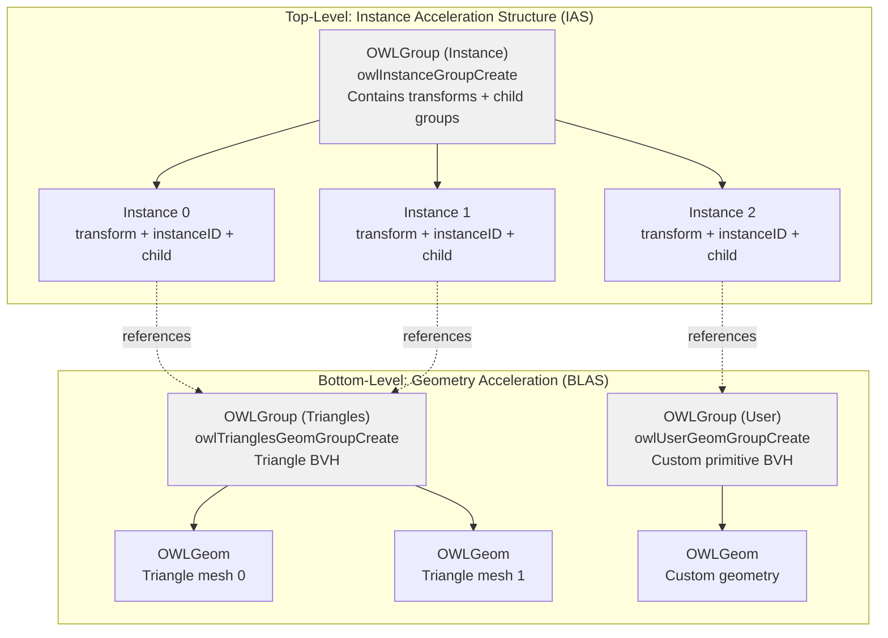

**Key Acceleration Structure Concepts:**

| Concept | Description | OWL Type | Build Function |
|---------|-------------|----------|----------------|
| BLAS (Bottom-Level) | Acceleration structure over geometry primitives | `OWLGroup` created via `owlTrianglesGeomGroupCreate` | `owlGroupBuildAccel(blas)` |
| IAS/TLAS (Top-Level) | Acceleration structure over instances with transforms | `OWLGroup` created via `owlInstanceGroupCreate` | `owlGroupBuildAccel(ias)` |
| Multi-Level Instancing | IAS can instance other IAS (depth configurable) | Same `OWLGroup` handle | `owlSetMaxInstancingDepth(context, depth)` |
| BVH Compaction | Automatic memory optimization after build | Built-in (always enabled) | Automatic during `owlGroupBuildAccel` |
| Refitting | Update acceleration without full rebuild | Same `OWLGroup` | `owlGroupRefitAccel(group)` |

**Build Flags:**

OWL accepts OptiX build flags when creating groups (defaulting to sensible values if `0` is passed):
- `OPTIX_BUILD_FLAG_ALLOW_UPDATE` - Enable refitting
- `OPTIX_BUILD_FLAG_ALLOW_COMPACTION` - Enable compaction (default)
- `OPTIX_BUILD_FLAG_PREFER_FAST_TRACE` - Optimize for trace performance
- `OPTIX_BUILD_FLAG_PREFER_FAST_BUILD` - Optimize for build speed

Sources: [include/owl/owl_host.h:528-665](), [include/owl/owl_host.h:671-672](), [README.md:63-96]()

---

## Shader Binding Table (SBT) Abstraction

The Shader Binding Table is OptiX's mechanism for associating geometry instances with shader programs and per-geometry data. OWL's primary value proposition is automating SBT construction, which is complex and error-prone in raw OptiX.

### SBT Structure and OWL's Automation

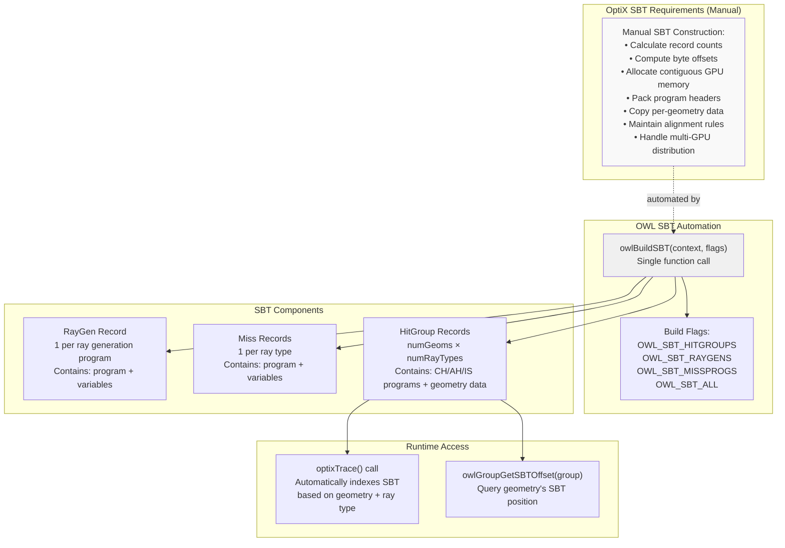

**SBT Record Layout:**

For a scene with N geometries and M ray types, the SBT hitgroup section contains N×M records:

| Record Index | Geometry | Ray Type | Content |
|-------------|----------|----------|---------|
| 0 | Geom 0 | Ray Type 0 | ClosestHit₀, AnyHit₀, Intersection₀, Variables₀ |
| 1 | Geom 0 | Ray Type 1 | ClosestHit₁, AnyHit₁, Intersection₁, Variables₀ |
| ... | ... | ... | ... |
| M | Geom 1 | Ray Type 0 | ClosestHit₀, AnyHit₀, Intersection₀, Variables₁ |
| M+1 | Geom 1 | Ray Type 1 | ClosestHit₁, AnyHit₁, Intersection₁, Variables₁ |

**Build Pipeline Sequence:**

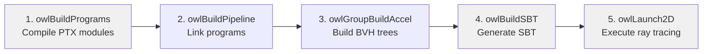

Sources: [include/owl/owl_host.h:331-334](), [README.md:10-18](), [include/owl/owl_host.h:688-689]()

---

## Variable System and Data Flow

OWL provides a type-safe variable system for passing data from host to device. Variables can be attached to geometries, programs, and launch parameters, and are automatically populated into the SBT or device memory.

### Variable Declaration and Setting

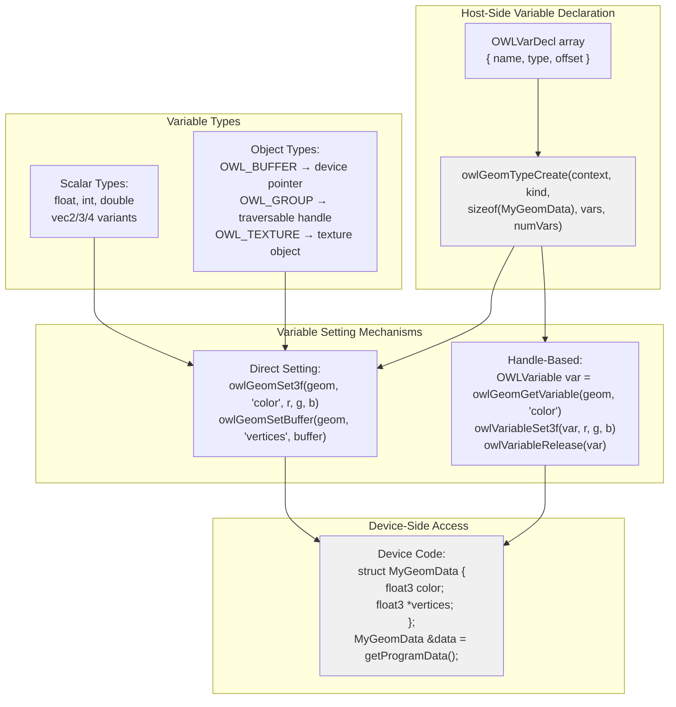

**Variable Type Mapping:**

| Host Type | Device Type | Translation | Example |
|-----------|-------------|-------------|---------|
| `OWL_FLOAT3` | `float3` | Direct copy | `owlGeomSet3f(geom, "color", 1.f, 0.f, 0.f)` |
| `OWL_BUFFER` | `T*` (device pointer) | Resolved at SBT build | `owlVariableSetBuffer(var, vertexBuffer)` |
| `OWL_GROUP` | `OptixTraversableHandle` | Resolved at SBT build | `owlVariableSetGroup(var, instanceGroup)` |
| `OWL_TEXTURE` | `cudaTextureObject_t` | Resolved at SBT build | `owlVariableSetTexture(var, texture)` |
| `OWL_USER_TYPE(T)` | `T` (any struct) | Memcpy of `sizeof(T)` bytes | For custom types |

**Attachment Points:**

Variables can be attached to three categories of objects:

1. **Geometry Variables** - Per-geometry data in SBT hitgroup records
   - Set via `owlGeomSet*()` functions
   - Accessed via `getProgramData<T>()` in hit programs

2. **Program Variables** - Per-program data in SBT raygen/miss records
   - Set via `owlRayGenSet*()` or `owlMissProgSet*()` functions
   - Accessed via `getProgramData<T>()` in respective programs

3. **Launch Parameters** - Global data in CUDA constant memory
   - Set via `owlParamsSet*()` functions
   - Accessed via `__constant__ MyLaunchParams optixLaunchParams;`

Sources: [include/owl/owl_host.h:258-262](), [include/owl/owl_host.h:1080-1211](), [include/owl/owl_host.h:95-204]()

---

## Ray Types and Program Bindings

OWL supports multiple ray types to enable different shading modes (primary rays, shadow rays, ambient occlusion, etc.) within a single pipeline. Each geometry type can bind different programs per ray type.

### Ray Type Configuration

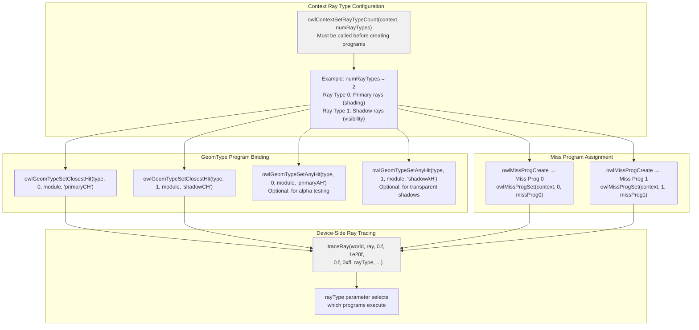

**Program Type Mapping:**

| Program Type | Host Binding Function | Device Macro | When Executed |
|--------------|----------------------|--------------|---------------|
| Ray Generation | `owlRayGenCreate` | `OPTIX_RAYGEN_PROGRAM(name)` | Entry point, once per pixel/thread |
| Miss | `owlMissProgSet` | `OPTIX_MISS_PROGRAM(name)` | When ray misses all geometry |
| Closest Hit | `owlGeomTypeSetClosestHit` | `OPTIX_CLOSEST_HIT_PROGRAM(name)` | After traversal, on closest intersection |
| Any Hit | `owlGeomTypeSetAnyHit` | `OPTIX_ANY_HIT_PROGRAM(name)` | During traversal, on each intersection |
| Intersection | `owlGeomTypeSetIntersectProg` | `OPTIX_INTERSECT_PROGRAM(name)` | For user geometries, test ray-primitive |
| Bounds | `owlGeomTypeSetBoundsProg` | Not exposed to device | For user geometries, compute AABB |

Sources: [include/owl/owl_host.h:394-396](), [include/owl/owl_host.h:1031-1056](), [include/owl/owl_host.h:507-511]()

---

## Build Pipeline and Launch Sequence

OWL enforces a specific sequence of build operations to ensure GPU state is properly initialized before ray tracing.

### Required Build Sequence

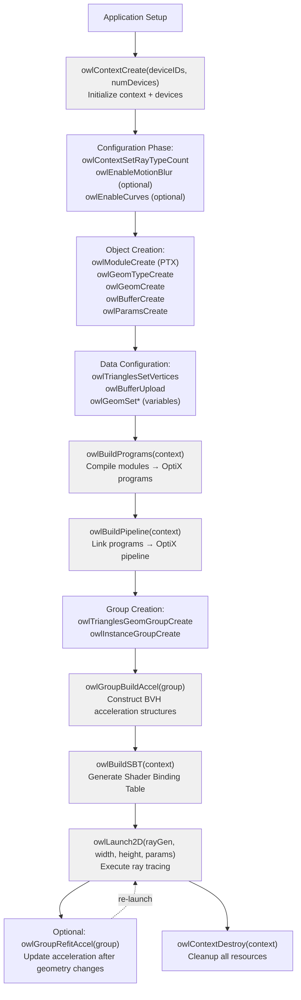

**Critical Ordering Constraints:**

1. **Context Configuration Before Programs:**
   - `owlContextSetRayTypeCount()` must precede program creation
   - `owlEnableMotionBlur()` must precede geometry creation
   - `owlEnableCurves()` must precede pipeline build

2. **Build Programs Before Pipeline:**
   - `owlBuildPrograms()` compiles PTX to OptiX programs
   - `owlBuildPipeline()` links programs (requires compiled programs)

3. **Build Pipeline Before SBT:**
   - SBT generation requires compiled pipeline
   - Cannot build SBT without pipeline

4. **Build Acceleration Before Launch:**
   - `owlGroupBuildAccel()` must complete before SBT build
   - Traversable handles created during acceleration build

5. **SBT Before Launch:**
   - `owlBuildSBT()` must complete before `owlLaunch2D()`
   - Can rebuild SBT independently if only variables change

**Incremental Updates:**

After initial build, certain operations can be updated without full rebuild:

| Update Type | Required Rebuild | Function |
|------------|------------------|----------|
| Variable values | SBT only | `owlBuildSBT(context, flags)` |
| Geometry positions (refit) | Acceleration + SBT | `owlGroupRefitAccel(group)` |
| Geometry topology | Full acceleration + SBT | `owlGroupBuildAccel(group)` |
| Add/remove geometries | Full acceleration + SBT | Rebuild groups |
| Change programs | Pipeline + SBT | `owlBuildPipeline()` |

Sources: [include/owl/owl_host.h:331-334](), [include/owl/owl_host.h:671-672](), [README.md:98-104]()

---

## Multi-GPU Support

OWL provides transparent multi-GPU support through device-replicated objects and per-device data access.

### Device Coordination

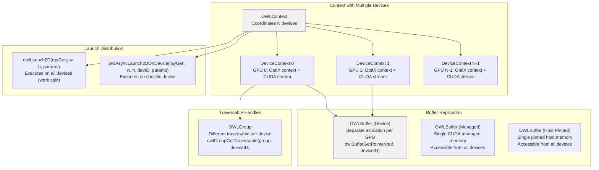

**Device-Specific Queries:**

| Function | Purpose | Returns |
|----------|---------|---------|
| `owlGetDeviceCount(context)` | Query number of devices | Integer count |
| `owlBufferGetPointer(buffer, deviceID)` | Get device-specific pointer | `void*` (device address) |
| `owlGroupGetTraversable(group, deviceID)` | Get device-specific handle | `OptixTraversableHandle` |
| `owlContextGetStream(context, deviceID)` | Get device CUDA stream | `cudaStream_t` |
| `owlContextGetOptixContext(context, deviceID)` | Get device OptiX context | `OptixDeviceContext` |

Sources: [include/owl/owl_host.h:336-338](), [include/owl/owl_host.h:449-454](), [include/owl/owl_host.h:809-813](), [include/owl/owl_host.h:891-895]()

---

