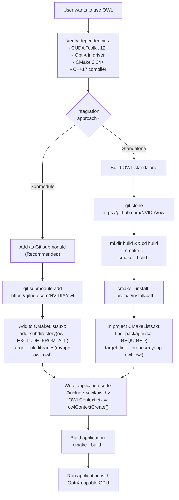
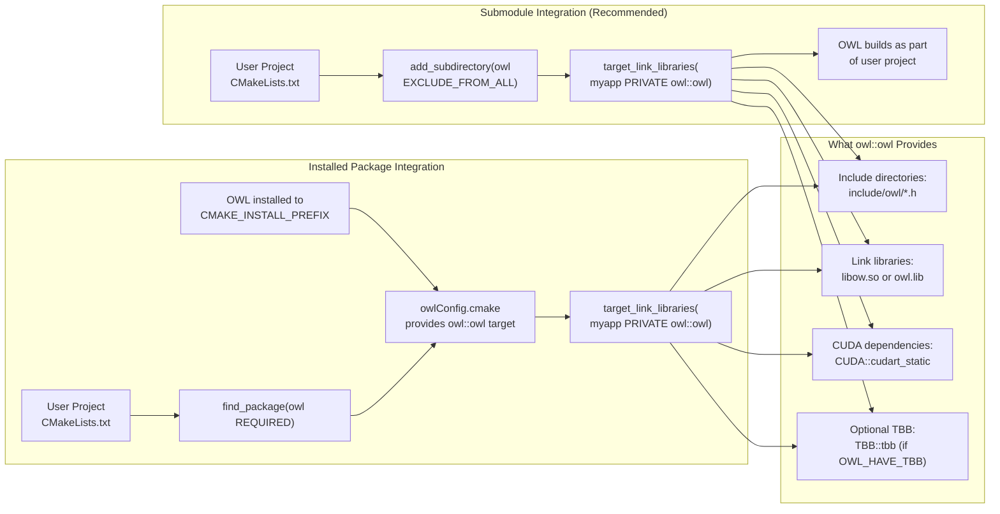
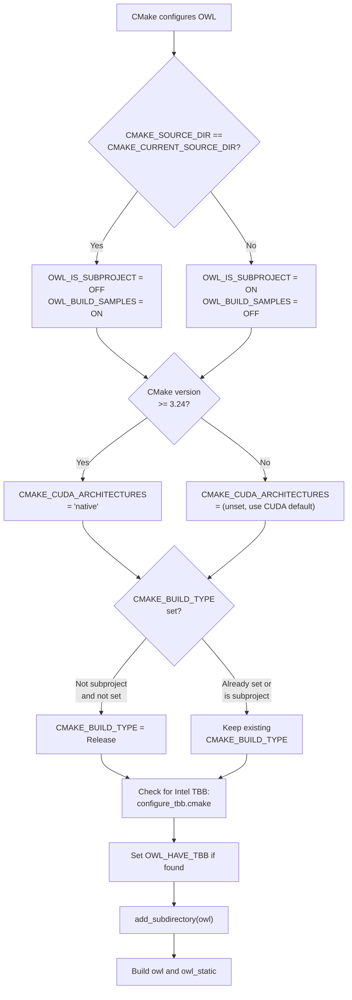

<!-- source: DeepWiki mcp.deepwiki.com · repo NVIDIA/OWL · page 2 Getting Started · fetched 2026-10-26 -->

# Getting Started

<details>
<summary>Relevant source files</summary>

The following files were used as context for generating this wiki page:

- [3rdParty.txt](3rdParty.txt)
- [CMakeLists.txt](CMakeLists.txt)
- [README.md](README.md)

</details>


This document guides users through the initial setup and first steps with OWL (OptiX Wrapper Library). It covers prerequisite dependencies, build procedures, and integration into downstream projects. 

For detailed dependency requirements and platform-specific considerations, see [System Requirements](#2.1). For complete build instructions with configuration options, see [Building from Source](#2.2). For integrating OWL into your own projects, see [Integration into Projects](#2.3).

For understanding OWL's architecture and programming model before beginning, see [Architecture Overview](#1.1) and [Key Concepts](#1.2).

## Overview

OWL simplifies OptiX ray tracing development by abstracting complex operations like Shader Binding Table (SBT) construction, acceleration structure management, and multi-GPU coordination. The library requires NVIDIA hardware with ray tracing support, the OptiX driver, and CUDA Toolkit 12 or newer.

Getting started involves three main steps:

1. **Verify Prerequisites**: Ensure CUDA Toolkit 12+, OptiX driver, and build tools are installed
2. **Obtain OWL**: Clone the repository or add as a Git submodule to your project
3. **Build or Integrate**: Either build OWL standalone or integrate directly into your CMake project

The recommended workflow uses OWL as a Git submodule with CMake's `add_subdirectory()`, avoiding separate installation steps.

## Getting Started Workflow



**Sources**: [README.md:163-241](), [CMakeLists.txt:1-187]()

## Integration Approaches

OWL supports two primary integration methods, both using CMake. The submodule approach is recommended for most users as it requires no installation step and ensures version consistency.



**Sources**: [README.md:210-241](), [CMakeLists.txt:22-26](), [CMakeLists.txt:159-185]()

## CMake Target and Build Options

When OWL is configured via CMake, several key entities control the build and integration:

| Entity | Type | Purpose | Default |
|--------|------|---------|---------|
| `owl::owl` | CMake Target | Primary interface target for linking OWL into applications | N/A |
| `owl::owl_static` | CMake Target | Static library variant (always built) | N/A |
| `OWL_IS_SUBPROJECT` | CMake Variable | Auto-detected; `ON` if OWL is added via `add_subdirectory()` | Auto |
| `OWL_BUILD_SAMPLES` | CMake Option | Whether to build sample programs in `samples/` directory | `ON` if not subproject, else `OFF` |
| `OWL_BUILD_SHARED` | CMake Option | Build shared library (`libow.so`/`owl.dll`) in addition to static | `OFF` |
| `CMAKE_CUDA_ARCHITECTURES` | CMake Variable | GPU architectures to compile for | `"native"` (CMake 3.24+) |

**Sources**: [CMakeLists.txt:22-26](), [CMakeLists.txt:63-70](), [CMakeLists.txt:79-80](), [CMakeLists.txt:159-160]()

## Minimal Example

This minimal example demonstrates the complete workflow for integrating OWL as a submodule:

**Directory structure:**
```
myproject/
├── CMakeLists.txt
├── main.cpp
└── owl/              # git submodule
```

**CMakeLists.txt:**
```cmake
cmake_minimum_required(VERSION 3.24)
project(MyOwlApp LANGUAGES CXX CUDA)

# Add OWL as subdirectory
add_subdirectory(owl EXCLUDE_FROM_ALL)

# Create executable and link OWL
add_executable(myapp main.cpp)
target_link_libraries(myapp PRIVATE owl::owl)
```

**main.cpp:**
```cpp
#include <owl/owl.h>
#include <iostream>

int main() {
    // Create OWL context
    OWLContext context = owlContextCreate(nullptr, 0);
    
    // Query number of GPUs
    int numGPUs = owlGetDeviceCount(context);
    std::cout << "Found " << numGPUs << " OptiX-capable GPUs" << std::endl;
    
    // Clean up
    owlContextDestroy(context);
    return 0;
}
```

**Build commands:**
```bash
mkdir build && cd build
cmake ..
cmake --build .
./myapp
```

**Sources**: [README.md:210-231](), [CMakeLists.txt:36-48]()

## Quick Reference: Common Scenarios

```mermaid
flowchart TD
    subgraph "Scenario 1: First-time User"
        S1Start["Clone OWL repository"]
        S1Build["cd owl && mkdir build<br/>cmake .. && cmake --build ."]
        S1Run["Run samples:<br/>./s01-singleGPU<br/>./s02-multiGPU"]
        
        S1Start --> S1Build --> S1Run
    end
    
    subgraph "Scenario 2: Integrating into Existing Project"
        S2Add["Add as submodule:<br/>git submodule add<br/>https://github.com/NVIDIA/owl"]
        S2CMake["Edit CMakeLists.txt:<br/>add_subdirectory(owl EXCLUDE_FROM_ALL)"]
        S2Link["Link target:<br/>target_link_libraries(myapp owl::owl)"]
        S2Include["Include headers:<br/>#include &lt;owl/owl.h&gt;"]
        
        S2Add --> S2CMake --> S2Link --> S2Include
    end
    
    subgraph "Scenario 3: Installed System Library"
        S3Install["Install OWL:<br/>cmake --install .<br/>--prefix=/usr/local"]
        S3PrefixPath["Set CMAKE_PREFIX_PATH<br/>to install location"]
        S3Find["find_package(owl REQUIRED)"]
        S3Link2["target_link_libraries(myapp owl::owl)"]
        
        S3Install --> S3PrefixPath --> S3Find --> S3Link2
    end
```



**Sources**: [README.md:163-208](), [README.md:210-241]()

## System Configuration Detection

OWL's `CMakeLists.txt` automatically detects and configures several aspects of the build environment:



**Sources**: [CMakeLists.txt:22-26](), [CMakeLists.txt:39-48](), [CMakeLists.txt:50-59](), [CMakeLists.txt:63-70](), [CMakeLists.txt:83-84]()

## Next Steps

After completing the initial setup:

1. **Review System Requirements** ([#2.1](#2.1)): Verify all dependencies and platform-specific details
2. **Build from Source** ([#2.2](#2.2)): Learn about build configuration options and troubleshooting
3. **Integrate into Projects** ([#2.3](#2.3)): Detailed integration patterns and CMake best practices
4. **Explore Host API** ([#3](#3)): Learn the CPU-side API for creating contexts, buffers, and geometries
5. **Study Examples**: Review sample code in the `samples/` directory for complete working examples

For architectural understanding:
- [Architecture Overview](#1.1): Three-layer architecture (Host, Device, OptiX/CUDA)
- [Key Concepts](#1.2): Fundamental OWL programming model concepts

**Sources**: [README.md:1-241](), [CMakeLists.txt:1-187]()

---

