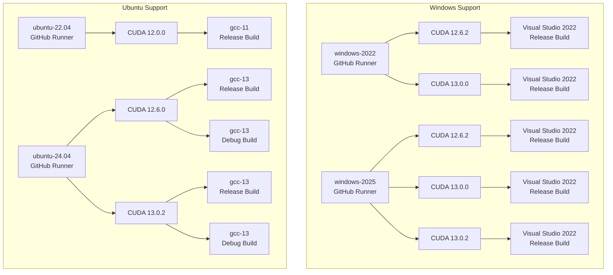

<!-- source: DeepWiki mcp.deepwiki.com · repo NVIDIA/OWL · page 2.1 System Requirements · fetched 2026-10-26 -->

# System Requirements

<details>
<summary>Relevant source files</summary>

The following files were used as context for generating this wiki page:

- [.github/action-scripts/install-cuda-windows.ps1](.github/action-scripts/install-cuda-windows.ps1)
- [.github/action-scripts/install_cuda_ubuntu.sh](.github/action-scripts/install_cuda_ubuntu.sh)
- [3rdParty.txt](3rdParty.txt)
- [CMakeLists.txt](CMakeLists.txt)
- [README.md](README.md)

</details>


This page details the software and hardware requirements for building and running OWL (OptiX Wrapper Library). It covers required dependencies (CUDA, OptiX, compilers, CMake), supported platforms, optional dependencies, and hardware requirements. For information about building OWL from source, see [Building from Source](#2.2). For integration into downstream projects, see [Integration into Projects](#2.3).

## Overview

OWL requires a modern development environment with GPU ray tracing support. The library has been designed to work across Windows and Linux platforms with recent CUDA and OptiX versions. The CI/CD system continuously validates compatibility across multiple configuration combinations.

## Required Dependencies

### CUDA Toolkit

**Version Requirement:** CUDA 12.0 or newer

OWL requires CUDA Toolkit version 12.0 or later. The project is actively tested with CUDA versions 12.0.0 through 13.0.2 across the CI/CD matrix.

**Tested Versions:**
| CUDA Version | Ubuntu 22.04 | Ubuntu 24.04 | Windows 2022 | Windows 2025 |
|--------------|--------------|--------------|--------------|--------------|
| 12.0.0       | ✓            | -            | -            | -            |
| 12.6.0       | -            | ✓            | -            | -            |
| 12.6.2       | -            | ✓            | ✓            | ✓            |
| 13.0.0       | -            | -            | ✓            | ✓            |
| 13.0.2       | -            | ✓            | -            | ✓            |

**Required CUDA Components:**

On Windows, the following CUDA packages are installed by the CI system:
- `nvcc` - CUDA compiler
- `visual_studio_integration` - Visual Studio integration
- `curand_dev` - CUDA Random Number Generation
- `nvrtc_dev` - Runtime compilation
- `cudart` - CUDA runtime
- `cuda_profiler_api` - Profiling support
- Additional packages for CUDA 12.4+: `nvfatbin`
- Additional packages for CUDA 13.0+: `thrust`, `nvptxcompiler`, `nvvm`, `npp`, `cublas`, `cufft`, `cusolver`, `cusparse`, and development variants

On Ubuntu, the following packages are required:
- `cuda-compiler` (or `cuda-nvcc` for CUDA < 9.1)
- `cuda-cudart-dev`
- `cuda-nvtx`
- `cuda-nvrtc-dev`
- `libcurand-dev`
- `cuda-cccl` (CUDA 11.4+, provides CUB and Thrust)

**Verification:**
```bash
nvcc --version
```

Sources: [.github/action-scripts/install-cuda-windows.ps1:72-167](), [.github/action-scripts/install_cuda_ubuntu.sh:11-18](), [README.md:168]()

### OptiX

**Version Requirement:** OptiX 7.0 or newer (driver-level support required)

OWL requires NVIDIA OptiX 7.0 or later. OptiX headers are included in the OWL distribution at [3rdParty/optix/include](). While OWL ships with recent `optix.h` headers, the OptiX runtime must be present in the GPU driver.

**Provided Headers:**
The repository includes OptiX headers under [3rdParty/optix/](). These can be used for compilation, but driver support for OptiX is still required at runtime.

**Custom OptiX Headers:**
To use your own OptiX headers instead of the bundled versions, add your OptiX SDK directory to `CMAKE_PREFIX_PATH` during CMake configuration.

Sources: [README.md:166-167](), [README.md:232-238](), [3rdParty.txt:45-50]()

### C++ Compiler

**Requirement:** C++17-capable compiler

OWL requires a compiler with C++17 support, as specified in [CMakeLists.txt:73-74]():
```cmake
set(CMAKE_CXX_STANDARD 17)
set(CMAKE_CXX_STANDARD_REQUIRED ON)
```

**Supported Compilers:**

| Platform | Compiler | Minimum Version | Tested Configurations |
|----------|----------|-----------------|----------------------|
| Windows  | Visual Studio | 2017 (with CUDA 10.0+) | VS 2022 (CI tested) |
| Windows  | Visual Studio | 2019 (with CUDA 10.1+) | - |
| Windows  | Visual Studio | 2022 (with CUDA 11.6+) | VS 2022 (CI tested) |
| Ubuntu   | GCC | 11 | gcc-11 with CUDA 12.0.0 |
| Ubuntu   | GCC | 13 | gcc-13 with CUDA 12.6.0, 13.0.2 |

**Visual Studio and CUDA Compatibility:**

The CI system enforces minimum CUDA versions for Visual Studio:
- Visual Studio 2022 requires CUDA 11.6.0 or newer
- Visual Studio 2019 requires CUDA 10.1 or newer
- Visual Studio 2017 requires CUDA 10.0 or newer

These constraints are validated in [.github/action-scripts/install-cuda-windows.ps1:63-123]().

Sources: [CMakeLists.txt:73-74](), [.github/action-scripts/install-cuda-windows.ps1:63-68](), [README.md:169-170](), [README.md:189]()

### CMake

**Minimum Version:** 3.24

CMake 3.24 or newer is required, as specified in [CMakeLists.txt:9]():
```cmake
cmake_minimum_required(VERSION 3.24)
```

CMake 3.24 introduced the `native` option for `CMAKE_CUDA_ARCHITECTURES`, which allows automatic detection of the build host's GPU architecture. For earlier CMake versions, no architecture flags are specified, defaulting to CUDA's behavior.

**CUDA Architecture Selection:**

The build system automatically configures CUDA architectures:
```cmake
if (NOT CMAKE_CUDA_ARCHITECTURES)
  if (${CMAKE_VERSION} VERSION_LESS 3.24)
    # cmake < 3.24 doesn't know 'native', so leave it off
  else()
    set(CMAKE_CUDA_ARCHITECTURES "native")
  endif()
endif()
```

Sources: [CMakeLists.txt:9](), [CMakeLists.txt:39-48](), [README.md:179]()

## Platform Support

### Dependency Version Matrix



Sources: [.github/workflows/Windows.yml](), [.github/workflows/Ubuntu.yml]()

### Windows

**Supported Versions:**
- Windows Server 2022 (actively tested)
- Windows 10 and later (expected to work)

**Build Configuration:**
- Visual Studio 2022 (primary tested configuration)
- Visual Studio 2017 and 2019 (supported with appropriate CUDA versions)
- Release build type only in CI (Debug builds supported locally)

**Required Tools:**
- Visual Studio with C++ development tools
- CMake 3.24 or newer
- CUDA Toolkit (see version requirements above)

**CUDA Installation on Windows:**

The CI system uses network installers for CUDA on Windows. The installation process:
1. Downloads CUDA network installer from NVIDIA developer site
2. Installs selected component packages
3. Sets environment variables: `CUDA_PATH`, `CUDA_PATH_V{MAJOR}_{MINOR}`, `NVTOOLSEXT_PATH`
4. Updates `PATH` to include CUDA binaries

The complete installation logic is in [.github/action-scripts/install-cuda-windows.ps1]().

**Building on Windows:**

From command line:
```cmd
mkdir build
cd build
cmake ..
cmake --build . --config Release
```

Sources: [README.md:188-199](), [.github/action-scripts/install-cuda-windows.ps1:1-257]()

### Linux (Ubuntu)

**Supported Versions:**
- Ubuntu 22.04 LTS (with gcc-11, CUDA 12.0.0)
- Ubuntu 24.04 LTS (with gcc-13, CUDA 12.6.0, 13.0.2)
- Ubuntu 18.04, 20.04 (historically supported, no longer in CI)

**Build Configuration:**
- Both Release and Debug builds tested
- gcc-11 or gcc-13 required depending on CUDA version

**Required Packages:**
```bash
sudo apt install cmake cmake-curses-gui build-essential
```

**CUDA Installation on Ubuntu:**

The CI system uses APT repository installation for CUDA on Ubuntu. The process:
1. Downloads and installs CUDA repository pinning file
2. Installs CUDA keyring package
3. Adds CUDA APT repository
4. Installs selected CUDA packages
5. Sets environment variables: `CUDA_PATH`, updates `PATH` and `LD_LIBRARY_PATH`

The complete installation logic is in [.github/action-scripts/install_cuda_ubuntu.sh]().

**Package Name Transformations:**

The Ubuntu installation script handles version-specific package naming:
- CUDA 9.1+: `cuda-compiler` (earlier versions: `cuda-nvcc`)
- CUDA 11.4+: `cuda-cccl` (CUDA 11.3: `cuda-thrust`, earlier: not included)
- CUDA 11.0+: `libcu*` prefix (earlier: `cuda-cu*` prefix)

**Building on Ubuntu:**

```bash
mkdir build
cd build
cmake ..
make
```

Sources: [README.md:175-187](), [.github/action-scripts/install_cuda_ubuntu.sh:1-199]()

## Optional Dependencies

### Intel Threading Building Blocks (TBB)

**Status:** Optional

TBB provides optional CPU parallelism support. When TBB is detected, OWL enables additional parallel processing capabilities on the host side.

**Configuration:**

TBB support is configured via [owl/cmake/configure_tbb.cmake](), included at [CMakeLists.txt:83]():
```cmake
include(owl/cmake/configure_tbb.cmake)
```

When TBB is found, the CMake variable `OWL_HAVE_TBB` is set, which affects:
- Build flags in the OWL library
- Dependency resolution in `owlConfig.cmake` for downstream projects

**Downstream Impact:**

The generated `owlConfig.cmake` conditionally includes TBB as a dependency:
```cmake
find_dependency(TBB) if OWL_HAVE_TBB
```

This ensures that projects linking against OWL will automatically find TBB if it was used during OWL's build.

Sources: [CMakeLists.txt:83](), [owl/cmake/owlConfig.cmake.in]()

### OpenGL

**Status:** Optional (required for viewer samples)

OpenGL is not required for core OWL functionality but is needed for samples with interactive visualization. The README mentions OpenGL as a general requirement, likely for the sample applications rather than the library itself.

Sources: [README.md:171]()

## Hardware Requirements

### GPU Requirements

**Minimum Hardware:**
- NVIDIA GPU with RT Cores (Turing architecture or newer)
- RTX 2000 series or newer (consumer GPUs)
- Quadro RTX series or newer (professional GPUs)
- Tesla T4 or newer (data center GPUs)

**OptiX Support:**
The GPU driver must support OptiX 7.0 or later. This generally requires:
- Driver version 435.80 or newer (for OptiX 7.0)
- More recent drivers recommended for newer OptiX versions

**Architecture Considerations:**

OWL automatically detects and uses the build host's GPU architecture via `CMAKE_CUDA_ARCHITECTURES="native"` when using CMake 3.24+. For cross-compilation or targeting specific architectures, set `CMAKE_CUDA_ARCHITECTURES` explicitly:

```bash
cmake .. -DCMAKE_CUDA_ARCHITECTURES="75;86"  # Turing + Ampere
```

Sources: [CMakeLists.txt:39-48](), [README.md:27-34]()

## Dependency Resolution Flow

```mermaid
graph TB
    subgraph "Build-Time Dependencies"
        CMAKE["CMake 3.24+<br/>cmake_minimum_required"]
        CUDA["CUDA Toolkit 12.0+<br/>LANGUAGES CUDA"]
        CXX["C++17 Compiler<br/>CMAKE_CXX_STANDARD 17"]
        OPTIX["OptiX Headers<br/>3rdParty/optix/include"]
        TBB["Intel TBB<br/>Optional<br/>configure_tbb.cmake"]
    end
    
    subgraph "Runtime Dependencies"
        OPTIX_DRIVER["OptiX Driver<br/>GPU driver support"]
        CUDA_RUNTIME["CUDA Runtime<br/>cudart"]
        TBB_RUNTIME["TBB Runtime<br/>If OWL_HAVE_TBB"]
    end
    
    subgraph "Platform-Specific"
        WINDOWS["Windows<br/>Visual Studio 2017+<br/>CUDA 10.0+ match"]
        UBUNTU["Ubuntu 22.04/24.04<br/>gcc-11/13<br/>build-essential"]
    end
    
    CMAKE --> CUDA
    CMAKE --> CXX
    CMAKE --> OPTIX
    CMAKE --> TBB
    
    CUDA --> CUDA_RUNTIME
    OPTIX --> OPTIX_DRIVER
    TBB --> TBB_RUNTIME
    
    CXX --> WINDOWS
    CXX --> UBUNTU
    
    WINDOWS --> "owlConfig.cmake"
    UBUNTU --> "owlConfig.cmake"
    
    CUDA_RUNTIME --> "Link owl::owl"
    TBB_RUNTIME -.-> "Link owl::owl"
    OPTIX_DRIVER --> "Runtime Execution"
```

Sources: [CMakeLists.txt:9-90](), [owl/cmake/owlConfig.cmake.in]()

## Verification Checklist

Before building OWL, verify your environment meets these requirements:

**Required Components:**
- [ ] CMake 3.24 or newer installed: `cmake --version`
- [ ] CUDA Toolkit 12.0+ installed: `nvcc --version`
- [ ] C++17 compiler available (gcc-11+, VS 2017+, or equivalent)
- [ ] OptiX driver support in GPU driver
- [ ] NVIDIA GPU with RT Cores

**Platform-Specific:**
- [ ] **Windows:** Visual Studio 2017+ with matching CUDA version
- [ ] **Ubuntu:** `build-essential` package installed
- [ ] **Ubuntu:** gcc version compatible with CUDA version

**Optional:**
- [ ] Intel TBB for CPU parallelism
- [ ] OpenGL for viewer samples

**Environment Variables (Auto-configured by installation scripts):**
- `CUDA_PATH` - Points to CUDA installation directory
- `PATH` - Includes CUDA binary directory
- `LD_LIBRARY_PATH` (Linux) - Includes CUDA library directories

Sources: [CMakeLists.txt:9-90](), [.github/action-scripts/install-cuda-windows.ps1:230-255](), [.github/action-scripts/install_cuda_ubuntu.sh:177-198]()

---

