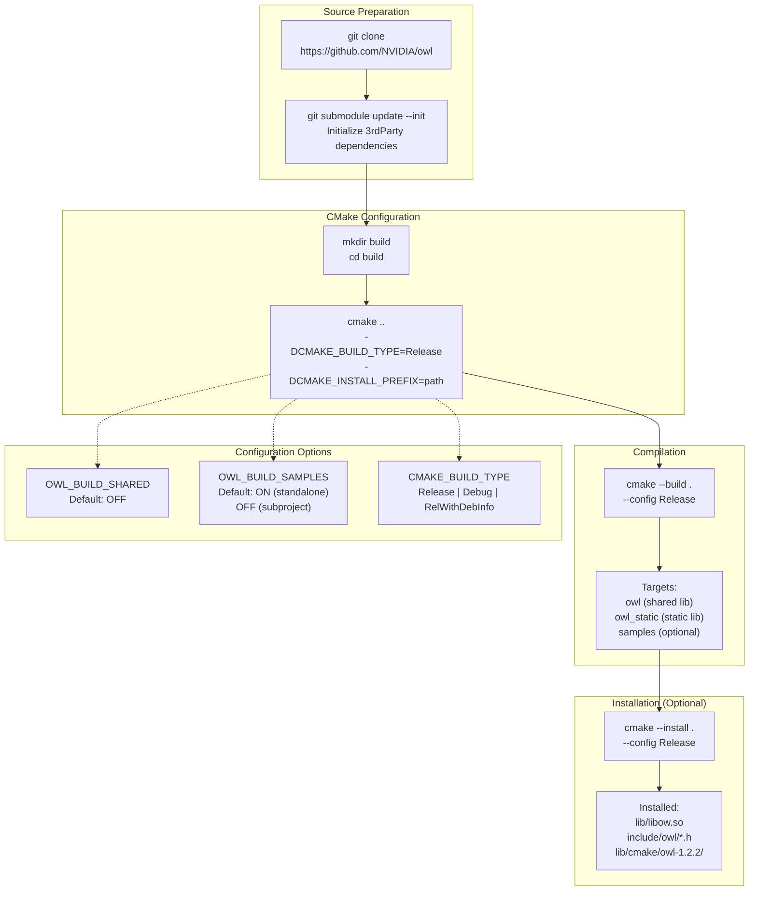
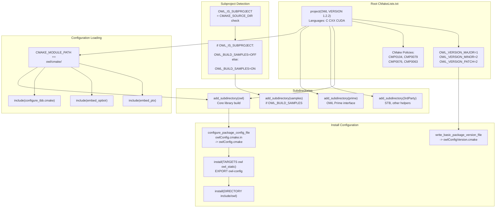
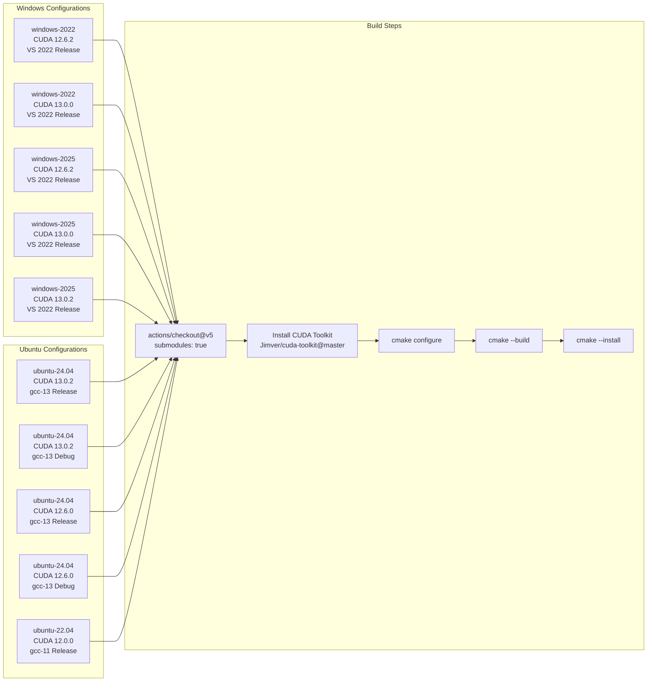

<!-- source: DeepWiki mcp.deepwiki.com · repo NVIDIA/OWL · page 2.2 Building from Source · fetched 2026-10-26 -->

# Building from Source

<details>
<summary>Relevant source files</summary>

The following files were used as context for generating this wiki page:

- [.github/workflows/Ubuntu.yml](.github/workflows/Ubuntu.yml)
- [.github/workflows/Windows.yml](.github/workflows/Windows.yml)
- [3rdParty.txt](3rdParty.txt)
- [CMakeLists.txt](CMakeLists.txt)
- [README.md](README.md)

</details>


This page explains how to compile OWL from source code using CMake. It covers platform-specific build procedures, configuration options, and installation steps. For dependency requirements, see [System Requirements](#2.1). For integrating a built OWL library into downstream projects, see [Integration into Projects](#2.3). For detailed CMake configuration internals, see [CMake Configuration](#5.1).

## Build Process Overview

OWL uses a standard CMake-based build system that produces both shared and static libraries. The build process involves:

1. Cloning the repository with submodules
2. Configuring the build with CMake
3. Compiling with platform-specific toolchains
4. Optionally installing artifacts to a prefix directory

The CI workflows in [.github/workflows/Windows.yml:1-97]() and [.github/workflows/Ubuntu.yml:1-88]() demonstrate the complete build process across multiple platforms and configurations.

### Build Workflow Diagram



**Sources:** [.github/workflows/Windows.yml:52-96](), [.github/workflows/Ubuntu.yml:46-87](), [CMakeLists.txt:1-187]()

## Prerequisites

Before building OWL, ensure the following dependencies are installed on your system:

| Dependency | Minimum Version | Notes |
|------------|----------------|-------|
| **CMake** | 3.24+ | Required for configuration |
| **CUDA Toolkit** | 12.0+ | Versions 12.x and 13.x tested in CI |
| **C++ Compiler** | C++17 capable | gcc-11+, Visual Studio 2022 |
| **OptiX Headers** | 7.x or 8.x | Shipped with OWL in `3rdParty/optix/` |
| **Git** | Any recent version | Required for cloning submodules |

See [System Requirements](#2.1) for detailed dependency information.

**Sources:** [CMakeLists.txt:9-48](), [README.md:165-172]()

## Cloning the Repository

OWL uses Git submodules for third-party dependencies. Clone with submodule initialization:

```bash
git clone https://github.com/NVIDIA/owl.git
cd owl
git submodule update --init --recursive
```

Alternatively, use `--recurse-submodules` during initial clone:

```bash
git clone --recurse-submodules https://github.com/NVIDIA/owl.git
```

The CI workflows use `actions/checkout@v5` with `submodules: true` ([.github/workflows/Windows.yml:52-55](), [.github/workflows/Ubuntu.yml:46-49]()).

**Sources:** [.github/workflows/Windows.yml:52-55](), [.github/workflows/Ubuntu.yml:46-49]()

## Platform-Specific Build Instructions

### Ubuntu / Linux

#### Install Build Dependencies

```bash
sudo apt install cmake cmake-curses-gui build-essential
```

For specific GCC versions tested in CI:

```bash
sudo apt install gcc-11 g++-11  # For ubuntu-22.04
sudo apt install gcc-13 g++-13  # For ubuntu-24.04
```

**Sources:** [README.md:177-179](), [.github/workflows/Ubuntu.yml:66-71]()

#### Configure and Build

Standard Release build:

```bash
mkdir build
cd build
cmake .. -DCMAKE_BUILD_TYPE=Release
cmake --build . --config Release
```

Debug build (used in CI for testing):

```bash
mkdir build
cd build
cmake .. -DCMAKE_BUILD_TYPE=Debug
cmake --build . --config Debug
```

Specify compiler explicitly (as done in CI):

```bash
export CC=/usr/bin/gcc-13
export CXX=/usr/bin/g++-13
export CUDAHOSTCXX=/usr/bin/g++-13
cmake .. -DCMAKE_BUILD_TYPE=Release
cmake --build .
```

**Sources:** [README.md:182-187](), [.github/workflows/Ubuntu.yml:66-82]()

#### Install to Custom Prefix

```bash
mkdir build
cd build
cmake .. -DCMAKE_BUILD_TYPE=Release \
         -DCMAKE_INSTALL_PREFIX=/path/to/install
cmake --build . --config Release
cmake --install . --config Release
```

**Sources:** [.github/workflows/Ubuntu.yml:73-87]()

### Windows

#### Install Build Dependencies

- **Visual Studio 2022** (or 2019) with C++ desktop development workload
- **CUDA Toolkit 12.x or 13.x** from NVIDIA website
- **CMake** 3.24 or newer

The CI workflows test Visual Studio 2022 with multiple CUDA versions ([.github/workflows/Windows.yml:20-45]()).

**Sources:** [README.md:188-191](), [.github/workflows/Windows.yml:20-45]()

#### Configure and Build (Command Line)

Using PowerShell or Command Prompt:

```powershell
mkdir build
cd build
cmake .. -G "Visual Studio 17 2022" -A x64 ^
         -DCMAKE_BUILD_TYPE=Release ^
         -DCMAKE_INSTALL_PREFIX=C:\path\to\install
cmake --build . --config Release
```

**Sources:** [.github/workflows/Windows.yml:81-91](), [README.md:193-199]()

#### Configure and Build (CMake GUI)

1. Open CMake GUI
2. Set **Source Directory**: `path/to/owl`
3. Set **Build Directory**: `path/to/owl/build`
4. Click **Configure**, select **Visual Studio 17 2022**, platform **x64**
5. Adjust options (see Configuration Options below)
6. Click **Generate**
7. Open `build/OWL.sln` in Visual Studio
8. Build the **ALL_BUILD** project in Release configuration

**Sources:** [README.md:191-192]()

#### Install (Windows)

```powershell
cd build
cmake --install . --config Release
```

This installs to `CMAKE_INSTALL_PREFIX`, placing DLLs in `bin/`, import libraries in `lib/`, and headers in `include/owl/`.

**Sources:** [.github/workflows/Windows.yml:93-96](), [README.md:200-207]()

## CMake Configuration Options

The root [CMakeLists.txt:1-187]() defines several configuration options:

### Build Options Table

| Option | Type | Default | Description |
|--------|------|---------|-------------|
| `CMAKE_BUILD_TYPE` | STRING | `Release` | Build configuration: `Release`, `Debug`, `RelWithDebInfo`, `MinSizeRel` |
| `CMAKE_INSTALL_PREFIX` | PATH | System default | Installation directory for libraries and headers |
| `OWL_BUILD_SHARED` | BOOL | `OFF` | Build shared library (`ON`) or static library (`OFF`) |
| `OWL_BUILD_SAMPLES` | BOOL | `ON` (standalone)<br/>`OFF` (subproject) | Include sample programs in build |
| `CMAKE_CUDA_ARCHITECTURES` | STRING | `native` (CMake 3.24+) | Target GPU architectures; auto-detected if not set |

**Sources:** [CMakeLists.txt:28-80]()

### Configuration Option Details

#### OWL_BUILD_SHARED

Controls whether OWL is built as a shared library (`.so`/`.dll`) or static library (`.a`/`.lib`):

```cmake
cmake .. -DOWL_BUILD_SHARED=ON  # Build libow.so / owl.dll
cmake .. -DOWL_BUILD_SHARED=OFF # Build libow_static.a / owl_static.lib (default)
```

Both targets are always built; this option sets `BUILD_SHARED_LIBS` to determine the default `owl::owl` target linkage ([CMakeLists.txt:79-80]()).

**Sources:** [CMakeLists.txt:79-80]()

#### OWL_BUILD_SAMPLES

Controls sample program compilation:

```cmake
cmake .. -DOWL_BUILD_SAMPLES=ON  # Build samples/ directory
cmake .. -DOWL_BUILD_SAMPLES=OFF # Skip samples
```

When OWL is used as a subproject (`OWL_IS_SUBPROJECT=ON`), samples are automatically disabled ([CMakeLists.txt:63-70]()).

**Sources:** [CMakeLists.txt:63-70](), [CMakeLists.txt:108-110]()

#### CMAKE_CUDA_ARCHITECTURES

Specifies target NVIDIA GPU architectures:

```cmake
# Auto-detect local GPU (default for CMake 3.24+)
cmake .. # Uses CMAKE_CUDA_ARCHITECTURES=native

# Target specific architectures
cmake .. -DCMAKE_CUDA_ARCHITECTURES="75;86;89"

# Target all major architectures
cmake .. -DCMAKE_CUDA_ARCHITECTURES="all-major"
```

If not specified, CMake 3.24+ defaults to `native`, detecting the build system's GPU ([CMakeLists.txt:39-48]()).

**Sources:** [CMakeLists.txt:39-48]()

### Subproject Detection

OWL automatically detects when used as a CMake subproject via `add_subdirectory()`:

```cmake
if (NOT (${CMAKE_CURRENT_SOURCE_DIR} STREQUAL ${CMAKE_SOURCE_DIR}))
  set(OWL_IS_SUBPROJECT ON)
else()
  set(OWL_IS_SUBPROJECT OFF)
endif()
```

When `OWL_IS_SUBPROJECT=ON`:
- Samples are disabled by default
- Output directories are not redirected
- `CMAKE_MODULE_PATH` is propagated to parent scope

**Sources:** [CMakeLists.txt:22-70]()

## Build System Architecture

### CMake Project Structure Diagram



**Sources:** [CMakeLists.txt:1-187]()

## Build Targets

The OWL build system produces the following targets:

### Library Targets

| Target | Type | Description | Output |
|--------|------|-------------|--------|
| `owl` | Library | Main OWL library (shared or static based on `OWL_BUILD_SHARED`) | `libow.so` / `owl.dll` / `libow_static.a` |
| `owl_static` | Static Library | Always static variant | `libow_static.a` / `owl_static.lib` |
| `owl::owl` | Alias | CMake namespace alias for consumption | Links to `owl` |

Both targets are always built ([CMakeLists.txt:159]()). The `owl::owl` namespace alias is used in downstream projects via `target_link_libraries()`.

**Sources:** [CMakeLists.txt:159-175]()

### Sample Targets

When `OWL_BUILD_SAMPLES=ON`, the `samples/` subdirectory builds example programs demonstrating OWL usage. These are not installed.

**Sources:** [CMakeLists.txt:108-110]()

## Installation Layout

Running `cmake --install` creates the following directory structure:

```
${CMAKE_INSTALL_PREFIX}/
├── bin/                          (Windows only)
│   └── owl.dll                   (if OWL_BUILD_SHARED=ON)
├── lib/
│   ├── libow.so                  (Linux, if OWL_BUILD_SHARED=ON)
│   ├── libow_static.a            (Linux static)
│   ├── owl_static.lib            (Windows static)
│   └── cmake/
│       └── owl-1.2.2/
│           ├── owlConfig.cmake
│           ├── owlConfigVersion.cmake
│           ├── owl-config.cmake  (exported targets)
│           ├── embed_ptx.cmake
│           └── run_bin2c.cmake
└── include/
    └── owl/
        ├── owl.h
        ├── owl_host.h
        ├── owl_device.h
        └── optix/
            └── include/          (OptiX headers)
```

**Sources:** [CMakeLists.txt:122-185]()

### Installation Components

The installation includes:

1. **Libraries** ([CMakeLists.txt:161-171]()): Both shared and static variants
2. **Headers** ([CMakeLists.txt:177-184]()): Public API from `include/owl/` and bundled OptiX headers
3. **CMake Package Files** ([CMakeLists.txt:142-149]()): `owlConfig.cmake`, version file, and utility scripts
4. **Build Utilities** ([CMakeLists.txt:145-146]()): `embed_ptx.cmake` and `run_bin2c.cmake` for downstream PTX embedding

The CMake package files enable downstream projects to locate OWL via `find_package(owl)`. See [Integration into Projects](#2.3) for usage.

**Sources:** [CMakeLists.txt:122-185]()

## CI Build Matrix

The OWL continuous integration system validates builds across multiple configurations:

### CI Configuration Matrix Diagram



**Sources:** [.github/workflows/Windows.yml:16-45](), [.github/workflows/Ubuntu.yml:16-40]()

### Tested Configurations Summary

| Platform | OS Versions | CUDA Versions | Compilers | Build Types |
|----------|-------------|---------------|-----------|-------------|
| **Windows** | 2022, 2025 | 12.6.2, 13.0.0, 13.0.2 | Visual Studio 2022 | Release only |
| **Ubuntu** | 22.04, 24.04 | 12.0.0, 12.6.0, 13.0.2 | gcc-11, gcc-13 | Release, Debug |

All configurations use `fail-fast: false` to report all build failures rather than stopping at the first failure ([.github/workflows/Windows.yml:17](), [.github/workflows/Ubuntu.yml:17]()).

**Sources:** [.github/workflows/Windows.yml:16-45](), [.github/workflows/Ubuntu.yml:16-40]()

## Build Verification

After building, verify the build succeeded:

### Check Built Libraries

**Linux:**
```bash
ls build/libow*.{so,a}
# Expected output:
# build/libow.so (if OWL_BUILD_SHARED=ON)
# build/libow_static.a
```

**Windows:**
```powershell
dir build\Release\owl*.{dll,lib}
# Expected output:
# build\Release\owl.dll (if OWL_BUILD_SHARED=ON)
# build\Release\owl.lib (import library)
# build\Release\owl_static.lib
```

### Check Installed Files

After `cmake --install`:

```bash
tree $CMAKE_INSTALL_PREFIX
# Verify presence of:
# - lib/libow* or bin/owl.dll
# - include/owl/owl.h
# - lib/cmake/owl-1.2.2/owlConfig.cmake
```

### Test with Sample Program

If `OWL_BUILD_SAMPLES=ON`, verify samples build:

```bash
ls build/samples/
# Should show compiled sample executables
```

**Sources:** [CMakeLists.txt:108-110]()

## Troubleshooting

### Common Build Issues

| Issue | Solution |
|-------|----------|
| **CMake version too old** | Upgrade to CMake 3.24+; OWL requires modern CMake policies ([CMakeLists.txt:9]()) |
| **CUDA not found** | Ensure CUDA Toolkit installed and `nvcc` in `PATH`; set `CMAKE_CUDA_COMPILER` if needed |
| **Submodules not initialized** | Run `git submodule update --init --recursive` |
| **OptiX headers missing** | OptiX headers shipped in `3rdParty/optix/`; no separate OptiX SDK installation needed for building |
| **C++17 not supported** | Use gcc-11+, MSVC 2017+, or other C++17-capable compiler ([CMakeLists.txt:73-74]()) |
| **Link errors on Windows** | Ensure building for x64 (`-A x64`), not x86; check Visual Studio platform selection |

**Sources:** [CMakeLists.txt:9](), [CMakeLists.txt:73-74](), [README.md:165-207]()

### Verbose Build Output

For detailed build diagnostics:

```bash
# Linux/macOS
cmake --build . --config Release -- VERBOSE=1

# Windows
cmake --build . --config Release -- /v:detailed
```

### Clean Rebuild

If encountering persistent issues:

```bash
rm -rf build/
mkdir build
cd build
cmake .. -DCMAKE_BUILD_TYPE=Release
cmake --build .
```

**Sources:** [.github/workflows/Windows.yml:81-91](), [.github/workflows/Ubuntu.yml:73-82]()

---

