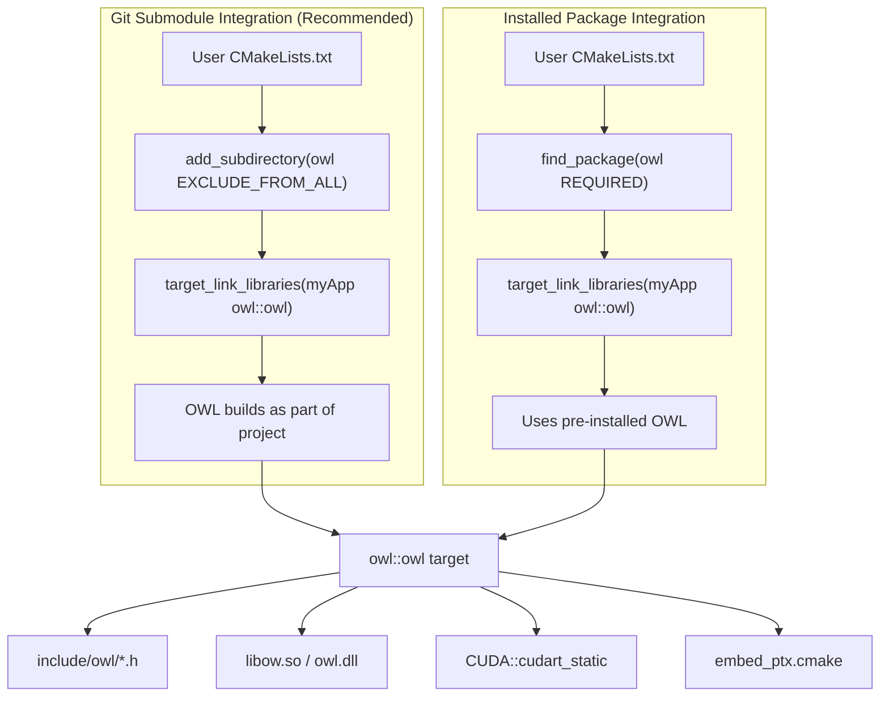
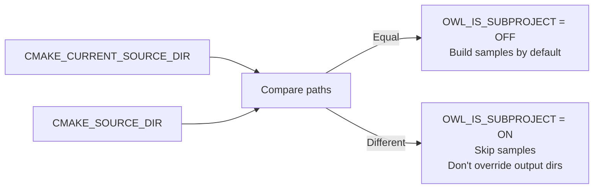
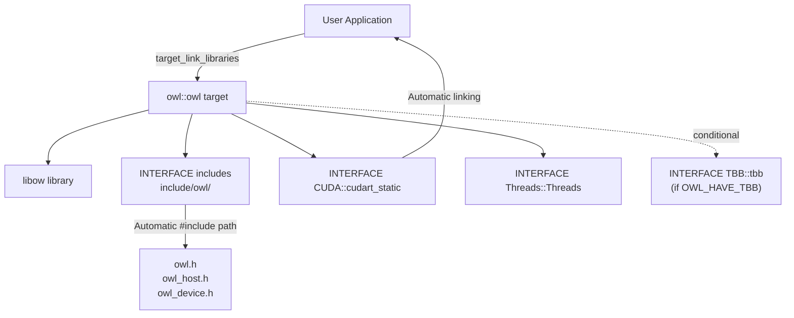
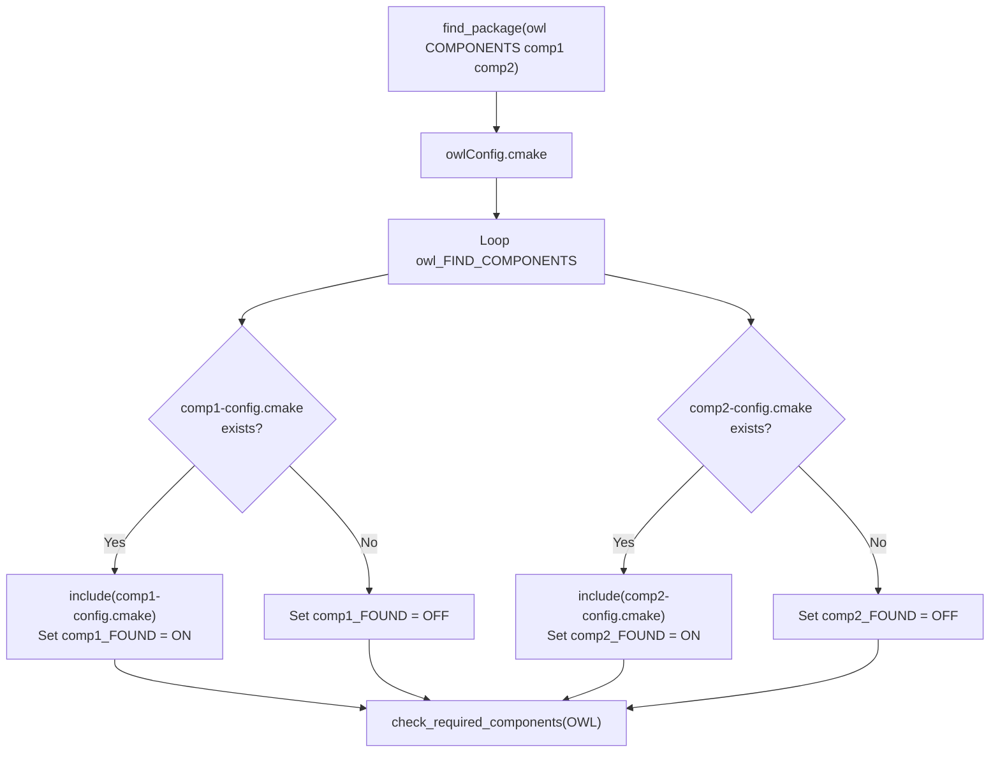

<!-- source: DeepWiki mcp.deepwiki.com · repo NVIDIA/OWL · page 2.3 Integration into Projects · fetched 2026-10-26 -->

# Integration into Projects

<details>
<summary>Relevant source files</summary>

The following files were used as context for generating this wiki page:

- [3rdParty.txt](3rdParty.txt)
- [CMakeLists.txt](CMakeLists.txt)
- [README.md](README.md)
- [owl/cmake/owlConfig.cmake.in](owl/cmake/owlConfig.cmake.in)

</details>


This page explains how to integrate the OWL library into downstream CMake projects. It covers the two primary integration methods: Git submodule integration (recommended) and installed package integration. Both approaches use CMake's target-based dependency management to automatically handle transitive dependencies and include paths.

For information about building OWL itself from source, see [Building from Source](#2.2). For details on the CMake package configuration system, see [Package System](#5.2). For details on compiling device code to PTX, see [PTX Embedding](#5.3).

---

## Integration Modes Overview

OWL supports two integration patterns, each suited to different project workflows. The submodule approach builds OWL as part of your project, while the installed package approach consumes a pre-built installation.

**Comparison of Integration Modes**



**Sources:** [CMakeLists.txt:22-26](), [README.md:210-239](), [owl/cmake/owlConfig.cmake.in:1-50]()

---

## Git Submodule Integration (Recommended)

The recommended integration method uses Git submodules with CMake's `add_subdirectory()`. This approach builds OWL alongside your project, ensuring consistent compiler flags and build configuration.

### Project Structure

```
my-owl-project/
├── CMakeLists.txt
├── src/
│   └── main.cpp
├── device/
│   └── kernels.cu
└── external/
    └── owl/               # Git submodule
        ├── CMakeLists.txt
        ├── owl/
        └── include/
```

### CMakeLists.txt Configuration

The minimal configuration requires two CMake commands: `add_subdirectory()` to incorporate OWL's build system and `target_link_libraries()` to link against the `owl::owl` target.

```cmake
cmake_minimum_required(VERSION 3.24)
project(MyOwlApp LANGUAGES C CXX CUDA)

# Add OWL as a subdirectory
# EXCLUDE_FROM_ALL prevents building OWL samples/tests
add_subdirectory(external/owl EXCLUDE_FROM_ALL)

# Define your application
add_executable(myOwlApp src/main.cpp)

# Link against OWL - this brings in all necessary dependencies
target_link_libraries(myOwlApp PRIVATE owl::owl)
```

**Sources:** [README.md:210-230](), [CMakeLists.txt:22-26]()

### Subproject Detection

OWL automatically detects when it is being built as a subproject and adjusts its behavior accordingly. When `OWL_IS_SUBPROJECT` is true, sample building is disabled by default and CMake output directories are not overridden.



**Sources:** [CMakeLists.txt:22-26](), [CMakeLists.txt:50-70](), [CMakeLists.txt:102-106]()

---

## Installed Package Integration

For projects that prefer to use a pre-installed OWL library, the standard CMake package discovery mechanism is supported. This requires installing OWL to a specific prefix and then pointing CMake to that location.

### Installation Process

First, build and install OWL to a chosen installation prefix:

```bash
# Build OWL
mkdir build
cd build
cmake .. -DCMAKE_INSTALL_PREFIX=/path/to/install
cmake --build . --config Release

# Install to the prefix location
cmake --install . --config Release
```

### Installed Directory Structure

The installation creates a standard CMake package layout:

```
/path/to/install/
├── lib/
│   ├── libow.so              # Shared library (or owl.dll on Windows)
│   ├── libow_static.a        # Static library
│   └── cmake/
│       └── owl-1.2.2/
│           ├── owlConfig.cmake
│           ├── owlConfigVersion.cmake
│           ├── owl-config.cmake       # Target definitions
│           ├── embed_ptx.cmake
│           └── run_bin2c.cmake
├── include/
│   └── owl/
│       ├── owl.h
│       ├── owl_host.h
│       ├── owl_device.h
│       └── optix/           # Bundled OptiX headers
└── bin/
    └── owl.dll              # Windows only
```

**Sources:** [CMakeLists.txt:122-185]()

### CMakeLists.txt Configuration

Downstream projects use `find_package()` to locate the installed OWL package:

```cmake
cmake_minimum_required(VERSION 3.24)
project(MyOwlApp LANGUAGES C CXX CUDA)

# Method 1: Set CMAKE_PREFIX_PATH (as environment variable or CMake variable)
set(CMAKE_PREFIX_PATH "/path/to/install" ${CMAKE_PREFIX_PATH})
find_package(owl REQUIRED)

# Or Method 2: Set owl_DIR directly
# set(owl_DIR "/path/to/install/lib/cmake/owl-1.2.2")
# find_package(owl REQUIRED)

add_executable(myOwlApp src/main.cpp)
target_link_libraries(myOwlApp PRIVATE owl::owl)
```

**Sources:** [README.md:200-207](), [owl/cmake/owlConfig.cmake.in:1-50]()

---

## The owl::owl Target

Both integration methods provide the `owl::owl` CMake target, which encapsulates all necessary dependencies and configuration. Linking against this target automatically propagates include directories, libraries, and compile definitions.

### Target Dependency Graph



**Sources:** [owl/cmake/owlConfig.cmake.in:31-33](), [owl/cmake/owlConfig.cmake.in:8-9](), [owl/cmake/owlConfig.cmake.in:26-29]()

### Transitive Dependencies

The `owlConfig.cmake` file automatically resolves and links transitive dependencies when `find_package(owl)` is invoked:

| Dependency | Requirement | Configuration |
|------------|-------------|---------------|
| `Threads` | Always | `find_dependency(Threads)` with `THREADS_PREFER_PTHREAD_FLAG` |
| `CUDAToolkit` | Always | `find_package(CUDAToolkit REQUIRED)` |
| `CUDA::cudart_static` | Always | Linked as `INTERFACE` dependency of `owl::owl` |
| `TBB` | Conditional | `find_dependency(TBB)` only if `OWL_HAVE_TBB` was ON during build |

**Sources:** [owl/cmake/owlConfig.cmake.in:6-33]()

### Build Directory Usage Prevention

The package configuration explicitly prevents usage from OWL's build directory, requiring a proper installation:

```cmake
if (NOT TARGET owl::owl)
  message(FATAL_ERROR "CMAKE_PREFIX_PATH or owl_DIR are pointing to a \
  owl build directory. Please do a full install of owl \
  (e.g. 'make install') and point to where you installed it \
  (CMAKE_INSTALL_PREFIX in your build of owl). \
  Consuming owl from a build directory is not supported.")
endif()
```

**Sources:** [owl/cmake/owlConfig.cmake.in:13-19]()

---

## PTX Embedding for Device Code

Both integration methods provide access to the `embed_ptx.cmake` module, which enables downstream projects to compile their own CUDA device programs to PTX and embed them as C++ byte arrays. This is essential for creating OptiX programs that run on the GPU.

### embed_ptx Usage Pattern


### CMakeLists.txt Example

```cmake
# Include embed_ptx module (automatically available when using owl::owl)
include(embed_ptx)

# Compile device code to embedded PTX
embed_ptx_from_file(
    OUTPUT_TARGET
        deviceProgramsPTX
    PTX_LINK_LIBRARIES
        owl::owl
    SOURCES
        device/kernels.cu
)

# Your application executable
add_executable(myOwlApp src/main.cpp)

# Link both OWL and the generated PTX
target_link_libraries(myOwlApp PRIVATE 
    owl::owl
    deviceProgramsPTX
)
```

In application code, the embedded PTX is accessible as a C-style string:

```cpp
extern "C" char deviceCode_ptx[];

// Create OWL module from embedded PTX
OWLModule module = owlModuleCreate(context, deviceCode_ptx);
```

**Sources:** [CMakeLists.txt:76-77](), [owl/cmake/owlConfig.cmake.in:34](), [CMakeLists.txt:145-146]()

---

## OptiX Header Location

OWL includes bundled OptiX headers in its distribution, but projects can specify a custom OptiX installation using CMake's standard prefix path mechanism.

### Specifying OptiX Location

OptiX is located using CMake's module system. There are three ways to specify the OptiX location:

**Method 1: Environment Variable**
```bash
export CMAKE_PREFIX_PATH="/opt/optix:$CMAKE_PREFIX_PATH"
cmake ..
```

**Method 2: CMake Variable**
```bash
cmake .. -DCMAKE_PREFIX_PATH="/opt/optix"
```

**Method 3: Use Bundled Headers**
```bash
# No action needed - OWL ships with optix.h
cmake ..
```

The bundled OptiX headers are installed to:
```
<install-prefix>/include/owl/optix/
```

**Sources:** [README.md:232-238](), [CMakeLists.txt:181-184]()

---

## Component System

The package configuration supports optional components through CMake's component mechanism. When requesting OWL with specific components, the configuration loads additional component-specific config files.



**Sources:** [owl/cmake/owlConfig.cmake.in:36-47]()

---

## Complete Integration Examples

### Example 1: Simple Submodule Project

**File: `CMakeLists.txt`**
```cmake
cmake_minimum_required(VERSION 3.24)
project(SimpleRayTracer LANGUAGES C CXX CUDA)

# Add OWL as submodule
add_subdirectory(external/owl EXCLUDE_FROM_ALL)

# Compile device programs to PTX
include(embed_ptx)
embed_ptx_from_file(
    OUTPUT_TARGET devicePTX
    PTX_LINK_LIBRARIES owl::owl
    SOURCES device/raygen.cu device/closesthit.cu
)

# Build application
add_executable(raytracer src/main.cpp)
target_link_libraries(raytracer PRIVATE owl::owl devicePTX)
```

### Example 2: Installed Package with Custom OptiX

**File: `CMakeLists.txt`**
```cmake
cmake_minimum_required(VERSION 3.24)
project(AdvancedRenderer LANGUAGES C CXX CUDA)

# Point to custom OptiX and installed OWL
set(CMAKE_PREFIX_PATH 
    "/opt/optix-8.0"
    "/usr/local/owl"
    ${CMAKE_PREFIX_PATH}
)

# Find OWL package
find_package(owl 1.2 REQUIRED)

# Device code compilation
include(embed_ptx)
embed_ptx_from_file(
    OUTPUT_TARGET rendererPTX
    PTX_LINK_LIBRARIES owl::owl
    SOURCES 
        device/raygen.cu
        device/miss.cu
        device/hit.cu
)

# Application with multiple source files
add_executable(renderer
    src/main.cpp
    src/scene.cpp
    src/camera.cpp
)

target_link_libraries(renderer PRIVATE 
    owl::owl 
    rendererPTX
)
```

**Sources:** [README.md:210-239](), [CMakeLists.txt:76-77]()

---

## Summary

OWL provides two flexible integration methods suitable for different project structures:

| Aspect | Git Submodule | Installed Package |
|--------|---------------|-------------------|
| **Setup** | `add_subdirectory(owl EXCLUDE_FROM_ALL)` | `find_package(owl REQUIRED)` |
| **Build Time** | Builds with your project | Uses pre-built libraries |
| **CMake Version** | Requires consistent flags | Independent build |
| **Updates** | Git submodule update | Re-install from new build |
| **Recommended For** | Active development, consistent builds | Stable OWL version, multiple projects |

Both methods provide the same `owl::owl` target with automatic dependency resolution, header includes, and access to the `embed_ptx.cmake` utility for compiling device code.

**Sources:** [CMakeLists.txt:1-187](), [README.md:210-239](), [owl/cmake/owlConfig.cmake.in:1-50]()

---

