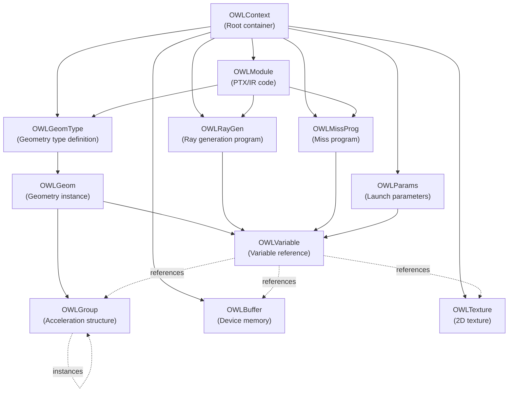
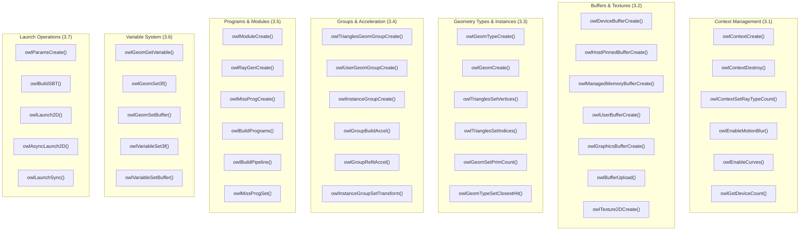
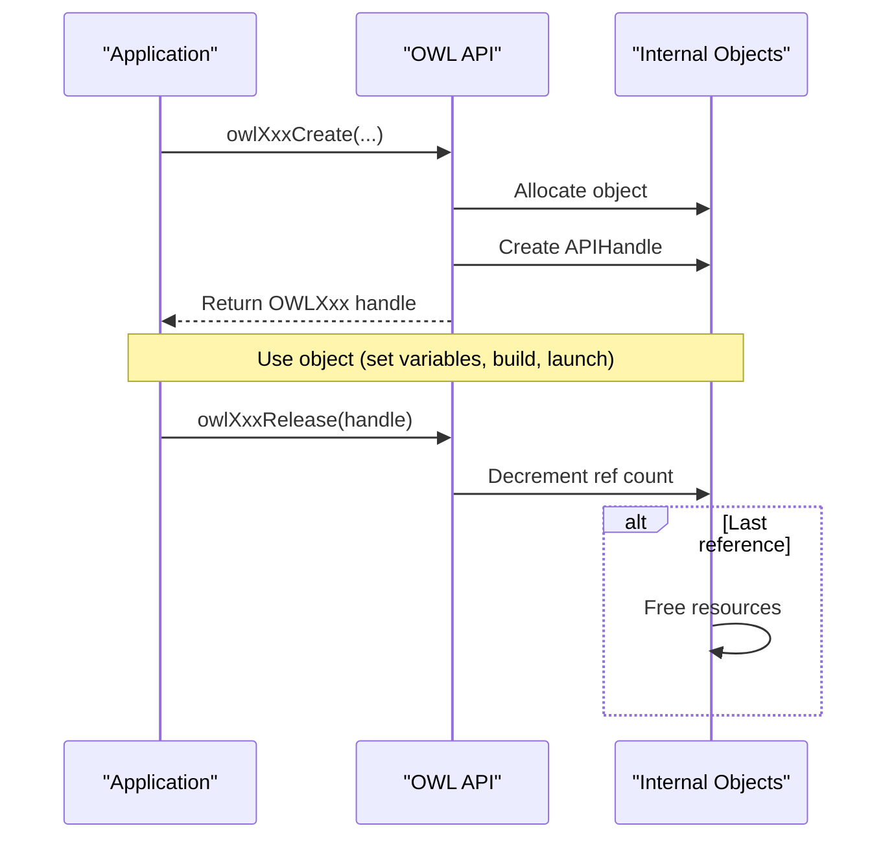
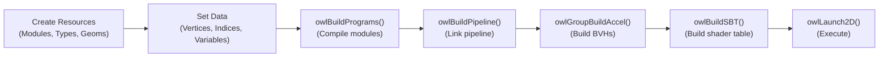
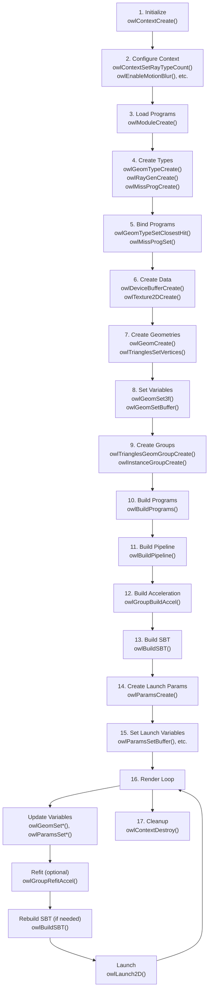

<!-- source: DeepWiki mcp.deepwiki.com · repo NVIDIA/OWL · page 3 Host API Reference · fetched 2026-10-26 -->

# Host API Reference

<details>
<summary>Relevant source files</summary>

The following files were used as context for generating this wiki page:

- [include/owl/owl_host.h](include/owl/owl_host.h)
- [owl/impl.cpp](owl/impl.cpp)

</details>


## Purpose and Scope

The OWL Host API is the CPU-side C/C++ interface exposed in [include/owl/owl_host.h](). It provides functions for creating and managing ray tracing resources, configuring acceleration structures, setting program parameters, and launching ray tracing kernels. All host API functions are prefixed with `owl` and operate on opaque handle types.

This page provides an overview of the Host API architecture, common patterns, and function organization. For detailed documentation of specific subsystems, see:
- Context and device management: [3.1](#3.1)
- Buffer and texture operations: [3.2](#3.2)
- Geometry types and instances: [3.3](#3.3)
- Groups and acceleration structures: [3.4](#3.4)
- Programs and modules: [3.5](#3.5)
- Variable system: [3.6](#3.6)
- Launch operations: [3.7](#3.7)

For GPU-side device functions, see [4](#4).

**Sources:** [include/owl/owl_host.h:1-1809]()

## API Architecture

### Handle-Based Object Model

OWL uses an opaque handle-based API where all resources are represented by typed pointers. Each handle type corresponds to an internal object managed by the library.

**Handle Types and Relationships**



**Sources:** [include/owl/owl_host.h:310-329](), [owl/impl.cpp:54-60]()

### Core Handle Types

| Handle Type | Description | Created By | Manages |
|-------------|-------------|------------|---------|
| `OWLContext` | Root container managing all resources and devices | `owlContextCreate()` | Multi-GPU coordination, global state |
| `OWLModule` | Compiled PTX/IR code module | `owlModuleCreate()` | Device program code |
| `OWLGeomType` | Geometry type with program bindings | `owlGeomTypeCreate()` | Hit/intersection programs, variable layout |
| `OWLGeom` | Geometry instance with data | `owlGeomCreate()` | Vertex/index buffers, per-geometry variables |
| `OWLGroup` | Acceleration structure (BLAS or IAS) | `owlTrianglesGeomGroupCreate()`, `owlInstanceGroupCreate()`, etc. | BVH structures, child geometries/instances |
| `OWLBuffer` | Device memory buffer | `owlDeviceBufferCreate()`, `owlHostPinnedBufferCreate()`, etc. | GPU-accessible memory |
| `OWLTexture` | 2D texture object | `owlTexture2DCreate()` | Sampled texture data |
| `OWLRayGen` | Ray generation program | `owlRayGenCreate()` | Entry point for ray tracing |
| `OWLMissProg` | Miss program for ray type | `owlMissProgCreate()` | Ray miss handling |
| `OWLParams` | Launch parameters (globals) | `owlParamsCreate()` | Global constant memory accessible to all programs |
| `OWLVariable` | Variable reference handle | `owlGeomGetVariable()`, etc. | Deferred variable setting |

**Sources:** [include/owl/owl_host.h:310-329]()

## API Organization by Subsystem

The Host API is organized into functional subsystems, each with a dedicated documentation page.

**Functional Organization**



**Sources:** [include/owl/owl_host.h:1-1809]()

### Subsystem Summary

| Subsystem | Page | Key Responsibilities |
|-----------|------|---------------------|
| **Context Management** | [3.1](#3.1) | Context creation/destruction, device enumeration, global settings (ray types, instancing depth, motion blur) |
| **Buffers & Textures** | [3.2](#3.2) | Memory allocation (device/host-pinned/managed/user/graphics), upload/download, texture creation |
| **Geometry Types & Instances** | [3.3](#3.3) | Geometry type definition with variable layout, geometry instantiation, vertex/index data configuration |
| **Groups & Acceleration** | [3.4](#3.4) | Geometry groups (BLAS), instance groups (IAS), BVH building/refitting, transform management |
| **Programs & Modules** | [3.5](#3.5) | Module creation from PTX/IR, program creation (raygen, miss, hit), pipeline compilation |
| **Variable System** | [3.6](#3.6) | Variable declaration, type-safe setters, buffer/texture/group binding |
| **Launch Operations** | [3.7](#3.7) | Launch parameter setup, SBT building, synchronous/asynchronous launches |

**Sources:** [include/owl/owl_host.h:1-1809]()

## Common API Patterns

### Handle Lifecycle Pattern

All OWL objects follow a create-use-release lifecycle:



**Sources:** [owl/impl.cpp:1050-1092]()

### Variable Declaration and Setting

Variables are declared with `OWLVarDecl` arrays and set using type-specific functions:

**Variable Declaration Pattern**
```c
// Define variable layout
OWLVarDecl geomVars[] = {
  { "color",    OWL_FLOAT3, offsetof(MyGeomData, color) },
  { "vertices", OWL_BUFFER, offsetof(MyGeomData, vertices) },
  { /* sentinel */ }
};

// Create type with variable layout
OWLGeomType type = owlGeomTypeCreate(context, OWL_GEOM_TRIANGLES,
                                     sizeof(MyGeomData), geomVars, -1);
```

**Variable Setting Pattern (Two Approaches)**

1. **Direct setting by name:**
```c
owlGeomSet3f(geom, "color", 1.0f, 0.0f, 0.0f);
owlGeomSetBuffer(geom, "vertices", vertexBuffer);
```

2. **Via variable handle (for repeated updates):**
```c
OWLVariable colorVar = owlGeomGetVariable(geom, "color");
owlVariableSet3f(colorVar, 1.0f, 0.0f, 0.0f);
owlVariableRelease(colorVar);
```

**Sources:** [include/owl/owl_host.h:258-267](), [include/owl/owl_host.h:1080-1097](), [include/owl/owl_host.h:1151-1157](), [owl/impl.cpp:329-383]()

### Build Phase Workflow

OWL uses explicit build phases to compile and link ray tracing resources:



**Sources:** [include/owl/owl_host.h:331-334](), [owl/impl.cpp:193-212]()

### Multi-Device Handling

`OWLContext` can manage multiple GPUs. Device-specific operations accept a `deviceID` parameter:

```c
// Create context with specific devices
int devices[] = {0, 2};  // Use GPUs 0 and 2
OWLContext ctx = owlContextCreate(devices, 2);

// Get device-specific pointer
const void* ptr = owlBufferGetPointer(buffer, 0);  // Device 0

// Get device stream
cudaStream_t stream = owlContextGetStream(ctx, 1);  // Device 1
```

**Sources:** [include/owl/owl_host.h:340-360](), [owl/impl.cpp:44-52](), [owl/impl.cpp:71-84]()

## Function Naming Conventions

The Host API follows consistent naming patterns for predictability:

| Pattern | Purpose | Examples |
|---------|---------|----------|
| `owlContextXxx()` | Context/global operations | `owlContextCreate()`, `owlContextSetRayTypeCount()` |
| `owlXxxCreate()` | Object creation | `owlModuleCreate()`, `owlBufferCreate()`, `owlGeomCreate()` |
| `owlXxxDestroy()` | Immediate destruction | `owlBufferDestroy()`, `owlTexture2DDestroy()` |
| `owlXxxRelease()` | Reference-counted release | `owlBufferRelease()`, `owlModuleRelease()` |
| `owlXxxSetY()` | Type-specific setter | `owlGeomSet3f()`, `owlRayGenSetBuffer()` |
| `owlXxxGetVariable()` | Get variable handle | `owlGeomGetVariable()`, `owlParamsGetVariable()` |
| `owlVariableSetY()` | Generic variable setter | `owlVariableSet3f()`, `owlVariableSetBuffer()` |
| `owlBuildXxx()` | Compilation/build operations | `owlBuildPrograms()`, `owlBuildPipeline()`, `owlBuildSBT()` |
| `owlGroupXxx()` | Group/acceleration structure ops | `owlGroupBuildAccel()`, `owlGroupRefitAccel()` |
| `owlInstanceGroupXxx()` | Instance-specific operations | `owlInstanceGroupSetTransform()`, `owlInstanceGroupSetChild()` |
| `owlTrianglesXxx()` | Triangle mesh operations | `owlTrianglesSetVertices()`, `owlTrianglesSetIndices()` |
| `owlLaunchXxx()` / `owlAsyncLaunchXxx()` | Launch operations | `owlLaunch2D()`, `owlAsyncLaunch3D()`, `owlLaunchSync()` |

**Sources:** [include/owl/owl_host.h:1-1809]()

## Data Type System

### OWLDataType Enumeration

The `OWLDataType` enum defines all supported data types for variables and buffers:

| Category | Types | Description |
|----------|-------|-------------|
| **Scalar Types** | `OWL_FLOAT`, `OWL_INT`, `OWL_UINT`, `OWL_LONG`, `OWL_ULONG`, `OWL_DOUBLE`, `OWL_CHAR`, `OWL_UCHAR`, `OWL_SHORT`, `OWL_USHORT`, `OWL_BOOL` | Basic numeric types |
| **Vector Types** | `OWL_FLOAT2/3/4`, `OWL_INT2/3/4`, `OWL_UINT2/3/4`, etc. | 2D/3D/4D vectors |
| **Matrix Types** | `OWL_AFFINE3F` | 4x3 affine transformation matrix |
| **Object Types** | `OWL_BUFFER`, `OWL_GROUP`, `OWL_TEXTURE` | References to OWL objects |
| **Derived Types** | `OWL_BUFFER_SIZE`, `OWL_BUFFER_ID`, `OWL_BUFFER_POINTER` | Buffer metadata access |
| **Special Types** | `OWL_DEVICE`, `OWL_RAW_POINTER` | Device index, raw device pointers |
| **User Types** | `OWL_USER_TYPE(T)` | Custom struct types via macro |

**Sources:** [include/owl/owl_host.h:85-206]()

### Variable Setter Coverage

For each scalar type, OWL provides comprehensive setter variants:

```c
// Pattern: owlXxxSet[1234][type][v]()
// Examples for float:
owlGeomSet1f(geom, "scalar", 1.0f);
owlGeomSet2f(geom, "vec2", 1.0f, 2.0f);
owlGeomSet3f(geom, "vec3", 1.0f, 2.0f, 3.0f);
owlGeomSet4f(geom, "vec4", 1.0f, 2.0f, 3.0f, 4.0f);
owlGeomSet3fv(geom, "vec3", floatArray);  // Array variant
```

This pattern applies to: `RayGen`, `MissProg`, `Geom`, `Params` objects and all numeric types (`f`, `i`, `ui`, `l`, `ul`, `d`, `c`, `uc`, `s`, `us`, `b`).

**Sources:** [include/owl/owl_host.h:1151-1652](), [owl/impl.cpp:1372-1590]()

## Typical Usage Workflow

A complete OWL application follows this sequence:



**Key Phases:**

1. **Initialization (Steps 1-2):** Create context and configure global settings
2. **Resource Creation (Steps 3-9):** Load programs, create types, data, geometries, and groups
3. **Compilation (Steps 10-11):** Compile modules and link pipeline
4. **Acceleration Structure Building (Step 12):** Build BVHs for ray tracing
5. **SBT Building (Step 13):** Generate shader binding table
6. **Launch Setup (Steps 14-15):** Create and configure launch parameters
7. **Render Loop (Step 16):** Update state, launch kernels, repeat
8. **Cleanup (Step 17):** Destroy context and free all resources

**Sources:** [include/owl/owl_host.h:1-1809](), [owl/impl.cpp:1-1918]()

## API Compatibility and Platform Support

### C/C++ API Exposure

The API is declared with `extern "C"` linkage for C compatibility, with C++-only convenience overloads:

```c
#ifdef __cplusplus
#  define OWL_API extern "C" OWL_INTERFACE
#else
#  define OWL_API /* bla */ OWL_INTERFACE
#endif
```

C++-specific features (enabled with `__cplusplus`):
- Bool type setters (`owlVariableSet1b()`, etc.)
- Struct overloads for vector types (e.g., `owlParamsSet3f(params, "vec", owl3f{x,y,z})`)
- `owl4x3f` matrix convenience wrappers

**Sources:** [include/owl/owl_host.h:44-55](), [include/owl/owl_host.h:1104-1112](), [include/owl/owl_host.h:1696-1808]()

### Optional Features

Some features require OptiX version checks and explicit enabling:

| Feature | OptiX Version | Enable Function |
|---------|---------------|-----------------|
| Curves geometry | 7.4+ (`OWL_CAN_DO_CURVES`) | `owlEnableCurves()` |
| Sphere geometry | 7.5+ (`OWL_CAN_DO_SPHERES`) | `owlEnableSpheres()` |
| Motion blur | Any | `owlEnableMotionBlur()` |

**Sources:** [include/owl/owl_host.h:20-28](), [include/owl/owl_host.h:362-381]()

### Build Flags and Options

Several build-time flags affect API behavior:

- `OWL_INTERFACE`: Platform-specific DLL export/import macros (Windows/Linux)
- `owl_static_STATIC`: Disables DLL decorations for static linking
- Default calling convention: C linkage (`extern "C"`)

**Sources:** [include/owl/owl_host.h:30-54]()

## Error Handling

OWL uses assertions and exceptions for error reporting. Invalid parameters or state typically trigger:
- Fatal errors via `OWL_RAISE()` macro (throws/terminates)
- Assertions for null checks and preconditions
- Logged warnings/errors when `Context::logging()` is enabled

Example error patterns:
```c
// Null handle check
if (!_rayGen) OWL_RAISE("invalid null rayGen program handle");

// State validation
assert("geometry multiplier must be disabled" && context->perGeometrySBTRecordsDisabled);
```

**Sources:** [owl/impl.cpp:251-260](), [owl/impl.cpp:1749-1750]()

## Performance Considerations

### Asynchronous Operations

Launch operations have both synchronous and asynchronous variants:

| Synchronous | Asynchronous | Notes |
|-------------|--------------|-------|
| `owlLaunch2D()` | `owlAsyncLaunch2D()` + `owlLaunchSync()` | Async enables pipelining |
| Waits for completion | Returns immediately | Use `owlLaunchSync()` to wait |
| Simpler API | Requires explicit sync | Better for multi-frame overlap |

Each `OWLParams` maintains a dedicated CUDA stream for asynchronous execution.

**Sources:** [include/owl/owl_host.h:856-903](), [owl/impl.cpp:214-297]()

### Acceleration Structure Building

- **Initial build:** `owlGroupBuildAccel()` constructs BVH from scratch
- **Refit:** `owlGroupRefitAccel()` updates BVH for modified geometry (faster but lower quality)
- **Build flags:** Pass `OptixBuildFlags` to control compaction, fast trace vs. fast build trade-offs

**Sources:** [include/owl/owl_host.h:671-672](), [owl/impl.cpp:1155-1226]()

### Variable Updates

- Direct setters (`owlGeomSet3f()`) are one-liners but look up variable by name each call
- Variable handles (`owlGeomGetVariable()` + `owlVariableSet3f()`) amortize lookup cost for repeated updates
- SBT must be rebuilt (`owlBuildSBT()`) after variable changes affecting shader records

**Sources:** [include/owl/owl_host.h:1080-1097](), [owl/impl.cpp:329-383]()

---

For detailed documentation of each subsystem, navigate to the respective child pages linked at the top of this document.

---

